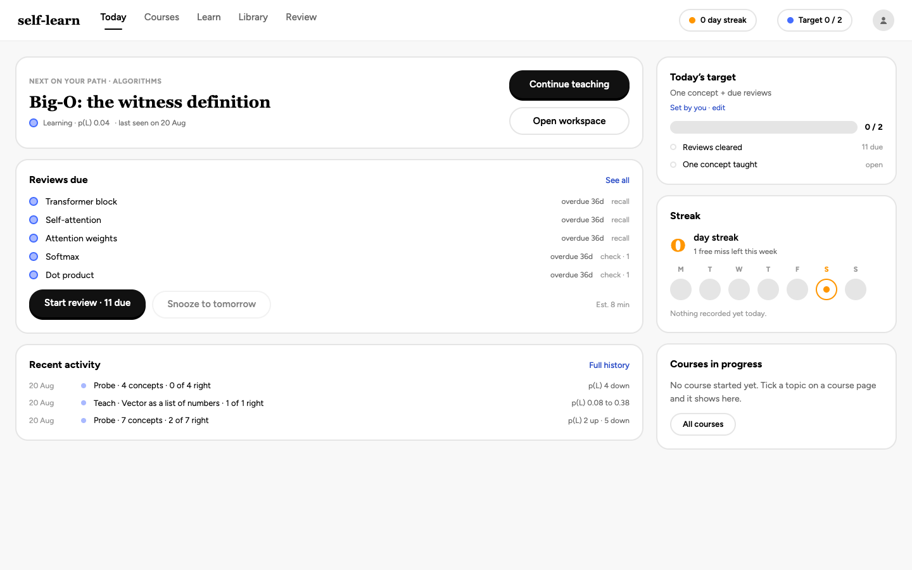
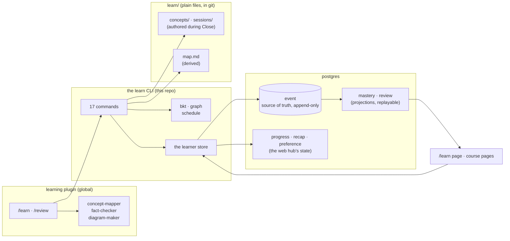

<p align="center">
  
</p>

<h1 align="center">
Self-Learn
</h1>

<p align="center">
  <strong>A study hub for the NUS SoC shortlist, a tutoring loop in Claude Code, and a video renderer.</strong>
</p>

<p align="center">
  <a href="https://github.com/c-wenlong/self-learn/actions/workflows/ci.yml"></a>
  <a href="https://app.codecov.io/gh/c-wenlong/self-learn"></a>
  <a href="LICENSE"></a>
  <a href="https://www.typescriptlang.org/"></a>
  <a href="https://nextjs.org/"></a>
</p>

<p align="center">
  <a href="#why-this-exists">Why</a> ·
  <a href="#whats-inside">What's inside</a> ·
  <a href="#install">Install</a> ·
  <a href="#the-learning-pipeline">Pipeline</a> ·
  <a href="#how-it-works">How it works</a> ·
  <a href="#development">Development</a> ·
  <a href="#contributing">Contributing</a>
</p>

---

**Self-Learn** is a personal study workspace built around the NUS School of Computing AY2026/27 course shortlist. A Next.js hub renders each course as a docs-style roadmap: topic checklists, notes, curated resources, and short Socratic tutoring sessions whose conclusions are saved back against the topic.

Behind the hub sits a file-backed tutoring loop that runs inside Claude Code. It measures what you already know, plans a path from there to a goal, teaches one reasoning step at a time, and schedules what you will forget. Everything it learns about you lands in `learn/` as plain Markdown and JSON you can read, diff, and revert.

A third part, the `tools/manimkc/` submodule, renders narrated animations for concepts that text and SVG cannot carry.

```
/learn <anything>     in Claude Code: probe, plan, teach, close
/review               spaced repetition over what is due
```

<p align="center">
  <br>
  <em>The course catalog, live at <a href="https://self-learn-one.vercel.app">self-learn-one.vercel.app</a>.</em>
</p>

## Why this exists

Knowing what is worth learning and actually learning it are two different problems, and most tools solve only one. The roadmap answers the first: a shortlist of courses broken into topics you can tick off. The pipeline answers the second, by keeping a real model of what you hold rather than a list of what you have read. Asset generation is the third piece, for the ideas that only make sense in motion, so the loop can end in a video rather than a paragraph.

## What's inside

| Part | Where | What it does |
| --- | --- | --- |
| Roadmap | `apps/web/` | Next.js hub over the AY2026/27 shortlist: progress, notes, resources, tutoring sessions, topic recaps |
| Learning pipeline | `scripts/learn/`, `learn/` | Probe → Plan → Teach → Close loop with a file-backed knowledge base |
| Asset generation | `tools/manimkc/` (submodule) | Narrated manim animations for concepts with moving parts |
| Diagrams | [`tools/tldrawkc/`](tools/tldrawkc/README.md) (submodule) | Teaching diagrams drawn on a real tldraw canvas, exported as self-contained SVG with the editable `.tldr` committed beside it |
| Catalog | `packages/schema/`, `services/catalog/` | Postgres index over the three content trees, and the `catalog` CLI agents read |

Ten courses are covered (CS2111, CS4263, CP4281 through CP4285, CS3216, CS3227, CS3249). Three have inferred syllabi and say so in a banner until official NUSMods data lands. Learner state — ticks, notes, recaps, preferences — lives in Postgres alongside the catalog; there are still no accounts, just one learner row. A browser that used the old `localStorage` document imports it once, automatically, on first load.

| Surface | Purpose |
| --- | --- |
| `/` | Course catalog and overall progress |
| `/learn` | Knowledge base: mastery per concept, the frontier, the dependency graph |
| `/courses/[slug]` | Course overview, modules, capstone, related courses |
| `/courses/[slug]/[module]` | Topic checklist, notes, recaps, curated and user resources |
| `/courses/[slug]/[module]/session?topic=…` | Socratic micro-session for one topic |
| `POST /api/agent/chat`, `POST /api/agent/summarize` | Server proxy to the free provider cascade (system prompt injected server-side), and transcript to structured topic recap |

```
apps/web/         The Next.js app: src/app · src/components · src/data · src/lib · public/
packages/content/ One reader for content/, shared by the app and the indexers
packages/schema/  Drizzle tables: the single source of the catalog's row shapes
services/catalog/ Migrations, the database connection and the catalog CLI
scripts/learn/    Pipeline CLI: bkt · graph · schedule · markdown · store · render
content/          Authored data: topics.yaml, the shared vocabulary, and courses/
learn/            The knowledge base itself (see learn/README.md)
tools/manimkc/    Submodule: narrated manim videos
tools/tldrawkc/   Submodule: tldraw diagrams
.claude/          launch.json, plus the two skills symlinked from the submodules
```

Three of those are npm workspaces (`apps/*`, `packages/*`, `services/*`), so
one `npm ci` at the root installs the lot and `npm run lint`, `typecheck` and
`test` cover all of them from there. `tools/` is not a workspace: both
submodules carry their own lockfiles and toolchains.

The catalog is the join the three trees never had: one `topic` vocabulary every
asset points at, typed link tables with foreign keys at both ends, and an
append-only `event` log the learner state is replayed from. `npm run catalog --
index` fills it from `content/`, `learn/` and `manimkc topics --json`, and
agents read it back in layers with `ls`, `show`, `path` and `search`, every one
of them `--json` and bounded. The design is in
[services/catalog/SCHEMA.md](services/catalog/SCHEMA.md), the content it indexes
in [content/README.md](content/README.md).

`.claude/` holds no learning skills. `/learn`, `/review` and the three subagents live in the globally installed `learning` plugin, so they work in every project; see [AGENTS.md](AGENTS.md) for why copying them back here would be a mistake.

`tools/manimkc/` is its own repo with its own venvs and build system. It currently holds 28 topics across 15 domains, filed as `topics/<domain>/<topic>/` and mirrored into `out/`. Narration syncs TTS to the animation through a `voiceover()` context manager with six backends (`local`, `soprano`, `kokoro`, `chatterbox`, `elevenlabs`, `sarvam`), defaulting to the offline `local` voice, with clip caching so re-renders cost no API quota. Agents drive it through `tools/manimkc/tools/cli/manimkc` and the `manimkc-video` skill; read [`tools/manimkc/AGENTS.md`](tools/manimkc/AGENTS.md) before working in there.

## Install

```bash
git clone --recursive https://github.com/c-wenlong/self-learn   # two submodules under tools/
cd self-learn
npm ci
cp .env.example .env.local    # optional: provider keys for live tutoring chat
npm run dev
```

Open [http://localhost:3000](http://localhost:3000). Node 22 or newer is required. Already cloned without `--recursive`? Run `git submodule update --init --recursive` to fetch `tools/manimkc/` and the manim clone nested inside it. Pulling a clone that predates the move needs `git submodule sync --recursive` first, because both submodules changed path.

The diagram tool in `tools/tldrawkc/` needs one extra step, because `npm run canvas` runs a compiled CLI that is not committed:

```bash
git submodule update --init tools/tldrawkc
(cd tools/tldrawkc && npm ci && npm run build)
npm run canvas -- doctor       # says which Chromium it found
```

Skip it if you are not drawing diagrams; nothing else in the repo depends on it.

## The learning pipeline

Four phases, driven by a dependency-free Node CLI. **Probe** ranks concepts by expected information gain, so it binary-searches the edge of your understanding instead of marching through a syllabus; being asked does not count as being taught. **Plan** returns a topologically ordered path from what you hold to the goal, with mastered prerequisites dropped and claims fact-checked before anything is taught. **Teach** hands back one concept at a time at the frontier, with a check after each step. **Close** writes the concept notes, stores the checks, logs the session, and schedules the reviews.

Mastery uses Bayesian Knowledge Tracing; review scheduling uses SM-2. Both are written from scratch in under 200 lines each with no dependencies. The `event` table is the source of truth, an append-only record of every answer with its before and after belief — append-only enforced by a trigger, not by convention — so the mastery model and the schedule are both projections that can be thrown away and replayed, and the model parameters are safe to change. Concept notes, session logs and the map stay plain files in git.

```bash
npm run learn -- status      # where you are
npm run learn -- doctor      # validate the concept graph
npm run learn -- help        # the full primitive surface
```

The `/learn` and `/review` skills are not in this repo. They live in the globally installed `learning` plugin, and both open by running `npm run learn -- status` so they refuse to improvise a session that records nothing. Full architecture, formulas, and an honest list of what these models get wrong: **[learn/README.md](learn/README.md)**.

## Drawing diagrams

`tools/tldrawkc/` draws teaching diagrams on a real tldraw canvas: a snippet places boxes and arrows, the agent looks at a screenshot and fixes what reads wrong, then exports a self-contained SVG. Both the editable `.tldr` and the exported `.svg` are committed to `learn/assets/`; the PNGs used to look at a diagram mid-edit are scratch and never are.

| Entry point | How | When |
| --- | --- | --- |
| `/learn`'s Teach phase | Spawns the `diagram-maker` subagent, which drives the tool and falls back to a hand-written SVG if `doctor` fails | Automatic, nothing to type |
| The `tldrawkc-diagram` skill | Symlinked into `.claude/skills/` | You ask an agent to draw a diagram or lift a mermaid flowchart onto the canvas |
| The CLI | `npm run --silent canvas -- <verb>` | You, or any script |
| The library | A relative import, e.g. `import { run } from "../tools/tldrawkc/dist/lib/index.js"` from `scripts/`. `tools/` is not an npm workspace, so there is no bare `"tldrawkc"` specifier | Node code that wants the verbs without a shell |
| `serve` | A real browser tab, open until Ctrl+C | A human watching and nudging shapes by hand |

The deployed web app is not an entry point. It reads `learn/` and renders the exported SVGs; it never runs the tool, because a Vercel build has no local Chromium and no business writing local files.

A CLI session, start to finish (needs the submodule built first, see [Install](#install)):

```bash
npm run --silent canvas -- doctor
npm run --silent canvas -- run learn/assets/probe-and-frontier.tldr --create \
  --shot /tmp/probe-and-frontier.png --code - <<'JS'
helpers.box('probe', 'probe', { x: 60, y: 60, w: 160, h: 64 })
helpers.box('teach', 'teach', { after: 'probe', gap: 120, w: 160, h: 64 })
helpers.connect('probe', 'teach', { label: 'frontier' })
return helpers.describe().lints
JS
# look: the "frontier" label wraps, gap is too small. fix with a second snippet:
npm run --silent canvas -- run learn/assets/probe-and-frontier.tldr \
  --shot /tmp/probe-and-frontier.png --code - <<'JS'
helpers.box('teach', 'teach', { after: 'probe', gap: 160, w: 160, h: 64 })
return helpers.describe().lints
JS
# look again: fixed. file it and export:
npm run --silent canvas -- meta set learn/assets/probe-and-frontier.tldr \
  --topic vector-and-linear-algebra-basics
npm run --silent canvas -- export learn/assets/probe-and-frontier.tldr \
  --svg learn/assets/probe-and-frontier.svg
npm run --silent canvas -- list
```

| Verb | What |
| --- | --- |
| `doctor` | check node, the page bundle, Chromium and the page |
| `api` | what a snippet can call, from the helpers' own JSDoc |
| `new` | create an empty document, refuses to overwrite |
| `run` | load, run a snippet, save, export |
| `shot` | screenshot without running anything |
| `inspect` | print every shape, binding, lint and the metadata. Exits 3 on lints |
| `export` | write the files that get committed |
| `from-mermaid` | build a document from a mermaid flowchart |
| `list` | every .tldr in a directory (default `learn/assets`), no browser |
| `meta set` | stamp metadata on an existing document, no browser |
| `serve` | mirror the document in a real browser tab until Ctrl+C |

Three things that bite:

- `npm run canvas` without `--silent` prints npm's own banner ahead of the tool's stdout, which breaks `--json` parsing. Same for `npm run learn`.
- Exit 3 means the file saved but lints remain: read them and run again, or pass `--allow-lints`. Exit 2 means the snippet threw and nothing was written.
- A new `.tldr` needs `meta set --topic <slug>` (or `new --topic <slug>`) with a slug from `content/topics.yaml` before `catalog index` will take it.

## How it works



## Configuration

| Path | Purpose | Shipped? |
| --- | --- | --- |
| `learn/concepts/<domain>/<id>.md` | Atomic concept notes, Obsidian-compatible and wikilinked | tracked |
| `learn/sessions/*.md`, `learn/assets/*.svg` and `*.tldr` | One log per session, written live; diagrams drawn with `npm run canvas` while teaching, the `.tldr` source committed beside each SVG | tracked |
| `learn/map.md` | The mermaid knowledge map, regenerated by `learn map` | tracked |
| `event`, `mastery`, `review` (Postgres) | The trajectory and its projections. `event` is the only copy | not in git |
| `progress`, `recap`, `preference` (Postgres) | The web hub's ticks, notes and recaps. Also the only copy | not in git |
| `.env.local` | Provider keys and `DATABASE_URL` | gitignored |
| `tools/manimkc/out/`, `tools/manimkc/cache/` | Rendered videos and the TTS cache | gitignored |

Tutoring chat tries three free providers in order and falls through on errors and rate limits. Every variable is optional: with no keys the site still works, and Launch Agent falls back to **Copy system prompt** and **Copy terminal launch pack**.

| Variable | Default | Purpose |
| --- | --- | --- |
| `NEXT_PUBLIC_SITE_URL` | Vercel domain in production, `http://localhost:3000` locally | Canonical origin that social preview images resolve against |
| `NVIDIA_API_KEY` | unset | Provider 1, NVIDIA NIM |
| `GEMINI_API_KEY` | unset | Provider 2, Google AI Studio free tier |
| `OPENROUTER_API_KEY` | unset | Provider 3, OpenRouter free models |
| `NVIDIA_MODEL` · `GEMINI_MODEL` · `OPENROUTER_MODEL` | `meta/llama-3.1-8b-instruct` · `gemini-2.5-flash` · `openrouter/free` | Model override per provider |
| `OPENROUTER_HTTP_REFERER`, `OPENROUTER_APP_TITLE` | unset | Attribution headers sent to OpenRouter |

Keys are read server-side only (`apps/web/src/lib/agent/providers.ts`); the browser never sees them. Production also needs them set in the Vercel project's environment variables. Deployment details are in [docs/DEPLOYMENT.md](docs/DEPLOYMENT.md), and editing the curriculum is covered in [docs/CURRICULUM.md](docs/CURRICULUM.md).

## Development

| Command | Description |
| --- | --- |
| `npm run dev` | Dev server |
| `npm run build` | Production build |
| `npm run start` | Serve a production build |
| `npm run lint` / `npm run typecheck` | ESLint / `tsc --noEmit` |
| `npm run test` | Vitest, single run |
| `npm run test:watch` | Vitest watch mode |
| `npm run test:coverage` | Vitest with v8 coverage, lcov for Codecov |
| `npm run learn -- <cmd>` | The learning pipeline CLI |
| `npm run canvas -- <cmd>` | The `tools/tldrawkc/` diagram CLI. Needs `npm ci && npm run build` inside the submodule first |
| `npm run catalog -- <cmd>` | The catalog CLI: `migrate`, `index`, `status`, `ls`, `show`, `path`, `search`. Needs `createdb self_learn` against a local Postgres 17 |

Thirteen Vitest files cover the three halves. On the web side: curriculum integrity, progress counting, learner-state reducers, topic recaps and the v1 to v2 migration, the recap summariser, and agent prompt/provider/objective selection. On the pipeline side: BKT update formulas and information-gain ordering, DAG cycle detection and frontier advance, the SM-2 interval ladder and leech handling, frontmatter and wikilink parsing, and `scripts/learn/cli.test.mjs` over the command surface itself. On the catalog side: migrations applying from empty and staying idempotent, and the constraints that make the database worth having — an unknown foreign key, a prerequisite kind outside `requires|assumes`, a `collection_item` with zero or two targets, and an `UPDATE` on `event`. Those need a reachable Postgres and skip themselves with a named reason without one, so `npm test` stays green on a machine that has none; CI runs a `postgres:17` service so they are a real gate there.

`.github/workflows/ci.yml` runs `lint` → `typecheck` → `test:coverage` → `build` on every push and pull request, against a `postgres:17` service container, then uploads the lcov report to Codecov. Production deploys go through Vercel's Git integration on every push to the default branch; there is no deploy workflow to maintain. See [docs/DEPLOYMENT.md](docs/DEPLOYMENT.md).

## Contributing

Start with [CONTRIBUTING.md](CONTRIBUTING.md) for the branch, test and PR conventions, and [ARCHITECTURE.md](ARCHITECTURE.md) for how the code is shaped. Found a security problem? [SECURITY.md](SECURITY.md) says how to report it. [AGENTS.md](AGENTS.md) is the source of truth for coding agents working here, including a gotchas log of traps not worth rediscovering; `CLAUDE.md` just imports it.

## License

MIT. See [LICENSE](LICENSE).
