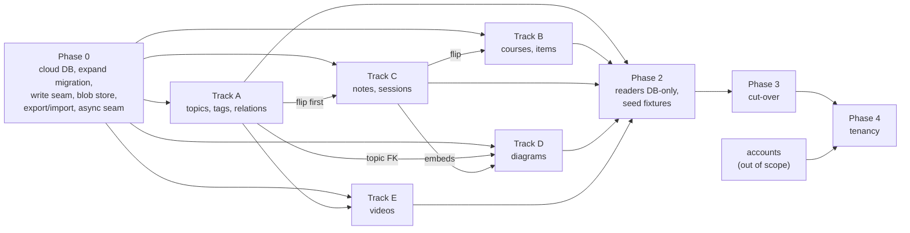

# Moving authored content into the database

**Status: built through phase 1, and phase 2 in part, 2026-09-28.** Phase 0
merged as PRs #126 to #129, and the fixes a read-only review of it asked for
as #130 and #131. Phase 1's five tracks merged as PRs #132 to #145, and a
read-only review of them asked for the fixes listed under
[Phase 1 review fixes](#phase-1-review-fixes). Phase 2's vault, catalog and
tests slices merged as #150, #151 and #154, and the contract migration and
flip day's safeguards as #153; the web and studio slice (#152) waits for flip
day on the owner's database. Each step below says what was
built under **Built**, and a box is ticked only for what exists. No type is
flipped on the owner's database yet: every flip so far ran on a scratch copy. Approved 2026-09-27, when
the owner answered the open questions (see
[Decided by the owner](#decided-by-the-owner)): everything stays local for
now, so the cloud database and the cloud blob adapter are deferred to a
go-live step and phase 0 started at 0.2. The owner's `self_learn` database is
still at `0009` and unflipped: flip day (`node scripts/flip-rehearsal.mjs
--real`, below) backs it up, migrates it and flips it.
Numbers
marked *measured* were taken on the owner's laptop on 2026-09-27 against the
working tree, `~/.self-learn/manimkc/out` and the local `self_learn` database;
every other number is marked *guessed* and says what would settle it. File
and line references are against `origin/main` at `5a78e61`.

**What changes.** Postgres becomes the source of truth for every piece of
authored content: the topic vocabulary, tags, courses and their curriculum
items, concept notes, session logs and diagrams. Binaries (videos, their
posters, diagram SVGs) move into an object store behind one `BlobStore`
interface, and Postgres holds a row per object with its key, size, hash and
type. The files under `content/` and `learn/` stop being what the app reads and
become an export format: `catalog export` writes the same YAML and markdown
shapes back out, and `catalog import` (today's indexers, renamed) reads them in.
Every content write carries an author and a reason and leaves a row in an
append-only revision table, which is how the database gives back the history
git used to give for free.

**What does not change.** The learner-state tables (`learner`, `event`,
`mastery`, `review`, `progress`, `recap`, `preference`) keep their shapes; they
already live in Postgres, and the only change for them is which database they
sit in. The `learn` CLI keeps its verb names and the five pinned
`--json` shapes in [learn/README.md](../learn/README.md#the-json-shapes), so the
external `learning` plugin keeps parsing what it parses today. The render tools
stay local processes: manimkc renders on a laptop or the homeserver, tldrawkc
draws in a local headless Chromium, and a Vercel function never renders
anything. A person still approves every write.

## Why now

The owner intends this to become a multi-tenant cloud service. A cloud service
cannot keep its content in the working tree of one laptop, and a second tenant
cannot commit to the owner's git repository. The content half of the catalog
was designed as a derived index over files
([SCHEMA.md "The two halves"](../services/catalog/SCHEMA.md#the-two-halves)),
and that design has no place for content that a person creates through the app.

The studio is the first place this bites. The chat-first redesign merged today
as PR #120 ([STUDIO-CHAT-FIRST.md](STUDIO-CHAT-FIRST.md)) has a planner that
proposes a new topic when nothing in the vocabulary fits. Under the files rule,
its D39 can only print a YAML block for the person to paste into
`content/topics.yaml`, then wait for a manual `catalog index` before Draw goes
live (open question 3 there). The owner has decided a proposed topic must be
creatable through the app, with typed edges to related topics, and that topic
writes go through one catalog command so the cloud version can swap storage
without rewriting callers.

The same gap exists for every other type. A diagram accepted in the studio is a
working-tree change the person must commit (D6 of
[TLDRAWKC-INTEGRATION.md](TLDRAWKC-INTEGRATION.md#d6-the-person-commits-and-the-runner-has-no-mutating-git-access));
the checkout this plan was written in holds one such diagram right now,
`learn/assets/tailscale-vpn-communication.{tldr,svg}`, accepted by studio job
`1395e739` and untracked (*measured*: `git status` and the `job` table). A note
the plugin writes in a tutoring session is a file edit. None of these can
happen on a server.

## What git gave us, and how the database gives it back

The owner asked why content was never meant to live in a database. The answer
was that git gave five things for free. Leaving git means paying for each of
them explicitly, and this table is the bill.

| Property | How files in git provide it | How the database provides it after this plan |
| --- | --- | --- |
| Review | A person sees the diff before committing; a content change can ride a PR | Every write goes through a person: a CLI verb the person or their session ran, the studio's Accept, or the Draw press. The write carries `author` and `reason`, and `catalog history` shows it. A web editor with its own review screen is later work |
| Diff | `git diff`, `git log -p` | `content_revision` keeps a full jsonb snapshot per write with `previous_id`; `catalog diff <revision> [<revision>]` renders a field diff for structured rows and a line diff for markdown bodies |
| History | Every commit, with author and message | The same `content_revision` chain per entity, append-only by trigger, the way `event` already is ([SCHEMA.md "Append-only is a trigger"](../services/catalog/SCHEMA.md#append-only-is-a-trigger-not-a-revoked-privilege)) |
| Backup | Every clone is a full copy; GitHub is offsite | Provider point-in-time recovery plus a scheduled `pg_dump` (already required by [DEPLOYMENT.md](DEPLOYMENT.md#the-database)); a nightly `catalog export` committed to a private archive repository; blobs content-addressed and never overwritten |
| Offline reading | The files are on disk | `catalog export --out <dir>` at any time; the studio's last-read cache (D13); the optional vault sync for Obsidian (open question 1) |

The revision table is the cost of leaving git, and it is paid once, in phase 0,
in the one write path every type shares. Nothing else in this plan depends on
content being in git.

## Target state

### Where each type lives

| Type | Today | After | Writer after | Reader after | Owner |
| --- | --- | --- | --- | --- | --- |
| Topic vocabulary | `content/topics.yaml`, 86 topics, 23 domains, 39 KB (*measured*) | `topic` rows; `maps.concepts` becomes `concept.topic_slug` (already a column), `maps.courses` becomes the module's `collection_item` topic row (already written, `services/catalog/src/index/courses.ts:140-146`), `maps.manimkc` becomes a new `manimkc_topic` row per path | `catalog topic add\|edit\|relate\|archive` | the `packages/content` seam | `topic.owner_id` |
| Topic relations | nowhere | `topic_relation(from_slug, to_slug, kind)` | `catalog topic relate` | the seam; the planner's vocabulary block | `topic_relation.owner_id` |
| Tags | `content/tags.yaml`, 8 tags (*measured*); on courses only as strings inside `collection.metadata.tags` (`courses.ts:93-101`) | `tag` rows and a `collection_tag` link table | `catalog tag add\|edit`; course import | the seam | `tag.owner_id` |
| Courses, modules | `content/courses/*.yaml`, 10 files, 61 modules (*measured*) | `collection` rows as today, plus `archived_at` | `catalog course import <file.yaml>`, `catalog course export <id>` | the seam | `collection.owner_id` |
| Curriculum items | the same files, 137 items, 68 resource links, 8 concept links (*measured*) | `curriculum_item` as today, plus `archived_at`; links as today | the same import; `catalog item archive\|restore` | the seam | `curriculum_item.owner_id` |
| Concept notes | `learn/concepts/<domain>/<slug>.md`, 32 notes, 27,197 bytes (*measured*) | `concept` gains `domain`, `body`, `tags`, `sources`, `authored_at`, `archived_at`; `concept_prerequisite` as today | `learn concept add\|edit\|commit`, `learn check add`, `learn session close` | the seam; `readConceptNote` reads `concept.body` | `concept.owner_id` |
| Session logs | `learn/sessions/<id>.md`, 3 files, 17,781 bytes (*measured*) | the existing `session` row (it already has `title` and `goal`) plus `session_log_entry(session_id, seq, markdown)` | `learn session start\|log\|close`, `learn observe --session` | the seam; the export concatenates entries | `session.learner_id`, already there |
| Diagram sources | `learn/assets/<name>.tldr`, 2 tracked plus 1 untracked, 24 to 26 KB each (*measured*) | `diagram.document` jsonb | studio Accept; `learn diagram commit` | `catalog diagram list\|show`; a materialised temp file for tldrawkc | `diagram.owner_id` |
| Diagram SVGs | `learn/assets/<name>.svg`, 214 to 313 KB each (*measured*) | a blob, referenced by `diagram.svg_blob_key` and `asset.blob_key` | the same Accept or commit | `/api/assets/{id}/file`, via the blob store | `blob_object.owner_id` and the key prefix |
| Videos and sidecars | `~/.self-learn/manimkc/out`, outside the repo; 36 indexed videos, 432,692,181 bytes, plus 87 sidecars (*measured*) | blobs; `asset` rows keep their ids and gain `blob_key` | `catalog asset upload --source manimkc` | `/api/assets/{id}/file` redirects to a signed URL | `asset.owner_id`, `blob_object.owner_id`, the key prefix |
| Posters | ffmpeg at request time into a temp cache (`apps/web/src/lib/asset-posters.ts:306-315`) | a blob per video, made at upload, as an `asset` of new kind `poster` derived from the video | the upload command | `/api/assets/{id}/poster` redirects | as videos |
| `learn/map.md` | a generated file (`services/catalog/src/learn/cli.ts:1241`) | nothing stored; `learn map` renders from rows to stdout or `--out` | none | on demand | none |

### The new tables

Every table below is created in phase 0, in one expand migration, so no phase 1
track touches `packages/schema/src/` (D10).

**`content_revision`**, the history of record:

| Column | Type | Meaning |
| --- | --- | --- |
| `id` | bigint identity PK | |
| `owner_id` | text FK `learner(id)`, `RESTRICT` | Whose content this is |
| `entity_type` | text, `CHECK` | `topic`, `tag`, `collection`, `curriculum_item`, `concept`, `diagram`, `asset`. Link rows have no type of their own: they are part of their parent's snapshot, so a change to a link is a revision of the parent. `topic_relation` and `manimkc_topic` belong to the `from` topic, `collection_tag` to the collection, `curriculum_item_topic` and `concept_curriculum_item` to the item, `asset_topic`, `asset_concept` and `asset_derivation` to the asset, `concept_prerequisite` to the concept |
| `entity_id` | text | The entity's primary key, rendered as text |
| `seq` | integer | 1, 2, 3 per entity; `UNIQUE (entity_type, entity_id, seq)` |
| `previous_id` | bigint FK `content_revision(id)`, null | The revision this one replaced; null on create |
| `op` | text, `CHECK` | `create`, `update`, `archive`, `restore`, `rename`, `import`, and `delete` for an entity an import pruned (added in review of phase 0) |
| `snapshot` | jsonb | The whole entity after the write, body included, with its owned links listed under it in a canonical order. For a diagram, the document; the SVG is referenced by blob key. An import that changes only a mapping or a course link therefore changes the parent's `snapshot_hash` and writes a revision |
| `snapshot_hash` | text | sha256 of the canonical snapshot, so an import that changes nothing writes nothing |
| `author_kind` | text, `CHECK` | `person`, `agent`, `import` |
| `author` | text | A learner id, an agent label such as `planner` or `diagram-maker`, or `import:<git sha>` |
| `reason` | text, not null | The commit message's replacement. Empty is refused |
| `job_id`, `session_id` | text FKs, null | Provenance when a studio job or a tutoring session made the write |
| `created_at` | timestamptz | |

It carries the same `BEFORE UPDATE OR DELETE ... FOR EACH ROW` trigger as
`event` (migration `0003_append_only_per_row.sql`), for the same reason: a
revoked privilege does not bind the owner who runs psql. Writers pass the
revision they started from; a write whose base is no longer the latest is
refused rather than merged (edge case 16).

**`blob_object`**, one row per stored object:

| Column | Type | Meaning |
| --- | --- | --- |
| `key` | text PK | `<owner_id>/<sha256>.<ext>`, content-addressed |
| `owner_id` | text FK `learner(id)` | |
| `sha256`, `bytes`, `mime` | text, bigint, text | Checked against the store after upload |
| `provider` | text, `CHECK` | `fs`, `vercel-blob`, `r2` |
| `state` | text, `CHECK` | `pending` until the upload is confirmed, then `present` |
| `created_at`, `confirmed_at` | timestamptz | |

`asset` gains `blob_key` (FK to `blob_object(key)`, `RESTRICT`), and its
location check widens from `num_nonnulls(path, url) = 1`
(`packages/schema/src/content.ts:202`) to "exactly one of `url` or a location,
where a location is `path`, `blob_key` or both". Both are allowed together
because the path survives as a logical name (D11).

**`topic_relation`**, the typed edge the owner asked for: `from_slug` and
`to_slug` (FKs to `topic`, `ON UPDATE CASCADE`, `ON DELETE RESTRICT`), `kind`
checked against `broader` (to is the wider subject), `related` (symmetric) and
`precedes` (learn from before to), and `owner_id`. Primary key
`(from_slug, to_slug, kind)`, a no-self check, and
`kind <> 'related' or from_slug < to_slug` so a symmetric edge is stored once.
Foreign keys at both ends are the schema's standing rule
([SCHEMA.md "Typed link tables"](../services/catalog/SCHEMA.md#typed-link-tables-never-a-generic-edge-table)).

**`tag`** (`id` PK, `label`, `description`, `owner_id`) and **`collection_tag`**
(`collection_id`, `tag_id`, both FKs). Today a course's tags are free strings in
jsonb and validated only at parse time
(`packages/content/src/courses.ts:351-357`); the link table makes a stale tag a
`23503`.

**`manimkc_topic`** (`path` PK, `topic_slug` FK, `owner_id`). It replaces
`maps.manimkc`, and the primary key does the job `vocabulary.claim()` does in
code today (`services/catalog/src/index/vocabulary.ts:41-56`): one path, one
topic. A table, because a manimkc topic can be mapped before its first render;
today 35 paths are mapped and 35 video directories are indexed (*measured*).

**`diagram`**: `slug` PK, `owner_id`, `title`, `topic_slug` FK (not null,
`RESTRICT`, the same rule as `job.topic_slug`), `document` jsonb (the whole
`.tldr`), `document_hash`, `svg_blob_key` FK, `svg_document_hash` (the
`document_hash` the SVG was exported from), `archived_at`, timestamps. The two
hashes replace the modification-time comparison behind the studio's freshness
pill (U9 in TLDRAWKC-INTEGRATION.md): the SVG is stale exactly when they differ.

**`session_log_entry`**: `session_id` FK `session(id)`, `seq`, `markdown`,
`created_at`, primary key `(session_id, seq)`, append-only by trigger (D20).

**`content_source`**: one row per content type, `source` in (`files`, `db`),
`flipped_at`, `parity_report` jsonb. It records which types the database owns,
and writers and importers obey it (D18).

**`catalog_instance`**: a single row naming this database `primary` or `copy`.
Every content and state writer refuses on a copy (edge case 14).

### The `owner_id` rule

Every content entity table gets `owner_id text not null default 'local'
references learner(id) on delete restrict` in the phase 0 migration: `topic`,
`tag`, `topic_relation`, `manimkc_topic`, `collection`, `curriculum_item`,
`concept`, `asset`, `diagram`, `blob_object`, `content_revision`. Link tables
(`asset_topic`, `collection_tag` and the rest) inherit the owner of the entity
at their owning end and carry no column of their own, because a link whose
owner disagrees with its parent is a state the schema should not be able to
express. `job` and `asset_job` gain `owner_id` too, since today only `session`
carries a learner (`packages/schema/src/studio.ts:77-120`).

Primary keys stay as they are: slugs and authored ids remain globally unique
across owners. `owner_id` from day one gives ownership, scoping and per-owner
caps without a second migration; it does not give each tenant its own slug
namespace, and D3 says why that is deferred rather than done now.

Blob keys are prefixed by owner, `<owner_id>/<sha256>.<ext>`, so a tenant's
objects can be listed, counted, capped and deleted by prefix.

### Where a `.tldr` goes

The document goes in a jsonb column on `diagram` and the SVG goes in the blob
store. The document is small JSON whose stamp the catalog already reads; the
SVG is ten times larger and is served as bytes. D6 has the numbers.

### Integrity the database enforces

The owner's second reason for this plan, raised on 2026-09-27: nine of the ten
course files carry no `concepts:` on any curriculum item (*measured*: `grep`
over `content/courses/`), and nothing refused them, because a YAML parser can
only check what one file says about itself and the agents editing those files
were the only thing standing between a course and a hole in it. Under this plan
every rule the parser enforces today becomes a constraint or a write-seam check,
and the completeness rules that were never written down become deferred
constraint triggers. The table is the contract; Track B and the flip command
carry it out.

| Rule | Enforced today by | Enforced after by |
| --- | --- | --- |
| Slugs and ids are kebab-case and unique | `ContentError` at parse (`packages/content/src/topics.ts:60-66`, `courses.ts:136-146`) | Primary keys, and a `CHECK` on the slug pattern |
| Each manimkc path, module and concept sits under exactly one topic | `vocabulary.claim()` (`services/catalog/src/index/vocabulary.ts:41-56`) | `manimkc_topic.path` is a primary key; `concept.topic_slug` is one column; a module's topic is one `collection_item` row |
| A module's topic exists | parse (`courses.ts:257-264`) | foreign key |
| An item's concepts sit under its module's topic | parse (`courses.ts:282-295`) | a constraint trigger on `concept_curriculum_item` comparing `concept.topic_slug` with the item's topic |
| A course's tags exist | parse (`courses.ts:351-357`) | `collection_tag` foreign key |
| Every module has at least one item | parse (`courses.ts:269-274`) | a deferred constraint trigger checked at commit, fired by an insert of a module and by any insert, update or delete of a `curriculum_item`, re-checking every module the statement touched |
| **Every curriculum item names at least one concept** | nothing; nine courses fail it today | a deferred constraint trigger fired by an insert of an item and by any insert, update or delete of a `concept_curriculum_item` row, re-checking every item the statement touched; armed by `catalog flip courses --strict` once `catalog doctor` reports zero violations, and required before cut-over (phase 3) |
| Every concept is filed under a topic | `concept.topic_slug` nullable; the indexer refuses at run time | `NOT NULL`, the one-line migration SCHEMA.md already names as pending. It is Track C's contract migration, not phase 0's expand: `ON DELETE SET NULL` on that column (`packages/schema/src/content.ts:100`) means a pruned topic can have left a null, so `catalog doctor` must report zero null rows first, and the migration itself raises if it finds one rather than failing on the constraint |
| Every diagram has a topic | the indexer refuses an unstamped `.tldr` | `diagram.topic_slug NOT NULL`, from the table's creation; Track D's import refuses an untopiced `.tldr` by name as the indexer does today |
| An asset has exactly one location | the `asset` location `CHECK` | the same check, widened for `blob_key` |
| A relation points at two real topics and never at itself | nowhere; relations do not exist | foreign keys at both ends and the no-self check |
| Ids are permanent | convention in `content/README.md` | `ON UPDATE CASCADE` everywhere, one `rename` verb, and a `rename` revision |

A `CHECK` sees one row, so "at least one child" cannot be a `CHECK`. It is a
`CONSTRAINT TRIGGER ... DEFERRABLE INITIALLY DEFERRED` that runs once at
commit, and it is attached to both sides: to the parent, so a new module or
item is checked, and to the child table, so deleting a module's last item or
an item's last concept link re-checks that parent (a trigger on the parent
alone would never see a child row leave). The write seam imports a whole
course in one transaction, so the moment between inserting a module and
inserting its items is never visible to the rule. `catalog doctor` runs the same predicates as plain queries
and lists every violator by id, which is how the distance to `--strict` is
measured; `catalog flip <type> --strict` refuses while doctor reports any.
Filling the nine courses is content work, not migration work, and it happens
whenever the owner or a session chooses; the trigger is armed the day the count
reaches zero and refuses the tenth hole forever after.

## Principles

- **Expand, migrate, contract.** Every change adds the new path beside the old
  one, proves parity by counts and content hashes, flips, and only then removes
  the old path. A type is read from one truth at a time; the flip for a type is
  one PR.
- **One content type per track.** Each phase 1 track owns its type's writer,
  its reader implementation, its importer changes, its parity check and its
  tests, in its own worktree. Shared files are changed in phase 0 so tracks do
  not collide on them.
- **A person still approves every write.** The writers are CLI verbs a person
  or their session runs, the studio's Accept, and the Draw press. No agent
  writes content on its own authority, and no content write is reachable from
  a Vercel function before phase 4 (D19).
- **The plugin contract holds.** Verb names and the five `--json` shapes do not
  change. Where the plugin edits a file directly today, a checkout and commit
  verb pair replaces the edit, and the plugin's version is bumped in the same
  change (D15).
- **Reversible until cut-over.** `catalog export` regenerates the whole
  `content/` and `learn/` tree from the database at any moment until phase 3.
  Until phase 2, `CONTENT_SOURCE=files` pointed readers back at it; since
  phase 2 the web app has no file reader and refuses a type the database does
  not own, so rolling reads back means reverting the phase 2 web PR (#152) or
  restoring the pre-flip dump, not setting a variable.

## Phase 0: the foundation

Serial; every phase 1 track waits on it. Five PRs (*guessed*): 0.2, 0.3, 0.4,
0.5 and 0.6. Step 0.1 is the cloud move, which the owner deferred on
2026-09-27: the local Postgres stays primary, and 0.1 runs as its own PR when
the app goes live, any time after phase 0.

### 0.1 The cloud database, deferred to go-live

**Deferred.** The owner decided everything stays local for now. The local
`self_learn` database is the primary, `catalog_instance` records it as such
from 0.2, and Vercel keeps running with no database as today. The checklist
below is the procedure for the day that changes; it is kept here so the order
is not rediscovered. Vercel has no database today, and every read degrades
because of that ([DEPLOYMENT.md:163-174](DEPLOYMENT.md#the-database)). Setting
`DATABASE_URL` on Vercel is also the moment `/api/learner/*` becomes writable
to anyone who can pass the site password and forge an `Origin` header
(DEPLOYMENT.md:175-190). The order below is that document's, plus database
roles and the move of the primary.

- [ ] Choose the provider and region (open question 6). Put the database and
      the Vercel functions in the same region.
- [ ] Turn on the provider's point-in-time recovery and a scheduled `pg_dump`
      to storage the provider does not own. Restore one dump into a scratch
      database and count rows before going further.
- [ ] Add the per-IP firewall rule on `/api/learner` and publish it
      (`vercel firewall rules list`, `vercel firewall publish --yes`).
- [ ] Create three roles: `catalog_owner` (migrations), `catalog_writer` (the
      laptop's CLI and studio: content and state writes), `app_web` (Vercel:
      `SELECT` on content tables, writes on state tables only). D19.
- [ ] Confirm the local database is at the expand migration of 0.2 or later,
      so `catalog_instance`, `owner_id` and the rest exist before any data
      moves.
- [ ] Move the data: `pg_dump self_learn`, restore into the cloud database,
      `npm run catalog -- migrate` against it (a no-op, since migrations are
      keyed by file hash), compare every table's row count with the local
      database, and write the `catalog_instance` row as `primary` there.
- [ ] Move the bytes: `catalog blob migrate --to <provider>` streams every
      `present` object from the `fs` store to the cloud adapter, `head`s each
      one, and only then rewrites `blob_object.provider`; a key that fails
      stays `fs` and is listed. Rows and bytes move in the same window, before
      any reader switches adapters, because Vercel cannot reach
      `~/.self-learn/blobs` and the uploader skips keys already `present`.
- [ ] Mark the local database `copy`, and point the laptop's `DATABASE_URL` at
      the cloud database as `catalog_writer` (D2).
- [ ] Set `DATABASE_URL` on Vercel production as `app_web`, and on preview
      deployments to a separate branch or database, never production's.
- [ ] Redeploy, load `/today`, and confirm the store banner is gone.

### 0.2 The expand migration

- [x] Before any `owner_id` column: `insert into learner (id) values ('local')
      on conflict do nothing`. The row is created only on the first state
      write today (`services/catalog/src/state/learner.ts`), so a database
      that has been indexed but never studied has no `local` row, and the
      foreign key default would fail on the first existing content row.
- [x] Every table in [The new tables](#the-new-tables), every new column
      (`owner_id` everywhere, `archived_at` on `collection`, `curriculum_item`,
      `concept`, `topic`, `diagram`; the concept body columns; `asset.blob_key`;
      `asset.resource_type`, checked against `paper`, `docs`, `video`, `book`,
      `other`, because the course YAML requires it on every curated link
      (`packages/content/src/courses.ts:46`) and the indexer drops it today
      (`services/catalog/src/index/courses.ts:181-191`), so an export could not
      be re-imported; `poster` in `ASSET_KINDS`), and the widened `asset`
      location check.
- [x] The cascade fix (D12): `progress` and `recap` switch from `ON DELETE
      CASCADE` to `RESTRICT` on `curriculum_item`
      (`packages/schema/src/state.ts:227`, `:252`), and `curriculum_item` to
      `RESTRICT` on `collection`. `writer.ts`'s prune archives these two tables
      instead of deleting (`pruneEntity`,
      `services/catalog/src/index/writer.ts:396`).
- [x] The append-only triggers on `content_revision` and
      `session_log_entry`. The guard trigger that refuses a content write
      unless the transaction has set `self_learn.revision_id` (D4) is
      defined here but enabled per table by `catalog flip <type>`, not in
      phase 0: until track D flips, the studio's Accept still writes `asset`
      rows through `assert-output` outside the seam, and a guard armed early
      would fail every acceptance in between.
- [x] Every constraint trigger in [Integrity the database
      enforces](#integrity-the-database-enforces), created disarmed where the
      data does not yet satisfy it, and `catalog doctor` extended with the same
      predicates as queries (D21).
- [x] `CREATE EXTENSION pg_trgm` and a trigram index on `topic.title` and the
      aliases (D14).
- [x] Generated with `npm run generate -w @self-learn/catalog`, never written
      by hand, and never an edit to an applied file.

Its number is the next free one on `origin/main` at merge: `0010`, or `0011`
if the studio's `draft` table lands first. Contract migrations follow serially.

**Built** as `0010_content_expand`. Where it goes past or around the list
above, and why:

- **`position` on `topic`, `tag`, `collection_tag`, `manimkc_topic` and
  `concept_prerequisite`.** Each stores a list a person authored in an order
  (the vocabulary's domain groups, the tag chips the home page renders in file
  order, a course's `tags:`, a topic's `maps.manimkc`, a note's `requires:`).
  Without it 0.5's export would have to sort them, parity would fail on the
  order, and D10 forbids a track adding the column later.
- **`collection_item` is part of the collection's snapshot**, beside
  `collection_tag`. A module's topic is its `collection_item` row, and a
  changed mapping has to be a revision of something.
- **The live-slug index.** `collection_parent_slug_key` became a partial
  unique index over `coalesce(parent_id, '')` and `slug` where `archived_at is
  null`, so an archived module does not hold its slug against the one that
  replaced it. The importer archives before it upserts for the same reason.
- **Slug `CHECK`s** on `topic`, `concept`, `collection`, `curriculum_item`,
  `tag` and `diagram`, the kebab-case rule of the integrity table. Every
  existing id already satisfied it.
- **The copy guard is a trigger**, not a check in each writer: a statement
  trigger on every table but `catalog_instance` refuses a write on a copy and
  names `primary_host`. It binds the web app and psql as well as the CLI. The
  flag is `CATALOG_COPY_OK=1`, which makes the connection set
  `self_learn.copy_ok = on`; `catalog migrate` sets it itself.
- **`content_source` carries `export_hash`, `exported_at` and `waivers`** for
  edge case 12 and phase 3's `--waive`, and a type with no row reads from
  files. **`catalog_instance.primary_host`** is required on a copy, so the
  refusal can name where writes go.
- **`catalog doctor` is new.** There was no `catalog doctor` to extend; it runs
  the three completeness predicates, lists the concept-less courses, the
  concepts with no topic, the armed state of every rule and guard, and this
  database's role.

The trigger inventory, with every name, is in
[SCHEMA.md "Triggers"](../services/catalog/SCHEMA.md#triggers).

### 0.3 The one write seam and the revision writer

- [x] `services/catalog/src/content/write.ts`: `writeContent(tx, { type, id,
      next, base, author, reason })` opens the transaction, sets
      `self_learn.revision_id`, writes the entity, and appends the revision.
      Every writer in phase 1 calls it and nothing else writes content tables.
- [x] `writeSource` (`writer.ts:218`) calls the same revision writer for each
      upserted entity whose `snapshot_hash` changed, with
      `author_kind = import` and the tree's git sha as `author`. An idempotent
      re-index therefore writes zero revisions.
- [x] `catalog history <type> <id>` and `catalog diff` read it.
- [x] A grep test: no `insert(` or `update(` on a content table outside
      `services/catalog/src/content/` and `services/catalog/src/index/`.

**Built** in `services/catalog/src/content/` (`write.ts`, `snapshot.ts`,
`revisions.ts`, `entities.ts`, `history.ts`, `rules.ts`). The signature grew
`authorKind`, and optional `op`, `jobId` and `sessionId`. A write whose
snapshot equals the latest revision's appends nothing and changes nothing (its
writes run in a savepoint that is rolled back), like an unchanged import. The
op vocabulary gained `delete`: an import that prunes an entity records its last
state, so the history ends with a word and a return is always a new revision.
The seam and the importer take the same advisory locks before reading the
latest revision, so they cannot pick the same `seq`. The seam takes the revision id from the identity's sequence before the
entity write, so `self_learn.revision_id` names the revision the guard lets
through; an import sets it to `import:<source>`. The grep test
(`test/content-writes.test.ts`) also catches `delete`, and allows one writer
outside the seam by name: `assert-output`, the studio's Accept, until Track D
replaces it. `blob_object` and `session_log_entry` carry no revisions and are
left to Tracks E and C.

Added after the phase 0 review: `writeContents(db, inputs[])`, the composite
form Tracks B and D need (a course with its items, a diagram with its assets).
It takes every entity's locks up front, sorted by type then id, writes in the
order given, and commits all or nothing. The global lock order is written down
in `services/catalog/src/content/revisions.ts`; `writeContent` still composes
inside an outer transaction as a savepoint, but two such calls lock in call
order and can deadlock against an import, which a test shows.

### 0.4 The blob store

- [x] `packages/blob/` (a new workspace with its own `tsconfig.json` and
      `typecheck` script, per the AGENTS.md gotcha) exports:

```ts
interface BlobStore {
  readonly provider: "fs" | "vercel-blob" | "r2";
  put(key: string, body: Readable, meta: { sha256: string; bytes: number; mime: string }): Promise<void>;
  head(key: string): Promise<{ bytes: number; sha256?: string } | null>;
  stat(key: string): Promise<{ bytes: number } | null>; // added after the review
  get(key: string, range?: { start: number; end: number }): Promise<{ body: Readable; size: number; start: number; end: number }>;
  signedUrl(key: string, ttlSeconds: number): Promise<string | null>; // null: the caller streams instead
  delete(key: string): Promise<void>;
  list(prefix: string): AsyncIterable<{ key: string; bytes: number; uploadedAt: Date }>;
}
```

It also exports `key(ownerId, sha256, ext)`. After the phase 0 review `get`
returns `{ body, size, start, end }` (it returned a bare stream), so Track E's
route can write `Content-Range` without hashing the file through `head`, and a
`stat(key)` returns the size alone; the `fs` adapter opens objects
non-blocking and refuses anything under a key that is not a regular file (a
FIFO hung `head`), and its checkout guard also recognises a root
`package.json` named `self-learn`. `blobRoot()` in
`services/catalog/src/env.ts` resolves the root for the CLI and the web app
alike. Two members were added when it
was built: `list`, by plain string prefix, because phase 4 counts, caps and
deletes by owner prefix (D3, D5) and edge case 9's orphan sweep needs each
object's upload time; and `provider`, so the upload command fills
`blob_object.provider` from the store it holds rather than from a second
setting that could disagree. The contract per method, the key rules and the
refusal codes are in [packages/blob/README.md](../packages/blob/README.md).

- [x] An `fs` adapter rooted at `$SELF_LEARN_HOME/blobs` (default
      `~/.self-learn/blobs`), outside the repo for the reason `$MANIMKC_HOME`
      exists, and refusing a root inside a self-learn checkout. Writes go to a
      temp file under the root and are renamed into place after the hash and
      length check; `head` hashes the file on every call rather than trusting
      the key or a sidecar, since its callers are asking whether the bytes are
      intact. Its `signedUrl` returns null and the route streams, reusing the
      Range code already in `apps/web/src/lib/asset-files.ts:328-405`; that
      route is Track E's.
- [ ] The cloud adapter is deferred with 0.1 (the owner: everything local for
      now). When it comes: R2 while the project is on Vercel Hobby, Vercel Blob
      on Pro (open question 3). A Vercel Blob adapter would need a private
      store, `@vercel/blob` 2.3 or later and presigned `GET` URLs (Vercel's
      private storage documentation, read 2026-09-27). The interface above is
      what makes it one file later.
- [x] One conformance suite, written now against the `fs` adapter and run
      against any later adapter unchanged: round trip, a Range read, `head` of
      a missing key, a wrong hash refused, and `signedUrl` either null or
      fetchable. A cloud run skips with a named reason when no token is set,
      the way the Postgres suites skip
      (`services/catalog/test/scratch-database.ts:30-53`). It is
      `conformance(name, makeStore, { skip })` in
      `packages/blob/test/conformance.ts`, and also covers a wrong length, an
      overrun stopped early, a body that fails midway, an object invisible
      until its put finishes, malformed keys, delete, and listing by owner
      prefix.
- [x] `upload(file)` in the catalog: write the `pending` row, stream to the
      store, `head` it, then mark it `present`. D5. Built by Track D as
      `uploadBlob` in `services/catalog/src/content/blob.ts` (with
      `openBlobStore` and `markBlobPending`), which diagrams needed first;
      Track E's `catalog asset upload` calls the same function.

### 0.5 Export, import and parity

- [x] `catalog import [--only <type>] <dir>`: the seven indexers plus a new
      `tags` indexer for `tags.yaml` (today tags reach Postgres only as
      strings inside course metadata, so a tag with no course would export
      and never come back), reading a directory argument instead of the repo
      root, writing through 0.3. The topics indexer also reads a new
      `relations:` list per topic (`- {kind: broader, to: <slug>}`), which is
      how `topic_relation` rows round-trip; the export writes it and parity
      counts it. It
      skips a type whose `content_source` row says `db` with a named line, and
      refuses when that type's file hash differs from the last export (edge
      case 12).
- [x] `catalog export [--only <type>] --out <dir>`: new code per type, writing
      `topics.yaml` grouped by domain under the same header and divider
      comments it has today, each topic carrying its `relations:` and its
      `maps.manimkc` paths from `manimkc_topic`, `tags.yaml`, one `courses/<code>.yaml` per course,
      `concepts/<domain>/<slug>.md` with frontmatter, `sessions/<id>.md`,
      `assets/<slug>.{tldr,svg}`.
- [x] `catalog parity [--only <type>] <dir>`: counts per type, and sha256 per
      entity over a canonical form (parsed YAML as sorted-key JSON; markdown
      frontmatter parsed and the body byte-exact; `.tldr` parsed; binaries as
      bytes). It prints the mismatches by id and exits 1 on any.
- [x] `catalog flip <type> [--strict] [--waive <rule> --reason ...]`: writes
      the `content_source` row, arms the type's write guards, and with
      `--strict` arms its completeness rules once `catalog doctor` reports no
      violator. Built and tested on scratch databases; nothing is flipped, and
      nothing can be until a track builds its type's database reader.

**Built** in `services/catalog/src/content/` (`layout.ts`, `export.ts`,
`yaml-out.ts`, `parity.ts`, `ownership.ts`, `flip.ts`), the `tags` indexer, and
four commands. On the real tree, into a scratch database: 86 topics, 8 tags,
10 courses, 32 notes, 3 session logs and 4 diagram files export byte for byte
identical to the working tree, parity against both is zero mismatches, a second
database imported from the export holds the same newest snapshot hash for all
441 entities, and a second import writes zero revisions. Where it goes past or
around the list above, and why:

- **The export is the repository's layout**: `<dir>/content/topics.yaml`,
  `<dir>/learn/concepts/<domain>/<slug>.md` and so on, not a flat tree. So
  `catalog index` is literally `catalog import` of the repository, parity
  against the working tree and against an export is one rule, and
  `catalog export --out .` regenerates the tree in place with an empty
  `git diff`. The pinned tools resolve from the repository whatever `<dir>` is.
- **Migration `0011_content_export_positions`.** Three authored orders had
  nowhere to live and parity would have failed on them: `maps.concepts` (the
  course path breaks ties by it), `maps.courses` and `relations:`. It adds
  `concept.topic_position`, `collection_item.topic_position` and
  `topic_relation.position`, and `tags` to `index_run`'s sources. 0.2's list
  of positions missed these; D10 is why they land in phase 0 rather than in a
  track.
- **A curated link is a `collection_item` of its module**, at its place in
  `resources:`. Two modules can share a topic, so `asset_topic` cannot say
  which module a link belongs to.
- **Two new refusals at import**: a `maps.concepts` entry with no note (it has
  no row to live in and would vanish from the export), and a `related` edge
  written under the larger slug (it is stored under the smaller one, and the
  export would move it).
- **Concept notes, session logs and diagrams are copied through** from the
  directory their import read (`index_run.metadata.root`), each checked
  against its row's `content_hash`, until Tracks C and D move the text into
  rows. The export refuses a file it cannot vouch for. (Both have since: all
  three are rendered from rows, and the copy-through is gone.)
- **`catalog flip` runs parity itself**, against the files the type was last
  imported from and under the type's revision locks, and records it on
  `content_source.parity_report`: the plan's "parity clean, then flip" as a
  check rather than a habit, and one no edit made since the import can slip
  past. It also refuses a type whose `dbSource` method is not built
  (`DB_READERS`, empty today), because readers follow the row and would all
  fail. Flip arms the triggers before counting violators, inside its
  transaction, so the count cannot go stale before the commit, and a waiver
  disarms a rule an earlier strict flip armed. `manimkc` cannot be flipped
  until Track E defines a video's parity.
- **A tag gone from `tags.yaml` while the database owns courses is refused**
  by name, since the courses source will not run to rewrite the course's
  links. While courses is on files the prune clears them and the courses
  source writes them back in the same import, and the course files are read
  before the tags source writes anything, so a course still naming the tag is
  refused before its links go (each source commits on its own).
- **`catalog export` refuses to write outside `--out`**, checking every
  rendered path before writing any.
- **An import of a `db` type** skips it when its files hash to the last
  export and refuses otherwise, naming the files that differ from what the
  database would write; with no export recorded it refuses and says to export
  first. `export` and `parity` record nothing on a copy, since they are reads.
- **After the phase 0 review:** parity compares the key order of `topics.yaml`
  and `tags.yaml` as a mismatch of its own (`content/topics.yaml (order)`),
  since each topic hashes the same wherever it sits; positions are sparse
  (D22) with `catalog renumber`; an import revision's author is the commit the
  files read are tracked at (`-dirty` with local changes, `import:unknown`
  when nothing under the directory is tracked, rather than the enclosing
  repository's commit), and its reason names the directory and the file read
  without a home path.

### 0.6 The reader seam, and readers made async

The web app reads content synchronously at module load
(`apps/web/src/data/courses/index.ts:26`, `data/topics.ts:20`,
`data/content.ts:17`), which Postgres cannot serve, so the 16 importers
(*measured*) change once, here, rather than once per track (D9).

- [x] `packages/content` exports a `ContentSource` interface (`topics()`,
      `tags()`, `courses()`, `concept(slug)`, `sessionLog(id)`,
      `diagram(slug)`, all async) and `fileSource(root)` wrapping today's
      parsers. The single-item methods return the stored text (the note or
      log whole, the `.tldr` parsed) and `null` for a slug nothing has.
      `fileSource` keeps each parse until a file it read changes size or
      modification time, because parsing every course file per request costs
      about 18 ms (*measured*) where the module constants cost nothing.
- [x] `dbSource(db)` in `services/catalog/src/content/source.ts`, with every
      method throwing "`<type>` is not migrated yet" until its track fills it
      in. The database implementation lives in the catalog because the
      catalog owns the connection; the interface and the switch live in
      `packages/content`. It is exported through `@self-learn/catalog/state`
      rather than a new `./content` subpath: `state` is the web app's one
      door into the catalog (ARCHITECTURE.md layering rules 1 and 4).
- [x] `selectSource()` in `packages/content` resolves per type:
      `CONTENT_SOURCE=files|db` or a per-type list such as
      `CONTENT_SOURCE=topics=db,courses=files` first, then the
      `content_source` row through a pluggable `ownership()` callback, then
      `files`. The row is the authority for importers and writers; the
      variable overrides readers only (D18). A callback that throws resolves
      as no rows, so a reader falls back to files.
- [x] The `ownership()` callback wired to the `content_source` table in the
      catalog, and passed by the web app's `contentSource()` (0.5). It is
      `contentOwnership` in `services/catalog/src/content/ownership.ts`,
      exported through `@self-learn/catalog/state`. When the rows cannot be
      read (the database is down, or not yet at 0010) every type reads files
      and the reason is logged once per outage, not once per request. The
      studio's `selectSource` is not wired: it has no database source to
      choose, so the row could only ever say what the default already says.
- [x] The 16 web importers move from module-level constants to
      `await getCourses()` and friends, wrapped in React's `cache()` per
      request. `generateStaticParams` on the two course routes goes; every page
      is already dynamic (AGENTS.md "Every page is dynamic").
- [x] `services/studio/src/brief.ts` (`loadVocabulary`, the studio's own
      parser) moves onto the seam, with the studio's local cache (D13) in
      `services/studio/src/content-cache.ts`. The studio's repo-root walk
      (`services/studio/src/paths.ts:24`) stays until phase 2 removes it.

After the phase 0 review: `dbSource` is composed from one reader file per
type under `services/catalog/src/content/readers/`, with `DB_READERS` derived
from each file's `ready` flag (the shared-files table under "Dependencies and
parallel work" has the layout); `noteId` reads the `id:` key line by line, as
the notes' dialect does, where a pattern let an empty `id:` take the next
line; `fileSource` keys its parse on ctime and inode as well as size and
mtime; and the web app's ownership callback hands Next's "dynamic server
usage" back to Next instead of logging it as an outage, and logs each new
cause of an outage once rather than only the first. The catalog's commands
that read what 0010 and 0011 added, and `learn index`, refuse a database
behind the journal with exit 4 and `Run: npm run catalog -- migrate`.

### 0.7 Docs

- [x] `SCHEMA.md` gains the new tables and the reversed "two halves" row.
- [ ] `DEPLOYMENT.md` gains the roles, the region and the blob token. Not yet,
      and on purpose: all three belong to the cloud move of 0.1, which the
      owner deferred to go-live, and none exists to document. What does exist
      is written there now: the local blob store and `SELF_LEARN_HOME`
      ("The blob store"). This box is ticked in 0.1's PR.

**Done when:** the expand migration is applied to a `createdb -T self_learn`
copy and then to the local primary; `catalog import` of the current tree into a
scratch database followed by `catalog export` yields a tree for which
`catalog parity` reports zero mismatches against the working tree; the `fs`
blob adapter passes the conformance suite; a second `catalog import` writes zero
revisions; the web app renders every route from `fileSource` through the async
seam with no visible change (`shots.mjs` before and after); and
`npm run lint && npm run typecheck && npm test && npm run build` is green with
Postgres up and `npm run build` still succeeds with `DATABASE_URL` pointed at a
dead port.

## Phase 1: five parallel tracks

Each track ends with a flip PR: `catalog parity --only <type>` clean, then
`catalog flip <type>` writes the `content_source` row, and from that commit the
database owns the type. Until phase 3, the topic, tag and course writers also
rewrite that type's export file in the working tree after a successful write
(D17, as amended), so readers of other types that still parse files stay
consistent; the note, log and diagram writers do not, once their type is
flipped.

Every track's done-when includes the same three lines, stated once here:
counts and content hashes equal between files and rows; `shots.mjs` screenshots
of the type's pages identical under `CONTENT_SOURCE=files` and `db`, plus
`scripts/e2e.mjs` green; and the files path still working with the override.

### Track A: topics, tags, topic relations

**Owns:** `services/catalog/src/content/topics.ts` and `tags.ts`, their
commands, `vocabulary-edit.ts` (deleted at the flip), the planner's topic path.

- [x] `catalog topic add --slug --title --domain --summary [--alias]...
      [--relate kind:slug]... --reason --json`: validates what
      `packages/content/src/topics.ts:60-66` validates (kebab-case, unique),
      then a `pg_trgm` similarity check against titles and aliases that warns
      above a threshold (*guessed* 0.45) and names the near match.
- [x] `catalog topic edit` (title, summary, aliases, domain; never the slug),
      `catalog topic rename --from --to` (edge case 2), `catalog topic relate`,
      `catalog topic archive`.
- [x] `catalog tag add|edit`.
- [x] `learn concept add --topic` calls `catalog topic` internals to set
      `concept.topic_slug`, replacing the text splice, lock and verify in
      `vocabulary-edit.ts:244-397`. The invariant that code enforces (a concept
      in exactly one topic, checked after the write) is now a column and a
      foreign key.
- [ ] Studio: the planner's prompt (STUDIO-CHAT-FIRST.md, "Topics") changes
      from "write the YAML for the person to paste" to "propose the entry and
      its relations". The runner validates the proposal with
      `catalog topic add --dry-run --json`, stores it on the draft as
      `pending_topic`, and the confirm card shows it with one button, **Create
      topic and draw**. That press runs `catalog topic add` with the person as
      author and the draft id in the reason, then enqueues the job. This
      supersedes D39 there (D16 here).
- [ ] The planner's VOCABULARY block includes relations, so it can say "this
      sits under `computer-networks`". The planner is not built (phase 1 of
      STUDIO-CHAT-FIRST.md); what it will read is: `catalog topic ls --json`
      returns every live topic with its relations, `incoming` edges and maps.
- [x] The web app's topic and tag readers switch to `dbSource`.

**Built** (the verbs) in `services/catalog/src/content/topics.ts`, `tags.ts`,
`write-through.ts` and `commands/topic.ts`, tested in
`services/catalog/test/topic-verbs.test.ts`. Where it goes past or around the
list above, and why:

- **Every write rewrites its export in the same transaction**
  (`writeThrough`), from the type's flip back to now: D17 said "from a type's
  flip", but a topic written before the flip would otherwise be deleted by the
  next `catalog index`, which reads the file. The writer takes an advisory
  lock per type, refuses unless the files under the root the type was last
  imported from are byte for byte what the rows would export (anything else is
  an edit the database has not seen, and writing from rows would lose it),
  writes, renders again inside the transaction, replaces the changed files, and
  records the export hash on `content_source`. A failure after the first file
  write, commit included, puts the files back. So after any verb the next
  import of the tree writes zero revisions and parity is clean, which the
  tests assert after every write.
- **Built (phase 1 review fixes): the write-through writes only a tree this
  database imported, and never over a save.** A `createdb -T` copy inherits
  `index_run.metadata.root`, and its `catalog_instance` says `primary` like
  the original's, so a seam write on a scratch copy used to rewrite the
  owner's working tree (reproduced). Each import now records which database
  ran it beside the root (`metadata.database`, name and `pg_database` oid,
  which a copy never shares), and `src/content/import-root.ts` refuses a root
  another database recorded, or one in any git checkout other than the one
  running the command (another worktree or a separate clone), naming the
  command that fixes it: `catalog index` against the copy. An import that skips a flipped type because its files are the
  database's export records that tree as the root too, so a copy imported
  from an export folder writes there. This departs from the review's
  suggested check of `catalog_instance.role` and `primary_host`: neither
  tells a `createdb -T` copy from its template, and requiring the repository
  root would refuse every write against a scratch tree. And each file is read
  once more just before its rename: one saved since the check is left alone,
  the database's version goes beside it as `<file>.incoming` (then
  `.incoming.2`), and the verb lists it. That is #135's fix, lost when its
  merge kept Track A's write-through. `test/write-through-root.test.ts`.
- **Built (phase 1 review fixes): `catalog topic map <slug> --manimkc <path>...
  [--remove] --reason`**, the one writer of `maps.manimkc`. Once topics are
  flipped a hand edit of that list is refused as an edited export and the
  manimkc indexer refuses a folder no topic maps, so without it the first new
  rendered topic would block every `catalog index`. A folder another topic
  holds is refused, naming that topic. Tested on a flipped scratch database
  against a stand-in manimkc CLI: the index refuses the new folder, the map
  writes it through, and the index then runs.
- **`add` places the topic after the last topic of its domain** (the file is
  written in domain groups), as a sparse position between its neighbours
  (D22); no gap left is refused with `catalog renumber topics`. It also
  refuses a title another live topic has (case and spacing ignored), and a
  `--relate` that would close a loop of `broader` or `precedes`. A `related`
  edge to a smaller slug is stored under that topic, so the add is a
  composite write and that topic gets a revision too.
- **The near-match check** (edge case 17) compares the proposed title, each
  alias and the slug read as words with every live topic's title, aliases and
  slug read as words, by `similarity`, and lists up to five at or above 0.45.
  It warns and never refuses. Kept at 0.45 after measuring the real
  vocabulary: each of the 86 titles checked against the other topics flags 4
  topics, three of them genuine neighbours (the ManimGL pipeline and graphics
  pipelines, coding agents and AI code review, 3DGS and its variants) and one
  not (the two "evaluation methods"); 0.35 flags 16.
- **`archive` needs the database to own topics**: `topics.yaml` cannot say
  archived, so before the flip the export would drop the topic and the next
  import would delete it. It is refused while anything points at the topic
  (live concepts and modules, manimkc paths, relations, assets, diagrams, open
  jobs), listed by kind. `restore` is its inverse.
- **`rename`** locks the six entity types an import would, takes the
  `related` edges out and puts them back under whichever end is now smaller
  (the order check would refuse the cascade), rewrites each diagram row's
  `meta.tldrawkc.topic` and `document_hash`, rewrites open jobs' `brief.topic`,
  appends the old slug to the aliases, and writes one `rename` revision per
  entity whose snapshot changed. The topic's is under its new slug, `seq` 1,
  with `previous_id` at the last revision under the old one. It rewrites the
  course files too when a module sits under the topic. While diagrams are read
  from files it refuses a topic a `.tldr` stamps, naming the files, since only
  tldrawkc rewrites a stamp; `--restamp-diagrams-later` goes ahead and lists
  them, and the next import refuses them by name until they are restamped.
- **`topic ls --json`** is what the planner will read in place of its
  VOCABULARY block: every live topic's slug, title, domain, summary, aliases,
  `relations`, `maps` and the `incoming` edges other topics hold.
- **`learn concept add --topic`** calls `fileConceptUnderTopic` in
  `content/topics.ts`: before the note is written, `checkConceptTopic` refuses
  a topic that is not a live row, a concept already under another topic, a
  knowledge base other than the tree topics were imported from, and a
  `topics.yaml` out of step; after it, `concept.topic_slug` goes through the
  seam (the row created from the note's title and summary when the catalog
  has none, at the end of the topic's `maps.concepts`), `topics.yaml` is
  rewritten from the rows, and the concepts indexer runs as before. The
  `--json` shape is unchanged; `--reason` is optional there, with a default,
  since the plugin's calls cannot be made to pass one (D15).
  `vocabulary-edit.ts` is deleted before the flip rather than at it, since
  nothing calls it; its lock and atomic replace moved to
  `services/catalog/src/learn/file-lock.ts` for `course-edit.ts`, the one text
  edit left until Track B.
- **The readers** are `services/catalog/src/content/readers/topics.ts` and
  `tags.ts`, both `ready`: `readTopicEntries` and `readTags` run the export's
  own queries, so they return what `fileSource` returns for the database's own
  export. `test/topic-readers.test.ts` holds them equal to the file reader on
  the real tree, value for value, then flips both and reads them back through
  `selectSource`. On a `createdb -T self_learn` copy migrated, imported and
  flipped (parity clean: 86 topics, 23 domains, 294 aliases, 35 manimkc paths,
  61 module and 32 concept mappings, 8 tags), two `next start` servers on
  identical copies, one with the rows in charge and one with
  `CONTENT_SOURCE=topics=files,tags=files`, served byte-identical server HTML
  for all 47 routes tried (`/today`, `/courses`, the ten course pages,
  `/learn`, every concept page, `/library`, `/review`), once the request's
  own `asOf` timestamp is set aside. A single fetch can differ in the order
  React streams its rows, between two fetches from the same server too, so
  each route was fetched until a pair matched. The rendered DOM and full-page
  screenshots at 1440 wide, light and dark, matched for 21 of those routes,
  and `scripts/e2e.mjs` passed 12 of 12 against a copy of that database. The studio's planner path (the confirm card's
  **Create topic and draw**) is not built, per phase 1's rule: the verbs it
  will call are, and `topic add --dry-run --json` is the validation step D16
  names.
- **Flip day for topics and tags** is, on the migrated primary: `catalog index`
  (so both were last imported from the repository, by this database),
  `catalog parity . --only topics,tags`, `catalog flip topics`, `catalog flip
  tags`. The flip records the tree's export hash (phase 1 review fixes; it
  used to record none, and every import that reached a flipped type refused
  with "No export of tags is recorded" until someone exported), and lists any
  file whose bytes a fresh export would change. `catalog export --out <dir>`
  records the hash only when `<dir>` is that tree, so an export to a scratch
  folder no longer makes the next `catalog index` refuse the untouched tree
  as edited; and an import skips a flipped type whose files are byte for byte
  the database's current export wherever they were written.
- **`--author`** names the person a write is for (the studio's Draw press);
  the default is the local learner. Every write needs `--reason`; a dry run
  does not.

**Parity:** 86 topics, 23 domains, 294 aliases, 8 tags, 35 manimkc paths, 32
concept mappings, 61 module mappings (*measured* today). **Tests:** the verbs'
refusals by name; a trigram warning; a relation's symmetric storage; the
planner path from a recorded reply to a created topic and a queued job.
**Docs:** [content/README.md](../content/README.md) rewritten as the export
format; STUDIO-CHAT-FIRST.md's D39 marked superseded. **Done when:** a topic
proposed in the studio chat is created by one press and the job it gates
reaches `awaiting_review` with no file edit and no manual index. **Tier:**
Sonnet for the verbs and the reader, Opus for the planner path. **Size:** 3
PRs (*guessed*).

### Track B: courses and curriculum items

**Owns:** `services/catalog/src/content/courses.ts`, the `course` and `item`
commands, the courses indexer's import mode.

- [x] `catalog course import <file.yaml> --reason`: parses with
      `packages/content`'s course parser (every rule in its section 7 of the
      inventory, `packages/content/src/courses.ts:136-357`), validates
      references against rows instead of other files, and writes the diff
      through the seam. An item the file no longer lists is archived and
      reported by id, never deleted.
- [x] `catalog course export <id>` writes the one YAML file to edit.
- [x] `catalog item archive|restore|purge`. `purge` refuses while `progress`
      or `recap` rows name the item unless `--with-learner-data` is passed, and
      then snapshots those rows into the revision before deleting.
- [x] Readers filter `archived_at is null`; an archived item with a learner's
      tick leaves the course path and stays in the Settings export. The
      catalog's own `status`, `ls` and `show` and the progress, note and
      recap writes do since the phase 0 review; the web app's course readers
      are this track's `readers/courses.ts`.
- [x] The web app's course readers switch to `dbSource`.
- [ ] The nine courses with no concept on any item get their concepts, as
      content work the owner scheduled into this track on 2026-09-27: one
      export, edit, import per course, each a revision with a reason, with
      `catalog status` showing the distance to zero. When it reaches zero,
      `catalog flip courses --strict` arms the rule (D21), so phase 3 does not
      have to waive it.

**Built** (the writers) in `services/catalog/src/content/courses.ts` and
`items.ts`, with `parseCourse`, the one-file half of the course parser, in
`packages/content`. Where it goes past or around the list above, and why:

- **The writers write through (D17) from day one, not from the flip**, with
  Track A's shared `write-through.ts`: a course write refuses unless the
  course files (and `topics.yaml`, which lists each module under its topic)
  are what the database would export, rewrites the ones it changed from the
  rows in the same transaction, and records the export hash. While courses
  are on files that is what keeps the next `catalog index` from undoing the
  write; after the flip it is D17. Track B added one option to it,
  `exempt`: the file `course import` was handed may differ from the database,
  because it is the edit being imported, so editing
  `content/courses/cs2111.yaml` in place and importing it works.
- **The rows are the indexer's rows**, column for column and placed with the
  same sparse positions, so importing an unchanged file writes no revision and
  a `catalog index` after an import writes none either.
- **An archived row keeps its links.** The indexer drops them (it replaces its
  link tables whole); the seam does not, and `item restore` of an item the
  indexer archived takes its concept links from its last live revision.
- **A curated link no module lists any more is deleted**, with a `delete`
  revision, as the indexer prunes it. It carries no learner data.
- **`purge` refuses a live item**: archive first, so deleting is always the
  second of two steps. The learner rows go into the `delete` revision's
  snapshot as `links.progress` and `links.recap`, and `item restore` of a
  purged item rebuilds the row, its links and those rows from it.
- **Course order is unique by the seam's check, not a constraint.** A unique
  index on live courses' `position` would be a migration, and D10 keeps
  phase 1 free of them; every course write goes through `course import`,
  which refuses a taken order by name. Slug uniqueness is the existing partial
  index, and the import names a clash before the index would. Course imports
  take one advisory lock before their checks, which run inside the write's
  transaction, so two imports of different courses cannot both pass the
  order and code checks against the old rows.
- **`item archive` locks the item's module before the item**, in the global
  lock order, so two archives cannot each leave the other item live and
  together empty the module.
- **`--dry-run`** runs the whole write and rolls it back, for the planner.

**Built** (the reader) in `services/catalog/src/content/readers/courses.ts`,
`ready: true`: six queries, each ordered the way the export orders its list,
returning the `Course[]` `fileSource` returns key for key, since the pages hand
courses to client components and React serialises props in key order.
`test/courses-reader.test.ts` holds it to `JSON.stringify` equality with
`fileSource` on the real tree. On a `createdb -T self_learn` copy, migrated
and imported, `catalog flip courses` passes parity and arms the six guards,
`--strict` is refused with 134 violators, and 76 routes (Today, the Courses
grid, Learn, Library, Settings, the ten course pages, and the 61 module
routes, which redirect to their course page) answer the same under
`CONTENT_SOURCE=courses=files` and `=db`; with no variable the row alone
chooses `db`. `scripts/e2e.mjs` pointed at that copy passes 12 of 12. Where it
departs from "byte-identical server HTML": two responses of one page from one
server already differ byte for byte, because the RSC rows inside
`self.__next_f.push` stream in the order their promises settle and each row's
id is its place in that order, and the learner snapshot carries its read time
(`asOf`). So the check is the markup outside `<script>` byte for byte, plus the
flight rows as a sorted multiset with row ids, references to them and `asOf`
blanked; a one-word change to one item's title in the database fails it on
the two pages that show that item. `shots.mjs` at 1440, light and dark, is
pixel-identical apart from the wordmark and a few anti-aliased pixels (at most
16, channel difference at most 3), which differ the same way between two
captures of one server.

**Concepts filled** where an existing note teaches what the item names, which
only one module allows: every one of the 32 notes is filed under one of seven
topics, and an item's concepts must sit under its module's topic, which for 55
of the 61 modules has no note at all. `cp4283-m6-t1` (Self-attention
mechanics) takes the four attention notes. Where a note only teaches a
component of what the row names (`tool-calling` and `react-loop` against the
three `cs3216-m2` rows on structured outputs, LangGraph and composing agents)
it was left out. 4 of 137 items now name a concept (12 links), and
`catalog doctor` lists 133 violators of `item-has-concept`. Zero is not
reachable without new notes, which are the owner's to write, so the strict
flip waits on them; the list of items is in the PR that filled these.

**Parity:** 10 courses, 61 modules, 137 items, 68 links, 8 concept links
(*measured* before the filling above, which makes it 12).
**Tests:** an import that drops an item archives it and leaves `progress`; a
purge refused, then allowed with the flag and recoverable from the revision;
the course order and slug uniqueness rules as constraint errors.
**Docs:** [content/courses/README.md](../content/courses/README.md) and
[CURRICULUM.md](CURRICULUM.md) rewritten around import and export.
**Done when:** removing an item from a course file and importing it leaves the
learner's tick and recap in place and reports the archive. **Tier:** Opus for
the archive rules, Sonnet for the reader. **Size:** 2 to 3 PRs (*guessed*).

### Track C: concept notes and session logs

**Owns:** `services/catalog/src/learn/files.ts`, `concept-note.ts`,
`today.ts:192-201`, two indexers' import mode, the plugin's `learn` skill.

- [x] `writeConcept` (`files.ts:166`) and `appendSession` (`files.ts:213`), the
      only two functions that write notes and logs, become row writes behind
      the same signatures. `learn map` renders to stdout or `--out`.
- [x] `learn concept checkout <id> --json` materialises the note to a scratch
      path and returns `{ id, path, revision }`; `learn concept commit <id>
      --reason` reads it back, refuses when the row has moved past `revision`,
      and writes through the seam. `learn concept edit --body-file` is the
      one-shot form.
- [x] `readConceptNote` (`apps/web/src/lib/concept-note.ts:60-78`) reads
      `concept.body`; `review-queue.ts` gets checks from the same body; the
      256 KB cap stays.
- [x] `![[x.svg]]` embeds keep resolving through
      `diagram:learn/assets/<name>` ids (`apps/web/src/app/(app)/learn/[concept]/page.tsx:85`),
      which D11 keeps valid.
- [ ] The plugin: Phase 4 Close in `skills/learn/SKILL.md` says "check out,
      edit, commit" instead of "edit `learn/concepts/<id>.md` directly"; the
      `session close`, `map`, `index` sequence becomes `session close`, `map`.
      Version bump.
- [x] Offline: `concept add`, `check add` and `session log` stop working
      without the database (`cli.ts:156-160` chose otherwise). `status`, which
      both skills already run first and stop on, has needed the database since
      bundle 5, so a session could not start offline anyway.
- [x] The rows hold the notes and the logs before anything is flipped:
      `catalog import` fills `concept.body` and the frontmatter columns and
      appends `session_log_entry` rows, and `catalog export` and `catalog
      parity` render both types from those rows instead of copying the files
      through. Added to this list when it was built, since parity, and so the
      flip, needs it before any writer does.

**Parity:** 32 notes, byte-exact bodies; 3 logs byte-exact after
concatenation; 70 prerequisite rows. **Tests:** the five golden `--json`
shapes unchanged (`services/catalog/test/learn-cli.test.ts:99`); checkout and
commit with a moved base refused; `observe --session` appends one entry.
**Docs:** [learn/README.md](../learn/README.md) storage sections.
**Done when:** a full `/learn` session run against the migrated database closes
with filled-in notes and a log, and no file under `learn/` changed. **Tier:**
Opus. **Size:** 4 PRs (*guessed*): writers, readers, plugin, flip.

**Built, rows (PR 1 of the track).** In `services/catalog/src/content/`
(`notes.ts`, `note-rows.ts`, `session-logs.ts`) and the two indexers. On a
`createdb -T self_learn` copy: 32 notes, 70 prerequisite rows, 3 logs; parity
zero mismatches; all 3 logs and 27 of the 32 notes render byte for byte. Where
it goes past or around the list above, and why:

- **A row keeps a note's frontmatter values, not their layout.** The rendered
  note writes the eight keys in `learn concept add`'s order and leaves out an
  empty `assumes:`. Five notes lay theirs out otherwise (four write
  `assumes: []`, `tool-calling.md` writes `assumes` last), so an export
  changes one frontmatter line in each and no body byte in any. Parity
  therefore compares a note as the fields its row holds plus its body byte for
  byte (`noteParityForm`), not its frontmatter as parsed. Keeping the layout
  would have needed a column, and D10 put the schema in phase 0. After the
  flip, an import of `concepts` accepts only files that are the database's
  last recorded export (edge case 12), so the flip day ends with
  `catalog export --only concepts --out .`, which rewrites that one line in
  those five notes and nothing else.
- **A frontmatter key outside the eight is refused at import**, by file and
  key, since a row has nowhere to keep it and the flip would drop it. So is a
  `created:` that is not a date, and a title, summary or list item the
  dialect cannot write back as it was read (it has no escapes). None of the
  32 notes trips any of them.
- **A note asset's hash is of the note as its row renders it**, not of the
  bytes on disk, so it is the same whether imported from the tree, from an
  export, or written by the database writer.
- **A log's first entry is the header `session start` wrote**, frontmatter
  included, not a frontmatter rebuilt from the `session` row: the three logs'
  `date:` is a millisecond off `session.started_at`, and one opens with a note
  of its own. Each entry is the exact text appended, so the log is the
  concatenation. An import appends what a file grew by as one entry, takes a
  new log whole as its first, and starts a `session` row (`interrupted`, as
  0006's backfill does) for a log nothing started. It refuses a log edited
  above its end and a log whose file is gone, since the table is append-only.

**Built, writers (PR 2 of the track).** `services/catalog/src/learn/files.ts`
keeps its signatures and asks the `content_source` row which side answers;
the row side is `content/note-rows.ts` (`writeNoteRow`, `noteText`,
`commitNoteText`) and `content/session-logs.ts` (`appendLog`), and the CLI
verbs are in `learn/cli.ts` and `learn/checkout.ts`. Proved by
`test/learn-cli-rows.test.ts`: a fixture imported and both types flipped for
real, guards armed, then add, edit, check, checkout and commit (and a moved
base refused), a session start, observe with `--session`, log and close, the
map and the index, with every file under `learn/` hashed before and after.
Where it goes past or around the list above:

- **A note write is two entities in one `writeContents`**: the concept with
  its prerequisites, and its `note:` asset with the links the indexer would
  give it, so `/library` and `catalog show` stay right with no index run. A
  log append is one entry plus its `session:` asset, rewritten through the
  seam, so every append leaves an asset revision.
- **Refused on rows, where files allowed it**: a new note with no `--topic`
  or no `--domain` (a file with neither was never indexed either), moving a
  note to another folder or topic (the asset's id is its path and the seam
  cannot retire the old one yet), and writing an archived concept. A new
  note is placed one `POSITION_STEP` past the end of its topic (D22), and its
  write runs inside Track A's `writeThrough(["topics"])`, so
  `content/topics.yaml`'s `maps.concepts` gains it in the same transaction.
- **The checkout copy lives outside the repository**: `$LEARN_ROOT/work/`
  when `LEARN_ROOT` is set, a folder per checkout and database under the OS
  temp directory otherwise, or `LEARN_WORK_DIR`, with a sidecar holding the
  base and naming where it came from (a commit from another checkout or
  database is refused). Checkout reads the note and its revision in one
  snapshot, and refuses to overwrite a copy with uncommitted edits, or one
  whose sidecar is gone, unless `--force`. `session start` writes its header
  only onto an empty log, decided under the log's lock. Checkout and
  commit work on files too (the base is the file's hash there, and the commit
  re-indexes), so the plugin can move to them before the flip.
- **`concept commit` and `concept edit --body-file` require `--reason`**;
  every other writer defaults one from its command line (`learn check add
  <id>: <question>`), and `--reason` overrides it. Revisions are
  `author_kind person`, author `local`; `session close` records the session
  on the note revisions it writes.
- **No write-through export for these two types (D17).** The track's
  done-when is that no file under `learn/` changes, and no other type's
  reader parses a note or a log (course and topic validation read
  `content/`). So `CONTENT_SOURCE=concepts=files` reads the tree as of the
  flip; `catalog export --only concepts,sessions --out .` brings it up to
  date on demand.
- **`learn map` prints to stdout** (`--json` puts the document in the
  output), and writes only to `--out`. `learn/map.md` stays in git, no longer
  rewritten, until phase 3 removes `learn/`. `learn index` on flipped notes
  reads nothing and reports the snapshot.

**Built, readers (PR 3 of the track).** `readers/concepts.ts` and
`readers/sessions.ts` answer from rows and say `ready`, so `catalog flip
concepts|sessions` accepts both. In the web app, `readConceptNote` reads
through the seam once `concepts` resolves to `db` (and through the note's
asset row as before until then), so the workspace, the tutor, the review
queue and `/api/concepts/<slug>` follow; Today counts check blocks through the
seam for both sides and no longer opens files itself; the library's text
reader takes a `note:` or `session:` asset's text from the seam when its type
resolves to `db`, since the file is then the export as of the flip. On a
flipped `createdb -T self_learn` copy, served by `next start` twice (the rows,
then `CONTENT_SOURCE=concepts=files,sessions=files`), the server HTML of
`/learn/<slug>` for `master-theorem`, `tool-calling` and `accounting-method`,
two tutor session pages, `/review`, `/today`, `/learn`, `/learn/dot-product`
(its `![[dot-product.svg]]` embed resolving through the `diagram:` id), and the
library pages of a note and a log differs only in the `asOf` timestamp;
`/api/concepts/tool-calling` differs in the raw note's frontmatter order, as
the rows render it. A scratch session run then (start, observe with
`--session`, checkout and commit, check add, close, map) left rows and
revisions and no file under `learn/` changed, and the committed line showed
on the page from rows and not from files. Not moved here, and fixed after the
phase 1 review (Track E's review fixes): the raw file route
`/api/assets/{id}/file` served a note's or a log's file.

**Built, the contract migration (PR 4 of the track).** `0012_concept_topic_not_null`:
`concept.topic_slug` is `NOT NULL`, and its foreign key `RESTRICT` rather than
`SET NULL` (which could now only fail). A hand-written block ahead of
drizzle's output counts the concepts with no topic, archived ones included,
and raises with every slug. `catalog doctor` lists the same rows and says
whether the constraint is in force, and now reports in full on a database
behind only on a migration after the expand. The owner's `self_learn` has no
such row (0 of 32, counted read-only on 2026-09-28), so it will apply. A
topic dropped in the same edit that moves its concepts or removes their notes
is held untouched by the topics source, emptied by the concepts source, and
deleted straight after it in the same `catalog index` (`pruneHeldTopics`);
with the concepts source not running (the database owns concepts) the drop is
refused by name before anything is written.

### Track D: diagrams

**Owns:** `services/catalog/src/content/diagrams.ts`, the studio's Accept,
list and SVG route (`services/studio/src/review.ts`, `diagrams.ts`,
`api.ts:674-850`), the plugin's `diagram-maker`.

- [x] `catalog diagram put --slug --tldr <file> --svg <file> [--job] --reason`
      writes the `diagram` row, uploads the SVG blob, upserts the two `asset`
      rows with their existing `diagram:` ids and the derivation, and appends
      the revision, in one transaction after the upload is `present`.
- [x] Studio Accept (`review.ts:218-227`) calls `diagram put` instead of the two
      renames and `assert-output`. Candidates stay files where the agent
      writes them, `learn/assets/.candidates/` (a dot directory no import
      reads; moving them into the job workspace is phase 2's studio item).
      Before `catalog flip diagrams` the put writes the two files through
      into the tree (D17); after it, Accept writes nothing tracked.
- [x] `catalog diagram checkout <slug>` materialises the document to a temp
      `.tldr` under `$STUDIO_HOME/work/`; the mirror (`canvas serve`) and every
      `canvas` verb run on that file, since every verb takes a path. Saving
      from the mirror is followed by an explicit commit, with the same base
      check as notes (edge case 18).
- [x] `catalog diagram list --json` replaces `canvas list learn/assets`
      (`services/studio/src/diagrams.ts:146-199`): slug, title, topic,
      concepts, shape count (counted in jsonb), freshness from the two hashes.
      The studio's own `/api/diagrams/{name}/svg` streams the blob.
- [x] `job.target_path` keeps its value as a logical name and keeps working
      as the lease key (`job_active_target_key`).
- [x] The plugin's `diagram-maker` draws in a checkout path and ends with
      `learn diagram commit`, a wrapper over `catalog diagram put`; its
      fallback SVG-only path uploads through the same verb. Version bump.
- [x] Import the untracked `tailscale-vpn-communication` diagram first. Done
      on a scratch copy of `self_learn` with the file copied in: 3 diagrams,
      3 blobs, parity clean. The owner's own `self_learn` is untouched, so
      the real import is still the owner's, and the file is still untracked
      in the working tree, where only an import or a `git add` keeps it.

**Built** so far: `services/catalog/src/content/diagrams.ts` and
`commands/diagram.ts` (`catalog diagram put|checkout|commit|list|show`),
`content/blob.ts` (the 0.4 upload helper), and the import and export moved onto
rows: the diagrams indexer writes a `diagram` row per `.tldr` and hands each
SVG to the runner, which uploads it before the rows that name its key, and the
export renders both back from the row and the blob. Where it goes past or
around the list above, and why:

- **A document's bytes are its canonical JSON.** jsonb keeps no key order, so
  the export cannot give back an imported `.tldr` byte for byte. The sorted-key
  form is the definition (`content/diagram-document.ts`): `document_hash`, the
  `.tldr` asset's `content_hash`, the export and every checkout use it. Parity
  compares `.tldr` files parsed, so it is clean; the first `catalog export`
  into the working tree after the diagrams flip rewrites the two tracked
  files' key order once. The flip records the tree's export hash as it
  stands, so a later `catalog index` skips the tree without that export
  (edge case 12), and lists the files the export would rewrite.
- **Write-through until the flip, then no file (D17).** While the files own
  diagrams, `put` also writes the `.tldr` and `.svg` under the directory
  diagrams were last imported from, or the next `catalog index` would read
  the old files back and undo it (caught in review). Built (phase 1 review
  fixes): that is the shared `writeThrough(db, ["diagrams"], ...)` now, not a
  private copy that wrote after the commit with no export lock, no in-step
  check and no put-back, overwrote a hand-edited `.tldr`, and with no import
  root wrote nothing for the next index to revert. So a put takes the export
  lock, refuses when a file under the root says something the rows do not (a
  `.tldr` compared as its document, since tldrawkc's key order is not the
  export's), renders the files from the rows with the blob store it uploaded
  to, and writes the `.tldr` as the export does, in canonical JSON. The files
  it was handed are exempt from the check, as `course import`'s are: a
  `canvas` edit of `learn/assets/<slug>.tldr` in place is the edit being put.
  A put on a database that never imported diagrams is refused. Once
  `catalog flip diagrams` hands the type to the database nothing validates
  against a diagram file (the embed resolves through the asset row and
  `/api/assets/{id}/file`, which reads the blob first), the import skips them,
  and a put writes none: the done-when's "a row and a blob and no file".
- **`put` without `--base` writes over whatever is latest**, for a person at a
  terminal. `commit` always passes the checkout's base, and the studio passes
  the revision its job started from. A retried `put --job` whose own earlier
  write is the latest and holds the same bytes is that write again and
  changes nothing; different bytes are judged as a new write, and an accepted
  job's output is never rewritten under its name.
- **The studio (part 2).** Accept is `diagram put --job` with the job's
  starting revision as its base, then `job accept`, which no longer takes
  `--path`; `assert-output` is deleted and the grep test allows no writer
  outside the seam. The list is `catalog diagram list`, cached under
  `$STUDIO_HOME/cache/diagrams.json` for edge case 1. Every `canvas` verb, the
  mirror and an extend job's starting copy run on the checkout in
  `$STUDIO_HOME/work/`, which the agent's permission file denies like the rest
  of the corpus. A Commit button stores the canvas's edits with a reason, and
  Export SVG stores the fresh SVG when the canvas holds no uncommitted edits.
  With the database down, Accept refuses and the candidate waits, as edge case
  1 says; drawing runs on the checkouts already on disk. The database reader
  (`readers/diagrams.ts`) is built and `ready` in the same PR, since that is
  the PR that retires the last writer outside the seam, so `catalog flip
  diagrams` is possible from here on. Until the flip the
  put writes the files through, so an Accept then leaves the two files in the
  working tree, as it did before; after it, nothing.
- **The plugin (part 3).** `learn diagram <verb>` is `catalog diagram` under
  the learn CLI's name, the same parser and the same verbs, so the two cannot
  drift; it writes as `agent:diagram-maker` unless `--author-kind` says
  otherwise, and exits 3 with the database down as the catalog does. The
  `diagram-maker` agent (learning plugin 0.4.1, branch `content-migration-d`
  of the plugin's repository, stacked on Track C's 0.4.0) checks out, draws
  and exports in that file, and commits. Its hand-written fallback is
  `put --slug --svg --topic [--concept]` with no `--tldr`: one `diagram_svg`
  asset and its blob, and no `diagram` row, since there is no document to
  keep. Until the flip that put is refused unless the slug is the concept the
  SVG explains and the topic is that concept's, because the import files a
  bare SVG by its name and would otherwise quietly undo it.
- **Checkouts keep a record beside the file** (`<slug>.checkout.json`: base
  revision, the hash of what was written), so a commit needs no base passed in
  and an uncommitted edit is visible without the database. A checkout with
  edits nobody committed is never overwritten without `--force`. A checkout of
  a slug with no diagram is how a new drawing starts: a record with no base.

**Parity:** 3 diagrams (2 tracked, 1 untracked), document hashes, SVG bytes.
**Tests:** Accept writes a row and a blob and no file; an interrupted upload
leaves a `pending` row and no asset change; the list matches the old
`canvas list` fields for the same documents. (`vitest.setup.ts`'s tracked-tree
check retargeting, edge case 11, is phase 2's, with the seed tree it
retargets to.) **Docs:**
[TLDRAWKC-INTEGRATION.md](TLDRAWKC-INTEGRATION.md) write path, D2, D6 and U3
amended. **Done when:** a studio job from chat to Accept lands a diagram that
the concept page embeds from the blob store, with `git status` clean. **Tier:**
Opus. **Size:** 3 to 4 PRs (*guessed*).

### Track E: videos

**Owns:** `services/catalog/src/commands/asset-upload.ts`,
`apps/web/src/app/api/assets/[id]/file/route.ts` and `poster/route.ts`,
`apps/web/src/lib/asset-files.ts`, `apps/web/src/lib/asset-posters.ts`.

- [x] `catalog asset upload --source manimkc [--dry-run]` reads the report the
      manimkc indexer already reads (`manimkc topics --json`, with its
      `outRoot`), hashes each deliverable and sidecar, skips keys already
      `present`, uploads the rest, makes a poster with ffmpeg on the laptop and
      uploads it, and sets `asset.blob_key`. Resumable by construction, since a
      content-addressed key that is `present` is done.
- [x] `/api/assets/{id}/file` resolution order: `blob_key` first (redirect to
      `signedUrl` with a TTL of an hour, or stream when the adapter returns
      null), then the legacy file. `ASSET_FILES_ENABLED` keeps gating the
      legacy branch only. `/api/assets/{id}/poster` does the same with the
      poster asset.
- [x] The mirror ledger stays as it is (open question 8): it audits manimkc's
      own Drive and Seafile copies, and its join key, the logical
      `out/...` path, survives (D11).

- [x] `catalog blob audit [--fix]` (edge case 9), added when it was built: an
      object with no row, a `present` row whose object is gone or no longer
      hashes to its key, a stale `pending` row, an object nothing points at, a
      poster whose video is gone.
- [x] Servability per row, added by the phase 1 review (S5): a page decides
      whether it can show an asset from that row through `resolveAsset`, the
      route's own resolver (a `present` blob, a row the database owns, or a
      legacy file with `ASSET_FILES_ENABLED` on), never from the switch alone.
- [x] The file route serves row text for a type the database owns (S4): a
      note as its row renders it, a session log as its entries concatenated,
      a `.tldr` as its canonical document, before the legacy file branch.

**Built** (branch `p1/e-videos`). The upload is `services/catalog/src/content/asset-upload.ts`
behind `commands/asset-upload.ts`, on Track D's `uploadBlob`. Three things the
plan did not say, found while building it:

- **A re-index would have unhooked every blob.** The writer's upsert sets every
  column from the row an indexer gives it, and an indexer never names a blob,
  so `catalog index --only manimkc` after an upload set every `blob_key` back
  to null. `services/catalog/src/index/blob-keys.ts` carries a stored key
  forward while the stored blob's sha256 is the `content_hash` just read, so a
  re-render drops it and nothing else does.
- **A poster's id is `poster:<video id>`, outside `manimkc:`**, because the
  manimkc prune deletes every row in its namespace it did not produce. It has
  no `path` and `source_repo = 'self-learn'`, and it is a companion kind in the
  library. The recipe moved to `services/catalog/src/poster/recipe.ts`, shared
  with the route's ffmpeg fallback, so the two cannot cut different pictures.
  A poster cut from a video's old bytes is unhooked from the video when the
  upload links new bytes and cannot cut a new poster, since nothing later
  would notice it showed the old render.
- **The upload refuses a file whose bytes are not its row's `content_hash`**
  (a re-render since the last index), rather than hooking new bytes to an old
  row, since that is the one parity rule this track has.

The routes resolve through `resolveAsset` in `apps/web/src/lib/asset-files.ts`,
which the status route and the pages' pre-render check (`readFileProblems`,
`readAssetText`) share, so a blob that serves is `ok` everywhere. With the
switch off and no catalog the routes still answer `files-off`, exactly as
before. Not built: edge case 15's one retry in the player for an expired URL,
since the `fs` store signs nothing and it belongs with the cloud adapter.

**Built, review fixes (S4 and S5 of the phase 1 review).** `resolveAsset`
asks three places in order: the blob store when the row names a key, then the
row itself when the database owns the asset's type (`resolveRowText`: a
`note`, a `session` or a `diagram_source` whose type resolves to `db`), then
the legacy file, which the switch gates. Before this, after the concepts and
sessions flips the route served the tree file as of the flip (a line
committed since was missing), a log started since answered 404
`file-missing`, and a `.tldr` answered `unsupported-type`. A row's `.tldr`
is served as `application/json`; the legacy branch still refuses a `.tldr`
file, since the only `.tldr` worth serving is the document the database
holds. The pages stopped
reading the switch deployment-wide: the library's asset page, the concept
workspace's note embeds and thumbnails, the session page's teaching picture
and embeds, the course rails and the library grid all decide per row, the
detail pages through `readFileProblems` (which is `resolveAsset`) and the
thumbnails through one batched `servedWithoutFiles` read (a `present` blob or
an owned row type); a video's card draws only when a poster is stored for it
or its file may be read, since a stored video with no stored poster would
need the file to cut one. The grid's files-off notice shows only while some
row in the current view still needs a file on disk, and search reads a row's
text with the switch off and says how many notes and transcripts it matched
by name only. `apps/web/src/app/api/assets/asset-rows.test.ts` imports a fixture, flips
`concepts`, `sessions` and `diagrams` on a scratch database, and holds the
route, the status route and the page checks to it with `ASSET_FILES_ENABLED`
unset.

**Parity:** 36 videos and 87 sidecars indexed today (*measured*); each asset's
`content_hash` equals its blob's `sha256`. Measured on 2026-09-28 on a
`createdb -T self_learn` copy migrated to 0011 with a temporary
`SELF_LEARN_HOME`: 36 videos, 87 sidecars and 36 posters uploaded, 433.6 MB,
159 of 159 rows with `blob_object.sha256 = asset.content_hash` and equal
bytes; a second run uploaded nothing and wrote no revision; `catalog index
--only manimkc` afterwards kept all 159 keys; `catalog blob audit` found
nothing. **Tests:** the redirect carries no
path; a Range request on the fs adapter still returns 206; an asset with a
`pending` blob answers 404 `not-uploaded` rather than 500. **Docs:**
[DEPLOYMENT.md](DEPLOYMENT.md) gains the blob store; AGENTS.md's poster gotcha
notes the upload path. **Done when:** a video page served by `next start` against the local primary
plays and seeks from the `fs` blob store, through the streaming path the route
keeps for an adapter with no signed URLs; the redirect path is exercised by a
test adapter whose `signedUrl` returns a local URL. **Tier:** Sonnet for the upload command, Opus for the route and the
signing. **Size:** 2 to 3 PRs (*guessed*).

## Phase 1 review fixes

A read-only review of the merged phase 1 found these; three branches fixed
them at once. B2 to B4, S7 and S11 (`p1/fixes-seam`, #147) carry **Built**
notes in the tracks they touch; the other two are below.

### Phase 1 review fixes, the web slice

Routes, `concept add --item`, tests that could not fail, output and docs
(#146 and `p1/fixes-web-2`):

- [x] S4: `/api/assets/{id}/file` serves row text for a type the database
      owns (see Track E's review-fix note).
- [x] S5: pages decide servability per row (Track E).
- [x] S1: `learn concept add --item` lists through `catalog course import`
      whenever the database owns courses or concepts, so the link is a row
      and the next `catalog index` goes through; a refusal names
      `catalog course import <file>`, never `catalog export --only courses`,
      which would drop the listing. `test/concept-item-mixed.test.ts` holds
      both mixed states.
- [x] S13: Accept through the real CLI on a database that owns diagrams
      (`services/studio/test/accept-db.test.ts`: a row, a blob, the job
      accepted, and no file under the sandbox tree); an upload followed by
      the manimkc import through the writer keeps every key and drops only a
      re-rendered one (`test/asset-upload.test.ts`); each destructive branch
      of `blob audit --fix`, and each of its guards
      (`test/blob-audit-fix.test.ts`; the `.owner` marker has its own tests).
- [x] Output: `learn session start --json` and `session log --json` answer
      `path: null` once the database owns sessions (the key stays; the plugin
      reads only the id); Accept's `written` lists the files it wrote, with
      the logical names that landed in the database under `landed`.
- [x] S12: D17 amended (above).
- [x] Docs: this status line; TLDRAWKC-INTEGRATION.md's catalog layer and
      rule 6; the catalog's usage text; AGENTS.md on Accept before the flip,
      `concept add --topic` on rows and `learn map`; CURRICULUM.md's concept
      links; Track D's candidates and edge case 11.

### Phase 1 review fixes, slice 1b

A read-only review of the merged phase 1 found writers that could undo each
other. **Built** (branch `p1/fixes-seam-2`), each with a test that makes the
other write on a second connection at the moment between the first writer's
read and its write, and fails without the fix:

- **S3, lost updates.** `writeNoteRow` takes `base` with no default. The
  `learn` verbs that rewrite a note (`concept edit`, `check add`, `session
  close`, `concept add --force`) read it and its revision in one snapshot
  (`readConceptForWrite`, `updateConcept` in `learn/files.ts`); `concept
  edit` is refused when the note moved, while an appended check or session
  link is read again and reapplied. A checkout's next base is the revision
  its commit wrote, never a read after it. `course export` stamps
  `# base-revision: N` on the file, and `course import` refuses a stamped
  file the course has moved past unless `--force-base`, then moves the stamp
  on; the tree's own file is left unstamped. `asset upload` reads each row and
  its revision in one snapshot at the start and writes against it, so a
  `catalog index` that rewrote the row mid-upload is reported as refused.
  Tests: `services/catalog/test/lost-updates.test.ts`,
  `services/catalog/test/blob-owner.test.ts`.
- **S2.** `item purge` locks the item row `FOR UPDATE` before reading its
  learner rows, so a tick committed mid-purge is in the revision.
- **S9.** Every catalog failure prints the deepest `cause` too
  (`failureText`), so migration 0012's RAISE is visible under drizzle's
  "Failed query".
- **S10.** `topic rename` lists every SVG under the topic as stale, refuses
  while a studio job is running or awaiting review under the old slug (a
  queued one still has its brief rewritten), and decides whether to write the
  course files again under its locks. The diagram vocabulary leaves archived
  topics out.
- **S8.** `--blob-root` is removed from `asset upload` and `blob audit`, and
  refused by name: rows written through it pointed at bytes the web app never
  reads, and a copy made with `createdb -T` is `primary` too, so "refuse on a
  primary" could not tell a scratch run from the real one.
  `SELF_LEARN_HOME` is the one knob, and both sides read it.
- **S6.** `<root>/.owner` names the database (its name and
  `pg_database` oid, as the write-through names an importing database, and
  its server's port, since two servers can hand out the same oid) that
  first writes or `--fix`es a root; an upload and `--fix`
  both refuse a root naming another, since each would leave that database
  with objects it has no row for. The stale-pending delete also requires the row still be a
  day old, and `--fix` sweeps day-old `.tmp/*.part`.
- **Consolidated:** one blob-store factory in the catalog (`openBlobStore`),
  one canonical JSON (`canonical`, `canonicalJson` in
  `@self-learn/schema/shared`, used by the catalog and the studio), one file
  hash (`fileFacts`). `LEARN_ROOT` at or inside the repository is refused for
  checkouts, which would land in the tree.
- **Left, and why:** the three delete-revision paths build different
  snapshots (a purge's carries the learner rows) and already share the
  append; `readTopicEntries` copying the export's queries, the two
  checkout-sidecar implementations (notes and diagrams) and pruning the
  posters of removed videos are each a refactor or a new sweep with no bug
  behind it, left for phase 2.

## Phase 2: readers go database-only

Parallel by area once every type has flipped. Four PRs (*guessed*).

- [x] **Web app:** `fileSource` is removed from the app's composition root;
      `apps/web/src/data/repo-root.ts` and its five callers go;
      `outputFileTracingIncludes` and its comment go from
      `apps/web/next.config.ts:46-47`, keeping `outputFileTracingRoot` for the
      workspace packages; the legacy file branch of `asset-files.ts` goes.

      **Built** (branch `p2/readers-db-only`, held until the owner's
      database is flipped). `contentSource()` hands `selectSource` a file
      reader that only refuses: a type whose row says `files`, that has no
      row, or that `CONTENT_SOURCE` sends to files throws
      `ContentUnavailableError` naming `npm run catalog -- flip <type>`, and
      an ownership read that fails throws too, where it used to fall back to
      the files (edge case 20). `app/(app)/error.tsx` renders either inside
      the shell; Next keeps the message out of the browser, so the panel names
      both causes and the digest, and the server log names the one it was.
      The legacy file branch goes with `ASSET_FILES_ENABLED`, and with it the
      request-time ffmpeg poster (`asset-posters.ts`), which read the video's
      file: the routes serve a blob or a row, a poster only when the upload
      stored one, and anything else is `not-uploaded`; a note, log or
      `.tldr` whose type is not flipped is a 503 `not-flipped`. The pages
      decide servability per row (the go-live follow-up Track E left), and
      the library grid's notice counts the rows in view with no stored copy
      and names `catalog asset upload`. Suites that want real course data
      mock the seam with `apps/web/src/test/content-files.ts`, which reads
      `seed/`; with `content/` and `learn/` moved out of the worktree, every
      `apps/web` and `services/studio` suite still passes (93 files). Proof on a
      `createdb -T self_learn` copy, migrated, imported from a throwaway copy
      of the tree (the untracked tailscale diagram included), all six types
      flipped and exported, and `asset upload` into a temporary
      `SELF_LEARN_HOME` (159 objects, 433.6 MB): 71 routes served by this
      branch from rows gave the same server HTML, scripts and hashed asset
      names set aside, as `origin/main` with `CONTENT_SOURCE=files` and
      `ASSET_FILES_ENABLED=1` on an identical copy; 34 full-page screenshots
      at 1440, light and dark, of 17 of those routes: 20 matched pixel for
      pixel and 14 differed only in about 190 pixels of the wordmark's
      resampling; `scripts/e2e.mjs` passed 12 of 12
      against the flipped copy (`E2E_TEMPLATE_DB` names it); with the
      courses row set back to `files`, `/courses` rendered the panel and the
      log named `catalog flip courses`, and with `DATABASE_URL` at a dead
      port it rendered the panel beside the store banner.
      **Review fixes** (same branch): the two agent routes that read courses
      answer a refused read with a `{ error, code }` 503
      (`CONTENT_NOT_FLIPPED` or `CONTENT_UNAVAILABLE`) instead of a bare 500;
      Today rethrows courses that are not flipped to the error boundary rather
      than showing the empty dashboard, and `/api/learner/today` answers 503;
      a diagram SVG with no stored copy names `catalog diagram put`, not the
      manimkc upload; the dead `indexedRoot` is gone; the docs no longer
      offer `CONTENT_SOURCE=files` as the rollback (D18).
- [x] **Studio:** reads through the seam with its cache only; the repo-root
      walk in `services/studio/src/paths.ts:24-37` goes, and so does the
      `learn/assets/.candidates` convention in favour of the job workspace.
      `vitest.setup.ts`'s tracked-tree check moves to the seed's assets
      (edge case 11), with the Tests item below.
      The web app's studio screen shows D13's "stale since" banner from the
      runner's `health.vocabulary` (`stale`, `readAt`), which exists since 0.6
      and which nothing in `apps/web` reads yet.

      **Built** (same branch). `paths.ts` takes the repo root from its own
      location, as the catalog's `env.ts` does, with `STUDIO_REPO_ROOT` kept
      for the tests. The vocabulary is `catalog topic ls --json` through
      `readThrough("topics")`, so the studio still opens no database
      connection, and `fileSource` is gone from it. Candidates are
      `$STUDIO_HOME/jobs/<id>/candidate/<slug>.tldr|.svg`, and
      `job.candidate_path` holds that path relative to `STUDIO_HOME`,
      derived and checked by the catalog (a job id must be one path segment
      now, since it names the directory); `CANDIDATES_DIR` is gone. The
      permission file allows exactly the job's two candidate files and denies
      every other job, `work/`, `cache/` and anything else under
      `STUDIO_HOME`. A record from before the move keeps resolving against
      the repository, and a queued one is re-pointed at its workspace before it
      draws. `/api/vocabulary` serves the cached list, and the two studio
      screens take their topics from it rather than from the app's
      database-only read, which throws with Postgres down (U3); they show the
      "stale since" banner from `health.vocabulary`, louder when `readAt` is
      null. Proof on its own flipped copy: the runner reported the vocabulary
      fresh, then stale with the cached `readAt` against a dead port, where
      `/studio` rendered the banner; a real Sonnet job drew in its workspace
      and Accept landed a revision with `git status` clean. The tracked-tree
      check's retargeting to `seed/` stays with the Tests item.
      **Review fixes** (same branch): the permission file also denies, by
      glob, every job id but the agent's own, so a job queued after the agent
      started is out of its reach (proved against the CLI: read without the
      globs, refused with them); `/api/health` reuses the last vocabulary read
      for `STUDIO_VOCABULARY_STATUS_MS` rather than spawning `topic ls` per
      call; the dirty-tree backstop leaves a `STUDIO_HOME` inside the checkout
      out again, as it did the old candidates directory.
- [x] **Catalog:** `catalog index` becomes `catalog import`, with `index`
      kept as an alias that prints the new name. The indexers keep their
      parsers and refusal rules as the import format's validator. The
      write-through export of D17 keeps running until phase 3 for topics,
      tags and courses, so `CONTENT_SOURCE=files` never reads a vocabulary or
      course export older than the last write; for notes, logs and diagrams
      it reads the export as of the last `catalog export`.
- [x] **Vault:** `learn vault pull [--out <dir>]` (default
      `~/.self-learn/vault/`) writes every note and session log as markdown
      with a `.vault.json` recording each file's base revision and hash;
      `learn vault push` reads changed notes back through the write seam, one
      revision per file with `--reason`, refusing a file whose row moved
      (edge case 4). Session logs are append-only entries (D20) with no
      revision to compare against, so the vault treats them as read-only:
      pull writes them, push refuses an edited log by name and says the log is
      a record of what happened, and a correction belongs in the note it
      touched. Pull never overwrites a locally modified file. Decided by the
      owner on 2026-09-27.
      **Built** in `services/catalog/src/learn/vault.ts` on the row pair
      `noteText` and `commitNoteText`, proved by
      `services/catalog/test/learn-vault.test.ts` (the done-when's four vault
      cases, plus a copy merged into and never replaced, a file there before
      any pull, a new note refused, a vault from another database) and on a
      flipped `createdb -T self_learn` copy: 32 notes and 3 logs pulled,
      byte-identical to `catalog export --only concepts,sessions`, a push with
      no edits wrote zero revisions, one edited note wrote one concept
      revision (and its `note:` asset's). Where it departs from the words
      above: `.incoming` is written only when the database moved past the
      file's base, since otherwise it would be the text the edit started
      from; deleting an `.incoming` or `.conflict` copy is how it is settled,
      and the note is then based on that copy's version; a pull from another
      database forgets every base rather than refusing, and a push to one is
      refused. The folder defaults to `$SELF_LEARN_HOME/vault`, and one
      inside the repository is refused.
      **Review fixes** (branch `p2/vault-fixes`): every diagram's SVG is
      pulled from the blob store into `assets/<slug>.svg`, read-only, so the
      `![[<slug>.svg]]` embeds resolve once `learn/assets/` is gone; a push of
      text whose frontmatter does not parse or has no `id:` is refused by
      file name (`commitNoteText`, so `learn concept commit` gets it too),
      where a damaged fence used to drop the title, tags, prerequisites and
      `created`; a note the database already holds as exactly the file is
      taken for the push's own commit, not a `.conflict`; an id that would be
      named like a side copy (`z.incoming`) is left out rather than wedging
      `.vault.json`; a `.kept-` file is refused for what it is; a vault
      inside any checkout of the repository is refused. Three tests pin the
      mutations the review found passing: removing an edited stale file, a
      check-then-write replace, and no manifest write after each commit.
- [x] **Tests:** a small `seed/` tree (*guessed*: 5 topics, 2 tags, 1 course
      with 2 modules, 4 notes, 1 session, 1 diagram, no videos), produced by
      `catalog export --subset`. `services/catalog/test/catalog.test.ts`
      imports `seed/` and its `EXPECTED` counts (`:53`) change to the seed's;
      `tldr.test.ts` reads the seed's diagram; `scripts/e2e.mjs` templates from
      a local database built by `catalog import seed/`; `vitest.setup.ts`'s
      tracked-tree check watches `seed/`.
- [x] **Contract migration:** the `asset` location check narrows so a video,
      sidecar, poster or SVG must have a `blob_key`; and `blob_object_key_check`
      tightens to the blob package's own key rule (`packages/blob/src/key.ts`:
      a lowercase owner of 1 to 64 characters, a required extension of 1 to
      16), which it is looser than today. Every key the package makes already
      passes the current check, which `packages/blob/test/key.test.ts` holds.

**Built** (catalog, seed and tests; branch `p2/import-seed-contract`):

- **`catalog import [<dir>]` is the name.** With no directory it reads the
  repository. `catalog index` still runs it and prints
  `catalog index is now catalog import ...` once, on stderr, so a `--json`
  reader's stdout is untouched; `index <dir>` is refused as a usage error,
  since it never took one. The catalog's own messages and the docs say
  `import`. The web app and the studio still name `catalog index` in a few
  strings, which works through the alias; `learn index` is unchanged (its verb
  names are the plugin's contract).
- **`catalog export --subset --topic <slug>... --course <id> --session <id>
  --diagram <slug> --out <dir>`** (`services/catalog/src/content/subset.ts`,
  a filter threaded through `renderType`): the named topics, the course's
  modules filed under them and the course's tags, every note filed under them,
  one log, one diagram, and no `maps.manimkc`. It refuses by name a reference
  that would leave the tree (a prerequisite, an item's concept, a diagram's
  topic or concept, or a topic relation outside it), refuses to write over the
  repository, any tree the database imported from, or through a symlink out of
  `--out` (every export checks that now), and records no hash.
- **`seed/`, measured:** 5 topics in 4 domains, 2 tags, `cp4284` cut to 2
  modules (5 items, 4 links, 8 concept links), 11 notes (13 prerequisites),
  the `2026-08-19-react-agents` log, and `vector-as-a-list-of-numbers`; 300 KB,
  most of it the SVG. The notes are 11 rather than the guessed 4 because a
  subset has to be closed under prerequisites: `tool-calling` assumes
  `transformer-block`, which pulls in the whole transformer topic.
  `seed/README.md` has the recipe. Importing it and exporting it back is byte
  for byte (`catalog.test.ts`).
- **Tests on the seed:** `catalog.test.ts` (its `EXPECTED` now 5, 4, 11, 1, 2),
  `tldr.test.ts`, and every other suite that read the real tree:
  `courses-reader`, `topic-readers`, `notes-and-logs`, `frontmatter`,
  `export-import` in the catalog and `courses`, `file-source` in
  `packages/content`. `vitest.setup.ts` watches every file under `seed/` as
  well as `learn/assets/`, and its studio farm no longer needs a `learn/`.
  With `content/` and `learn/` moved out of a worktree, every suite in
  `services/catalog` and `packages/` passes; the ones that still fail are in
  `apps/web` and `services/studio`, the web slice's (`p2/readers-db-only`).
- **`npm run e2e -- --seed`** builds its database instead of copying
  `self_learn`: migrate, `catalog import seed/`, one `learn observe` for a due
  card, the SVG in a temp blob store. The Mark watched step prints `SKIP`,
  since the seed has no videos. The default stays `-T self_learn` until
  phase 3.
- **Flip day is `scripts/flip-rehearsal.mjs`** (below).

**Built** (the contract migration; branch `p2/contract-migration`):
`0013_asset_blob_contract` adds `asset_stored_blob_check` (a video, sidecar,
poster or diagram SVG names its `blob_key`) beside the location check, and
tightens `blob_object_key_check` to the package's key rule. A hand-written
block ahead of drizzle's output lists every stored-kind asset with no blob and
every bad key and raises with them, so on a database whose videos were never
uploaded it refuses by id rather than failing on the constraint. Where it
departs from the plan:

- **`catalog migrate` holds it back rather than failing.** drizzle applies a
  run in one transaction, so on the owner's database (at 0009, nothing
  uploaded) the raise would have rolled 0010 to 0012 back with it, and the
  upload needs 0010's columns: flip day could not have started. `migrate` now
  applies everything before 0013 as its own run, asks the question the guard
  asks, and holds 0013 and anything after it with the reason, exiting 0 with
  `held`; the other commands accept a database whose first outstanding
  migration is a held one. `catalog doctor` lists the same assets and keys.
- **After 0013 the manimkc import stores the bytes itself.** A row can no
  longer go in before its blob, so under the contract the manimkc source hands
  each file to the runner to store first, as the diagrams source does, and a
  re-render lands under its own key in the same import. `catalog asset upload`
  then only makes posters. Before 0013 nothing changes: rows first, then the
  upload, which is flip day's order.
- **The suites that test the upload itself** (`asset-upload`, `blob-owner`)
  run on a scratch database stopped at 0012, since that flow only exists
  before the contract; fixtures elsewhere that wrote a stored-kind row with a
  path alone now name a `present` blob (`test/stored-blob.ts`).

Measured on a copy of `self_learn` (0009): the rehearsal's first `migrate`
applied 0010 to 0012 and held 0013 with 123 manimkc assets and 3 diagram SVGs
without a blob; after the import and the uploads `doctor` listed none, and the
last `migrate` applied 0013.

### Flip day, as a script

`node scripts/flip-rehearsal.mjs` runs flip day against a copy, and `--real
--database <name> --checkout <dir>` runs the same list against a database in
place: the flip the readers need before they can go database-only (#152).
Phase 3's cut-over comes after it. The steps, each checked before the next:

0. A backup: `pg_dump -Fc` to `~/<name>-preflip-<UTC time>.dump` on `--real`
   (into the temp directory on a rehearsal), then `pg_restore --list` of the
   file, which must list data for `event`, `mastery` and `review`. Nothing
   else runs without it, because everything after it is forward-only and the
   learner state lives in this database alone; the summary prints the file and
   the commands that restore it, naming the server and user it was taken from
   (the client tools do not read `DATABASE_URL`).
1. `catalog migrate`, then `catalog doctor`.
2. `catalog import <tree>` into a throwaway `createdb -T` copy of the
   database, which must remove no row, then the same import into the database
   itself, which must remove none either (the checkout root on `--real`; a
   temp copy of `--tree-from`, default this checkout, on a rehearsal, so the
   owner's working tree is never written), then `catalog parity <tree>`, which
   must be clean. A removal cascades: a tree without the owner's untracked
   files (a worktree, a clone) would prune their rows, and the copy finds it
   before the database is touched.
3. `flip topics`, `flip tags`, `export --only topics,tags --out <tree>`.
4. `flip concepts`, `flip sessions`, `export --only concepts,sessions`.
5. `flip courses`, not `--strict` (133 items name no concept), `export --only
   courses`.
6. `flip diagrams`, `export --only diagrams`.
7. `import <tree>` again, which must skip all six types as their own export,
   and `parity` again.
8. `asset upload --source manimkc`, twice; neither may refuse a file (a
   refused render has no blob, and 0013 stays held), and the second must store
   nothing and write no row. Posters skipped for want of ffmpeg is a warning.
9. `blob audit`, which must find nothing outstanding.
10. `doctor` again, which must list no stored asset without a blob and no bad
    key, then `migrate` again, which applies the contract migration (0013) that
    step 1 held back, and must hold nothing.

Each flip must record its export hash and each export must record its hash at
the tree, or the next import would refuse the files as edited; the script
fails the step otherwise. A rehearsal copies `--from` (default `self_learn`)
with `createdb -T`, or `pg_dump` into an empty database when the template has
sessions open, sets `CATALOG_COPY_OK=1` and a temp `SELF_LEARN_HOME`, and drops
the copy and its temp directories unless `--keep`. `--real` refuses without
`--database`, and without a `--checkout` that is the checkout the script sits
in (so a copy of the script elsewhere cannot import a tree missing the owner's
files); it refuses a rehearsal's options, drops `CATALOG_COPY_OK`, uses the
blob store the environment names (asked of `@self-learn/blob`, not guessed),
shows `git status` of `content/` and `learn/` and refuses while a tracked file
there has an edit (the exports rewrite those files, and undoing a failed run
restores them from `HEAD`), and asks for the database name to be typed on a
terminal; there is no `--yes`, so no agent or script can run
it. Every child runs in its own process group, and a signal to the script is
forwarded to the catalog command in flight, which a `kill` of the script used
to leave running.

Measured 2026-09-28, a rehearsal of `self_learn` (at 0009) with the main
checkout's tree, the untracked `tailscale-vpn-communication` diagram included:
19 of 19 steps in 21 seconds. Migrate applied 0010 to 0012; the import wrote
1,461 rows; parity was clean before and after; the concepts flip listed 5
notes and the diagrams flip 3 files an export rewrites; the uploads stored 159
objects (36 videos, 87 sidecars, 36 posters) and then none; the audit found
162 rows and 162 objects (the three diagram SVGs the import stored, and the
159), with nothing outstanding. Since the contract migration, the same run
ends with `doctor` and `migrate` applying 0013 (21 of 21 steps), and with the
backup and the copy's import it is 23 of 23 (the dump 128 KB, data for 24
tables; the copy's import 1,461 rows, none removed). Rehearsed from a worktree
without the untracked diagram, it stops at the copy's import, naming the two
`tailscale-vpn-communication` assets the import would have removed.
`services/catalog/test/flip-rehearsal.test.ts` runs the script on a scratch
template at 0009 with the seed tree and a stand-in manimkc CLI, restores the
backup into a fresh database and reads it back, runs a tree that would remove
a row and sees it stop at the copy, and holds `--real`'s refusals.

### Phase 2 review fixes, the cut-over script

A read-only review of phase 2 found these in #153 before the owner's flip day;
each is fixed there.

- [x] `--real` backs the database up first and refuses to go on without a
      readable, non-empty archive (step 0 above).
- [x] `--real` imports only from the checkout the script is in (`--checkout`),
      shows `git status` of `content/` and `learn/`, and every import fails on a
      removal, the first one on a throwaway copy.
- [x] The upload fails on a refused file and warns on skipped posters.
- [x] `catalog migrate` refuses a migration drizzle skips (an applied file
      edited, or one older than the last applied) instead of looping on it.
- [x] `catalog status`, `learn init` and `learn doctor` say what is held and
      why while 0013 is held, and run their checks, instead of "run migrate".
- [x] A test fails when a journal entry follows a registered contract
      migration; phase 3 unregisters 0013 (checklist below).
- [x] `assertMigrated` takes a folder, so the test of a migration queued
      behind 0013 exercises it; `packages/blob/test/key.test.ts` holds `key()`
      and `isKey()` against `BLOB_KEY_PATTERN` itself.
- [x] Signals are forwarded to the command in flight; the copy helper is
      shared with `scripts/e2e.mjs` (`scripts/lib/pg.mjs`) and the flip order
      lives in `scripts/lib/flip-order.mjs`; an import refused on a later type
      records no tree for an earlier one; a deleted or added export file is
      called that rather than "edited".

**Done when:** deleting `content/` and `learn/` in a scratch worktree leaves
`npm run lint && npm run typecheck && npm test && npm run build` green and the
built app serving every route against the local primary; `learn vault pull`
into an empty folder and `learn vault push` with no edits round-trips with zero
revisions written, one edited note pushes as one revision, a note edited on
both sides is refused with the `.conflict` copy left beside it, and an edited
session log is refused by name.

## Phase 3: cut-over

One PR, one agent, Opus.

- [ ] Every completeness trigger in [Integrity the database
      enforces](#integrity-the-database-enforces) armed: `catalog flip --strict`
      for each type, which refuses while `catalog doctor` lists a violator.
      For the item-to-concept rule that means the nine courses have been given
      their concepts first, by the owner or a session, as content work Track B
      tracks with `catalog status`. Cut-over refuses while any trigger is
      disarmed, unless the PR records `catalog flip --waive <rule> --reason
      "..."`, which writes the waiver onto `content_source` where doctor
      reports it on every run; a forgotten rule is then impossible, and a
      deferred one is a written decision.
- [ ] Final `catalog import` of the tree into the cloud database (a no-op if
      the flips held), then `catalog parity` of a fresh export against the
      tree, pasted into the PR body.
- [ ] `git tag content-files-final` on the commit before deletion and push the
      tag, so every historical version stays reachable (open question 4).
- [ ] Remove `content/` and `learn/`, keeping `seed/`. `CONTENT_SOURCE`
      defaults to `db`, and `files` survives only as a test override.
- [ ] Docs: AGENTS.md (the pipeline table, the tldrawkc rules about
      `learn/assets/`, the gotchas that name these paths), SCHEMA.md ("The two
      halves": content is authored here now), `content/README.md` moved to
      `seed/README.md` as the export format, `learn/README.md` storage
      sections.
- [ ] Plugin: a version bump removing every remaining path under `learn/` from
      the skills and agents.
- [ ] Take `0013_asset_blob_contract` out of `CONTRACT_MIGRATIONS`
      (`services/catalog/src/migrations.ts`) once the owner's database has
      applied it, so a migration can follow it again: while it is registered,
      any later migration waits behind it on a database that holds it, and
      `test/blob-contract.test.ts` fails when one is added.
- [ ] The nightly export to the private archive repository starts.

**Done when:** a fresh clone with only `seed/` passes the local gate, the
production site and a `/learn` session both work against the cloud database,
and `catalog doctor` reports every completeness rule armed or waived with a
reason.

### Cut-over day, as a script

The phase has two halves. The code half (the tree loses `content/` and
`learn/`) is one PR, held until the owner's database is flipped and has
applied 0013. The operator half runs against the database before that PR
merges, from the checkout that still has the files, so it ships first, on its
own, as `node scripts/flip-rehearsal.mjs --cutover`: `--real` refuses to run
from any checkout but the one the script sits in, and the cut-over PR's own
branch has no tree left to import.

`--real --cutover --database <name> --checkout <dir>` has flip day's guards
(the named database, the checkout the script is in, a terminal to type the
name on, no `--yes`) and refuses up front unless every type is flipped, the
tag does not exist here or on `origin`, and no tracked file under `content/`
or `learn/` differs from `HEAD`. Its steps, each checked before the next:

0. A backup, `~/<name>-precutover-<UTC time>.dump`, checked as flip day's is.
1. `catalog migrate`, which must hold nothing: the cut-over PR stops treating
   0013 as a contract, which is only safe on a database that applied it.
2. Every content type's `content_source` row says `db`.
3. `catalog import <tree>` into a throwaway copy, then into the database; each
   must remove nothing, and the second must skip all six types as their own
   export: a type read from files means the tree is not the last export.
4. `catalog export --out <temp dir>`, then `catalog parity <tree>`. The
   parity result and a byte comparison of that export with the tree are
   saved to `~/<name>-cutover-<UTC time>.parity.json`, the report the PR body
   quotes. A parity mismatch, or a file the export writes in other bytes than
   the tree holds, stops the run and says how to catch the tree up: export
   into it, commit, run again (the database may have moved on since flip day),
   so the tag holds the export itself.
5. `catalog doctor`, and a decision per completeness rule: a clean rule is
   armed by the strict flips; `item-has-concept` with violators is waived
   with a reason typed on the terminal, an empty one refused; any other rule
   with a violator stops the run before anything is armed.
6. `catalog flip <type> --strict` for all six, the waiver passed to courses,
   so it lands on `content_source` beside the flip.
7. `catalog doctor`, whose new `unsettled` list (rules neither armed nor
   waived) must be empty.
8. `catalog parity <tree>` once more, with `HEAD` still the commit compared
   in step 4: a write during the strict flips (a session logged) would
   otherwise leave the tag holding files older than the database.
9. `git tag content-files-final` on that commit, checked again first (and
   refused if `HEAD` moved), never pushed.

It ends by printing what the operator does next, in order: push the tag, merge
the cut-over PR (`gh pr merge p3/cutover --squash --delete-branch`), pull. The
untracked files under `content/` and `learn/` (the tailscale diagram) are
listed: the import read them into the database, the tag does not hold them,
and the pull leaves them on disk until someone removes them.

A rehearsal with `--cutover` runs flip day's steps and then these on one copy,
tags a throwaway git repository made of the copied tree, and takes the
waiver's reason from `--waive-reason` when there is no terminal. It refuses a
template that is flipped already, since flip day's steps store blobs into the
rehearsal's temp store and a flipped template's are elsewhere: after flip day,
restore the pre-flip dump into a new database and rehearse from that.

Measured 2026-09-28, a rehearsal of `self_learn` (at 0009) with the main
checkout's tree, the untracked tailscale diagram included: 40 of 40 steps.
Flip day's 23 as before; then the cut-over's backup (347 KB, data for 34
tables), a migrate with nothing to do, the imports skipping all six types and
removing nothing, parity clean (86 topics, 8 tags, 10 courses, 32 notes, 3
logs, 6 diagram files) with 53 of 53 exported files byte-identical in the
tree, `item-has-concept` waived with 134 violators (one more than the 133
counted when phase 3 was planned), the other two rules armed, doctor with
nothing unsettled, and the tag made. `services/catalog/test/flip-rehearsal.test.ts`
runs the same on the seed tree and holds the refusals, and
`scripts/lib/cutover.test.mjs` the tag's.

## Phase 4: tenancy

After accounts exist; accounts themselves are out of scope. The plumbing
below was built ahead of them, on 2026-09-28, as a behaviour-preserving
change: with one owner every read and write resolves to `local`, exactly as
before, so it merged before flip day and does not depend on #152.

- [x] `owner_id` comes from the signed-in session instead of `'local'`, through
      the same `learnerId` parameter every state function already accepts
      (`services/catalog/src/state/*.ts`) and the content writers gain in
      phase 0.
      **Built:** `apps/web/src/lib/owner.ts`. `currentOwner()` resolves the
      owner from the signed-in session, once per render; today the
      single-owner cookie maps to `local`, and accounts plug in here and
      nowhere else. A request with no valid session gets `NoOwnerError`,
      never `local`, and the `/api/learner/*` handler answers it with the
      proxy's own 401 before the body is read. Every web read and write that
      used to omit `learnerId` passes the owner explicitly, and
      `apps/web/src/lib/owner-calls.test.ts` fails the build of one that
      does not: it finds every owner-bearing function in the catalog's own
      declarations, so a function added to `@self-learn/catalog/state` later
      is covered the day it lands. `readableOwners(owner)` is `[owner,
      commons]`, and `COMMONS_OWNER`, `readableOwners`, `ownerScope` and the
      `OwnerScope` type live in `@self-learn/schema/shared`, so the web app
      and the catalog share one definition. The `commons` learner row is
      created on its first write by the seam, the way `local`'s is created on
      first use (`ensureLearner`), rather than by a migration or at app start:
      no read needs the row, and a web app that inserted it at start would be
      writing to whichever database it was pointed at.
- [x] App-level scoping first: every content query takes an owner and a list
      of readable owners (the owner plus a shared `commons` owner). Row-level
      security later, once a second service reads the database.
      **Built:** `dbSource(db, scope)` takes an `OwnerScope`, required, and
      each of the six readers under `services/catalog/src/content/readers/`
      keeps only rows `scope.readable` owns; a link is kept only when the
      entity at its far end is readable too (a relation to another owner's
      topic, a course's tag, an item's concept), and a session log belongs to
      its session's learner. The queries the web app reaches through
      `@self-learn/catalog/state` (`assetsForTopic`, `assetsForConcept`,
      `assetsByIds`, `listAssets`, `assetCounts`, `assetDerivations`,
      `conceptsForAsset(s)`, `derivationSources`, `assetsForCollection`,
      `assetBlobs`, `posterBlob`, `videosWithStoredPoster`, `topicTitles`,
      `notePaths`, `conceptSummaries`, `readConceptGraph`) take the scope as a
      required argument, and `readKnowledgeBase` and `reviewQueue` derive it
      from the learner they already take. The write seam stamps
      `owner_id = owner` (`WriteContentInput.owner`, required) and refuses,
      as `foreign-owner`, a write naming an id another owner holds, since ids
      are global (D23); the CLIs write as `CLI_OWNER`
      (`services/catalog/src/content/scope.ts`). The operator's
      whole-database tools (`catalog export`, parity, `topic ls`, the `learn`
      CLI's note reads) still read every owner, through an optional `owners`
      that nothing behind the web app's door exposes.
      `services/catalog/test/tenancy.test.ts` seeds a second owner with one
      of everything and the commons with a topic and a concept, and shows
      `local` reads exactly what it read before plus the commons, the second
      owner reads its own rows plus the commons, and the seam refuses a
      takeover; with the filter disabled five of its cases fail. Greptile's
      review of #158 added the boundaries a link crosses: evidence
      (`recordObservation`, `gradeReview`) is refused for a concept the
      learner cannot read (`assertReadableConcepts`), with the sentence a
      missing concept gets; the knowledge base drops a prerequisite, a
      curriculum item and a topic chip another owner holds; a stored poster
      answers only when the video it stands for is readable; and the seam
      stamps its owner on `topic_relation` and `manimkc_topic` rows too.
- [x] Blob keys already carry the owner; per-owner caps on bytes stored and
      on uploads per day, checked in `upload()`.
      **Built:** `uploadBlob` in `services/catalog/src/content/blob.ts` reads
      `SELF_LEARN_OWNER_BYTES_CAP` and `SELF_LEARN_OWNER_UPLOADS_PER_DAY`
      (unset, the default, is no cap, and then nothing is measured). With a cap
      set it measures the owner from `blob_object` by the key's `<owner_id>/`
      prefix, under an advisory lock per owner in the transaction that writes
      the pending row, so two uploads at once cannot both fit under a cap only
      one fits; a refusal (`OwnerCapError`) stores and records nothing, and
      `catalog asset upload` records it as that file's refusal and goes on
      with the rest. Only a new object is measured: a key that already has a
      row (asked under the lock, since an audit may have deleted a stale one
      meanwhile) is already counted, so a rerun or putting back an object the
      store lost is never refused, even under a cap lowered below what the
      owner holds. The day is rolling, as the studio's spend cap.
      A value that is not a whole number refuses every new object with the
      variable named, rather than dropping the cap the way `STUDIO_DAILY_USD`
      does: an upload is a command a person watches, and a quota that a typo
      turns off is the failure that matters here. (The phase 4 review found it
      refused a re-store of a key with a row too, so every unchanged import
      failed; it now reads the caps only for a new object.) No migration: `blob_object`
      already holds the key, the size and `created_at`, so a cap table would
      only duplicate them. `catalog blob audit` prints each owner's objects,
      bytes and uploads in the last 24 hours, and the caps in force.
      `services/catalog/test/blob-caps.test.ts`.
- [ ] `app_web` gains content writes, now that a route can know who is
      writing; the web editor lands here.
      **Not built, on purpose:** the gate exists (`currentOwner()`, and the
      seam's `owner`), the role and the editor do not. DEPLOYMENT.md says what
      a content-writing route will have to do.
- [x] Decide per type whether ids stay global (D3). **Decided:** D23.

### Phase 4 review fixes, slice 1: read leaks and unscoped write verbs

A read-only review of #158 and #160, on a flipped copy seeded with a second
owner `other` and the commons, found reads that crossed owners at the edge
rather than at the row, and write verbs that went around the seam's owner
check. Every fix below changes nothing the one owner there is today sees:
with every row `local` each filter keeps every row, and on a database from
before 0010 each read still answers unscoped.

- [x] The studio lists, opens and serves only its owner's diagrams (BLOCKER).
      **Built:** `listDiagrams`, `readDiagramDocument`, `checkoutState` and
      `checkoutDiagram` take the owner's scope, so another owner's slug is a
      slug with no diagram (no file, no revision number); `catalog diagram`
      takes `--owner`. The runner serves one owner, `STUDIO_OWNER` (default
      `local`), passes it on every diagram verb, and refuses a request the web
      app names as another owner's (`x-self-learn-owner`, set by the app's
      server from the session, a page's value dropped first).
      **Departed from the brief**, which asked the runner to pass each
      request's owner through: nothing the runner holds is per owner (one
      queue, one checkout directory, one cached list, one agent account and
      daily cap), so serving a second owner would put their briefs on this
      owner's bill and their jobs in this owner's list. A second owner's studio
      is a second runner. `services/studio/test/owner.test.ts` fails a diagram
      verb that leaves `--owner` out; `apps/web/src/lib/studio-owner.test.ts`
      pins the header.
- [x] A note names no prerequisite its reader cannot open (BLOCKER).
      **Built:** `readNoteRows` keeps a `requires:` or `assumes:` edge only
      when its far end is readable, as `readableEdges` does for the graph.
- [x] Learner writes name only readable curriculum items (S5).
      **Built:** `assertReadableItems` beside `assertReadableConcepts`, used by
      a tick, a note, a recap and the legacy import, with the sentence a
      missing item gets; a reset clears only rows on readable items.
- [x] The `learn` CLI's learner view reads as `cliScope()` (S6).
      **Built:** the graph (`status`, `frontier`, `plan`), the note reads and
      checkouts, `vault pull` and the session list; the five pinned `--json`
      shapes did not change.
- [x] `scopedRead` no longer fails open (S7).
      **Built:** an `undefined_column` error reads unscoped only after
      `ownersExist` says `asset.owner_id` is absent, and a yes is kept per
      pool; writes ask first with `readableFor`.
- [x] Due cards and a refused session say nothing about another owner (nits).
      **Built:** `dueReviews` lists no card on an unreadable concept, which
      covers `/today` and the streak; `openTutorSession`'s refusal of an id
      another learner holds no longer says whose it is.
- [x] The whole-database readers are listed (S11, this slice's half).
      **Built:** `services/catalog/SCHEMA.md` "Owners", and the gotcha in
      `AGENTS.md`: which CLI verbs read every owner on purpose, and that a
      type still on files has no owner, so accounts need every type flipped.

### Phase 4 review fixes, slice 2: the import, the upload, the caps

A read-only review of #158 and #160 on a flipped scratch copy seeded with a
second owner, `other`, and the commons. Slice 1 (read leaks and write verbs)
is its own list.

- [x] `catalog import` is tenant-safe (S3). It writes as one owner, stamps it
      on every row, and prunes, archives and clears links only among that
      owner's rows; a tree row on another owner's id, under another owner's
      entity or pointing at one the owner cannot read, and a prune whose
      cascade reaches another owner's rows, are refused by id. Another
      learner's session log is neither called gone nor appended to.
      **Built:** `src/index/writer.ts` (`stampOwner`, `assertNoForeignRows`,
      `assertNoKeptCollisions`, `assertNoForeignDependents`, `linkOwned`),
      `owner_id` in `NEVER_UPDATED`, the lookups in `src/index/run.ts`
      scoped to readable rows, `importLogs` per learner.
      `services/catalog/test/import-tenancy.test.ts` pins the three measured
      cases (16 of its 17 cases fail on the writer before the fix). On seeded
      copies: before the flip, the old import re-stamped `other`'s note
      `local`, replaced its body, and deleted `other`'s and the commons'
      notes, note assets, tag and link rows and `other`'s mastery, where the
      new one refuses the clashing note by name and, without the clash,
      imports with 0 removed and every one of `other`'s and the commons' rows
      byte-identical; after the flip, the old import deleted `other`'s video,
      the new one removes nothing. D23's limit is rewritten.
- [x] `catalog asset upload` writes each row as its own owner (S4): a commons
      video's bytes go under `commons/` and its rows are written as the
      commons; another owner's row is refused by name before a byte is read.
      D23's "one update per table" step now says the upload is its second
      half. `test/asset-upload.test.ts`.
- [x] The caps hold under an audit and a typo (S9). A cap check locks the
      row it asks about and the audit's stale-pending delete takes the
      owner's cap lock, so a delete between the check and the pending write
      cannot let a new object past both caps; the caps are read only for a
      new object, so a malformed value refuses no re-store (an unchanged
      post-contract import went from failing to `456 rows written, 0
      removed`), and `doctor`, `status` and `blob audit` (exit 1) say it.
      **Built:** `src/content/blob.ts`, `src/content/blob-audit.ts`,
      `test/blob-caps.test.ts` (the widened window, the audit waiting, the
      day cap under the lock, pending rows counting; removing the row lock,
      the audit lock or the pending count each fails a case).
- [x] Tests that fail when a filter goes (S10). `test/tenancy.test.ts`
      compares every read whole with another owner's rows grafted into the
      owner's course, deck and topic. Disabling each `ownedBy`/`andOwnedBy`
      call in `services/catalog/src` one at a time, 53 of 60 fail it or the
      other owner suites (`scope-reads`, `diagrams`, `import-tenancy`). Two
      survivors are equivalent (child rows grouped by a parent id no
      unreadable parent is ever looked up by, `readers/courses.ts:107,143`);
      five are slice 1's (`content/diagrams.ts:121,125,955`,
      `learn/vault.ts:864`, `state/progress.ts:209`) and no suite pins them
      yet. It found four leaks,
      fixed in `src/state/assets.ts`: `assetsForTopic`, `assetsForConcept`,
      `assetsForCollection` and `derivationSources` answered for a topic,
      concept, collection or derived id the reader cannot read.
      `apps/web/src/lib/owner-calls.test.ts` also refuses literal owners,
      hand-built scopes, namespace and unbound dynamic imports, re-exports of
      owner-bearing functions, other catalog entry points, `drizzle-orm` and
      `.execute(`.
- [x] The nits. Usage by `owner_id` on the database's clock; an overflowing
      cap says it is too large; `asset upload --dry-run` asks the caps (a key
      once, a poster against the day's count); `--json` keeps
      `code: "BLOB_CAP"`; flip day runs with the caps off; a row may name
      only a blob under its own owner's prefix (the seam refuses a new one,
      the blob reads serve a blob only to a reader of its owner).
- [x] Docs (S11, this slice's half): DEPLOYMENT.md "Per-owner caps",
      SCHEMA.md "Owners" rows for the import, the upload, `uploadBlob` and
      blob keys, and D23's limit.

## Dependencies and parallel work



All five tracks are built at once. They merge in a fixed order, each rebasing
on the one before: A, C, B, D, E. A goes first because every other type
validates against topics. C goes before B because a course import checks its
concept links against concept rows. D needs A's topic writer for the studio
path and C's embed rules. E depends only on A and on phase 0's blob store, so
it can merge early if it is ready.

| Track | Runs alongside | Worktree | Agent tier | Merges | Files it shares |
| --- | --- | --- | --- | --- | --- |
| A | B, C, D, E | 1 | Sonnet; Opus for the planner path | 1st | `services/catalog/src/cli.ts` (one registration line); `services/studio/src/` (planner) with D |
| C | A, B, D, E | 1 | Opus | 2nd | the plugin repository with D |
| B | A, C, D, E | 1 | Opus for archive rules, Sonnet for the reader | 3rd | `cli.ts` (one line) |
| D | A, B, C, E | 1 | Opus | 4th | `services/studio/src/api.ts` with A; the plugin with C |
| E | A, B, C, D | 1 | Sonnet; Opus for the route | 5th, or earlier | none of the above |

Five worktrees, one per track, each created from `origin/main` after phase 0
merges (Workflow 3 in [AGENTS.md](../AGENTS.md#workflow-3-working-in-a-checkout-other-sessions-share)).

The shared files, and how tracks stay off them:

| Shared file | Why it would conflict | How it is avoided |
| --- | --- | --- |
| `packages/schema/src/*.ts` and `services/catalog/drizzle/` | Every track adds columns; two branches both generating the next number collide in `_journal.json` and the snapshot files | Phase 0 lands every expand change (D10). A track that finds it needs more schema rebases onto `main`, regenerates, and never hand-merges a snapshot |
| `packages/content/src/*` | Every track adds its reader | Phase 0 lands the interface complete and `fileSource` complete; tracks fill methods in their own file under `services/catalog/src/content/` |
| `services/catalog/src/content/source.ts` and `DB_READERS` | Every track fills in one `dbSource` method and adds its type to the set `catalog flip` checks | One file per type under `services/catalog/src/content/readers/` (`topics.ts`, `tags.ts`, `courses.ts`, `concepts.ts`, `sessions.ts`, `diagrams.ts`), each exporting `reader = { ready, read }` and starting as `{ ready: false, read: notMigrated("<type>") }`. `source.ts` composes them and `flip.ts` derives `DB_READERS` from the `ready` flags, so a track edits its own reader file and nothing else |
| `services/catalog/src/index/writer.ts` | Revisions and the archive-instead-of-prune rule | Both land in phase 0; tracks change only their own indexer file |
| `services/catalog/src/cli.ts` | Verb registration | One line per track in a registry; a trivial rebase |
| The `learning` plugin | C and D both edit instructions | C merges first; D rebases and bumps the version again |

## Edge cases

| # | Case | What happens |
| --- | --- | --- |
| 1 | Postgres is unreachable while the studio is open | The studio reads topics, relations and the diagram list from its cache, written at the last successful read under `$STUDIO_HOME/cache/`, and the banner says the vocabulary is stale and when it was read. Drawing still runs, as D16 of TLDRAWKC-INTEGRATION.md requires. Accept cannot land a diagram, since the diagram lives in the database: the candidate stays in the job workspace with `awaiting_review`, and Accept is offered again when the database answers |
| 2 | A topic is renamed | A title change is an ordinary `topic edit`. A slug change is `topic rename --from --to` in one transaction: the row's slug is updated and every foreign key follows (`ON UPDATE CASCADE` on all of them, `packages/schema/src/content.ts` and `studio.ts:168`); the slug inside each diagram's `meta.tldrawkc.topic` and each open job's brief is rewritten by the same command; the old slug is appended to the aliases so search still finds it; one `rename` revision is written per affected row. Revisions keep the old slug in their snapshots, which is correct history |
| 3 | A concept with evidence is deleted | It cannot be: `event.concept_slug` is `ON DELETE RESTRICT` (migration `0004`). `learn concept archive` sets `archived_at`, readers hide it, `mastery` and `review` stay, and `restore` brings it back |
| 4 | The owner edits a note in Obsidian after cut-over | There is no `learn/` to edit. With the vault sync of open question 1, `learn vault pull` writes notes and logs to `~/.self-learn/vault/` with each file's base revision recorded, and `learn vault push` commits changed files; a note whose row moved since the pull is refused and left beside a `.conflict` copy. `pull` is just as careful in the other direction: it records each written file's hash, and a file whose hash has changed since is never overwritten; the database version is written beside it as `.incoming` and the file is listed, so an unpushed edit survives a pull. Without the sync, an edit to an old export is simply not read, and `catalog doctor` says so when it finds that directory |
| 5 | A video upload is interrupted | The `blob_object` row is `pending` and `asset.blob_key` is unchanged, so the page keeps serving the legacy file or answers `not-uploaded`. Rerunning the command resumes: a key already `present` is skipped, a `pending` one is re-uploaded (the key is the hash, so the bytes are identical). A sweep deletes `pending` rows older than a day with no object behind them |
| 6 | Two tracks both add a column | They should not: phase 0 lands all expand schema (D10). If one must, it merges in the fixed order, rebases on the other, and regenerates its migration from the schema source; the later track's number moves, and neither applied file is edited |
| 7 | The plugin runs against a half-migrated checkout | Its verbs and shapes are unchanged, so everything it parses still parses. What can break is a direct file edit: an old plugin version editing `learn/concepts/<id>.md` after track C flipped writes to a file the database no longer reads. `learn doctor` compares the file's hash with the last export and prints the plugin version it expects; the next `catalog import` refuses that file by name (edge case 12) |
| 8 | Export and import lose YAML comments | Measured: `topics.yaml` has 28 comment lines, all a file header or a domain divider, `tags.yaml` has 4, and the ten course files have none. The exporter writes the same header and one divider per domain, so the round trip loses nothing a person wrote beyond byte-exact spacing, and parity compares canonical forms rather than bytes for YAML |
| 9 | A blob exists with no row, or a row with no blob | `catalog blob audit` lists both. An object with no `blob_object` row is an orphan from an upload whose row write failed after the store accepted it, and is deleted after a day. A `present` row whose `head` fails is marked `pending`, and the asset answers `not-uploaded` until the upload command reruns. Keys are content-addressed, so neither case can point a row at the wrong bytes |
| 10 | Vercel function limits on a large video | The route never streams a blob on Vercel. It redirects to a signed URL and the browser's Range requests go to the store. Vercel's own guidance is not to serve files over 100 MB through a function from a private store unless traffic is low; the largest video is 37 MB (*measured*) and would still pay function transfer twice and hold a function for the whole download |
| 11 | `catalog.test.ts` indexes a tree that no longer exists | It indexes `REPO_ROOT` and asserts `concepts: 32` (`services/catalog/test/catalog.test.ts:53-56`). Phase 2 points it at `seed/` with the seed's counts, before phase 3 deletes the tree; `vitest.setup.ts:49` (`TRACKED_ASSETS`) moves to the seed's assets in the same PR. `tldr.test.ts` reads the seed's diagram |
| 12 | Someone hand-edits a flipped type's file | The file is an export. `catalog import` refuses it with the file named and the command that would apply the change (`catalog topic edit ...`), because silently overwriting it on the next export would lose the edit and silently importing it would bypass the reason field |
| 13 | A course file drops an item a learner ticked | The import archives the item and reports its id; `progress` and `recap` stay, since the foreign key is now `RESTRICT`. The item is gone from the course path and present in the learner's export |
| 14 | The laptop writes to the old local database after the primary moved | The local database's `catalog_instance` row says `copy`, and every writer refuses on a copy with the cloud host named. Tests and `scripts/e2e.mjs` pass an explicit flag to write to their scratch copies |
| 15 | A signed URL expires mid-playback | Seeking issues a new Range request, which fails once the URL has expired. The TTL is an hour (*guessed*) against a longest video far shorter (*guessed*; durations were not measured), and the player's error handler re-requests `/api/assets/{id}/file` for a fresh URL once |
| 16 | Two writers edit the same note at once | Each write carries the revision it started from. The second write finds the latest revision is not its base and is refused with both revision ids; the writer re-checks out and reapplies. No merge is attempted |
| 17 | The planner proposes a topic that nearly exists | The trigram check in `topic add --dry-run` returns the nearest titles and aliases above the threshold. The runner puts the match on the confirm card ("this looks like `tcp-congestion-control`, use it instead?") and the person chooses |
| 18 | A mirror save lands after the diagram row changed | The mirror edits a checkout file. Its commit carries the checkout's base revision and is refused when the row moved, as in case 16; the checkout file is kept so nothing drawn is lost |
| 19 | The revision table grows | Snapshots are whole entities. At today's sizes a diagram snapshot is about 25 KB and a note about 1 KB (*measured* averages), so ten thousand diagram revisions is about 250 MB (*guessed* rate). If that arrives, old diagram snapshots move to the blob store with the row keeping the key; the shape of the table does not change |
| 20 | The database is down and a visitor opens a course page | Course pages read content from the database after track B, so they degrade the way learner pages already do: the shell renders and says the catalog is unreachable. Today they would still render from files; this is the one availability property the plan gives up, and D2 says why. Until the cloud move, Vercel has no database and serves its shell without content, as it serves learner pages without state today |

## Decisions

### D1. The database is the truth; files are an export format

**Verdict:** Postgres holds every piece of authored content; `catalog export`
writes the old shapes and `catalog import` reads them. **Why:** content made
through the app has nowhere to go under the files rule, and a tenant cannot
commit to one person's repository. Keeping the shapes as the export format keeps
the parsers, the refusal rules and a readable backup. **Rejected:** files as
truth with the database as a cache (today's design, which the studio has
outgrown); files in object storage as truth (no transactions and no foreign
keys, the failure SCHEMA.md's typed links exist to prevent).

### D2. One primary database; local now, cloud at go-live

**Verdict:** there is exactly one primary at any time, recorded in
`catalog_instance`, and every writer refuses on a copy. It is the local
`self_learn` database now, by the owner's decision of 2026-09-27, and it moves
to the cloud in the deferred step 0.1 when the app goes live; from then the
laptop's CLI and studio connect to the cloud and the local database is a copy
for tests and e2e. **Why:** two databases that both take writes are two truths,
and what the studio writes must be what the app serves. Keeping the primary
local costs nothing while Vercel has no database at all, and the guard row is
what makes the later move a procedure rather than a migration. **Rejected:**
the cloud primary from the end of phase 0 (the plan's first draft; premature
while nothing runs in the cloud); a local primary pushed to the cloud by export
and import (a second truth between pushes); logical replication (operational
weight for one user); Vercel staying on files for good (the goal is a cloud
service).

### D3. `owner_id` on every content table now; ids stay global

**Verdict:** the phase 0 migration adds `owner_id`, default `'local'`, to every
entity table; primary keys do not change. **Why:** the column is cheap while
tables hold hundreds of rows (*measured*), and it lets phase 4 scope, cap and
delete by owner with no schema change. Re-keying every table to
`(owner_id, slug)` changes every foreign key and query before a second tenant
exists, and a shared vocabulary may be what the product wants. **Rejected:**
composite keys now; no owner column until accounts.

### D4. One revision table: an append-only jsonb snapshot per write

**Verdict:** `content_revision` with `previous_id`, `author_kind`, `author`,
`reason` and a whole-entity snapshot with its hash, written only by the write
seam, append-only by trigger; a guard trigger on each content table refuses a
write outside the seam, armed for a table when its type flips (0.2). **Why:** one shape gives back diff, history and blame
for every type. A whole snapshot makes a diff a comparison of two rows and a
restore one write, and the guard makes a psql edit a deliberate act, the
argument that made `event` append-only by trigger. **Rejected:** a history
table per type (eight shapes to keep in step); stored diffs (a restore replays
a chain); a trigger that writes the revision (it cannot know the reason);
importing git history (open question 4).

### D5. One `BlobStore` interface, content-addressed keys prefixed by owner

**Verdict:** the interface in phase 0, an `fs` adapter for the laptop, a private
Vercel Blob adapter for the cloud, keys `<owner_id>/<sha256>.<ext>`. **Why:**
content addressing makes uploads resumable and idempotent, keeps an old
revision's SVG resolvable, and makes a row pointing at wrong bytes impossible.
The prefix is what phase 4 caps and deletes by. **Rejected:** path-shaped keys
(overwrites break old revisions and caches); bytes in Postgres (D7). R2 stays a
second adapter behind the same interface (open question 3).

### D6. A `.tldr` lives in jsonb; its SVG is a blob

**Verdict:** `diagram.document` jsonb and `diagram.svg_blob_key`. **Why:** the
document is 24 to 26 KB of JSON (*measured*) the catalog already reads a field
from (`services/catalog/src/index/tldr.ts:117-129`); in jsonb the stamp, the
shape count and the revision snapshot are one query away and the studio's list
needs no subprocess. The SVG is ten times larger and is served to browsers as
bytes under its own CSP. **Rejected:** the `.tldr` as a blob (reading the stamp
needs a download); the SVG in a column (every list query drags 300 KB rows).

### D7. Videos never enter Postgres

**Verdict:** videos, sidecars and posters are blobs with rows. **Why:** 433 MB
of indexed video (*measured*) would make an 11 MB database forty times larger,
slow every dump and restore, and stream through a function; SCHEMA.md already
rules it out. **Rejected:** large objects, `bytea`.

### D8. Rendering stays local

**Verdict:** manimkc and tldrawkc run where they run today and upload what they
make. **Why:** both need Chromium or a Python toolchain with ffmpeg and minutes
of CPU, and the studio's safety rules assume a local supervised process
(TLDRAWKC-INTEGRATION.md, "Rules the code must obey"). **Rejected:** rendering
in a Vercel Sandbox or a queue worker, until a tenant without a laptop exists.

### D9. The seam is in `packages/content`, and readers become async once

**Verdict:** `packages/content` defines `ContentSource` and the file
implementation, the catalog provides the database implementation, and phase 0
converts the 16 web importers and the studio's parser. **Why:** synchronous
module-level reads (`packages/content/src/read.ts:6-15`,
`apps/web/src/data/courses/index.ts:26`) cannot be served from Postgres, and
converting once means no track rewrites a shared importer. **Rejected:** a
database version of the synchronous functions (impossible with `pg`);
top-level `await` in the data modules (it queries at build time, and the build
must pass without a database).

### D10. All phase 1 schema lands in phase 0

**Verdict:** one expand migration carries every table and column the tracks
need. **Why:** drizzle numbers migrations from its journal, so two branches that
each generate one collide in `_journal.json` and the snapshots, and an applied
migration can never be edited to fix it. **Rejected:** reserving numbers per
track (drizzle always takes the next number); one track owning all
migrations while the others wait.

### D11. Asset ids and paths survive as logical names

**Verdict:** `note:`, `session:`, `diagram:` and `manimkc:` ids and their
`asset.path` strings keep their values after the files are gone. **Why:** they
are in URLs, `asset_job`, the mirror ledger's join key
(`services/catalog/src/index/mirrors.ts:28-40`), `job.target_path` and the
embed resolver (`apps/web/src/app/(app)/learn/[concept]/page.tsx:85`).
**Rejected:** new ids at migration time.

### D12. Curriculum items and modules are archived, never cascaded away

**Verdict:** `archived_at` on `collection` and `curriculum_item`; `progress`,
`recap` and `curriculum_item` become `ON DELETE RESTRICT`; `purge` is explicit
and snapshots the learner rows into the revision first. **Why:** SCHEMA.md
"Still open" records that removing an item from a course file silently deletes
the learner's tick and recap. With the database as truth every course edit
writes those rows, so the loss moves onto the ordinary edit path. **Rejected:**
keeping `CASCADE` with a CLI warning (a warning does not guard anything); an
archive copy of learner rows (a second truth).

### D13. The studio keeps working offline through the seam and a cache

**Verdict:** the studio reads through the seam; each successful read writes
`$STUDIO_HOME/cache/<type>.json`; with the database down it reads the cache and
the banner says "stale since" and the time. **Why:** U3 of
TLDRAWKC-INTEGRATION.md promises browsing and drawing with Postgres down, and
today its own YAML parser (`services/studio/src/brief.ts:155`) is how.
**Rejected:** keeping the studio on files (two truths); refusing to open
offline (breaks U3). **Built** in phase 0 up to the banner: the cache and
`health.vocabulary` (`stale`, `readAt`) are in `services/studio/src/` since
0.6, and nothing in `apps/web` reads them yet, so the "stale since" banner is a
phase 2 follow-up, beside the studio's other reader changes there.

### D14. `pg_trgm` now; `pgvector` at about 300 topics, in the same Postgres

**Verdict:** the trigram extension and index in phase 0; embeddings as a
`vector` column once the vocabulary nears 300 topics. **Why:** at 86 topics and
294 aliases (*measured*) trigram similarity catches near duplicates, and
`pg_trgm` is already available locally (*measured*). The owner wants no
separate vector database. **Rejected:** a vector store now; any second
database.

### D15. The plugin contract: verbs and shapes fixed; file edits become checkout and commit

**Verdict:** no verb is renamed and the five `--json` shapes stay exact; the
Close phase's note edits and the diagram-maker's `learn/assets/` paths become
checkout and commit verbs; every instruction change bumps the plugin version
(0.3.2 today, *measured*). **Why:** the plugin lives outside the repo, is shared
across projects, and is read from a cache only a version bump refreshes
(AGENTS.md). **Rejected:** database access for the plugin; direct edits against
exported files, which would be silently ignored.

### D16. One topic writer; the planner's topic is created on the Draw press

**Verdict:** `catalog topic add` is the only topic writer. The planner proposes
an entry, the confirm card offers **Create topic and draw**, and that press
creates the topic with the person as author and then enqueues. This supersedes
D39 of [STUDIO-CHAT-FIRST.md](STUDIO-CHAT-FIRST.md) and answers its open
question 3. **Why:** the owner wants topics creatable in the app through one
seam the cloud can swap, and `job.topic_slug` is a foreign key (S5 of
TLDRAWKC-INTEGRATION.md), so the topic must exist before the job.
**Rejected:** creating it at the diagram's Accept (the job cannot be enqueued
first); a `proposed` topic state (a filter in every reader); D39's paste path.

### D17. Writers export their type while any reader still reads files

**Verdict:** until the phase 3 cut-over, the topic, tag and course writers
rewrite their type's export files after each write (from day one, not from
the flip: Tracks A and B found a write before the flip would otherwise be
undone by the next import). The note, session log and diagram writers do not
once their type is flipped: after the concepts and sessions flips there is no
live file under `learn/` for a note or a log, and the vault (phase 2,
`learn vault pull`) is how a person reads notes and logs during and after a
session. **Why:** `loadCourses` validates against `topics.yaml` while courses
are on files (`packages/content/src/courses.ts:203-209`), so a topic created
in the database must reach the file or the next course import refuses; no
other type's reader parses a note, a log or a `.tldr`, so exporting those
would only keep files nothing reads. **Rejected:** deleting a type's files at
its flip (cross-type validation breaks); leaving the vocabulary and course
files stale (hand edits vanish, edge case 12); a live log file after the
sessions flip, which Track C's done-when (no file under `learn/` changes) and
the D20 append-only table rule out. **Amended** 2026-09-28 after the phase 1
review (S12), as the coordinator's default pending the owner: it said every
writer exports until phase 3, which Tracks C and D did not do. The plugin's
`skills/learn/SKILL.md` still says "the learner has this file open" of the
session log, and changes in its next version bump.

### D18. The database records which types it owns

**Verdict:** `content_source` rows, written by `catalog flip`, are obeyed by
importers and writers; `CONTENT_SOURCE` overrides readers only, for tests.
Until phase 2 it was also the read rollback lever; since phase 2 the web app
refuses a type the variable sends to files rather than reading them, so the
rollback is reverting the phase 2 web PR (#152) or restoring the pre-flip
dump. **Why:** an environment variable set differently on two processes is two
truths, and a row is one. **Rejected:** the variable as the authority.

### D19. Vercel connects with a role that cannot write content

**Verdict:** when the cloud move of 0.1 happens, `app_web` has `SELECT` on
content and writes on state only, until phase 4. **Why:** no content writer runs on Vercel before accounts, so the
database can enforce that a route bug or a forged request never reaches
content. **Rejected:** one role for everything, which would extend the exposure
DEPLOYMENT.md describes to content.

### D20. Session logs are append-only entries

**Verdict:** `session_log_entry` rows; the export concatenates them under the
frontmatter the `session` row already holds. **Why:** every log write is an
append today (`services/catalog/src/learn/files.ts:213-218`), so the entries are
their own history and need no revisions. **Rejected:** a `body` column
rewritten on each `observe`.

### D21. Completeness rules live in the database, armed when the data allows

**Verdict:** every rule in [Integrity the database
enforces](#integrity-the-database-enforces) is a constraint, a foreign key or a
deferred constraint trigger, defined in phase 0 and armed per type by
`catalog flip <type> --strict` once `catalog doctor` reports no violators.
**Why:** the owner's point: nine courses shipped with no concept on any item
because the only check was an agent reading a YAML file, and a database that
holds the rows is the one place a rule about all of them can be stated once and
enforced on every write. Arming late is what lets the migration land before the
content is fixed, without pretending the content is fine. **Rejected:** keeping
completeness in `catalog doctor` alone (a report nobody has to read); refusing
the whole migration until the nine courses are filled; a `CHECK` (cannot see
other rows).

### D22. Positions that order entities are sparse, and kept while their place holds

**Verdict:** `topic.position`, `tag.position`, `concept.topic_position`,
`curriculum_item.position` and a module's `collection_item.topic_position` are
stored in steps of 1000 in file order. On re-import a row keeps its number
while its place relative to its neighbours is unchanged (the most rows that
can, a longest increasing run, and among runs that long one that leaves room
for the rest); only a moved or new row is numbered, from the gap it landed
in: a midpoint between two neighbours, or one step past either end. When no
run that long leaves room, so fitting the rest would move a row whose place
did not change, the import refuses and names
`catalog renumber <list> --reason`, which spreads the list back out and writes
one revision per row it moves, on purpose. A row whose entity has no revision
yet was positioned before revisions existed, and is numbered afresh. Positions
stay in the snapshot, so a real reorder is a revision of the moved rows only,
and the export sorts by position, so the files do not change. Positions that
order links inside one entity's snapshot (`relations:`, a course's `tags:`, an
item's `concepts:`, `requires:`, `resources:`, `maps.manimkc`) stay dense,
since any change to such a list is that one entity's revision whatever the
numbers are. **Why:** positions are part of each snapshot, and dense ones
turned one insertion into a revision of everything after it: adding a topic at
the top of `topics.yaml` wrote 87 topic revisions (*measured* by the phase 0
review). A history in which one edit touches 86 rows buries the edit, and
every phase 1 writer that inserts a topic, an item or a concept would repeat
it. **Rejected:** dense positions renumbered on every write (the bug);
fractional or string keys (a type change on five columns, and an export that
can no longer write a plain integer); positions out of the snapshot (a reorder
would then leave no history at all); renumbering silently when a gap closes
(it is a revision of every row it moves, so it is a decision, not a side
effect).

### D23. Ids stay global; shared types move to the commons, authored types stay per owner

**Verdict**, per type, decided 2026-09-28 in phase 4:

| Type | Ids | Owner | Why |
| --- | --- | --- | --- |
| Topics, relations, manimkc mappings | global | `commons`, once a second owner exists | The vocabulary is what every course, concept, diagram and job validates against (`concept.topic_slug`, `diagram.topic_slug`, `job.topic_slug`, a module's topic row, all foreign keys). A vocabulary per owner would fork the catalog at its root, and the planner's near-duplicate check (D14) only works over one list |
| Tags | global | `commons`, likewise | Eight curated themes over the shared courses; nothing about them is personal |
| Courses, modules, curriculum items, course links | global | `commons`, likewise | The curriculum is shared; what is personal about a course, the ticks and recaps, is already per learner (`progress`, `recap`). A tenant's own course would be a new id, not a copy |
| Concept notes | global slug, for now | per owner | Two people's notes on `dot-product` are different notes (open question 7). Re-key to `(owner_id, slug)` only if a second tenant actually collides; the export and import path is how that re-key would be done |
| Session logs | generated ids | per learner (`session.learner_id`) | Already unique and already owned |
| Diagrams | global slug, for now | per owner | As concept notes: a drawing is its author's |
| Assets | global | follow their entity: course links the commons, `note:`, `session:` and `diagram:` assets their owner, the manimkc library the operator's (the commons once shared) | An asset is a pointer at something else's bytes or text; its owner is that thing's |
| Blobs | content addressed | the key's prefix | D5 |

**What the decision needs today, and all that was built:** reads filter by
`owner_id in (owner, commons)`, and the write seam stamps the owner and
refuses a write naming an id another owner holds (`foreign-owner`), so a
collision on a global slug is an error the second tenant sees rather than a
silent takeover of the first owner's row. Nothing is re-keyed and nothing is
moved to the commons: every row is `local` today. Moving the shared types, on
the day a second owner is created, is two steps, and changes nothing `local`
reads, since `local` reads the commons: one `update ... set owner_id =
'commons'` per table, then `catalog asset upload --source manimkc` for the
rows that have bytes. A blob's key carries its row's owner (D5), so a moved
asset still names a `local/` key; the upload writes each row as its own owner,
stores the bytes again under `commons/` and points the row there. (An upload
that wrote every row as the CLI's owner, as the first cut of phase 4 did, was
refused by the seam for every moved row after its bytes were stored.) **Why:** re-keying every table to `(owner_id, slug)` changes
every foreign key and query before a second tenant exists (D3's reason, which
still holds), and the collision it would prevent can now only surface as a
refusal. **Rejected:** composite keys now; a vocabulary per owner; moving the
shared types to the commons today, which would make every CLI write of a topic
a `foreign-owner` refusal until the CLI learned to write as the commons.

**The import is one owner's** (fixed in the phase 4 review). The first cut
left `catalog import` pruning, archiving and unlinking whatever its tree did
not produce, whoever owned it, and its upsert re-stamping a colliding row
`local`; on a scratch copy seeded with a second owner that measured as three
kinds of damage (a re-stamped note and pruned notes before the flip, an
archived course and cleared links with courses on files, a deleted video after
the flip). Now the import writes as one owner (`CLI_OWNER`): it stamps that
owner on every row, prunes, archives and clears links only among that owner's
rows (a link is its parent's, D24; one whose far end the owner cannot read is
left for `catalog doctor`), and refuses by id, before the source writes
anything, a tree row on an id another owner holds, a link under another
owner's entity or to an entity the owner cannot read, and a prune whose
cascade would take another owner's rows. `owner_id` is never changed by an
upsert (`NEVER_UPDATED` in `content/upsert.ts`).

**A limit this still leaves, named so the accounts PR starts from it:**
`export`, `flip` and parity are the operator's whole-database tools and read
every owner. And an import writes as one owner, so once a shared type moves to
the commons, a tree holding it is refused as another owner's rows until the
import can be told to write as the commons. Each source still commits on its
own, so a refusal in a later source leaves the earlier ones written; every row
they wrote is the importing owner's.

## Decided by the owner

Answered on 2026-09-27, the day the plan merged.

| Question | Answer | Where it landed |
| --- | --- | --- |
| Obsidian | Build the vault pair: `learn vault pull` writes notes and session logs from the database into a folder Obsidian opens as a vault, `learn vault push` reads edits back through the write seam with base-revision conflict refusal. Not a live sync; two commands | Phase 2, edge case 4 |
| Blob provider | Everything local for now: the `fs` adapter under `~/.self-learn/blobs`. A cloud adapter comes with go-live (R2 on Hobby, Vercel Blob on Pro) | 0.4, D5 |
| Cloud Postgres | Local for now: the local database stays primary, Vercel keeps running without a database, and the cloud move is the deferred step 0.1 | 0.1, D2, D19 |
| The nine courses | Fill them as content work inside track B, so strict mode arms before cut-over instead of being waived | Track B, D21 |
| Phase 0 | Approved once these answers were in the doc | this PR |

## Open questions

1. **Obsidian.** Decided (above). The owner edits `learn/` as an Obsidian vault (its config,
   `learn/.obsidian/`, is gitignored at `.gitignore:51`, *measured*). After
   cut-over there is no vault. **Recommendation:** build `learn vault pull` and
   `learn vault push` in a small phase 2 PR, with base-revision conflict
   refusal (edge case 4); until then, `catalog export` gives a read-only vault.
   Two-way live sync is not worth building for one user. The owner asked
   whether this is a sync of the database with markdown files so Obsidian can
   view them: yes, in both directions but on command, never in the
   background.
2. **Courses as YAML.** Nobody writes a course through a program today; the
   files are hand-edited. **Recommendation:** keep YAML as the authoring format
   with `course export`, edit, `course import` as the write path, until the web
   editor of phase 4.
3. **Vercel Blob or R2.** Decided: local only for now; this decides the
   adapter at go-live. Measured need is 433 MB of indexed video plus under 2
   MB of SVG and sidecars; 924 MB if every file under the data root were
   uploaded. Prices from the providers' pages, read 2026-09-27: Vercel Blob
   $0.023 per GB-month and $0.05 per GB transferred (the `iad1` example), with
   1 GB storage and 10 GB transfer included on Hobby; R2 $0.015 per GB-month,
   10 GB free, egress free. At 1 GB both are free. At 50 GB, storage is about
   $1.15 against $0.60, and transfer decides it: 100 GB watched a month is up to
   $5 on Vercel Blob, depending on the plan's included transfer, and $0 on R2
   (*guessed* traffic). On Hobby, going over the allowance locks Blob access for
   30 days, per the same page. **Recommendation:** Vercel Blob if the project is
   on Pro, for one dashboard and no second account; R2 while it stays on Hobby.
4. **Git history of content.** 27 commits on `main` touch `content/` or
   `learn/` (*measured*). **Recommendation:** tag `content-files-final`, import
   the current state as revision 1 with `author = import:<sha>`, and do not
   replay history into revisions: the tag keeps every old version one
   `git show` away, and replayed revisions would carry authors and reasons
   nobody wrote.
5. **The first cloud `DATABASE_URL`.** Deferred with 0.1 to go-live.
   **Recommendation:** the order in phase 0.1, in its own PR: backups proven by a restore, the per-IP rule published,
   the `app_web` role, previews on their own database, then production.
6. **Provider and region.** Deferred to go-live. DEPLOYMENT.md lists Neon, Supabase or the
   homeserver over Tailscale. **Recommendation:** Neon through the Vercel
   integration, in the region nearest the owner with the Vercel function region
   set to match (Vercel defaults functions to `iad1`); its branches can give
   each phase 1 worktree its own database. The homeserver is ruled out by D2,
   since Vercel would reach the primary over a tunnel. Confirm `pg_trgm` and
   `vector` are offered before choosing.
7. **Per-owner namespaces.** Decided in D23 (phase 4). D3 keeps ids global. Concept notes are the type
   most likely to need per-owner slugs, since two people's notes on
   `dot-product` are different notes. **Recommendation:** decide in phase 4
   with a real second tenant; the export and import path is how a re-key would
   be done.
8. **The mirror ledger.** Drive and Seafile hold manimkc's own copies, audited
   into `mirror` (`packages/schema/src/operations.ts:137-172`).
   **Recommendation:** keep it unchanged through phase 3; decide whether to
   retire those destinations once the blob store has a year of backups behind
   it.

## Where the facts changed the outline

- **Readers change once, in phase 0.** The outline had a database version "of
  the same exported functions, so readers do not change". They are synchronous
  and run at module load, so that cannot work (D9). The database
  implementation lives in the catalog, which owns the connection.
- **The planner's topic is created at Draw.** The outline said Accept; the job's
  foreign key needs the topic first (D16).
- **Migration numbers cannot be reserved.** All expand schema lands in phase 0
  instead (D10). STUDIO-CHAT-FIRST.md still calls `0009` free; it is taken.
- **Added:** one primary database (D2) with a `catalog_instance` guard;
  `manimkc_topic`, since a mapping can precede its first render;
  `content_source` (D18); `session_log_entry` (D20).
- **Video scope.** The inventory's 267 `.mp4` files (909 MB) include per-scene
  clips under `scenes/` and renders whose topics are not in the vocabulary.
  The catalog indexes 36 videos (433 MB), and that is what the plan uploads.

## Measured and guessed

| Number | Value | Kind | How |
| --- | --- | --- | --- |
| Postgres version, size | 17.11, 11 MB | measured | `psql`, `pg_database_size` |
| Tables | 24 in `public` plus drizzle's journal | measured | `pg_tables`; `packages/schema/src/index.ts:47-72` |
| Migration head | `0009_concept_curriculum_item_position` | measured | `drizzle/meta/_journal.json`, `drizzle.__drizzle_migrations` |
| Extensions installed, available | `plpgsql`; `pg_trgm` available | measured | `pg_extension`, `pg_available_extensions` |
| Topics, domains, aliases, tags | 86, 23, 294, 8 | measured | parsed the YAML |
| manimkc, concept, course mappings | 35, 32, 61 | measured | parsed `topics.yaml` |
| Courses, modules, items, links, concept links | 10, 61, 137, 68, 8 | measured | parsed the course files |
| YAML comment lines | 28, 4, 0 | measured | `grep` |
| Concept notes | 32, 27,197 bytes | measured | `find`, `wc -c` |
| Session logs | 3, 17,781 bytes | measured | `asset` table |
| Diagrams | 2 tracked, 1 untracked; `.tldr` 24 to 26 KB; SVG 214 to 313 KB | measured | `git ls-files`, `ls -l` |
| Indexed videos, bytes | 36, 432,692,181 | measured | `asset` table |
| Indexed sidecars | 87 | measured | `asset` table |
| Files under the manimkc data root | 267 `.mp4`, 909 MB video, 924 MB total | measured | `find`, `du` |
| Largest, mean video | 37 MB, 3.4 MB | measured | `ls -l` |
| Web importers of the data modules | 16 files | measured | `grep` |
| Test cases | 1,572 | measured by the inventory | `grep` over `*.test.ts` |
| Content commits on `main` | 27 | measured | `git log -- content learn` |
| Plugin version | 0.3.2 | measured | `plugin.json` |
| Blob prices | as in open question 3 | read from provider pages 2026-09-27 | may change |
| PRs per phase and track | 5, 3, 2 to 3, 4, 3 to 4, 2 to 3, 4, 1 | guessed | |
| Trigram warning threshold | 0.45 | guessed | settle on the first twenty proposals |
| Signed URL TTL | 1 hour | guessed | video durations not measured |
| Revision growth | 25 KB per diagram revision | guessed rate | from measured sizes |
| Seed tree size | 5 topics, 1 course, 4 notes | guessed | settle in phase 2 |
| Monthly transfer | 100 GB | guessed | no production traffic yet |
