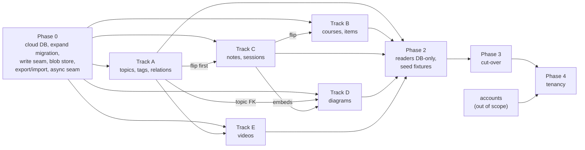

# Moving authored content into the database

**Status: proposed, not built. 2026-09-27.** Nothing below exists yet. Numbers
marked *measured* were taken on the owner's laptop on 2026-09-27 against the
working tree, `~/.self-learn/manimkc/out` and the local `self_learn` database;
every other number is marked *guessed* and says what would settle it. File
and line references are against `origin/main` at `5a78e61`.

**What changes.** Postgres becomes the source of truth for every piece of
authored content: the topic vocabulary, tags, courses and their curriculum
items, concept notes, session logs and diagrams. Binaries (videos, their
posters, diagram SVGs) move into an object store behind one `BlobStore`
interface, and Postgres holds a row per object with its key, size, hash and
type. The files under `content/` and `learn/` stop being what the app reads and
become an export format: `catalog export` writes the same YAML and markdown
shapes back out, and `catalog import` (today's indexers, renamed) reads them in.
Every content write carries an author and a reason and leaves a row in an
append-only revision table, which is how the database gives back the history
git used to give for free.

**What does not change.** The learner-state tables (`learner`, `event`,
`mastery`, `review`, `progress`, `recap`, `preference`) keep their shapes; they
already live in Postgres, and the only change for them is which database they
sit in. The `learn` CLI keeps its verb names and the five pinned
`--json` shapes in [learn/README.md](../learn/README.md#the-json-shapes), so the
external `learning` plugin keeps parsing what it parses today. The render tools
stay local processes: manimkc renders on a laptop or the homeserver, tldrawkc
draws in a local headless Chromium, and a Vercel function never renders
anything. A person still approves every write.

## Why now

The owner intends this to become a multi-tenant cloud service. A cloud service
cannot keep its content in the working tree of one laptop, and a second tenant
cannot commit to the owner's git repository. The content half of the catalog
was designed as a derived index over files
([SCHEMA.md "The two halves"](../services/catalog/SCHEMA.md#the-two-halves)),
and that design has no place for content that a person creates through the app.

The studio is the first place this bites. The chat-first redesign merged today
as PR #120 ([STUDIO-CHAT-FIRST.md](STUDIO-CHAT-FIRST.md)) has a planner that
proposes a new topic when nothing in the vocabulary fits. Under the files rule,
its D39 can only print a YAML block for the person to paste into
`content/topics.yaml`, then wait for a manual `catalog index` before Draw goes
live (open question 3 there). The owner has decided a proposed topic must be
creatable through the app, with typed edges to related topics, and that topic
writes go through one catalog command so the cloud version can swap storage
without rewriting callers.

The same gap exists for every other type. A diagram accepted in the studio is a
working-tree change the person must commit (D6 of
[TLDRAWKC-INTEGRATION.md](TLDRAWKC-INTEGRATION.md#d6-the-person-commits-and-the-runner-has-no-mutating-git-access));
the checkout this plan was written in holds one such diagram right now,
`learn/assets/tailscale-vpn-communication.{tldr,svg}`, accepted by studio job
`1395e739` and untracked (*measured*: `git status` and the `job` table). A note
the plugin writes in a tutoring session is a file edit. None of these can
happen on a server.

## What git gave us, and how the database gives it back

The owner asked why content was never meant to live in a database. The answer
was that git gave five things for free. Leaving git means paying for each of
them explicitly, and this table is the bill.

| Property | How files in git provide it | How the database provides it after this plan |
| --- | --- | --- |
| Review | A person sees the diff before committing; a content change can ride a PR | Every write goes through a person: a CLI verb the person or their session ran, the studio's Accept, or the Draw press. The write carries `author` and `reason`, and `catalog history` shows it. A web editor with its own review screen is later work |
| Diff | `git diff`, `git log -p` | `content_revision` keeps a full jsonb snapshot per write with `previous_id`; `catalog diff <revision> [<revision>]` renders a field diff for structured rows and a line diff for markdown bodies |
| History | Every commit, with author and message | The same `content_revision` chain per entity, append-only by trigger, the way `event` already is ([SCHEMA.md "Append-only is a trigger"](../services/catalog/SCHEMA.md#append-only-is-a-trigger-not-a-revoked-privilege)) |
| Backup | Every clone is a full copy; GitHub is offsite | Provider point-in-time recovery plus a scheduled `pg_dump` (already required by [DEPLOYMENT.md](DEPLOYMENT.md#the-database)); a nightly `catalog export` committed to a private archive repository; blobs content-addressed and never overwritten |
| Offline reading | The files are on disk | `catalog export --out <dir>` at any time; the studio's last-read cache (D13); the optional vault sync for Obsidian (open question 1) |

The revision table is the cost of leaving git, and it is paid once, in phase 0,
in the one write path every type shares. Nothing else in this plan depends on
content being in git.

## Target state

### Where each type lives

| Type | Today | After | Writer after | Reader after | Owner |
| --- | --- | --- | --- | --- | --- |
| Topic vocabulary | `content/topics.yaml`, 86 topics, 23 domains, 39 KB (*measured*) | `topic` rows; `maps.concepts` becomes `concept.topic_slug` (already a column), `maps.courses` becomes the module's `collection_item` topic row (already written, `services/catalog/src/index/courses.ts:140-146`), `maps.manimkc` becomes a new `manimkc_topic` row per path | `catalog topic add\|edit\|relate\|archive` | the `packages/content` seam | `topic.owner_id` |
| Topic relations | nowhere | `topic_relation(from_slug, to_slug, kind)` | `catalog topic relate` | the seam; the planner's vocabulary block | `topic_relation.owner_id` |
| Tags | `content/tags.yaml`, 8 tags (*measured*); on courses only as strings inside `collection.metadata.tags` (`courses.ts:93-101`) | `tag` rows and a `collection_tag` link table | `catalog tag add\|edit`; course import | the seam | `tag.owner_id` |
| Courses, modules | `content/courses/*.yaml`, 10 files, 61 modules (*measured*) | `collection` rows as today, plus `archived_at` | `catalog course import <file.yaml>`, `catalog course export <id>` | the seam | `collection.owner_id` |
| Curriculum items | the same files, 137 items, 68 resource links, 8 concept links (*measured*) | `curriculum_item` as today, plus `archived_at`; links as today | the same import; `catalog item archive\|restore` | the seam | `curriculum_item.owner_id` |
| Concept notes | `learn/concepts/<domain>/<slug>.md`, 32 notes, 27,197 bytes (*measured*) | `concept` gains `domain`, `body`, `tags`, `sources`, `authored_at`, `archived_at`; `concept_prerequisite` as today | `learn concept add\|edit\|commit`, `learn check add`, `learn session close` | the seam; `readConceptNote` reads `concept.body` | `concept.owner_id` |
| Session logs | `learn/sessions/<id>.md`, 3 files, 17,781 bytes (*measured*) | the existing `session` row (it already has `title` and `goal`) plus `session_log_entry(session_id, seq, markdown)` | `learn session start\|log\|close`, `learn observe --session` | the seam; the export concatenates entries | `session.learner_id`, already there |
| Diagram sources | `learn/assets/<name>.tldr`, 2 tracked plus 1 untracked, 24 to 26 KB each (*measured*) | `diagram.document` jsonb | studio Accept; `learn diagram commit` | `catalog diagram list\|show`; a materialised temp file for tldrawkc | `diagram.owner_id` |
| Diagram SVGs | `learn/assets/<name>.svg`, 214 to 313 KB each (*measured*) | a blob, referenced by `diagram.svg_blob_key` and `asset.blob_key` | the same Accept or commit | `/api/assets/{id}/file`, via the blob store | `blob_object.owner_id` and the key prefix |
| Videos and sidecars | `~/.self-learn/manimkc/out`, outside the repo; 36 indexed videos, 432,692,181 bytes, plus 87 sidecars (*measured*) | blobs; `asset` rows keep their ids and gain `blob_key` | `catalog asset upload --source manimkc` | `/api/assets/{id}/file` redirects to a signed URL | `asset.owner_id`, `blob_object.owner_id`, the key prefix |
| Posters | ffmpeg at request time into a temp cache (`apps/web/src/lib/asset-posters.ts:306-315`) | a blob per video, made at upload, as an `asset` of new kind `poster` derived from the video | the upload command | `/api/assets/{id}/poster` redirects | as videos |
| `learn/map.md` | a generated file (`services/catalog/src/learn/cli.ts:1241`) | nothing stored; `learn map` renders from rows to stdout or `--out` | none | on demand | none |

### The new tables

Every table below is created in phase 0, in one expand migration, so no phase 1
track touches `packages/schema/src/` (D10).

**`content_revision`**, the history of record:

| Column | Type | Meaning |
| --- | --- | --- |
| `id` | bigint identity PK | |
| `owner_id` | text FK `learner(id)`, `RESTRICT` | Whose content this is |
| `entity_type` | text, `CHECK` | `topic`, `topic_relation`, `tag`, `collection`, `curriculum_item`, `concept`, `diagram`, `asset` |
| `entity_id` | text | The entity's primary key, rendered as text |
| `seq` | integer | 1, 2, 3 per entity; `UNIQUE (entity_type, entity_id, seq)` |
| `previous_id` | bigint FK `content_revision(id)`, null | The revision this one replaced; null on create |
| `op` | text, `CHECK` | `create`, `update`, `archive`, `restore`, `rename`, `import` |
| `snapshot` | jsonb | The whole entity after the write, body included. For a diagram, the document; the SVG is referenced by blob key |
| `snapshot_hash` | text | sha256 of the canonical snapshot, so an import that changes nothing writes nothing |
| `author_kind` | text, `CHECK` | `person`, `agent`, `import` |
| `author` | text | A learner id, an agent label such as `planner` or `diagram-maker`, or `import:<git sha>` |
| `reason` | text, not null | The commit message's replacement. Empty is refused |
| `job_id`, `session_id` | text FKs, null | Provenance when a studio job or a tutoring session made the write |
| `created_at` | timestamptz | |

It carries the same `BEFORE UPDATE OR DELETE ... FOR EACH ROW` trigger as
`event` (migration `0003_append_only_per_row.sql`), for the same reason: a
revoked privilege does not bind the owner who runs psql. Writers pass the
revision they started from; a write whose base is no longer the latest is
refused rather than merged (edge case 16).

**`blob_object`**, one row per stored object:

| Column | Type | Meaning |
| --- | --- | --- |
| `key` | text PK | `<owner_id>/<sha256>.<ext>`, content-addressed |
| `owner_id` | text FK `learner(id)` | |
| `sha256`, `bytes`, `mime` | text, bigint, text | Checked against the store after upload |
| `provider` | text, `CHECK` | `fs`, `vercel-blob`, `r2` |
| `state` | text, `CHECK` | `pending` until the upload is confirmed, then `present` |
| `created_at`, `confirmed_at` | timestamptz | |

`asset` gains `blob_key` (FK to `blob_object(key)`, `RESTRICT`), and its
location check widens from `num_nonnulls(path, url) = 1`
(`packages/schema/src/content.ts:202`) to "exactly one of `url` or a location,
where a location is `path`, `blob_key` or both". Both are allowed together
because the path survives as a logical name (D11).

**`topic_relation`**, the typed edge the owner asked for: `from_slug` and
`to_slug` (FKs to `topic`, `ON UPDATE CASCADE`, `ON DELETE RESTRICT`), `kind`
checked against `broader` (to is the wider subject), `related` (symmetric) and
`precedes` (learn from before to), and `owner_id`. Primary key
`(from_slug, to_slug, kind)`, a no-self check, and
`kind <> 'related' or from_slug < to_slug` so a symmetric edge is stored once.
Foreign keys at both ends are the schema's standing rule
([SCHEMA.md "Typed link tables"](../services/catalog/SCHEMA.md#typed-link-tables-never-a-generic-edge-table)).

**`tag`** (`id` PK, `label`, `description`, `owner_id`) and **`collection_tag`**
(`collection_id`, `tag_id`, both FKs). Today a course's tags are free strings in
jsonb and validated only at parse time
(`packages/content/src/courses.ts:351-357`); the link table makes a stale tag a
`23503`.

**`manimkc_topic`** (`path` PK, `topic_slug` FK, `owner_id`). It replaces
`maps.manimkc`, and the primary key does the job `vocabulary.claim()` does in
code today (`services/catalog/src/index/vocabulary.ts:41-56`): one path, one
topic. A table, because a manimkc topic can be mapped before its first render;
today 35 paths are mapped and 35 video directories are indexed (*measured*).

**`diagram`**: `slug` PK, `owner_id`, `title`, `topic_slug` FK (not null,
`RESTRICT`, the same rule as `job.topic_slug`), `document` jsonb (the whole
`.tldr`), `document_hash`, `svg_blob_key` FK, `svg_document_hash` (the
`document_hash` the SVG was exported from), `archived_at`, timestamps. The two
hashes replace the modification-time comparison behind the studio's freshness
pill (U9 in TLDRAWKC-INTEGRATION.md): the SVG is stale exactly when they differ.

**`session_log_entry`**: `session_id` FK `session(id)`, `seq`, `markdown`,
`created_at`, primary key `(session_id, seq)`, append-only by trigger (D20).

**`content_source`**: one row per content type, `source` in (`files`, `db`),
`flipped_at`, `parity_report` jsonb. It records which types the database owns,
and writers and importers obey it (D18).

**`catalog_instance`**: a single row naming this database `primary` or `copy`.
Every content and state writer refuses on a copy (edge case 14).

### The `owner_id` rule

Every content entity table gets `owner_id text not null default 'local'
references learner(id) on delete restrict` in the phase 0 migration: `topic`,
`tag`, `topic_relation`, `manimkc_topic`, `collection`, `curriculum_item`,
`concept`, `asset`, `diagram`, `blob_object`, `content_revision`. Link tables
(`asset_topic`, `collection_tag` and the rest) inherit the owner of the entity
at their owning end and carry no column of their own, because a link whose
owner disagrees with its parent is a state the schema should not be able to
express. `job` and `asset_job` gain `owner_id` too, since today only `session`
carries a learner (`packages/schema/src/studio.ts:77-120`).

Primary keys stay as they are: slugs and authored ids remain globally unique
across owners. `owner_id` from day one gives ownership, scoping and per-owner
caps without a second migration; it does not give each tenant its own slug
namespace, and D3 says why that is deferred rather than done now.

Blob keys are prefixed by owner, `<owner_id>/<sha256>.<ext>`, so a tenant's
objects can be listed, counted, capped and deleted by prefix.

### Where a `.tldr` goes

The document goes in a jsonb column on `diagram` and the SVG goes in the blob
store. The document is small JSON whose stamp the catalog already reads; the
SVG is ten times larger and is served as bytes. D6 has the numbers.

## Principles

- **Expand, migrate, contract.** Every change adds the new path beside the old
  one, proves parity by counts and content hashes, flips, and only then removes
  the old path. A type is read from one truth at a time; the flip for a type is
  one PR.
- **One content type per track.** Each phase 1 track owns its type's writer,
  its reader implementation, its importer changes, its parity check and its
  tests, in its own worktree. Shared files are changed in phase 0 so tracks do
  not collide on them.
- **A person still approves every write.** The writers are CLI verbs a person
  or their session runs, the studio's Accept, and the Draw press. No agent
  writes content on its own authority, and no content write is reachable from
  a Vercel function before phase 4 (D19).
- **The plugin contract holds.** Verb names and the five `--json` shapes do not
  change. Where the plugin edits a file directly today, a checkout and commit
  verb pair replaces the edit, and the plugin's version is bumped in the same
  change (D15).
- **Reversible until cut-over.** `catalog export` regenerates the whole
  `content/` and `learn/` tree from the database at any moment until phase 3,
  and `CONTENT_SOURCE=files` points readers back at it.

## Phase 0: the foundation

Serial; every phase 1 track waits on it. Five PRs (*guessed*): 0.1 with its
docs, 0.2 with 0.3, 0.4, 0.5, and 0.6.

### 0.1 A cloud database, provisioned in the order DEPLOYMENT.md requires

Vercel has no database today, and every read degrades because of that
([DEPLOYMENT.md:163-174](DEPLOYMENT.md#the-database)). Setting `DATABASE_URL`
on Vercel is also the moment `/api/learner/*` becomes writable to anyone who
can pass the site password and forge an `Origin` header
(DEPLOYMENT.md:175-190). The order below is that document's, plus database
roles and the move of the primary.

- [ ] Choose the provider and region (open question 6). Put the database and
      the Vercel functions in the same region.
- [ ] Turn on the provider's point-in-time recovery and a scheduled `pg_dump`
      to storage the provider does not own. Restore one dump into a scratch
      database and count rows before going further.
- [ ] Add the per-IP firewall rule on `/api/learner` and publish it
      (`vercel firewall rules list`, `vercel firewall publish --yes`).
- [ ] Create three roles: `catalog_owner` (migrations), `catalog_writer` (the
      laptop's CLI and studio: content and state writes), `app_web` (Vercel:
      `SELECT` on content tables, writes on state tables only). D19.
- [ ] Move the data: `pg_dump self_learn`, restore into the cloud database,
      `npm run catalog -- migrate` against it (a no-op, since migrations are
      keyed by file hash), compare every table's row count with the local
      database, and write the `catalog_instance` row as `primary` there.
- [ ] Mark the local database `copy`, and point the laptop's `DATABASE_URL` at
      the cloud database as `catalog_writer` (D2).
- [ ] Set `DATABASE_URL` on Vercel production as `app_web`, and on preview
      deployments to a separate branch or database, never production's.
- [ ] Redeploy, load `/today`, and confirm the store banner is gone.

### 0.2 The expand migration

- [ ] Every table in [The new tables](#the-new-tables), every new column
      (`owner_id` everywhere, `archived_at` on `collection`, `curriculum_item`,
      `concept`, `topic`, `diagram`; the concept body columns; `asset.blob_key`;
      `poster` in `ASSET_KINDS`), and the widened `asset` location check.
- [ ] The cascade fix (D12): `progress` and `recap` switch from `ON DELETE
      CASCADE` to `RESTRICT` on `curriculum_item`
      (`packages/schema/src/state.ts:227`, `:252`), and `curriculum_item` to
      `RESTRICT` on `collection`. `writer.ts`'s prune archives these two tables
      instead of deleting (`pruneEntity`,
      `services/catalog/src/index/writer.ts:396`).
- [ ] The append-only triggers on `content_revision` and
      `session_log_entry`, and a guard trigger on every content table that
      refuses a write unless the transaction has set
      `self_learn.revision_id` (D4).
- [ ] `CREATE EXTENSION pg_trgm` and a trigram index on `topic.title` and the
      aliases (D14).
- [ ] Generated with `npm run generate -w @self-learn/catalog`, never written
      by hand, and never an edit to an applied file.

Its number is the next free one on `origin/main` at merge: `0010`, or `0011`
if the studio's `draft` table lands first. Contract migrations follow serially.

### 0.3 The one write seam and the revision writer

- [ ] `services/catalog/src/content/write.ts`: `writeContent(tx, { type, id,
      next, base, author, reason })` opens the transaction, sets
      `self_learn.revision_id`, writes the entity, and appends the revision.
      Every writer in phase 1 calls it and nothing else writes content tables.
- [ ] `writeSource` (`writer.ts:218`) calls the same revision writer for each
      upserted entity whose `snapshot_hash` changed, with
      `author_kind = import` and the tree's git sha as `author`. An idempotent
      re-index therefore writes zero revisions.
- [ ] `catalog history <type> <id>` and `catalog diff` read it.
- [ ] A grep test: no `insert(` or `update(` on a content table outside
      `services/catalog/src/content/` and `services/catalog/src/index/`.

### 0.4 The blob store

- [ ] `packages/blob/` (a new workspace with its own `tsconfig.json` and
      `typecheck` script, per the AGENTS.md gotcha) exports:

```ts
interface BlobStore {
  put(key: string, body: Readable, meta: { sha256: string; bytes: number; mime: string }): Promise<void>;
  head(key: string): Promise<{ bytes: number; sha256?: string } | null>;
  get(key: string, range?: { start: number; end: number }): Promise<Readable>;
  signedUrl(key: string, ttlSeconds: number): Promise<string | null>; // null: the caller streams instead
  delete(key: string): Promise<void>;
}
```

- [ ] An `fs` adapter rooted at `$SELF_LEARN_HOME/blobs` (default
      `~/.self-learn/blobs`), outside the repo for the reason `$MANIMKC_HOME`
      exists. Its `signedUrl` returns null and the route streams, reusing the
      Range code already in `apps/web/src/lib/asset-files.ts:328-405`.
- [ ] A Vercel Blob adapter on a private store. Private stores need
      `@vercel/blob` 2.3 or later and support presigned `GET` URLs (Vercel's
      private storage documentation, read 2026-09-27).
- [ ] One conformance suite, run against both adapters: round trip, a Range
      read, `head` of a missing key, a wrong hash refused, and `signedUrl`
      either null or fetchable. The Vercel Blob run is skipped with a named
      reason when no token is set, the way the Postgres suites skip
      (`services/catalog/test/scratch-database.ts:30-53`).
- [ ] `upload(file)` in the catalog: write the `pending` row, stream to the
      store, `head` it, then mark it `present`. D5.

### 0.5 Export, import and parity

- [ ] `catalog import [--only <type>] <dir>`: the seven indexers, reading a
      directory argument instead of the repo root, writing through 0.3. It
      skips a type whose `content_source` row says `db` with a named line, and
      refuses when that type's file hash differs from the last export (edge
      case 12).
- [ ] `catalog export [--only <type>] --out <dir>`: new code per type, writing
      `topics.yaml` grouped by domain under the same header and divider
      comments it has today, `tags.yaml`, one `courses/<code>.yaml` per course,
      `concepts/<domain>/<slug>.md` with frontmatter, `sessions/<id>.md`,
      `assets/<slug>.{tldr,svg}`.
- [ ] `catalog parity [--only <type>] <dir>`: counts per type, and sha256 per
      entity over a canonical form (parsed YAML as sorted-key JSON; markdown
      frontmatter parsed and the body byte-exact; `.tldr` parsed; binaries as
      bytes). It prints the mismatches by id and exits 1 on any.

### 0.6 The reader seam, and readers made async

The web app reads content synchronously at module load
(`apps/web/src/data/courses/index.ts:26`, `data/topics.ts:20`,
`data/content.ts:17`), which Postgres cannot serve, so the 16 importers
(*measured*) change once, here, rather than once per track (D9).

- [ ] `packages/content` exports a `ContentSource` interface (`topics()`,
      `tags()`, `courses()`, `concept(slug)`, `sessionLog(id)`,
      `diagram(slug)`, all async) and `fileSource(root)` wrapping today's
      parsers.
- [ ] `@self-learn/catalog/content` exports `dbSource(db)`, with every method
      throwing "`<type>` is not migrated yet" until its track fills it in. The
      database implementation lives in the catalog because the catalog owns
      the connection; the interface and the switch live in `packages/content`.
- [ ] `selectSource()` in `packages/content` resolves per type: the
      `content_source` row when the database answers, overridden by
      `CONTENT_SOURCE=files|db` or a per-type list such as
      `CONTENT_SOURCE=topics=db,courses=files`.
- [ ] The 16 web importers move from module-level constants to
      `await getCourses()` and friends, wrapped in React's `cache()` per
      request. `generateStaticParams` on the two course routes goes; every page
      is already dynamic (AGENTS.md "Every page is dynamic").
- [ ] `services/studio/src/brief.ts:155` (`loadVocabulary`, the studio's own
      parser) and the studio's repo-root walk (`services/studio/src/paths.ts:24`)
      move onto the seam, with the studio's local cache (D13).

### 0.7 Docs

- [ ] `SCHEMA.md` gains the new tables and the reversed "two halves" row;
      `DEPLOYMENT.md` gains the roles, the region and the blob token.

**Done when:** the expand migration is applied to a `createdb -T self_learn`
copy and to the cloud database; `catalog import` of the current tree into a
scratch database followed by `catalog export` yields a tree for which
`catalog parity` reports zero mismatches against the working tree; both blob
adapters pass the conformance suite; a second `catalog import` writes zero
revisions; the web app renders every route from `fileSource` through the async
seam with no visible change (`shots.mjs` before and after); and
`npm run lint && npm run typecheck && npm test && npm run build` is green with
Postgres up and `npm run build` still succeeds with `DATABASE_URL` pointed at a
dead port.

## Phase 1: five parallel tracks

Each track ends with a flip PR: `catalog parity --only <type>` clean, then
`catalog flip <type>` writes the `content_source` row, and from that commit the
database owns the type. Until phase 2, each writer also rewrites that type's
export file in the working tree after a successful write (D17), so readers of
other types that still parse files stay consistent.

Every track's done-when includes the same three lines, stated once here:
counts and content hashes equal between files and rows; `shots.mjs` screenshots
of the type's pages identical under `CONTENT_SOURCE=files` and `db`, plus
`scripts/e2e.mjs` green; and the files path still working with the override.

### Track A: topics, tags, topic relations

**Owns:** `services/catalog/src/content/topics.ts` and `tags.ts`, their
commands, `vocabulary-edit.ts` (deleted at the flip), the planner's topic path.

- [ ] `catalog topic add --slug --title --domain --summary [--alias]...
      [--relate kind:slug]... --reason --json`: validates what
      `packages/content/src/topics.ts:60-66` validates (kebab-case, unique),
      then a `pg_trgm` similarity check against titles and aliases that warns
      above a threshold (*guessed* 0.45) and names the near match.
- [ ] `catalog topic edit` (title, summary, aliases, domain; never the slug),
      `catalog topic rename --from --to` (edge case 2), `catalog topic relate`,
      `catalog topic archive`.
- [ ] `catalog tag add|edit`.
- [ ] `learn concept add --topic` calls `catalog topic` internals to set
      `concept.topic_slug`, replacing the text splice, lock and verify in
      `vocabulary-edit.ts:244-397`. The invariant that code enforces (a concept
      in exactly one topic, checked after the write) is now a column and a
      foreign key.
- [ ] Studio: the planner's prompt (STUDIO-CHAT-FIRST.md, "Topics") changes
      from "write the YAML for the person to paste" to "propose the entry and
      its relations". The runner validates the proposal with
      `catalog topic add --dry-run --json`, stores it on the draft as
      `pending_topic`, and the confirm card shows it with one button, **Create
      topic and draw**. That press runs `catalog topic add` with the person as
      author and the draft id in the reason, then enqueues the job. This
      supersedes D39 there (D16 here).
- [ ] The planner's VOCABULARY block includes relations, so it can say "this
      sits under `computer-networks`".
- [ ] The web app's topic and tag readers switch to `dbSource`.

**Parity:** 86 topics, 23 domains, 294 aliases, 8 tags, 35 manimkc paths, 32
concept mappings, 61 module mappings (*measured* today). **Tests:** the verbs'
refusals by name; a trigram warning; a relation's symmetric storage; the
planner path from a recorded reply to a created topic and a queued job.
**Docs:** [content/README.md](../content/README.md) rewritten as the export
format; STUDIO-CHAT-FIRST.md's D39 marked superseded. **Done when:** a topic
proposed in the studio chat is created by one press and the job it gates
reaches `awaiting_review` with no file edit and no manual index. **Tier:**
Sonnet for the verbs and the reader, Opus for the planner path. **Size:** 3
PRs (*guessed*).

### Track B: courses and curriculum items

**Owns:** `services/catalog/src/content/courses.ts`, the `course` and `item`
commands, the courses indexer's import mode.

- [ ] `catalog course import <file.yaml> --reason`: parses with
      `packages/content`'s course parser (every rule in its section 7 of the
      inventory, `packages/content/src/courses.ts:136-357`), validates
      references against rows instead of other files, and writes the diff
      through the seam. An item the file no longer lists is archived and
      reported by id, never deleted.
- [ ] `catalog course export <id>` writes the one YAML file to edit.
- [ ] `catalog item archive|restore|purge`. `purge` refuses while `progress`
      or `recap` rows name the item unless `--with-learner-data` is passed, and
      then snapshots those rows into the revision before deleting.
- [ ] Readers filter `archived_at is null`; an archived item with a learner's
      tick leaves the course path and stays in the Settings export.
- [ ] The web app's course readers switch to `dbSource`.

**Parity:** 10 courses, 61 modules, 137 items, 68 links, 8 concept links.
**Tests:** an import that drops an item archives it and leaves `progress`; a
purge refused, then allowed with the flag and recoverable from the revision;
the course order and slug uniqueness rules as constraint errors.
**Docs:** [content/courses/README.md](../content/courses/README.md) and
[CURRICULUM.md](CURRICULUM.md) rewritten around import and export.
**Done when:** removing an item from a course file and importing it leaves the
learner's tick and recap in place and reports the archive. **Tier:** Opus for
the archive rules, Sonnet for the reader. **Size:** 2 to 3 PRs (*guessed*).

### Track C: concept notes and session logs

**Owns:** `services/catalog/src/learn/files.ts`, `concept-note.ts`,
`today.ts:192-201`, two indexers' import mode, the plugin's `learn` skill.

- [ ] `writeConcept` (`files.ts:166`) and `appendSession` (`files.ts:213`), the
      only two functions that write notes and logs, become row writes behind
      the same signatures. `learn map` renders to stdout or `--out`.
- [ ] `learn concept checkout <id> --json` materialises the note to a scratch
      path and returns `{ id, path, revision }`; `learn concept commit <id>
      --reason` reads it back, refuses when the row has moved past `revision`,
      and writes through the seam. `learn concept edit --body-file` is the
      one-shot form.
- [ ] `readConceptNote` (`apps/web/src/lib/concept-note.ts:60-78`) reads
      `concept.body`; `review-queue.ts` gets checks from the same body; the
      256 KB cap stays.
- [ ] `![[x.svg]]` embeds keep resolving through
      `diagram:learn/assets/<name>` ids (`apps/web/src/app/(app)/learn/[concept]/page.tsx:85`),
      which D11 keeps valid.
- [ ] The plugin: Phase 4 Close in `skills/learn/SKILL.md` says "check out,
      edit, commit" instead of "edit `learn/concepts/<id>.md` directly"; the
      `session close`, `map`, `index` sequence becomes `session close`, `map`.
      Version bump.
- [ ] Offline: `concept add`, `check add` and `session log` stop working
      without the database (`cli.ts:156-160` chose otherwise). `status`, which
      both skills already run first and stop on, has needed the database since
      bundle 5, so a session could not start offline anyway.

**Parity:** 32 notes, byte-exact bodies; 3 logs byte-exact after
concatenation; 70 prerequisite rows. **Tests:** the five golden `--json`
shapes unchanged (`services/catalog/test/learn-cli.test.ts:99`); checkout and
commit with a moved base refused; `observe --session` appends one entry.
**Docs:** [learn/README.md](../learn/README.md) storage sections.
**Done when:** a full `/learn` session run against the migrated database closes
with filled-in notes and a log, and no file under `learn/` changed. **Tier:**
Opus. **Size:** 4 PRs (*guessed*): writers, readers, plugin, flip.

### Track D: diagrams

**Owns:** `services/catalog/src/content/diagrams.ts`, the studio's Accept,
list and SVG route (`services/studio/src/review.ts`, `diagrams.ts`,
`api.ts:674-850`), the plugin's `diagram-maker`.

- [ ] `catalog diagram put --slug --tldr <file> --svg <file> [--job] --reason`
      writes the `diagram` row, uploads the SVG blob, upserts the two `asset`
      rows with their existing `diagram:` ids and the derivation, and appends
      the revision, in one transaction after the upload is `present`.
- [ ] Studio Accept (`review.ts:218-227`) calls `diagram put` instead of the two
      renames and `assert-output`. Candidates stay files in the job workspace;
      the runner still writes nothing tracked, and now there is nothing
      tracked to write.
- [ ] `catalog diagram checkout <slug>` materialises the document to a temp
      `.tldr` under `$STUDIO_HOME/work/`; the mirror (`canvas serve`) and every
      `canvas` verb run on that file, since every verb takes a path. Saving
      from the mirror is followed by an explicit commit, with the same base
      check as notes (edge case 18).
- [ ] `catalog diagram list --json` replaces `canvas list learn/assets`
      (`services/studio/src/diagrams.ts:146-199`): slug, title, topic,
      concepts, shape count (counted in jsonb), freshness from the two hashes.
      The studio's own `/api/diagrams/{name}/svg` streams the blob.
- [ ] `job.target_path` keeps its value as a logical name and keeps working
      as the lease key (`job_active_target_key`).
- [ ] The plugin's `diagram-maker` draws in a checkout path and ends with
      `learn diagram commit`, a wrapper over `catalog diagram put`; its
      fallback SVG-only path uploads through the same verb. Version bump.
- [ ] Import the untracked `tailscale-vpn-communication` diagram first.

**Parity:** 3 diagrams (2 tracked, 1 untracked), document hashes, SVG bytes.
**Tests:** Accept writes a row and a blob and no file; an interrupted upload
leaves a `pending` row and no asset change; the list matches the old
`canvas list` fields for the same documents; `vitest.setup.ts`'s tracked-tree
check retargets (edge case 11). **Docs:**
[TLDRAWKC-INTEGRATION.md](TLDRAWKC-INTEGRATION.md) write path, D2, D6 and U3
amended. **Done when:** a studio job from chat to Accept lands a diagram that
the concept page embeds from the blob store, with `git status` clean. **Tier:**
Opus. **Size:** 3 to 4 PRs (*guessed*).

### Track E: videos

**Owns:** `services/catalog/src/commands/asset-upload.ts`,
`apps/web/src/app/api/assets/[id]/file/route.ts` and `poster/route.ts`,
`apps/web/src/lib/asset-files.ts`, `apps/web/src/lib/asset-posters.ts`.

- [ ] `catalog asset upload --source manimkc [--dry-run]` reads the report the
      manimkc indexer already reads (`manimkc topics --json`, with its
      `outRoot`), hashes each deliverable and sidecar, skips keys already
      `present`, uploads the rest, makes a poster with ffmpeg on the laptop and
      uploads it, and sets `asset.blob_key`. Resumable by construction, since a
      content-addressed key that is `present` is done.
- [ ] `/api/assets/{id}/file` resolution order: `blob_key` first (redirect to
      `signedUrl` with a TTL of an hour, or stream when the adapter returns
      null), then the legacy file. `ASSET_FILES_ENABLED` keeps gating the
      legacy branch only. `/api/assets/{id}/poster` does the same with the
      poster asset.
- [ ] The mirror ledger stays as it is (open question 8): it audits manimkc's
      own Drive and Seafile copies, and its join key, the logical
      `out/...` path, survives (D11).

**Parity:** 36 videos and 87 sidecars indexed today (*measured*); each asset's
`content_hash` equals its blob's `sha256`. **Tests:** the redirect carries no
path; a Range request on the fs adapter still returns 206; an asset with a
`pending` blob answers 404 `not-uploaded` rather than 500. **Docs:**
[DEPLOYMENT.md](DEPLOYMENT.md) gains the blob store; AGENTS.md's poster gotcha
notes the upload path. **Done when:** a video page on the production URL plays
and seeks. **Tier:** Sonnet for the upload command, Opus for the route and the
signing. **Size:** 2 to 3 PRs (*guessed*).

## Phase 2: readers go database-only

Parallel by area once every type has flipped. Four PRs (*guessed*).

- [ ] **Web app:** `fileSource` is removed from the app's composition root;
      `apps/web/src/data/repo-root.ts` and its five callers go;
      `outputFileTracingIncludes` and its comment go from
      `apps/web/next.config.ts:46-47`, keeping `outputFileTracingRoot` for the
      workspace packages; the legacy file branch of `asset-files.ts` goes.
- [ ] **Studio:** reads through the seam with its cache only; the repo-root
      walk in `services/studio/src/paths.ts:24-37` goes, and so does the
      `learn/assets/.candidates` convention in favour of the job workspace.
- [ ] **Catalog:** `catalog index` becomes `catalog import`, with `index`
      kept as an alias that prints the new name. The indexers keep their
      parsers and refusal rules as the import format's validator. The
      write-through export of D17 stops.
- [ ] **Tests:** a small `seed/` tree (*guessed*: 5 topics, 2 tags, 1 course
      with 2 modules, 4 notes, 1 session, 1 diagram, no videos), produced by
      `catalog export --subset`. `services/catalog/test/catalog.test.ts`
      imports `seed/` and its `EXPECTED` counts (`:53`) change to the seed's;
      `tldr.test.ts` reads the seed's diagram; `scripts/e2e.mjs` templates from
      a local database built by `catalog import seed/`; `vitest.setup.ts`'s
      tracked-tree check watches `seed/`.
- [ ] **Contract migration:** the `asset` location check narrows so a video,
      sidecar, poster or SVG must have a `blob_key`.

**Done when:** deleting `content/` and `learn/` in a scratch worktree leaves
`npm run lint && npm run typecheck && npm test && npm run build` green and the
built app serving every route against the cloud database.

## Phase 3: cut-over

One PR, one agent, Opus.

- [ ] Final `catalog import` of the tree into the cloud database (a no-op if
      the flips held), then `catalog parity` of a fresh export against the
      tree, pasted into the PR body.
- [ ] `git tag content-files-final` on the commit before deletion and push the
      tag, so every historical version stays reachable (open question 4).
- [ ] Remove `content/` and `learn/`, keeping `seed/`. `CONTENT_SOURCE`
      defaults to `db`, and `files` survives only as a test override.
- [ ] Docs: AGENTS.md (the pipeline table, the tldrawkc rules about
      `learn/assets/`, the gotchas that name these paths), SCHEMA.md ("The two
      halves": content is authored here now), `content/README.md` moved to
      `seed/README.md` as the export format, `learn/README.md` storage
      sections.
- [ ] Plugin: a version bump removing every remaining path under `learn/` from
      the skills and agents.
- [ ] The nightly export to the private archive repository starts.

**Done when:** a fresh clone with only `seed/` passes the local gate, and the
production site and a `/learn` session both work against the cloud database.

## Phase 4: tenancy

After accounts exist; accounts themselves are out of scope.

- [ ] `owner_id` comes from the signed-in session instead of `'local'`, through
      the same `learnerId` parameter every state function already accepts
      (`services/catalog/src/state/*.ts`) and the content writers gain in
      phase 0.
- [ ] App-level scoping first: every content query takes an owner and a list
      of readable owners (the owner plus a shared `commons` owner). Row-level
      security later, once a second service reads the database.
- [ ] Blob keys already carry the owner; per-owner caps on bytes stored and
      on uploads per day, checked in `upload()`.
- [ ] `app_web` gains content writes, now that a route can know who is
      writing; the web editor lands here.
- [ ] Decide per type whether ids stay global (D3).

## Dependencies and parallel work



All five tracks are built at once. They merge in a fixed order, each rebasing
on the one before: A, C, B, D, E. A goes first because every other type
validates against topics. C goes before B because a course import checks its
concept links against concept rows. D needs A's topic writer for the studio
path and C's embed rules. E depends only on A and on phase 0's blob store, so
it can merge early if it is ready.

| Track | Runs alongside | Worktree | Agent tier | Merges | Files it shares |
| --- | --- | --- | --- | --- | --- |
| A | B, C, D, E | 1 | Sonnet; Opus for the planner path | 1st | `services/catalog/src/cli.ts` (one registration line); `services/studio/src/` (planner) with D |
| C | A, B, D, E | 1 | Opus | 2nd | the plugin repository with D |
| B | A, C, D, E | 1 | Opus for archive rules, Sonnet for the reader | 3rd | `cli.ts` (one line) |
| D | A, B, C, E | 1 | Opus | 4th | `services/studio/src/api.ts` with A; the plugin with C |
| E | A, B, C, D | 1 | Sonnet; Opus for the route | 5th, or earlier | none of the above |

Five worktrees, one per track, each created from `origin/main` after phase 0
merges (Workflow 3 in [AGENTS.md](../AGENTS.md#workflow-3-working-in-a-checkout-other-sessions-share)).

The shared files, and how tracks stay off them:

| Shared file | Why it would conflict | How it is avoided |
| --- | --- | --- |
| `packages/schema/src/*.ts` and `services/catalog/drizzle/` | Every track adds columns; two branches both generating the next number collide in `_journal.json` and the snapshot files | Phase 0 lands every expand change (D10). A track that finds it needs more schema rebases onto `main`, regenerates, and never hand-merges a snapshot |
| `packages/content/src/*` | Every track adds its reader | Phase 0 lands the interface complete and `fileSource` complete; tracks fill methods in their own file under `services/catalog/src/content/` |
| `services/catalog/src/index/writer.ts` | Revisions and the archive-instead-of-prune rule | Both land in phase 0; tracks change only their own indexer file |
| `services/catalog/src/cli.ts` | Verb registration | One line per track in a registry; a trivial rebase |
| The `learning` plugin | C and D both edit instructions | C merges first; D rebases and bumps the version again |

## Edge cases

| # | Case | What happens |
| --- | --- | --- |
| 1 | Postgres is unreachable while the studio is open | The studio reads topics, relations and the diagram list from its cache, written at the last successful read under `$STUDIO_HOME/cache/`, and the banner says the vocabulary is stale and when it was read. Drawing still runs, as D16 of TLDRAWKC-INTEGRATION.md requires. Accept cannot land a diagram, since the diagram lives in the database: the candidate stays in the job workspace with `awaiting_review`, and Accept is offered again when the database answers |
| 2 | A topic is renamed | A title change is an ordinary `topic edit`. A slug change is `topic rename --from --to` in one transaction: the row's slug is updated and every foreign key follows (`ON UPDATE CASCADE` on all of them, `packages/schema/src/content.ts` and `studio.ts:168`); the slug inside each diagram's `meta.tldrawkc.topic` and each open job's brief is rewritten by the same command; the old slug is appended to the aliases so search still finds it; one `rename` revision is written per affected row. Revisions keep the old slug in their snapshots, which is correct history |
| 3 | A concept with evidence is deleted | It cannot be: `event.concept_slug` is `ON DELETE RESTRICT` (migration `0004`). `learn concept archive` sets `archived_at`, readers hide it, `mastery` and `review` stay, and `restore` brings it back |
| 4 | The owner edits a note in Obsidian after cut-over | There is no `learn/` to edit. With the vault sync of open question 1, `learn vault pull` writes notes and logs to `~/.self-learn/vault/` with each file's base revision recorded, and `learn vault push` commits changed files; a note whose row moved since the pull is refused and left beside a `.conflict` copy. Without the sync, an edit to an old export is simply not read, and `catalog doctor` says so when it finds that directory |
| 5 | A video upload is interrupted | The `blob_object` row is `pending` and `asset.blob_key` is unchanged, so the page keeps serving the legacy file or answers `not-uploaded`. Rerunning the command resumes: a key already `present` is skipped, a `pending` one is re-uploaded (the key is the hash, so the bytes are identical). A sweep deletes `pending` rows older than a day with no object behind them |
| 6 | Two tracks both add a column | They should not: phase 0 lands all expand schema (D10). If one must, it merges in the fixed order, rebases on the other, and regenerates its migration from the schema source; the later track's number moves, and neither applied file is edited |
| 7 | The plugin runs against a half-migrated checkout | Its verbs and shapes are unchanged, so everything it parses still parses. What can break is a direct file edit: an old plugin version editing `learn/concepts/<id>.md` after track C flipped writes to a file the database no longer reads. `learn doctor` compares the file's hash with the last export and prints the plugin version it expects; the next `catalog import` refuses that file by name (edge case 12) |
| 8 | Export and import lose YAML comments | Measured: `topics.yaml` has 28 comment lines, all a file header or a domain divider, `tags.yaml` has 4, and the ten course files have none. The exporter writes the same header and one divider per domain, so the round trip loses nothing a person wrote beyond byte-exact spacing, and parity compares canonical forms rather than bytes for YAML |
| 9 | A blob exists with no row, or a row with no blob | `catalog blob audit` lists both. An object with no `blob_object` row is an orphan from an upload whose row write failed after the store accepted it, and is deleted after a day. A `present` row whose `head` fails is marked `pending`, and the asset answers `not-uploaded` until the upload command reruns. Keys are content-addressed, so neither case can point a row at the wrong bytes |
| 10 | Vercel function limits on a large video | The route never streams a blob on Vercel. It redirects to a signed URL and the browser's Range requests go to the store. Vercel's own guidance is not to serve files over 100 MB through a function from a private store unless traffic is low; the largest video is 37 MB (*measured*) and would still pay function transfer twice and hold a function for the whole download |
| 11 | `catalog.test.ts` indexes a tree that no longer exists | It indexes `REPO_ROOT` and asserts `concepts: 32` (`services/catalog/test/catalog.test.ts:53-56`). Phase 2 points it at `seed/` with the seed's counts, before phase 3 deletes the tree; `vitest.setup.ts:49` (`TRACKED_ASSETS`) moves to the seed's assets in the same PR. `tldr.test.ts` reads the seed's diagram |
| 12 | Someone hand-edits a flipped type's file | The file is an export. `catalog import` refuses it with the file named and the command that would apply the change (`catalog topic edit ...`), because silently overwriting it on the next export would lose the edit and silently importing it would bypass the reason field |
| 13 | A course file drops an item a learner ticked | The import archives the item and reports its id; `progress` and `recap` stay, since the foreign key is now `RESTRICT`. The item is gone from the course path and present in the learner's export |
| 14 | The laptop writes to the old local database after the primary moved | The local database's `catalog_instance` row says `copy`, and every writer refuses on a copy with the cloud host named. Tests and `scripts/e2e.mjs` pass an explicit flag to write to their scratch copies |
| 15 | A signed URL expires mid-playback | Seeking issues a new Range request, which fails once the URL has expired. The TTL is an hour (*guessed*) against a longest video far shorter (*guessed*; durations were not measured), and the player's error handler re-requests `/api/assets/{id}/file` for a fresh URL once |
| 16 | Two writers edit the same note at once | Each write carries the revision it started from. The second write finds the latest revision is not its base and is refused with both revision ids; the writer re-checks out and reapplies. No merge is attempted |
| 17 | The planner proposes a topic that nearly exists | The trigram check in `topic add --dry-run` returns the nearest titles and aliases above the threshold. The runner puts the match on the confirm card ("this looks like `tcp-congestion-control`, use it instead?") and the person chooses |
| 18 | A mirror save lands after the diagram row changed | The mirror edits a checkout file. Its commit carries the checkout's base revision and is refused when the row moved, as in case 16; the checkout file is kept so nothing drawn is lost |
| 19 | The revision table grows | Snapshots are whole entities. At today's sizes a diagram snapshot is about 25 KB and a note about 1 KB (*measured* averages), so ten thousand diagram revisions is about 250 MB (*guessed* rate). If that arrives, old diagram snapshots move to the blob store with the row keeping the key; the shape of the table does not change |
| 20 | The cloud database is down and a visitor opens a course page | Course pages read content from the database after track B, so they degrade the way learner pages already do: the shell renders and says the catalog is unreachable. Today they would still render from files; this is the one availability property the plan gives up, and D2 says why |

## Decisions

### D1. The database is the truth; files are an export format

**Verdict:** Postgres holds every piece of authored content; `catalog export`
writes the old shapes and `catalog import` reads them. **Why:** content made
through the app has nowhere to go under the files rule, and a tenant cannot
commit to one person's repository. Keeping the shapes as the export format keeps
the parsers, the refusal rules and a readable backup. **Rejected:** files as
truth with the database as a cache (today's design, which the studio has
outgrown); files in object storage as truth (no transactions and no foreign
keys, the failure SCHEMA.md's typed links exist to prevent).

### D2. One primary database, in the cloud, from the end of phase 0

**Verdict:** the cloud database is primary for both halves; the laptop's CLI
and studio connect to it; the local database is a copy for tests and e2e.
**Why:** two databases that both take writes are two truths, and what the
studio writes on the laptop must be what Vercel serves. The learner state was
already meant to move ([DEPLOYMENT.md](DEPLOYMENT.md#the-database)).
**Rejected:** a local primary pushed to the cloud by export and import (a second
truth between pushes); logical replication (operational weight for one user);
Vercel staying on files (the goal is a cloud service).

### D3. `owner_id` on every content table now; ids stay global

**Verdict:** the phase 0 migration adds `owner_id`, default `'local'`, to every
entity table; primary keys do not change. **Why:** the column is cheap while
tables hold hundreds of rows (*measured*), and it lets phase 4 scope, cap and
delete by owner with no schema change. Re-keying every table to
`(owner_id, slug)` changes every foreign key and query before a second tenant
exists, and a shared vocabulary may be what the product wants. **Rejected:**
composite keys now; no owner column until accounts.

### D4. One revision table: an append-only jsonb snapshot per write

**Verdict:** `content_revision` with `previous_id`, `author_kind`, `author`,
`reason` and a whole-entity snapshot with its hash, written only by the write
seam, append-only by trigger; a guard trigger on each content table refuses a
write outside the seam. **Why:** one shape gives back diff, history and blame
for every type. A whole snapshot makes a diff a comparison of two rows and a
restore one write, and the guard makes a psql edit a deliberate act, the
argument that made `event` append-only by trigger. **Rejected:** a history
table per type (eight shapes to keep in step); stored diffs (a restore replays
a chain); a trigger that writes the revision (it cannot know the reason);
importing git history (open question 4).

### D5. One `BlobStore` interface, content-addressed keys prefixed by owner

**Verdict:** the interface in phase 0, an `fs` adapter for the laptop, a private
Vercel Blob adapter for the cloud, keys `<owner_id>/<sha256>.<ext>`. **Why:**
content addressing makes uploads resumable and idempotent, keeps an old
revision's SVG resolvable, and makes a row pointing at wrong bytes impossible.
The prefix is what phase 4 caps and deletes by. **Rejected:** path-shaped keys
(overwrites break old revisions and caches); bytes in Postgres (D7). R2 stays a
second adapter behind the same interface (open question 3).

### D6. A `.tldr` lives in jsonb; its SVG is a blob

**Verdict:** `diagram.document` jsonb and `diagram.svg_blob_key`. **Why:** the
document is 24 to 26 KB of JSON (*measured*) the catalog already reads a field
from (`services/catalog/src/index/tldr.ts:117-129`); in jsonb the stamp, the
shape count and the revision snapshot are one query away and the studio's list
needs no subprocess. The SVG is ten times larger and is served to browsers as
bytes under its own CSP. **Rejected:** the `.tldr` as a blob (reading the stamp
needs a download); the SVG in a column (every list query drags 300 KB rows).

### D7. Videos never enter Postgres

**Verdict:** videos, sidecars and posters are blobs with rows. **Why:** 433 MB
of indexed video (*measured*) would make an 11 MB database forty times larger,
slow every dump and restore, and stream through a function; SCHEMA.md already
rules it out. **Rejected:** large objects, `bytea`.

### D8. Rendering stays local

**Verdict:** manimkc and tldrawkc run where they run today and upload what they
make. **Why:** both need Chromium or a Python toolchain with ffmpeg and minutes
of CPU, and the studio's safety rules assume a local supervised process
(TLDRAWKC-INTEGRATION.md, "Rules the code must obey"). **Rejected:** rendering
in a Vercel Sandbox or a queue worker, until a tenant without a laptop exists.

### D9. The seam is in `packages/content`, and readers become async once

**Verdict:** `packages/content` defines `ContentSource` and the file
implementation, the catalog provides the database implementation, and phase 0
converts the 16 web importers and the studio's parser. **Why:** synchronous
module-level reads (`packages/content/src/read.ts:6-15`,
`apps/web/src/data/courses/index.ts:26`) cannot be served from Postgres, and
converting once means no track rewrites a shared importer. **Rejected:** a
database version of the synchronous functions (impossible with `pg`);
top-level `await` in the data modules (it queries at build time, and the build
must pass without a database).

### D10. All phase 1 schema lands in phase 0

**Verdict:** one expand migration carries every table and column the tracks
need. **Why:** drizzle numbers migrations from its journal, so two branches that
each generate one collide in `_journal.json` and the snapshots, and an applied
migration can never be edited to fix it. **Rejected:** reserving numbers per
track (drizzle always takes the next number); one track owning all
migrations while the others wait.

### D11. Asset ids and paths survive as logical names

**Verdict:** `note:`, `session:`, `diagram:` and `manimkc:` ids and their
`asset.path` strings keep their values after the files are gone. **Why:** they
are in URLs, `asset_job`, the mirror ledger's join key
(`services/catalog/src/index/mirrors.ts:28-40`), `job.target_path` and the
embed resolver (`apps/web/src/app/(app)/learn/[concept]/page.tsx:85`).
**Rejected:** new ids at migration time.

### D12. Curriculum items and modules are archived, never cascaded away

**Verdict:** `archived_at` on `collection` and `curriculum_item`; `progress`,
`recap` and `curriculum_item` become `ON DELETE RESTRICT`; `purge` is explicit
and snapshots the learner rows into the revision first. **Why:** SCHEMA.md
"Still open" records that removing an item from a course file silently deletes
the learner's tick and recap. With the database as truth every course edit
writes those rows, so the loss moves onto the ordinary edit path. **Rejected:**
keeping `CASCADE` with a CLI warning (a warning does not guard anything); an
archive copy of learner rows (a second truth).

### D13. The studio keeps working offline through the seam and a cache

**Verdict:** the studio reads through the seam; each successful read writes
`$STUDIO_HOME/cache/<type>.json`; with the database down it reads the cache and
the banner says "stale since" and the time. **Why:** U3 of
TLDRAWKC-INTEGRATION.md promises browsing and drawing with Postgres down, and
today its own YAML parser (`services/studio/src/brief.ts:155`) is how.
**Rejected:** keeping the studio on files (two truths); refusing to open
offline (breaks U3).

### D14. `pg_trgm` now; `pgvector` at about 300 topics, in the same Postgres

**Verdict:** the trigram extension and index in phase 0; embeddings as a
`vector` column once the vocabulary nears 300 topics. **Why:** at 86 topics and
294 aliases (*measured*) trigram similarity catches near duplicates, and
`pg_trgm` is already available locally (*measured*). The owner wants no
separate vector database. **Rejected:** a vector store now; any second
database.

### D15. The plugin contract: verbs and shapes fixed; file edits become checkout and commit

**Verdict:** no verb is renamed and the five `--json` shapes stay exact; the
Close phase's note edits and the diagram-maker's `learn/assets/` paths become
checkout and commit verbs; every instruction change bumps the plugin version
(0.3.2 today, *measured*). **Why:** the plugin lives outside the repo, is shared
across projects, and is read from a cache only a version bump refreshes
(AGENTS.md). **Rejected:** database access for the plugin; direct edits against
exported files, which would be silently ignored.

### D16. One topic writer; the planner's topic is created on the Draw press

**Verdict:** `catalog topic add` is the only topic writer. The planner proposes
an entry, the confirm card offers **Create topic and draw**, and that press
creates the topic with the person as author and then enqueues. This supersedes
D39 of [STUDIO-CHAT-FIRST.md](STUDIO-CHAT-FIRST.md) and answers its open
question 3. **Why:** the owner wants topics creatable in the app through one
seam the cloud can swap, and `job.topic_slug` is a foreign key (S5 of
TLDRAWKC-INTEGRATION.md), so the topic must exist before the job.
**Rejected:** creating it at the diagram's Accept (the job cannot be enqueued
first); a `proposed` topic state (a filter in every reader); D39's paste path.

### D17. Writers export their type while any reader still reads files

**Verdict:** from a type's flip until phase 2, its writer rewrites that type's
export file after each write. **Why:** `loadCourses` validates against
`topics.yaml` while courses are on files
(`packages/content/src/courses.ts:203-209`), so a topic created in the
database must reach the file or the next course import refuses. **Rejected:**
deleting a type's files at its flip (cross-type validation breaks); leaving
them stale (hand edits vanish, edge case 12).

### D18. The database records which types it owns

**Verdict:** `content_source` rows, written by `catalog flip`, are obeyed by
importers and writers; `CONTENT_SOURCE` overrides readers only, for tests and
as the read rollback lever. **Why:** an environment variable set differently on
two processes is two truths, and a row is one. **Rejected:** the variable as the
authority.

### D19. Vercel connects with a role that cannot write content

**Verdict:** `app_web` has `SELECT` on content and writes on state only, until
phase 4. **Why:** no content writer runs on Vercel before accounts, so the
database can enforce that a route bug or a forged request never reaches
content. **Rejected:** one role for everything, which would extend the exposure
DEPLOYMENT.md describes to content.

### D20. Session logs are append-only entries

**Verdict:** `session_log_entry` rows; the export concatenates them under the
frontmatter the `session` row already holds. **Why:** every log write is an
append today (`services/catalog/src/learn/files.ts:213-218`), so the entries are
their own history and need no revisions. **Rejected:** a `body` column
rewritten on each `observe`.

## Open questions

1. **Obsidian.** The owner edits `learn/` as an Obsidian vault (its config,
   `learn/.obsidian/`, is gitignored at `.gitignore:51`, *measured*). After
   cut-over there is no vault. **Recommendation:** build `learn vault pull` and
   `learn vault push` in a small phase 2 PR, with base-revision conflict
   refusal (edge case 4); until then, `catalog export` gives a read-only vault.
   Two-way live sync is not worth building for one user.
2. **Courses as YAML.** Nobody writes a course through a program today; the
   files are hand-edited. **Recommendation:** keep YAML as the authoring format
   with `course export`, edit, `course import` as the write path, until the web
   editor of phase 4.
3. **Vercel Blob or R2.** Measured need is 433 MB of indexed video plus under 2
   MB of SVG and sidecars; 924 MB if every file under the data root were
   uploaded. Prices from the providers' pages, read 2026-09-27: Vercel Blob
   $0.023 per GB-month and $0.05 per GB transferred (the `iad1` example), with
   1 GB storage and 10 GB transfer included on Hobby; R2 $0.015 per GB-month,
   10 GB free, egress free. At 1 GB both are free. At 50 GB, storage is about
   $1.15 against $0.60, and transfer decides it: 100 GB watched a month is up to
   $5 on Vercel Blob, depending on the plan's included transfer, and $0 on R2
   (*guessed* traffic). On Hobby, going over the allowance locks Blob access for
   30 days, per the same page. **Recommendation:** Vercel Blob if the project is
   on Pro, for one dashboard and no second account; R2 while it stays on Hobby.
4. **Git history of content.** 27 commits on `main` touch `content/` or
   `learn/` (*measured*). **Recommendation:** tag `content-files-final`, import
   the current state as revision 1 with `author = import:<sha>`, and do not
   replay history into revisions: the tag keeps every old version one
   `git show` away, and replayed revisions would carry authors and reasons
   nobody wrote.
5. **The first cloud `DATABASE_URL`.** **Recommendation:** the order in phase
   0.1, in its own PR: backups proven by a restore, the per-IP rule published,
   the `app_web` role, previews on their own database, then production.
6. **Provider and region.** DEPLOYMENT.md lists Neon, Supabase or the
   homeserver over Tailscale. **Recommendation:** Neon through the Vercel
   integration, in the region nearest the owner with the Vercel function region
   set to match (Vercel defaults functions to `iad1`); its branches can give
   each phase 1 worktree its own database. The homeserver is ruled out by D2,
   since Vercel would reach the primary over a tunnel. Confirm `pg_trgm` and
   `vector` are offered before choosing.
7. **Per-owner namespaces.** D3 keeps ids global. Concept notes are the type
   most likely to need per-owner slugs, since two people's notes on
   `dot-product` are different notes. **Recommendation:** decide in phase 4
   with a real second tenant; the export and import path is how a re-key would
   be done.
8. **The mirror ledger.** Drive and Seafile hold manimkc's own copies, audited
   into `mirror` (`packages/schema/src/operations.ts:137-172`).
   **Recommendation:** keep it unchanged through phase 3; decide whether to
   retire those destinations once the blob store has a year of backups behind
   it.

## Where the facts changed the outline

- **Readers change once, in phase 0.** The outline had a database version "of
  the same exported functions, so readers do not change". They are synchronous
  and run at module load, so that cannot work (D9). The database
  implementation lives in the catalog, which owns the connection.
- **The planner's topic is created at Draw.** The outline said Accept; the job's
  foreign key needs the topic first (D16).
- **Migration numbers cannot be reserved.** All expand schema lands in phase 0
  instead (D10). STUDIO-CHAT-FIRST.md still calls `0009` free; it is taken.
- **Added:** one primary database (D2) with a `catalog_instance` guard;
  `manimkc_topic`, since a mapping can precede its first render;
  `content_source` (D18); `session_log_entry` (D20).
- **Video scope.** The inventory's 267 `.mp4` files (909 MB) include per-scene
  clips under `scenes/` and renders whose topics are not in the vocabulary.
  The catalog indexes 36 videos (433 MB), and that is what the plan uploads.

## Measured and guessed

| Number | Value | Kind | How |
| --- | --- | --- | --- |
| Postgres version, size | 17.11, 11 MB | measured | `psql`, `pg_database_size` |
| Tables | 24 in `public` plus drizzle's journal | measured | `pg_tables`; `packages/schema/src/index.ts:47-72` |
| Migration head | `0009_concept_curriculum_item_position` | measured | `drizzle/meta/_journal.json`, `drizzle.__drizzle_migrations` |
| Extensions installed, available | `plpgsql`; `pg_trgm` available | measured | `pg_extension`, `pg_available_extensions` |
| Topics, domains, aliases, tags | 86, 23, 294, 8 | measured | parsed the YAML |
| manimkc, concept, course mappings | 35, 32, 61 | measured | parsed `topics.yaml` |
| Courses, modules, items, links, concept links | 10, 61, 137, 68, 8 | measured | parsed the course files |
| YAML comment lines | 28, 4, 0 | measured | `grep` |
| Concept notes | 32, 27,197 bytes | measured | `find`, `wc -c` |
| Session logs | 3, 17,781 bytes | measured | `asset` table |
| Diagrams | 2 tracked, 1 untracked; `.tldr` 24 to 26 KB; SVG 214 to 313 KB | measured | `git ls-files`, `ls -l` |
| Indexed videos, bytes | 36, 432,692,181 | measured | `asset` table |
| Indexed sidecars | 87 | measured | `asset` table |
| Files under the manimkc data root | 267 `.mp4`, 909 MB video, 924 MB total | measured | `find`, `du` |
| Largest, mean video | 37 MB, 3.4 MB | measured | `ls -l` |
| Web importers of the data modules | 16 files | measured | `grep` |
| Test cases | 1,572 | measured by the inventory | `grep` over `*.test.ts` |
| Content commits on `main` | 27 | measured | `git log -- content learn` |
| Plugin version | 0.3.2 | measured | `plugin.json` |
| Blob prices | as in open question 3 | read from provider pages 2026-09-27 | may change |
| PRs per phase and track | 5, 3, 2 to 3, 4, 3 to 4, 2 to 3, 4, 1 | guessed | |
| Trigram warning threshold | 0.45 | guessed | settle on the first twenty proposals |
| Signed URL TTL | 1 hour | guessed | video durations not measured |
| Revision growth | 25 KB per diagram revision | guessed rate | from measured sizes |
| Seed tree size | 5 topics, 1 course, 4 notes | guessed | settle in phase 2 |
| Monthly transfer | 100 GB | guessed | no production traffic yet |
