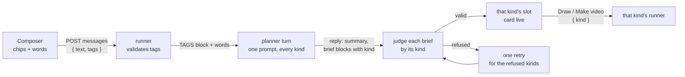
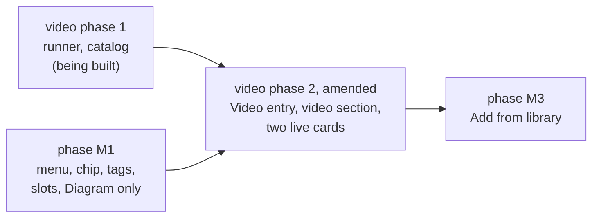

# Choosing what to make: @ tags in the studio's composer

How a person tells the studio's chat what to make. Typing `@` in the composer
opens a short menu; picking Diagram or Video puts a tag in the composer, and a
tag is an order: the planner proposes a brief of each tagged kind. Tag both
and one message gets a diagram brief and a video brief, each with its own
button. This replaces the Diagram or Video control that
[`STUDIO-VIDEOS.md`](STUDIO-VIDEOS.md) planned for the empty conversation
(D51), and the rules in [`STUDIO-CHAT-FIRST.md`](STUDIO-CHAT-FIRST.md) that
allowed one brief per message and one Draw on screen.

**Status: proposed, 2026-09-29. Nothing here is built.** Every number is a
guess and says so, except where it is quoted from the two documents above,
which say where theirs were measured.

**The owner's request, 2026-09-29.** Like ChatGPT: typing `@` drops a list of
options under the composer, and choosing one (ChatGPT's is "Create image")
commands the chat to make that kind of thing from the prompt. Here the options
make diagrams or videos, several tags are allowed in one message, and "Add
from library", which in ChatGPT attaches the person's own files, is a later
milestone for attaching catalog items as context.

**What changes for the person, in one paragraph.** The plus card opens the
same chat, with no kind to pick first. The person types, and when they want to
say what to make they type `@` (or press the plus at the left of the field): a
menu lists Diagram and Video, each with an icon and one line saying what it
is. Typing narrows it; Enter or a tap picks. The pick becomes a chip at the
front of the field, and they keep typing. Sent, the message shows its chips
above the words, and the planner answers with a brief for each tagged kind, as
a card each: Draw under the diagram's, Make video under the video's. Each card
is pressed on its own; a newer diagram brief greys the older diagram card and
leaves the video card alone. With no tag, the chat works as it does today: the
planner makes what the words ask for, a diagram when they do not say.

**What does not change.** One process spawns every agent under one daily cap
(D27). A person approves every spend with a press (D29); a tag asks for a
brief, never for a job. The brief schemas, the validators, the gates, the two
runners, Accept and Discard are the diagram and video documents' own. The
draft is still one conversation with one planner session.

## Read order

| Document | Why you would open it |
| --- | --- |
| This file | The @ menu and the chip, what a tag means, several live briefs per draft, the combined planner prompt, the later "Add from library" |
| [`STUDIO-CHAT-FIRST.md`](STUDIO-CHAT-FIRST.md) | The draft, the turn loop, the hand-off, the confirm card, the Composer, D27 to D42 |
| [`STUDIO-VIDEOS.md`](STUDIO-VIDEOS.md) | The video brief, its planner prompt, its card, its runner, D43 to D54; phase 2 is amended by this file |
| [`design/IMPLEMENTATION.md`](design/IMPLEMENTATION.md) | The kit contract, where `Composer`'s props are listed |

## What this replaces

| Decision or rule | Where | Replaced by |
| --- | --- | --- |
| D51: the kind is chosen before the first paid turn with a Diagram or Video control, and fixed after it | [`STUDIO-VIDEOS.md`](STUDIO-VIDEOS.md#d51-the-kind-is-chosen-before-the-first-paid-turn-and-fixed-after-it) | D55 and D57: an @ tag on any message, and no fixed kind |
| D42, in part: "a planner prompt and brief validator chosen by kind" of the draft | [`STUDIO-CHAT-FIRST.md`](STUDIO-CHAT-FIRST.md#d42-the-draft-carries-a-kind-only-diagram-is-built) | D59: one planner prompt carrying every built kind; D61: the validator chosen by each brief's own `kind`; D62: `draft.kind` becomes the newest brief's kind, for display |
| "One brief block per message" in both planner prompts | Both prompts, "The brief" | D61: at most one brief block per kind per message |
| "A newer brief greys the older card and removes its button: one Draw on screen, ever" | [`STUDIO-CHAT-FIRST.md`](STUDIO-CHAT-FIRST.md#the-confirm-message) | D60: one live card per kind; a newer brief supersedes only the older brief of its own kind |
| C14: messages to a draft that is `drawing` are refused with 409 | [`STUDIO-CHAT-FIRST.md`](STUDIO-CHAT-FIRST.md#edge-cases) | D60: accepted for every kind, as the video owner's decision 9 already allowed for videos |
| `PUT /api/drafts/{id}/kind` and `kind` on `POST /api/drafts` | [`STUDIO-VIDEOS.md`](STUDIO-VIDEOS.md#api) | Not built. `POST /api/drafts` takes `sourceKind` beside `source` for a draft opened on a video |

Consistent with what the video phase 1 builders were told on 2026-09-29: the
kind lives on the brief and the job, a draft is never locked to one kind, and
one draft may have a drawing and a video in flight at once. Nothing in this
file asks phase 1 (the video runner and the catalog) to change; it changes
video phase 2 and the drafts code phase 1 does not touch.

## The @ menu

### What is in it

| Entry | Icon | Name | Description | Aliases the filter also matches |
| --- | --- | --- | --- | --- |
| Diagram | `diagram`, three joined nodes | Diagram | Shapes and arrows that show how it fits together | `draw`, `drawing` |
| Video | `video`, a screen with a play mark | Video | A narrated animation, one to ten minutes | `animation`, `explainer` |

Names are the kinds' own words, the ones the plus card, the grid and the
confirm cards already use, so a chip reads naturally in front of a sentence
("Video: how attention weights are computed"). Descriptions say something the
name does not: what the thing is and, for a video, how long, which the video
brief's `targetSeconds` range (60 to 600) bounds. Both are sentence case
(AGENTS.md, "Sentence case, and no label that repeats the page"). The icons
are the course page's `Glyph` paths
([`course-home/icons.tsx`](../apps/web/src/components/course-home/icons.tsx)),
which already draw `diagram`, `video` and `assets`; phase M1 moves `Glyph`
into the kit so the studio does not import from the course page.

Under the entries, one hint line in the label role: "Tag one or both". It is
the one thing a person cannot see from the entries, that more than one tag is
allowed. There is no group heading while the menu has one group; when "Add
from library" arrives (D63) the two groups get short headings, because two
groups need telling apart.

An entry that cannot be used stays in the list, marked `aria-disabled`, with
its description replaced by why, so the person learns the reason rather than
wondering where Video went:

| Why | Description shown |
| --- | --- |
| The video doctor fails (V2 and V3 of the video doc) | "Videos are unavailable: " and the doctor's reason |
| The video kind is off on this machine (V4, Linux) | "Videos are not available on this machine" |
| The draft's planner prompt predates the video section (T4) | "Start a new conversation to make a video" |
| The kind is already tagged in this message | Not disabled: picking it again does nothing, and the row shows a tick |

### How it opens and closes

| Action | Result |
| --- | --- |
| Typing `@` at the start of the field or after a space or a new line | The menu opens with an empty query |
| Typing `@` inside a word (`a@b.com`) | Nothing; it is text |
| The plus button at the left of the field | The menu opens with an empty query, focus stays in the field, and no `@` is typed |
| Typing after `@` | Filters: a case-insensitive prefix match against each entry's name and aliases, on the text between `@` and the caret |
| No entry matches | The list shows "Nothing matches"; a space typed then closes the menu and leaves the text as typed |
| Esc | Closes the menu and leaves `@` and the query as plain text. It stops there: the event does not reach the `<dialog>`, whose own Esc would close the whole panel (T2) |
| The caret leaves the query (a click elsewhere, Left past the `@`, blur) | Closes, text left as typed |
| Picking an entry | The `@` and the query are removed from the text, the chip is added, and the caret goes back where the `@` was |

The plus button is the Composer's first new control: a 32px round button with
the `add` glyph in `--text2`, inside the field's border at the left, with a
44px hit area on a coarse pointer. It is there for three reasons: a person who
has never seen an @ menu finds it, a phone user gets a tap target in place of
a keyboard hunt for `@`, and ChatGPT puts its attach menu in the same place. A
Composer given no menu entries, the concept tutor's, draws no plus and does
not change.

### Keyboard, mouse and touch

| Input | While the menu is open |
| --- | --- |
| Down and Up | Move the active row, wrapping; a disabled row is skipped |
| Enter or Tab | Pick the active row. Enter does not send while the menu is open |
| Cmd+Enter (Ctrl+Enter) | Ignored: it neither sends nor presses a card, so a keystroke meant for the menu never starts a job |
| Esc | Close, as above |
| Pointer hover | Moves the active row |
| Click or tap | Picks; the row's `mousedown` is prevented so the field keeps focus and the phone keyboard stays up |
| IME composition | The `@` check and every key above wait until composition ends, as `composer-keys.ts` already does for Enter |

**At 400px**, the panel is the full-screen sheet with the composer pinned above
the keyboard (STUDIO-CHAT-FIRST.md, "Narrow widths"). The menu opens upwards
from the composer, since there is no room under it, as wide as the composer,
rows 48px tall on a coarse pointer, the description wrapping under the name.
On a wide screen it opens upwards too, since the composer sits at the foot of
the panel; ChatGPT's opens under a composer at the top of its page, for the
same reason in reverse.

### The chip

A picked entry becomes a chip at the front of the field: the entry's glyph at
16px and its name, 13px at 600, in `--accent-text` on `--tint`, radius 8, 28px
tall, then a small remove mark. Every token it uses is defined in all four
theme blocks of `globals.css` (`:root`, `.dark`, `.gnosia`, `.gnosia.dark`),
so the six modes need nothing new. Chips sit in a row inside the field's
border, before the text on the first line, and wrap above the text when the
field is narrow.

| Behaviour | Rule |
| --- | --- |
| Removing | Backspace with the caret at the very start of the text and nothing selected removes the last chip whole; the remove mark removes its own chip. There is no way to put the caret inside a chip, so it cannot be half-edited |
| Duplicates | One chip per kind. Picking a kind already tagged does nothing |
| Order | The order picked. It carries no meaning: tags reach the runner as a set |
| Sending | Enter sends the text and the tags together; both clear. A refused send gives both back, as `wordsBack` already gives the words back |
| Paste | Pasted text containing `@video` stays text. Only a pick makes a chip, so a tag is always something the person chose from the menu |
| A tag with no words | Allowed once the conversation has a turn: "@video" alone after an accepted diagram means a video of what was just discussed. In an empty conversation Send stays disabled with "Say what it should show", since a bare tag gives the planner nothing to go on |

**How the menu and the chip look**, as a region table rather than a drawing:

| Region | Content | Style |
| --- | --- | --- |
| Menu container | Opens above the composer, left-aligned with the field | `--surface`, 1px `--border`, radius 12, no shadow, as the kit `Panel`; at most 360px wide on a wide screen, the composer's width below 768px |
| Row, idle | Glyph, name, description | 20px glyph in `--text2`; name 14px 500 `--text`; description 13px `--text2`, on the name's line when it fits, under it when not |
| Row, active | The same | `--tint` background, glyph in `--accent-text` |
| Row, disabled | Glyph, name, the reason | Glyph and name in `--text3`, the reason in `--text2` |
| Foot | "Tag one or both" | 12px `--text3`, 8px above the container's edge |
| Field with chips | [Diagram chip] [Video chip] then the caret and the typed words | Chips as above; the text starts after the last chip on the same line |
| Sent message | The chips above the person's words, in the same look without the remove mark | `UserMessage`'s bubble, chips in a row at its top |

### Accessibility

The field keeps the textarea (D56). While the menu is open, the textarea
carries `aria-controls` naming the list, `aria-activedescendant` naming the
active row, and `aria-autocomplete="list"`; the list is `role="listbox"` with
an accessible name ("What to make"), each row `role="option"` with
`aria-selected` on the active one and `aria-disabled` on a disabled one. The
ARIA combobox role is not set on the textarea, since ARIA in HTML allows a
textarea no role of its own; `aria-activedescendant` is allowed on a text
field. Phase M1's done-when checks the result with VoiceOver rather than
trusting the attributes.

Screen readers do not all read `aria-activedescendant` changes on a text field,
so a polite live region inside the Composer says what the person would
otherwise miss:

| Moment | Announced |
| --- | --- |
| The menu opens | "2 options. Diagram, shapes and arrows that show how it fits together." |
| The active row changes | The row's name and description, or its reason when disabled |
| A chip is added | "Diagram tag added. Backspace at the start removes it." |
| A chip is removed | "Diagram tag removed." |
| The menu closes with nothing picked | Nothing |

The plus button is a `<button>` named "Tag what to make", with
`aria-haspopup="listbox"` and `aria-expanded` following the menu. Each chip's
remove mark is a `<button>` named "Remove diagram tag". The chips are a list
named "Tags", so a screen reader that lands in the field hears it is tagged;
the field's `aria-describedby` also points at a visually hidden line, "Tagged:
diagram, video", present only while there are tags.

## What a tag means

**A tag is an order to propose a brief of that kind.** It is not a job: the
brief still waits for its own press (D29). It is not a hint either: a tagged
message the planner can answer with a brief, it answers with one, in the same
reply, and a question comes first only when a tagged brief truly cannot be
guessed. The stop rules of both prompts still hold (at most three questions in
a row), counted across the reply, not per kind.

**Several tags, several briefs.** "@Diagram @Video how attention weights are
computed" gets one reply with a summary and a brief block for each kind. The
two briefs stand alone (each its own title, slug and fields) but usually share
the topic, the idea and the concepts, and the prompt asks for the same slug on
both: a diagram and a video are different targets (`learn/assets/<slug>.tldr`
and `videos/<slug>.mp4`), different leases and different asset namespaces, and
one slug lets the library pair them.

**Tags reach the runner as data.** `POST /api/drafts/{id}/messages` takes
`{ text, tags?: ("diagram" | "video")[] }`. The runner validates the list (at
most one of each kind, each a kind the build knows, each a kind this draft's
planner prompt carries), records it on the `message` event, and writes it into
the planner's user turn as a fenced block the planner prompt describes, ahead
of the person's words:

```text
-----BEGIN TAGS-----
diagram
video
-----END TAGS-----
how attention weights are computed
```

The planner never has to find an `@` in prose: the chip's words were removed
from the text when it was picked, and the block is written by the runner from
the validated list. A person who types a TAGS fence by hand gains nothing a
chip would not have given them, for the reason STUDIO-CHAT-FIRST.md gives for
a forged STUDIO note: the most a tag can do is ask for a brief, which the
person could ask for anyway, and every brief still meets its validator, the
person and a press.

**In the transcript**, the person's message shows its chips above its words;
`GET /api/drafts/{id}` returns `tags` on the entry. The drafts list's
`firstMessage` stays the words alone, and a new `kinds` field lists the kinds
the draft has briefs or jobs of, so the list can show their glyphs. A C3
replay (the planner's session lost) writes each message's TAGS block back in
front of it, so the fresh session reads the conversation as the old one did.



## With no tag

**The planner makes what the words ask for, and a diagram when they do not
say** (D58). "A short video on TCP's handshake" gets a video brief with no
tag; "how TCP's handshake works" gets a diagram brief, and the reply says in
one line that it chose a diagram and that tagging Video gets a video instead.
On a draft opened on an existing asset (Extend on a diagram, Change on a
video), the default is that asset's kind.

A follow-up about a brief already proposed ("make it two minutes", "add the
server's reply") is about that brief, tag or no tag, and gets a whole new brief
of that kind only. The CLI session holds the whole conversation, so the
planner knows which brief "it" is; where it cannot tell, it asks, which is an
ordinary question.

**Why not ask every time the words do not say.** A question to learn one bit is
a paid turn (D51's own reason for rejecting it), and the wrong default costs
exactly one turn too: the person says "a video instead", or tags it. Diagrams
are what every conversation so far has made, so the default is right more
often than not, and the reply saying what it chose keeps it from being a
surprise.

## Several live briefs

### One live card per kind (D60)

| | Before (STUDIO-CHAT-FIRST.md) | Now |
| --- | --- | --- |
| Briefs per reply | One | At most one per kind |
| Live cards on screen | One, ever | At most one per kind: a diagram card and a video card at once |
| A newer brief | Greys every older card | Greys only the older card of its own kind |
| The press | Draw | Draw on a diagram card, Make video on a video card, each its own press and its own idempotency key |
| Pressed while that kind's job from this draft is queued, running or in review | Not reachable: the draft was `drawing` and refused messages | The card stays live, its button disabled with the reason ("The diagram is still being drawn", "The video is still being made"), until that job reaches a verdict. The other kind's card is unaffected |
| Messages while a job runs | 409 (C14) | Accepted, for every kind |
| After a press | The panel becomes the job view | The job view when no other card is live; when another is, the panel stays on the conversation and the pressed card shows "Drawing" or "Making the video" with a link to its job, so the second card is not hidden behind the first job |

**A card's identity is its reply and its kind**, never the reply alone. Two
briefs in one reply share a transcript `seq`, so everything the web app keys by
`seq` today keys by `(seq, kind)`: the draw idempotency key (`drawKey` in
`studio-chat.ts` gains the kind), `PUT .../brief?base=`, the refusal shown
under a card, and the `data-studio-draw` focus target.

**Which briefs a reply ends.** Today a planner-written brief goes out of force
when a planner reply carries no brief, because the reply asked something
(STUDIO-CHAT-FIRST.md, "Who wrote the brief decides what ends it"). With two
kinds:

| The reply | Diagram card | Video card |
| --- | --- | --- |
| Carries a video brief only | Unchanged | Replaced by the new brief |
| Carries both | Replaced | Replaced |
| Carries no brief, answering a message tagged Video | Unchanged | Out of force, if the planner wrote it |
| Carries no brief, answering an untagged message | Out of force, if the planner wrote it | Out of force, if the planner wrote it |

The last row keeps today's rule on its safe side: when the runner cannot tell
which brief a question is about, it does not leave a stale brief one press away
from a paid job. A card the person edited stays in force, as today, and a held
card can be put back with its own edit button without a turn (T13).

**Cmd+Enter with two live cards.** Today Cmd+Enter from an empty composer
presses the one live Draw. With exactly one live, enabled card it still presses
that card. With two, it presses the card that has focus within it; from the
composer it presses nothing, moves focus to the first live card's button, and
announces "Two briefs are ready: Draw or Make video." A shortcut should never
choose between two paid jobs for the person. `aria-keyshortcuts` goes on the
one live button, or on none when there are two.

### The draft's state (D62)

The draft keeps one row and one planner session. What becomes per kind is the
brief in force and the newest job, which the runner keeps in `draft.json` as a
slot per kind:

| Slot field | Meaning |
| --- | --- |
| `brief`, `briefAt`, `briefSeq`, `briefBy` | Today's four fields, for this kind |
| `pendingTopic` | The proposed topic this kind's brief names, if any |
| `jobId` | This kind's newest job from this draft |
| `state` | `open`, `briefed`, `drawing` or `done`, today's meanings, for this kind alone |

The row's `state` becomes a summary for the drafts list and pruning:
`abandoned` if abandoned; else `drawing` if any slot is `drawing`; else
`briefed` if any is `briefed`; else `done` if any is `done`; else `open`. The
row's `brief`, `brief_at` and `pending_topic` mirror the newest brief of any
kind, and `kind` becomes that brief's kind. So a draft whose last brief was a
video lists with the video's title and glyph, and every existing `CHECK` on the
row holds as written: `pending_topic` still belongs to the `brief` beside it.

Why disk rather than new columns: the runner is disk-first and the row is its
query surface (D32); the slots are read only by the runner, as its undelivered
STUDIO notes and pending edits already are. A table of briefs per draft would
be a migration, an owner filter and a mirror to keep in step, for data nothing
queries.

**A job's STUDIO notes name its kind** ("The video
`attention-weights-in-transformers` is ready for review, 3 min 4 s"), and a
job's verdict moves only its own kind's slot. A Resume or a Revise of a job
carries its draft and its kind, as today.

**A proposed topic shared by both briefs.** One reply carries at most one
`topic` block, and both briefs may name its slug. The first press creates the
topic; the runner then clears `pendingTopic` on every slot that names that
slug, so the other card's button reads plain Draw or Make video. This is C4's
existing "someone else created it" path, taken on purpose.

## The planner (D59, D61)

### One prompt for every kind

The planner stays one session per draft, and its system prompt carries every
kind the build has, not one chosen per draft. The CLI records the system prompt
on the first request and replays it on every resume, which was D51's reason for
fixing the kind: with every kind in the prompt from the start, nothing has to
switch.

The two prompts are already mostly the same text: "When to stop asking",
"Topics" and "Never" differ by a word or two, and the VOCABULARY block is
identical. The combined prompt is a shared core and a section per kind:

| Part | Content |
| --- | --- |
| Opening | You are the planner in a studio that makes teaching diagrams and short explainer videos |
| What to make | The TAGS rule, the no-tag rule (D58), one brief per kind per reply, the same slug for a diagram and a video of one idea, a follow-up changes one kind's brief only, and two of one kind are done one after the other (T21) |
| When to stop asking | The shared rules; "just draw it" and "just make it" both end the questions |
| Topics | Shared, as both prompts have it |
| A diagram brief | "What you must end up knowing" and "The brief" from the diagram prompt, with `"kind": "diagram"` in the block |
| A video brief | "What you must end up knowing", "Writing the storyboard" and "The brief" from the video prompt, with `"kind": "video"` in the block |
| Never | The union of both lists |
| Data blocks | VOCABULARY; CORPUS (diagrams, as today); VIDEOS (the video prompt's corpus, renamed so the two corpora do not share a name); VOICES; EXTENDING or CHANGING on a draft opened on an asset |

**Only built kinds go in.** A kind's section and blocks are included when the
build has the kind (the video kind is on for this machine), not when its doctor
passes: a doctor can fail and recover within a conversation, and the prompt
cannot change after the first turn. The doctor decides whether the menu entry
is usable and whether the press succeeds, as V2 already says for the press.
The draft records the kinds its prompt carries (`plannerKinds` in
`draft.json`, `["diagram"]` for a draft from before this file), and the runner
refuses a tag outside it (T4).

**Size.** The diagram prompt alone is 1,444 tokens and the video prompt's text
about 1,600 (6,326 characters), both measured by their documents; with the
overlap taken out the combined text is a guess of 2,600 to 3,000 tokens, before
the data blocks. With today's 86-topic vocabulary (8,269 tokens, measured) that
is about 11,500 tokens, one cache write per conversation of about a cent more
than today's (a guess from the tailscale draft's $0.054 first turn for about
9,900 tokens).

**Why one prompt, when D42 and D51 said a mixed prompt makes each planner
worse at its own.** That was a worry, not a measurement, and it assumed a
generic brief describing both kinds at once, which D42 rightly rejected; here
each kind keeps its own brief and its own section. The phases below make it a
measurement: the combined prompt must pass the same drafts the single-kind
prompts passed before it ships. The alternatives cost more:

| Alternative | Why not |
| --- | --- |
| Two planner sessions per draft, one per kind, messages routed by tag | Two voices in one thread, a two-tag message answered twice, and an untagged message still needs someone to decide where it goes, which is the inference D58 already asks the one planner for |
| Choosing the prompt on the first tagged message | The first message may be untagged, and a second kind wanted later would need a new conversation, which is D51's restriction again |
| A second call that turns the planner's words into a video storyboard | A second planner with its own prompt and cost for every video brief, and a split the person would see as the storyboard arriving after the reply |

### The brief blocks (D61)

Every brief block keeps the fence tag `brief` and gains a `kind` field, first
in the object:

````text
```brief
{"kind": "diagram", "intent": "...", "title": "...", "topic": "...", ...}
```

```brief
{"kind": "video", "title": "...", "topic": "...", "idea": "...", ...}
```
````

| Rule | Why |
| --- | --- |
| The runner reads every `brief` block, groups them by `kind`, and keeps the last of each kind | Today's "last block wins" (`lastFencedBlock` in `planner.ts`), per kind |
| A block with no `kind` is a diagram | Every session recorded before this ships has a prompt that never mentions `kind`; its briefs keep working |
| An unknown `kind`, or a kind outside `plannerKinds` | A refusal on the field `kind`, retried like any other |
| `kind` is removed before validation, and each brief goes to its own validator (`validateBrief`, `validateVideoBrief`) with its own planner field list | A diagram brief can never carry a video field, or the reverse, as `plannerFields` already ensures for one kind |
| At most one `topic` block per reply | See the shared topic above |

**Validation and the one retry, per brief.** Each brief is judged on its own.
A valid brief settles at once: its card is live while the other is still being
judged or retried. Any refused briefs get one retry between them: one STUDIO
message naming each refused kind with its field and the validator's sentence
("video, scenes[2].beats: 7 beats; at most 6"), asking for those briefs again
and no others. The retry's reply is read for those kinds only; a brief of a
kind that already passed is ignored, so the retry cannot quietly replace a card
the person may already be reading. A brief refused a second time shows the E6
card for its kind, and the other card stays live.

**In the thread.** When every brief in a reply was refused, the reply is marked
`superseded` and the retry's reply takes its place, as today. When some passed,
the first reply stays with its valid cards, the refused kind's place shows
"Checking the video brief" until the retry lands, and the retry's reply appears
under it as an ordinary planner turn carrying the fixed card. That is one more
bubble than today in the partial case, and it keeps a card the person may be
reading from moving.

The retry counts as one turn against the turn cap, as today, however many
briefs it fixes.

## API and schema

**Schema: no migration.** Video phase 1's migration already widens
`DRAFT_KINDS` and `JOB_KINDS` with `video` (STUDIO-VIDEOS.md, "Schema", `0015`
on `origin/main` when that was written; its catalog branch was not pushed when
this was). This file adds nothing to it: `draft.kind` stays, with the meaning
in D62, and the slots live on disk.

**On the runner**, behind the same guard and route handler:

| Method | Path | Change |
| --- | --- | --- |
| `POST` | `/api/drafts` | `sourceKind` (`diagram`, the default, or `video`) beside `source`, for a draft opened on a studio video; no `kind` |
| `GET` | `/api/drafts` | Each draft gains `kinds`, the kinds it has briefs or jobs of. `kind` is the newest brief's |
| `GET` | `/api/drafts/{id}` | Gains `slots: { diagram?, video? }` (the fields in D62), `plannerKinds`, and on transcript entries `tags` and `briefs: [{ kind, brief }]`. `brief`, `briefSeq` and `jobId` stay one release as the newest of any kind, so the runner PR can land before the web PR, then go |
| `POST` | `/api/drafts/{id}/messages` | `{ text, tags? }`. `400 { field: "tags" }` for a list that is not an array of distinct known kinds; `409 { reason: "kind-not-in-conversation", kind }` for a kind outside `plannerKinds`; `400 { field: "text" }` for empty text with no tag, or with a tag on a draft with no turns yet. No longer 409 while a job runs (C14 lifted) |
| `GET` | `/api/drafts/{id}/events` | `brief` and `brief-invalid` carry `kind` |
| `POST` | `/api/drafts/{id}/draw` | `{ idempotencyKey, kind? }`, `kind` defaulting to `diagram` for the web app from before this ships. Enqueues on that kind's runner; 409 `{ reason: "kind-busy", jobId }` while that kind's newest job from this draft is not terminal |
| `PUT` | `/api/drafts/{id}/brief` | `?base=<seq>&kind=<kind>`; validates with that kind's validator; `409 brief-changed` compares that kind's slot only |
| `PUT` | `/api/drafts/{id}/kind` | Not built (STUDIO-VIDEOS.md listed it) |

## The kit: Composer

`Composer` stays the one chat input the tutor and the studio share, with the
menu as an optional part (IMPLEMENTATION.md, the kit contract):

| Prop | Meaning |
| --- | --- |
| `mentions?` | `{ id, name, description, icon, aliases?, disabledReason? }[]`. Absent or empty: no plus button, no menu, the Composer as it is today |
| `tags?`, `onTagsChange?` | The picked ids, controlled like `value` |
| `onSubmit(value, tags)` | Gains the tags |
| `mentionHint?` | The foot line, "Tag one or both" in the studio |

The rules that can be tested without React (when `@` opens a query, the
filter, what each key means with the menu open, what Backspace at the start
removes) go in a React-free `mention-keys.ts` beside `composer-keys.ts`, with
its own tests, in the shape the Composer already has.

## Edge cases

T for tags, so they do not collide with C, M, E, U or V.

| # | Case | What happens |
| --- | --- | --- |
| T1 | `@` inside a word or an email address | No menu; it is text |
| T2 | Esc with the menu open | Closes the menu only; the event is stopped before the `<dialog>` sees it. A second Esc closes the panel, as today |
| T3 | A full-width `＠` from an IME | Not a trigger in phase M1; the plus button is the way in. Revisit if a person asks |
| T4 | A Video tag on a draft whose prompt predates the video section | The menu shows Video disabled, "Start a new conversation to make a video"; the runner refuses the tag with 409 `kind-not-in-conversation` if one arrives anyway |
| T5 | The video doctor fails while a Video chip is in the composer | The message still sends: the planner may propose, and Make video is what answers 503 with the reason (V2). The menu disables Video for the next pick |
| T6 | Both tagged, and the planner asks a question first | Allowed by the stop rules. Its next reply should carry both briefs; the runner does not police it, and phase V2's done-when measures how often it does |
| T7 | Both tagged, the diagram brief valid and the video brief refused | The diagram card is live at once; one retry for the video brief; refused again, the E6 card for the video only |
| T8 | A newer diagram brief while this draft's diagram job runs | The card is live, Draw disabled with "The diagram is still being drawn" until the job's verdict; the video card and its job are unaffected |
| T9 | Cmd+Enter with two live cards | See "Several live briefs": the focused card, or focus moved and announced, never a guess |
| T10 | The diagram and the video share a slug | Allowed, and what the prompt asks for: different targets, leases and namespaces |
| T11 | Both briefs name one proposed topic | The first press creates it; the other slot's pending topic is cleared and its button reads plain |
| T12 | Both cards pressed at once, or from two tabs | Two keys (the kind is in each), two runners, the cap checked by each press. V20's "both run" now happens inside one draft; the machine carries one Chromium job and one render job, still unmeasured together |
| T13 | An untagged question after both cards are live | Both planner-written cards go held (the table in "Several live briefs"); a held card is put back by its edit button with no turn, or by asking |
| T14 | Pasted text containing `@video` | Text. Only a pick makes a chip |
| T15 | A bare tag in an empty conversation | Send disabled, "Say what it should show" |
| T16 | A bare tag after a turn | Sent: the planner proposes that kind from the conversation so far |
| T17 | A send refused (409, 429) | The words and the chips both come back |
| T18 | Pruning (D40) | Unchanged: a draft with any job, of any kind, is kept |
| T19 | A screen reader user picks a tag | The live region's lines in "Accessibility"; the field describes its tags |
| T20 | A Resume or Revise of a job | Carries its draft and its kind; only that kind's slot follows the new job |
| T21 | "Two diagrams, one for X and one for Y" in one message | One diagram brief per reply: the planner proposes the first, says the second follows, and proposes it after the first card is pressed or answered. Open question 4 |
| T22 | The planner's session is lost (C3) | The replay writes each message's TAGS block back, and `plannerKinds` is kept, so the fresh session gets the same prompt |
| T23 | A job's verdict arrives as a STUDIO note | The note names its kind and slug; only that kind's slot moves |

## Decisions

Continuing from D54 in [`STUDIO-VIDEOS.md`](STUDIO-VIDEOS.md).

### D55. What to make is chosen with an @ tag in the composer

**Verdict (the owner's request, 2026-09-29):** typing `@`, or pressing the plus
at the left of the field, opens a menu of what the studio can make, Diagram and
Video, each with a glyph and a one-line description; a pick becomes a chip in
the composer and a tag on the message. This supersedes D51's two-option control
before the first message.

**Why:** it is the pattern the owner already uses in ChatGPT, it lets the kind
be chosen on any message rather than once per conversation, and it lets one
message ask for both. The plus button makes it findable and tappable.

**Rejected:** D51's control (one kind per conversation, chosen before a word
is typed); slash commands (`/video`), which read as settings rather than as
part of the request, and which the owner did not ask for; a kind picker beside
Send, a second control doing what the menu does.

### D56. The chip is a token at the front of the field, and the field stays a textarea

**Verdict:** chips render in a row inside the field's border, before the text,
never inside it. Backspace at the start removes the last chip whole; the remove
mark removes its own. A tag's position in the sentence is not kept.

**Why:** a tag is a command about the message, not a word in it, and the runner
receives tags as a set, so the position carries nothing. Keeping the textarea
keeps what the Composer already gets right and is tested for: IME composition,
paste, undo, the six-line growth and the tutor's use, which does not change.
A chip that is not text cannot be half-edited, which is what the owner's
ChatGPT chip does too.

**Rejected:** a `contenteditable` field with inline chips, exactly ChatGPT's
look, which brings its own caret, IME, paste-of-rich-text and screen reader
behaviour to own and test, for a position that means nothing (open question
1); a mirror layer behind a transparent textarea that styles `@video` in place,
whose chip is still editable text, so it can be half-deleted.

### D57. A tag is structured data on the message and an order to the planner

**Verdict:** `tags` on `POST /api/drafts/{id}/messages`, validated by the
runner, recorded on the `message` event, and written into the planner's turn as
a fenced TAGS block ahead of the words. The planner proposes a brief of every
tagged kind in its reply, asking first only when a tagged brief cannot be
guessed; one message may carry one tag of each kind.

**Why:** the owner's word was "explicitly commands", so a tag must not be a
guess the planner makes from prose. The runner already speaks to the planner in
fenced blocks (STUDIO, the data blocks), so a TAGS block is one more of those,
built from a validated list.

**Rejected:** leaving `@video` in the text for the planner to find (a word in
prose is a hint, and a pasted `@video` would count); a tag that enqueues a job
directly, which spends without the confirm card (D29).

### D58. With no tag, the planner makes what the words ask for, a diagram when they do not say

**Verdict:** an untagged message is read for its kind ("a short video on",
"draw"); a follow-up about a proposed brief changes that brief; when the words
do not say and no brief is in play, the planner makes a diagram, or the kind of
the asset the draft was opened on, and says in one line which it chose and
that a tag gets the other.

**Why:** the chat must keep working for a person who never types `@`, and
everything the studio has made so far is a diagram. A wrong default costs one
turn, the same as a question would in every ambiguous case.

**Rejected:** asking whenever the words do not say (a paid turn for one bit,
D51's reason); the last tagged kind sticking to later messages, which surprises
the first time it is wrong; refusing an untagged message.

### D59. One planner, one prompt carrying every built kind

**Verdict:** the planner's system prompt is a shared core plus a section per
kind the build has, written once at the draft's creation as today; the draft
records which kinds it carries (`plannerKinds`). Each kind keeps its own brief
schema and validator.

**Why:** the CLI replays the recorded prompt on every resume, so a prompt that
has every kind from the first turn never needs to switch, which is what made
D51 fix the kind. The two prompts share most of their text already. The cost is
about a cent more per conversation's first cache write (a guess), and the risk
that each kind's briefs get worse is measured before shipping (phases).

**Rejected:** see the table under "One prompt for every kind": two planner
sessions per draft, choosing the prompt on the first tagged message, and a
second storyboard call.

### D60. One live brief per kind, each with its own press

**Verdict:** a draft holds at most one brief in force per kind; a newer brief
supersedes only the older brief of its kind. Each card has its own button
(Draw, Make video) and its own idempotency key, keyed by reply and kind. A
card's press is disabled while that kind's newest job from the draft is not
terminal. Messages are accepted while jobs run, for every kind, which lifts
C14. Cmd+Enter presses the one live card, or with two, the focused one or none.

**Why:** a diagram and a video of one idea are two approvals of two different
spends (about $0.81 and about $1.35, both from the two documents' figures), so
each gets its own press, which is what D29 asks. Superseding by kind keeps
today's rule (a newer brief replaces the older) exactly where it applied, and
stops a video reply from greying a diagram the person was about to draw.

**Rejected:** one button that starts both (one press for two spends of
different sizes; open question 3); one live card for the whole draft, which
makes a two-tag message impossible; several live briefs of the same kind, which
needs a brief id and a slug check per card for a case nobody has asked for yet
(open question 4).

### D61. A brief's kind is in its block, and each brief is validated and retried on its own

**Verdict:** every `brief` block carries `kind` (absent means diagram); the
runner keeps the last block of each kind in a reply, validates each with its
own validator, settles the valid ones at once, and sends one retry naming every
refused brief, read only for those kinds.

**Why:** one fence tag and one field is the smallest change to what
`lastFencedBlock` already does, and a missing field meaning `diagram` keeps
every session recorded before this ships working. Judging briefs separately
means a small mistake in a long video script does not hold back a diagram card
that passed.

**Rejected:** fence tags per kind (`diagram-brief`, `video-brief`), which the
planner would have to get right before the JSON is even read, and which a
reader of the reply sees as two formats; one retry per refused brief, which
would spend two turns where one does.

### D62. The draft keeps its row; per-kind state lives in `draft.json`

**Verdict:** a slot per kind in `draft.json` holds that kind's brief in force,
its author, its pending topic, its newest job and its own state; the row's
`state` is a summary, its `brief`, `brief_at` and `pending_topic` mirror the
newest brief of any kind, and `draft.kind` becomes that brief's kind. No
migration.

**Why:** the runner is disk-first and the row is its query surface; nothing
queries a draft's briefs by kind, and the drafts list reads the runner, which
has the slots. Keeping `kind` with a display meaning costs nothing and gives the
list the newest brief's glyph without a read of the transcript.

**Rejected:** a `draft_brief` table (a migration, an owner filter, and a mirror
to keep in step, for data only the runner reads); `draft.brief` as an object
keyed by kind, which would change the meaning of a column the catalog's `draft`
verbs validate; dropping `draft.kind`, a migration to remove a column that
still has a use.

### D63. "Add from library" is a later phase, through the same menu

**Verdict:** not built now. When built, the @ menu gains a second group, "Add
from library", that searches the owner's catalog items and attaches the chosen
ones to the message as context; see the next section.

**Why:** the owner named it a future milestone. The menu, the chip and the
structured field on the message are what it needs, and this file builds all
three for tags first.

**Rejected:** building it with the tags: it needs its own answers (below)
about size, scoping and what the drawing and video agents receive, and the tags
are useful without it.

## Later: "Add from library"

In ChatGPT, "Add from library" attaches the person's own files. Here the
library is the catalog: concept notes, diagrams, videos and links, each already
a row the owner can see. Attaching one tells the planner, and through the brief
the agent, "use this". It is the second, more deliberate way to give context,
beside pasting text.

**What it would look like.** The menu's second group, "Add from library",
under a short heading, with a search field of its own taking the typed query:
the owner's and the commons' items, ranked by the library's existing search, a
row per item with its kind glyph (`text` for a note, `diagram`, `video`, `link`)
and its title. A pick is a chip in `--surface2` rather than the accent, so
"make this" and "use this" are told apart at a glance, with the item's glyph
and a title cut to 24 characters. The message carries `context: [{ type, id }]`
beside `tags`.

**What the planner would receive.** The runner resolves each item, scoped to
`STUDIO_OWNER` exactly as the grid and the source note are, and writes it into
the user turn as a fenced ATTACHED block, data like every other block:

| Type | What goes in | From |
| --- | --- | --- |
| Concept note | The note's text | `learn concept show --json`, as a brief's `source` note is read today |
| Diagram | Its title, topic, labels and bindings, the EXTENDING block's shape | `canvas inspect --json` over its checkout |
| Video | Its title, topic and script (the brief's scenes and lines) | The `video` row's stored brief |
| Link | Its title, URL and the summary the catalog holds | The asset row. The URL is never fetched: the planner has no network, and the runner does not fetch on its behalf |

Attached in one turn, it stays in the session for the rest of the
conversation, so an item is sent once, not every turn.

**Open questions for that phase**, each with a recommendation:

| Question | Recommendation |
| --- | --- |
| How large an item may be | 8,000 characters an item and 20,000 a message (guesses), cut with a line saying so; a long note is a note, not a transcript |
| Whether an item reaches the agent, or only the planner | Concept notes reach the agent as the brief's `source` does today, generalised to `sources` (a list); diagrams and videos only inform the planner, since the agent draws from the brief |
| Attaching a diagram versus extending it | Attaching is reference only. Extend stays the tile's own press, which opens a draft on the diagram (EXTENDING); an attached diagram's labels are material, not shapes to keep |
| Owner scoping | Only what the grid and library already show this owner: their own items and the commons'. The runner resolves ids, never a path, and refuses another owner's by name |
| Prompt injection through an attached note | The same as pasted text: data in a fence, material for the diagram, never orders (the prompt's "Never"). The planner has no tool to be talked into using |
| Which types first | Concept notes and diagrams, then video scripts, then links |
| Cost | An attached note of 8,000 characters is about 2,000 input tokens once, then cached; measure on the first ten uses |

## Open questions for the owner

1. **The chip at the front, rather than inline where it was typed.** ChatGPT
   places the chip where the `@` was. Here chips sit at the front of the field
   (D56). **Recommendation:** front. A tag's place in the sentence means
   nothing, and inline chips need a rich-text field the tutor's composer would
   then share.
2. **The default with no tag.** **Recommendation:** a diagram (or the opened
   asset's kind), said in one line in the reply (D58), over asking each time.
3. **One press for both.** A "Make both" button under a two-brief reply.
   **Recommendation:** no. A diagram and a video are two spends of different
   sizes, and D29 is a press per spend; two presses are two clicks.
4. **Two of one kind from one message** ("two diagrams, one for X, one for
   Y"). **Recommendation:** not now; one per kind per reply, the second after
   the first (T21). Revisit if it comes up in real use.
5. **Labels once videos exist.** The plus card and the panel's header say "New
   diagram". **Recommendation:** keep them until the Video entry ships, then
   "New diagram or video" on the plus card and "New conversation" in the
   header until a brief gives it a title.
6. **Ship the menu with Diagram alone first?** **Recommendation:** yes, as
   phase M1, before video phase 2 (see the phases).
7. **An untagged question greying both cards** (T13). **Recommendation:** keep
   it; it is today's rule on its safe side, and a held card comes back with one
   click and no turn.

## Phases

Each with its "done when", in the style of
[`IMPLEMENTATION.md`](design/IMPLEMENTATION.md). One PR per phase through the
shipping loop in the root [`AGENTS.md`](../AGENTS.md). Status key: `[ ]` not
started, `[x]` done.



**Why M1 first, with Diagram as the only entry.** With one entry the menu adds
little for the person, since an untagged message already makes a diagram. What
it ships is the plumbing: the Composer's menu and chip, `tags` on messages,
`kind` on brief blocks, per-kind slots, per-kind cards and the combined
prompt's core, all measured against a kind that already works, so video phase 2
only adds a section and a card. M1 touches `drafts.ts`, `planner.ts`, the
Composer and the draft panel, which video phase 1 (the runner's job store, the
video runner, the catalog) does not, so the two run in parallel without
conflicts. Folding it into video phase 2 would make that phase, already the
largest, carry a refactor of the draft's state as well.

### Phase M1. The menu, the chip, tags and per-kind slots, with Diagram only

Two PRs, as the chat-first phase 1 was: M1a the runner, M1b the web app, built
against the API table and landing after M1a.

- [ ] `draft.json` slots per kind, the row's summary state and mirror, and
      `plannerKinds`; old drafts read as one diagram slot
- [ ] `tags` on `POST .../messages` with its refusals, the TAGS block in the
      turn, `tags` on the `message` event, the C3 replay writing it back
- [ ] Brief blocks with `kind` (absent means diagram), the last per kind,
      per-brief validation, the one shared retry for refused kinds, the
      partial-reply thread
- [ ] `POST .../draw` and `PUT .../brief` by kind; `drawKey` and every
      `seq`-keyed card lookup keyed by `(seq, kind)`
- [ ] C14 lifted: messages accepted while a job runs; the press disabled per
      kind instead
- [ ] The combined prompt's core with the diagram section and the TAGS and
      no-tag rules; the CORPUS block unchanged
- [ ] `Glyph` moved into the kit; `Composer` gains `mentions`, `tags`, the plus
      button, the menu, the chip and the live region, with `mention-keys.ts`
      and its tests; IMPLEMENTATION.md's Composer row updated
- [ ] The transcript shows a message's chips; the drafts list shows its kinds

Done when: the five drafts of STUDIO-CHAT-FIRST.md's "Phase 2 measured" re-run
on the new prompt pass as they did (the TCP topic proposed with no question,
the networking domain chosen four times, the extend brief passing first time),
recorded in the PR with their cost; a message tagged Diagram gets a brief in
its first reply in five of five drafts; a draft created before M1 still draws;
the menu is worked by keyboard alone, by mouse, by touch at 400px and with
VoiceOver, each recorded, Esc closing the menu and not the panel; the tutor's
composer is unchanged; and `npm run lint && npm run typecheck && npm test &&
npm run build` is green with Postgres up.

### Video phase 2, amended

[`STUDIO-VIDEOS.md`](STUDIO-VIDEOS.md#phase-2-the-chat-and-the-panel)'s phase 2
loses the Diagram or Video control and `PUT /api/drafts/{id}/kind`, and gains:

- [ ] The Video entry in the menu, disabled with the doctor's reason while the
      doctor fails, or with T4's when the draft's prompt lacks it
- [ ] The video section and the VIDEOS, VOICES and CHANGING blocks in the
      combined prompt; `plannerKinds` gains `video` for drafts created from
      then on
- [ ] Two live cards in one reply, the per-kind press rules, Cmd+Enter with two
      cards, and the panel staying on the conversation after a press while
      another card is live
- [ ] `sourceKind` on `POST /api/drafts` for Change from a video tile
- [ ] The plus card and header labels (open question 5)

Its done-when gains: five drafts whose first message is tagged Diagram and
Video get both briefs, each passing validation within one retry, in at least
four; one of them has both pressed and both jobs run at once from the one
draft; the five diagram drafts above still pass on the prompt with the video
section in it; and the five video drafts its own done-when names are made on
the combined prompt, not a video-only one.

### Phase M3. "Add from library", later

- [ ] Only after video phase 2, and after twenty real drafts have used tags,
      so the menu's shape is settled by use before a second group joins it

Done when: the open questions in "Later" are answered by the owner, and a
design section here says how, before any code.
