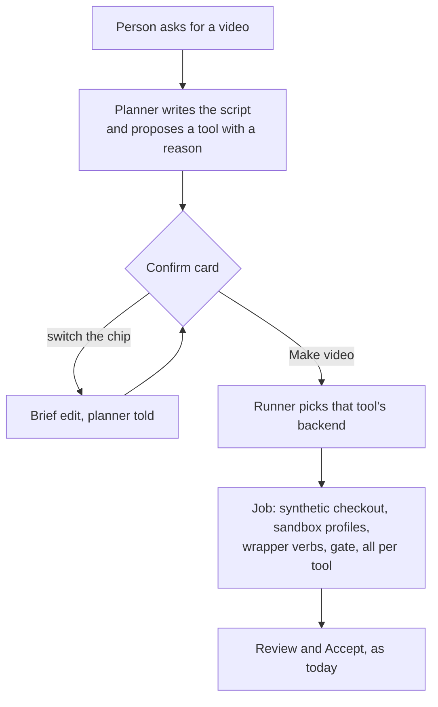

# The studio picks a video tool

How the studio's video path stops being manimkc only. The planner proposes
which of the three video tools makes each video, with a one-line reason; the
confirm card shows that choice as a chip the person can switch; Make video
stays the one approval; and the video runner gains a backend per tool, so a
revideokc video (and later a remotionkc one) is made unattended, inside the
same kind of per-job sandbox manimkc runs in today.

**Status: proposed, 2026-09-30, and built in phases; phases 1 to 3 are
built (2c on 2026-10-03, 3 on 2026-10-04), and a paid end-to-end job of each
tool has passed the gate and been accepted ("Paid end-to-end jobs", below).** The owner asked
for this after [VIDEO-TOOLS.md](VIDEO-TOOLS.md) (#248) wrote down what each
tool is for and a routing procedure for agents at a terminal. The one thing
that could have sunk it, headless Chrome inside the job sandbox, was measured
before this was written ("Chrome inside the job sandbox", below). Numbers
marked *measured* come from that spike on the owner's M4 Pro; every other
number is a guess and says so.

**Why a file of its own** rather than a section of
[STUDIO-VIDEOS.md](STUDIO-VIDEOS.md): that file is the manimkc runner's
design, 1,974 lines, and this change touches every layer of it (the brief, the
planner, the card, the runner, the sandbox, the gate, the accept path) for a
second and third tool. Decisions continue the studio's numbering at D71.

## What changes for the person

A video brief card gains one row: the tool, as a chip ("revideokc"), with the
planner's reason beside it ("real depth and light for the cache levels;
runner-up manimkc"). Once the studio can make more than one tool, pressing
the chip opens a menu of those tools, each with the line that says what it is
best at; a tool the studio cannot make yet is not offered, and the planner's
reason names it as the runner-up instead (D73). Picking another tool is an
edit of the brief, like any other edit, and the planner is told. Make video works exactly
as it does today. After the press the job carries the tool, and a later
change to that video keeps it.

What does not change: every job starts from a press (D29); the planner has no
tools (the seals in `planner.ts`); the brief is the script and the gate holds
the video to it (D48); a studio video lands as a `video` row and blobs (D49);
the spend cap and the settings panel's model and effort (D53) apply to every
tool alike.

## Where the work is

Two read-only surveys of the code (2026-09-30) found the tool is assumed at
every layer, and abstracted at none but the catalog's importer.

| Layer | Today | What changes |
| --- | --- | --- |
| Brief | `VideoBrief` in `services/studio/src/video/brief.ts`; `validateVideoBrief` rebuilds the object from a fixed field list, so an unknown field is dropped | `tool` and `toolReason` fields (phase 1) |
| Planner | `planner-prompt.ts` holds the VIDEO section and data blocks (VOICES, VIDEOS); `PLANNER_VIDEO_FIELDS` in `planner.ts` whitelists what a brief may carry | A TOOLS data block and a paragraph in VIDEO (phase 1) |
| Draft and edits | `brief` is opaque JSON on disk and in `draft.brief` (jsonb); `EDITABLE_VIDEO_FIELDS` picks what `PUT /api/drafts/{id}/brief` may change | Nothing to migrate; `tool` becomes editable through the field list (phase 1) |
| Card | `ConfirmCardVideo.tsx`, read-only; availability from health's `video` block (`videoAvailability` in `lib/studio-drafts.ts`) | A tool chip with a `FilterMenu` switch; availability per tool (phase 1) |
| Runner | `video/runner.ts` sets up a manimkc job inline: `buildCheckout`, three Seatbelt profiles, `scaffold`, `apiListing`, wrapper, guard, clip seeding | Setup moves behind a backend interface (phase 2a) |
| Sandbox | `video/sandbox.ts`: `(deny default)`, exec of Python, ffmpeg and manimkc's trees, one Mach service (Metal), no network | A second profile shape for Chrome (phase 2c, measured below) |
| Wrapper | `bin/video` with verbs `api`, `lint`, `narrate`, `preview`, `build` | Verbs per backend (phase 2c) |
| Gate | Ten steps; step 1 parses Python in the sandbox, step 2 is `manimkc lint`, step 3 matches scene classes, `voiceover` literals and labels | Steps 1 to 3, 7 and 10 per backend; 4 to 6, 8, 9 shared (phase 2c) |
| Accept | `catalog video put`; `SOURCE_NAME` accepts `*.py` and `topic.yml` only | Accepts a revideokc topic's sources; the brief records the tool (phase 2c) |
| Catalog importer | `index/video-tool.ts` already has `VideoToolName` and a descriptor per tool | Nothing |

## Decisions

### D71. The planner proposes the tool, from a data block pinned to VIDEO-TOOLS.md

The planner writes `tool` and `toolReason` in every video brief. It reads the
choice from a TOOLS data block in its system prompt, the same way it reads
VOICES: one line per tool (its name, what it is best at, whether the studio
can make it), the "Pick by what the video needs" rows of
[VIDEO-TOOLS.md](VIDEO-TOOLS.md), top row first, and that page's capability
matrix.

The rows alone are not the routing: VIDEO-TOOLS.md's procedure also puts a
tool the person named first, keeps a series' tool, and checks a second visual
against the matrix. So the video section of the planner's prompt restates
the procedure's steps in the studio's terms, in order: the tool the person
named, when the studio can make it (when it cannot, the planner proposes no
video brief, says so in one line and asks whether an available tool should
make it, as the page's procedure says to on a conflict; a diagram asked for
in the same message still gets its brief); a change keeps its
video's tool; a week
of a series keeps the series' tool; the main visual's row; a second beat the
matrix says that tool cannot do moves the choice to a tool that can do both,
else the beat is simplified; and `toolReason` names the step or row and the
runner-up. Step 1 of the page's procedure (unattended or not) is the TOOLS
block's "available here" column, since every studio video is unattended.

The planner has no tools and never reads a file, so the block is built from
TypeScript constants in `services/studio/src/video/tools.ts`. A test reads
the table and the matrix in VIDEO-TOOLS.md and fails when a constant and the
doc disagree, and the prompt's procedure is quoted in STUDIO-MENTIONS.md and
pinned there as the rest of the prompt is. A change to the procedure's steps
in VIDEO-TOOLS.md still needs the prompt's paragraph changed by hand; the
test holds the rows and the matrix, which are the parts that change most.

`toolReason` is one sentence of at most 160 characters naming the row that
chose the tool and the runner-up, the procedure's step 6. The planner is told
to keep the series' tool for a new week of a series, as the table's first row
says, and that the person can overrule it with one click, so it never argues
for its pick in prose.

**Why not let the runner choose.** The runner sees the brief after the press;
the person should see and be able to change the choice before anything is
spent, and the planner is the one reading the request.

### D72. `tool` is optional, defaults to manimkc, and must be one the studio has a backend for

A brief without `tool` is a manimkc brief, so every draft, job and video from
before this change keeps its meaning with no rewrite. The validator refuses a
tool the runner has no backend for ("revideokc is not in the studio yet"),
the same `BriefError` path a bad voice takes, so the planner hears it as a
STUDIO note and picks again. Whether this machine can run a tool it has a
backend for is the video doctor's answer, checked at the press as today, and
shown on the card as the press's reason; the validator stays a pure function
of the brief, so the planner's brief never changes meaning with the doctor's
mood.

The alternative was letting the planner propose a tool the studio cannot make,
with a "make it at a terminal" hint. Refused: a card whose button cannot work
is worse than a card that names the better tool in its reason ("runner-up
revideokc, not in the studio yet").

### D73. The card shows the tool as a chip, and switching it is a brief edit

The video card gains one row under the summary line: the tool as a chip,
with `toolReason` beside it in `--text2` (or, once a person has switched,
what the new tool is best at). When the studio can make two or more tools,
the chip is a `FilterMenu` trigger whose options are those tools, each with
its strength as the option's `detail` line; a tool the studio cannot make is
not offered, and the planner's reason names it as the runner-up instead. A
menu of one is just the chip, which is all phase 1 shows, and a change card
offers no switch at all, since a change keeps its video's tool (D74). There
is no label:
the chip's content says what it is (DESIGN.md, "Sentence case").

Picking one is `PUT /api/drafts/{id}/brief` with the new `tool` and no
`toolReason` (the planner's was for the old tool), through the existing base
check, so a switch that races a new brief is refused like any
edit. `describeVideoBriefEdit` tells the planner "The person switched the tool
to revideokc", so its next brief keeps the choice. The card is otherwise still
read-only; in-place editing of the script is a separate change.

### D74. The tool is fixed from the press on

Before the press, the tool is a field like any other. The press copies the
brief into the job record, so the job's tool is whatever the card showed. A
`change` brief (D52) edits the source files of its parent video, which only
the parent's tool can read, so the validator refuses a change whose tool
differs from the parent's, and the TOOLS block tells the planner a change
keeps its video's tool. The parent's tool comes from the brief stored on its
`video` row (`source.brief.tool`, absent meaning manimkc).

### D75. One runner, one backend per tool

The video runner keeps everything that is not about a tool: the queue, the
lease, the claim, the agent spawn with its settings and guard, the hang timer
(D54), the gate loop, cost, Accept and Discard. Everything else moves behind
an interface, one implementation per tool, chosen by `brief.tool` at claim
time:

| Backend method | What manimkc's does today |
| --- | --- |
| `toolchain()`, `problems()` | Discovers python, the venvs, kokoro, ffmpeg; the reasons a job cannot run |
| `prepare(job)` | Synthetic checkout, scaffold, clip seeding |
| `profiles(job)` | The render, narrate and gate Seatbelt profiles |
| `env(kind, job)` | The environment each profile runs with, built from nothing |
| `verbs` and `argv(verb, args)` | The wrapper's verbs and what each runs |
| `sourcePattern` | Which files are the video's source (`^[a-z0-9_]+\.py$`, `topic.yml`) |
| `scan(job)` | The gate's steps 1 to 3: parse, lint, structure against the brief |
| `outputs(job)` | Where the deliverable, sidecars and sheets land |
| `manual()`, `prompt(job)` | The agent's system prompt and first message |
| `doctor()` | The fixture render that proves the backend works on this machine |

Phase 2a moves manimkc's code behind it with no change in behaviour: the
profiles it writes must be byte-identical before and after, which a test
checks against the current `buildProfile` output. Only then does a second
backend arrive, so a regression in the move cannot hide inside new work.

**Why not a second runner per tool** (as D43 made the video runner separate
from the diagram one): the video runners would share the queue's one-at-a-time
limit, the cost meter, the gate loop and Accept, and differ only in setup. A
second runner would copy the 1,196 lines of `runner.ts` to change about 200.

### D76. Chrome runs inside the job's Seatbelt profile, with its own sandbox off

revideokc and remotionkc render through headless Chrome driven by puppeteer.
The job profile is the security boundary, as it is for manimkc's Python;
Chrome's own sandbox cannot start inside it (Chrome's children fail with
"sandbox initialization failed: Operation not permitted", *measured*), so
Chrome runs with `--no-sandbox` and every Chrome process is confined by the
job profile instead. The agent's code runs only in Chrome's renderer: Vite
serves `scene.tsx` to the page, and nothing in Node imports it.

What the render profile gains over manimkc's, each measured necessary in the
spike below:

| Rule | Why |
| --- | --- |
| exec: `node`, the Chrome app bundle, `node_modules/@ffmpeg-installer`, `@ffprobe-installer` | The renderer, the browser and its helpers, Revideo's own ffmpeg and ffprobe |
| read: the tool's `node_modules` | Vite resolves the symlinked `node_modules` to its real path |
| network: bind, inbound and outbound on `localhost:<port>` and `<port>+1` only | Revideo's Vite server, one per worker; the port pair is chosen per job and set with `strictPort` |
| puppeteer `pipe: true` | DevTools over a pipe, not a TCP port, so no other port is needed |
| unix sockets and symlink creation under `render/tmp` only | Chrome's `SingletonSocket` and `SingletonLock`; `MAC_CHROMIUM_TMPDIR` points Chrome's temp dir there, because Chrome ignores `TMPDIR` on macOS |
| `mach-register` of `com.google.Chrome.*` | Chrome's `MachPortRendezvousServer` |
| `mach-lookup` of 13 services | Metal's compiler, fonts, logd, the window server, CARenderServer, libinfo, notification_center, FSEvents, diagnosticd, tccd.system, distributed_notifications, launchservicesd, and Chrome's own rendezvous |
| Vite `cacheDir` under `render/cache/vite` | Vite otherwise writes `node_modules/.vite` in the real checkout |
| `DISABLE_TELEMETRY=true` | Revideo's renderer reports to PostHog otherwise; the profile blocks it anyway |

Denied, and measured to cost nothing: the pasteboard, AppleEvents,
LaunchServices' databases (`lsd.*`), coreservicesd, the keychain
(`SecurityServer`, `securityd`), CoreLocation, iCloud (`bird`), Spotlight,
usernoted, the Dock, analyticsd, DNS configuration, and every outside network.

### D77. The gate holds a revideokc video to the brief through `narration.json`

In manimkc the spoken lines are string literals in the scene file, so the gate
parses Python to find them. revideokc keeps the script in `narration.json`
(chapters with their lines), which makes the check simpler: the gate compares
each chapter's name and lines with the brief's scenes and `say` lines, allowing
the respellings D47 allows, and looks for each beat's labels as string
literals in `scene.tsx`. That file is parsed with the TypeScript compiler's
parser by a small Node script run inside the gate profile, the way manimkc's
scan runs Python's `ast` inside the render profile: parsing runs no code, but
every process that reads an agent-written file stays inside a job profile,
and the runner only reads the script's JSON answer. Step 2's lint is
`tsc --noEmit` in the render profile. Steps 4 to 6, 8 and 9 (the topic, the
copy, the probe, the length, the poster) are the same code for every tool.
Step 7 (narration in sync) reads the transcript sidecar, which revideokc
writes in manimkc's shape. Step 10 (the agent looked) needs the agent to have
Read the stills sheet after its last scene edit and the build's sheet after
the last build.

The agent may edit `scene.tsx` and files it adds beside it; `topic.yml`,
`narration.json` and `lib/` are the runner's, written from the brief, as
`topic.yml` is today.

### D78. Narration stays the tool's own verb, run in the shared narrate profile

revideokc's `narrate` calls manimkc's `lib/narration.py` in manimkc's TTS venv,
so the narrate profile, the kokoro model and the per-job clip cache are
manimkc's, reached through `MANIMKC_ROOT` pointing at a read-only view of the
real checkout. The remotionkc session is moving narration into its own
package, gnosia-audio, with a JSON CLI; when that lands, every backend's
narrate step becomes one call to it and this decision is replaced. Until then,
nothing here builds a second narration path.

### D79. The catalog records the tool in the brief, and needs no migration

`catalog video put` widens `SOURCE_NAME` to a revideokc topic's files
(`scene.tsx`, `narration.json`, `topic.yml` and `.ts` or `.tsx` files beside
them), and requires at least one scene file for the tool the brief names. The
brief is already stored whole on the row (`source.brief`), so the tool rides
there; `video list` returns it so a change job can find its parent's tool.
`origin` stays `studio`: a studio video is the studio's, whichever tool drew
it, and the importers never prune it (videos.ts, the `video:` namespace).

### D80. remotionkc is the same interface, built third

remotionkc renders through the same Chrome, so its profile is D76's with its
own bundler's needs. Its backend is phase 3, after revideokc's has been
measured on real jobs, and is coordinated with the session that owns
remotionkc. Remotion's licence is free for this project today (VIDEO-TOOLS.md,
"Risks").

## Chrome inside the job sandbox (the spike, 2026-09-30)

The question that decided whether this design was worth writing: can a
revideokc render run inside a profile as tight as manimkc's? The spike built
a synthetic checkout like a job's (the topic, `lib/`, `src/`, `tools/`, a
symlinked `node_modules`), staged the narration, and ran
`revideokc still <topic> 20s --no-narrate` under `sandbox-exec` with a profile
written from `buildProfile`'s shape, loosening one rule at a time on each
logged denial and then cutting back.

*Measured:*

- The showcase topic (a three.js stage with a spotlight, shadow maps and glass
  cards) renders correctly inside the final profile; the still matches the
  unsandboxed one.
- 40 seconds inside against 27 outside for a 62-second, 1,863-frame topic
  (`still` renders the whole video to cut its frames).
- From Node inside the final profile: Postgres (5432) and the studio runner
  (7250) refused with `EPERM`, the internet unreachable, `~/.ssh`, `~/.zshrc`
  and `apps/web/.env.local` unreadable, a write into the checkout refused, and
  `/usr/bin/open` refused at exec. The job's own port answers.
- The failures on the way, in order: `SingletonLock` (a symlink, denied
  everywhere by the manimkc profile), Chrome's socket directory (it uses the
  Darwin user temp dir, not `TMPDIR`), the socket's `bind`, the rendezvous
  service's registration, Chrome's nested sandbox, the bundled ffprobe's exec,
  and with a tight Mach list, `distributed_notifications` and
  `launchservicesd`.

What the spike did not settle, for phase 2c: a full `build` with two workers
(the second worker's port), the narrate step in the profile, and the doctor's
fixture.

## Phases

Each phase is one PR through the usual loop, in order; a later phase never
lands before the earlier one is merged.

### Phase 1. The tool in the brief

- `services/studio/src/video/tools.ts`: the three tools, their strengths,
  `VIDEO_TOOL_ROUTES` and the capability matrix from VIDEO-TOOLS.md, and
  which the runner has a backend for (manimkc only).
- `brief.ts`: `tool` (optional, default manimkc) and `toolReason` (at most 160
  characters); refuse a tool this machine cannot drive (D72) and a change
  whose tool differs from its parent's (D74).
- `planner.ts`: both fields in `PLANNER_VIDEO_FIELDS`. `planner-prompt.ts`: the
  TOOLS block after VOICES, the routing steps and the JSON example's two
  lines in VIDEO, and the tool in `changingSummary`. STUDIO-MENTIONS.md's quoted prompt
  updated in the same change, since a test compares them.
- `drafts.ts`: the edit note for a tool switch.
- Health's `video` block gains `tools`, each `{ok, reason}`.
- Web: `tool` on the card's brief type, the chip and menu on
  `ConfirmCardVideo.tsx`, the switch through `saveBrief`.
- Tests: validator cases, prompt order and content, the doc-pinning test, the
  edit note, the card's option list.
- Docs: STUDIO-VIDEOS.md's brief table, VIDEO-TOOLS.md's "Not built yet".

Done when: a studio conversation asking for a video shows a manimkc brief with
the tool chip and a reason naming a runner-up, health lists revideokc and
remotionkc as not in the studio yet, and a brief the planner writes with an
unavailable tool is refused and rewritten.

### Phase 2a. The backend interface, manimkc only

Move manimkc's setup, profiles, verbs, scan and outputs behind D75's
interface. No behaviour changes: the written profiles, wrapper and settings
are byte-identical to today's for the same job, checked by a test; the video
suites pass unchanged.

**As built.** `services/studio/src/video/backend.ts` holds `VideoBackend` and
`backendFor(tool)`, which throws for a tool with no backend.
`backends/manimkc.ts` is a facade: each method calls the module that always
did that part, with the arguments the runner used to pass, so `checkout.ts`,
`sandbox.ts`, `seed.ts` and the rest did not move. The runner and the gate
reach manimkc only through it. `test/video-backend.test.ts` compares its
profiles, wrapper, settings and prompts with the old calls, byte for byte.

| Method | What it is |
| --- | --- |
| `tool`, `sourcePattern` | The tool, and which files of a topic folder are its source (what a change starts from) |
| `toolchain()`, `problems(tools)` | Discovery, and why a job cannot run |
| `paths(jobId, slug)` | Every path of the job, resolved |
| `profiles(job)`, `prepare(job)` | The profiles' text; the checkout, profiles and caches written |
| `scaffold(job, brief, startFrom)` | The topic, new or copied from a start; returns the scene classes |
| `wrapper(job, input)` | Writes `bin/video` and returns the library listing for the manual |
| `seed(job, lines, parent)`, `keepClips(job)` | The narration cache before the agent, and the clips kept after a verdict |
| `manual(wrapper, listing)`, `prompt(request)` | The system prompt, and the four user messages as one discriminated request |
| `settings(job, input)` | The permission file around the runner's guard |
| `gateTools(job)`, `checkSource(input, report)`, `sheet(paths, scene)` | The gate's sandboxed tools, its steps 1 to 3, and the sheet step 10 wants Read |
| `sceneUnchanged(input)`, `keepPreviewed(paths, calls)` (optional) | For the gate's own step 10: whether a scene's last look, of an older source, still shows it in the checked one, and the runner's hook to keep each look's source. manimkc's; a backend without them has every look held to the checked source |

The runner keeps the Bash guard and writes the settings file; the gate keeps
steps 4 to 10 and calls `checkSource` and `sheet` (`VideoGateChecks` in
`gate.ts`, manimkc's in `backends/manimkc-gate.ts`). `compareLines` moved to
`lines.ts` so a backend's checks can use it without importing the gate.

Still manimkc-shaped, for phase 2c (and done there: each is a backend method
or an optional gate hook now): the doctor (one per machine, built in
`index.ts` and read by health and the press; a doctor per backend changes
both); the wrapper's verbs (`VERBS` in `calls.ts`, `steps.ts`,
`narrateCall`, and step 10's `preview`); `GateTools.scan` and `lint`; the
`Toolchain` and `VideoPaths` shapes; the source step 5 copies and
`saveSource` keeps (the scene file and `topic.yml`); the `.sheet.png` suffix
the runner watches Reads for; and `routes.ts` and `review.ts`, which still
call `resolvedPaths` and `sheetPath` directly.

### Phase 2b. revideokc, ready to be sandboxed (in c-wenlong/revideokc)

- puppeteer `pipe: true` always; `DISABLE_TELEMETRY=true` always.
- Vite's `cacheDir` under the data root's `cache/vite`, so a render never
  writes into `node_modules`.
- `REVIDEOKC_VITE_PORT` (a base port, `strictPort`) and `REVIDEOKC_CHROME_ARGS`
  honoured by `still` and `build`.
- Then the submodule pointer here, per Workflow 1.

### Phase 2c. The revideokc backend

The synthetic checkout, the profile of D76 with the job's port pair, the verbs
(`api`, `narrate`, `lint` as `tsc --noEmit`, `still`, `build`), the gate
adapter of D77, the manual (from the `revideokc-video` skill and
CAPABILITIES.md, as manimkc's manual came from its skill), the doctor fixture
(a small three.js topic rendered in the profile), `catalog video put` for its
sources (D79), and revideokc enabled in `tools.ts`. Then one paid job end to
end, measured: time, cost, gate verdict, and what the agent Read.

**As built.** `backends/revideokc.ts` is a facade over `video/revideokc/`,
one module per part, as manimkc's is over the modules that always did its
parts. Measured on the owner's M4 Pro against revideokc 41eebf8 (#8, `build
--no-narrate` and `sidecars`): the doctor's fixture (a glass card under a
spotlight with shadows, a 2D title, a spring and a word cue, 8.8 s voiced)
narrated in 7 s, built with two workers in 11.5 s and the whole doctor ran
in 19.5 s, every step inside its profile; the suite's end-to-end job (the
wrapper's `still` and `build`, then the gate with its sandboxed tools)
passes in 21 s.

| Part | As built |
| --- | --- |
| Checkout | `lib/`, `src/`, `tools/`, `package.json`, `tsconfig.json` and `requirements-narration.txt` copied; `docs/CAPABILITIES.md` and `REVIDEO-API.md` copied for the agent to Read; `node_modules` and `.venv` linked to the real checkout's, read-only (open question 2: reuse) |
| Topic | `topic.yml`, `narration.json` from the brief's lines (one chapter per scene, named `<PREFIX><n>_<Name>` as manimkc names its classes) and `revideokc new`'s stub scene, written by the runner |
| Ports | Each job takes an even base in 47000 to 48998, the first pair free on both loopback addresses starting from where a hash of its id points, written to `jobs/<id>/ports.json` and into its profile once; the doctor takes a pair in 46990 to 46998. Below the macOS ephemeral range (49152 up), clear of 7250, 5432 and 3000, and two jobs never run at once. The wrapper checks both ports before a render and names one that is still held |
| render profile | D76, with node's binary alone (the spike allowed its whole store directory) and no shell (the spike allowed `/bin/sh`, `/bin/bash` and `/usr/bin/env`; none was needed), the system ffmpeg the CLI masters and tiles with, `(deny file-link)`, and no Python: `build --no-narrate` starts none |
| narrate profile | node, gnosia-audio's console script and interpreter in revideokc's `.venv`, kokoro's in manimkc's `.venv-tts`, the model; writes the clip cache, the staged clips, the build's work folder and the deliverable's folder (for `sidecars`). gnosia-audio runs on its own environment with `MANIMKC_HOME` at the job's `render/`, so the clip keys are a manimkc job's and the shared cache seeds a revideokc job too. The clip keys run here, since the render profile has no Python |
| gate profile | node, ffmpeg and ffprobe; reads `candidate/` and the TypeScript package; writes the poster |
| Hard links | refused in every profile: gnosia-audio stages clips with a link when it can, and the runner keeps only single-link files, so the staging copies |
| Wrapper | `api`, `lint` (`tsc --noEmit`), `narrate`, `still [frame or 12.5s ...]` (narrate, then `still --no-narrate`), `build` (narrate, `build --no-narrate --workers 2`, then `sidecars` in the narrate profile). The recorded `sceneSha256` is one hash over every source file (`revideokc/source.ts`, the same function compiled into the wrapper) |
| Gate | Steps 1 to 3 as D77, the parse in the gate profile, the whole source held to the catalog's own size limit (one constant, `video-source-limits.ts`), and the labels looked for only in files `scene.tsx` reaches by its imports (why not per scene: the note in `revideokc/gate.ts`); step 5 copies every source file, each held to the hash it was read with; step 10 is the tool's own (`VideoGateChecks.looked`): a still of every scene, of the source the gate checked, its sheet Read before a later still replaced it, and the build's sheet Read after the build |
| Manual | `revideokc-video` rewritten for one command, `revideokc api`'s listing from the real checkout, and the doctor's fixture as the worked scene |
| Doctor | Per backend (`VideoBackend.doctor`): the toolchain, a hostile probe in JavaScript (18 attempts, every one blocked, a listen on a port that is not the job's among them), then the fixture narrated, linted, parsed, built with two workers, its sidecars written and probed. The build's verdict is kept for six hours while the toolchain, the voice and the code a render runs (the checkout's copied files, by content) are unchanged, so a ten-minute refresh does not start Chrome |
| Health and the press | `video.tools[].available` is a tool's own doctor's verdict; the runner refuses a brief on its tool's doctor, and the card blocks the press on it |
| Catalog | `video put` takes `scene.tsx`, `narration.json`, `.ts` and `.tsx` and `topic.yml` for a brief whose `tool` is revideokc, and requires the scene and the narration; a manimkc brief's source is still `.py` and `topic.yml` |

Where this differs from the decisions above, and why:

- **D77 said `narration.json` is the runner's.** The agent may edit it: it
  is the script, the gate's step 3 compares its lines with the brief's and
  reports every reworded or split line, as manimkc's does for its
  `voiceover` literals, and an agent that could not fix a line the voice
  stumbles on, or give a 3D move a `hold`, would be worse off than
  manimkc's. Its chapter names and order are checked exactly, and `hold`
  is at most three seconds.
- **D78 is replaced as it said it would be**: narration is gnosia-audio,
  in revideokc's own `.venv`, run by revideokc's `narrate` verb in the
  narrate profile.
- **A silent revideokc brief is refused** by the validator: revideokc's
  build refuses a video with no sound.

### Phase 3. The remotionkc backend

The same, for remotionkc, with the remotionkc session.

**As built.** `backends/remotionkc.ts` is a facade over `video/remotionkc/`,
as revideokc's is over `video/revideokc/`. What the two TypeScript tools
share moved out of revideokc's modules, which re-export it so their callers
and tests are unchanged: the port scheme and the ports file
(`video/ports.ts`), the source set and its combined hash
(`video/source-set.ts`, parameterised by the scene file's name), the gate's
steps 1 to 3 and 10 (`video/ts-gate.ts`, by the scene file, whether a chapter
may `hold`, and where the sheets are), the parse and `tsc`'s output
(`video/ts-parse.ts`), and the hostile probe (`video/hostile-probe.ts`).

remotionkc needed four changes of its own first, made against its main at
7852514, mirroring revideokc#2 and #8: `build --no-narrate` and a `sidecars`
verb with revideokc's contract; renders made ready for a sandbox
(`tools/render/sandbox.mjs`); and a render that removes its webpack bundle
(about 40 MB under the temporary directory, one left per still and build
before). Measured on the owner's M4 Pro, every allowance below by a render
failing without it, under the default `STUDIO_HOME` (inside this repository):

| Part | As built |
| --- | --- |
| Chrome | Remotion's Chrome Headless Shell, from `node_modules/.remotion` (`npx remotion browser ensure`, once, outside any job), never the system Chrome. It is the build Remotion pins and renders with by default, one binary with no app bundle, and needs one Mach service and its own rendezvous name where revideokc's system Chrome needs thirteen; current Chrome has also dropped the old headless mode Remotion asks a custom executable for. Remotion passes `--no-sandbox` itself |
| Ports | The jobs' range and scheme are revideokc's (47000 to 48998, a pair per job); remotionkc's doctor takes 46980 to 46988, away from revideokc's, since the two doctors refresh on their own clocks. `REMOTIONKC_PORT` pins Remotion's HTTP server (the bundle and its media proxy) to the base and Chrome's DevTools to the next. Remotion picks a free server port from 3000 and passes `--remote-debugging-port=0` (any port), with no option for either beyond the server's `port`; remotionkc rewrites that one argument as Remotion spawns Chrome and stops a render that launched without it, so an upgrade that changes the launch fails loudly. Chrome speaks DevTools over that port, not a pipe: Remotion's launcher has no pipe mode |
| The LAN | Remotion's server listens on every address (`::`), and a Seatbelt rule for `localhost:<port>` allows that listen and the local network's connections to it (measured from another address of this machine). No profile rule found keeps it to loopback, since a listen is checked against the port, not the address. So remotionkc listens on 127.0.0.1 itself when `REMOTIONKC_PORT` is set; measured, the job's port answers on loopback and refuses the LAN during a render. The agent's code runs only in Chrome's renderer, which opens no socket of its own |
| render profile | node; the Headless Shell's folder; Remotion's compositor package (its own ffmpeg and ffprobe); webpack's esbuild binary; TypeScript 7's native `tsc` (the lint); the system ffmpeg and ffprobe the CLI masters and tiles with. Reads the job and remotionkc's `node_modules`. Symlinks only under `render/tmp`, where Remotion links `public/` into its bundle. No unix socket (the Headless Shell keeps no singleton), and Mach: Metal's compiler as an `xpc-service-name` (as a `global-name` the GPU process died and WebGL failed) and Chrome's rendezvous, `org.chromium.Chromium.MachPortRendezvousServer.<pid>`, looked up and registered. No Python, no shell |
| Config searches | browserslist, which webpack asks for a target, walks up from the checkout reading every `package.json` to the root; the repository's, refused, ended the bundle with EPERM (the class of revideokc's Puppeteer bug). remotionkc bounds it with `BROWSERSLIST_ROOT_PATH` at the checkout, the same answer as before: no config. Remotion's own `package.json` lookup finds the checkout's copy first, so no `.puppeteerrc.json` analogue is needed |
| Caches | webpack's cache moved from `node_modules/.cache/webpack` to the data root, but is off in a job (`REMOTIONKC_BUNDLE_CACHE=off`): storing it snapshots every loader's resolution, statting each directory above `node_modules` to the root, and the first refused stat drops the store after the work is spent. A bundle then takes about 6 s where a warm cache took 1.6 s. Bundles and Chrome's profile are under `render/tmp` |
| Telemetry | none: Remotion sends a usage event only when given a license key, and remotionkc passes none; the profile blocks the network anyway |
| narrate profile | revideokc's, for the same gnosia-audio in remotionkc's own `.venv`; `/bin/sh` and the shell macOS runs as `sh` are allowed only when uv wrote the console script in its `#!/bin/sh` form, which it does for an interpreter path too long for a shebang (measured: a checkout under the session's temporary directory got it, and narration died on "Failed to exec /bin/bash as variant for /bin/sh") |
| gate profile | revideokc's, but the parse uses the studio's own TypeScript (6), since remotionkc's TypeScript 7 is a native compiler with no JavaScript API; the parse needs only the syntax |
| Wrapper | `api`, `lint` (the native `tsc`, run directly), `narrate`, `still` (narrate, then `still --no-narrate`), `build` (narrate, `build --no-narrate` at remotionkc's concurrency of three, then `sidecars` in the narrate profile), with revideokc's pipes, held-port check and records |
| Checkout | `lib/`, `src/`, `tools/`, `package.json`, `tsconfig.json`, `remotion.config.ts` and `requirements-narration.txt` copied; Remotion's markup guides (the `remotion-markup` part of the skill remotionkc vendors) copied to `docs/remotion/` for the agent; `node_modules` and `.venv` linked |
| Topic | `topic.yml`, `narration.json` from the brief, and `remotionkc new`'s composition with its one word cue taken out (it cued "scene", which a brief's line need not say, and a cue on an unsaid word throws) |
| Gate | Steps 1 to 3 and 10 as revideokc's, on `composition.tsx`; a chapter's `hold` is refused by name, since remotionkc holds a scene with `extraFrames` in code |
| Manual | `remotionkc-video` and remotionkc's cue, determinism and gotcha sections rewritten for one command and no network (no `@remotion/google-fonts`, no remote media), `remotionkc api`'s listing, and the doctor's fixture as the worked composition |
| Doctor | revideokc's checks, on a fixture of a bar chart that springs up on a word with a KaTeX formula, then a lit three.js card whose shadow turns (`@remotion/three`). Under the default `STUDIO_HOME` the whole doctor took 61 s: 19 s to voice two lines in a fresh job cache (the model load is most of it), 40 s for the build (6 s of it the bundle) |
| Tests | `test/video-remotionkc.test.ts` (31: profiles, environment, ports, source, checkout, scaffold, permissions, wrapper, gate) and `test/video-remotionkc-sandbox.test.ts` (4, real: the probe's 18 attempts blocked, the port pair and no other, the wrapper with its streams on a refused file, and `lint`, `still`, `build` and the gate under a refused `package.json` with a browserslist key above the studio home), 46 s |
| Catalog | `video put` takes `composition.tsx`, `narration.json`, `.ts`, `.tsx` and `topic.yml` for a brief whose `tool` is remotionkc, and requires the composition and the narration |

Where this differs from the decisions above, and why:

- **D76's table is revideokc's.** remotionkc's profile is narrower on
  Mach (two rules against fourteen) and has no unix sockets, but its exec
  list is longer (compositor, esbuild, `tsc`), and its network rule needed a
  change in the tool rather than the profile (the LAN row).
- **D80 said "with the remotionkc session".** The remotionkc changes were
  made here, as commits on a branch of remotionkc for that repository's
  review, and the submodule pointer moves once they merge (Workflow 1).
- **A silent remotionkc brief is refused**, as revideokc's is: its build
  refuses a video with no audio.

## Paid end-to-end jobs

One real job per new backend, posted to a runner as a brief (`POST
/api/jobs`), made by Opus 5.5 at the studio's default effort, reviewed and
accepted. Measured on the owner's M4 Pro.

| | revideokc (2c) | remotionkc (3) |
| --- | --- | --- |
| Video | "The datacenter storage hierarchy in depth", a lit three.js stack of storage tiers, 3 chapters | "How fast functions grow", growth curves on real axes, 3 chapters |
| Job | 15.6 min, $3.39, 57 turns | 9.8 min, $1.94, 28 turns |
| Wrapper calls | 3 `api`, 5 `lint`, 5 `still` (about 32 s render each), 1 `build` (31 s render), 1 refused for a bad argument | `api`, 3 `lint`, 3 `still` (about 20 s render each, 38 s narration the first time), 1 `build` (88 s render) |
| Gate | All ten steps; 60.8 s against 58 s predicted | All ten steps; 63.5 s against 60 s predicted |
| Landed | `storage-hierarchy-depth`, 2026-10-03 | `growth-rates-on-a-chart`, 2026-10-04 |

Neither first attempt was this clean. The first revideokc job failed the gate
after $5.51: Claude Code 2.1.287 runs the agent's Bash with stdout and stderr
on a file under `/private/tmp`, the wrapper passed those descriptors into the
sandbox, the profiles deny reading there, and node aborts at start when it
cannot fstat its standard streams, so every call died in about 20 ms (#274
gives each step pipes of the wrapper's own; #276 does the same for manimkc's
wrapper). Before that, the revideokc doctor had failed on the owner's machine
alone: with `STUDIO_HOME` at its default inside the repository, Puppeteer's
upward config search read the repository's denied `package.json` (#272). A
job whose wrapper calls keep dying at start is now stopped after three, as
`toolchain` (#277). The tests had kept `STUDIO_HOME` under the temporary
directory and missed both; the real-sandbox suites now put a denied
`package.json` above their studio home and run the wrapper with its output on
a denied file.

## Open questions

None blocks phase 1. For later work:

1. Whether two jobs of different tools may run at once. The video runner runs
   one job at a time today (`config.ts`); a Chrome render and a ManimGL render
   compete for the same cores, so one at a time stays until measured.
2. Whether a revideokc job should reuse the checkout's `node_modules` read-only
   (the spike did) or install its own. Read-only reuse is what the spike
   measured and costs nothing; an install per job would take minutes and the
   network the profile denies.
3. Whether revideokc's narrate profile needs the same shells remotionkc's
   does. It allows `/bin/sh` and not the shell `sh` runs, so a revideokc
   checkout at a path long enough for uv to write `#!/bin/sh` console scripts
   would fail its narration the way remotionkc's did before `scriptShells`.
   The owner's checkout is not at such a path today.
