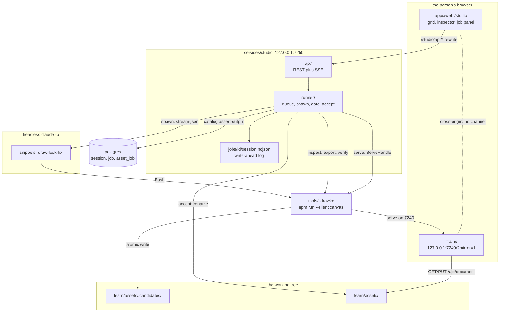
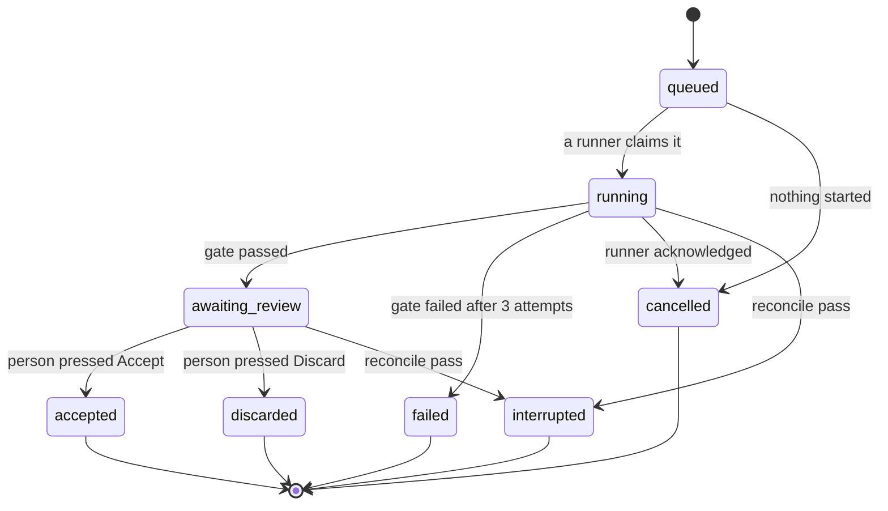

# The diagram studio

A local screen for the diagrams in [`learn/assets/`](../learn/assets): browse
them, open one on a live tldraw canvas, and ask an agent to draw a new version.
One user, one machine, one job at a time.

**What it is not.** Not a deployed surface: D7 in
[`tools/tldrawkc/docs/DECISIONS.md`](../tools/tldrawkc/docs/DECISIONS.md) keeps
the Vercel app the course encyclopedia, and a headless browser with filesystem
access has no place in that build. Not multiplayer: D3 settled that the human
view is a page that polls a file. Not a replacement for the
[`tldrawkc-diagram`](../.claude/skills/tldrawkc-diagram) skill, which is the
same loop driven from a terminal and stays the way a diagram gets drawn inside a
`/learn` session.

**How it works, in one paragraph.** A person fills in a brief. The runner queues
it as a `job` row, spawns a headless Claude Code session with a permission file
that lets it write exactly two paths under `learn/assets/.candidates/`, and
watches its stdout. The agent draws through `npm run --silent canvas`, the same
CLI the skill uses. When it exits, the runner checks the work itself with
`inspect`, `export` and `verify` rather than believing the agent, and the job
stops at `awaiting_review`. Nothing under `learn/assets/` has changed yet. The
person compares before and after and presses Accept, which renames the candidate
into place, re-exports the SVG and writes one `asset_job` row through the
catalog. Committing is still the person's job.

## Read order

| Document | Why you would open it |
| --- | --- |
| This file | The whole design: schema, runner, UI, decisions, roadmap |
| [`AGENTS.md`](../AGENTS.md) | The rules already in force, including the submodule and `--silent` traps this design obeys |
| [`tools/tldrawkc/AGENTS.md`](../tools/tldrawkc/AGENTS.md) | The tool's operating manual: verbs, exit codes, the metadata bag |
| [`tools/tldrawkc/docs/DECISIONS.md`](../tools/tldrawkc/docs/DECISIONS.md) | D1 to D43, which this design inherits and does not reopen |
| [`tools/tldrawkc/docs/ARCHITECTURE.md`](../tools/tldrawkc/docs/ARCHITECTURE.md) | The layering rules the agent runs inside |
| [`tools/tldrawkc/docs/CLI.md`](../tools/tldrawkc/docs/CLI.md) | Every verb, flag, JSON shape and exit code |
| [`services/catalog/SCHEMA.md`](../services/catalog/SCHEMA.md) | The tables the studio tables sit beside, and why each is shaped that way |
| [`services/catalog/LEARN.md`](../services/catalog/LEARN.md) | What each `learn/state/*` file became. The file-to-table mapping this design copies |
| [`CONTRIBUTING.md`](../CONTRIBUTING.md) | The gate and the PR loop every phase below ships through |

Read this file top to bottom once. After that the sections stand alone, and a
fact stated in one is cross-referenced rather than repeated in the others.

## Architecture

### The layers

| Layer | Where | What it owns |
| --- | --- | --- |
| UI | `apps/web/src/app/studio/` | The conversation with the person: the grid, the inspector, the brief form, the job panel, the accept screen. Holds no job state of its own |
| API | `services/studio/src/api/` | HTTP on `127.0.0.1:7250`. JSON in, JSON out, plus one SSE stream per job |
| Runner | `services/studio/src/runner/` | Jobs. Brief in, reviewed candidate out. Spawns the agent, constrains it, supervises it, checks its work, records what happened. Never draws |
| Agent | a headless `claude -p` session | The drawing. Writes snippets, runs the draw-look-fix loop, reads its own screenshots. The only model call in the system |
| Catalog | `services/catalog/src/` | The index. Gains one command, `assert-output`, and one migration |
| Tools | `tools/tldrawkc/`, `tools/manimkc/` | The canvas and the renderer. Neither changes for the studio |

### The pieces and the flow



### Rules the code must obey

Modelled on the tool's own layering rules, and enforced the same way: a grep
test where a grep test is possible, a named reviewer check where it is not.

1. **The UI never spawns an agent, never opens a browser, and never writes a
   file.** Everything it does is an HTTP call to `services/studio/`. A React
   component importing `node:child_process` is a failing test.
2. **The runner is the only thing that writes outside the candidates folder.**
   The agent's permission file allows exactly the two candidate paths and the
   job scratch directory. The single write outside them is the accept rename,
   and it happens after a person pressed Accept.
3. **The runner never runs a mutating git command.** It reads
   `git status --porcelain` as a backstop check and nothing else. No `add`, no
   `commit`, no `checkout`, no `stash`. See D6 below.
4. **The agent's word is never enough.** Every claim about the output is
   re-established by the runner's own subprocess calls before a job leaves
   `running`.
5. **Every path the studio computes is repo-relative and resolved through one
   module.** `services/studio/src/paths.ts`, the same discipline
   `tools/tldrawkc/src/lib/paths.ts` keeps. The repo root comes from
   [`apps/web/src/data/repo-root.ts`](../apps/web/src/data/repo-root.ts)'s rule,
   walking up to the directory holding `content/courses`, because the studio
   does not run from the repo root either.
6. **Nothing in the studio writes an `asset` row itself.** It calls
   `catalog assert-output`, which runs the owning indexer's reader. There is one
   implementation of what a diagram asset row looks like.
7. **The disk record is written before the database row.**
   `jobs/<id>/session.ndjson` and `jobs/<id>/job.json` are the write-ahead log;
   Postgres is the query surface. See D3 below.
8. **Progress is a cache, never the record.** Every SSE event is appended to the
   ndjson before it is pushed. A UI that never connects to the stream shows the
   right thing from `GET /api/jobs/{id}`.
9. **The studio adds no chrome inside the tldraw iframe.** Every corner and both
   bottom edges are taken. See D12.
10. **`npm run` calls carry `--silent`.** Both `canvas` and `learn` print a
    two-line npm banner otherwise, and `--json` output is then unparseable. The
    root [`AGENTS.md`](../AGENTS.md) names this as a trap that cost time once.

## The schema

Three new tables and one changed column, as migration `0006`. Nothing else in
the catalog moves.

What this deliberately leaves alone:

- **The content half stays derived.** `asset`, `asset_topic`, `asset_concept`
  and `asset_derivation` keep their shapes and keep being written by the
  indexers in [`services/catalog/src/index/`](../services/catalog/src/index/).
  No asset kind is added: a diagram is a kind `asset` already has.
- **`event` keeps its five types.** A render failure is not evidence about a
  learner, nothing projects it into `mastery` or `review`, and `learn void`
  cannot retract it. Widening `EVENT_TYPES` in
  [`packages/schema/src/shared.ts`](../packages/schema/src/shared.ts) would put
  rows in the log that no reader reads.
- **manimkc's SQLite job index stays where it is.** See D5.
- **No migration is edited.** `SCHEMA.md` already gives the reason: drizzle keys
  applied migrations by the sha256 of the file.

### New and changed tables

| Table | New or changed | Columns that carry meaning |
| --- | --- | --- |
| `session` | New | `id` PK (text, minted by the caller), `kind` (`tutor`\|`studio`), `learner_id` FK, `state`, `title`, `goal`, `agent_session_id` (the headless session, for resume), `log_asset_id` FK nullable, `started_at`, `ended_at`, `heartbeat_at`, `error_kind`, `error`, `metadata` jsonb |
| `job` | New | `id` PK, `kind` (`diagram` today), `session_id` FK nullable, `parent_job_id` FK nullable, `state`, `phase`, `topic_slug` FK not null, `target_path`, `candidate_path`, `target_hash_before`, `brief` jsonb, `gate` jsonb, `idempotency_key` unique, `attempt`, `requested_at`, `started_at`, `finished_at`, `reviewed_at`, `heartbeat_at`, `cancel_requested_at`, `runner`, `runner_job_id`, `exit_code`, `turns`, `cost_usd`, `error_kind`, `error`, `error_detail` jsonb |
| `asset_job` | New | `asset_id` PK FK, `job_id` PK FK, `content_hash` (what the job wrote), `bytes`, `written_at` |
| `event` | Changed | `session_id` becomes a foreign key to `session(id)`, `ON DELETE RESTRICT ON UPDATE CASCADE`. The column, its type and its index are unchanged |

`target_path` is the committed path the job intends to land on, which is also
the lease key. `candidate_path` is where the job actually writes, under
`learn/assets/.candidates/`. Until a person accepts, `target_path` names a file
the job has never opened. D2 is where that split comes from.

Indexes beyond the primary keys, following the rule in `SCHEMA.md` that every
foreign key column gets one: `session(kind, state)`, `session(started_at)`,
`job(session_id)`, `job(state)`, `job(topic_slug)`, `job(parent_job_id)`,
`job(requested_at)`, `asset_job(job_id)`.

One partial unique index does real work:

```sql
CREATE UNIQUE INDEX job_active_target_key ON job (target_path)
  WHERE state in ('queued', 'running', 'awaiting_review');
```

Two jobs cannot hold the same committed path at once, and an unaccepted
candidate keeps holding it, because the second brief was written against what
the first has not landed yet. See edge cases S3 and A6.

### Where these sit

`SCHEMA.md` splits the catalog into content (derived from files), state (the
only copy) and operational (`index_run`, `mirror`). The studio tables are a
fourth group.

They have the state half's durability: losing them loses the brief and the
failure record, and no re-index writes those back. They have none of its
meaning: a render error is not a thing a learner did, and putting it beside a
BKT belief would make both harder to read. So
[`packages/schema/src/index.ts`](../packages/schema/src/index.ts) gains
`STUDIO_TABLES = ["session", "job", "assetJob"]`, counted apart by
`catalog status` the way `OPERATIONAL_TABLES` already is.

### Session lifecycle

| State | Meaning |
| --- | --- |
| `running` | A process is alive and writing heartbeats |
| `closed` | Ended normally. `ended_at` set |
| `failed` | The agent exited non-zero. `error_kind` and `error` set |
| `cancelled` | The user stopped it and the runner acknowledged |
| `interrupted` | The process died. Found by the reconcile pass, never written by the process itself |

Transitions: `running` to `closed` on `learn session close` or a studio runner
exiting 0; `running` to `failed` on a non-zero exit the runner observed;
`running` to `cancelled` when the runner acknowledges a cancel request;
`running` to `interrupted` by the reconcile pass at studio start. Every other
transition is refused, and the four terminal states are terminal.

A `tutor` session only ever uses `running`, `closed` and `interrupted`.

### Job lifecycle

| State | Meaning |
| --- | --- |
| `queued` | Accepted, no runner has claimed it |
| `running` | Claimed. `session_id` and `started_at` are set |
| `awaiting_review` | The candidate is written and the gate passed. Nothing under `learn/assets/` has changed |
| `accepted` | A person accepted it. The candidates were renamed into place and one `asset_job` row exists per file the job landed. That is two when the SVG exists and one when it does not, which is the gate's exit 4 case |
| `discarded` | A person rejected it. The candidate is gone |
| `failed` | The runner reached a verdict and it was no |
| `cancelled` | Stopped on request, acknowledged by the runner |
| `interrupted` | The runner died mid-job |



`queued` to `running` is a conditional update (`WHERE state = 'queued'`) so two
runners cannot both claim it. `queued` to `interrupted` is not a transition: a
queued job survives a restart. `awaiting_review` to `interrupted` is, because
the candidate outlives the process that wrote it and a restart has to decide
whether it is still trustworthy.

`phase` is not a state. It is free text the runner writes for the progress list:
`reading`, `planning`, `drawing`, `linting`, `exporting`, `verifying`,
`ready`. Keeping it out of `state` is what lets `state` stay small enough to
guard a transition with, while the panel shows a real step count.

`cancel_requested_at` is a timestamp, not a state. A job being cancelled is
still running until the runner has killed Chromium, and the row should say so.

### The write path

The studio does not write `asset` rows. On accept it calls one command, and that
command is the indexer:

```bash
npm run --silent catalog -- assert-output --job <job-id> --path <repo-relative-path>
```

It runs the owning source's reader over that one file, through the refusal rules
already in
[`services/catalog/src/index/diagrams.ts`](../services/catalog/src/index/diagrams.ts)
and [`services/catalog/src/index/tldr.ts`](../services/catalog/src/index/tldr.ts),
then writes the `asset` upsert and the `asset_job` row in one transaction. D1 is
why this rather than `catalog index --only diagrams`.

Three things make a retried accept idempotent:

- **The asset id is a pure function of the path**, per `ASSET_PREFIX` in
  [`services/catalog/src/index/source.ts`](../services/catalog/src/index/source.ts).
  Asserting twice is one upsert twice.
- **`asset_job` is keyed by `(asset_id, job_id)`.** A second assert of the same
  file by the same job is `ON CONFLICT DO UPDATE` on the hash and the bytes.
- **Every state transition is a conditional update.** `WHERE state = <expected>`,
  so a replayed finish against a row already `accepted` writes nothing and
  reports that it wrote nothing.

Enqueue is idempotent separately, through the unique `job.idempotency_key`
supplied by the caller. A retried submit returns the existing job id instead of
queueing the render twice.

## The API and the runner

### Who owns what

The two-process split matters. The root `package.json` reserves `services/*` for
long-lived processes and CLIs, and `apps/*` for deployable surfaces. A job queue
inside a Next dev server dies on every hot reload, so the queue is
`services/studio/` on `127.0.0.1:7250` and `apps/web` rewrites `/studio/api/*`
to it. The rewrite, rather than a cross-port fetch from the browser, is so the
page sees one origin and SSE needs no CORS. D11 covers why the UI still lives in
`apps/web` and how it stays out of production.

### The job API

Route conventions follow [`apps/web/src/app/api/`](../apps/web/src/app/api):
JSON in and JSON out, an `{ error, detail }` envelope on failure,
`runtime = "nodejs"`, and the validate-then-act shape of
[`apps/web/src/lib/learner-api.ts`](../apps/web/src/lib/learner-api.ts). The
same-origin and rate-limit guards in
[`apps/web/src/lib/agent/guard.ts`](../apps/web/src/lib/agent/guard.ts) are not
carried over: the runner binds loopback only, which is a stronger boundary than
either.

| Method | Path | Purpose | Request | Response |
| --- | --- | --- | --- | --- |
| `POST` | `/api/jobs` | Queue a job from a frozen brief | `Brief` | `201 { jobId, state: "queued", jobsAhead, note }` |
| `GET` | `/api/jobs` | List jobs, newest first | `?limit=25&state=running` | `{ jobs: [{ jobId, title, target, state, turns, costUsd, updated }] }` |
| `GET` | `/api/jobs/{id}` | One job, current state | none | `{ jobId, state, phase, brief, attempt, artifacts, gate, costUsd, error, note }` |
| `GET` | `/api/jobs/{id}/events` | Live progress, SSE | `Last-Event-ID` on reconnect | `text/event-stream` of `phase`, `step`, `gate`, `done` |
| `GET` | `/api/jobs/{id}/log` | Windowed raw log | `?from=0&limit=200` | `{ lines, from, next, total }` |
| `POST` | `/api/jobs/{id}/cancel` | Stop a running or queued job | none | `{ jobId, state: "running" \| "cancelled", cancelRequestedAt }` |
| `POST` | `/api/jobs/{id}/accept` | Land the candidate | none | `{ jobId, state: "accepted", written, indexed, note }` |
| `POST` | `/api/jobs/{id}/discard` | Delete the candidate | none | `{ jobId, state: "discarded" }` |
| `POST` | `/api/jobs/{id}/revise` | Resume the stored session with a change request | `{ changes }` | `{ jobId, state: "queued" }` |
| `GET` | `/api/health` | What is and is not working right now | none | `{ ok, tldrawkc, chromium, claude, postgres, queueDepth, costLast24h }` |
| `POST` | `/api/mirrors` | Open a human canvas on one file | `{ file }` | `{ file, url, port }` |
| `DELETE` | `/api/mirrors` | Close one | `?file=…` | `{ closed: true }` |
| `GET` | `/api/mirrors` | What is open, and whether each is answering | none | `{ mirrors: [{ file, url, port, openedAt, healthy }] }` |

`state` is the `job` column from the schema section and means exactly what it
says there. `phase` refines `running`. Every response carries a `note`, the
plain-English line manimkc's `_enrich_status` in
[`tools/manimkc/server/app.py`](../tools/manimkc/server/app.py) adds, for the
same reason: a caller should never have to guess what a state means.

**Progress is streamed, and the polled GET stays authoritative.** A job is three
to twenty minutes of an agent working, and the interesting part is the
draw-look-fix loop, which moves irregularly. SSE costs nothing here because the
runner already holds the agent's stdout, so the stream is a subscription to an
in-process emitter. Rule 8 above is what keeps it honest.

### The brief

Modelled on the "Brief (required fields)" block in
[`tools/manimkc/server/DESIGN.md`](../tools/manimkc/server/DESIGN.md). A job
cannot start until every required field is filled, and the UI's job is to ask
rather than to guess.

| Field | Required | What it feeds |
| --- | --- | --- |
| `intent` | yes | One or two sentences on what the diagram has to make clear. The prompt's opening, and what the person reads back when judging the result |
| `topic` | yes | `meta.tldrawkc.topic`, and `job.topic_slug`. Must already exist in [`content/topics.yaml`](../content/topics.yaml) |
| `slug` | yes | The paths: `learn/assets/<slug>.tldr` is `target_path`, `learn/assets/.candidates/<slug>.tldr` is `candidate_path` |
| `title` | yes | `meta.tldrawkc.title`, the `<title>` an `export --svg` stamps, and the card label |
| `mode` | yes | `new` or `extend`. `new` refuses an existing target, `extend` refuses a missing one. The agent never decides this |
| `elements` | yes | Ordered `{ label, note }`. The things that must appear. The agent's checklist and half the gate |
| `relations` | yes, may be empty | Ordered `{ from, to, label }`. Each becomes a bound arrow through `helpers.connect`, which is layering rule 6 in the tool's `ARCHITECTURE.md` |
| `concepts` | no | `meta.tldrawkc.concepts`, the concept slugs under that topic |
| `layout` | no | A hint: `flow-lr`, `layered`, `comparison`, `radial` |
| `mermaidPath` | no | A pasted flowchart, written to the job scratch directory and lifted with `from-mermaid`. The text never enters the prompt |
| `source` | no | `meta.tldrawkc.source`: the concept note path or session id that prompted the diagram |
| `model` | no | `sonnet` (default) or `opus`. Drawing loops are mechanical, so the default is the cheaper tier |
| `notes` | no | Anything else the person wants the agent to know, as data |

`slug`, `topic` and each concept are checked against tldrawkc's exported
`SLUG_PATTERN` before they are stored, so none can carry a paragraph.

### Runner constraints

Each with the reason it exists.

- **Working directory is the repo root.** `learn/assets/` is repo-relative,
  `content/topics.yaml` is repo-relative, and `npm run --silent canvas` only
  resolves from there. manimkc's `agent.run_claude` does the same with
  `cwd=ROOT`.
- **A per-job `--settings` file, written into the job workspace.** This is the
  primary control, not the prompt. Deny `Write` and `Edit` everywhere, then
  allow exactly `learn/assets/.candidates/<slug>.tldr`,
  `learn/assets/.candidates/<slug>.svg` and the job scratch directory.
  Permission rules fail an injected instruction; prompt wording only discourages
  it. Note that `learn/assets/<slug>.tldr` is denied, so the agent cannot reach
  the committed file at all.
- **`--allowedTools Bash,Read,Write,Edit,Glob,Grep,TodoWrite`, and `Bash` is an
  allowlist rather than a deny list.** This is the correction the first draft
  needed. A deny list over `rm`, `mv`, `git`, `node` and the network tools does
  not constrain `Bash` at all: a shell redirect, `cp`, `tee`, `printf >`, `sed
  -i` or `python3` writes anywhere in the tree, and the `Write` and `Edit`
  allowlist has no say over any of it. So the settings file allows a fixed set
  of command prefixes and denies everything else:
  `Bash(npm run --silent canvas:*)`, `Bash(cat:*)`, `Bash(ls:*)`,
  `Bash(head:*)`, `Bash(wc:*)`. The deny entries stay as belt and braces, not as
  the boundary.
- **The residual hole, named rather than hidden.** `canvas run <file> --code
  <snippet>` takes an output path as an argument, so even the allowlist lets the
  agent write a `.tldr` or a `.png` outside the candidates directory. Three
  things sit on that and none of them is airtight: the prompt names the
  candidate path and nothing else, `--settings` denies `Write` and `Edit` so the
  snippet file itself has to live in the scratch directory, and the backstop
  below catches it after the fact. The real fix is an OS-level filesystem
  sandbox around the agent process, which is a known gap below and not a thing
  this design invents.
- **A narrowed clean-room rule.** The agent may read `canvas api`, the tool's
  [`HELPERS.md`](../tools/tldrawkc/docs/HELPERS.md), its own candidate and the
  concept note named in `source`. Other files under `learn/assets/` are denied,
  with one exception: in `extend` mode the runner copies the committed `.tldr`
  to the candidate path before the agent starts, so extending reads the copy
  rather than the original. manimkc's reason carries: lifting an existing
  document is how every diagram ends up looking like the first one.
- **`--session-id` assigned and persisted before the agent launches.** This is
  the fix manimkc already made after losing progress on a restart. A kill at any
  point leaves a resumable session.
- **`--output-format stream-json`**, so the runner parses turn events as they
  arrive, appends each raw line to `session.ndjson` and pushes a condensed one
  to SSE subscribers.
- **`--max-turns 60` per attempt**, capped server side regardless of the brief.
- **Three timers: 15 minutes per attempt, 45 minutes per job, 5 minutes idle.**
  A diagram job is Chromium launches and short renders, not a video render, so
  manimkc's 3600 is far too loose. The idle timer catches a browser that never
  answered the bridge, where the CLI's own 30 second exec timeout never fires.
  All three numbers are guesses and belong in the open questions.
- **Concurrency 1.** Every tldrawkc verb launches its own Chromium (D2:
  stateless commands, no daemon), and one job is four or more of them at a
  1904 px viewport and pixel ratio 2. A `STUDIO_CONCURRENCY` knob exists,
  defaults to 1 and is capped at 2.
- **Job state is the ndjson plus `job.json` on disk, mirrored into Postgres.**
  D3 says which is which.

### The gate

The runner's own subprocess calls, in this order, after the agent exits:

1. The candidate `.tldr` exists and is newer than the job start.
2. `canvas -- inspect <candidate> --json` exits 0 or 3, and reports at least one
   shape. Exit 3 is lints remaining, which is a finished diagram with findings,
   not a failure.
3. The metadata names a topic, and that topic is in `content/topics.yaml`.
4. `canvas -- export <candidate> --svg <candidate-svg>` runs. Exit 4 means the
   document saved and the export did not, which is recorded and not fatal.
5. `canvas -- verify <candidate-svg> --json` exits 0, when step 4 produced a
   file.

A zero exit from the agent with nothing written is step 1 failing and needs no
special case. A step 2 or 3 failure is fed back as a resume prompt carrying the
specific finding, up to three attempts total. After that the job is `failed`
with the gate's findings, and the partial artifacts are moved to
`jobs/<id>/rejected/` so a person can look.

**The agent's exit code is not a tldrawkc exit code.** The agent runs the CLI
many times and the runner sees only the session's own exit. The tldrawkc codes
that reach a job come from the gate's own calls, and they are stored in
`job.gate` rather than in `job.exit_code`. A code 1 or 2 the agent hit mid-loop
appears in the transcript and in the narration, never as a job state. D4 is the
mapping.

### Accept and discard

**Everything that can fail happens before anything lands.** Accept finishes the
artifacts in the candidates directory first, and only then moves them. The
alternative, renaming first and exporting onto the committed path, leaves the
target replaced and the candidate gone when the export fails, with the job still
`awaiting_review`: a retry cannot repeat a rename that already happened and
Discard cannot delete a candidate that has moved. So the order is:

1. `canvas -- export <candidate> --svg <candidate.svg>`, skipped when the gate
   already produced one. This is the step an exit 4 job never got.
2. `canvas -- verify <candidate.svg> --json`, because the tool's own rule is
   that the loop does not end at `export`.
3. `rename(candidate.tldr, target.tldr)`, then
   `rename(candidate.svg, target.svg)`. Each is atomic, because
   `learn/assets/.candidates/` is a sibling directory and not the OS temp
   directory, so each file is either the old one or the new one.
4. `catalog assert-output --job <id> --path learn/assets/<slug>.tldr`, then the
   same for the `.svg`. A `job` conditional update to `accepted` last.

Two failure windows remain and both are recoverable by construction. A failure
in step 1 or 2 changes nothing under `learn/assets/`, so the job stays
`awaiting_review` and Accept, Discard and a follow-up job are all still
available. A failure between the two renames in step 3 lands a new `.tldr` with
the old `.svg` beside it, which is exactly the SVG-stale state U9 already
models: the pill goes stale and one click on Export SVG fixes it. The one thing
the runner keeps for that window is the previous `target.tldr` hash in
`job.target_hash_before`, so the panel can say which version is on disk.

Step 4 is the only step that needs Postgres. With the database down, steps 1 to
3 still run and the job lands as `accepted` with `indexed: false` and the
reason, which the UI surfaces as a Reindex button. The files are the output; the
index is derived.

Discard deletes both candidates and writes `discarded`. Neither is undoable
inside the studio, and the panel says so in one line: git is the undo.

### The canvas

The studio imports `serve` from `tldrawkc` and holds one `ServeHandle` per open
document. The two rejected options were extending `serve` to many documents,
which is a change to the tool that only the studio wants and reopens the daemon
question D2 settled, and mounting the mirror bundle inside the studio, which
duplicates `/api/document` and would drift from the tool's own route. That is
the local-copy-shadows-the-plugin failure this repo already names in
[`AGENTS.md`](../AGENTS.md).

**The iframe is cross-origin and there is no channel through it.** It is
`http://127.0.0.1:<port>/?mirror=1`, a different origin from the studio page.
D13 records what follows.

## The UI

### What the good ones do

| Source | The choice | Adopt | Why |
| --- | --- | --- | --- |
| [tldraw UI components](https://tldraw.dev/sdk-features/ui-components) | Named zones: MenuPanel top-left, StylePanel top-right, Toolbar bottom-centre, NavigationPanel bottom-left, HelpMenu bottom-right. TopPanel top-centre is the one empty slot | Yes, as a keep-out map | The studio embeds tldraw's full UI through serve mode. Every edge of that rectangle is spoken for, so all studio chrome goes outside the frame |
| [tldraw TLComponents](https://tldraw.dev/reference/tldraw/TLComponents) | Every slot can be set to `null`, including `PeopleMenu`, `CollaboratorCursor`, `SharePanel`, `CursorChatBubble` | Not now | The mirror page mounts a plain `<Tldraw>` with no `components` prop. Passing `null` is a change to `tools/tldrawkc/src/page/mirror.tsx`, not to the studio. An open question |
| [Figma right sidebar](https://help.figma.com/hc/en-us/articles/360039832014-Design-prototype-and-explore-layer-properties-in-the-right-sidebar) | Left is structure and navigation, right is the properties of what is selected | Yes | The whole rule the studio needs. Left rail lists the corpus, right panel holds the one diagram and whatever is happening to it |
| [Figma left sidebar](https://help.figma.com/hc/en-us/articles/360039831974-Explore-the-navigation-bar-and-left-sidebar) | Drag-resizable sidebar plus a shortcut that collapses the whole UI | Collapse yes, resize no | The canvas needs width. Resizing is a preference nobody asked for; a one-key collapse is the thing that pays |
| [Figma file thumbnails](https://help.figma.com/hc/en-us/articles/360038511413-Set-custom-thumbnails-for-files) | Thumbnails rendered from a 1920x1080 frame, 16:9, scaled to fill | Ratio rejected, fixed ratio adopted | The two real exports measure 1367x1167 and 1537x1236, near 7:6. Cropping those to 16:9 cuts off the drawing, which is the only thing a person scans for. 4:3, contained, never cropped |
| [Figma forum on inconsistent thumbnail ratios](https://forum.figma.com/suggest-a-feature-11/separate-aspect-ratio-of-cover-thumbnail-in-main-project-view-31241) | Figma uses 4:3, 16:9 and square in different views of the same file | Rejected outright | Recognition is by shape here. One ratio in grid, list and the inspector |
| [Figma file browser](https://help.figma.com/hc/en-us/articles/14381406380183-Guide-to-the-file-browser) | Sort exposed as a dropdown: name, created, modified | Yes | Three sorts cover it. Team Browse and Trash have no meaning with one user and one directory |
| [Linear display options](https://linear.app/docs/display-options) | Grouping, ordering and which fields a row shows live behind one Display control, not three menus | Yes | Group by topic, sort by modified, toggle the concept chips. One popover |
| [Linear filters](https://linear.app/docs/filters) | Filters are inline chips you click to edit, with the set encoded in the URL | Chips yes, URL yes | The chips are the cheapest way to refine. The URL makes the back button work and a filtered view bookmarkable |
| [How we redesigned the Linear UI](https://linear.app/now/how-we-redesigned-the-linear-ui) | Two deliberate row densities, 32px and 40px, and a header strip reserved for filters and display controls | Yes | 32px for list rows, and a 40px strip under the app header |
| [Notion sidebar](https://www.notion.com/help/navigate-with-the-sidebar) | Collapse is layered: one branch, one section, or the entire rail with Cmd+\ | Rail collapse only | Two levels of topic is not a tree worth building. The whole-rail collapse is what the canvas screen needs |
| [Manus, via WorkOS](https://workos.com/blog/introducing-manus-the-general-ai-agent) | Chat on one side, a live panel showing the agent working on the other | Yes, shrunk | A running job shows its phase list and the current step. No live browser view: the work is a headless Chromium nobody needs to watch |
| [v0 versions](https://v0.app/docs/versions) | Every generation is a version you can inspect, diff against the previous one, or restore. Nothing is overwritten | Yes | A job writes to a candidate and never over the committed `.tldr`. Accept is a rename, discard is a delete. This is D2 |
| [The v0 way](https://vercel.com/academy/vercel-foundations/v0-way) | Prompt on the left, live preview on the right, code and console behind tabs | Split yes, live preview no | A job produces nothing viewable until `run` finishes and `shot` returns a PNG. Streaming a half-drawn canvas is not available and faking it would be worse |
| [Bolt terminal errors](https://www.sidetool.co/post/boltnew-terminal-errors-debugging-guide-2025) | The terminal is a collapsed bottom panel; the real error lives there and is pasted back into the chat on failure | Yes | Raw CLI output collapsed by default, expanded automatically on a failure |
| [Lovable troubleshooting](https://docs.lovable.dev/tips-tricks/troubleshooting) | Activity cards summarise each turn in words instead of showing raw logs | Yes | One line per phase, past tense, with a duration. The log is one click under it |
| [Cursor per-change diff review, and the pushback](https://forum.cursor.com/t/bring-back-per-change-apply-inline-diff-review-you-re-throwing-away-your-best-ux-advantage/160856) | Cursor moved from per-change accept to bulk auto-apply-then-review and users objected | Adopt the old model, reject the new one | Nothing an agent produces lands on a committed file before the person says so |
| [Copilot coding agent](https://docs.github.com/copilot/concepts/agents/coding-agent/about-coding-agent) | The deliverable is reviewed as a diff, with live logs beside it | Diff idea yes, mechanics no | tldrawkc has no shape-level diff and the studio is not inventing one. The comparison is before and after PNGs, counts, and the lint list |
| [Devin session tools](https://fast.io/resources/devin-session-tools-guide/) | Separate views for the plan, the live progress and a scrubbable replay | Plan and progress yes, replay no | Knowing the seven phases up front and which one is current is the whole value. A replay of a two-minute local run is machinery with no payoff |
| [UX Tigers on progress indicators](https://www.uxtigers.com/post/progress-indicators) | With no reliable percentage: name the phase, show the step count, show elapsed time, surface interim artefacts, never fabricate a percentage | Yes, verbatim | The phases have wildly different durations and no honest percentage |
| [Material dark theme codelab](https://codelabs.developers.google.com/codelabs/design-material-darktheme) | Base surface is dark grey rather than black, and elevation is expressed by lightening the surface, not by shadow | Elevation yes, base already exists | The app's dark background is `#0f1115` and its surface `#171a21`, which is already the idea. The studio adds one step above it |
| [Apple HIG dark mode](https://developer.apple.com/design/human-interface-guidelines/foundations/dark-mode/) | 4.5:1 contrast floor, 7:1 for small custom-coloured text | Yes | Binding on the metadata rows and the stale badge, where the studio is most tempted to go pale |
| [Carbon type sets](https://carbondesignsystem.com/guidelines/typography/type-sets/) | Body 14px/20px, caption and label 12px/16px, code 12px/16px. 12px is the floor | Yes | The app runs 14px UI text and drops to 10px and 11px for metadata. 12px becomes the floor and the 10px sizes go |
| [Material 3 type scale](https://m3.material.io/styles/typography/type-scale-tokens) | Role-based scale: every piece of text is a title, a body or a label, not an arbitrary size | Yes | Three roles are enough for this app |

Rejected across the board, because there is one user on one machine: presence
and cursors, share panels, comments, teamspaces, permissions, seat and plan UI,
onboarding tours, and anything that assumes a second person can see the screen.

### Shell

The studio keeps the app's shell so it reads as a sibling. Three regions.

- **Left rail.** The existing
  [`Sidebar`](../apps/web/src/components/Sidebar.tsx), 288px, fixed, its own
  scroll, static at `lg` and an overlay below that. One entry is added, Studio,
  under Navigate beside Knowledge base. No second rail anywhere.
- **Main area.** The existing
  [`AppShell`](../apps/web/src/components/AppShell.tsx) wraps `children` in
  `max-w-3xl` centred, which is right for prose and wrong for a canvas. Studio
  routes opt out and take the full width and the full remaining height.
- **Right panel.** 320px, fixed, its own scroll. The inspector for one diagram
  and for the job attached to it. Collapses with a toggle in the strip, and
  below 1024px is not rendered inline at all.

Vertically: the app header (sticky, unchanged), then the studio strip at 40px,
then the job strip at 32px when a job exists, then the content. Only the content
scrolls.

**The studio strip** is 40px, full width of the main area, sticky, `--border` on
the bottom. Its contents change per screen and its height never does, so the
canvas below it does not resize when navigating. On the browser: a 240px search
field, the topic filter chips, a spacer, Display, Sort, and New diagram as the
one filled button. On the canvas: a back arrow, the file name in the title role,
the topic chip, the SVG freshness pill, a spacer, the verb buttons, and the
right panel toggle.

**The job strip** is 32px, present only while a job is queued, running, or
awaiting review. It persists across both screens, because a job started from the
canvas must still be visible after navigating back. Left to right: a status dot,
the diagram name, the phase in words, `step 4 of 7`, elapsed counting up, an
indeterminate bar, and Cancel. The whole strip opens the job in the right panel.
No percentage is ever shown.

### Asset browser

Route `/studio`. A grid of cards at `repeat(auto-fill, minmax(260px, 1fr))` with
a 16px gap, so a 1440px window at full rail and panel gives four columns and a
1024px window with the panel collapsed gives three. Each card:

- A thumbnail at 4:3, the exported SVG in an `` with `object-fit: contain`
  on a `--surface` ground, lazy-loaded. The committed SVGs are 200kB to 300kB
  each, so the grid loads them on scroll.
- The title from `meta.tldrawkc.title` in the title role, one line, truncated.
  Then the topic chip and the modified time as a relative string, both in the
  label role.
- The concept slugs as chips, hidden until Display turns them on.
- At most two badges in the thumbnail's top-right: **No topic** and **SVG
  stale**, both in the warning colour.

A card with no SVG shows the shape count and `not exported` on `--chip-bg`. A
card with no topic gets a `--warn` border, its badge first in the reading order,
and one extra line saying the indexer refuses a diagram with no topic, with a
Set topic action. That is not decoration: `diagrams.ts` refuses such a file by
name.

Topic filter chips are the topics that appear in the directory, not the whole of
`content/topics.yaml`, grouped by domain in an overflow popover past six.
`No topic` is always the last chip and always shown, because its absence is the
thing worth noticing. Chips are multi-select, OR within themselves, and the
active set goes in the query string.

Display holds group by (none, topic, domain), sort by (modified, title,
created), the direction, show concept chips, and grid or list. List is the 32px
density with the thumbnail as a 48px square at the same ratio.

Selecting a card fills the right panel. Opening a card goes to the canvas.

### Right panel

With nothing selected: the directory path, the counts
(`14 diagrams, 12 with a topic, 1 unreadable`), and the errors from `list --json`
if it is not empty. A `.tldr` that will not parse never appears as a card, so
this is the only place it is visible.

With a card selected: the thumbnail at full panel width, the title, topic,
concepts, source path, created and modified times, shape count, the SVG path
with its own modified time and a stale marker, and the verbs. Below that, the
job history for that diagram, newest first, each row a date, the brief's first
line, and the outcome.

### Canvas view

Route `/studio/d/<name>`. The main area below the strips is the mirror in an
iframe, filling the region with no padding and no border of its own. The studio
asks the runner to `POST /api/mirrors`, which starts
`serve <file> --no-open --json`, reads the one JSON object it prints when ready,
and returns the `url` it carries. That is `http://127.0.0.1:7240/?mirror=1` by
default, on a port that falls back when taken, which is why the URL is read
rather than assumed.

Saving is the mirror's job and the studio does not restate it. What the studio
does say is the thing the mirror cannot know: whether the committed SVG is older
than the `.tldr`. The freshness pill reads `SVG current` or `SVG stale`, derived
from the two file times. Clicking it runs `export --svg` over the same path.

Verb buttons in the strip, in order: Export SVG, Verify, Inspect, New job. Open
in browser is in an overflow menu. The right panel is the same inspector with a
Lints section carrying the last `inspect` result: rule, severity, and the shape
it names. A `warn` severity is styled muted, an `error` severity warning, because
`error` is what makes `inspect` exit 3.

### Starting a job

New job replaces the right panel's contents with a form. Never a modal: the
canvas or the grid stays visible behind it, which is the thing the brief is
about. The fields are the brief table above, in that order, with `intent` as a
six-row textarea autogrowing to twelve and `topic` as a combobox over
`content/topics.yaml` grouped by domain. At the bottom, Start, and beside it a
muted line naming the candidate path the result will be written to.

Required is exactly the brief table's required column. Everything else has a
defensible default.

### A job running

Four parts in the right panel, top to bottom.

**The phase list**, all seven visible from the first second: read the document,
plan the snippet, draw, lint, export the SVG, verify, ready to accept. Each row
is 32px: a state glyph, the phase name, and a duration once finished. The
current row carries an indeterminate pulse and nothing else moves. Done rows go
muted, unreached rows to 40 percent opacity. No phase shows a percentage.

**The narration**, one line per completed step, past tense, newest at the
bottom, capped at twenty: `drew 44 shapes`, `4 lints, 1 error`,
`exported 213 kB`. Derived by the studio from each verb's `--json`, not emitted
by the agent, because the second is richer and can lie.

**The log**, a disclosure collapsed by default, the raw stdout and stderr in the
mono role at 12px in a fixed 240px box scrolled to the bottom. It opens by
itself when a phase fails, and only then.

**Cancel**, a bordered button, enabled while the job runs.

A job that finishes while the window is not focused sets the title and posts a
notification.

### A job finished

The panel switches to the comparison. Nothing under `learn/assets/` has changed.

- **Two thumbnails**, each at 4:3 and half the panel width, Before and After,
  from the PNG each `shot` produced. Clicking either opens it full width in the
  main area.
- **The counts**, a three-row table: shapes, bindings, SVG bytes, with before,
  after, and the signed delta.
- **The lints**, two lists, Fixed and New, each row naming the rule and the
  shape. An empty New list is said in words.
- **The verify result**, the four checks (`self-contained`, `fonts-applied`,
  `text-visible`, `declared-size`), each pass or fail with its detail line.
- **Accept** filled, **Discard** bordered beside it.

There is no shape-level diff. tldrawkc does not produce one and this design is
not inventing one from two `.tldr` files.

A gate that recorded exit 3 arrives here rather than in the failure state. The
panel says `finished with 2 lints` and both buttons are live, because a diagram
with a warning on it is often the right thing to accept. A gate that recorded
exit 4 arrives here too, with the After thumbnail replaced by
`the document was saved, the export failed` and Accept still live, because
accept re-exports anyway.

### A job failed

The panel keeps the phase list with the failed phase marked, opens the log, and
puts a message at the top chosen by the last tldrawkc code recorded in the gate
or in the transcript.

| Code | The message | The actions |
| --- | --- | --- |
| 1 | What the usage or environment error said, verbatim | Edit brief, and Run doctor when the message came from the environment |
| 2 | `the snippet threw`, then the corrected stack line the bridge produces, which points at the snippet's own line | Retry, Edit brief |
| 3 | Not a failure. See the finished state above | |
| 4 | Not a failure. See the finished state above | |
| none | The gate's own finding, for instance `the agent exited 0 and wrote nothing` | Retry, Edit brief |

The committed diagram is unchanged in every one of these cases, by construction:
the agent's permission file never allowed it.

### Narrow widths

| Width | What changes |
| --- | --- |
| Below 1280px | The right panel collapses by default. The strip's toggle brings it back as an overlay, 320px, with a backdrop |
| Below 1024px | The left rail returns to its existing off-canvas behaviour. The grid drops to two columns |
| Below 768px | The grid drops to one column. On the canvas screen the strip keeps only the back arrow, the name and an overflow menu |

The canvas is not usable on a phone and the design does not pretend it is. The
floor is a 1024px window.

### Design tokens

| Token | Value | From |
| --- | --- | --- |
| `--background`, `--foreground` | `#f8f7f4` / `#1c1917`, dark `#0f1115` / `#e7e5e4` | Existing |
| `--surface`, `--surface-hover` | `#ffffff` / `#f5f5f4`, dark `#171a21` / `#1e232c` | Existing |
| `--surface-raised` | One step lighter than `--surface` in dark, equal to `--surface` in light | New. The right panel over a canvas needs to read as above it, and shadow does not carry on a dark ground |
| `--border`, `--chip-bg` | `#e7e5e4` / `#f5f5f4`, dark `#2a2e37` / `#1e232c` | Existing |
| `--muted`, `--muted-strong` | `#78716c` / `#57534e`, dark `#a8a29e` / `#d6d3d1` | Existing |
| `--accent`, `--accent-strong` | `#2563eb` / `#1d4ed8`, dark `#60a5fa` / `#93c5fd` | Existing |
| `--warn`, `--warn-bg`, `--warn-border` | The amber the shell already uses for its store banner | New as tokens. The values exist twice today, inline in [`AppShell.tsx`](../apps/web/src/components/AppShell.tsx) and [`CourseCard.tsx`](../apps/web/src/components/CourseCard.tsx) |
| `--danger`, `--danger-bg` | A red pair at the same lightness as the amber pair | New. A failed job and a failed verify check have no colour today |
| `--ok` | A green, used only for a passed verify check and a done phase glyph | New |
| `--font-geist-sans`, `--font-geist-mono` | Geist and Geist Mono | Existing, via `next/font` |
| Type: title | 14px / 20px, weight 500 | New role over existing sizes. Card titles, panel headings |
| Type: body | 14px / 20px, weight 400 | Existing |
| Type: label | 12px / 16px | New floor. The app uses 10px and 11px for metadata today |
| Type: mono | 12px / 16px | Existing font, fixed size. Logs, paths, slugs, counts |
| Space | 4, 8, 12, 16, 24, 32 | Existing. Tailwind's default scale, at these six steps only |
| Radius | 6px controls, 12px cards | Existing. `rounded-md` and `rounded-xl` |
| Row height | 32px dense, 40px comfortable | New. List rows and phase rows are 32, the two strips are 40 and 32 |
| Rail width | 288px left, 320px right | Left existing (`w-72`), right new |
| Thumbnail | 4:3, contained | New |

All of it lands in
[`apps/web/src/app/globals.css`](../apps/web/src/app/globals.css) beside the
existing variables, in the same `:root` and `.dark` pair. No new mechanism.

## Edge cases

Every case from all three sections, in one table. The prefix says which section
raised it: S schema, A API and runner, U interface.

| # | Case | What happens | Where it is handled |
| --- | --- | --- | --- |
| S1 | A job crashes mid-run and the candidate is on disk | The reconcile pass at studio start finds a stale heartbeat and a dead process, and writes `interrupted`. The candidate is left alone and is offered for review with a note that no gate ran on it | Runner reconcile pass; `job.heartbeat_at` |
| S2 | A job is cancelled while Chromium is open | The API writes `cancel_requested_at` and the state stays `running`. The runner kills the browser, writes `cancelled` and `finished_at`. If the runner never acknowledges, S1 applies and the state is `interrupted`, not `cancelled`: "the user stopped it" and "it died" are different facts | `POST /api/jobs/{id}/cancel`; reconcile pass |
| S3 | Two jobs target the same committed path | `job_active_target_key` makes the second enqueue a `23505` naming the holder. A Postgres advisory lock dies with its connection and is invisible to the UI; a row in `queued`, `running` or `awaiting_review` is durable and showable | Partial unique index; `POST /api/jobs` returns 409 with the holder's id |
| S4 | A human edits in the mirror while a job runs | The job writes only the candidate, so there is no race on the committed file at all. The race moves to accept: three hashes make the loss visible afterwards. `job.target_hash_before`, `asset_job.content_hash`, and `asset.content_hash`. Accept refuses when the target's hash has moved since the job started, and offers to re-open the comparison | D2; accept step 3 |
| S5 | The agent names a topic slug not in `content/topics.yaml` | It cannot: `job.topic_slug` is `NOT NULL` and a foreign key with `ON DELETE RESTRICT`, so the enqueue fails with a `23503` before any GPU time. The gate checks the output's own stamp a second time, through the same reader that refuses an unstamped `.tldr` by name today. Refuse, never skip, at both ends | `job.topic_slug` FK; gate step 3; `diagrams.ts` |
| S6 | Postgres is unreachable when a job finishes | The runner writes its terminal state to disk first and to Postgres second, so the record survives. A failed write leaves the row in `running` for the reconcile pass to fix from disk | D3 |
| S7 | A session is deleted | It is not, once it did anything. `event.session_id` and `job.session_id` are `ON DELETE RESTRICT`, the same verdict [`0004_event_concept_restrict.sql`](../services/catalog/drizzle/0004_event_concept_restrict.sql) reached, and `SET NULL` is not even available: the referential `UPDATE` it fires is what the per-row trigger from [`0003_append_only_per_row.sql`](../services/catalog/drizzle/0003_append_only_per_row.sql) refuses. `session.log_asset_id` is the one `SET NULL`, the other way round | Migration `0006` |
| S8 | The same diagram is regenerated | Update in place. The asset id is derived from the path, both files are committed per D8 in the tool's docs, and git holds every version with a diff and an author. What is new each time is one `asset_job` row per file. The history of the bytes stays in git, the history of who made them in the catalog | `assert-output` upsert |
| S9 | An asset row exists from a scan and a job later claims it | One `asset_job` insert, and nothing else. The id the studio derives from the path is the id the indexer derives from the same path. Assets with no producer need no backfill: the absence of an `asset_job` row is that statement | `assert-output` |
| A1 | Cancelling a job whose Chromium is mid-export | The agent is spawned detached in its own process group, so cancel is `SIGTERM` to the group, five seconds of grace, then `SIGKILL`. Layering rule 7 closes the browser in a `finally`, which only runs on a clean exit, so the runner then sweeps for Chromium whose `--user-data-dir` sits under the job scratch. The `.tldr` is safe either way: every write goes through the atomic rename in `tools/tldrawkc/src/lib/files.ts` | Runner cancel path |
| A2 | A job hangs | Fifteen minutes per attempt, forty-five per job, five minutes idle. The idle timer catches a browser that never answered the bridge, where the CLI's own 30 second exec timeout never fires. On timeout the job is `failed` with `reason: "timeout"` and the last fifty log lines, and the session id is kept so Resume can continue rather than paying again | Runner timers |
| A3 | The agent exits zero but wrote nothing, or wrote something that fails `verify` | The gate, in the five steps listed above. Any failure is fed back as a resume prompt carrying the specific finding, three attempts total, then `failed` with the findings and the partials moved to `jobs/<id>/rejected/` | The gate |
| A4 | The agent tries to write outside its allowed paths | Three layers, and the doc is explicit that they are not airtight. The per-job settings file allows `Write` and `Edit` on exactly the two candidate paths and the scratch directory, so the committed file is not reachable through either. `Bash` is an allowlist of command prefixes, not a deny list, because a deny list does not constrain a shell redirect, `cp`, `tee` or `python3`. And the runner compares `git status --porcelain` against the candidates directory at the end; anything else dirty fails the job with the file list even on a zero exit. It reverts nothing, because a revert can destroy a concurrent human edit, so it refuses and names the files for a person to handle. Two honest limits: a snippet is arbitrary JavaScript, but the page has no filesystem or network access (layering rule 2), so Bash is the risk and not the snippet; and `canvas run` takes an output path, so an allowlisted command can still write a `.tldr` elsewhere. An OS-level filesystem sandbox is the only answer that closes it, and it is a known gap | Settings file; the Bash allowlist; the backstop check |
| A5 | A prompt injected through a brief field or a pasted mermaid source | The person submitting is not the threat; a note or a flowchart pasted from somewhere else is. Brief fields enter the prompt inside a delimited block labelled as data. Mermaid never enters the prompt: it is written to the scratch directory and lifted with `from-mermaid --source <path>`, which is a parser rather than a model. Slug fields are pattern-checked and free-text fields length-capped. The settings file is the backstop, so an injected command fails on a permission rule rather than on judgment | Prompt assembly; `from-mermaid`; the settings file |
| A6 | Two jobs on one file, or a job on a file open in a mirror | The lease in S3 covers the first. For the second, the studio closes the mirror when a job starts on that file and reopens it when the job ends, so the common case never reaches a refusal. It matters less than it did under D2: the job writes a candidate, so only accept collides. Accept on a file with an open mirror closes the mirror first, because Cmd+S PUTs the document as the tab last loaded it and a human save landing after the rename would silently revert it | `POST /api/mirrors`; accept step 3 |
| A7 | The studio process dies with jobs running | On start the runner marks every non-terminal row `interrupted` and then stops. manimkc auto-requeues; the studio does not, because a person is sitting in front of it and an agent session that restarts itself on launch is a paid call nobody asked for. Interrupted jobs appear with a Resume button that posts `revise` against the stored session id. Orphaned Chromium is swept by the same `--user-data-dir` rule as A1, and mirrors are gone with their servers | Reconcile pass |
| A8 | The tldrawkc `dist/` is not built | Fatal at enqueue: 503 with the exact two commands (`git submodule update --init tools/tldrawkc`, then `npm ci && npm run build`), which is the message [`services/catalog/src/canvas.ts`](../services/catalog/src/canvas.ts) already writes. Nothing is queued, because every job would fail identically | `POST /api/jobs`; `GET /api/health` |
| A9 | Log volume | Four bounds. `jobs/<id>/session.ndjson` is uncapped on disk and never sent whole to a browser. SSE carries condensed events only, roughly one line per agent turn. The UI's log panel is a window backed by `GET /api/jobs/{id}/log?from=&limit=`, with a Raw button revealing the ndjson path. The per-connection SSE buffer is capped at 500 events, dropping oldest with an `N lines omitted` marker, so a slow tab cannot back-pressure the runner | The runner's emitter; the log route |
| A10 | Cost | Six guards, in the order they bite: `sonnet` by default, `--max-turns 60` per attempt capped server side, at most three attempts and a retry only with a specific gate finding attached, the 45 minute ceiling, `turns` and `cost_usd` recorded on the row from the final `stream-json` result event and shown in the list and on `/api/health`, and `STUDIO_DAILY_USD` refusing new jobs with 429 once crossed | Runner; `POST /api/jobs` |
| U1 | The assets directory is empty | One centred card, 420px: the directory path, `no .tldr files here yet`, a New diagram button, and one muted line saying a diagram needs a topic from `content/topics.yaml` before the indexer will take it | Browser empty state |
| U2 | No jobs for the selected diagram | Never an empty screen, because the job view is a panel. The history section reads `no jobs for this diagram` with New job under it | Right panel |
| U3 | Postgres is down | The studio keeps working. The asset list comes from `list --json`, the topics from `content/topics.yaml`, and the jobs from disk. An amber banner in the existing `StoreBanner` position says `not connected to the catalog, browsing and drawing still work`. Accept still renames, exports and verifies, and reports `indexed: false` with a Reindex button. The concept picker falls back to the slugs in `topics.yaml` | Accept step 4; `GET /api/health` |
| U4 | tldrawkc is not built | The studio runs `doctor` once on entry and, on failure, replaces the whole content region with one card: the failing checks as doctor reported them, the two commands, and a Recheck button. Nothing else renders, because a grid that half-works is worse than a page that says what is wrong | Studio entry; A8 covers the API side |
| U5 | `dist/page` is stale | A banner, and everything still runs. That is how `doctor` treats it: a stale bundle still works | Studio entry |
| U6 | A `.tldr` will not parse | It is absent from the grid and listed under Errors in the panel with its file name and message, which is the only place it is visible | `list --json` errors |
| U7 | An asset has no topic | Warning border, a No topic badge first in the reading order, and one line of explanation. Set topic runs `meta set` then re-exports the SVG, because `export --svg` stamps the topic | Card; right panel |
| U8 | An asset has no SVG | A placeholder with the shape count and `not exported`, and an Export SVG action | Card |
| U9 | An asset's SVG is older than its `.tldr` | An SVG stale badge and the freshness pill on the canvas screen, both from comparing the two file times | Card; studio strip |
| U10 | The mirror is starting, unreachable, failed to save, or reloaded over unsaved edits | The mirror says all four itself, in its own overlay and banner, and the studio does not restate any of them. The one thing the studio adds is a Restart canvas button when the runner's own health poll of that port fails | D13 |
| U11 | A gate recorded tldrawkc exit 1 or 2 | The failure panel, with the message keyed to the code in the table above | Failure panel |
| U12 | A gate recorded tldrawkc exit 3 or 4 | The finished panel, not the failure panel, with `finished with N lints` or `the document was saved, the export failed`. Accept stays live in both | D4 |
| U13 | The window is narrower than 1024px | The panel and rail collapse per the table above. Below 768px the grid is one column and the canvas is not pretended to be usable | Responsive rules |

## Decisions

Recorded so they are not relitigated. Each has a verdict and the reason. These
are the studio's own; the tool's D1 to D43 in
[`tools/tldrawkc/docs/DECISIONS.md`](../tools/tldrawkc/docs/DECISIONS.md) still
hold and are not renumbered here.

### D1. Write-back is a single-file `catalog assert-output`, not `catalog index --only diagrams`

**Verdict:** accept calls `catalog assert-output --job <id> --path <p>` once per
file. A full `catalog index --only diagrams` stays available as the Reindex
button and as the repair path.

**Why:** `--only diagrams` is a sweep of the whole directory that also prunes,
so one job's write-back becomes a rebuild of the source, and
[`services/catalog/src/commands/index-command.ts`](../services/catalog/src/commands/index-command.ts)
reports `addedForSafety` and `addedAsPrerequisite`, meaning a single diagram's
write-back can pull in topics and concepts as well. It also cannot write
`asset_job`, because `index` knows nothing about jobs, so provenance would need
a second write outside the transaction that made the asset row. `assert-output`
runs the same `diagramsIndexer` reader over one file, so there is still one
implementation of what a diagram asset row looks like and one implementation of
"a `.tldr` with no topic is refused by name".

### D2. A job writes a candidate; accept renames it into place

**Verdict:** the agent's only writable artifact paths are
`learn/assets/.candidates/<slug>.tldr` and `.svg`. Nothing under
`learn/assets/` changes until a person presses Accept. `job.target_path` is the
committed path the job intends to land on and is the lease key;
`job.candidate_path` is where it writes.

**Why:** it makes Accept, Discard and Cancel real operations rather than
cosmetic ones, and a cancelled or crashed job cannot damage a file that is
already in git. It is also the mistake Cursor's users objected to when it went
the other way. It softens A4 as well: the out-of-bounds check no longer has to
police the target, because the permission file never allowed it, so
`git status --porcelain` drops from primary boundary to backstop. The cost is
one more directory and one more column. `learn/assets/.candidates/` is the right
place for it because `filesIn` in
[`services/catalog/src/index/files.ts`](../services/catalog/src/index/files.ts)
is not recursive, so the indexer cannot see a candidate, and because a sibling
directory is on the same filesystem, so the accept rename is atomic where an OS
temp directory would not be. It is gitignored.

### D3. Postgres is the source of truth for state; the ndjson is the write-ahead log

**Verdict:** the runner appends to `jobs/<id>/session.ndjson` and writes
`jobs/<id>/job.json` before it writes the `job` row. Postgres is what every
reader queries and the only record that survives a wiped scratch directory. On a
disagreement the disk record wins, and the reconcile pass at studio start
replays it into Postgres.

**Why:** the two sections disagreed because they were answering different
questions. The API section is right that a local tool which will not start
because a database is down fails at the worst moment, so the runner starts,
queues and runs with Postgres unreachable. The schema section is right that
losing the `job` table loses the brief and the failure record, and that no
re-index writes those back. Disk-first-then-database is the split manimkc
already runs on, per the docstring in
[`tools/manimkc/server/db.py`](../tools/manimkc/server/db.py), and it is the
same split this repo uses everywhere: the file is the write, the index is the
rebuild. Disk wins on a conflict for one mechanical reason, not a judgment: it
was written first, so it is the later state.

### D4. Exit 3 is a finished job and exit 4 keeps Accept live

**Verdict:** the gate maps tldrawkc's codes as follows. Exit 0 and exit 3 both
reach `awaiting_review`, with exit 3 carrying its lint list. Exit 4 reaches
`awaiting_review` with no candidate SVG and an `export_failed` note, and Accept
stays available. Exits 1 and 2 can only come from a call the agent made itself,
so they appear in the transcript and in the failure message, never as a job
state on their own.

**Why:** the CLI says so. Exit 3 means the command succeeded, the file is
written and lints remain, and sending that to the failure state would train the
person to ignore the failure state. Exit 4 exists because the tool saves before
it exports on purpose, so an export failure costs a picture and never the work;
throwing away a good candidate over it would be the opposite of why the code
exists. Accept exports the SVG in its own step 1 regardless, so an exit-4 job's accept
simply does the export that was missed.

### D5. manimkc's SQLite job index stays, and the catalog does not read it

**Verdict:** `tools/manimkc/`'s `jobs.db` is its own crash recovery and nothing
here points at it. The studio's `job` row is the caller's record and carries
`runner` plus `runner_job_id`.

**Why:** that submodule is its own repository that has to run from a fresh clone
with no Postgres anywhere, and its server is a separate process on a separate
box per its `DESIGN.md`. Pointing it at this schema would couple a submodule to
its consumer and break the independence rule the root
[`AGENTS.md`](../AGENTS.md) states. The cost is two state machines that can
drift, and the rule for that is stated rather than hidden: the runner is right
about `state`, the catalog is right about linkage, and a poll writes the first
into the second.

### D6. The person commits, and the runner has no mutating git access

**Verdict:** Accept lands both files in `learn/assets/` as working-tree changes
and stops. The panel shows the two paths and the `git add` line. The runner runs
`git status --porcelain` read-only as the A4 backstop and no other git command.
The agent is denied `Bash(git:*)` entirely.

**Why:** D8 in the tool's docs says both files are committed. It does not say
who commits them, and it is satisfied the moment they are in `learn/assets/`.
Giving the runner `git add` would restore the access A4 spent three layers
taking away, for the sake of one line a person types anyway. It also keeps the
PR loop where it belongs: [`CONTRIBUTING.md`](../CONTRIBUTING.md) guideline 3
says the knowledge base is a real study record and a code PR should not carry
changes to it, which is a judgment no runner can make. Read-only
`git status --porcelain` is not the access that was removed: the removal was
about the agent, and a status that writes nothing cannot destroy a concurrent
edit.

### D7. Topic is required in three places, and that is deliberate

**Verdict:** the brief form requires it, the `job.topic_slug` foreign key
enforces it at enqueue, and the gate checks the output's own stamp before the
job leaves `running`. The field is required even when the file already carries
one, prefilled from `meta.tldrawkc.topic`.

**Why:** all three sections already agreed on the rule and each put the check in
a different place, and all three places are worth having. The form catches it
before anything is spent. The foreign key catches a slug that does not exist,
with a `23503` rather than a wasted render. The gate catches a stamp the agent
did not write, which is the failure `diagrams.ts` refuses a file by name for. A
wrong topic is silent, so a prefilled required field costs one glance and
removes the whole class of problem.

### D8. Progress is streamed over SSE, and the polled GET stays the record

**Verdict:** `GET /api/jobs/{id}/events` is an SSE stream and
`GET /api/jobs/{id}` is authoritative. Every event is appended to the ndjson
before it is pushed, and a reconnect replays from `Last-Event-ID`.

**Why:** a job is minutes of irregular activity, which polling shows badly and
expensively, while the runner already holds the agent's stdout so the stream
costs nothing. Treating it as a cache means a dropped connection loses nothing.

### D9. Concurrency is 1, with a knob that caps at 2

**Verdict:** one job at a time. `STUDIO_CONCURRENCY` defaults to 1 and refuses
anything above 2.

**Why:** every tldrawkc verb launches its own Chromium, a job is four or more of
them, and three parallel vitest suites already saturated this laptop. One at a
time also makes a second job on one file structurally impossible rather than
something a lock has to get right, which is belt and braces over the lease in
S3.

### D10. The runner is a separate process under `services/studio/`

**Verdict:** `services/studio/` on `127.0.0.1:7250`, started on its own, never
inside Next.

**Why:** the root `package.json` reserves `services/*` for long-lived
processes, and a queue inside a Next dev server dies on every hot reload.
Loopback-only binding is also a stronger boundary than the same-origin and
rate-limit guards in `apps/web/src/lib/agent/guard.ts`, which is why those are
not carried over.

### D11. The UI lives in `apps/web`, gated off in production

**Verdict:** the studio routes are `apps/web/src/app/studio/`, and every one of
them calls `notFound()` unless `STUDIO_ENABLED` is set. The rewrite from
`/studio/api/*` to `127.0.0.1:7250` is gated on the same variable.

**Why:** the UI section's whole design is built on the app's existing
`AppShell`, `Sidebar` and `globals.css`, and a second Next app would either
duplicate all three or need a fourth workspace to share them. D7 in the tool's
docs is satisfied by the gate rather than by a separate app: production serves
404 for every studio route, so the deployed site stays the course encyclopedia
and no headless browser reaches that build. The cost is that the gate has to
actually be there, so it is one helper called at the top of each route and a
test that every route under `src/app/studio/` calls it. Note that
`npm run dev` fails in the desktop preview harness with `EPERM: uv_cwd`, so
looking at the studio means `npm run build` then `next start`, the workaround
the root [`AGENTS.md`](../AGENTS.md) records.

### D12. The studio puts nothing inside the tldraw iframe

**Verdict:** every studio control sits in the strip above the canvas or the
panel beside it.

**Why:** tldraw occupies all four corners and both bottom edges by default, and
the mirror page has already taken top-right for its status overlay and
top-centre for its reload banner. There is no free zone left.

### D13. The mirror is cross-origin and there is no channel through the iframe

**Verdict:** the iframed `serve` per document is kept. The studio reads nothing
out of the frame and writes nothing into it.

**Why, and what follows:** the iframe is `http://127.0.0.1:<port>`, a different
origin from the studio page, so `window.__tldrawkcMirror` is unreachable and a
cross-origin `fetch` of that port's `/api/health` is blocked too. The mirror
page has no `postMessage` listener, so there is no channel in either direction
and adding one is a submodule change. What the studio can know, all of it from
the runner rather than the browser: the file it asked to serve, the port and URL
`serve --json` printed, whether that port answers `/api/health` when the runner
polls it server-side, the file's mtime and hash on disk, and whether the SVG is
older than the `.tldr`. What the studio cannot know: whether the tab has unsaved
edits, whether a save succeeded, what is selected, where the camera is, or
whether anyone is looking. Those are exactly the things the mirror already says
in its own overlay, which is why U10 leaves them to it. The one remaining
channel is the file itself: a verb the studio runs writes the `.tldr`, and the
mirror's own one-second poll picks the change up.

### D14. The agent's word is never enough

**Verdict:** the gate is the runner's own subprocess calls, and no claim the
agent makes about its output is believed.

**Why:** `inspect` exiting 0 or 3 rather than failing is the definition of a
finished diagram, and manimkc already learned that a zero exit does not mean the
outputs exist.

### D15. Interrupted jobs are listed, not auto-resumed

**Verdict:** on start the runner marks non-terminal rows `interrupted` and
stops. Resume is a button.

**Why:** manimkc auto-requeues because nobody is watching it. A person is
watching this one, and an app that starts paid agent sessions on launch is a
surprise.

### D16. A missing `dist/` refuses the job; a missing Postgres does not

**Verdict:** no tldrawkc build is a 503 at enqueue. No database is a banner and
an `indexed: false` on accept.

**Why:** one makes every job fail identically, the other only blocks a step that
can be run later, and the artifacts are files.

### D17. One `session` table with a `kind` discriminator, not two tables

**Verdict:** `session.kind` is `tutor` or `studio`, with a `CHECK`.

**Why:** `event.session_id` needs exactly one foreign key target, and two tables
would force the polymorphic column `SCHEMA.md` already rejects under "typed link
tables, never a generic edge table". The two kinds are otherwise disjoint sets
sharing one id space, which is precisely when a `kind` column plus a `CHECK` is
the right shape, as it already is for `asset.kind` and `collection.kind`.

### D18. `event.session_id` becomes a foreign key to `session(id)`

**Verdict:** `ON DELETE RESTRICT ON UPDATE CASCADE`, and the migration backfills
a `tutor` session for every distinct existing value first.

**Why:** this is the "still open" item in `SCHEMA.md` resolved. Bundle 5 could
not do it because `learn session start` writes the event before the markdown log
exists as a file, so the asset it would reference has not been indexed yet. A
`session` row is created by that same command, in the same transaction as the
event, so the referent exists at write time. The backfill takes `started_at`
from `min(at)`, `ended_at` from the session's `session-close` event when it has
one, and `state` `closed` when it does and `interrupted` when it does not, which
is the honest reading of a session that never closed. The column is free text
today and the rows pointing through it are in an append-only table that cannot
be cleaned up afterwards, so the backfill runs before the constraint or not at
all.

### D19. Provenance is a link table, `asset_job`, not a column on `asset`

**Verdict:** `asset_job(asset_id, job_id)` carrying the hash the job wrote.

**Why:** a column is overwritten on regeneration and the earlier job's claim is
gone. The relationship is many-to-many over time, one-to-many at any instant, so
it is a link table for the same reason every other relationship in this schema
is. The hash it carries is what makes S4 answerable at all. There is no
`asset_session` table either: the only asset a session produces without a job is
its own markdown log, and `session.log_asset_id` names that directly.

### D20. `job.topic_slug` is a column and a foreign key; `brief` is jsonb

**Verdict:** topic is a real column with a real foreign key. Everything else
about the brief lives in `brief` jsonb.

**Why:** `SCHEMA.md` already argues that a foreign key does not survive being
stuffed into JSON, in the section on why `curriculum_item` is not an asset, and
the topic is also the earliest moment the refuse-never-skip rule can fire. The
rest of the brief has a shape that is the generator's, nothing joins on it, and
it is exactly the kind of kind-specific extra that `collection.metadata` already
holds.

### D21. `phase` is free text; `state` is a small checked vocabulary

**Verdict:** `state` has a `CHECK`, `phase` does not.

**Why:** the UI wants a progress label that differs per generator, and the
runner wants a transition guard it can reason about. One column cannot be both
without the `CHECK` growing every time a pipeline gains a step.

### D22. Thumbnails are 4:3 and contained, never cropped, and 12px is the type floor

**Verdict:** one ratio in grid, list and inspector. The existing `text-[10px]`
metadata sizes go.

**Why:** the two real exports measure 1367x1167 and 1537x1236, so any crop takes
a piece of the drawing off, and the drawing is the only thing the eye is
scanning for. At `--muted` on `--surface`, 10px is under the contrast floor for
small text, and the studio's metadata rows are denser than anything the app has
today.

### D23. No percentage, ever

**Verdict:** phase, step count and elapsed time. Never a bar with a number on
it.

**Why:** the phases have wildly different durations and the CLI reports none. A
fabricated bar is the thing that destroys trust the first time it stalls at 80
percent.

### D24. The narration is derived from each verb's `--json`, not emitted by the agent

**Verdict:** `drew 44 shapes` comes from `inspect --json`, `exported 213 kB`
from the file, `4 lints, 1 error` from the lint list.

**Why:** the agent's own summary is richer and can be wrong, and this is the
same reason D14 exists one layer down. A narration line a person reads while
waiting is a claim about the output, and every claim about the output is
re-established by the runner.

## Roadmap

Phases in order. Each has a definition of done an agent can verify without
asking. Do not start a phase before the previous one's checklist is green; do
open a PR per phase, following the shipping loop in the root
[`AGENTS.md`](../AGENTS.md) and the gate in
[`CONTRIBUTING.md`](../CONTRIBUTING.md).

Status key: `[ ]` not started, `[x]` done. Update this file in the same PR that
completes an item.

### Phase 0. The schema and the write path

Goal: a job can be recorded and its output attached, with no studio at all. This
is useful on its own: the `tldrawkc-diagram` skill draws a diagram from a
terminal today and nothing records who asked for it or whether it landed.

- [ ] Migration `0006` in `services/catalog/drizzle/`: `session`, `job`,
      `asset_job`, the `event.session_id` foreign key, and the `tutor` session
      backfill that has to precede it
- [ ] Table definitions in `packages/schema/src/state.ts` (or a new
      `studio.ts`), plus `STUDIO_TABLES` in `packages/schema/src/index.ts`
- [ ] `job_active_target_key`, the partial unique index, and the `CHECK`
      constraints on `session.kind`, `session.state`, `job.kind` and `job.state`
- [ ] `catalog assert-output --job <id> --path <p> [--json]`: the owning
      indexer's reader over one file, the `asset` upsert and the `asset_job` row
      in one transaction, refusing an untopiced `.tldr` by name
- [ ] `catalog job` verbs enough to drive it by hand: `enqueue` (from a brief
      JSON file), `claim`, `finish`, `accept`, `ls`, `show`, all with `--json`
- [ ] `catalog status` counts the studio tables apart, the way it counts
      `OPERATIONAL_TABLES`
- [ ] Schema tests in `services/catalog/test/`: every refused transition, the
      lease collision, the `RESTRICT` on a session that ran a job, and the
      backfill against a fixture event log
- [ ] `services/catalog/SCHEMA.md` gains the studio group and loses the
      `event.session_id` item from "Still open"

Done when: on a clean database, `npm run catalog -- migrate` succeeds, a job
enqueued from a brief JSON reaches `accepted` through the `catalog job` verbs
against a diagram drawn by hand with `npm run --silent canvas`, `catalog status`
shows the three studio tables counted apart, and `npm run lint && npm run
typecheck && npm test && npm run build` is green.

### Phase 1. The runner and its API

Goal: a brief in, a reviewed candidate out, driven by curl. No UI.

- [ ] `services/studio/` as a workspace, with its own `tsconfig.json` and a
      `typecheck` script, per the `AGENTS.md` gotcha about workspaces
- [ ] `services/studio/src/paths.ts`, the only module that builds a path
- [ ] The queue: enqueue, claim, the reconcile pass at start, concurrency 1
- [ ] The per-job workspace: `jobs/<id>/` with `job.json`, `session.ndjson`,
      the settings file and the scratch directory
- [ ] The agent spawn: detached process group, `--settings`, `--allowedTools`,
      the Bash allowlist, `--session-id` persisted first, `--output-format
      stream-json`, `--max-turns`, the three timers
- [ ] The prompt: brief fields in a delimited data block, mermaid through
      `from-mermaid --source` and never in the prompt text
- [ ] The gate, its five steps, the three-attempt retry with a finding attached
- [ ] Accept and discard in the order above: export and verify the candidate,
      then the two renames, then the `assert-output` calls
- [ ] The HTTP API on `127.0.0.1:7250`: every route in the table above, the SSE
      stream, and `/api/health`
- [ ] `learn/assets/.candidates/` added to `.gitignore`
- [ ] Tests: the state machine, the gate against a fixture candidate, the
      settings file contents (the Bash allowlist is an allowlist and `cp`,
      `tee` and a redirect are absent from it), the prompt assembly against an
      injected brief, the accept ordering with a forced export failure, and a
      cancel that leaves no Chromium behind

Done when: with the studio running and no browser open,
`curl -X POST 127.0.0.1:7250/api/jobs` with a brief produces a candidate under
`learn/assets/.candidates/`, `GET /api/jobs/{id}` reports `awaiting_review` with
a gate result, `POST .../accept` lands both files in `learn/assets/` and writes
one `asset_job` row per file, `git status` shows exactly those two files dirty,
and a `POST .../cancel` on a running job leaves no Chromium process behind.

### Phase 2. The browser and the canvas

Goal: a person can look at the corpus and open one diagram on a live canvas.

- [ ] The `STUDIO_ENABLED` gate helper and a test that every route under
      `apps/web/src/app/studio/` calls it
- [ ] The rewrite from `/studio/api/*` to `127.0.0.1:7250`, gated the same way
- [ ] The tokens from the design tokens table in `globals.css`, including
      replacing the two inline amber copies
- [ ] `/studio`: the grid, the cards, the badges, the topic chips, Display and
      Sort, the URL-encoded filter set
- [ ] The right panel inspector: counts, errors from `list --json`, the
      per-diagram metadata, the verbs
- [ ] `/studio/d/<name>`: the mirror iframe, the studio strip, the freshness
      pill, Export SVG, Verify and Inspect
- [ ] `POST`/`DELETE`/`GET /api/mirrors` wired to the `ServeHandle`, with the
      idle timeout
- [ ] The blocked states: no build, stale build, no database, unparseable file,
      empty directory

Done when: with `STUDIO_ENABLED` set and the runner up, `/studio` lists both
committed diagrams with their topics and thumbnails, opening one shows a live
tldraw canvas whose drag-then-save is visible to a `canvas -- inspect` from
another terminal, the freshness pill flips to stale after touching the `.tldr`,
and `/studio` returns 404 with the variable unset.

### Phase 3. Generation in the UI

Goal: the brief, the job strip and the running panel.

- [ ] The brief form in the right panel, with the topic combobox over
      `content/topics.yaml` and the concept multi-select
- [ ] The job strip, persisting across both routes
- [ ] The running panel: the seven-phase list, the narration, the collapsed log
      with its window, Cancel
- [ ] The SSE client, with reconnect from `Last-Event-ID` and a fall back to
      polling `GET /api/jobs/{id}`
- [ ] The failure panel and its code-keyed messages
- [ ] The title change and notification when a job finishes unfocused

Done when: a brief submitted from `/studio` produces a candidate, the phase list
advances through all seven phases with real durations, killing the runner
mid-job leaves the job listed as `interrupted` with a Resume button, and
reloading the page mid-job shows the correct phase from the polled GET with the
stream disconnected.

### Phase 4. Accept and reject

Goal: the comparison screen, and the only place a committed file changes.

- [ ] The before `shot` taken at job start, and the after `shot` from the gate
- [ ] The comparison panel: the two thumbnails, the counts table, the Fixed and
      New lint lists, the four verify checks
- [ ] The full-width thumbnail view in the main area
- [ ] Accept and Discard wired to their routes, with the open-mirror close and
      the hash check from S4
- [ ] The `indexed: false` banner and the Reindex button
- [ ] The `git add` line the panel shows after an accept

Done when: a finished job shows before and after side by side with an honest
shape delta, Accept leaves exactly two dirty files in `git status` and one
`asset_job` row per file, Discard leaves the working tree clean, and an Accept
with Postgres stopped still lands both files and reports `indexed: false`.

### Phase 5. Optional: manimkc video jobs

Only once phases 0 to 4 have real use. `job.kind` widens to `video` and the
studio shows diagram and video jobs side by side, which is what phase 6 of the
tool's own roadmap describes. Needs the open question about where manimkc's
queue lives settled first. Not designed here.

### Phase 6. Optional: an MCP entry for the agent

Only if the typed-argument benefit is worth a second surface. Today "the agent
wrote to a path the brief did not name" is policed by permission rules and
caught by a gate; with typed tools whose only path argument is a document id, it
stops being representable. D6 in the tool's docs defers MCP, and the project's
own preference is a CLI with `--json` and MCP only as a thin wrapper, so this
earns its place when there is a second client and not before.

## Known gaps

Not a phase. What this design does not answer, written down so it is found
deliberately.

- **There is no OS-level filesystem sandbox around the agent, and the
  permission rules are not a substitute for one.** The `Bash` allowlist stops a
  redirect and a `cp`, and the `Write` and `Edit` allowlist stops the direct
  path, but `canvas run` takes an output path as an argument, so an allowlisted
  command can still write a `.tldr` somewhere the brief never named. The
  backstop catches it after the fact and refuses the job; nothing prevents it.
  Closing this means running the agent under a sandbox that denies writes
  outside the job's own directories, which is a real piece of work and belongs
  in its own phase rather than bolted onto phase 1.
- **The before thumbnail costs an extra Chromium launch per job.** The
  alternative is comparing the committed SVG against the candidate's PNG, which
  are different renderers and therefore not a fair comparison. The launch is
  kept and the cost is real.
- **There is no shape-level diff and there will not be one here.** The
  comparison is two pictures, three counts and two lint lists. A person judging
  a redraw of a complex diagram has to look.
- **The mirror tab carries tldraw's watermark.** The tool's own roadmap lists it
  as a known gap after phase 4. Harmless for one person's local tab, and it
  would matter the day a mirror is shown to anyone else.
- **The mirror's status overlay is hardcoded to light colours.** White
  background, `#111` text, which in the app's dark theme is a bright box in the
  corner of a dark canvas. Fixing it is a change to
  `tools/tldrawkc/src/page/mirror.tsx` and therefore a submodule PR.
- **Nothing prunes a `job` row.** A failed render's `error_detail` log tail
  lives forever and the table only grows. Worth deciding before it is ten
  thousand rows rather than after.
- **The three timers are guesses.** Fifteen minutes per attempt, forty-five per
  job, five idle. They should be reset against the first ten real jobs rather
  than defended.
- **A `tutor` session that spawns a `studio` job has no link between the two
  sessions.** Widening `EVENT_TYPES` is rejected above, so today the session
  log's wikilinks are the only record that a diagram came out of a `/learn`
  session.
- **`learn/assets/` is the only writable target.** A diagram for a course rather
  than a concept has nowhere to go, and widening the allowlist is the kind of
  change that should be deliberate.
- **`session.learner_id` assumes the single `local` learner** the rest of the
  state half assumes. A studio job started by nobody in particular still needs a
  value, and `local` is the only one there is.

## Out of scope

- Multiplayer, presence, cursors, comments, or a sync server (D3 in the tool's
  docs)
- Hosting the studio on the deployed site (D7 there, D11 here)
- Committing, branching or opening a PR from the runner (D6 here)
- A shape-level diff between two `.tldr` files
- Generating a diagram from a prompt with a second model call; the agent in the
  loop is the model
- Editing or reading manimkc's SQLite job index (D5 here)
- A phone or tablet layout; the floor is a 1024px window
- Authentication, seats, plans or anything that assumes a second person

## Open questions

These need the user, not the repo.

1. **Where the runner runs.** This design assumes the runner is on the same
   machine as the working tree, because it renames files into `learn/assets/`.
   manimkc's server is bound to loopback on a different box and published over
   Tailscale. If video jobs ever join the studio, the queue and the renderer are
   on different machines and phase 5 has to answer that first.
2. **Should Accept run a full `catalog index --only diagrams` as well?**
   `assert-output` attaches the two files. It does not prune a diagram deleted
   outside the studio, so the catalog can hold a row for a file that is gone
   until someone runs a full index. Automatic is fewer steps and fails when
   Postgres is down, which is a state the rest of the studio tolerates.
3. **Should `revise` be allowed to change the brief, or only add a change
   request?** manimkc's `/revise` takes free text only. A brief edit that moves
   `slug` or `topic` is really a new job, which argues for free text, but a
   person who mistyped one element label will want the edit.
4. **The two submodule changes the UI wants.** Should the mirror's overlay be
   made theme-aware, and should it pass `null` for tldraw's presence slots
   (`PeopleMenu`, `CollaboratorCursor`, `SharePanel`, `CursorChatBubble`)? Both
   are small PRs against `tools/tldrawkc/`, and both are cosmetic until the
   studio exists.
5. **What `STUDIO_DAILY_USD` should be.** A10 puts a daily ceiling in front of
   repeated Resume clicks, and the number is the user's to pick.
6. **Whether a `tutor` session should be able to open a `studio` job.** The
   `/learn` skill runs the `diagram-maker` agent today and the studio is a
   second path to the same output. Two paths to one artifact is a decision, not
   an accident.
