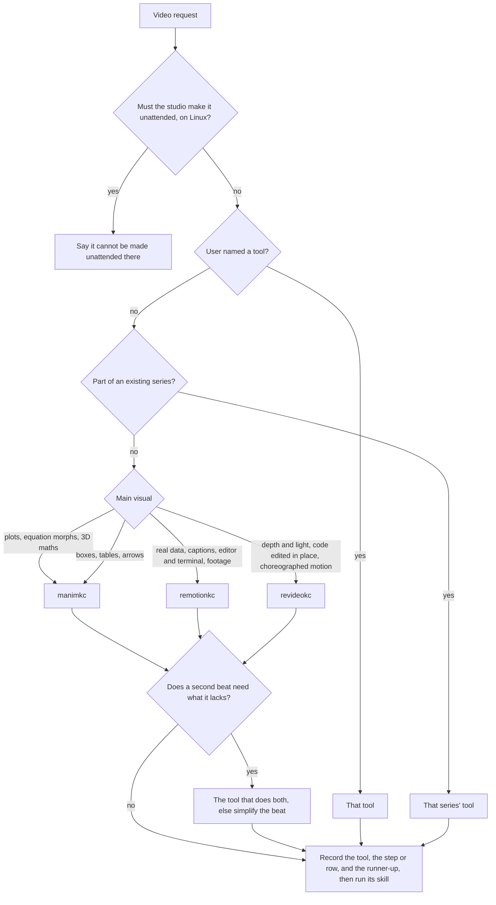

# Video tools: which one makes this video

self-learn has three tools that turn a narrated script into an MP4, each a
submodule under `tools/` with its own CLI, skill and operating manual. They
share one voice (manimkc's narration layer), one report shape (`topics
--json`, indexed by one reader in `services/catalog/src/index/video-tool.ts`)
and one deliverable format (1080p30 H.264, AAC at 48 kHz, transcript,
chapters and VTT sidecars). So the choice between them is about what the
picture needs, not about plumbing.

The `video-router` skill (`.claude/skills/video-router/`) runs the procedure
at the end of this page before any tool-specific skill. This page is its
source of truth: change routing here, and the skill follows.

## The three tools

| | manimkc | remotionkc | revideokc |
| --- | --- | --- | --- |
| Engine | ManimGL 1.7.2 (3blue1brown's), vendored | Remotion 4 (React, rendered in Chrome) | Revideo 0.11 (the Motion Canvas fork that renders headless), three.js |
| Language | Python | TypeScript and React | TypeScript, generator timelines on a canvas |
| Scene model | Mobjects and `self.play` animations, narration blocks | A React component per frame, cued on spoken words | One generator per topic on a 2D canvas with signals and flexbox, cued on spoken words |
| Skill | `manimkc-video` | `remotionkc-video` | `revideokc-video` |
| Capability doc | [tools/manimkc/docs/CAPABILITIES.md](../tools/manimkc/docs/CAPABILITIES.md) | Remotion's own skills, vendored in `tools/remotionkc/.claude/skills/` | [tools/revideokc/docs/CAPABILITIES.md](../tools/revideokc/docs/CAPABILITIES.md) |
| The studio can drive it | On macOS (the video runner, [STUDIO-VIDEOS.md](STUDIO-VIDEOS.md)); off on Linux until its sandbox is measured there, and anywhere with `STUDIO_VIDEO_KIND=off` | Not yet | Not yet |
| Licence | MIT | Remotion License: free for a person or a company of up to three, a company licence above that | MIT |

## Pick by what the video needs

Find the row that names the video's main visual. If two rows fit, the one
higher up wins.

| The video mainly needs | Tool | Why | Proven in |
| --- | --- | --- | --- |
| A new week of a series that already exists (CS3230, CS4223, CS4225 lecture videos) | the series' tool, usually manimkc | Viewers watch a series in order; a change of look between weeks reads as a mistake | the week folders under `tools/manimkc/topics/` |
| Continuous maths: function plots, areas, Riemann sums, geometric proofs, linear maps, vector fields | manimkc | `Axes`, `get_graph`, `NumberPlane` with `ApplyMatrix`, `VectorField` and `StreamLines` exist and are exact; nothing else here has them | manimkc CAPABILITIES.md, "Graphs and plots" (built; no topic yet) |
| An equation whose symbols slide into their new places (a derivation, a recurrence being unrolled) | manimkc | `TransformMatchingTex` moves glyphs; Revideo's `Latex` is an image that only cross-fades, and remotionkc's label-to-label morph is weaker than manim's glyph transforms | manimkc CAPABILITIES.md (built; not yet rendered in a topic) |
| 3D maths objects: surfaces, solids, cutaways, a camera orbiting a shape | manimkc | Lit `Sphere`, `Torus`, `Prismify`, `ThreeDAxes.get_graph`, clip planes, `fix_in_frame` labels, all headless | manimkc CAPABILITIES.md, three 3D renders |
| Real data on a chart (a series from a file, log axes, a trend line) | remotionkc | d3-style scales and SVG in React, driven by the frame; its prototype's data chart was the strongest of the three | `computer-architecture/cs4223/week-01-why-multicore-data` |
| Words on screen that must match the voice (word-level captions, kinetic text) | remotionkc | `@remotion/captions` and whisper.cpp give paged, per-word captions; the other two have no captions pipeline | the same topic |
| A code walkthrough in an editor and a terminal, variables changing beside it | remotionkc | CSS layout makes an editor, a variables panel and a terminal cheap; its prototype beat manimkc clearly here | `big-data/cs4225/week-02-wordcount-code` |
| Real footage or a screen recording, transitions between shots, sound effects | remotionkc | `<Video>` with trim and effects, `TransitionSeries` with twenty presentations, `@remotion/sfx`; neither other tool composites footage well | Remotion's skills (no topic yet) |
| The same composition embedded live in the web app, or many videos from one template | remotionkc | `<Player>` runs a composition in Next.js without rendering, and props make one composition a template | Remotion's skills (not wired up here) |
| Depth and light: layers stacked in perspective, a spotlight following the story, soft shadows, glass cards | revideokc | A three.js scene inside the 2D stage, with 2D titles, code and formulas drawn over it; filters dim or blur the stage behind a panel | `computer-architecture/cache-basics/memory-hierarchy-in-depth` |
| Code that is edited in place while the voice explains the change (a loop from `a[i]` to `a[16 * i]`), with the other lines dimmed | revideokc | `Code` reflows lines around an insert or a replace and tweens a selection; this is its strongest 2D feature | both revideokc topics |
| Hand-choreographed diagram motion: things that spring into place, masks and reveals, light that adds over a diagram | revideokc | Springs, `compositeOperation`, `cache` masks, radial gradients, flexbox layout, signals binding one node to another | the showcase topic |
| Boxes, tables and arrows with nothing above | manimkc | It is the house style of every series so far, and the studio can already make it | every manimkc topic |

When nothing in the video needs more than the last row, use manimkc: on macOS the
studio can make it without a person at the terminal, and it matches every
video made so far.

## The capability matrix

For lookup. "Yes" means rendered in a topic or a check; "built" means
constructed and driven but not rendered in a narrated topic; "no" means
missing or poor.

| Capability | manimkc | remotionkc | revideokc |
| --- | --- | --- | --- |
| Function plots, axes, areas | built | via d3 and SVG | no |
| Glyph-level equation morphs | built | weak | no (cross-fade) |
| Typeset maths | yes (Tex through Tectonic) | yes (KaTeX) | yes (MathJax) |
| 3D maths surfaces and solids | yes | via three.js | via three.js |
| 3D scene with lights and shadows | yes (shading, moving light) | yes (`@remotion/three`; looked plain in the prototype) | yes (spotlight, shadow maps, glass) |
| Vector fields, stream lines | built | no | no |
| Boolean shape ops (Venn, overlaps) | built | via SVG paths | no |
| Data charts from real data | built (`BarChart`, `Axes`) | yes | possible, untested |
| Word-level captions | no | yes | no |
| Code panel with syntax highlighting | built (`Code`, Pango) | yes | yes (Lezer) |
| Code edited in place with reflow | no | by hand | yes |
| Terminal and UI mock-ups | by hand | yes | by hand |
| Footage, screen recordings, transitions, SFX | no | yes | partial (`Video`, few transitions) |
| Springs, masks, additive light, filters | partial | yes (CSS) | yes |
| Visuals cued on the spoken word | yes (`narration.word_times`) | yes | yes |
| Studio can make it unattended | on macOS only | on macOS only | on macOS only |
| Render speed, 1080p, measured on the owner's Mac | about 30 s for a 79 s scene, 8 scenes in parallel | 32 to 75 s for 68 to 113 s videos, concurrency 3 | about 25 s for a 62 s video with a 3D stage, 2 workers |

## Shared ground, and what it allows

- **One voice.** All three narrate through gnosia-audio, each pinned in its
  own `.venv`, with manimkc's voice settings, so all three sound the same and
  share the kokoro clip cache. None of them has a narration layer of its own,
  on purpose.
- **One report.** Every tool's `topics --json` has manimkc's shape, so a
  video from any of them lands in the catalog, the library and a session log
  the same way.
- **One format.** All three deliver 1080p30 H.264 with AAC at 48 kHz and the
  index first. Chapters from different tools could be joined into one video
  with a stream copy; nothing does that yet.

## Risks worth knowing before choosing

- **Revideo is small.** One company maintains it (0.11.0, 2026-07-10). Motion
  Canvas, its parent, has had one docs commit since February 2025. revideokc
  pins exact versions and documents every trap it met, so a stall upstream
  freezes it rather than breaking it.
- **Remotion's licence changes in 5.0**: contractors count toward the
  three-person free limit, and server renders take a licence key
  (`"free-license"` for free users). Free for this project today.
- **The studio makes all three unattended, and only on macOS**: the video
  runner's sandbox is Seatbelt, one backend per tool
  ([STUDIO-VIDEO-TOOLS.md](STUDIO-VIDEO-TOOLS.md)), so the video kind is off
  on Linux until a bubblewrap profile is measured (`videoKindBuilt` in
  `services/studio/src/video/config.ts`). A video from a Linux machine needs
  an agent session with a terminal.

## The routing procedure

This is what the `video-router` skill does, in this order. Hard constraints
come before preferences, so a later step can never undo an earlier one.

1. **Unattended or not.** If the video has to come out of the studio with no
   one at a terminal, any of the three can make it, and only on macOS. On
   Linux, say it cannot be made unattended there, and stop. Otherwise carry
   on: the steps below choose among the three as they would at a terminal.
2. **The user named a tool.** Use it, and stop.
3. **Series.** Is this a week or a part of an existing series? Use that
   series' tool, and stop.
4. **Name the main visual.** Write one sentence: what is on screen for most
   of the video? Find it in "Pick by what the video needs", top row first.
5. **Check the second visual.** If a second beat needs something the chosen
   tool cannot do (the capability matrix says "no"), prefer the tool that can
   do both; if none can, keep the main visual's tool and simplify that beat.
6. **Say why.** Write down the tool, the step or row that chose it, and the
   second choice, in the reply or the brief, so the owner can overrule it in
   one word. Then hand over to that tool's skill.

## Not built yet

- **Joining chapters from different tools** into one deliverable.
