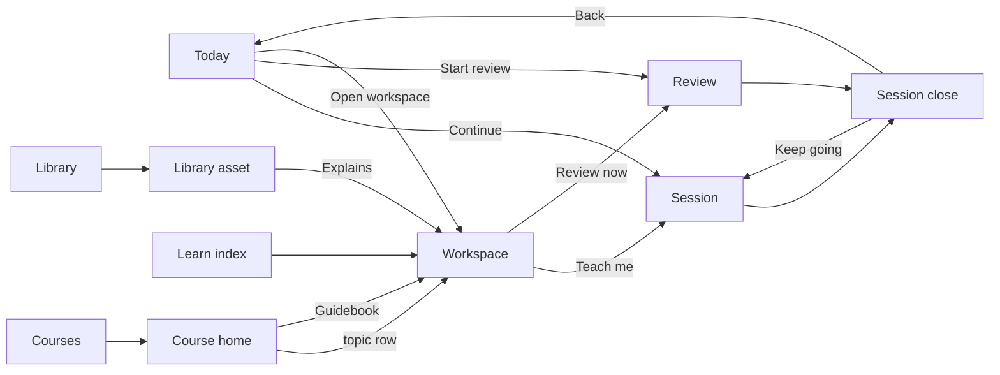

# Redesign v1: lo-fi

Status: lo-fi agreed in an interview on 2026-09-23; hi-fi v1 drawn on
2026-09-26 from the three captured design systems under [reference/](reference/).
Implementation is phased; the plan, the shipped token and component contract
and the status of each phase are in [IMPLEMENTATION.md](IMPLEMENTATION.md).
This document is the written half of the design. The drawn half is
[self-learn-lofi.fig](self-learn-lofi.fig), an OpenPencil document with a
lo-fi page and a hi-fi page, and the SVG exports of every screen under
[lofi/](lofi/) and [hifi/](hifi/). The research the design draws on is under
[research/](research/); the three captured design systems it takes real
components from are under [reference/](reference/).

## What the redesign is

The app becomes a notebook with a habit layer on top of it and a focused
teaching mode inside it. The notebook is NotebookLM's shape: a concept has
its note and sources on the left, the tutor in the middle, and the things
made from it (mastery, checks, assets, the neighbourhood graph) on the
right. The habit layer is Duolingo's, with the pressure removed: a
forgiving streak, a target the learner sets, no hearts, no leagues. The
teaching mode is Brilliant's: one idea per screen, a widget in the prose,
a question, an inline verdict with an opt-in "Why". Review is Anki's
four-button rating. The front door is a Math Academy style dashboard that
says what to do today.

One model of "what you know" runs through all of it. The mastery p(L)
from the `learn` pipeline is the only score; the tutor chat writes to it.

## Decisions

Sixteen decisions from the interview, each with the research that argued
for it. Where a decision changes the API it is marked, and expanded under
[API changes](#api-changes).

| # | Decision | Choice | Why | Source |
| --- | --- | --- | --- | --- |
| 1 | Study screen shape | Hybrid: three-panel concept workspace plus a single-column focus mode | Keeps reading, asking and made things visually separate, without forcing quizzes into a chat column | [notebooklm.md](research/notebooklm.md), [brilliant.md](research/brilliant.md) |
| 2 | Visual tone | Warm, calm, editorial | Serious enough for proofs, warm enough for a daily habit; NotebookLM's chrome overload and Duolingo's mascot both rejected | [brilliant.md](research/brilliant.md) visual language |
| 3 | Density | Dense dashboard, roomy lessons | Status must fit on one screen; teaching must not | [others.md](research/others.md) Math Academy |
| 4 | Theme | Light and dark designed together | The app already has a theme class; tokens are two-mode from day one | [notebooklm.md](research/notebooklm.md) |
| 5 | Streak | Forgiving, no guilt. Superseded 2026-10-04: removed (H1 of [the Home proposal](../proposals/home-page.md)) | Duolingo's own data: leeway raised engagement more than strict rules; guilt notifications are the named dark pattern | [duolingo.md](research/duolingo.md) |
| 6 | Effort counter | Self-set daily target; mastery is the score; no XP shown. The target was removed 2026-10-04 (H1 of [the Home proposal](../proposals/home-page.md)) | XP rewards volume over understanding | [duolingo.md](research/duolingo.md) patterns to avoid |
| 7 | Social | None: no hearts, no leagues, no friends | A solo adult learner has no reason to be ranked against strangers | [duolingo.md](research/duolingo.md) |
| 8 | Feedback | Inline verdict with opt-in "Why", plus a session-close screen with real numbers | Both apps do the inline part; the Close phase of the loop needs a home | [brilliant.md](research/brilliant.md), [duolingo.md](research/duolingo.md) |
| 9 | Home | A Today dashboard. Superseded 2026-10-04 by Home at `/home`, built on what the owner last touched ([the Home proposal](../proposals/home-page.md)) | Nothing on the current site surfaces due reviews, the next step or recent activity | [current-app.md](research/current-app.md) |
| 10 | Course navigation | Coursera's course home: one module per URL, a sidebar of modules, the module's topics as item rows marked by mastery, one Continue, a Guidebook per module (revised 2026-09-29; first built as a linear path of unit cards) | Removes "what do I click next" and keeps a long course to one module on screen; the Guidebook is the concept note | [coursera](reference/coursera/README.md), [duolingo.md](research/duolingo.md), [others.md](research/others.md) Khan |
| 11 | Review rating | Anki four buttons with the resulting interval under each | Maps onto the SM-2 state the database already holds | [others.md](research/others.md) Anki |
| 12 | Mastery model (API) | One model: chat probes write BKT events | Today two notions of mastery coexist and never reconcile | [current-app.md](research/current-app.md) |
| 13 | Concept graph | `/learn` opens on a map of every concept: an island per cluster, mastery-coloured with p(L) as an arc, fitted to the selected concept's island, with pan, zoom, search and a keyboard walk. The table and the workspace keep the neighbourhood graph (revised 2026-10-04, [knowledge-map.md](../proposals/knowledge-map.md) G1) | A whole-vault graph is a hairball on first open, so the map opens on one island and never on all of it; the table's alphabetical rows put unrelated concepts side by side | [others.md](research/others.md) Obsidian, Math Academy |
| 14 | Scope | Redesign Library; Studio keeps the shared shell only | Library is learner-facing; Studio is an author tool behind a flag | [current-app.md](research/current-app.md) |
| 15 | Mobile | Desktop first; phone layouts for Today, Review and Session | The screens a person would actually use on a phone | [notebooklm.md](research/notebooklm.md) mobile criticism |
| 16 | Files | Commit the .fig, the SVGs and this doc; third-party screenshots stay local | They are other people's copyrighted UI | .gitignore |

## Information architecture

One sidebar, laid out as a chat app's (revised 2026-10-04: the owner asked
for the studio to be the main page, "like the main chatgpt page to generate
things", with the learning pages folded into its sidebar and the top bar
removed). From the top: New chat, which is the studio's composer, when
`STUDIO_ENABLED` is set; the four learning destinations, Home, Courses,
Learn and Library; the studio's conversations; and the account at
the foot, with the theme, Settings and Sign out behind it. On a phone the
sidebar is a drawer behind a header button. Before this, five
destinations sat in a top bar with Studio as a sixth (2026-09-30), and the
phone had a five-column tab bar. The streak and target the bar once carried
went with the habit layer (H1 of docs/proposals/home-page.md).

Review left the sidebar on 2026-10-04 (owner's call). `/review` stays as
the full queue, reached from Review now on a concept page and Recall these
on Home, and the `review` and `mastery` tables are untouched. The reason is
in [the recall proposal](../proposals/recall-in-chat.md): only the Teach
session, a module's week check and the terminal's `/learn` skill make a
review card, so the chat, the studio and the videos, the product's main
surfaces, never fill the queue a top-level Review would show.



The loop the repo already runs (Probe, Plan, Teach, Close) lives in
Session. Probe and Teach are steps inside it; Close is its last screen.

## Routes and screens

| Route | Screen | Lo-fi | Replaces | Reads | Status |
| --- | --- | --- | --- | --- | --- |
| `/` | Today | [01-today](lofi/01-today.svg), [13-phone-today](lofi/13-phone-today.svg) | `/` course shortlist | due reviews, frontier, target, streak, recent events, course progress | New |
| `/courses` | Courses | [02-courses](lofi/02-courses.svg) | `/` | courses, tags, progress, the next topic and the course last opened | Redesigned; rebuilt on 2026-09-29 in Coursera's layout: a Continue learning block (My Learning's course card) over a grid of cover cards (its explore carousels), filtered by a tag menu and a search |
| `/courses/[slug]` | Course home | [03-course-path](lofi/03-course-path.svg) (superseded by the [Coursera reference](reference/coursera/README.md)) | `/courses/[slug]` | modules, topics, concept mastery per topic, assets per module, the topic vocabulary's summary per module | Redesigned; shows the module the learner is on |
| `/courses/[slug]/[module]` | Course home, one module | as above | `/courses/[slug]/[module]` | as above | Redesigned; a page of its own again, the same screen with the module the URL names |
| `/learn` | Learn index | [09-learn-index](lofi/09-learn-index.svg) | `/learn` | the map of every concept (default) with a panel for the selected one; the table (`?view=table`) with mastery, due, last seen, course link and the neighbourhood graph | Redesigned |
| `/learn/[concept]` | Concept workspace | [04-concept-workspace](lofi/04-concept-workspace.svg) | none (concept notes had no page) | note, prerequisites, dependants, backlinks, sources, tutor thread, mastery and history, checks, assets, graph | New |
| `/learn/[concept]/session` | Session focus mode | [05-session-focus](lofi/05-session-focus.svg), [06-session-feedback](lofi/06-session-feedback.svg), [07-session-close](lofi/07-session-close.svg), [15-phone-session](lofi/15-phone-session.svg) | `/courses/[slug]/[module]/session` | the tutor's step plan, the concept's checks, assets | Redesigned; moves from topic to concept |
| `/review` | Review session | [08-review](lofi/08-review.svg), [14-phone-review](lofi/14-phone-review.svg) | nothing on the web (`/review` skill only) | due queue, SM-2 state per card, checks, citations | New |
| `/library` | Library | [10-library](lofi/10-library.svg) | `/library` | assets by kind and topic, text search, concept links | Redesigned |
| `/library/[id]` | Library asset | [11-library-asset](lofi/11-library-asset.svg) | `/library/[id]` | asset, chapters, transcript, `asset_concept`, derivations | Redesigned |
| `/settings` | Settings | [12-settings](lofi/12-settings.svg) | none | preferences: target, leeway, reminders, theme, tutor style, BKT priors, providers | New |
| `/studio`, `/studio/d/[name]` | Studio | none | same | same | Shared shell only |

Every desktop frame is 1440 by 900; phone frames are 390 by 844. Content
that runs past the bottom is clipped at the frame edge, the way a scrolling
page would be (the course home is the one that does).

### Today

Superseded 2026-10-04 by Home ([docs/proposals/home-page.md](../proposals/home-page.md)); kept as the record of what was designed.

Left: Next up (the active path node with Continue and Open workspace),
Reviews due (five rows, Start review, Snooze, estimated minutes), Recent
activity (event rows with p(L) before and after). Right: Target (a ring the
learner filled by their own definition), Streak (one number, a seven-day
strip, the leeway remaining), Courses in progress. Nothing here is a game
element the learner did not choose.

### Course home

Laid out after Coursera's signed-in course home, in our tokens, font and
primitives. Three columns: a sidebar with the course code and title and a
collapsible "Course material" list, one row per module with a status mark
and its done count, the module on screen tinted; the module in the middle;
a rail of cards on the right. Each module has its own URL, and the course's
own URL shows the module the learner is on.

The module column carries the title with the Guidebook beside it, a meta
row of counts (topics, concepts, assets, done), the topic vocabulary's
summary as its description, "Show learning objectives" (the topics'
subtopics), then its topics, resources and assets as item rows in
collapsible groups. A topic row is a status mark, the title and a grey line
("3 concepts · Learning"); the active one is tinted and carries Continue,
and any row opens the topic's concepts, done tick, tutor chat, recap and
note. A locked module is drawn, not hidden, with a line naming the module
that opens it. Links to the modules either side close the column. The rail
is the course's progress with Continue and Reset, the next topic when it is
in another module, About this course, and related courses.

Coursera's slots with no data behind them (instructors, ratings, level,
time left, deadlines, item types, the weekly target and timeline) are left
out rather than invented.

### Concept workspace

Three panels, each collapsible. Note and sources (left): summary,
prerequisites and dependants with mastery dots, sources, backlinks.
Tutor (centre): the thread, every claim with a citation chip, Save to note
and Why on tutor turns, suggested question chips, the input. Studio
(right): the mastery card with the observation history, the checks the
note holds, the assets that explain this concept, the neighbourhood
graph. The header carries the two ways out: Teach me (focus mode) and
Review now.

### Session focus mode

A thin progress bar, a step label, one column at 720 wide. A step is
prose, an interactive widget (the manim or tldraw asset, or a live
diagram), and a question. Feedback replaces the buttons in place: the
verdict, one line of reason, the p(L) movement, and Why, Ask the tutor,
Continue. The close screen shows four numbers (right, mastery moved,
review cards added, target progress), what moved as before-and-after bars,
what got scheduled, and two exits.

### Review

The card, the revealed answer with its citation, and the four ratings
with their resulting interval. Keys 1 to 4 rate; space reveals. Check
blocks from a note render as a question with options and the same
inline verdict as a session step; recall cards render as prompt and answer.

### Learn index, Library, Library asset, Settings

Learn index is the table the current `/learn` page hides in prose, with
search and mastery filters, and the graph docked beside it. Library gains
text search over titles, transcripts and notes, a sort, and a concept
chip on every card. The asset page gains Explains (the `asset_concept`
rows with mastery), Mark watched, Add to note. Settings holds the habit
controls the learner owns, the tutor style, and the BKT priors under an
Advanced label.

## Components

The lo-fi kit draws every screen from these pieces; the hi-fi pass and the
implementation should keep the same vocabulary.

| Component | Used on | Notes |
| --- | --- | --- |
| Top bar | every desktop screen | wordmark, five destinations (a sixth, Studio, when the studio is enabled), streak pill, target pill, avatar |
| Phone tab bar | phone screens | the same five destinations, never Studio |
| Card | everywhere | title, optional action link at the right |
| Mastery dot | path, lists, workspace | three buckets: mastered, learning, untouched |
| Progress bar | courses, path rail, close screen | fill proportional to a fraction |
| Chip, Pill | filters, citations, top bar | citation chips carry `[n] source, locator` |
| Filter menu | courses, learn, library | a chip reading "Type: Video" that opens a list of the group's options with counts; replaced the hi-fi's chip rows once the option count outgrew a row (IMPLEMENTATION.md, Deviations) |
| Button | everywhere | primary (filled) and secondary (outlined); one primary per region |
| Item row, module row | course home | Coursera's 60px item row with a 20px status mark (done, learning, not started) and a meta line; a module row marks done, in progress, not started or locked |
| Message | workspace | who, body, citation, Save to note, Why |
| Rating row | review | four equal-weight buttons, interval under each |
| Stat tile | close screen | a number and a label |
| Widget placeholder | session, workspace, library | where an asset or interactive renders |
| Step progress | session, review | the thin bar at the top of focus mode |

### Mastery buckets

The path, the lists and the graph colour by bucket, never by the raw
probability: mastered, learning, untouched. The exact thresholds are the
ones the `learn` pipeline already uses for its mastery label; the UI
displays the label and shows the number beside it where there is room.

## API changes

The `--json` shapes of the `learn` CLI are a contract with the plugin and
do not change. Everything below is on the web side, in
`apps/web/src/app/api/`, and is proposed, not built.

| Need | Screen | Change |
| --- | --- | --- |
| A due list, not a count | Today, Review | `GET /api/review/due` returning the `review due` shape, and `POST /api/review/grade` wrapping `review grade` |
| Chat probes move mastery (decision 12) | Session, Workspace | the agent chat route returns graded probes as structured results, and the session calls `POST /api/learner/observe` (wrapping `learn observe`) per graded answer; the recap stays a note |
| Next step, target, streak | Today, top bar | `GET /api/learner/today` aggregating frontier, target progress, streak (derived from the event log, with leeway from preferences), recent events |
| Target and leeway are the learner's | Settings | new preference keys: `dailyTarget` and `dailyLeeway` (in `PREFERENCE_KEYS` since phase 0), `reminders` |
| Concept page data | Workspace | `GET /api/concepts/[slug]` returning note body, requires and assumes, dependants, backlinks, sources, checks, mastery with the event trajectory, `asset_concept` rows |
| Assets explain concepts | Library asset, Workspace, Course home | query `asset_concept` wherever an asset is shown; it is in the schema and unread today |
| Save to note, Mark watched | Workspace, Library asset | extend `POST /api/learner/note`; a `watched` event kind on the asset |
| Text search | Library, Learn | a search endpoint over asset titles, transcripts and note bodies |

The session route moves from topic to concept
(`/learn/[concept]/session`). The old topic session stays reachable from
the path node until the concept-level one lands.

## Before and after

Current pages, captured on 2026-09-23 from a clean build of `origin/main`.

| Now | Becomes |
| --- | --- |
| [home](research/assets/current-app/home.png): a course shortlist | Today, decision 9 |
| [learn](research/assets/current-app/learn.png): stat cards, a full graph, prose per concept | Learn index plus the workspace, decisions 13 and 1 |
| [library](research/assets/current-app/library.png): every asset, no search | Library with search and concept chips |
| [course](research/assets/current-app/course.png) and [module](research/assets/current-app/module.png): rows and a checklist | Course home, decision 10 |
| [session](research/assets/current-app/session.png): a chat that never touches mastery | Session focus mode, decisions 1, 8, 12 |
| [library-asset](research/assets/current-app/library-asset.png): the asset alone | Library asset with Explains |
| [studio](research/assets/current-app/studio.png) | unchanged, decision 14 |

## Lo-fi tokens

The lo-fi is greyscale with one accent, on purpose: the hi-fi pass picks
the palette. What the lo-fi does fix is the scale.

- Type: 32, 28 (numbers), 22 (page title), 20 (concept title), 16, 15
  (lesson prose), 14 (card title), 13 (body), 12 (secondary), 11 (labels).
- Space: 4, 6, 8, 10, 12, 14, 16, 18, 20, 24. Frame padding 24, card
  padding 16, panel padding 18, focus column 720.
- Radius: 8 (buttons, inputs), 10 (cards), 12 (unit cards, review cards),
  full (chips, pills, nodes).
- Colour roles: canvas, panel, box, line, ink, muted, accent, primary
  button; mastery high, mid, low. The hi-fi assigns values per theme.

## Hi-fi v1

Every lo-fi screen exists in light and dark under [hifi/](hifi/), drawn by
[kit/hifi.py](kit/hifi.py) from the three design systems captured under
[reference/](reference/). Each system was read against our component list
first; those readings are [hifi/notes/brilliant.md](hifi/notes/brilliant.md),
[hifi/notes/notebooklm.md](hifi/notes/notebooklm.md) and
[hifi/notes/duolingo.md](hifi/notes/duolingo.md), and they say per component
which crop or screenshot the value came from. The split follows the
interview: Brilliant is the base, NotebookLM is the workspace, Duolingo is
the habit layer.

### Which system supplies what

| Ours | Taken from | What was kept | What was changed |
| --- | --- | --- | --- |
| Palette, type, spacing | Brilliant | white on `#141414`, black and white text with 60% and 40% steps, blue `#456dff`, green for correct, yellow for "not quite", Figtree with Georgia for display (the reference's own fallbacks for CoFo Brilliant and CoFo Robert) | alphas flattened to hex; one accent, so the black CTA and the blue accent coexist only as button versus link |
| Card | Brilliant card | flat surface, 2px `border.solid`, radius 20, no shadow | padding 20 instead of 24 on the dense dashboard |
| Primary button | Brilliant button3d | pill, 44px face over a 4px same-hue lip, black face in light and `#e5e5e5` in dark | no hover in the reference (Safari-only tint), ours is left for implementation |
| Secondary button, input, search | Brilliant flat button and form input | 2px border, pill for buttons and search, radius 8 for inputs | height 44 instead of 48 and 52 |
| Top bar, stat pills | Brilliant app header | selected tab in text colour with a 2px underline, stat pills at pill radius with 2px border | pills carry the streak and target instead of keys and Premium |
| Eyebrow labels | Brilliant badge | 11px, 700, uppercase, tracked | used as section labels, not badges. Since 2026-09-29: 12px, 600, sentence case, no tracking, `--text2`, and only where the label says something the heading does not (see [Sentence case](#sentence-case-2026-09-29)) |
| Workspace shell | NotebookLM | three panels on the page colour, radius 16, no border, 16px gutter, side panels about 290px, 48px panel header with a hairline | our side panels are 290 and 310 at 1440 wide |
| Chat | NotebookLM | user bubble tinted with radius 20, tutor prose bare, citation as a numbered circle | the circle grows into a short pill holding the source and locator |
| Filter and suggestion chips | NotebookLM choice chip | pill, 1px border, accent fill when selected | 34px tall instead of 40 |
| Path node | Duolingo | disc over a lip, active node in a ring | 56px face and 6px lip instead of 57 and 8; no zig-zag, a straight connector |
| Unit header, Guidebook | Duolingo unit banner | tinted banner with the Guidebook button on it | accent tint instead of the unit colour |
| Streak calendar | Duolingo streak week | 34px discs, orange `#ff9600` done with a check, grey future | the leeway line replaces the paid freeze |
| Target bar | Duolingo goal bar | 20px track at radius 10 with the "x / y" label | label beside the bar; accent fill, not gold |
| Feedback footer | Duolingo lesson footer | tinted bar, icon circle, title, ghost actions, coloured 3D continue | Brilliant's green and yellow, since our "not quite" is not red |
| Choice rows | Duolingo choice row | 56px row with a keyboard-number badge, tinted when selected, recoloured when graded | Brilliant tokens for the colours |
| Stat tiles | Duolingo lesson-complete cards | coloured frame, uppercase strip, value box | one colour per metric: green, accent, purple, orange; the strip is sentence case since 2026-09-29 |
| Rating row, mastery dot, step bar, table | none | designed here from the palette; the extracts confirm no reference has them | |

### Hi-fi tokens

`TOKENS` in [kit/hifi.py](kit/hifi.py) is the source; the same values are in
the `.fig` as two variable collections, "self-learn light" and "self-learn
dark". "derived" means a value we made from a reference one.

| Token | Light | Dark | From |
| --- | --- | --- | --- |
| page | `#F8F8F8` | `#141414` | Brilliant bg.secondary / bg.primary |
| surface | `#FFFFFF` | `#1E1E1E` | Brilliant bg.primary / bg.elevated |
| surface2 | `#F3F3F3` | `#292929` | derived, one step off surface |
| tint | `#EEF1FF` | `#232A4A` | derived from the accent, after NotebookLM surface.selected |
| border | `#E5E5E5` | `#4C4C4C` | Brilliant border.solid |
| hair | `#EBEBEB` | `#333333` | derived hairline |
| text, text2, text3 | `#000000`, `#666666`, `#999999` | `#FFFFFF`, `#A3A3A3`, `#7A7A7A` | Brilliant text.primary, secondary, tertiary, alphas flattened |
| accent, accent_text | `#456DFF`, `#294BC6` | `#456DFF`, `#7491FF` | Brilliant bg.blue-primary, text.blue-primary |
| ok, ok_lip, ok_text, ok_tint | `#29CC57`, `#15B441`, `#009B2B`, `#E6F8EC` | same, same, `#5ED981`, `#17331F` | Brilliant green; tint derived |
| warn, warn_lip, warn_text, warn_tint | `#F7C325`, `#B78900`, `#B78900`, `#FFF5D6` | `#F9D25C`, `#B78900`, `#F9D25C`, `#33300F` | Brilliant yellow; tint derived |
| danger | `#C43939` | `#FF8585` | Brilliant text.danger-primary |
| streak | `#FF9600` | `#FFAB33` | Duolingo fox |
| btn_face, btn_lip, btn_text | `#111111`, `#000000`, `#FFFFFF` | `#E5E5E5`, `#B3B3B3`, `#000000` | Brilliant button3d primary |
| m_hi, m_mid, m_lo | `#456DFF`, `#A9B9FF`, `#E5E5E5` | `#7491FF`, `#3A4A8F`, `#4C4C4C` | mastery buckets: accent, derived light accent, border |
| lip_shade | `#D4D4D4` | `#0F0F0F` | derived: the lip under an untouched path node, after Duolingo's black at 20% |

Type: Figtree 15/400 body (14 in dense rows, 17 in lesson prose), 16/700
card titles, 11/700 uppercase tracked eyebrows (12/600 sentence case
since 2026-09-29, below), 15/600 button labels;
Georgia 26 to 32/700 for page and concept titles. Radius: 20 cards, 16
panels and unit headers, 12 choice rows, pill for buttons, chips, pills and
search, 8 inputs. Borders: 2px on cards, inputs and secondary buttons, 1px
hairlines. No shadows on any surface.

### Sentence case (2026-09-29)

The owner's call, after the studio's New diagram panel showed an uppercase
"PLANNER" over the planner's first message: no all-caps anywhere in the
interface, and no label that says what the layout, a heading, an icon or the
content already says. The hi-fi above is left as drawn, since it is the
record of what was designed; this is what changed on top of it.

- **Eyebrows and small labels** are 12/600, sentence case, no
  letter-spacing, in `--text2` (`LABEL` in
  `apps/web/src/components/ui/classes.ts`). The capitals were what made the
  old 11/700 label read as a label, so it moves from `--text3`, a hint
  colour, to `--text2`, which clears 4.5:1 on every surface.
- **Stat tiles** keep the coloured strip; its text is sentence case ("Next
  due", not "NEXT DUE").
- **Table heads, filter-menu sections and the theme menu's heading** are
  sentence case too; the same rule covers every page, not only the public
  ones BRAND.md already covered.
- **A chat has no speaker label.** Two parties are told apart by shape (bare
  prose against a tinted bubble), so a "Tutor" or "Planner" line over each
  reply only repeated it. ChatGPT, Claude and NotebookLM print none either.
  A chat with three or more voices would need one; there is none today.
- **A label that repeats the page goes.** A recall card's "Recall ·
  Transformer block" over "Recall: Transformer block"; the library card's
  kind printed three times (in the empty thumbnail, on the chip, and as
  "concept note"); a note card's concept line that was its own title again;
  the workspace panel header under the phone tab that just opened it.

- **No control that only says it is not built.** Snooze to tomorrow,
  Reminders, Save to note, Add source and Generate flashcards were drawn
  disabled with "Not built yet." beside them; they are gone until they exist.
- **Today has no Streak card.** It repeated the top bar's streak pill, which
  stays, and is a button whose popover (and accessible name) carries the
  free misses and today's fact, so a phone or a keyboard can reach them.
- **"Leech" reads "Keeps slipping"** wherever the reader sees it (the Learn
  badge and filter, the review card). `leech` stays the field, the filter key
  and the CLI's word: the `--json` shapes are a contract with the plugin.
- **"Teach me"**, not "Teach me · focus mode", matching Today's "Continue
  teaching" to the same page.

The list of every label removed or restyled is in the pull request that made
the change. `apps/web/src/lib/sentence-case.test.ts` fails the build of an
`uppercase` class, wide tracking, or JSX text typed in capitals.

### What the references could not give us

- A hover state for the primary button (Brilliant's only renders in Safari).
- A per-option graded state (Brilliant grades the whole panel; ours colours
  the row, with Duolingo's choice-row recolour as the precedent).
- The four-button rating row, the mastery dot, the step bar and the table,
  which no reference has; they use the palette only.
- The dark "incorrect" values in Duolingo were derived from CSS, never
  captured, so the feedback footer takes its colours from Brilliant instead.

### Regenerating the hi-fi

```bash
OPENPENCIL_DOC=tab-2 python3 docs/design/kit/hifi.py               # both themes, all screens, and the variable collections
OPENPENCIL_DOC=tab-2 python3 docs/design/kit/hifi.py --theme dark 06 # one screen, one theme, tokens untouched
OPENPENCIL_DOC=tab-2 python3 docs/design/kit/hifi.py --variables 99  # rewrite the variable collections only
node docs/design/kit/svg2png.mjs /tmp/out docs/design/hifi/*.svg     # PNGs to look at
```

`OPENPENCIL_DOC` names the tab when more than one document is open (see
`op.py call list_documents '{}'`). The kit draws onto the "Hi-fi v1" page,
light frames in the top rows and dark frames 5000px below. A full run rewrites the two variable collections from `TOKENS`, so
a token change cannot leave the screens and the collections out of step; a
partial run leaves the collections alone unless `--variables` is passed.

## Regenerating the lo-fi

The screens are code, so a change to a screen is a change to
[kit/lofi.py](kit/lofi.py). It renders every screen into the open
OpenPencil document over its local MCP, exports the SVGs, and saves the
`.fig`.

```bash
python3 docs/design/kit/lofi.py            # all screens
python3 docs/design/kit/lofi.py 01-today   # one screen
node docs/design/kit/svg2png.mjs /tmp/out docs/design/lofi/*.svg   # PNGs to look at
```

OpenPencil must be running; the kit reads its port and token from
`~/Library/Application Support/OpenPencil/mcp.json`. It exits non-zero and
leaves the existing SVG alone if a render or export fails, and it refuses
to report success when the `.fig` did not save. OpenPencil only saves
under the home directory, so run the kit from a checkout inside it, not
from a worktree under `/tmp`. The PNG step imports `playwright-core` from
the tldrawkc submodule and uses the Chromium it caches, so the submodule
has to be installed; it exists because OpenPencil's own raster export
refuses ("no visible nodes") and Quick Look scales an SVG to a square and
crops it.

## Out of scope

Studio screens. Phone layouts beyond the three drawn. Interaction states
beyond the ones drawn (hover, focus, pressed). Any change to the `learn`
CLI's `--json` shapes.

## Research index

- [research/notebooklm.md](research/notebooklm.md), 13 assets
- [research/duolingo.md](research/duolingo.md), 19 assets
- [research/brilliant.md](research/brilliant.md), 17 assets
- [research/others.md](research/others.md): Math Academy, Anki, RemNote, Obsidian, Khan Academy, 18 assets
- [research/current-app.md](research/current-app.md): the inventory of pages, APIs and unsurfaced data, 8 captures

The three captured design systems (tokens, style guides, component specs,
screenshots) are under [reference/](reference/), one folder each for
NotebookLM, Duolingo and Brilliant.
Two were added later: [Coursera](reference/coursera/README.md) (2026-09-29)
and [Gauth](reference/gauth/README.md) (2026-10-04).

Third-party assets live under `research/assets/<product>/` on the machine
that gathered them and are gitignored. Our own captures under
`research/assets/current-app/` are committed.
