# Brilliant components

The discovery list, one inventory entry per component with a crop of the real product, the icon summary, and the Gaps. Values are computed styles read in the running app on 2026-09-25; token names are the paths in [tokens.json](tokens.json) (`bg.primary`, `radius.2xl`, `typography.ui.actions.base`). The full per-surface readings, including values not repeated here, are in [raw/measurements.md](raw/measurements.md). Anything sampled from a screenshot says "estimated from screenshot".

Brilliant builds its UI with Panda CSS. Components carry a `data-slot` attribute (`button3d`, `switch`, `segment`, `modal-content`), which is how each entry below names its source. Overlays are Base UI (`data-open`, `data-starting-style`), toasts are Sonner, and the lesson interactive is a `<custom-interactive>` web component with an open shadow root.

Names follow [tokens.json](tokens.json) with two shorthands. Type styles are cited by their Panda name (`body.base`, `ui.actions.sm`), which is `typography.body.base` in the file, and palette steps as `gray.900`, which is `palette.gray.900`. Semantic colours are `group.rest`, so Panda's `bg.green.primary` is `bg.green-primary`.

## Discovery list

Every page, view and overlay found, with what was captured. D is dark, L is light, M is the 390x844 mobile width. Screenshot names are in [screenshots/](screenshots).

### Public pages (headless Chromium, 1440x900 and 390x844)

| Surface | URL | Themes | Captured | Screenshots |
|---|---|---|---|---|
| Landing | `/` | L only (ignores dark) | desktop, M | `landing-light-default`, `mobile-landing-light-default` |
| Sign up | `/signup` → `/welcome/` | L only | desktop, M | `signup-light-default`, `mobile-signup-light-default` |
| Log in | `/login/` | L, D | desktop, M | `login-{light,dark}-default`, `mobile-login-*` |
| Course catalog (public) | `/courses/` | L, D | desktop, M | `courses-public-*`, `mobile-courses-public-*` |
| Course page (public) | `/courses/<slug>/` | L, D | desktop, M | `course-public-*`, `mobile-course-public-*` |
| Pricing | `/subscribe/` | L, D | viewport, full page, M | `pricing-{light,dark}-{default,fullpage}`, `mobile-pricing-*` |
| 404 (legacy Django) | any bad path | L only | desktop, M | `notfound-light-404`, `mobile-notfound-light-404` |

### Signed-in app (Chrome, 1384x797 at 2x)

| Surface | Where | Captured | Screenshots |
|---|---|---|---|
| Onboarding: intro, voice choice, Koji demo, subject, level list, placement intro and question, result | `/welcome/…` | D; hover and selected card states | `onboarding-dark-*` (11) |
| Returning-learner promo | `/welcome/recommendations` | D | `promo-dark-returning-learner-offer` |
| "Creating your learning plan" loader | onboarding | D | `plan-dark-creating-plan-loading` |
| Learning plan intro | `#llp-preview-intro` | D | `plan-dark-learning-plan-intro` |
| Learning path | `#learning-path` | D | `plan-dark-learning-path` |
| In-app paywall | onboarding | not saved, see Gaps | covered by `pricing-*-fullpage` |
| Home | `/home/` | D, L | `home-dark-default`, `home-light-default` |
| Koji prompt (home) | `/home/` ask pill | D | `home-dark-koji-prompt-open` |
| Course catalog | `/courses/` | D, L; tile hover | `courses-dark-default`, `courses-dark-course-tile-hover`, `courses-light-default` |
| Course page | `/courses/<slug>/` | D, L | `course-dark-default`, `course-light-default` |
| Lesson player | `/courses/<course>/<chapter>/<lesson>/` | D: idle, answer placed, correct, retry. L: idle | `lesson-dark-*`, `lesson-light-default` |
| Koji tutor chat | lesson, "Get help" | D: open, typing, board highlight | `lesson-dark-tutor-*` |
| Quit dialog | lesson, close button | D: default, danger hover | `lesson-dark-quit-confirm-*` |
| You (progress) | `/you/` | D, L; chart tooltip | `you-dark-default`, `you-dark-chart-tooltip`, `you-light-default` |
| Settings: account | `/settings/account/` | D, L; input focus plus button hover | `settings-dark-account`, `settings-dark-input-focus-button-hover`, `settings-light-account` |
| Settings: preferences | `/settings/preferences/` | D, L; switches off | `settings-dark-preferences`, `settings-dark-preferences-switches-off`, `settings-light-preferences` |
| Legacy account page | `/account/` (Django) | L only | `legacy-light-account-settings` |

### Overlays and transient states

| Overlay | Trigger | Captured |
|---|---|---|
| Header dropdown menu | ☰ in the app header | D (item hover), L (`settings-light-header-menu-open`) |
| Keys popover | keys stat pill | D, L |
| Streak popover | streak stat pill | D, L |
| Tooltip | You page, bar chart and strength chip | D |
| Modal | quit a lesson | D |
| Koji prompt overlay | home ask pill | D |
| Tutor chat panel | lesson "Get help" | D |
| Lesson feedback (correct, retry) | Check button | D |
| Empty state | You page, "No course progress yet." | D, L (in the page captures) |
| Error state | 404 page | L; invalid input read from CSS only |
| Toast (Sonner) | never fired in this session | not captured, see Gaps |
| Command palette | none exists in the product | n/a |
| Cookie banner | OneTrust, third party | hidden during capture, not documented |

## Core components

### Button3d

The main call to action everywhere: a pill face lifted 4px over a same-hue lip. `data-slot=button3d` wrapping `button3d-face`.

| Part | Value | Token |
|---|---|---|
| Size | h48, full width or 272–367 wide in context | `size.button-height` |
| Face | radius 60, padding 14 24, gap 8 | `radius.full` |
| Label | CoFo Brilliant 16/20 500 | `typography.ui.actions.base` |
| Lift | face `translateY(-4px)`, `box-shadow: 0 4px 0 0 <lip>` | `component.button3d.*` |
| Press | lift and shadow go 4px → 0, `transform .1s ease-out, box-shadow .1s ease-out` | `duration.instant` (100ms), `easing.ease-out` |
| Focus | `0 0 0 3px border.select` on the outer button | `shadow.outline` |
| Disabled | outer opacity .85, face `bg.disabled`, text `text.disabled`, no lift | `component.button3d.disabled-face`, `disabled-text` |

Colour variants (face / lip, dark theme): primary gray.200 / gray.400 (light: black / gray.800), secondary fill `bg.tertiary` / whiteAlpha, green green.500 / green.600, blue blue.500 / blue.600, yellow yellow.500 with yellow.900 text / yellow.700, plus red, purple, orange, teal, pink, pear, papaya and mint in the same pattern. All are in `component.button3d`.

Premium variant: flat, no lift, face `gradient.iridescent-frame`, text `text.iridescent-primary`, `box-shadow: inset 0 -4px 0 0 rgba(20,37,99,.3)`, hover opacity .85.

Hover changes nothing in Chrome: the tint (`--button3d-hover-tint`) is scoped to Safari.

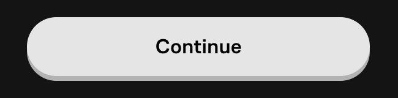
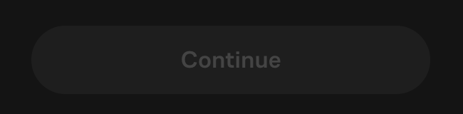
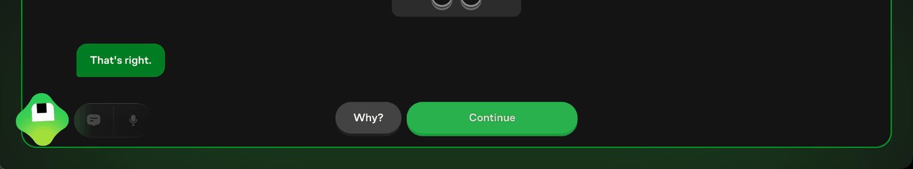
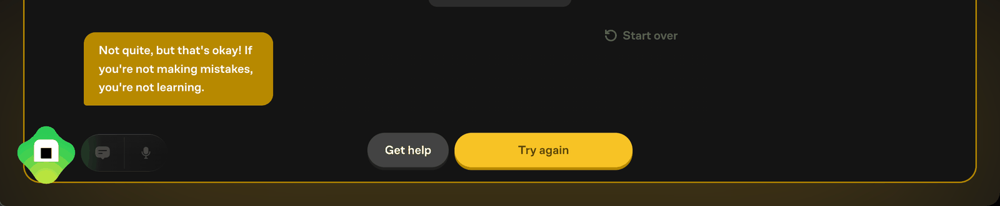
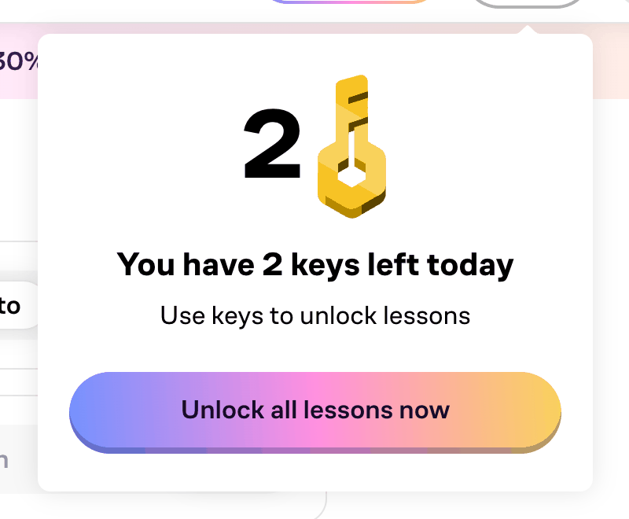

### Flat button

`data-slot=button`. h48, padding 12 22, radius 54, border 2px, `ui.actions.base`.

| Variant | Background | Text | Hover |
|---|---|---|---|
| primary (inverse) | `bg.inverse-primary` (#f2f2f2 D / #000 L) | `text.inverse` | opacity .78 |
| outline | transparent, border `border.primary` | `text.primary` | `bg.hover` |
| ghost | transparent | `text.secondary` or `text.tertiary` | `bg.hover` |
| danger ghost | transparent | `text.danger-primary` | `bg.danger-secondary-hover` |
| disabled | `bg.disabled` | `text.disabled` | none, cursor not-allowed |
| danger disabled | `bg.danger-disabled` | `text.danger-disabled` | none |

The public header uses a green sign-up variant (`bg.green-primary`, white text) and a compact h40 outline "Sign in".

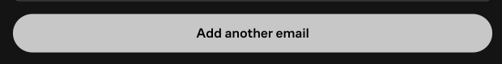
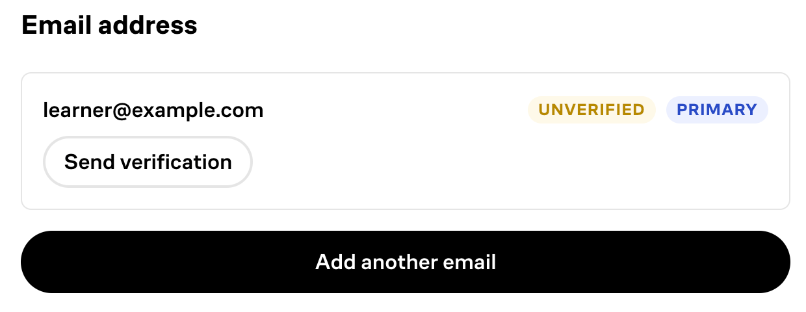
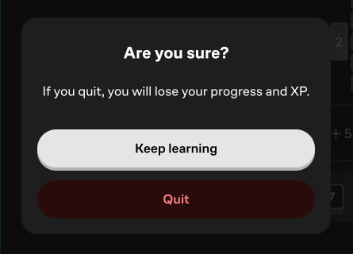

### Hue-shift pill

`data-slot=hue-shift-button`, used for quick answers (No / Maybe / Yes). h52, min-w 96, padding 16 24, radius full, `ui.actions.base`, background `gradient.hue-shift-action-gray`. Has a hidden loading layer with a spinner.

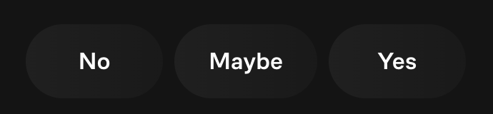

### Icon button and glass button

Icon button (`data-slot=icon-button`): 44–48 square, padding 12, border 2px transparent, radius 6 or full. Play-sample variant sits on `bg.hover`. Focus is `shadow.outline` plus `bg.hover`.

Glass button (`data-slot=glass-button`, lesson rail): 48x48, radius 54, `backdrop-filter: blur(20px) saturate(1.8)`, icon `text.disabled`. The Koji dock pairs two as a split pill (60x52 each, radii 9999 0 0 9999 and 0 9999 9999 0).

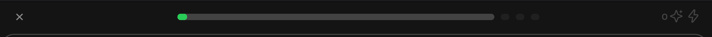
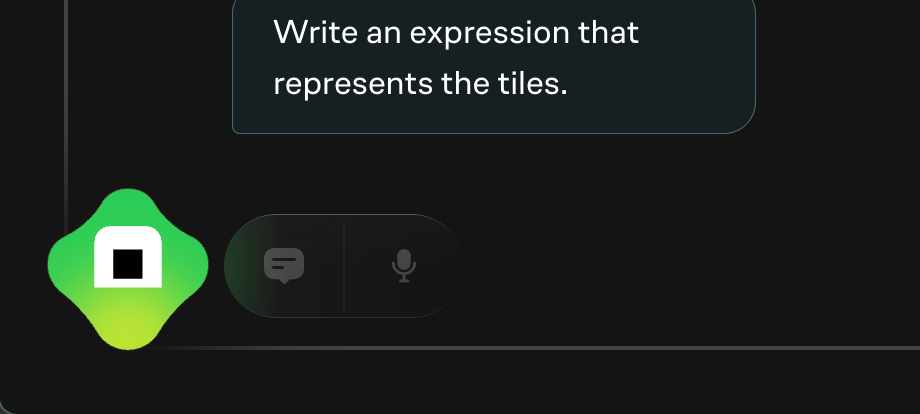

### Text input

`data-slot=form-input` inside `data-slot=field`.

| State | Value |
|---|---|
| Default | h52, padding 12 16, radius 8, border 2px `border.primary`, transparent bg, `typography.body.base` |
| Placeholder | `text.disabled` |
| Focus | border 2px `border.active` plus `inset 0 0 0 1px` the same colour (reads as a 3px ring), no outline |
| Disabled | `bg.secondary`, no border, `text.secondary`, field opacity .5 |
| Invalid | label and message `text.danger-primary` (read from CSS; no live error was triggered) |

Label is 16/20 500 `text.primary`, 8px above the input.

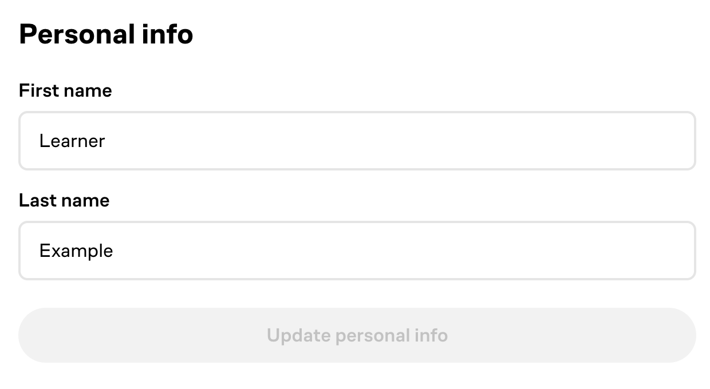
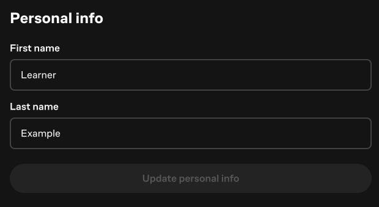
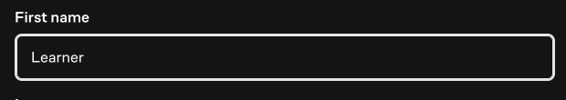
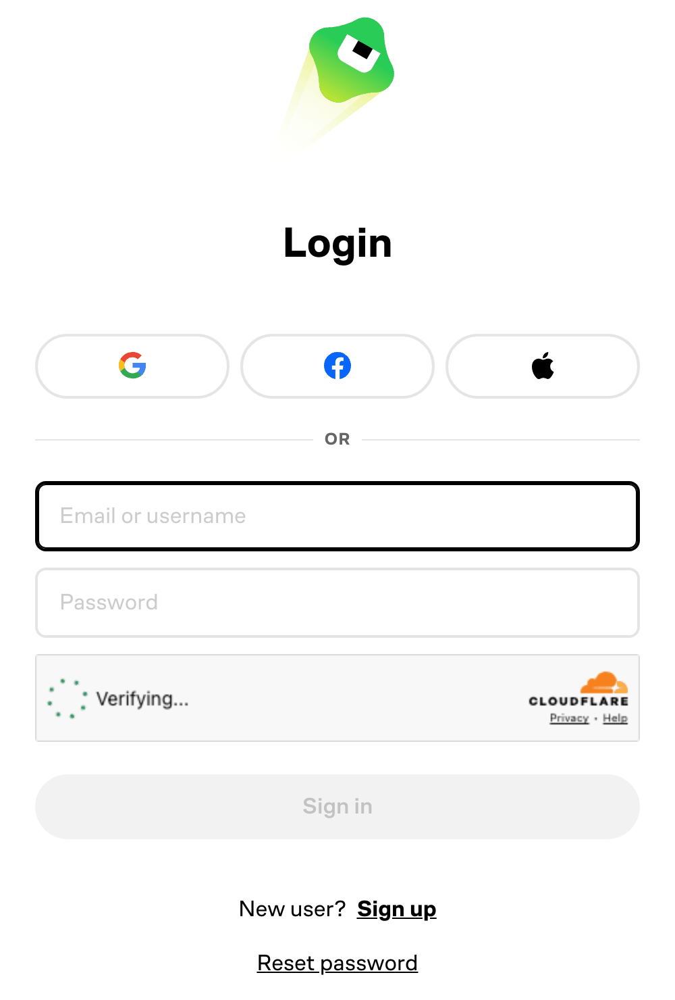

### Chat input and ask pill

Chat input (tutor panel): h53, radius 24, bg `autoflip.black.100`, border .5px `autoflip.black.200`, auto-resizing textarea, send button 32 round inside it. The send button is transparent when empty and fills with `gradient.koji-send-button` once there is text.

Ask pill (home, fixed bottom): 552x68, radius 32, border 2px `border.secondary`, `shadow.base`, translucent fill, idle opacity .65, focused adds `blur(24px)` and opacity 1, `150ms ease`.

Keycaps (`kbd`) under the chat input: h21, padding 0 6 2, radius 5, 1px border with a 2px bottom.

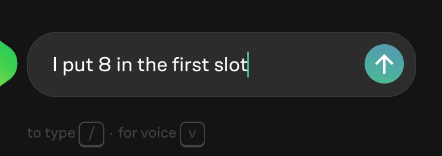
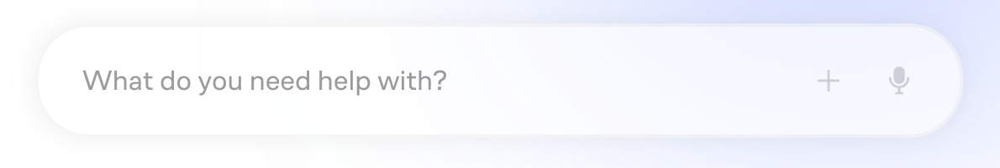
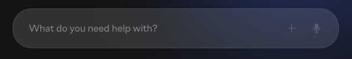

### Search field (catalog)

A button styled as a field that opens Koji: 340x52, radius full, border 2px `border.primary`, padding 4 4 4 16, search icon 16, trailing disabled-look "Ask" pill. Hover `border.hover`; focus `border.active` plus `shadow.outline`.

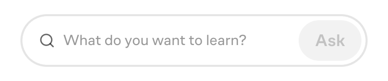
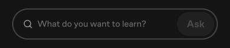

### Switch

`data-slot=switch`: 48x32 track, padding 4, radius full; thumb 24 white. Off `bg.disabled`, on `bg.green-primary`, thumb moves 16px with `transform .15s ease`. Focus ring 3px. Disabled plus checked uses `bg.disabled` with a `bg.primary` thumb. The onboarding voice switch uses a teal gradient in place of green. Tokens: `component.switch.*`.

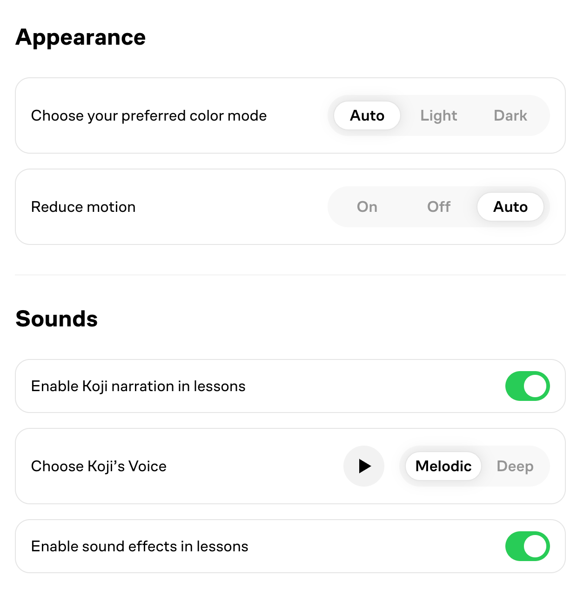
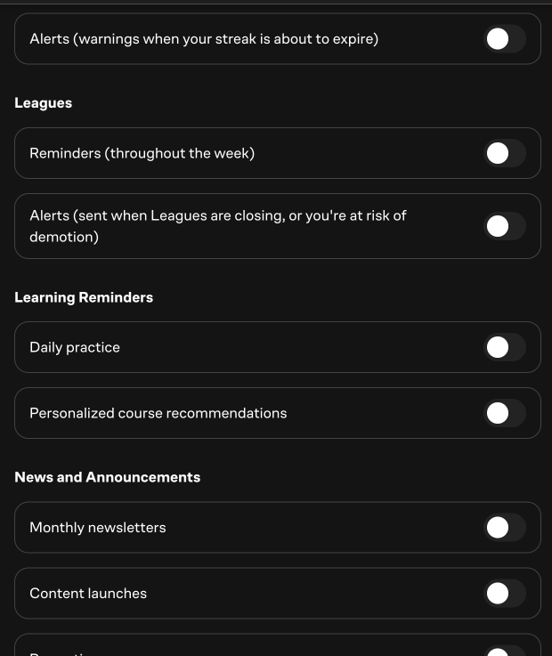
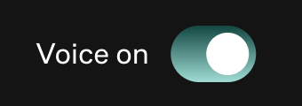

### Segmented control

Two sizes, same pattern: a `bg.secondary` track (radius full, padding 4–6, gap 4) with pill segments. Checked segment is `bg.primary`, `border.primary` 1px, `text.primary`, `shadow.base`; unchecked is `text.tertiary`. `transition: background-color, border-color, box-shadow, color .15s ease-out`.

| Where | Track | Segment | Type |
|---|---|---|---|
| Preferences (`data-slot=segment`) | h44, padding 6 | h32, padding 0 10 | `ui.nav.selected` 16/24 500 |
| You page time range | padding 4 | min-w 60, padding 8 12 | `body.sm` 14/21 |

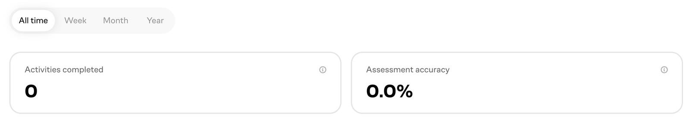
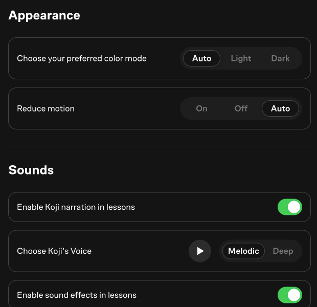

### Choice card

A card that acts as a radio (onboarding voice, subject and level). 158–178 wide, h228, radius 16, padding 32 24 24, bg `gradient.hue-shift-action-gray`, label `ui.actions.base` in `text.secondary`.

| State | Change |
|---|---|
| Hover | bg `bg.hover`, gradient removed |
| Selected (`data-checked`) | label `text.primary`; `::before` paints a hue-shift gradient (teal or blue); subject cards add `shadow.outline` |

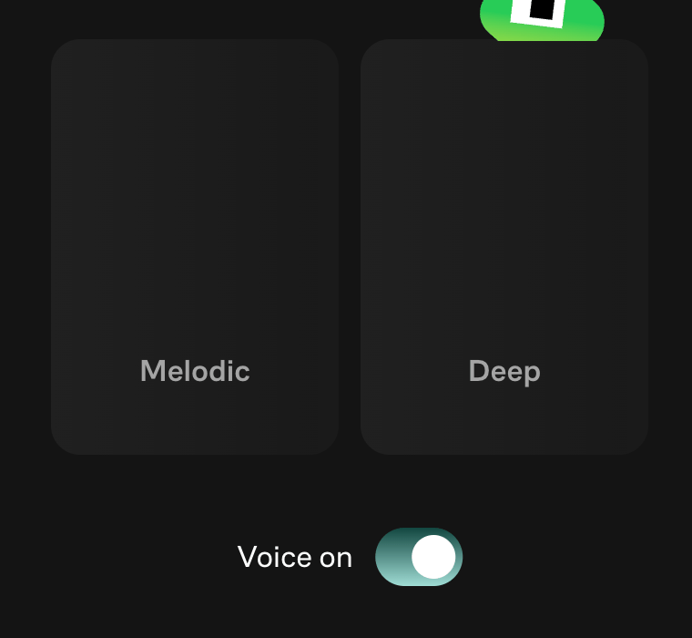
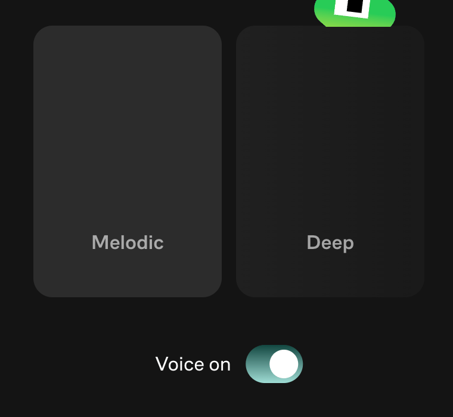
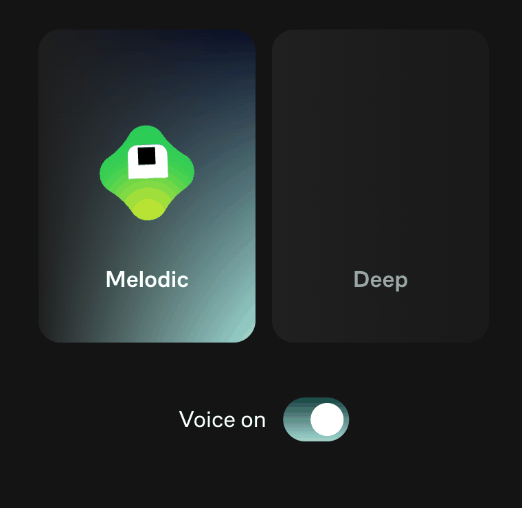
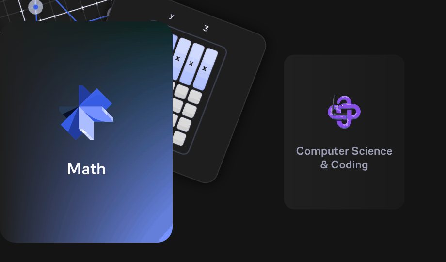
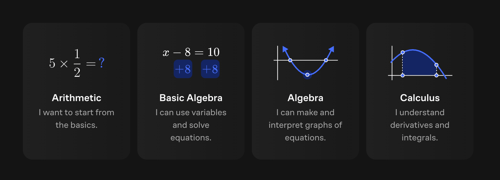

### Tabs and navigation

App header nav tabs: `a` h63, `ui.nav.default` 16/24 in `text.secondary`; selected is `text.primary`, weight 500 and a 2px underline that slides up with `transform 100ms linear`.

Settings side menu: `bg.primary` panel, 1px `border.primary`, radius 12, padding 16; items h40, radius 8; selected `bg.tertiary` with `ui.nav.selected`.

Pricing billing tabs (Base UI): 48 tall, 16/24; active is 500 `text.purple-primary` with an underline. Feature tabs (vertical) are 56 tall, radius 8, active `gray.100` light or `bg.hover` dark.

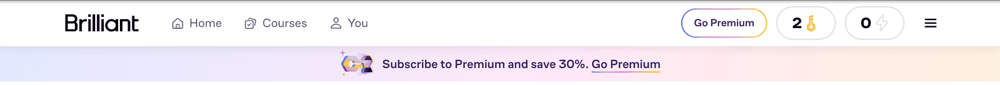
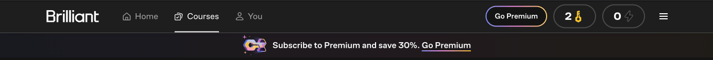
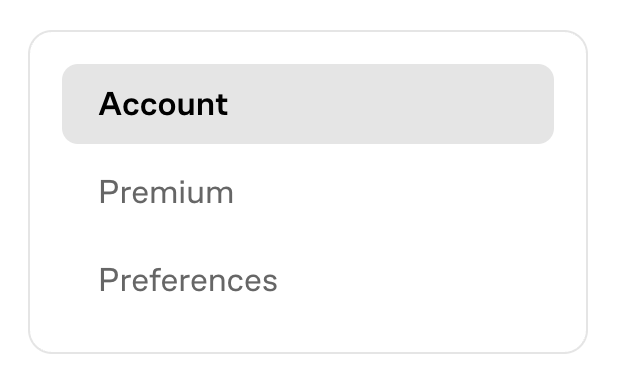
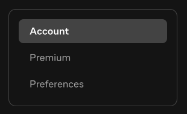

### Badge

`.panda-badge`, recipe with `colorPalette` and `variant`. Text is `ui.actions.sm`: 12/13.2 700, uppercase, tracking .48px.

| Variant | Padding / radius | Example |
|---|---|---|
| subtle | 4 8, full | "RECOMMENDED" blue (L blue.200 on blue.700 text; D blue.900 with blue.200), "UNVERIFIED" yellow, "PRIMARY" blue |
| solid | 4 8, 12 | "NEW" green.600 with white, "SAVE xx%" purple.500 |
| minimal | none | grade eyebrows "GR 4–5" in `text.tertiary` |
| premium solid | 6 20, 12 | pink.300 → yellow.400 gradient, black text |

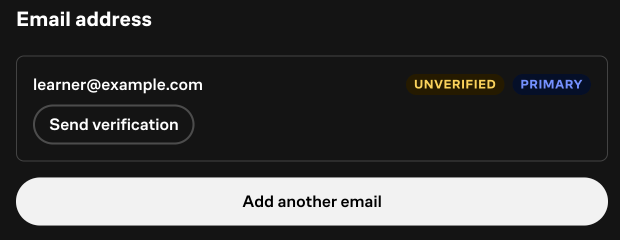
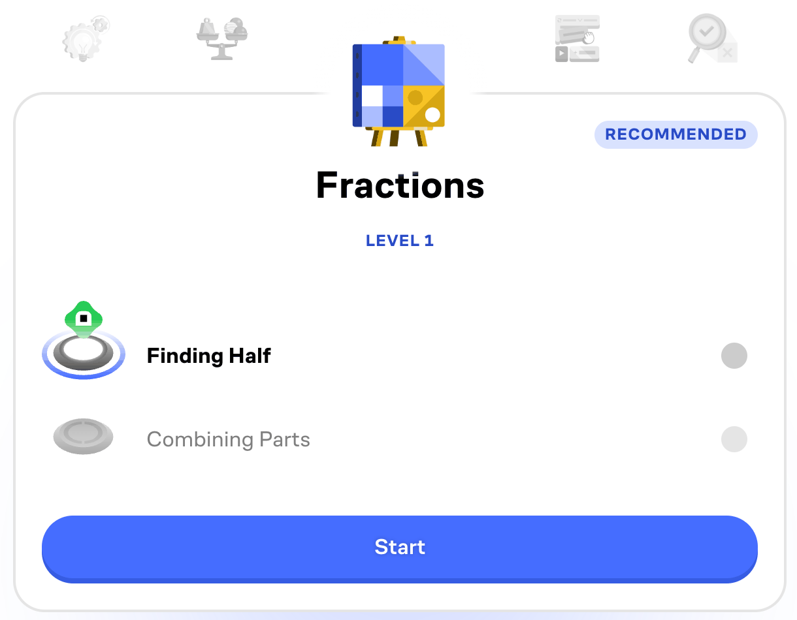
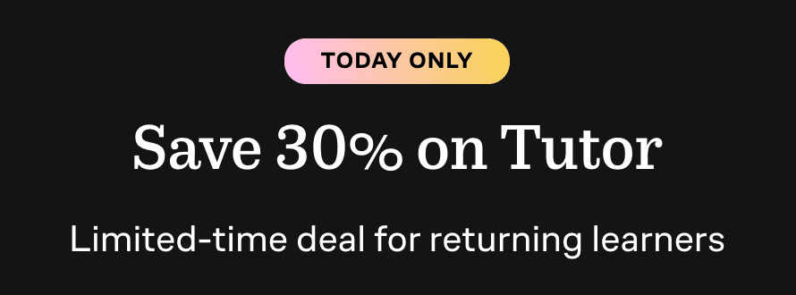

### Progress

`.panda-progress`, track radius full, indicator `bg.green-primary`.

| Size | Height | Where |
|---|---|---|
| sm | 4 | not seen in use |
| default | 8 | onboarding, 696 wide, indicator `width 200ms ease` |
| lg | 12 | lesson top bar, 592 wide, followed by 16x12 upcoming-section dots |

The learning-plan intro splits the bar into 3 segments with 4px gaps.

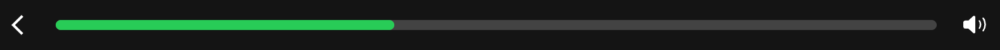
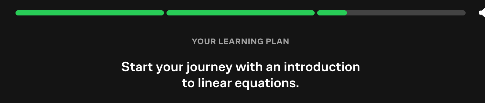
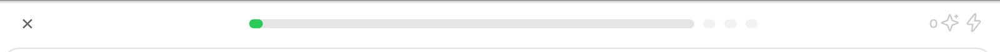

### Spinner

`data-slot=spinner`: 16x16, 2px border, top in currentColor and the other sides at 25%, `spin 600ms linear infinite`. Seen inside hue-shift pills and the plan loader (`plan-dark-creating-plan-loading.png`).

### Dropdown menu

`data-slot=dropdown-menu-content`: 280 wide, `bg.elevated`, radius 8, `shadow.base`, no padding. Items h48, padding 12 16, `body.base`; highlighted `bg.hover`. 1px `border.secondary` separators. Opens from scale .95 and opacity 0 with `opacity 150ms ease-in-out, transform 150ms ease-in-out`.

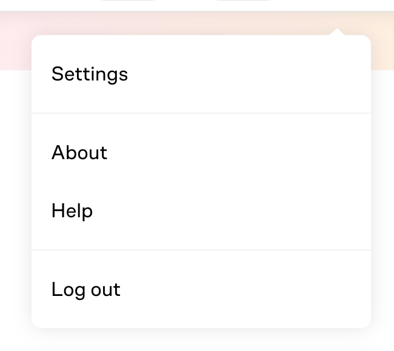
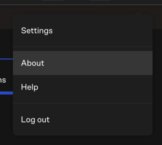

### Popover

`data-slot=popover-content`: 353 (keys) or 384 (streak) wide, `bg.elevated`, radius 8, `shadow.base`, 20x10 arrow in `bg.elevated`. Same 150ms scale-and-fade as the menu.

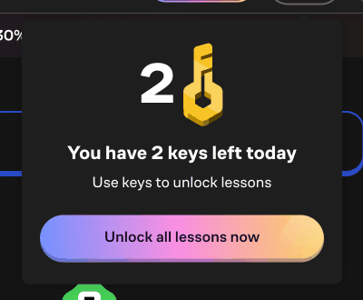
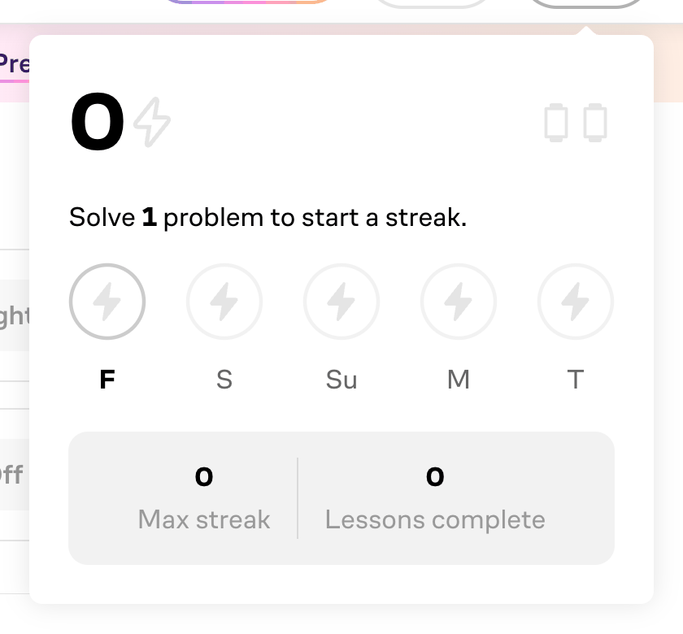
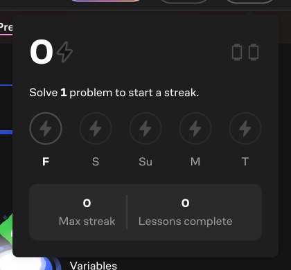

### Tooltip

`data-slot=tooltip-content`: max-w 280, padding 12 16, radius 12, `bg.elevated`, `shadow.base`; title `heading.sm`, body `body.sm` `text.secondary`; arrow is a 10px square rotated 45°. Same 150ms open transition.

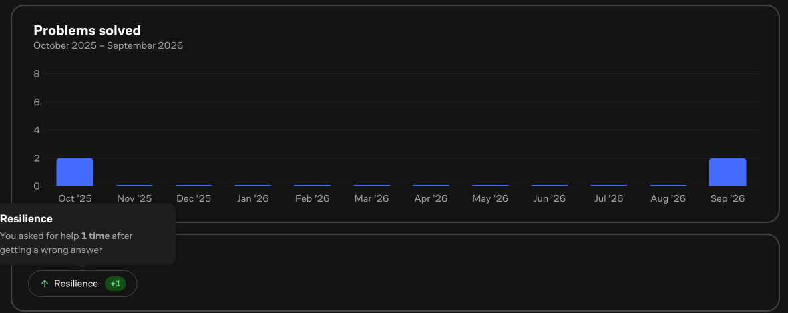

### Modal

Overlay `special.overlay.default` (rgba(11,11,11,.8) dark), `opacity 150ms`. Content max-w 448, `bg.elevated`, radius 20, `shadow.md`, padding 32 20 16, gap 24; title `heading.md`, body `body.base`; full-width button3d plus a danger ghost button. Opacity and transform 150ms.

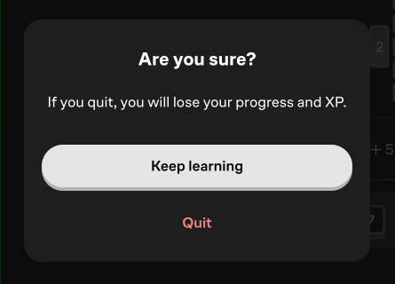

### Card

Several shells share one pattern: `bg.primary`, 2px `border.primary` or `border.solid`, large radius, no shadow.

| Card | Radius | Padding | Notes |
|---|---|---|---|
| Course hero | 20 | 32 | 487 wide at xl |
| Stat card | 20 | 16 24 | label `body.sm`, value `heading.xl` |
| Home recommended | 24 | 24 | height `clamp(320px, 50dvh + banner, 500px)` |
| Home gamification | 32 | 0 | premium upsell footer strip |
| Figure card | 32 | 24 | `bg.elevated`, 1px border, `shadow.base` |
| Setting row | 16 | 18 16 | 1px border |
| Fixed footer card (course) | 40 | 24 16 16 | `bg.elevated`, `border.solid` |

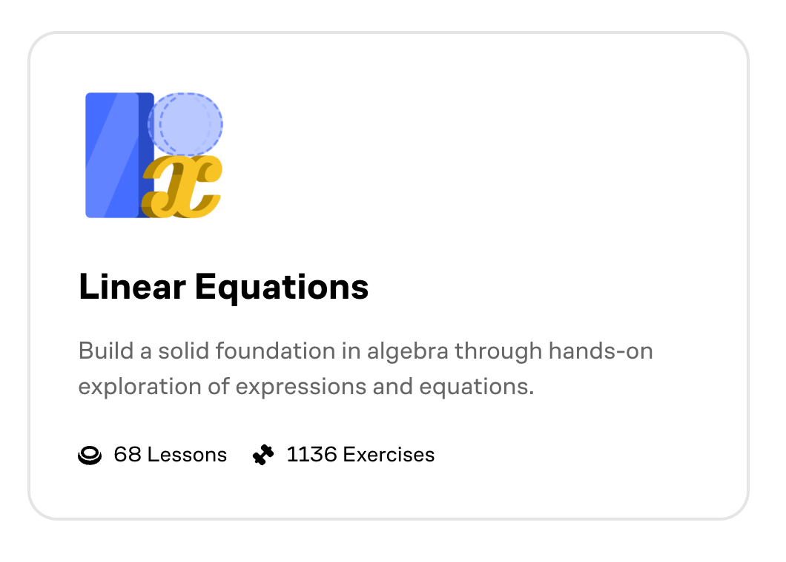
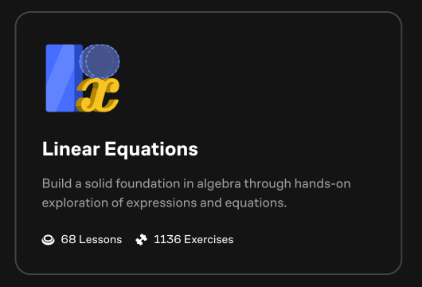
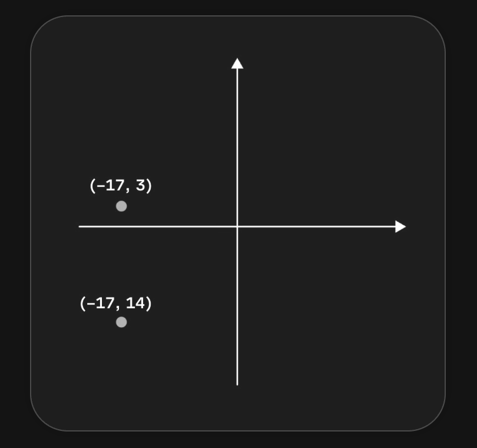

## Product components

### Promo banner

Under the app header: min-h 48, centred `body.sm` → `body.base` 500 with an underlined link, over a 25% blue → pink → yellow wash (80% `bg.primary` on top). Visible in every signed-in page crop of the header.

### Premium header button and stat pills

"Go Premium" (`data-slot=premium-button`): h41, padding 8 16, radius full, 2px iridescent gradient border via `padding-box`/`border-box`, 14/21 500 `text.iridescent-secondary`.

Stat pills (keys, streak): h47, padding 9 20, radius 54, 2px `border.primary`, `ui.actions.base`, icon 24. They open the keys and streak popovers.

### Course tile

`data-inner-course-card`: 176 square at 2xl (152–218 by breakpoint), padding 22.72%, radius 20, 2px `border.solid`, lifted 4px with a `border.solid` lip. Hover changes the border and lip to `border.hover`. `transform .1s ease-out, box-shadow .1s ease-out, border-color .2s`. Grade badge top-left, "NEW" badge top-right, label below. Tiles on a shelf (`bg.secondary`, radius 12) are joined by 2px connectors.

### Learning-path tile and "START HERE" tag

Onboarding path: 176x174 artwork well, radius 36, padding 36; current tiles get `gradient.hue-shift-color-blue-primary`, locked tiles are `bg.primary` with a 2px `border.secondary` and `text.disabled` label. "START HERE" is a `gray.900` pill with gradient-clipped `ui.actions.sm` text, sitting on the tile's top edge.

### Course path (level header and nodes)

Level header: 456x64 button, radius 18, over a 3D lip in the level colour (blue.700 for Level 1); presses 4px on active. Eyebrow `ui.actions.sm` in the level colour. Path nodes are 3D discs with a label to the right; the current node glows blue with Koji on top, locked nodes are grey with `text.tertiary` labels. A fixed footer card holds a full-width blue button3d.

### Home cards

Gamification card (streak, leagues, premium footer with an iridescent "Explore" pill) and recommended course card (badge, art, title, `LEVEL 1` eyebrow, lesson rows, blue button3d).

### Koji prompt

Opened from the ask pill. Cards slide out, "Hey, Learner! How can I help?" (`body.lg` 600) sits over Koji, and suggestion cards float around. The suggestion cards are drawn on a `<canvas>`, so their styling is estimated from screenshot: about 130x84, radius 12, 5% white fill, active card with a 1px blue.400 border and glow.

### Lesson frame and interactive

The lesson panel is inset 34px, radius 24, `bg.primary`, with a 2px border that turns to the evaluation colour. The interactive (`<custom-interactive>`, CoFo Semi Mono) has tappy tiles, wells, a tray, answer slots and algebra tiles; every colour is in `component.lesson.*` for both themes.

| Part | Dark | Light |
|---|---|---|
| Tile face / edge | #141414 / gray.600 | white / gray.300 |
| Stacked lip | gray.900 over #666 | gray.200 |
| Tray | whiteAlpha 10% | blackAlpha 2.4% |
| Empty slot | gray.900, 2px dashed #666 | gray.50, 2px dashed gray.300 |
| Variable chip | #381d66, border #5a2ea3 | purple.100, border purple.200 |
| Algebra bar | pink.600 → pink.400 | pink.300 → pink.400 |

### Lesson feedback

| State | Panel | Tutor bubble | Footer |
|---|---|---|---|
| Correct | border green.700 plus `borderGlow` 1s | green.800, border green.700 | "Why?" secondary, "Continue" green button3d |
| Retry | border yellow.700, `shakeX .45s` | yellow.700 | "Get help" secondary, "Try again" yellow button3d |
| Neutral (tutor) | unchanged | `component.lesson.bubble-tutor` #172326e0, border #3e6a74 | n/a |

Tutor bubbles have radius 16 16 16 4 and padding 12 20, 16/24 500. The answer row gets a check or cross badge at its corner.

### Koji tutor chat

A 400px column slides in from the left while the lesson panel moves right, using `--spring-smooth` over .833s. Messages: tutor (radius 16 16 16 4), user (right-aligned, `bg.tertiary`, 16 all round), and fading older messages at opacity .5. The board highlight is a pulsing `0 0 8px 0 rgba(255,255,255,.6)` glow.

### Weekly summary, stat cards and bar chart

Weekly summary: radius 20, 2px `border.primary`, `gradient` from `autoflip.green.100` to `autoflip.green.50`, Koji peeking bottom-left. Bar chart bars are plain divs in `bg.blue-primary`, radius 4 on top corners, a 2px bar for zero, with an accessible table underneath. Tokens: `component.chart.bar`.

Strength chip: h40, radius full, 1px border, delta pill `body.xs` 700 on `bg.green-secondary`.

### Pricing and Free vs Premium comparison

Hero: CoFo Robert 60/66 500 (`typography.display.5xl`) over `gradient.paywall-iridescent-bg-flipped`. Plan cards are a radio group (330x129), the checked one framed in `gradient.iridescent-frame` with a "MOST POPULAR" tab and Koji peeking over it (frame estimated from screenshot). The comparison table heading clips "Premium" to the iridescent gradient, and the Premium column is framed in the same gradient (about 4px, radius 16, estimated from screenshot).

### Public header and landing CTAs

Public header: logo, nav, "Sign in" outline and "Sign up" green buttons. Landing CTAs are h60 pills, `ui.actions.lg` 20/25 500, `0 4px 7px 0 rgba(0,0,0,.05)`: green "I'm a learner" and white "I'm a parent or teacher".

### Legacy 404

The old Django UI, not part of the Panda system: h1 22/30.8 500 #333, body 15/24, "Go home" pill #f0f0f0. Kept for completeness.

## Icons

App icons are a custom set of filled glyphs drawn at 16 (nav, menu), 24 (stats), 32 (XP) and 48 (lesson rail), all `fill="currentColor"` except the gold key. They were saved by hand from the signed-in pages into [icons/app/](icons/app), named by role and size.

| File | Where |
|---|---|
| `nav-home-16`, `nav-courses-16`, `nav-you-16` | app header tabs |
| `menu-16` | header menu trigger |
| `stat-key-24` (#f7c325), `stat-streak-bolt-24` | header stat pills |
| `xp-sparkle-32` | lesson XP counter |
| `lesson-report-flag-48`, `lesson-sound-48`, `lesson-chat-48`, `lesson-mic-18` | lesson rail and Koji dock |
| `play-16`, `close-16`, `arrow-up-16`, `arrow-down-16` | voice sample, close, strength deltas |

[icons/public/](icons/public) holds 33 SVGs pulled from the public pages by a script, named by content hash:

| Files | What | Size | Style |
|---|---|---|---|
| `91a27c79f8`, `35bbde23a3` | nav "Courses", "Next" chevron | 16, 12 | fill, currentColor black |
| `c29b0a1931`, `e950fc5c01` | course meta: lessons, exercises | 16 | fill |
| `93e06c447c`, `4fc06a14a3`, `38197ce722`, `197d4e7d65` | footer Facebook, Instagram, Twitter, LinkedIn | 20–22 | fill #999 |
| `f65ff86b03`, `9f2b7ed8f1` | Google and Apple login | 20, 17 | fill, brand colours |
| `b4ce175fcd`, `c6f4f6cb5b` | landing video pause and play | 16 | fill 30% black |
| `5ed2cd3d2e`, `99aace2974` | Koji peeking over the plan card | 40x26 | fill |
| `b7865a5607`, `6b48e24473`, `a38292d801`, `5baf88ce65`, `61a5187a65` | pricing feature list icons | 20–24 | fill with gradients |
| `13e7b9f445`, `2239dabbae`, `9d5342950c`, `f78cff109f` | pricing benefits | 32 | stroke 2.4px plus fills |
| `0cfb527962`, `f9abc0b2e7`, `c8b322698c`, `1c94002d26` | pricing tab icons | 20 | fill 60% black |
| `abefb23ce2`, `829a917deb`, `063a2fb769`, `0aa9540d2a`, `64e87ab675`, `b84ae4c3e9` | testimonial avatars (illustrated) | 28 | fill with stroke ring |

Course art, path nodes and Koji are raster or complex illustrations and are not included. All icons are Brilliant's property, kept for reference only.

## Gaps

What could not be captured, and why.

| Gap | Reason | What stands in |
|---|---|---|
| Toasts | Sonner is loaded, but nothing in the session fired a toast | none; the toaster exists in the DOM but was always empty |
| In-app paywall | The onboarding paywall auto-advanced before it could be saved or measured | the same Free vs Premium table on `/subscribe/`, measured headless in both themes |
| Select, checkbox, radio, avatar, data table | The app has none; choice cards and plan cards act as radios, and preferences use switches | n/a |
| Koji prompt suggestion cards | Drawn on a `<canvas>`, so there is no DOM to read | values estimated from screenshot |
| Signed-in mobile width | The signed-in pages were captured in the user's own Chrome window, which was left at desktop size while they were using it | public pages at 390x844 in both themes |
| Light theme: onboarding, promo, plan, learning path | Onboarding runs once per account and was done in dark before the light pass | tokens cover both themes; the components reappear on light pages |
| Light theme: lesson correct and retry, tutor chat, quit dialog | Tile drags did not register while the tab was in the background, so no answer could be placed | light values read by script (`component.lesson.*`, `raw/measurements.md`), plus `lesson-light-default.png` |
| Lesson completion screen | A lesson was not finished in the session | none |
| Lesson plan steps (reinforce skill, skill check) | Not reached on a new account | none |
| Settings "Premium" tab | Not opened | none |
| Invalid input and login errors | No error was triggered, to avoid failed-login noise on the account | `text.danger-*` tokens from CSS |
| Button3d hover | The hover tint is scoped to Safari, so Chrome shows no computed change | `--button3d-hover-tint` noted in the measurements |
| Duration tokens | Panda's `trs-dur_fast` and `normal` compile to invalid CSS in production, so no duration variable exists | `duration` lists the durations actually used in transitions |
| High-contrast theme | The product has none; only Auto, Light, Dark and Reduce motion | n/a |
| Proprietary fonts | CoFo Brilliant, CoFo Robert, CoFo Semi Mono are licensed and not committed | the style guide falls back to Figtree and Georgia |
| Some captures at 1x | Taken while Chrome sat on an external 1x display | 1384 px wide; crops are scaled to match |
| Legacy pages (404, `/account/`) | Old Django UI, not on the Panda tokens | documented separately above |
| Cookie banner | OneTrust, third party | hidden during capture |
