# ChatGPT components

The discovery list of every page and state captured, then one entry per component with crops of the real product, the shared values, the icon index and the Gaps. Captured from chatgpt.com on 2026-10-04, signed in to the owner's account (Free plan, dark theme, blue accent), as static copies of each page state rendered in headless Chromium at 1440 x 900 (the Mobile group at 390 x 844), with computed styles read from the rendered copy in both themes. Nothing was sent, created or deleted in the account; the only changes were opening menus and closing them, typing a line into the composer and deleting it, and collapsing the sidebar and reopening it.

The full per-state readings are in [raw/measurements.md](raw/measurements.md), with the machine-readable copy in [raw/components-computed.json](raw/components-computed.json) (105 components, 426 states). The page layouts are described in [raw/pages.md](raw/pages.md).

How to read an entry:

- A colour is its value followed by the token in [tokens.json](tokens.json) whose value in that theme is the same, when there is one. Text is written family size/line-height weight, then its colour, for example `System 14/20 400, #ffffff`, and is read from the first text node inside the component. System is the `-apple-system-body` stack.
- Dark states come first (every page was captured dark), then the same states read in light. Each theme's first row lists every value; later rows of that theme list only what changes. A state with the same values as its theme's first is named in that label, for example "default (same: focus-visible)". When the root paints nothing, "Child layers" names the first nodes inside it that do.
- Crops are images of the component from the rendered copy, in [components/crops/](components/crops) (426 files, named `{component}-{state}.png`, at 2x). Screenshots are in [screenshots/](screenshots).

## Discovery list

Screenshots are named `{page}-{theme}-{state}.png`. Desktop shots are 1440 x 900 at 2x; `-full` shots are whole pages at 2x, kept for the home, Library and Plugins; mobile shots are `mobile-{page}-{theme}-{state}.png`, 390 x 844 at 2x. Every state exists in both themes.

| Surface | URL | Screenshots |
|---|---|---|
| Home. The heading, composer and suggestion rows. Captured at rest, with the + menu, a chat row's menu, the user menu and the search dialog open, with a line typed in the composer, and with the sidebar collapsed. | `/` | [chat-menu (dark)](screenshots/home-dark-chat-menu.png), [composer-typed (dark)](screenshots/home-dark-composer-typed.png), [full (dark)](screenshots/home-dark-full.png), [plus-menu (dark)](screenshots/home-dark-plus-menu.png), [search (dark)](screenshots/home-dark-search.png), [sidebar-collapsed (dark)](screenshots/home-dark-sidebar-collapsed.png), [user-menu (dark)](screenshots/home-dark-user-menu.png), [default (dark)](screenshots/home-dark.png), [chat-menu (light)](screenshots/home-light-chat-menu.png), [composer-typed (light)](screenshots/home-light-composer-typed.png), [plus-menu (light)](screenshots/home-light-plus-menu.png), [search (light)](screenshots/home-light-search.png), [sidebar-collapsed (light)](screenshots/home-light-sidebar-collapsed.png), [user-menu (light)](screenshots/home-light-user-menu.png), [default (light)](screenshots/home-light.png) |
| A thread (a conversation about hikes, the owner's own). Captured at the table answer, at the user turn with the "Worked for" disclosure and the map widget, and at the bottom. | `/c/<id>` | [bottom (dark)](screenshots/thread-dark-bottom.png), [table (dark)](screenshots/thread-dark-table.png), [user-turn (dark)](screenshots/thread-dark-user-turn.png), [bottom (light)](screenshots/thread-light-bottom.png), [table (light)](screenshots/thread-light-table.png), [user-turn (light)](screenshots/thread-light-user-turn.png) |
| Library, list view, Suggested tab. | `/library` | [full (dark)](screenshots/library-dark-full.png), [default (dark)](screenshots/library-dark.png), [default (light)](screenshots/library-light.png) |
| Images, Trending tab. | `/images` | [default (dark)](screenshots/images-dark.png), [default (light)](screenshots/images-light.png) |
| Plugins. | `/plugins` | [full (dark)](screenshots/plugins-dark-full.png), [default (dark)](screenshots/plugins-dark.png), [default (light)](screenshots/plugins-light.png) |
| A project page (Research), Chats tab. | `/g/<project>/project` | [default (dark)](screenshots/project-dark.png), [default (light)](screenshots/project-light.png) |
| Settings dialog, General pane, at rest and with the accent colour listbox open. | `/#settings` | [accent-menu (dark)](screenshots/settings-dark-accent-menu.png), [general (dark)](screenshots/settings-dark-general.png), [accent-menu (light)](screenshots/settings-light-accent-menu.png), [general (light)](screenshots/settings-light-general.png) |
| Home at 390, and the drawer. | `/` | [drawer (dark)](screenshots/mobile-home-dark-drawer.png), [default (dark)](screenshots/mobile-home-dark.png), [drawer (light)](screenshots/mobile-home-light-drawer.png), [default (light)](screenshots/mobile-home-light.png) |
| The thread at 390, and the model menu. | `/c/<id>` | [model-menu (dark)](screenshots/mobile-thread-dark-model-menu.png), [default (dark)](screenshots/mobile-thread-dark.png), [model-menu (light)](screenshots/mobile-thread-light-model-menu.png), [default (light)](screenshots/mobile-thread-light.png) |

### Overlays and transient states

| State | Where | How it was reached | Captured |
|---|---|---|---|
| Composer + menu | home | the composer's + button | [home-dark-plus-menu](screenshots/home-dark-plus-menu.png), [plus-menu](#plus-menu) |
| Composer with text | home | a line typed, then deleted | [home-dark-composer-typed](screenshots/home-dark-composer-typed.png), [send-button](#send-button) |
| Chat row menu | home | the options button on a hovered history row | [home-dark-chat-menu](screenshots/home-dark-chat-menu.png), [chat-menu](#chat-menu) |
| User menu | home | the account row | [home-dark-user-menu](screenshots/home-dark-user-menu.png), [user-menu](#user-menu) |
| Search dialog | home | the sidebar's search button | [home-dark-search](screenshots/home-dark-search.png), [search-dialog](#search-dialog) |
| Collapsed sidebar | home | the close-sidebar button, then reopened | [home-dark-sidebar-collapsed](screenshots/home-dark-sidebar-collapsed.png), [sidebar-rail](#sidebar-rail) |
| Settings dialog | home | Settings in the user menu; closed with Escape | [settings-dark-general](screenshots/settings-dark-general.png), [settings-dialog](#settings-dialog) |
| Accent colour listbox | settings | the Accent color select; closed with Escape, nothing chosen | [settings-dark-accent-menu](screenshots/settings-dark-accent-menu.png), [accent-menu](#accent-menu) |
| Phone drawer | home at 390 | the menu button | [mobile-home-dark-drawer](screenshots/mobile-home-dark-drawer.png), [m-drawer](#m-drawer) |
| Phone model menu | thread at 390 | the model switcher | [mobile-thread-dark-model-menu](screenshots/mobile-thread-dark-model-menu.png), [model-menu](#model-menu) |

## Shared values

Values that apply across entries, tallied from the measurement file.

**Radius.** full (130), 8px (64), 10px (60), 16px (26), 12px (22), 28px (12), 20px (8), 22px (4), 26px (2). Rows and settings tabs are 10, controls (icon buttons, Share, the header Upgrade, select buttons) 8, menu items 12, popovers 20, dialogs and the accent listbox 16, the composer 28 (26 on a phone), the user bubble 22. Pills, round buttons, the mode toggle, tabs, search fields and the toggle track are fully round (`rounded-full`, read as `full`).

**Hover.** ChatGPT hovers with a translucent fill. Dark: no change on the element (15), transparent to rgba(255, 255, 255, 0.1) `interactive.bg-secondary-hover` (13), transparent to rgba(255, 255, 255, 0.15) `surface.surface-hover` (5), text #cdcdcd `text.secondary` to #ffffff `text.primary` (5), transparent to rgba(255, 255, 255, 0.06) `interactive.bg-inactive-danger-soft` (2), text #afafaf `text.tertiary` to rgba(255, 255, 255, 0.9) `interactive.label-hover-secondary` (1). Light: no change on the element (13), transparent to rgba(0, 0, 0, 0.05) `interactive.bg-secondary-hover` (13), transparent to rgba(0, 0, 0, 0.07) `surface.surface-hover` (6), text #5d5d5d `text.secondary` to #0d0d0d `text.primary` (4), #ffffff `bg.primary` to #f9f9f9 `bg.secondary-surface` (2), text #8f8f8f `text.tertiary` to rgba(0, 0, 0, 0.9) `interactive.label-hover-secondary` (1). The row fill is `interactive.bg-secondary-hover` (white at 10% in dark, black at 5% in light) and the current page or chat rests on `interactive.bg-secondary-selected`, the same value, so a current row does not change on hover. Icon buttons in the sidebar use `surface.surface-hover` (white at 15%, black at 7%). Menu items show no hover here: Radix highlights them with `data-highlighted`, which its script sets, so only the captured highlighted row is filled.

**Focus.** Of 36 elements given a real keyboard focus in dark: no ring on the element (20), 1px auto #99c8ff offset 0px (13), 1px solid #ffffff `interactive.border-focus` offset 2px (1), 1px auto #63a8f8 `text.accent` offset 4px (1), 1px solid rgba(255, 255, 255, 0.16) `interactive.focus-ring-secondary` offset 2px (1). In light: no ring on the element (20), 1px auto #005fcc offset 0px (13), 1px solid #0d0d0d `interactive.border-focus` offset 2px (1), 1px auto #3a83f7 `bg.accent-static` offset 4px (1), 1px solid rgba(13, 13, 13, 0.12) `interactive.focus-ring-secondary` offset 2px (1). With scripts gone the `keyboard-focused:` rings ChatGPT draws do not switch on, so most focused states show the browser's own outline (`auto`, the platform blue), and a few controls show their own ring: the settings toggle a 2px gap and a 4px ring in `interactive.border-focus`, the project tabs a 3px ring in the text colour, the settings tabs a 1px outline offset 2.

**Motion.** 0.15s cubic-bezier(0.4, 0, 0.2, 1) (84), 0.2s cubic-bezier(0.4, 0, 0.2, 1) (14), 0.15s steps(1, start) (2). Nearly every transition is Tailwind's `transition-colors` at 150 ms on cubic-bezier(0.4, 0, 0.2, 1) (`duration.default`, `easing.default`); larger moves (the sidebar, popovers, page transitions) use the spring curves listed under the core set's notTokenised, at 667 ms and up. The code block's full-screen view cross-fades at 220 ms ease-out.

**Layout grid.** The sidebar is 260 wide (the rail 52), the page header 52 tall, and the composer and thread share one 768 wide centred column (x 466 at 1440 with the sidebar open). Images, Plugins and the project page sit in an 800 wide `max-w-app-content` box with 16 padding; the Library uses a wider 1092 column. On a phone the sidebar is a 260 wide drawer over the page and the column is 358 wide at x 16. The numbers per page are in [raw/pages.md](raw/pages.md).

**Accent.** The account's accent (blue) paints only the user bubble (`chatTheme.blue.user-msg-bg`, #173e76 dark, #e8f3fe light), the voice and send button (`chatTheme.blue.submit-btn-bg`), the Work segment, the header Upgrade, the toggle and selection. Everything else is grey, which is why the eight accents in [tokens.json](tokens.json) differ only in the `chatTheme` group.

## Components

### Sidebar

The 260px sidebar every page shares (`#stage-slideover-sidebar`): a 52px header with the wordmark, search and close, the nav rows (New chat, Images, Library, Scheduled, Plugins, Codex, More), then three collapsible sections, Pinned, Projects and Chats, and the account row with its Upgrade pill pinned at the bottom. Every row is a `.__menu-item`, 36 tall with radius 10, whose fills come from inline `--menu-item-*` variables. Closing it leaves the 52px tiny rail.

#### Sidebar (expanded)

`sidebar`, on home-dark. `#stage-slideover-sidebar`, 260 wide (`--sidebar-width`), `--sidebar-surface-primary` fill and a 1px `--border-extra-light` rule at the inline end. The header and the account row are sticky inside it.

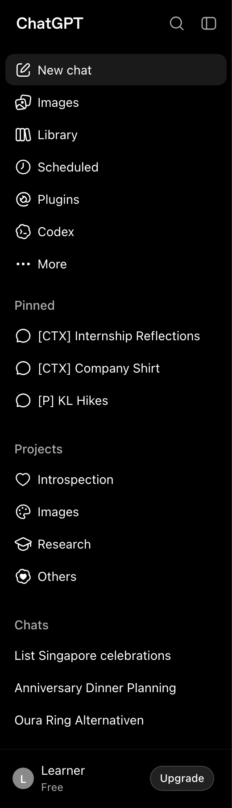 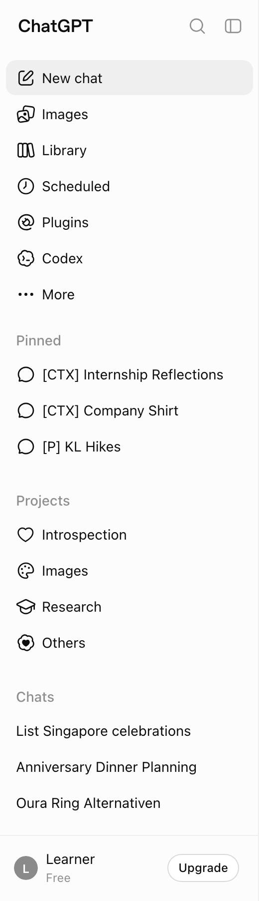 

| State | Values |
|---|---|
| default | size 260 x 900; border R: 1px solid rgba(255, 255, 255, 0.1) `border.extra-light`; background #000000 `bg.secondary-surface`; text System 12/17.14 600, #ffffff `text.primary`; icon 20 x 20, #ffffff `icon.primary` |
| light | size 260 x 900; border R: 1px solid rgba(0, 0, 0, 0.05) `border.light`; background #fcfcfc `surface.sidebar-surface`; text System 12/17.14 600, #ffffff `text.inverted`; icon 20 x 20, #0d0d0d `icon.primary` |

Tokens named in its classes: `--bg-tertiary`, `--border-extra-light`, `--sidebar-rail-width`, `--sidebar-section-first-margin-top`, `--sidebar-surface-primary`, `--sidebar-width`, `--surface-hover`, `--text-primary`, `--text-tertiary`.

#### Sidebar header row

`sidebar-header`, on home-dark. 52 tall (`--header-height`): the ChatGPT wordmark at the start, search and close icon buttons at the end.

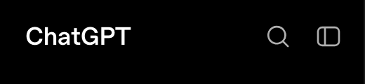 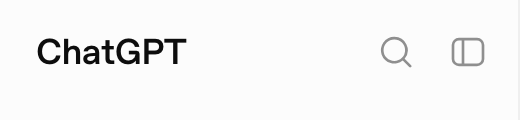 

| State | Values |
|---|---|
| default | size 244 x 52; background transparent; text OpenAI Sans 18/26 600, #ffffff `text.primary`; icon 20 x 20, #afafaf `icon.tertiary` |
| light | size 244 x 52; background transparent; text OpenAI Sans 18/26 600, #0d0d0d `text.primary`; icon 20 x 20, #8f8f8f `icon.tertiary` |

Tokens named in its classes: `--surface-hover`, `--text-primary`, `--text-tertiary`.

#### Wordmark link (ChatGPT)

`sidebar-wordmark`, on home-dark. The only place the UI sets OpenAI Sans: `.header-wordmark`, 600 weight, -0.015em tracking.

  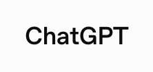   

| State | Values |
|---|---|
| default (same: hover, focus-visible) | size 95.23 x 36; padding 0px 10px; radius 8px; background transparent; text OpenAI Sans 18/26 600, #ffffff `text.primary` |
| light (same: light-hover, light-focus-visible) | size 95.23 x 36; padding 0px 10px; radius 8px; background transparent; text OpenAI Sans 18/26 600, #0d0d0d `text.primary` |

Tokens named in its classes: `--surface-hover`, `--text-primary`.

#### Sidebar icon button (Search)

`sidebar-icon-button`, on home-dark. 36x36, radius 8, `--text-tertiary` icon; hover fills with `--surface-hover`.

 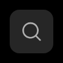 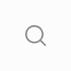   

| State | Values |
|---|---|
| default (same: focus-visible) | size 36 x 36; radius 8px; background transparent; text System 16/24 400, #afafaf `text.tertiary`; icon 20 x 20, #afafaf `icon.tertiary` |
| hover | background rgba(255, 255, 255, 0.15) `surface.surface-hover` |
| light (same: light-focus-visible) | size 36 x 36; radius 8px; background transparent; text System 16/24 400, #8f8f8f `text.tertiary`; icon 20 x 20, #8f8f8f `icon.tertiary` |
| light-hover | background rgba(0, 0, 0, 0.07) `surface.surface-hover` |

Tokens named in its classes: `--surface-hover`, `--text-tertiary`.

#### Close sidebar button

`sidebar-close-button`, on home-dark.

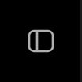 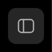 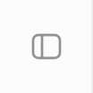 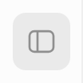 

| State | Values |
|---|---|
| default | size 36 x 36; radius 8px; background transparent; text System 16/24 400, #afafaf `text.tertiary`; icon 20 x 20, #afafaf `icon.tertiary` |
| hover | background rgba(255, 255, 255, 0.15) `surface.surface-hover` |
| light | size 36 x 36; radius 8px; background transparent; text System 16/24 400, #8f8f8f `text.tertiary`; icon 20 x 20, #8f8f8f `icon.tertiary` |
| light-hover | background rgba(0, 0, 0, 0.07) `surface.surface-hover` |

Tokens named in its classes: `--surface-hover`, `--text-tertiary`.

#### Nav row (Images)

`nav-row`, on home-dark, library-dark. A `.__menu-item` row, 36 tall, radius 10, 20px icon and 14/20 text, inset 6px from the sidebar edges. Its fills come from inline `--menu-item-*` variables pointing at `--interactive-bg-secondary-*`. The current page gets the selected fill (`active`).

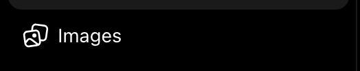 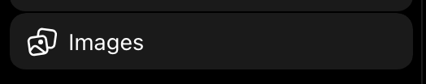 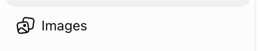 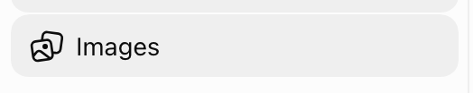 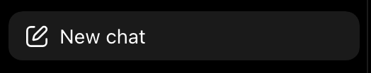  

| State | Values |
|---|---|
| default | size 248 x 36; padding 6px 10px; border B: 1px solid transparent; radius 10px; background transparent; text System 14/20 400, #ffffff `text.primary`; transition color and 9 more 0.15s cubic-bezier(0.4, 0, 0.2, 1); icon 20 x 20, #ffffff `icon.primary` |
| hover, focus-visible, active, active-hover, active-library | background rgba(255, 255, 255, 0.1) `interactive.bg-secondary-hover` |
| light | size 248 x 36; padding 6px 10px; border B: 1px solid transparent; radius 10px; background transparent; text System 14/20 400, #0d0d0d `text.primary`; transition color and 9 more 0.15s cubic-bezier(0.4, 0, 0.2, 1); icon 20 x 20, #0d0d0d `icon.primary` |
| light-hover, light-focus-visible, light-active, light-active-hover, light-active-library | background rgba(0, 0, 0, 0.05) `interactive.bg-secondary-hover` |

Tokens named in its classes: `--menu-item-active`, `--menu-item-background`, `--menu-item-highlighted`, `--menu-item-icon-opacity`, `--menu-item-open`, `--menu-item-pressed`.

#### Nav row icon

`nav-row-icon`, on home-dark. A sprite `<use>` icon, drawn in currentColor.

 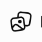 

| State | Values |
|---|---|
| default | size 20 x 20; background transparent; icon 20 x 20, #ffffff `icon.primary` |
| light | size 20 x 20; background transparent; icon 20 x 20, #0d0d0d `icon.primary` |

#### Section label (Pinned)

`section-label`, on home-dark. A collapsible header: `.__menu-label` text in `--text-tertiary`; the row shows a chevron on hover.

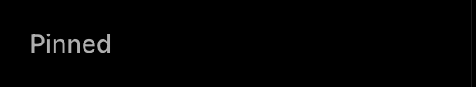   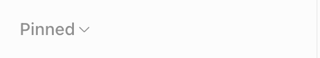 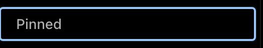 

| State | Values |
|---|---|
| default (same: hover) | size 254 x 32; padding 6px 16px; background transparent; text System 14/20 500, #afafaf `text.tertiary`; icon 12 x 12, #afafaf `icon.tertiary` |
| focus-visible | outline 1px auto #99c8ff, offset 0px |
| light (same: light-hover) | size 254 x 32; padding 6px 16px; background transparent; text System 14/20 500, #8f8f8f `text.tertiary`; icon 12 x 12, #8f8f8f `icon.tertiary` |
| light-focus-visible | outline 1px auto #005fcc, offset 0px |

Tokens named in its classes: `--text-tertiary`.

#### Section label text

`section-label-text`, on home-dark.

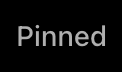 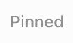 

| State | Values |
|---|---|
| default | size 45.47 x 20; background transparent; text System 14/20 500, #afafaf `text.tertiary` |
| light | size 45.47 x 20; background transparent; text System 14/20 500, #8f8f8f `text.tertiary` |

#### Chat row (pinned)

`chat-row`, on home-dark, thread-dark-table. Pinned chats carry a speech-bubble icon; plain history rows (Chats) have none. Hover reveals the options button at the end. The open chat gets the selected fill (`active`).

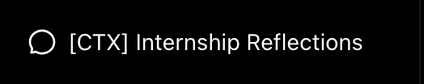 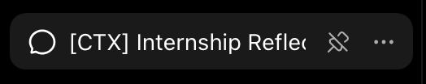 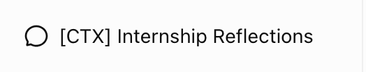 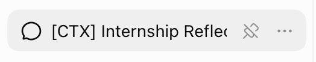 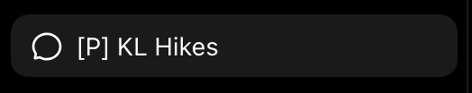  

| State | Values |
|---|---|
| default | size 248 x 36; padding 6px 10px; border B: 1px solid transparent; radius 10px; background transparent; text System 14/20 400, #ffffff `text.primary`; transition opacity 0.15s cubic-bezier(0.4, 0, 0.2, 1); icon 20 x 20, #ffffff `icon.primary` |
| hover, focus-visible, active | background rgba(255, 255, 255, 0.1) `interactive.bg-secondary-hover` |
| light | size 248 x 36; padding 6px 10px; border B: 1px solid transparent; radius 10px; background transparent; text System 14/20 400, #0d0d0d `text.primary`; transition opacity 0.15s cubic-bezier(0.4, 0, 0.2, 1); icon 20 x 20, #0d0d0d `icon.primary` |
| light-hover, light-focus-visible, light-active | background rgba(0, 0, 0, 0.05) `interactive.bg-secondary-hover` |

Tokens named in its classes: `--interactive-label-hover-secondary`, `--menu-item-active`, `--menu-item-background`, `--menu-item-highlighted`, `--menu-item-icon-opacity`, `--menu-item-open`, `--menu-item-pressed`, `--text-tertiary`.

#### History row (Chats)

`history-row`, on home-dark.

 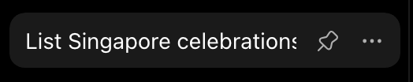 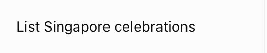 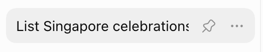 

| State | Values |
|---|---|
| default | size 248 x 36; padding 6px 10px; border B: 1px solid transparent; radius 10px; background transparent; text System 14/20 400, #ffffff `text.primary`; transition opacity 0.15s cubic-bezier(0.4, 0, 0.2, 1); icon 16 x 16, #afafaf `icon.tertiary` |
| hover | background rgba(255, 255, 255, 0.1) `interactive.bg-secondary-hover` |
| light | size 248 x 36; padding 6px 10px; border B: 1px solid transparent; radius 10px; background transparent; text System 14/20 400, #0d0d0d `text.primary`; transition opacity 0.15s cubic-bezier(0.4, 0, 0.2, 1); icon 16 x 16, #8f8f8f `icon.tertiary` |
| light-hover | background rgba(0, 0, 0, 0.05) `interactive.bg-secondary-hover` |

Tokens named in its classes: `--interactive-label-hover-secondary`, `--menu-item-active`, `--menu-item-background`, `--menu-item-highlighted`, `--menu-item-open`, `--menu-item-pressed`, `--text-tertiary`.

#### Chat row options button

`chat-row-options`, on home-dark. Hidden until its row is hovered; measured while the row is hovered.

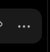 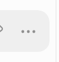 

| State | Values |
|---|---|
| hover | size 34 x 36; padding 0px 6px 0px 4px; radius 0px 10px 10px 0px; background transparent; text System 14/20 400, #afafaf `text.tertiary`; icon 16 x 16, #afafaf `icon.tertiary` |
| light-hover | size 34 x 36; padding 0px 6px 0px 4px; radius 0px 10px 10px 0px; background transparent; text System 14/20 400, #8f8f8f `text.tertiary`; icon 16 x 16, #8f8f8f `icon.tertiary` |

Tokens named in its classes: `--interactive-label-hover-secondary`, `--text-tertiary`.

#### Project row

`project-row`, on home-dark, project-dark. Each project keeps its own icon and colour; hover reveals "Open project home" and options.

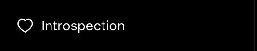 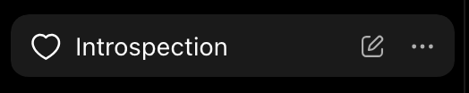 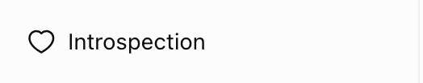 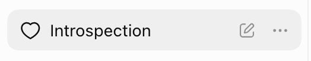 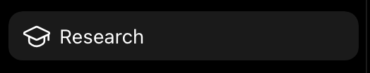  

| State | Values |
|---|---|
| default | size 248 x 36; padding 6px 10px; border B: 1px solid transparent; radius 10px; background transparent; text System 14/20 400, #ffffff `text.primary`; transition color and 9 more 0.15s cubic-bezier(0.4, 0, 0.2, 1); icon 20 x 20, #ffffff `icon.primary` |
| hover, focus-visible | padding 6px 64px 6px 10px; background rgba(255, 255, 255, 0.1) `interactive.bg-secondary-hover` |
| active | background rgba(255, 255, 255, 0.1) `interactive.bg-secondary-hover` |
| light | size 248 x 36; padding 6px 10px; border B: 1px solid transparent; radius 10px; background transparent; text System 14/20 400, #0d0d0d `text.primary`; transition color and 9 more 0.15s cubic-bezier(0.4, 0, 0.2, 1); icon 20 x 20, #0d0d0d `icon.primary` |
| light-hover, light-focus-visible | padding 6px 64px 6px 10px; background rgba(0, 0, 0, 0.05) `interactive.bg-secondary-hover` |
| light-active | background rgba(0, 0, 0, 0.05) `interactive.bg-secondary-hover` |

Tokens named in its classes: `--menu-item-active`, `--menu-item-background`, `--menu-item-highlighted`, `--menu-item-icon-opacity`, `--menu-item-open`, `--menu-item-pressed`.

#### Account row

`account-row`, on home-dark, home-dark-user-menu. 52 tall: a 24px avatar, the name over the plan in `--text-tertiary`, and the Upgrade pill at the end; sticky at the bottom over a hairline.

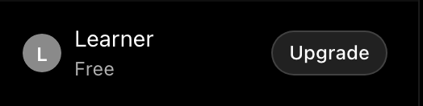 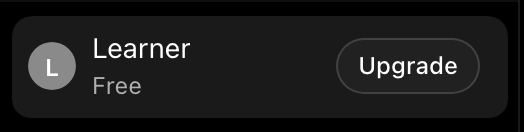 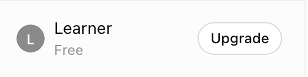 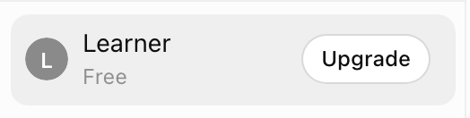 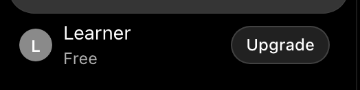 

| State | Values |
|---|---|
| default (same: open) | size 248 x 52.14; padding 6px 10px 6px 8px; border B: 1px solid transparent; radius 10px; background transparent; text System 12/17.14 600, #ffffff `text.primary`; transition color and 9 more 0.15s cubic-bezier(0.4, 0, 0.2, 1) |
| hover | background rgba(255, 255, 255, 0.1) `interactive.bg-secondary-hover` |
| light (same: light-open) | size 248 x 52.14; padding 6px 10px 6px 8px; border B: 1px solid transparent; radius 10px; background transparent; text System 12/17.14 600, #ffffff `text.inverted`; transition color and 9 more 0.15s cubic-bezier(0.4, 0, 0.2, 1) |
| light-hover | background rgba(0, 0, 0, 0.05) `interactive.bg-secondary-hover` |

Tokens named in its classes: `--bg-tertiary`, `--interactive-label-hover-secondary`, `--menu-item-active`, `--menu-item-background`, `--menu-item-highlighted`, `--menu-item-icon-opacity`, `--menu-item-open`, `--menu-item-pressed`, `--text-secondary`, `--text-tertiary`.

#### Avatar

`avatar`, on home-dark. Redacted to a grey disc with an L; the real one is the account photo at 24px.

  

| State | Values |
|---|---|
| default | size 24 x 24; radius full; background #414141 `bg.tertiary`; text System 12/17.14 600, #ffffff `text.primary` |
| light | size 24 x 24; radius full; background #f3f3f3 `bg.tertiary`; text System 12/17.14 600, #ffffff `text.inverted` |

Tokens named in its classes: `--bg-tertiary`.

#### Upgrade pill (account row)

`sidebar-upgrade`, on home-dark. An outline pill: a `--border-default` ring, 13px 500 text.

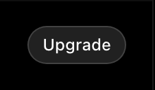 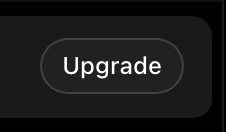 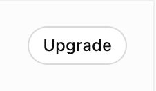 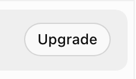 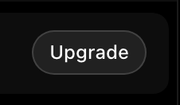 

| State | Values |
|---|---|
| default (same: hover, focus-visible) | size 97.89 x 51.14; padding 6px 10px 6px 8px; radius 0px 10px 10px 0px; background transparent; text System 12/16 500, #ffffff `text.primary` |
| light (same: light-hover, light-focus-visible) | size 97.89 x 51.14; padding 6px 10px 6px 8px; radius 0px 10px 10px 0px; background transparent; text System 12/16 500, #0d0d0d `text.primary` |

Child layers: span 71.9x28 background #212121 `bg.primary` border 1px solid rgba(255, 255, 255, 0.15) `border.medium` radius full

Tokens named in its classes: `--interactive-label-hover-secondary`, `--text-tertiary`.

#### Sidebar collapsed to the tiny rail

`sidebar-rail`, on home-dark-sidebar-collapsed. `#stage-sidebar-tiny-bar`, 52 wide (`--sidebar-rail-width`, 13 spacing units): open sidebar, new chat, search, images, library, then the avatar at the bottom.

 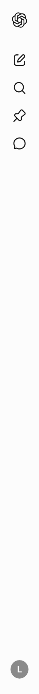 

| State | Values |
|---|---|
| default | size 52 x 900; padding 0px 0px 6px 0px; background transparent; text System 12/17.14 600, #ffffff `text.primary`; transition opacity 0.15s steps(1, start); icon 20 x 20, #ffffff `icon.primary` |
| light | size 52 x 900; padding 0px 0px 6px 0px; background transparent; text System 12/17.14 600, #ffffff `text.inverted`; transition opacity 0.15s steps(1, start); icon 20 x 20, #0d0d0d `icon.primary` |

Child layers: a 36x36 background transparent border 1px solid transparent radius 10px; button 40x36 background transparent border 1px solid transparent radius 10px; button 40x36 background transparent border 1px solid transparent radius 10px

Tokens named in its classes: `--bg-tertiary`, `--sidebar-rail-width`, `--sidebar-section-first-margin-top`, `--surface-hover`, `--text-primary`.

#### Rail button (New chat)

`rail-button`, on home-dark-sidebar-collapsed.

   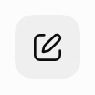  

| State | Values |
|---|---|
| default | size 36 x 36; border B: 1px solid transparent; radius 10px; background transparent; transition color and 9 more 0.15s cubic-bezier(0.4, 0, 0.2, 1); icon 20 x 20, #ffffff `icon.primary` |
| hover, focus-visible | background rgba(255, 255, 255, 0.1) `interactive.bg-secondary-hover` |
| light | size 36 x 36; border B: 1px solid transparent; radius 10px; background transparent; transition color and 9 more 0.15s cubic-bezier(0.4, 0, 0.2, 1); icon 20 x 20, #0d0d0d `icon.primary` |
| light-hover, light-focus-visible | background rgba(0, 0, 0, 0.05) `interactive.bg-secondary-hover` |

Tokens named in its classes: `--menu-item-active`, `--menu-item-background`, `--menu-item-highlighted`, `--menu-item-icon-opacity`, `--menu-item-open`, `--menu-item-pressed`.

#### Rail open-sidebar button

`rail-open-sidebar`, on home-dark-sidebar-collapsed.

 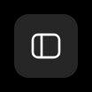   

| State | Values |
|---|---|
| default | size 36 x 36; radius 8px; background transparent; text System 16/24 400, #ffffff `text.primary`; icon 20 x 20, #ffffff `icon.primary` |
| hover | background rgba(255, 255, 255, 0.15) `surface.surface-hover` |
| light | size 36 x 36; radius 8px; background transparent; text System 16/24 400, #0d0d0d `text.primary`; icon 20 x 20, #0d0d0d `icon.primary` |
| light-hover | background rgba(0, 0, 0, 0.07) `surface.surface-hover` |

Tokens named in its classes: `--surface-hover`, `--text-primary`.

### Top bar

The 52px page header: on the home and a project, the Chat / Work segmented toggle in the middle and Upgrade and the temporary-chat button at the end; in a thread, Upgrade, Share and the conversation options.

#### Page header

`page-header`, on home-dark. 52 tall, sticky, 8px padding; the mode toggle centred, actions at the end.

  

| State | Values |
|---|---|
| default | size 1180 x 52; padding 8px; background transparent; text System 14/20 500, #ffffff `text.primary`; icon 12 x 12, #63a8f8 `icon.accent` |
| light | size 1180 x 52; padding 8px; background transparent; text System 14/20 500, #0d0d0d `text.primary`; icon 12 x 12, #3a83f7 `icon.accent` |

Tokens named in its classes: `--bg-elevated-primary`, `--bg-primary`, `--icon-accent`, `--interactive-label-accent-default`, `--surface-hover`, `--text-primary`, `--text-secondary`.

#### Chat / Work segmented toggle

`mode-toggle`, on home-dark. A pill track with two 130x36 radio segments; the selected one carries a filled thumb.

  

| State | Values |
|---|---|
| default | size 260.56 x 36; radius full; background #212121 `bg.primary`; text System 14/20 500, #ffffff `text.primary`; icon 12 x 12, #63a8f8 `icon.accent` |
| light | size 260.56 x 36; radius full; background #ffffff `bg.primary`; text System 14/20 500, #0d0d0d `text.primary`; icon 12 x 12, #3a83f7 `icon.accent` |

Tokens named in its classes: `--bg-elevated-primary`, `--bg-primary`, `--interactive-label-accent-default`, `--text-primary`, `--text-secondary`.

#### Mode segment (Work, not selected)

`mode-segment`, on home-dark. Work is drawn in the accent blue with a sparkle.

      

| State | Values |
|---|---|
| default (same: hover) | size 130.28 x 36; padding 8px 44px 8px 36px; radius full; background transparent; text System 14/20 500, #63a8f8 `text.accent`; transition color and 9 more 0.15s cubic-bezier(0.4, 0, 0.2, 1); icon 12 x 12, #63a8f8 `icon.accent` |
| focus-visible | outline 1px auto #99c8ff, offset 0px |
| selected, selected-hover | padding 8px 36px 8px 44px; text System 14/20 500, #ffffff `text.primary`; icon none |
| light (same: light-hover) | size 130.28 x 36; padding 8px 44px 8px 36px; radius full; background transparent; text System 14/20 500, #3a83f7 `text.accent`; transition color and 9 more 0.15s cubic-bezier(0.4, 0, 0.2, 1); icon 12 x 12, #3a83f7 `icon.accent` |
| light-focus-visible | outline 1px auto #005fcc, offset 0px |
| light-selected, light-selected-hover | padding 8px 36px 8px 44px; text System 14/20 500, #0d0d0d `text.primary`; icon none |

Tokens named in its classes: `--interactive-label-accent-default`, `--text-primary`, `--text-secondary`.

#### Upgrade button (header)

`header-upgrade`, on home-dark. Transparent pill, accent-blue sparkle and label (`.button-glimmer-cta`).

     

| State | Values |
|---|---|
| default (same: focus-visible) | size 106.16 x 34; padding 0px 12px; border 1px solid transparent; radius 8px; background transparent; text System 14/20 500, #63a8f8 `text.accent`; icon 20 x 20, #63a8f8 `icon.accent` |
| hover | border 1px solid rgba(58, 131, 247, 0.01); background rgba(164, 205, 251, 0.2); backdrop blur(38.571px) |
| light (same: light-focus-visible) | size 106.16 x 34; padding 0px 12px; border 1px solid transparent; radius 8px; background transparent; text System 14/20 500, #3a83f7 `text.accent`; icon 20 x 20, #3a83f7 `icon.accent` |
| light-hover | border 1px solid rgba(58, 131, 247, 0.01); background rgba(58, 131, 247, 0.09); backdrop blur(38.571px) |

#### Header icon button (Temporary chat)

`header-icon-button`, on home-dark.

     

| State | Values |
|---|---|
| default (same: focus-visible) | size 36 x 36; radius full; background transparent; text System 16/24 400, #ffffff `text.primary`; icon 20 x 20, #ffffff `icon.primary` |
| hover | background rgba(255, 255, 255, 0.15) `surface.surface-hover` |
| light (same: light-focus-visible) | size 36 x 36; radius full; background transparent; text System 16/24 400, #0d0d0d `text.primary`; icon 20 x 20, #0d0d0d `icon.primary` |
| light-hover | background rgba(0, 0, 0, 0.07) `surface.surface-hover` |

Tokens named in its classes: `--surface-hover`, `--text-primary`.

#### Share button (thread)

`share-button`, on thread-dark-table.

     

| State | Values |
|---|---|
| default | size 88.22 x 36; padding 0px 12px; border 1px solid transparent; radius 8px; background transparent; text System 14/20 500, #ffffff `text.primary`; icon 20 x 20, #ffffff `icon.primary` |
| hover | background rgba(255, 255, 255, 0.1) `interactive.bg-secondary-hover` |
| focus-visible | outline 1px auto #99c8ff, offset 0px |
| light | size 88.22 x 36; padding 0px 12px; border 1px solid transparent; radius 8px; background transparent; text System 14/20 500, #0d0d0d `text.primary`; icon 20 x 20, #0d0d0d `icon.primary` |
| light-hover | background rgba(0, 0, 0, 0.05) `interactive.bg-secondary-hover` |
| light-focus-visible | outline 1px auto #005fcc, offset 0px |

Tokens named in its classes: `--surface-hover`, `--text-primary`.

#### Conversation options (…) button

`conversation-options`, on thread-dark-table.

    

| State | Values |
|---|---|
| default | size 36 x 36; radius 8px; background transparent; text System 16/24 400, #ffffff `text.primary`; icon 20 x 20, #ffffff `icon.primary` |
| hover | background rgba(255, 255, 255, 0.15) `surface.surface-hover` |
| light | size 36 x 36; radius 8px; background transparent; text System 16/24 400, #0d0d0d `text.primary`; icon 20 x 20, #0d0d0d `icon.primary` |
| light-hover | background rgba(0, 0, 0, 0.07) `surface.surface-hover` |

Tokens named in its classes: `--surface-hover`, `--text-primary`.

### Home

The new-chat page: one heading centred over the composer, then three suggestion rows.

#### Home heading

`home-heading`, on home-dark. `text-heading-2` at 400 weight (28/34 here), centred over the composer.

  

| State | Values |
|---|---|
| default | size 306.97 x 42; background transparent; text System 24/28 400, #ffffff `text.primary` |
| light | size 306.97 x 42; background transparent; text System 24/28 400, #0d0d0d `text.primary` |

#### Suggestion row

`suggestion-row`, on home-dark. 768x52 rows under the composer, icon and 16px secondary text; hover fills with `text-primary` at 3%.

     

| State | Values |
|---|---|
| default | size 768 x 52; padding 0px 44px 0px 9px; radius 8px; background transparent; text System 16/26 400, #afafaf `text.tertiary`; icon 20 x 20, #afafaf `icon.tertiary` |
| hover | background rgba(255, 255, 255, 0.06) `interactive.bg-inactive-danger-soft`; text System 16/26 400, #ffffff `text.primary`; icon 20 x 20, #ffffff `icon.primary` |
| focus-visible | outline 1px auto #99c8ff, offset 0px |
| light | size 768 x 52; padding 0px 44px 0px 9px; radius 8px; background transparent; text System 16/26 400, #8f8f8f `text.tertiary`; icon 20 x 20, #8f8f8f `icon.tertiary` |
| light-hover | background rgba(13, 13, 13, 0.03); text System 16/26 400, #0d0d0d `text.primary`; icon 20 x 20, #0d0d0d `icon.primary` |
| light-focus-visible | outline 1px auto #005fcc, offset 0px |

Tokens named in its classes: `--icon-tertiary`, `--text-primary`, `--text-tertiary`.

### Composer

The composer shared by the home, a thread, a project and Images: a 768 wide pill (radius 28) with the + button, the ProseMirror field, the Think chip, dictation and the voice button, which becomes send once there is text. On a phone it takes two rows.

#### Composer

`composer`, on home-dark, home-dark-composer-typed, thread-dark-bottom, project-dark, images-dark. A pill on the home page (radius 28, 768 wide, `--composer-bar_width`), one row: + button, the ProseMirror field, Think chip, dictation, voice. `--bg-primary` fill (#212121 dark) with a hairline shadow.

    

| State | Values |
|---|---|
| default (same: focus-visible, project, images) | size 768 x 52; radius 28px; background #212121 `bg.primary`; shadow rgba(255, 255, 255, 0.2) 0px 0px 1px 0px inset; text System 16/26 400, #afafaf `text.tertiary`; transition color and 9 more 0.2s cubic-bezier(0.4, 0, 0.2, 1); icon 20 x 20, #ffffff `icon.primary`; placeholder #ffffff `text.primary` |
| typed | text System 16/26 400, #ffffff `text.primary`; placeholder none |
| thread | text System 16/26 400, #63a8f8 `text.accent` |
| light (same: light-focus-visible, light-project, light-images) | size 768 x 52; radius 28px; background #ffffff `bg.primary`; shadow rgba(0, 0, 0, 0.04) 0px 0px 0px 1px, rgba(0, 0, 0, 0.04) 0px 2px 8px 0px, rgba(0, 0, 0, 0.02) 0px 4px 80px 8px; text System 16/26 400, #8f8f8f `text.tertiary`; transition color and 9 more 0.2s cubic-bezier(0.4, 0, 0.2, 1); icon 20 x 20, #0d0d0d `icon.primary`; placeholder #0d0d0d `text.primary` |
| light-typed | text System 16/26 400, #0d0d0d `text.primary`; placeholder none |
| light-thread | text System 16/26 400, #3a83f7 `text.accent` |

Tokens named in its classes: `--composer-surface-primary`, `--spacing`, `--text-primary`.

#### Composer placeholder

`composer-placeholder`, on home-dark. "Ask anything", drawn by `p[data-placeholder]::before`.

  

| State | Values |
|---|---|
| default | size 523.03 x 26; background transparent; placeholder #ffffff `text.primary` |
| light | size 523.03 x 26; background transparent; placeholder #0d0d0d `text.primary` |

#### Composer + button

`composer-plus`, on home-dark. 36x36 round `.composer-btn`.

     

| State | Values |
|---|---|
| default | size 36 x 36; radius full; background transparent; text System 14/20 400, #ffffff `text.primary`; icon 20 x 20, #ffffff `icon.primary` |
| hover | background rgba(255, 255, 255, 0.1) `interactive.bg-secondary-hover` |
| focus-visible | outline 1px auto #99c8ff, offset 0px |
| light | size 36 x 36; radius full; background transparent; text System 14/20 400, #0d0d0d `text.primary`; icon 20 x 20, #0d0d0d `icon.primary` |
| light-hover | background rgba(0, 0, 0, 0.05) `interactive.bg-secondary-hover` |
| light-focus-visible | outline 1px auto #005fcc, offset 0px |

#### Think chip

`think-chip`, on home-dark, thread-dark-bottom. `.__composer-pill--neutral`: 36 tall, full radius, brain icon and 16px label.

     

| State | Values |
|---|---|
| default (same: focus-visible) | size 91.97 x 36; padding 0px 14px 0px 12px; radius full; background transparent; text System 16/26 400, #afafaf `text.tertiary`; icon 20 x 20, #afafaf `icon.tertiary` |
| hover | background #303030 `bg.secondary` |
| thread | background rgba(57, 74, 91, 0.5) `interactive.bg-accent-muted-context`; text System 16/26 400, #63a8f8 `text.accent`; icon 20 x 20, #63a8f8 `icon.accent` |
| light (same: light-focus-visible) | size 91.97 x 36; padding 0px 14px 0px 12px; radius full; background transparent; text System 16/26 400, #8f8f8f `text.tertiary`; icon 20 x 20, #8f8f8f `icon.tertiary` |
| light-hover | background rgba(0, 0, 0, 0.05) `interactive.bg-secondary-hover` |
| light-thread | background rgba(235, 244, 255, 0.5) `interactive.bg-accent-muted-context`; text System 16/26 400, #3a83f7 `text.accent`; icon 20 x 20, #3a83f7 `icon.accent` |

#### Dictation button

`dictation-button`, on home-dark.

    

| State | Values |
|---|---|
| default | size 36 x 36; radius full; background transparent; text System 14/20 400, #ffffff `text.primary`; icon 20 x 20, #ffffff `icon.primary` |
| hover | background rgba(255, 255, 255, 0.1) `interactive.bg-secondary-hover` |
| light | size 36 x 36; radius full; background transparent; text System 14/20 400, #0d0d0d `text.primary`; icon 20 x 20, #0d0d0d `icon.primary` |
| light-hover | background rgba(0, 0, 0, 0.05) `interactive.bg-secondary-hover` |

#### Voice button

`voice-button`, on home-dark. 36x36 circle in `--theme-submit-btn-bg`, the accent (blue-500 dark, blue-400 light).

     

| State | Values |
|---|---|
| default | size 36 x 36; radius full; background #2c67c5 `theme.blue.text`; text System 16/24 400, #ffffff `text.primary`; transition color and 9 more 0.15s cubic-bezier(0.4, 0, 0.2, 1); icon 20 x 20, #ffffff `icon.primary` |
| hover | opacity 0.7 |
| focus-visible | outline 1px auto #99c8ff, offset 0px |
| light | size 36 x 36; radius full; background #3a83f7 `bg.accent-static`; text System 16/24 400, #ffffff `text.inverted`; transition color and 9 more 0.15s cubic-bezier(0.4, 0, 0.2, 1); icon 20 x 20, #ffffff `icon.inverted` |
| light-hover | opacity 0.7 |
| light-focus-visible | outline 1px auto #005fcc, offset 0px |

#### Send button (typed)

`send-button`, on home-dark-composer-typed. Replaces the voice button once there is text: same circle and accent, an up arrow.

     

| State | Values |
|---|---|
| default (same: hover) | size 36 x 36; radius full; background #2c67c5 `theme.blue.text`; text System 16/24 400, #ffffff `text.primary`; icon 20 x 20, #ffffff `icon.primary` |
| focus-visible | outline 1px auto #99c8ff, offset 0px |
| light (same: light-hover) | size 36 x 36; radius full; background #3a83f7 `bg.accent-static`; text System 16/24 400, #ffffff `text.inverted`; icon 20 x 20, #ffffff `icon.inverted` |
| light-focus-visible | outline 1px auto #005fcc, offset 0px |

### Thread

A conversation: the user bubble in the accent colour, the "Worked for" disclosure, the assistant's markdown (paragraphs, headings, strong, tables, citation pills), widgets, and the actions under a turn.

#### User message bubble

`user-bubble`, on thread-dark-user-turn. Right-aligned, max 70% (`--user-chat-width`), radius 22, padding 10/16, with `--theme-user-msg-bg` / `--theme-user-msg-text`: the blue accent paints it blue-700 on blue-25 dark, blue-50 on blue-900 light. `data-ds-colored-user-message-bubbles` on <html> switches the colouring on.

  

| State | Values |
|---|---|
| default | size 537.59 x 116; padding 10px 16px; radius 22px; background #173e76 `chatTheme.blue.user-msg-bg`; text System 16/24 400, #f6fafe `chatTheme.blue.user-msg-text` |
| light | size 537.59 x 116; padding 10px 16px; radius 22px; background #e8f3fe `theme.blue.background`; text System 16/24 400, #0c274a `chatTheme.blue.user-msg-text` |

#### Assistant markdown body

`markdown`, on thread-dark-table. The `.markdown.prose` block, 768 wide, 16/28 body.

  

| State | Values |
|---|---|
| default | size 768 x 636; background transparent; text System 16/26 400, #ffffff `text.primary`; icon 20 x 20, #cdcdcd `icon.secondary` |
| light | size 768 x 636; background transparent; text System 16/26 400, #0d0d0d `text.primary`; icon 20 x 20, #5d5d5d `icon.secondary` |

Child layers: thead 835x33 border 1px solid #4a5565; th 192x33 border 1px solid rgba(255, 255, 255, 0.15) `border.medium`; th 130.3x33 border 1px solid rgba(255, 255, 255, 0.15) `border.medium`

Tokens named in its classes: `--bg-tertiary`, `--text-secondary`.

#### Markdown paragraph

`md-paragraph`, on thread-dark-table.

  

| State | Values |
|---|---|
| default | size 768 x 26; background transparent; text System 16/26 400, #ffffff `text.primary` |
| light | size 768 x 26; background transparent; text System 16/26 400, #0d0d0d `text.primary` |

#### Markdown h3

`md-h3`, on thread-dark-table.

  

| State | Values |
|---|---|
| default | size 768 x 28; background transparent; text System 18/28 600, #ffffff `text.primary` |
| light | size 768 x 28; background transparent; text System 18/28 600, #0d0d0d `text.primary` |

#### Markdown strong

`md-strong`, on thread-dark-table.

  

| State | Values |
|---|---|
| default | size 338.39 x 18; background transparent; text System 16/26 600, #ffffff `text.primary` |
| light | size 338.39 x 18; background transparent; text System 16/26 600, #0d0d0d `text.primary` |

#### Markdown table

`md-table`, on thread-dark-table.

  

| State | Values |
|---|---|
| default | size 835 x 184; background transparent; text System 14/16 600, #ffffff `text.primary` |
| light | size 835 x 184; background transparent; text System 14/16 600, #0d0d0d `text.primary` |

Child layers: thead 835x33 border 1px solid #4a5565; th 192x33 border 1px solid rgba(255, 255, 255, 0.15) `border.medium`; th 130.3x33 border 1px solid rgba(255, 255, 255, 0.15) `border.medium`

Tokens named in its classes: `--thread-content-width`.

#### Table header cell

`md-th`, on thread-dark-table.

  

| State | Values |
|---|---|
| default | size 192 x 33; padding 8px 24px 8px 0px; border B: 1px solid rgba(255, 255, 255, 0.15) `border.medium`; background transparent; text System 14/16 600, #ffffff `text.primary` |
| light | size 192 x 33; padding 8px 24px 8px 0px; border B: 1px solid rgba(0, 0, 0, 0.15) `border.heavy`; background transparent; text System 14/16 600, #0d0d0d `text.primary` |

Child layers: th 192x33 border 1px solid rgba(255, 255, 255, 0.15) `border.medium`

#### Table cell

`md-td`, on thread-dark-table.

  

| State | Values |
|---|---|
| default | size 192 x 69; padding 10px 24px 10px 0px; border B: 1px solid rgba(255, 255, 255, 0.05) `border.light`; background transparent; text System 14/24.00 600, #ffffff `text.primary` |
| light | size 192 x 69; padding 10px 24px 10px 0px; border B: 1px solid rgba(0, 0, 0, 0.05) `border.light`; background transparent; text System 14/24.00 600, #0d0d0d `text.primary` |

Child layers: td 192x69 border 1px solid rgba(255, 255, 255, 0.05) `border.light`

#### Citation pill

`citation-pill`, on thread-dark-table. Inline source chip after a sentence: favicon, domain and a +n count.

    

| State | Values |
|---|---|
| default (same: hover) | size 98.31 x 18; background transparent; text System 9/26 400, #cdcdcd `text.secondary` |
| light (same: light-hover) | size 98.31 x 18; background transparent; text System 9/26 400, #5d5d5d `text.secondary` |

Child layers: a 98.3x18 background #303030 `bg.secondary` radius 12px

Tokens named in its classes: `--text-secondary`.

#### "Worked for 22s" disclosure

`worked-for`, on thread-dark-user-turn. The collapsed reasoning header above an answer, secondary text and a chevron.

    

| State | Values |
|---|---|
| default | size 130.81 x 24; background transparent; text System 16/24 400, #cdcdcd `text.secondary`; icon 16 x 16, #cdcdcd `icon.secondary` |
| hover | text System 16/24 400, #ffffff `text.primary`; icon 16 x 16, #ffffff `icon.primary` |
| light | size 130.81 x 24; background transparent; text System 16/24 400, #8f8f8f `text.tertiary`; icon 16 x 16, #8f8f8f `icon.tertiary` |
| light-hover | text System 16/24 400, #0d0d0d `text.primary`; icon 16 x 16, #0d0d0d `icon.primary` |

Tokens named in its classes: `--interactive-label-tertiary-default`, `--text-primary`, `--text-tertiary`.

#### Map widget (iframe, kept as a box)

`map-widget`, on thread-dark-user-turn. An iframe in the product; the copy keeps a same-size dark box. Its frame and radius are real, its contents are not.

  

| State | Values |
|---|---|
| default | size 768 x 416; background transparent |
| light | size 768 x 416; background transparent |

Child layers: div 768x400 background rgba(38, 43, 61, 0.5) radius 30px

#### Turn action button (Copy)

`turn-action`, on thread-dark-bottom. Copy, read aloud, share and more sit under an answer at opacity 0 and appear when the turn is hovered; measured while the turn is hovered.

  

| State | Values |
|---|---|
| hover | size 32 x 32; radius 8px; background transparent; text System 16/24 400, #cdcdcd `text.secondary`; icon 20 x 20, #cdcdcd `icon.secondary` |
| light-hover | size 32 x 32; radius 8px; background transparent; text System 16/24 400, #5d5d5d `text.secondary`; icon 20 x 20, #5d5d5d `icon.secondary` |

Tokens named in its classes: `--surface-hover`, `--text-secondary`.

#### Thread disclaimer

`thread-disclaimer`, on thread-dark-bottom.

  

| State | Values |
|---|---|
| default | size 1180 x 40; background transparent; text System 12/16 400, #afafaf `text.tertiary` |
| light | size 1180 x 40; background transparent; text System 12/16 400, #8f8f8f `text.tertiary` |

Child layers: div 290.3x16 background #000000 `bg.secondary-surface` radius full shadow transparent 0px 0px 0px 0px, transparent 0px 0px 0px 0px, transparent 0px 0px 0px 0px, transparent 0px 0px 0px 0px, #000000 `bg.secondary-surface` 0px 0px 8px 8px

Tokens named in its classes: `--main-surface-primary`, `--spacing`, `--text-tertiary`.

### Menus

The popovers: the composer's + menu, the chat row menu, the user menu, the accent listbox and the phone's model menu. All are `.popover` on #353535 in dark (white in light), radius 20 (16 for the listbox), with 36 tall `.__menu-item` rows.

#### Composer + menu

`plus-menu`, on home-dark-plus-menu. Opens below the composer at its full width: a row per action with a title and a grey hint, then the installed plugins, then "Type to search…".

  

| State | Values |
|---|---|
| default | size 768 x 376; padding 8px 0px; radius 20px; background #212121 `bg.primary`; shadow rgba(255, 255, 255, 0.2) 0px 0px 1px 0px inset; text System 14/20 400, #ffffff `text.primary`; transform translate(0px, 60px); icon 20 x 20, #ffffff `icon.primary` |
| light | size 768 x 376; padding 8px 0px; radius 20px; background #ffffff `bg.primary`; shadow rgba(0, 0, 0, 0.04) 0px 0px 0px 1px, rgba(0, 0, 0, 0.04) 0px 2px 8px 0px, rgba(0, 0, 0, 0.02) 0px 4px 80px 8px; text System 14/20 400, #0d0d0d `text.primary`; transform translate(0px, 60px); icon 20 x 20, #0d0d0d `icon.primary` |

Tokens named in its classes: `--bg-primary`, `--main-surface-primary`, `--menu-item-height`, `--radix-popper-available-height`, `--radix-popper-available-width`, `--text-primary`, `--text-tertiary`.

#### + menu item

`plus-menu-item`, on home-dark-plus-menu. 36 tall, radius 12, inset 8px; the first row opens highlighted with the `--interactive-bg-secondary-hover` fill.

    

| State | Values |
|---|---|
| default (same: hover) | size 752 x 36; padding 6px 8px; radius 12px; background transparent; text System 14/20 400, #ffffff `text.primary`; icon 20 x 20, #ffffff `icon.primary` |
| highlighted | background rgba(255, 255, 255, 0.1) `interactive.bg-secondary-hover` |
| light (same: light-hover) | size 752 x 36; padding 6px 8px; radius 12px; background transparent; text System 14/20 400, #0d0d0d `text.primary`; icon 20 x 20, #0d0d0d `icon.primary` |
| light-highlighted | background rgba(0, 0, 0, 0.04) `component.popover-shadow-ring` |

Tokens named in its classes: `--menu-item-icon-opacity`, `--text-primary`, `--text-tertiary`.

#### Chat row menu

`chat-menu`, on home-dark-chat-menu. `.popover`, `--main-surface-primary` fill (#353535 in dark), radius 16; Share, Rename, Pin chat, Archive, Delete (danger), Move to project.

  

| State | Values |
|---|---|
| default | size 205.88 x 270; padding 10px 0px; radius 20px; background #353535 `component.popover-bg`; shadow rgba(255, 255, 255, 0.2) 0px 0px 1px 0px inset; text System 14/20 400, #ffffff `text.primary`; icon 20 x 20, #ffffff `icon.primary` |
| light | size 205.88 x 270; padding 10px 0px; radius 20px; background #ffffff `bg.primary`; shadow rgba(0, 0, 0, 0.04) 0px 0px 0px 1px, rgba(0, 0, 0, 0.04) 0px 2px 8px 0px, rgba(0, 0, 0, 0.02) 0px 4px 80px 8px; text System 14/20 400, #0d0d0d `text.primary`; icon 20 x 20, #0d0d0d `icon.primary` |

Tokens named in its classes: `--border-default`, `--main-surface-primary`, `--radix-align-offset`, `--radix-dropdown-menu-content-available-height`, `--radix-dropdown-menu-content-available-width`, `--radix-dropdown-menu-content-transform-origin`, `--radix-dropdown-menu-trigger-height`, `--radix-dropdown-menu-trigger-width`, `--trigger-width`.

#### Menu item

`menu-item`, on home-dark-chat-menu. `.__menu-item`, 36 tall, radius 10, icon and 14px label.

    

| State | Values |
|---|---|
| default (same: hover) | size 185.88 x 36; padding 6px 32px 6px 10px; radius 12px; background transparent; text System 14/20 400, #ffffff `text.primary`; icon 20 x 20, #ffffff `icon.primary` |
| light (same: light-hover) | size 185.88 x 36; padding 6px 32px 6px 10px; radius 12px; background transparent; text System 14/20 400, #0d0d0d `text.primary`; icon 20 x 20, #0d0d0d `icon.primary` |

Tokens named in its classes: `--menu-item-icon-opacity`.

#### Menu item (danger)

`menu-item-danger`, on home-dark-chat-menu.

    

| State | Values |
|---|---|
| default (same: hover) | size 185.88 x 36; padding 6px 32px 6px 10px; radius 12px; background transparent; text System 14/20 400, #fa423e `interactive.label-hover-danger-ghost`; icon 20 x 20, #fa423e `interactive.icon-hover-danger-ghost` |
| light (same: light-hover) | size 185.88 x 36; padding 6px 32px 6px 10px; radius 12px; background transparent; text System 14/20 400, #ff002a `text.danger`; icon 20 x 20, #ff002a `icon.status-error` |

Tokens named in its classes: `--menu-item-icon-opacity`.

#### Menu separator

`menu-separator`, on home-dark-chat-menu.

  

| State | Values |
|---|---|
| default | size 173.88 x 1; background rgba(255, 255, 255, 0.15) `surface.surface-hover` |
| light | size 173.88 x 1; background rgba(0, 0, 0, 0.1) `surface.main-surface-secondary-selected` |

Tokens named in its classes: `--border-default`.

#### User menu

`user-menu`, on home-dark-user-menu. Opens upward over the account row at its width: the account, Upgrade plan, Personalization, Profile, Settings, Help, Log out.

  

| State | Values |
|---|---|
| default | size 248 x 321.14; padding 10px 0px; radius 20px; background #353535 `component.popover-bg`; shadow rgba(255, 255, 255, 0.2) 0px 0px 1px 0px inset; text System 12/17.14 600, #ffffff `text.primary`; icon 16 x 16, #ffffff `icon.primary` |
| light | size 248 x 321.14; padding 10px 0px; radius 20px; background #ffffff `bg.primary`; shadow rgba(0, 0, 0, 0.04) 0px 0px 0px 1px, rgba(0, 0, 0, 0.04) 0px 2px 8px 0px, rgba(0, 0, 0, 0.02) 0px 4px 80px 8px; text System 12/17.14 600, #ffffff `text.inverted`; icon 16 x 16, #0d0d0d `icon.primary` |

Tokens named in its classes: `--border-default`, `--interactive-bg-secondary-selected`, `--main-surface-primary`, `--radix-align-offset`, `--radix-dropdown-menu-content-available-height`, `--radix-dropdown-menu-content-available-width`, `--radix-dropdown-menu-content-transform-origin`, `--radix-dropdown-menu-trigger-height`, `--radix-dropdown-menu-trigger-width`, `--sidebar-width`, `--text-secondary`, `--text-tertiary`, `--trigger-width`.

#### Accent colour menu

`accent-menu`, on settings-dark-accent-menu. Default, Blue, Green, Yellow, Pink, Orange, Purple, White (`data-chat-theme="black"`), each with a 10px dot.

  

| State | Values |
|---|---|
| default | size 220 x 300; padding 6px 0px; radius 16px; background #353535 `component.popover-bg`; shadow rgba(0, 0, 0, 0.32) 0px 8px 16px 0px, rgba(255, 255, 255, 0.2) 0px 0px 1px 0px inset, rgba(0, 0, 0, 0.62) 0px 0px 1px 0px; text System 14/20 400, #ffffff `text.primary`; icon 16 x 16, #ffffff `icon.primary` |
| light | size 220 x 300; padding 6px 0px; radius 16px; background #ffffff `bg.primary`; shadow rgba(0, 0, 0, 0.08) 0px 8px 12px 0px, rgba(0, 0, 0, 0.62) 0px 0px 1px 0px; text System 14/20 400, #0d0d0d `text.primary`; icon 16 x 16, #0d0d0d `icon.primary` |

Tokens named in its classes: `--main-surface-primary`, `--radix-select-content-available-height`, `--radix-select-content-available-width`, `--radix-select-content-transform-origin`, `--radix-select-trigger-height`, `--radix-select-trigger-width`, `--theme-submit-btn-bg`.

#### Accent option

`accent-option`, on settings-dark-accent-menu.

     

| State | Values |
|---|---|
| default (same: hover) | size 208 x 36; padding 6px 32px 6px 10px; radius 10px; background transparent; text System 14/20 400, #ffffff `text.primary` |
| checked | padding 6px 10px; icon 16 x 16, #ffffff `icon.primary` |
| light (same: light-hover) | size 208 x 36; padding 6px 32px 6px 10px; radius 10px; background transparent; text System 14/20 400, #0d0d0d `text.primary` |
| light-checked | padding 6px 10px; icon 16 x 16, #0d0d0d `icon.primary` |

Child layers: div 10x10 background #48a04c `theme.green.text` radius full

Tokens named in its classes: `--theme-submit-btn-bg`.

#### Model menu (phone)

`model-menu`, on mobile-thread-dark-model-menu. ChatGPT Plus with an Upgrade pill, and ChatGPT (checked).

  

| State | Values |
|---|---|
| default | size 318.08 x 122.28; padding 10px 0px; radius 20px; background #353535 `component.popover-bg`; shadow rgba(255, 255, 255, 0.2) 0px 0px 1px 0px inset; text System 14/20 400, #ffffff `text.primary`; icon 20 x 20, #ffffff `icon.primary` |
| light | size 318.08 x 122.28; padding 10px 0px; radius 20px; background #ffffff `bg.primary`; shadow rgba(0, 0, 0, 0.04) 0px 0px 0px 1px, rgba(0, 0, 0, 0.04) 0px 2px 8px 0px, rgba(0, 0, 0, 0.02) 0px 4px 80px 8px; text System 14/20 400, #0d0d0d `text.primary`; icon 20 x 20, #0d0d0d `icon.primary` |

Tokens named in its classes: `--main-surface-primary`, `--radix-align-offset`, `--radix-dropdown-menu-content-available-height`, `--radix-dropdown-menu-content-available-width`, `--radix-dropdown-menu-content-transform-origin`, `--radix-dropdown-menu-trigger-height`, `--radix-dropdown-menu-trigger-width`, `--text-primary`, `--text-secondary`, `--text-tertiary`, `--trigger-width`.

### Search

The search dialog the sidebar's search button opens: an input row and recent chats.

#### Search dialog

`search-dialog`, on home-dark-search. A centred 718 wide panel: the input row, then "Recent chats" rows.

  

| State | Values |
|---|---|
| default | size 720 x 462; border 1px solid rgba(255, 255, 255, 0.15) `border.medium`; radius 16px; background #212121 `bg.primary`; shadow rgba(0, 0, 0, 0.25) 0px 14px 62px 0px; text System 14/20 400, #cdcdcd `text.secondary`; icon 20 x 20, #ffffff `icon.primary`; placeholder #afafaf `text.tertiary` |
| light | size 720 x 462; border 1px solid rgba(0, 0, 0, 0.1) `border.default`; radius 16px; background #ffffff `bg.primary`; shadow rgba(0, 0, 0, 0.25) 0px 14px 62px 0px; text System 14/20 400, #5d5d5d `text.secondary`; icon 20 x 20, #0d0d0d `icon.primary`; placeholder #8f8f8f `text.tertiary` |

Tokens named in its classes: `--spacing`.

#### Search input

`search-input`, on home-dark-search.

  

| State | Values |
|---|---|
| default | size 642 x 24; background transparent; text System 16/24 400, #ffffff `text.primary`; placeholder #afafaf `text.tertiary` |
| light | size 642 x 24; background transparent; text System 16/24 400, #0d0d0d `text.primary`; placeholder #8f8f8f `text.tertiary` |

#### Search section title

`search-section-title`, on home-dark-search.

  

| State | Values |
|---|---|
| default | size 718 x 36; padding 8px 24px; background transparent; text System 14/20 400, #cdcdcd `text.secondary` |
| light | size 718 x 36; padding 8px 24px; background transparent; text System 14/20 400, #5d5d5d `text.secondary` |

#### Search result row

`search-result`, on home-dark-search.

    

| State | Values |
|---|---|
| default (same: hover, first) | size 694 x 48; padding 8px 12px; radius 12px; background transparent; text System 14/20 400, #ffffff `text.primary`; icon 20 x 20, #ffffff `icon.primary` |
| light (same: light-hover, light-first) | size 694 x 48; padding 8px 12px; radius 12px; background transparent; text System 14/20 400, #0d0d0d `text.primary`; icon 20 x 20, #0d0d0d `icon.primary` |

### Settings

The settings dialog: a close button, a search field and a left nav of tabs, then the General pane of rows with select buttons and a toggle.

#### Settings dialog

`settings-dialog`, on settings-dark-general. Centred, radius 16 (`--radius-2xl`), `--bg-elevated-primary` fill: a left nav column and the pane.

  

| State | Values |
|---|---|
| default | size 680 x 600; radius 16px; background #212121 `bg.primary`; shadow rgba(0, 0, 0, 0.32) 0px 8px 16px 0px, rgba(255, 255, 255, 0.2) 0px 0px 1px 0px inset, rgba(0, 0, 0, 0.62) 0px 0px 1px 0px; text System 14/20 400, #ffffff `text.primary`; icon 20 x 20, #ffffff `icon.primary`; placeholder #afafaf `text.tertiary` |
| light | size 680 x 600; radius 16px; background #ffffff `bg.primary`; shadow rgba(0, 0, 0, 0.08) 0px 8px 12px 0px, rgba(0, 0, 0, 0.62) 0px 0px 1px 0px; text System 14/20 400, #0d0d0d `text.primary`; icon 20 x 20, #0d0d0d `icon.primary`; placeholder #8f8f8f `text.tertiary` |

Tokens named in its classes: `--bg-primary`, `--bg-secondary`, `--border-default`, `--border-extra-light`, `--border-heavy`, `--border-light`, `--end`, `--icon-tertiary`, `--main-surface-tertiary`, `--surface-hover`, `--text-primary`, `--text-tertiary`.

#### Settings close button

`settings-close`, on settings-dark-general.

    

| State | Values |
|---|---|
| default | size 36 x 36; radius 8px; background #303030 `bg.secondary`; text System 16/24 400, #ffffff `text.primary`; icon 20 x 20, #ffffff `icon.primary` |
| hover | background #676767 `interactive.bg-control-default` |
| light | size 36 x 36; radius 8px; background transparent; text System 16/24 400, #0d0d0d `text.primary`; icon 20 x 20, #0d0d0d `icon.primary` |
| light-hover | background rgba(0, 0, 0, 0.07) `surface.surface-hover` |

Tokens named in its classes: `--bg-secondary`, `--main-surface-tertiary`, `--surface-hover`.

#### Settings search field

`settings-search`, on settings-dark-general.

   

| State | Values |
|---|---|
| default | size 189 x 36; padding 8px 12px 8px 36px; border 1px solid rgba(255, 255, 255, 0.15) `border.medium`; radius full; background #212121 `bg.primary`; text System 14/20 400, #ffffff `text.primary`; placeholder #afafaf `text.tertiary` |
| focus-visible | border 1px solid rgba(255, 255, 255, 0.2) `border.heavy`; shadow #ffffff 0px 0px 0px 0px, #1f4e94 0px 0px 0px 0px |
| light | size 189 x 36; padding 8px 12px 8px 36px; border 1px solid rgba(0, 0, 0, 0.1) `border.default`; radius full; background #ffffff `bg.primary`; text System 14/20 400, #0d0d0d `text.primary`; placeholder #8f8f8f `text.tertiary` |
| light-focus-visible | border 1px solid rgba(0, 0, 0, 0.15) `border.heavy`; shadow #ffffff 0px 0px 0px 0px, #1f4e94 0px 0px 0px 0px |

Tokens named in its classes: `--bg-primary`, `--border-default`, `--border-heavy`, `--text-primary`, `--text-tertiary`.

#### Settings nav tab

`settings-tab`, on settings-dark-general.

      

| State | Values |
|---|---|
| default | size 197 x 36; padding 6px 10px; radius 10px; background transparent; text System 14/20 400, #ffffff `text.primary`; icon 20 x 20, #ffffff `icon.primary` |
| hover | background rgba(255, 255, 255, 0.1) `interactive.bg-secondary-hover` |
| focus-visible | background rgba(255, 255, 255, 0.1) `interactive.bg-secondary-hover`; outline 1px solid #ffffff `interactive.border-focus`, offset 2px |
| selected | background #303030 `bg.secondary` |
| light | size 197 x 36; padding 6px 10px; radius 10px; background transparent; text System 14/20 400, #0d0d0d `text.primary`; icon 20 x 20, #0d0d0d `icon.primary` |
| light-hover | background rgba(0, 0, 0, 0.04) `component.popover-shadow-ring` |
| light-focus-visible | background rgba(0, 0, 0, 0.04) `component.popover-shadow-ring`; outline 1px solid #0d0d0d `interactive.border-focus`, offset 2px |
| light-selected | background rgba(0, 0, 0, 0.04) `component.popover-shadow-ring` |

Tokens named in its classes: `--bg-secondary`, `--menu-item-icon-opacity`.

#### Settings pane title

`settings-pane-title`, on settings-dark-general.

  

| State | Values |
|---|---|
| default | size 62.44 x 28; background transparent; text System 18/28 400, #ffffff `text.primary` |
| light | size 62.44 x 28; background transparent; text System 18/28 400, #0d0d0d `text.primary` |

#### Settings row (Appearance)

`settings-row`, on settings-dark-general. A label at the start and a control at the end, divided by a hairline.

  

| State | Values |
|---|---|
| default | size 438 x 60; padding 8px 0px; border B: 1px solid rgba(255, 255, 255, 0.05) `border.light`; background transparent; text System 14/20 400, #ffffff `text.primary`; icon 16 x 16, #ffffff `icon.primary` |
| light | size 438 x 60; padding 8px 0px; border B: 1px solid rgba(0, 0, 0, 0.05) `border.light`; background transparent; text System 14/20 400, #0d0d0d `text.primary`; icon 16 x 16, #0d0d0d `icon.primary` |

Child layers: div 438x60 border 1px solid rgba(255, 255, 255, 0.05) `border.light`; button 93.8x36 border 1px solid transparent radius 8px

Tokens named in its classes: `--border-light`, `--main-surface-secondary`, `--text-primary`, `--text-secondary`, `--text-tertiary`.

#### Settings select button

`settings-select`, on settings-dark-general, settings-dark-accent-menu.

      

| State | Values |
|---|---|
| default (same: focus-visible) | size 93.84 x 36; padding 0px 12px; border 1px solid transparent; radius 8px; background transparent; text System 14/14 400, #ffffff `text.primary`; icon 16 x 16, #ffffff `icon.primary` |
| hover | background #424242 |
| open | size 94.31 x 36 |
| light (same: light-focus-visible) | size 93.84 x 36; padding 0px 12px; border 1px solid transparent; radius 8px; background #ffffff `bg.primary`; text System 14/14 400, #0d0d0d `text.primary`; icon 16 x 16, #0d0d0d `icon.primary` |
| light-hover | background #ececec `surface.main-surface-tertiary` |
| light-open | size 94.31 x 36 |

Tokens named in its classes: `--main-surface-secondary`, `--text-primary`, `--text-secondary`, `--text-tertiary`.

#### Settings toggle (on)

`settings-toggle`, on settings-dark-general. Accent-filled track when on, white thumb.

     

| State | Values |
|---|---|
| default (same: hover) | size 32 x 20; padding 2px; radius full; background #3a83f7 `bg.accent-static` |
| focus-visible | shadow #ffffff 0px 0px 0px 2px, #ffffff 0px 0px 0px 4px |
| light (same: light-hover) | size 32 x 20; padding 2px; radius full; background #3a83f7 `bg.accent-static` |
| light-focus-visible | shadow #ffffff 0px 0px 0px 2px, #0d0d0d 0px 0px 0px 4px |

Tokens named in its classes: `--text-primary`, `--to-end-unit`.

#### Settings row description

`settings-description`, on settings-dark-general.

  

| State | Values |
|---|---|
| default | size 398 x 16; padding 0px 48px 0px 0px; background transparent; text System 12/16 400, #afafaf `text.tertiary` |
| light | size 398 x 16; padding 0px 48px 0px 0px; background transparent; text System 12/16 400, #8f8f8f `text.tertiary` |

Tokens named in its classes: `--text-tertiary`.

### Library

The file library: a title with filter, grid and list buttons, search and the New button, pill tabs, then a list of files with a type tile or thumbnail and the last activity.

#### Library page title

`library-title`, on library-dark.

  

| State | Values |
|---|---|
| default | size 74.11 x 36; background transparent; text System 24/28 500, #ffffff `text.primary` |
| light | size 74.11 x 36; background transparent; text System 24/28 500, #0d0d0d `text.primary` |

Tokens named in its classes: `--text-primary`.

#### Library tab

`library-tab`, on library-dark. Pill tabs; the selected one is filled with `--bg-secondary`.

      

| State | Values |
|---|---|
| default | size 94.03 x 36; padding 0px 16px; border 1px solid transparent; radius full; background transparent; text System 14/20 500, #cdcdcd `text.secondary` |
| hover | text System 14/20 500, #ffffff `text.primary` |
| focus-visible | outline 1px auto #99c8ff, offset 0px |
| selected | size 105.28 x 36; background #414141 `bg.tertiary`; text System 14/20 500, #ffffff `text.primary` |
| light | size 94.03 x 36; padding 0px 16px; border 1px solid transparent; radius full; background transparent; text System 14/20 500, #5d5d5d `text.secondary` |
| light-hover | text System 14/20 500, #0d0d0d `text.primary` |
| light-focus-visible | outline 1px auto #005fcc, offset 0px |
| light-selected | size 105.28 x 36; background #f3f3f3 `bg.tertiary`; text System 14/20 500, #0d0d0d `text.primary` |

Tokens named in its classes: `--text-primary`, `--text-secondary`.

#### Library toolbar icon button (grid view)

`library-icon-button`, on library-dark. 36x36, radius full; the current view (List) is filled with `--bg-secondary`.

      

| State | Values |
|---|---|
| default | size 36 x 36; radius full; background transparent; text System 14/20 500, #afafaf `text.tertiary`; icon 20 x 20, #afafaf `icon.tertiary` |
| hover | background rgba(255, 255, 255, 0.1) `interactive.bg-secondary-hover` |
| focus-visible | shadow #afafaf 0px 0px 0px 2px |
| selected | background #414141 `bg.tertiary`; text System 14/20 500, #ffffff `text.primary`; icon 20 x 20, #ffffff `icon.primary` |
| light | size 36 x 36; radius full; background transparent; text System 14/20 500, #8f8f8f `text.tertiary`; icon 20 x 20, #8f8f8f `icon.tertiary` |
| light-hover | background rgba(0, 0, 0, 0.05) `interactive.bg-secondary-hover` |
| light-focus-visible | shadow #8f8f8f 0px 0px 0px 2px |
| light-selected | background #f3f3f3 `bg.tertiary`; text System 14/20 500, #0d0d0d `text.primary`; icon 20 x 20, #0d0d0d `icon.primary` |

Tokens named in its classes: `--icon-tertiary`, `--text-primary`.

#### Library search field

`library-search`, on library-dark.

   

| State | Values |
|---|---|
| default | size 240 x 36; padding 8px 12px 8px 36px; border 1px solid rgba(255, 255, 255, 0.15) `border.medium`; radius full; background #212121 `bg.primary`; text System 14/20 400, #ffffff `text.primary`; placeholder #afafaf `text.tertiary` |
| focus-visible | border 1px solid rgba(255, 255, 255, 0.2) `border.heavy`; shadow #ffffff 0px 0px 0px 0px, #1f4e94 0px 0px 0px 0px |
| light | size 240 x 36; padding 8px 12px 8px 36px; border 1px solid rgba(0, 0, 0, 0.1) `border.default`; radius full; background #ffffff `bg.primary`; text System 14/20 400, #0d0d0d `text.primary`; placeholder #8f8f8f `text.tertiary` |
| light-focus-visible | border 1px solid rgba(0, 0, 0, 0.15) `border.heavy`; shadow #ffffff 0px 0px 0px 0px, #1f4e94 0px 0px 0px 0px |

Tokens named in its classes: `--bg-primary`, `--border-default`, `--border-heavy`, `--text-primary`, `--text-tertiary`.

#### New button (Library)

`library-new`, on library-dark. The one inverted control on the page: `--interactive-bg-primary-default` (white in dark) with a chevron.

     

| State | Values |
|---|---|
| default | size 77.34 x 36; padding 0px 12px; border 1px solid transparent; radius full; background #f9f9f9; text System 14/20 500, #0d0d0d `text.inverted`; icon 16 x 16, #0d0d0d `icon.inverted` |
| hover | background #ececec |
| focus-visible | outline 1px auto #99c8ff, offset 0px |
| light | size 77.34 x 36; padding 0px 12px; border 1px solid transparent; radius full; background #0d0d0d `surface.sidebar-body-primary`; text System 14/20 500, #ffffff `text.inverted`; icon 16 x 16, #ffffff `icon.inverted` |
| light-hover | background #212121 `surface.main-surface-primary-inverse` |
| light-focus-visible | outline 1px auto #005fcc, offset 0px |

Tokens named in its classes: `--text-primary`.

#### Library list header

`library-list-header`, on library-dark.

  

| State | Values |
|---|---|
| default | size 1078 x 42; padding 12px 8px 12px 0px; border B: 1px solid rgba(255, 255, 255, 0.05) `border.light`; background transparent; text System 13/20 400, #cdcdcd `text.secondary`; placeholder #1f4e94 `chatTheme.blue.chart-color` |
| light | size 1078 x 42; padding 12px 8px 12px 0px; border B: 1px solid rgba(0, 0, 0, 0.05) `border.light`; background transparent; text System 13/20 400, #5d5d5d `text.secondary`; placeholder #1f4e94 `chatTheme.blue.chart-sequential-4` |

Child layers: div 1078x42 border 1px solid rgba(255, 255, 255, 0.05) `border.light`; input 18x18 background #212121 `bg.primary` border 1px solid rgba(205, 205, 205, 0.2) radius 4px

Tokens named in its classes: `--bg-primary`, `--icon-secondary`, `--page-table-checkbox-inset`, `--text-secondary`.

#### Library row

`library-row`, on library-dark. Grid row: a 32px tile (thumbnail or type icon), the file name, the last activity; a hairline between rows.

    

| State | Values |
|---|---|
| default | size 1078 x 60; padding 10px 8px 10px 0px; border B: 1px solid rgba(255, 255, 255, 0.05) `border.light`; background transparent; text System 14/20 400, #ffffff `text.primary`; icon 20 x 20, #afafaf `icon.tertiary`; placeholder #1f4e94 `chatTheme.blue.chart-color` |
| hover | border B: 1px solid transparent |
| light | size 1078 x 60; padding 10px 8px 10px 0px; border B: 1px solid rgba(0, 0, 0, 0.05) `border.light`; background transparent; text System 14/20 400, #0d0d0d `text.primary`; icon 20 x 20, #8f8f8f `icon.tertiary`; placeholder #1f4e94 `chatTheme.blue.chart-sequential-4` |
| light-hover | border B: 1px solid transparent |

Child layers: div 1078x60 border 1px solid rgba(255, 255, 255, 0.05) `border.light`; div 1102pxx61px background rgba(255, 255, 255, 0.1) `interactive.bg-secondary-hover` radius 16px; div 1102pxx61px border 2px solid #ffffff `interactive.border-focus` radius 16px

Tokens named in its classes: `--bg-primary`, `--bg-tertiary`, `--border-default`, `--icon-secondary`, `--icon-tertiary`, `--page-table-checkbox-inset`, `--text-primary`, `--text-secondary`.

#### Library row type icon (text file)

`library-row-icon`, on library-dark.

  

| State | Values |
|---|---|
| default | size 32 x 32; border 1px solid rgba(255, 255, 255, 0.15) `border.medium`; radius 8px; background #212121 `bg.primary`; icon 20 x 20, #0285ff |
| light | size 32 x 32; border 1px solid rgba(0, 0, 0, 0.1) `border.default`; radius 8px; background #ffffff `bg.primary`; icon 20 x 20, #0285ff |

Tokens named in its classes: `--bg-primary`, `--border-default`.

#### Library row date

`library-row-date`, on library-dark.

  

| State | Values |
|---|---|
| default | size 160 x 20; background transparent; text System 14/20 400, #cdcdcd `text.secondary` |
| light | size 160 x 20; background transparent; text System 14/20 400, #5d5d5d `text.secondary` |

Tokens named in its classes: `--text-secondary`.

### Images

The Images page: a title, the composer, Trending and Templates tabs, and tall template cards.

#### Images page title

`images-title`, on images-dark.

  

| State | Values |
|---|---|
| default | size 119.88 x 19.73; padding 0px 16px; background transparent; text System 28/34 400, #ffffff `text.primary` |
| light | size 119.88 x 19.73; padding 0px 16px; background transparent; text System 28/34 400, #0d0d0d `text.primary` |

Tokens named in its classes: `--images-app-padding`, `--text-primary`.

#### Images tab

`images-tab`, on images-dark.

      

| State | Values |
|---|---|
| default | size 102.16 x 36; padding 0px 16px; border 1px solid transparent; radius full; background transparent; text System 14/20 500, #cdcdcd `text.secondary` |
| hover | text System 14/20 500, #ffffff `text.primary` |
| focus-visible | outline 1px auto #99c8ff, offset 0px |
| selected | size 92.25 x 36; background #414141 `bg.tertiary`; text System 14/20 500, #ffffff `text.primary` |
| light | size 102.16 x 36; padding 0px 16px; border 1px solid transparent; radius full; background transparent; text System 14/20 500, #5d5d5d `text.secondary` |
| light-hover | text System 14/20 500, #0d0d0d `text.primary` |
| light-focus-visible | outline 1px auto #005fcc, offset 0px |
| light-selected | size 92.25 x 36; background #f3f3f3 `bg.tertiary`; text System 14/20 500, #0d0d0d `text.primary` |

Tokens named in its classes: `--text-primary`, `--text-secondary`.

#### Template card

`template-card`, on images-dark. A tall tile with radius 24, a photo, and a label over a dark gradient at the bottom.

     

| State | Values |
|---|---|
| default (same: hover, blank) | size 186 x 232.5; radius 16px; background transparent; text System 14/20 500, #ffffff `text.primary`; transition opacity 0.15s cubic-bezier(0.4, 0, 0.2, 1) |
| focus-visible | outline 1px auto #63a8f8 `text.accent`, offset 4px |
| light (same: light-hover, light-blank) | size 186 x 232.5; radius 16px; background transparent; text System 14/20 500, #ffffff `text.inverted`; transition opacity 0.15s cubic-bezier(0.4, 0, 0.2, 1) |
| light-focus-visible | outline 1px auto #3a83f7 `bg.accent-static`, offset 4px |

Child layers: div 186x232.5 background #181818 `interactive.bg-tertiary-hover` radius 24px; div 186x61

Tokens named in its classes: `--bg-primary-inverted`, `--interactive-bg-tertiary-hover`, `--interactive-bg-tertiary-press`, `--spacing`, `--text-secondary`.

### Plugins

The plugin gallery: a title and subtitle, search and an add button, then sections of two-column plugin rows.

#### Plugins page title

`plugins-title`, on plugins-dark. `text-heading-app` (28/34), 500.

  

| State | Values |
|---|---|
| default | size 464 x 36; background transparent; text System 28/36 500, #ffffff `text.primary` |
| light | size 464 x 36; background transparent; text System 28/36 500, #0d0d0d `text.primary` |

Tokens named in its classes: `--text-primary`.

#### Plugins subtitle

`plugins-subtitle`, on plugins-dark.

  

| State | Values |
|---|---|
| default | size 464 x 24; background transparent; text System 16/24 400, #cdcdcd `text.secondary` |
| light | size 464 x 24; background transparent; text System 16/24 400, #5d5d5d `text.secondary` |

Tokens named in its classes: `--text-secondary`.

#### Plugins search field

`plugins-search`, on plugins-dark.

   

| State | Values |
|---|---|
| default | size 240 x 36; padding 8px 12px 8px 36px; border 1px solid rgba(255, 255, 255, 0.15) `border.medium`; radius full; background #212121 `bg.primary`; text System 14/20 400, #ffffff `text.primary`; placeholder #afafaf `text.tertiary` |
| focus-visible | border 1px solid rgba(255, 255, 255, 0.2) `border.heavy`; shadow #ffffff 0px 0px 0px 0px, #1f4e94 0px 0px 0px 0px |
| light | size 240 x 36; padding 8px 12px 8px 36px; border 1px solid rgba(0, 0, 0, 0.1) `border.default`; radius full; background #ffffff `bg.primary`; text System 14/20 400, #0d0d0d `text.primary`; placeholder #8f8f8f `text.tertiary` |
| light-focus-visible | border 1px solid rgba(0, 0, 0, 0.15) `border.heavy`; shadow #ffffff 0px 0px 0px 0px, #1f4e94 0px 0px 0px 0px |

Tokens named in its classes: `--bg-primary`, `--border-default`, `--border-heavy`, `--text-primary`, `--text-tertiary`.

#### Round + button (beside search)

`plugins-add`, on plugins-dark.

     

| State | Values |
|---|---|
| default | size 36 x 36; border 1px solid rgba(255, 255, 255, 0.15) `border.medium`; radius full; background transparent; outline 1px solid transparent, offset 2px; text System 16/24 400, #ffffff `text.primary`; icon 20 x 20, #ffffff `icon.primary` |
| hover | background rgba(255, 255, 255, 0.1) `interactive.bg-secondary-hover`; text System 16/24 400, rgba(255, 255, 255, 0.9) `interactive.label-hover-secondary`; icon 20 x 20, rgba(255, 255, 255, 0.9) `interactive.icon-hover-secondary` |
| focus-visible | background rgba(255, 255, 255, 0.1) `interactive.bg-secondary-hover`; outline 1px solid rgba(255, 255, 255, 0.16) `interactive.focus-ring-secondary`, offset 2px; text System 16/24 400, rgba(255, 255, 255, 0.9) `interactive.label-hover-secondary`; icon 20 x 20, rgba(255, 255, 255, 0.9) `interactive.icon-hover-secondary` |
| light | size 36 x 36; border 1px solid rgba(0, 0, 0, 0.1) `border.default`; radius full; background transparent; outline 1px solid transparent, offset 2px; text System 16/24 400, #0d0d0d `text.primary`; icon 20 x 20, #0d0d0d `icon.primary` |
| light-hover | border 1px solid rgba(0, 0, 0, 0.05) `border.light`; background rgba(0, 0, 0, 0.05) `interactive.bg-secondary-hover`; text System 16/24 400, rgba(0, 0, 0, 0.9) `interactive.label-hover-secondary`; icon 20 x 20, rgba(0, 0, 0, 0.9) `interactive.icon-hover-secondary` |
| light-focus-visible | background rgba(0, 0, 0, 0.05) `interactive.bg-secondary-hover`; outline 1px solid rgba(13, 13, 13, 0.12) `interactive.focus-ring-secondary`, offset 2px; text System 16/24 400, rgba(0, 0, 0, 0.9) `interactive.label-hover-secondary`; icon 20 x 20, rgba(0, 0, 0, 0.9) `interactive.icon-hover-secondary` |

#### Plugins section title (Popular)

`plugins-section`, on plugins-dark.

  

| State | Values |
|---|---|
| default | size 50.55 x 20; background transparent; text System 14/20 500, #ffffff `text.primary` |
| light | size 50.55 x 20; background transparent; text System 14/20 500, #0d0d0d `text.primary` |

Tokens named in its classes: `--text-primary`.

#### Plugin row

`plugin-row`, on plugins-dark. 384x56 (two columns): a 40px icon tile, name over a one-line description, a + at the end; the whole row is a link.

     

| State | Values |
|---|---|
| default (same: focus-visible) | size 384 x 56; padding 8px; radius 16px; background transparent; text System 14/18 400, #ffffff `text.primary`; icon 12 x 12, #007aff `misc.selection` |
| hover | background rgba(255, 255, 255, 0.1) `interactive.bg-secondary-hover` |
| light (same: light-focus-visible) | size 384 x 56; padding 8px; radius 16px; background transparent; text System 14/18 400, #0d0d0d `text.primary`; icon 12 x 12, #3a83f7 `icon.accent` |
| light-hover | background rgba(0, 0, 0, 0.05) `interactive.bg-secondary-hover` |

Child layers: div 40x40 background #212121 `bg.primary` border 1px solid rgba(0, 0, 0, 0.1) radius 12px; span 20x20 background #ddedff border 1px solid rgba(164, 205, 251, 0.35) radius full

Tokens named in its classes: `--bg-primary`, `--interactive-bg-secondary-hover`, `--text-accent`, `--text-primary`, `--text-tertiary`, `--theme-blue-background`.

#### Plugin icon tile

`plugin-icon`, on plugins-dark.

  

| State | Values |
|---|---|
| default | size 40 x 40; border 1px solid rgba(0, 0, 0, 0.1); radius 12px; background #212121 `bg.primary` |
| light | size 40 x 40; border 1px solid rgba(0, 0, 0, 0.1) `border.default`; radius 12px; background #ffffff `bg.primary` |

Tokens named in its classes: `--bg-primary`.

#### Plugin row + button

`plugin-add`, on plugins-dark.

     

| State | Values |
|---|---|
| default | size 32 x 32; radius full; background transparent; text System 16/24 400, #ffffff `text.primary`; transition color and 9 more 0.15s cubic-bezier(0.4, 0, 0.2, 1); icon 20 x 20, #ffffff `icon.primary` |
| hover | background #212121 `bg.primary` |
| focus-visible | outline 1px auto #99c8ff, offset 0px |
| light | size 32 x 32; radius full; background transparent; text System 16/24 400, #0d0d0d `text.primary`; transition color and 9 more 0.15s cubic-bezier(0.4, 0, 0.2, 1); icon 20 x 20, #0d0d0d `icon.primary` |
| light-hover | background #ffffff `bg.primary` |
| light-focus-visible | outline 1px auto #005fcc, offset 0px |

Tokens named in its classes: `--bg-primary`, `--text-primary`.

#### "See Outlook Email, Notion, and more" link

`plugins-see-more`, on plugins-dark.

     

| State | Values |
|---|---|
| default | size 768 x 48; padding 8px; radius 16px; background transparent; text System 14/20 400, #cdcdcd `text.secondary` |
| hover | text System 14/20 400, #ffffff `text.primary` |
| focus-visible | shadow #ffffff 0px 0px 0px 1px, #ffffff 0px 0px 0px 2px |
| light | size 768 x 48; padding 8px; radius 16px; background transparent; text System 14/20 400, #5d5d5d `text.secondary` |
| light-hover | text System 14/20 400, #0d0d0d `text.primary` |
| light-focus-visible | shadow #ffffff 0px 0px 0px 1px, #0d0d0d 0px 0px 0px 2px |

Child layers: div 24x24 background #212121 `bg.primary` border 1px solid rgba(0, 0, 0, 0.1) radius 6px; div 24x24 background #212121 `bg.primary` border 1px solid rgba(0, 0, 0, 0.1) radius 6px; div 24x24 background #212121 `bg.primary` border 1px solid rgba(0, 0, 0, 0.1) radius 6px

Tokens named in its classes: `--bg-primary`, `--text-primary`, `--text-secondary`.

### Project

A project page: the icon and title, Share and details, the composer, Chats and Sources tabs, and the project's chats with a preview line and date.

#### Project title

`project-title`, on project-dark.

  

| State | Values |
|---|---|
| default | size 577.78 x 36; background transparent; text System 28/34 500, #ffffff `text.primary` |
| light | size 577.78 x 36; background transparent; text System 28/34 500, #0d0d0d `text.primary` |

Tokens named in its classes: `--text-primary`.

#### Project Share button

`project-share`, on project-dark.

     

| State | Values |
|---|---|
| default (same: hover) | size 88.22 x 36; padding 0px 12px; border 1px solid rgba(255, 255, 255, 0.15) `border.medium`; radius full; background #212121 `bg.primary`; text System 14/20 500, #ffffff `text.primary`; icon 20 x 20, #ffffff `icon.primary` |
| focus-visible | outline 1px auto #99c8ff, offset 0px |
| light | size 88.22 x 36; padding 0px 12px; border 1px solid rgba(0, 0, 0, 0.15) `border.heavy`; radius full; background #ffffff `bg.primary`; text System 14/20 500, #0d0d0d `text.primary`; icon 20 x 20, #0d0d0d `icon.primary` |
| light-hover | background #f9f9f9 `bg.secondary-surface` |
| light-focus-visible | outline 1px auto #005fcc, offset 0px |

Tokens named in its classes: `--text-primary`.

#### Project details (…) button

`project-more`, on project-dark.

     

| State | Values |
|---|---|
| default (same: hover) | size 36 x 36; border 1px solid rgba(255, 255, 255, 0.15) `border.medium`; radius full; background #212121 `bg.primary`; text System 14/20 500, #ffffff `text.primary`; icon 20 x 20, #ffffff `icon.primary` |
| focus-visible | outline 1px auto #99c8ff, offset 0px |
| light | size 36 x 36; border 1px solid rgba(0, 0, 0, 0.15) `border.heavy`; radius full; background #ffffff `bg.primary`; text System 14/20 500, #0d0d0d `text.primary`; icon 20 x 20, #0d0d0d `icon.primary` |
| light-hover | background #f9f9f9 `bg.secondary-surface` |
| light-focus-visible | outline 1px auto #005fcc, offset 0px |

Tokens named in its classes: `--text-primary`.

#### Project tab (Sources)

`project-tab`, on project-dark.

      

| State | Values |
|---|---|
| default | size 85.86 x 38; padding 9px 16px; radius full; background transparent; text System 14/20 500, #afafaf `text.tertiary`; transition color and 9 more 0.15s cubic-bezier(0.4, 0, 0.2, 1) |
| hover | background rgba(255, 255, 255, 0.06) `interactive.bg-inactive-danger-soft` |
| focus-visible | shadow #afafaf 0px 0px 0px 3px |
| selected | size 70.47 x 38; background rgba(255, 255, 255, 0.05) `interactive.bg-press-secondary`; shadow rgba(255, 255, 255, 0.2) 0px 0px 0px 1px; text System 14/20 500, #ffffff `text.primary` |
| light | size 85.86 x 38; padding 9px 16px; radius full; background transparent; text System 14/20 500, #8f8f8f `text.tertiary`; transition color and 9 more 0.15s cubic-bezier(0.4, 0, 0.2, 1) |
| light-hover | background rgba(0, 0, 0, 0.03) |
| light-focus-visible | shadow #8f8f8f 0px 0px 0px 3px |
| light-selected | size 70.47 x 38; background rgba(0, 0, 0, 0.05) `interactive.bg-secondary-hover`; shadow rgba(0, 0, 0, 0.15) 0px 0px 0px 1px; text System 14/20 500, #0d0d0d `text.primary` |

Tokens named in its classes: `--border-heavy`, `--interactive-bg-secondary-hover`, `--interactive-bg-secondary-press`, `--interactive-label-secondary-default`, `--text-tertiary`.

#### Project chat row

`project-chat-row`, on project-dark. Title over a one-line preview of the last message, a date at the end, hairlines between rows.

    

| State | Values |
|---|---|
| default (same: hover) | size 744 x 40; background transparent; text System 14/20 500, #ffffff `text.primary`; icon 16 x 16, #ffffff `icon.primary` |
| light (same: light-hover) | size 744 x 40; background transparent; text System 14/20 500, #0d0d0d `text.primary`; icon 16 x 16, #0d0d0d `icon.primary` |

Tokens named in its classes: `--text-primary`, `--text-secondary`, `--text-tertiary`.

#### Project chat date

`project-chat-date`, on project-dark.

  

| State | Values |
|---|---|
| default | size 37.8 x 20; background transparent; text System 14/20 400, #afafaf `text.tertiary` |
| light | size 37.8 x 20; background transparent; text System 14/20 400, #8f8f8f `text.tertiary` |

### Mobile

The same app at 390 wide: the header with the menu button and model switcher, the two-row composer, the drawer and the user bubble.

#### Phone header

`m-header`, on mobile-home-dark. Menu button, the ChatGPT model switcher with a chevron, Upgrade and the temporary-chat button.

  

| State | Values |
|---|---|
| default | size 390 x 52; padding 8px; background transparent; text OpenAI Sans 18/28 600, #ffffff `text.primary`; icon 24 x 24, #cdcdcd `icon.secondary` |
| light | size 390 x 52; padding 8px; background transparent; text OpenAI Sans 18/28 600, #0d0d0d `text.primary`; icon 24 x 24, #5d5d5d `icon.secondary` |

Tokens named in its classes: `--icon-accent`, `--surface-hover`, `--text-primary`, `--text-secondary`, `--text-tertiary`.

#### Phone open-sidebar button

`m-open-sidebar`, on mobile-home-dark.

  

| State | Values |
|---|---|
| default | size 36 x 36; radius 8px; background transparent; icon 24 x 24, #cdcdcd `icon.secondary` |
| light | size 36 x 36; radius 8px; background transparent; icon 24 x 24, #5d5d5d `icon.secondary` |

Tokens named in its classes: `--surface-hover`, `--text-primary`, `--text-secondary`.

#### Phone model switcher

`m-model-switcher`, on mobile-home-dark, mobile-thread-dark-model-menu.

   

| State | Values |
|---|---|
| default (same: open) | size 115.23 x 36; padding 0px 10px; radius 8px; background transparent; text OpenAI Sans 18/28 600, #ffffff `text.primary`; icon 16 x 16, #afafaf `icon.tertiary` |
| light (same: light-open) | size 115.23 x 36; padding 0px 10px; radius 8px; background transparent; text OpenAI Sans 18/28 600, #0d0d0d `text.primary`; icon 16 x 16, #8f8f8f `icon.tertiary` |

Tokens named in its classes: `--surface-hover`, `--text-tertiary`.

#### Phone composer

`m-composer`, on mobile-home-dark. Two rows on a phone: the field over the tool row (+, dictation, voice), radius 28.

  

| State | Values |
|---|---|
| default | size 358 x 87; radius 26px; background #212121 `bg.primary`; shadow rgba(255, 255, 255, 0.2) 0px 0px 1px 0px inset; transition color and 9 more 0.2s cubic-bezier(0.4, 0, 0.2, 1); icon 20 x 20, #ffffff `icon.primary`; placeholder #ffffff `text.primary` |
| light | size 358 x 87; radius 26px; background #ffffff `bg.primary`; shadow rgba(0, 0, 0, 0.04) 0px 0px 0px 1px, rgba(0, 0, 0, 0.04) 0px 2px 8px 0px, rgba(0, 0, 0, 0.02) 0px 4px 40px 8px; transition color and 9 more 0.2s cubic-bezier(0.4, 0, 0.2, 1); icon 20 x 20, #0d0d0d `icon.primary`; placeholder #0d0d0d `text.primary` |

Tokens named in its classes: `--composer-surface-primary`, `--spacing`, `--text-primary`.

#### Phone drawer

`m-drawer`, on mobile-home-dark-drawer. The same sidebar in `#stage-popover-sidebar`, sliding over the page; the slide-in transform was set to its end state by hand before the copy.

  

| State | Values |
|---|---|
| default | size 260 x 844; border R: 1px solid rgba(255, 255, 255, 0.1) `border.extra-light`; background #000000 `bg.secondary-surface`; shadow rgba(0, 0, 0, 0.07) 0px 0px 64px 0px; text System 14/20 400, #ffffff `text.primary`; icon 20 x 20, #ffffff `icon.primary` |
| light | size 260 x 844; border R: 1px solid rgba(0, 0, 0, 0.05) `border.light`; background #fcfcfc `surface.sidebar-surface`; shadow rgba(0, 0, 0, 0.07) 0px 0px 64px 0px; text System 14/20 400, #0d0d0d `text.primary`; icon 20 x 20, #0d0d0d `icon.primary` |

Tokens named in its classes: `--border-extra-light`, `--sharp-edge-top-shadow`, `--sharp-edge-top-shadow-placeholder`, `--sidebar-section-first-margin-top`, `--sidebar-surface-primary`, `--sidebar-width`, `--surface-hover`, `--text-primary`, `--text-tertiary`.

#### Phone drawer row

`m-drawer-row`, on mobile-home-dark-drawer.

  

| State | Values |
|---|---|
| default | size 248 x 36; padding 6px 10px; border B: 1px solid transparent; radius 10px; background rgba(255, 255, 255, 0.1) `interactive.bg-secondary-hover`; text System 14/20 400, #ffffff `text.primary`; transition color and 9 more 0.15s cubic-bezier(0.4, 0, 0.2, 1); icon 20 x 20, #ffffff `icon.primary` |
| light | size 248 x 36; padding 6px 10px; border B: 1px solid transparent; radius 10px; background rgba(0, 0, 0, 0.05) `interactive.bg-secondary-hover`; text System 14/20 400, #0d0d0d `text.primary`; transition color and 9 more 0.15s cubic-bezier(0.4, 0, 0.2, 1); icon 20 x 20, #0d0d0d `icon.primary` |

Tokens named in its classes: `--menu-item-active`, `--menu-item-background`, `--menu-item-highlighted`, `--menu-item-icon-opacity`, `--menu-item-open`, `--menu-item-pressed`, `--text-tertiary`.

#### Phone user bubble

`m-user-bubble`, on mobile-thread-dark.

  

| State | Values |
|---|---|
| default | size 250.59 x 236; padding 10px 16px; radius 22px; background #173e76 `chatTheme.blue.user-msg-bg`; text System 16/24 400, #f6fafe `chatTheme.blue.user-msg-text` |
| light | size 250.59 x 236; padding 10px 16px; radius 22px; background #e8f3fe `theme.blue.background`; text System 16/24 400, #0c274a `chatTheme.blue.user-msg-text` |

## Icon index

77 icons were lifted from the sprite symbols inlined in the page copies into [icons/](icons), named by their sprite id; the ones whose id is a content hash are named from the label of the control they sit in, with the hash kept. [icons/INDEX.tsv](icons/INDEX.tsv) lists each file's sprite id, viewBox, the sizes it was drawn at, how often and where. ChatGPT draws them through `<use href="sprites-core-*.svg#name">` at 20px (`icon`), 16px (`icon-sm`) or 12px, filled in currentColor. A few glyphs are inline SVG rather than sprite symbols (the Think chip's brain, the mode toggle's sparkle, the composer's voice wave) and are not in the folder. The icons are OpenAI's property, kept for reference only.

| Icon | Sizes | Where it was used |
|---|---|---|
| `archive-de4c4d` | 20 | Archive |
| `arrow-top-right-sm` | 16 | Codex |
| `avatar` | 20 | Account |
| `blossom` | 20 | Open sidebar |
| `chat-bubble-light-20` | 20 | Recents |
| `chat-temp-checked` | 20 | Temporary chat |
| `chat-temp` | 20 | Temporary chat |
| `chat` | 20 | [CTX] Internship Reflections |
| `check-sm` | 16 | Blue |
| `chevron-down-sm` | 12 16 | Pinned |
| `chevron-right-sm` | 16 | Installed |
| `clock` | 20 | Scheduled |
| `compose` | 20 | New chat |
| `create-image-plugin` | 20 | - |
| `cross` | 16 18 | Close sidebar |
| `data-controls` | 20 | Data controls |
| `dots-horizontal` | 20 | - |
| `drive` | 20 | Storage |
| `exit` | 20 | Log out |
| `face` | 20 | Personalization |
| `globe` | 20 | Search the web |
| `grid-view-a6ce99` | 20 | Grid view |
| `health` | 20 | Others |
| `help` | 20 | Trusted contact |
| `icon-03424d` | 14 | - |
| `icon-3e6253` | 12 | - |
| `icon-50f34b` | 16 | - |
| `icon-7fccfb` | 20 | - |
| `icon-9efea5` | 12 | - |
| `icon-c28710` | 20 | - |
| `image-square` | 20 | Create an image or sticker |
| `images-7cd510` | 20 | Images |
| `introspection-a1bba7` | 20 | Introspection |
| `keys` | 20 | Security and login |
| `library` | 20 | - |
| `list-view-a881c2` | 20 | List view |
| `menu` | 24 | - |
| `microphone-regular-24` | 20 | Start dictation |
| `more-623957` | 20 | More |
| `move-to-project-f7cf8e` | 20 | Move to project |
| `new-2192c7` | 16 | New |
| `open-filters-60ccb6` | 20 | Open filters |
| `paperclip` | 20 | - |
| `pencil` | 20 | Write or edit |
| `pin-sm` | 16 | Pin List Singapore celebrations |
| `pin` | 20 | Pin chat |
| `plus-regular-20` | 20 | Add files and more |
| `plus` | 16 20 | New project |
| `research-86811d` | 20 | Research |
| `send-prompt-style-thin` | 20 | Send prompt |
| `settings-analytics` | 20 | Analytics |
| `settings-billing` | 20 | Billing |
| `settings-cog` | 20 | General |
| `settings-notifications` | 20 | Notifications |
| `settings-plugins` | 20 | Plugins |
| `settings-usage` | 20 | Usage |
| `settings-voice` | 20 | Voice |
| `share-8768d3` | 20 | Share |
| `shield-check` | 20 | Safety |
| `shortcuts` | 20 | Keyboard |
| `show-next-assistant-response-98b8ee` | 20 | Show next assistant response |
| `show-previous-assistant-response-a860e6` | 20 | Show previous assistant response |
| `sidebar-codex` | 20 | Codex |
| `sidebar-images` | 20 | Images |
| `sidebar-library` | 20 | Library |
| `sidebar-search` | 20 | Search |
| `sidebar` | 20 | Open sidebar |
| `sketch` | 20 | - |
| `skill-deep-research-dark` | 20 | - |
| `skill-globe-dark` | 20 | - |
| `sparkle-filled` | 12 20 | Upgrade |
| `sparkle` | 16 | Upgrade plan |
| `switch-model-ec66f0` | 20 | Switch model |
| `unpin-sm` | 16 | - |
| `user-lock` | 20 | Parental controls |
| `voice-regular-24` | 20 | Start Voice |
| `worked-for-07889e` | 16 | Worked for 22s |

## Gaps

- The copies were taken in the built-in browser pane while it was hidden, so no animation frame ran: entrance animations froze where they started. Modal backdrops render undimmed (the settings dialog's blur is there, its dim is not), the phone drawer's slide-in transform was set to its end state by hand before the copy, and the collapsed sidebar kept its 260 wide container (its width is driven by script frames) with the 52 wide rail drawn inside it, so the main column did not move.
- The thread is a virtualised list. Only the last turns were rendered (turns 1 to 5 of the conversation are empty placeholders), so there is no shot of the top of a thread and no first-turn spacing.
- The map widget in the thread is an iframe, kept as a same-size dark box; its frame is real, its contents are not. Lazy template thumbnails on Images were never requested, so only the first card has its picture.
- No code block appeared in any of the account's threads. Its look in the style guide comes from the code-block CSS only (`--code-block-surface`, the fade timings), not from a measured element.
- Hover and focus on the 390 wide copies were not measured (a phone has neither). Radix menu items highlight through script, so their hover is not measured either; the + menu's highlighted row is the captured state.
- The light theme was read by removing every `dark` class from the copies (ChatGPT also puts `dark` on each message's markdown body), not by changing the account's appearance. Every colour is a var() of the two palette blocks, so the readings match what Light shows, but anything ChatGPT swaps per theme through script would not have swapped. The accent was only ever blue in the copies; the other seven come from the CSS, read with `data-chat-theme` set on the probe page.
- Not captured: a streaming answer, voice mode, the Work mode, Codex, Scheduled, the Library's grid view and folders, the image editor, a plugin's detail page, the share dialog, and the Account, Billing and Data controls settings panes, since each either sends something, spends quota or shows account details.

