# Claude components

The discovery list of every page and state captured, then one entry per component with crops of the real product, the shared values, the icon index and the Gaps. Captured from claude.ai on 2026-10-04, signed in, as static copies of each page state rendered in headless Chromium at 1440 x 900 (the Mobile group at 390 x 844), with computed styles read from the rendered copy in both themes. Nothing was sent, created or deleted in the account: a line was typed into the composer and deleted, menus were opened and closed, and the sidebar was shown for the captures and hidden again.

The full per-state readings are in [raw/measurements.md](raw/measurements.md), with the machine-readable copy in [raw/components-computed.json](raw/components-computed.json) (132 components, 508 states). The page layouts are described in [raw/pages.md](raw/pages.md).

How to read an entry:

- A colour is its value followed by the token in [tokens.json](tokens.json) whose value in that theme is the same, when there is one (a role name such as `text.primary` before a ramp step). Text is written family size/line-height weight, then its colour, for example `Anthropic Sans 14/20 400, #f0efec`, and is read from the first text node inside the component. A glyph from the icon font reads `Anthropicons`.
- Dark states come first (every page was captured dark), then the same states read in light. Each theme's first row lists every value; later rows of that theme list only what changes. A state with the same values as its theme's first is named in that label, for example "default (same: focus-visible)". When the root paints nothing, "Child layers" names the first nodes inside it that do: a cds Button paints its fill on an inner span, so its hover shows there.
- Crops are images of the component from the rendered copy, in [components/crops/](components/crops) (494 files, named `{component}-{state}.png`, at 2x). Screenshots are in [screenshots/](screenshots).

## Discovery list

Screenshots are named `{page}-{theme}-{state}.png`. Desktop shots are 1440 x 900 at 2x; `-full` shots are whole pages at 2x, kept for the dark Artifacts and Chats pages; phone shots are `mobile-{page}-{theme}-{state}.png`, 390 x 844 at 2x. Every state exists in both themes.

| Surface | URL | Screenshots |
|---|---|---|
| Home (new chat). The greeting and the composer. Captured at rest, with the plus menu, the model menu, the account menu, a chat row's menu, the search dialog, a line typed in the composer, and with the sidebar hidden (the account's own setting). | `/new` | [chat-menu (dark)](screenshots/home-dark-chat-menu.png), [composer-typed (dark)](screenshots/home-dark-composer-typed.png), [model-menu (dark)](screenshots/home-dark-model-menu.png), [plus-menu (dark)](screenshots/home-dark-plus-menu.png), [search (dark)](screenshots/home-dark-search.png), [sidebar-collapsed (dark)](screenshots/home-dark-sidebar-collapsed.png), [user-menu (dark)](screenshots/home-dark-user-menu.png), [default (dark)](screenshots/home-dark.png), [chat-menu (light)](screenshots/home-light-chat-menu.png), [composer-typed (light)](screenshots/home-light-composer-typed.png), [model-menu (light)](screenshots/home-light-model-menu.png), [plus-menu (light)](screenshots/home-light-plus-menu.png), [search (light)](screenshots/home-light-search.png), [sidebar-collapsed (light)](screenshots/home-light-sidebar-collapsed.png), [user-menu (light)](screenshots/home-light-user-menu.png), [default (light)](screenshots/home-light.png) |
| A chat, one copy read at three scroll positions: the top (user message, Thought for 6s, the code block), the table (scroll 1150) and the follow-up (scroll 1780). | `/chat/<id>` | [followup (dark)](screenshots/thread-dark-followup.png), [table (dark)](screenshots/thread-dark-table.png), [default (dark)](screenshots/thread-dark.png), [followup (light)](screenshots/thread-light-followup.png), [table (light)](screenshots/thread-light-table.png), [default (light)](screenshots/thread-light.png) |
| Artifacts. Tabs, the notice card, Make something new, month groups of rows; also with the sidebar's More menu open. | `/artifacts` | [full (dark)](screenshots/artifacts-dark-full.png), [more-menu (dark)](screenshots/artifacts-dark-more-menu.png), [default (dark)](screenshots/artifacts-dark.png), [more-menu (light)](screenshots/artifacts-light-more-menu.png), [default (light)](screenshots/artifacts-light.png) |
| Chats and tasks. The table of chats and tasks with their times. | `/chats` | [full (dark)](screenshots/chats-dark-full.png), [default (dark)](screenshots/chats-dark.png), [default (light)](screenshots/chats-light.png) |
| Projects. The two project cards. | `/projects` | [default (dark)](screenshots/projects-dark.png), [default (light)](screenshots/projects-light.png) |
| A project page. | `/project/<id>` | [default (dark)](screenshots/project-dark.png), [default (light)](screenshots/project-light.png) |
| Settings dialog, General pane. | `/settings/general` | [general (dark)](screenshots/settings-dark-general.png), [general (light)](screenshots/settings-light-general.png) |
| Home at 390 wide, and the drawer. | `/new` | [drawer (dark)](screenshots/mobile-home-dark-drawer.png), [default (dark)](screenshots/mobile-home-dark.png), [drawer (light)](screenshots/mobile-home-light-drawer.png), [default (light)](screenshots/mobile-home-light.png) |
| The chat at 390 wide. | `/chat/<id>` | [default (dark)](screenshots/mobile-thread-dark.png), [default (light)](screenshots/mobile-thread-light.png) |

### Overlays and transient states

| State | Where | How it was reached | Captured |
|---|---|---|---|
| Plus menu | home | the composer's + button | [home-dark-plus-menu](screenshots/home-dark-plus-menu.png), [plus-menu](#plus-menu) |
| Model menu | home | the model selector | [home-dark-model-menu](screenshots/home-dark-model-menu.png), [model-menu](#model-menu) |
| Account menu | home | the account row | [home-dark-user-menu](screenshots/home-dark-user-menu.png), [user-menu](#user-menu) |
| Chat row menu | home | a sidebar chat row's more button | [home-dark-chat-menu](screenshots/home-dark-chat-menu.png), [chat-menu](#chat-menu) |
| Search dialog | home | the sidebar's Search button | [home-dark-search](screenshots/home-dark-search.png), [search-dialog](#search-dialog) |
| Composer with text | home | a line typed, then deleted | [home-dark-composer-typed](screenshots/home-dark-composer-typed.png), [send-button](#send-button) |
| Sidebar hidden | home | the account's own state; the sidebar was shown for every other capture and hidden again after | [home-dark-sidebar-collapsed](screenshots/home-dark-sidebar-collapsed.png), [sidebar-collapsed](#sidebar-collapsed) |
| More menu | Artifacts | the sidebar's More row | [artifacts-dark-more-menu](screenshots/artifacts-dark-more-menu.png), [more-menu](#more-menu) |
| Settings dialog | any page | Settings in the account menu; closed with Escape | [settings-dark-general](screenshots/settings-dark-general.png), [settings-dialog](#settings-dialog) |
| Drawer sheet | home at 390 | the Show sidebar button; it could not be closed in the copy, so it was hidden by hand before the phone chat copy | [mobile-home-dark-drawer](screenshots/mobile-home-dark-drawer.png), [m-drawer](#m-drawer) |

## Shared values

Values that apply across entries, tallied from the measurement file.

**Radius.** 8px (194), 7px (40), 6px (30), 9999px (22), 12px (22), 20px (12), 5px (8), 14px (6), 4px (2), 5.5px (2). Most of the interface is 8 (rows, icon buttons, menu items, list hover fills, the code block: the comfortable `--cds-radius`); 12 is cards, menus, dialogs and the user bubble (`rounded-card`, radius + 4); 7 and 6 are segmented tracks and their thumbs; 20 is the composer alone; 14 the Make something new tiles; 9999 avatars and switches.

**Hover.** Claude hovers with a translucent wash of the text colour. Dark: no change on the element (38), transparent to rgba(255, 255, 255, 0.07) `fill.ghost-hover` (6), text #c3c2b7 `text.secondary` to #ffffff `fill.primary` (3), text #898781 `text.muted` to #f0efec `text.primary` (3), text #898781 `text.muted` to #c3c2b7 `text.secondary` (3), opacity 0 to 1 (1). Light: no change on the element (38), transparent to #f0efec `frame.hover` (4), text #52514e `text.secondary` to #0b0b0b `text.primary` (3), text #898781 `text.muted` to #0b0b0b `text.primary` (3), text #898781 `text.muted` to #52514e `text.secondary` (3), transparent to rgba(11, 11, 11, 0.05) `alpha.1` (2). The wash is `fill.ghost-hover` (`rgba(255, 255, 255, 0.075)` in dark, `rgba(11, 11, 11, 0.05)` in light) on buttons, menu items and list rows; sidebar rows use `frame.hover`, the same wash in dark and a solid `#f0efec` in light; a selected row is `frame.selected` (15% white, or `#edece8`). A cds Button paints that fill on its inner `.cds-btn-squish` span, so the button itself reads "no change".

**Focus.** Of 35 elements given a real keyboard focus in dark: the shadow.focus ring (a 1px page-colour inset, a 1px fill.accent ring, a 6px glow) (25), 2px solid #5598e7 `legacy.accent-100` offset 2px (4), 2px solid rgba(85, 152, 231, 0) offset 2px (3), no ring painted on the element or its first layers (3). In light: the shadow.focus ring (a 1px page-colour inset, a 1px fill.accent ring, a 6px glow) (25), 2px solid #256abf `legacy.accent-100` offset 2px (4), 2px solid rgba(37, 106, 191, 0) offset 2px (3), no ring painted on the element or its first layers (3). The common ring is `shadow.focus`: a 1px inset of the page colour, a 1px `fill.accent` blue (`#2a78d6`) ring and a 6px blue glow, so focus reads as a blue outline with a halo. Plain links and the composer's own buttons fall back to a 2px blue outline offset 2.

**Motion.** 0.06s cubic-bezier(0.4, 0, 0.2, 1) (108), 0.2s ease (48), 0.2s cubic-bezier(0.4, 0, 0.2, 1) (22), 0.06s ease (8), 0.2s cubic-bezier(0.165, 0.84, 0.44, 1) (4). Buttons press on `duration.fast` (60 ms) and colour changes run 200 ms on the standard curve; the cds tokens name five durations (60, 120, 200, 300, 450 ms) and three curves (out, snap, overshoot), plus a `linear()` spring for button presses that DTCG cannot carry.

**Rings.** Claude draws hairlines as box-shadows, not borders: a 1px ring of `border.default` (10% ink) that sits outside the element in light (`--cds-ring-outer: 1px`) and inside it in dark (`--cds-ring-inner: 1px`). The composer, menus, dialogs and cards all carry it.

**Layout grid.** The sidebar is 288 wide on its own ground, the content column starts 8 further on and a 48 tall header runs over it. The home composer is 672 wide, the chat transcript 768, list pages a 960 column. On a phone the sidebar becomes a full-screen sheet. The numbers per page are in [raw/pages.md](raw/pages.md).

## Components

### Sidebar

The 288px sidebar every desktop page shares, on its own ground a step darker than the page in dark: a 44px title row (the serif "Claude" wordmark, Hide sidebar, Search), the Home/Code pills, New, Artifacts and More, then the Pinned and "Chats and tasks" sections whose rows lead with a 6px hollow ring, and the account row with the plan. Hiding it leaves one Show sidebar button in the corner.

#### Sidebar (expanded)

`sidebar`, on home-dark. aside.dframe-sidebar, 288 wide (--df-sidebar-width) and full height, on its own ground (--df-web-sidebar-bg: #111111 in dark, a step darker than the page; #fbfbf9 in light), with no rule between it and the content.

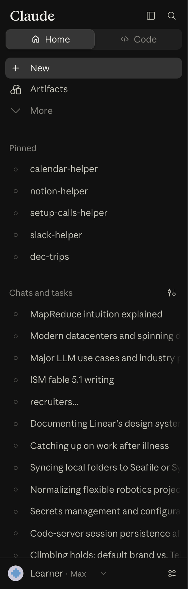 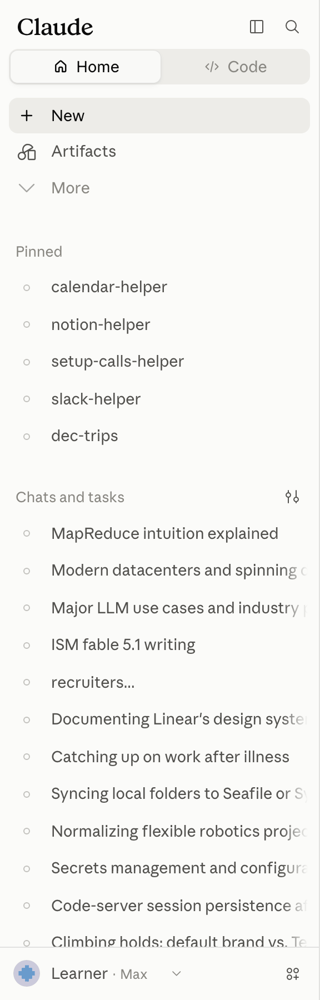 

| State | Values |
|---|---|
| default | size 288 x 900; border R: 1px solid rgba(255, 255, 255, 0.1) `alpha.2`; background #111111 `frame.web-sidebar-bg`; text Anthropicons 16/16 533.25, #c3c2b7 `text.secondary`; icon 68.33 x 20, #f0efec `text.primary` |
| light | size 288 x 900; border R: 1px solid rgba(11, 11, 11, 0.1) `alpha.2`; background #fbfbf9 `frame.web-sidebar-bg`; text Anthropicons 16/16 533.25, #52514e `text.secondary`; icon 68.33 x 20, #0b0b0b `text.primary` |

Tokens named in its classes: `--cds-cursor-interactive`, `--cds-fill-accent`, `--cds-page-bg`, `--cds-shortcut-cap-ink`, `--df-hover`, `--df-nav-scrollbar-lane`, `--df-radius-pill`, `--df-row-ctl`, `--df-row-font`, `--df-row-gap`, `--df-row-h`, `--df-row-px`, `--df-selected`.

#### Sidebar title row

`sidebar-titlebar`, on home-dark. 44 tall: the "Claude" serif wordmark at the start, Hide sidebar and Search icon buttons at the end.

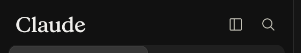 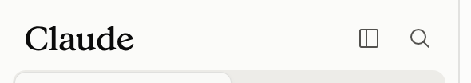 

| State | Values |
|---|---|
| default | size 287 x 44; padding 4px 8px 0px 8px; background transparent; text Anthropicons 16/16 533.25, #c3c2b7 `text.secondary`; icon 68.33 x 20, #f0efec `text.primary` |
| light | size 287 x 44; padding 4px 8px 0px 8px; background transparent; text Anthropicons 16/16 533.25, #52514e `text.secondary`; icon 68.33 x 20, #0b0b0b `text.primary` |

Child layers: a 68.3x20

Tokens named in its classes: `--cds-cursor-interactive`, `--cds-page-bg`.

#### Claude wordmark

`sidebar-wordmark`, on home-dark. An inline SVG, 68x20, in the text colour.

 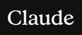 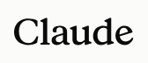  

| State | Values |
|---|---|
| default (same: hover) | size 68.33 x 20; background transparent; outline 2px solid rgba(85, 152, 231, 0), offset 2px; text Anthropic Sans 14/21 400, #f0efec `text.primary`; icon 68.33 x 20, #f0efec `text.primary` |
| light (same: light-hover) | size 68.33 x 20; background transparent; outline 2px solid rgba(37, 106, 191, 0), offset 2px; text Anthropic Sans 14/21 400, #0b0b0b `text.primary`; icon 68.33 x 20, #0b0b0b `text.primary` |

Child layers: a 68.3x20

#### Sidebar icon button (Hide sidebar)

`sidebar-icon-button`, on home-dark. A cds Button, ghost, 32x32 with a 16px glyph from the Anthropicons icon font.

 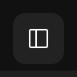 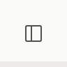 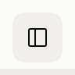 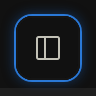 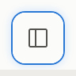 

| State | Values |
|---|---|
| default | size 32 x 32; radius 8px; background transparent; text Anthropicons 16/16 533.25, #c3c2b7 `text.secondary` |
| hover | text Anthropicons 16/16 533.25, #ffffff `fill.primary` |
| focus-visible | shadow #151515 0px 0px 0px 1px inset, #2a78d6 0px 0px 0px 1px, rgba(24, 79, 149, 0.6) 0px 0px 6px 1px; transition outline 0.2s ease |
| light | size 32 x 32; radius 8px; background transparent; text Anthropicons 16/16 533.25, #52514e `text.secondary` |
| light-hover | text Anthropicons 16/16 533.25, #0b0b0b `text.primary` |
| light-focus-visible | shadow #fcfcfb 0px 0px 0px 1px inset, #2a78d6 0px 0px 0px 1px, #cde2fb 0px 0px 6px 1px; transition outline 0.2s ease |

Tokens named in its classes: `--cds-cursor-interactive`, `--cds-page-bg`.

#### Sidebar Search button

`sidebar-search-button`, on home-dark.

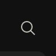 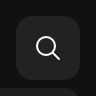 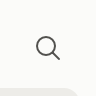 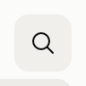 

| State | Values |
|---|---|
| default | size 32 x 32; radius 8px; background transparent; text Anthropicons 16/16 533.25, #c3c2b7 `text.secondary` |
| hover | text Anthropicons 16/16 533.25, #ffffff `fill.primary` |
| light | size 32 x 32; radius 8px; background transparent; text Anthropicons 16/16 533.25, #52514e `text.secondary` |
| light-hover | text Anthropicons 16/16 533.25, #0b0b0b `text.primary` |

Tokens named in its classes: `--cds-cursor-interactive`, `--cds-page-bg`.

#### Home/Code segmented control

`mode-pills`, on home-dark. Two pills (Home, Code) in a track the full width of the sidebar; a sliding indicator sits under the active one.

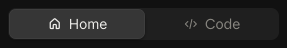 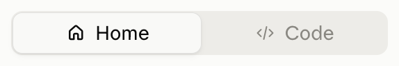 

| State | Values |
|---|---|
| default | size 271 x 32; padding 1px; radius 8px; background rgba(255, 255, 255, 0.06); text Anthropicons 16/16 700, #f0efec `text.primary` |
| light | size 271 x 32; padding 1px; radius 8px; background #edece8 `frame.selected`; text Anthropicons 16/16 700, #0b0b0b `text.primary` |

#### Mode pill

`mode-pill`, on home-dark.

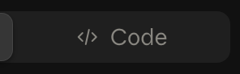 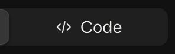 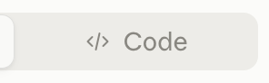 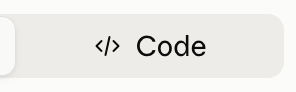  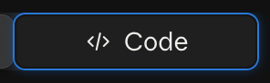  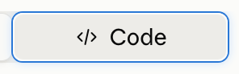 

| State | Values |
|---|---|
| default | size 132.89 x 30; padding 0px 4px; radius 6px; background transparent; outline 2px solid rgba(85, 152, 231, 0), offset 2px; text Anthropicons 16/16 533.25, #898781 `text.muted`; transition box-shadow 0.06s ease |
| hover | text Anthropicons 16/16 533.25, #f0efec `text.primary` |
| focus-visible | shadow #151515 0px 0px 0px 1px inset, #2a78d6 0px 0px 0px 1px, rgba(24, 79, 149, 0.6) 0px 0px 6px 1px; text Anthropicons 16/16 533.25, #f0efec `text.primary` |
| active | size 136.11 x 30; text Anthropicons 16/16 700, #f0efec `text.primary` |
| light | size 132.89 x 30; padding 0px 4px; radius 6px; background transparent; outline 2px solid rgba(37, 106, 191, 0), offset 2px; text Anthropicons 16/16 533.25, #898781 `text.muted`; transition box-shadow 0.06s ease |
| light-hover | text Anthropicons 16/16 533.25, #0b0b0b `text.primary` |
| light-focus-visible | shadow #fcfcfb 0px 0px 0px 1px inset, #2a78d6 0px 0px 0px 1px, #cde2fb 0px 0px 6px 1px; text Anthropicons 16/16 533.25, #0b0b0b `text.primary` |
| light-active | size 136.11 x 30; text Anthropicons 16/16 700, #0b0b0b `text.primary` |

Child layers: button 132.9x30 radius 6px

#### Mode pill indicator

`mode-pill-indicator`, on home-dark.

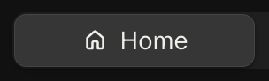 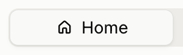 

| State | Values |
|---|---|
| default | size 136 x 30; radius 7px; background rgba(255, 255, 255, 0.1) `alpha.2`; shadow rgba(255, 255, 255, 0.08) 0px 0px 0px 0.5px inset, rgba(0, 0, 0, 0.3) 0px 1px 2px 0px, rgba(0, 0, 0, 0.25) 0px 2px 6px -1px; transition background-color 0.3s cubic-bezier(0.32, 0.72, 0, 1); transform translate(1px, 0px) |
| light | size 136 x 30; radius 7px; background #f9f9f7 `surface.0`; shadow rgba(11, 11, 11, 0.1) 0px 0px 0px 0.5px inset, rgba(0, 0, 0, 0.06) 0px 1px 2px 0px, rgba(0, 0, 0, 0.05) 0px 2px 6px -1px; transition background-color 0.3s cubic-bezier(0.32, 0.72, 0, 1); transform translate(1px, 0px) |

#### New row

`nav-new-row`, on home-dark. The first nav row: a 22px circle with a plus, "New", the ⇧⌘O shortcut, and a Quick task button at the end.

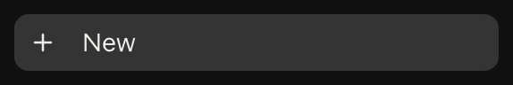 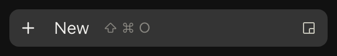 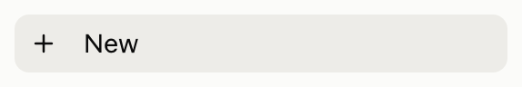 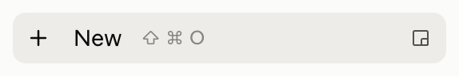 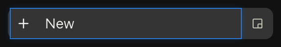 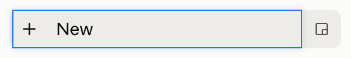 

| State | Values |
|---|---|
| default (same: hover, focus-visible) | size 271 x 32; padding 0px 0px 0px 2px; radius 8px; background rgba(255, 255, 255, 0.15) `fill.ghost-selected`; text Anthropicons 16/16 700, #f0efec `text.primary` |
| light (same: light-hover, light-focus-visible) | size 271 x 32; padding 0px 0px 0px 2px; radius 8px; background #edece8 `frame.selected`; text Anthropicons 16/16 700, #0b0b0b `text.primary` |

Tokens named in its classes: `--cds-cursor-interactive`, `--cds-fill-accent`, `--cds-page-bg`, `--cds-shortcut-cap-ink`, `--df-hover`, `--df-radius-pill`, `--df-row-ctl`, `--df-row-font`, `--df-row-gap`, `--df-row-h`, `--df-row-px`, `--df-selected`.

#### New row circle

`nav-new-circle`, on home-dark.

 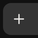 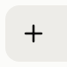  

| State | Values |
|---|---|
| default (same: hover) | size 22 x 22; radius 9999px; background transparent; text Anthropicons 16/16 700, #f0efec `text.primary` |
| light (same: light-hover) | size 22 x 22; radius 9999px; background transparent; text Anthropicons 16/16 700, #0b0b0b `text.primary` |

#### Shortcut hint

`nav-shortcut`, on home-dark. cds Shortcut, text variant: each key a <kbd> in caption size; held at opacity 0 until its row is hovered.

 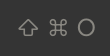  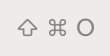 

| State | Values |
|---|---|
| default | size 39.78 x 12; background transparent; text Anthropic Sans 12/12 400, #898781 `text.muted`; opacity 0 |
| hover | opacity none |
| light | size 39.8 x 12; background transparent; text Anthropic Sans 12/12 400, #898781 `text.muted`; opacity 0 |
| light-hover | opacity none |

Tokens named in its classes: `--cds-shortcut-cap-ink`, `--df-radius-pill`.

#### Nav row (Artifacts)

`nav-row`, on home-dark. 32 tall (--df-row-h), radius 8 (--df-radius-pill), a 20px glyph in a 28px leading slot, 14px text in text-secondary; hover fills --df-hover.

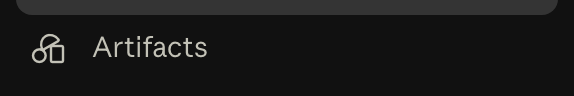 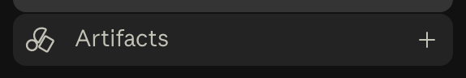 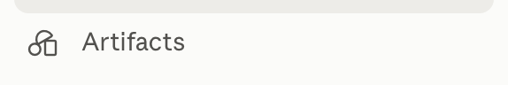 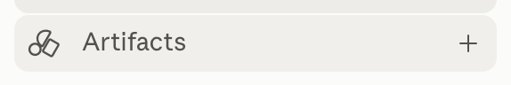 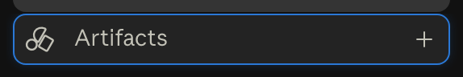 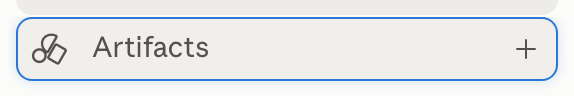 

| State | Values |
|---|---|
| default | size 271 x 32; radius 8px; background transparent; text Anthropicons 20/20 433.25, #c3c2b7 `text.secondary` |
| hover, focus-visible | background rgba(255, 255, 255, 0.07) `fill.ghost-hover` |
| light | size 271 x 32; radius 8px; background transparent; text Anthropicons 20/20 433.25, #52514e `text.secondary` |
| light-hover, light-focus-visible | background #f0efec `frame.hover` |

Child layers: a 271x32 radius 8px

Tokens named in its classes: `--cds-cursor-interactive`, `--cds-fill-accent`, `--cds-page-bg`, `--df-hover`, `--df-radius-pill`, `--df-row-ctl`, `--df-row-font`, `--df-row-gap`, `--df-row-h`, `--df-row-px`, `--df-selected`.

#### More row

`nav-row-more`, on home-dark, artifacts-dark-more-menu.

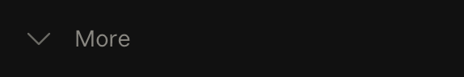 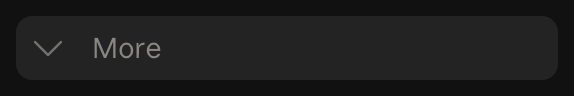 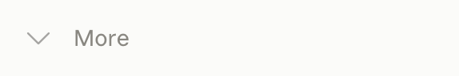 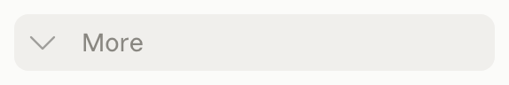 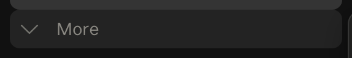 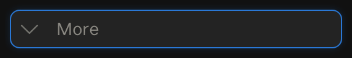 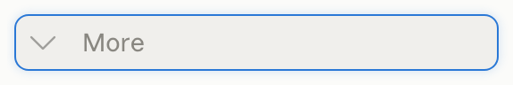 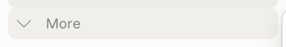 

| State | Values |
|---|---|
| default | size 271 x 32; padding 0px 2px; radius 8px; background transparent; outline 2px solid rgba(85, 152, 231, 0), offset 2px; text Anthropicons 20/20 433.25, #c3c2b7 `text.secondary` |
| hover | background rgba(255, 255, 255, 0.07) `fill.ghost-hover` |
| focus-visible | background rgba(255, 255, 255, 0.07) `fill.ghost-hover`; shadow #2a78d6 0px 0px 0px 1px inset, rgba(42, 120, 214, 0.2) 0px 0px 6px 0px |
| open | background rgba(255, 255, 255, 0.07) `fill.ghost-hover` |
| light | size 271 x 32; padding 0px 2px; radius 8px; background transparent; outline 2px solid rgba(37, 106, 191, 0), offset 2px; text Anthropicons 20/20 433.25, #52514e `text.secondary` |
| light-hover | background #f0efec `frame.hover` |
| light-focus-visible | background #f0efec `frame.hover`; shadow #2a78d6 0px 0px 0px 1px inset, rgba(42, 120, 214, 0.2) 0px 0px 6px 0px |
| light-open | background #f0efec `frame.hover` |

Child layers: button 271x32 radius 8px

Tokens named in its classes: `--cds-fill-accent`, `--df-hover`, `--df-radius-pill`, `--df-row-font`, `--df-row-gap`, `--df-row-h`, `--df-row-px`, `--df-selected`.

#### Section label (Pinned)

`section-label`, on home-dark. Caption-size text in text-muted with a caret that shows on hover.

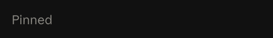      

| State | Values |
|---|---|
| default | size 265 x 24; padding 4px 0px 4px 4px; radius 8px; background transparent; outline 2px solid rgba(85, 152, 231, 0), offset 2px; text Anthropic Sans 13/16 400, #898781 `text.muted` |
| hover | text Anthropic Sans 13/16 400, #c3c2b7 `text.secondary` |
| focus-visible | shadow #2a78d6 0px 0px 0px 1px inset, rgba(42, 120, 214, 0.2) 0px 0px 6px 0px |
| light | size 265 x 24; padding 4px 0px 4px 4px; radius 8px; background transparent; outline 2px solid rgba(37, 106, 191, 0), offset 2px; text Anthropic Sans 13/16 400, #898781 `text.muted` |
| light-hover | text Anthropic Sans 13/16 400, #52514e `text.secondary` |
| light-focus-visible | shadow #2a78d6 0px 0px 0px 1px inset, rgba(42, 120, 214, 0.2) 0px 0px 6px 0px |

Child layers: button 265x24 radius 8px

Tokens named in its classes: `--cds-fill-accent`, `--df-radius-pill`.

#### Section action button (View all)

`section-action`, on home-dark. Revealed when its section label row is hovered.

    

| State | Values |
|---|---|
| default (same: hover) | size 24 x 24; radius 6px; background transparent; text Anthropicons 16/16 533.25, #c3c2b7 `text.secondary`; opacity 0 |
| light (same: light-hover) | size 24 x 24; radius 6px; background transparent; text Anthropicons 16/16 533.25, #52514e `text.secondary`; opacity 0 |

Tokens named in its classes: `--cds-cursor-interactive`, `--cds-page-bg`.

#### Chat row

`chat-row`, on home-dark, thread-dark. A 6px hollow ring as the bullet (role=img "Idle"), the title faded at the end (.dframe-fade-label, a mask, not an ellipsis), a more button on hover.

        

| State | Values |
|---|---|
| default (same: pinned) | size 271 x 32; radius 8px; background transparent; text Anthropic Sans 14/21 400, #c3c2b7 `text.secondary` |
| hover | background rgba(255, 255, 255, 0.07) `fill.ghost-hover` |
| selected | background rgba(255, 255, 255, 0.15) `fill.ghost-selected`; text Anthropic Sans 14/21 400, #f0efec `text.primary` |
| light (same: light-pinned) | size 271 x 32; radius 8px; background transparent; text Anthropic Sans 14/21 400, #52514e `text.secondary` |
| light-hover | background #f0efec `frame.hover` |
| light-selected | background #edece8 `frame.selected`; text Anthropic Sans 14/21 400, #0b0b0b `text.primary` |

Child layers: a 271x32 radius 8px; span 6x6 border 1px solid #898781 `text.muted` radius 3.35544e+07px

Tokens named in its classes: `--cds-cursor-interactive`, `--cds-fill-accent`, `--cds-page-bg`, `--df-hover`, `--df-radius-pill`, `--df-row-ctl`, `--df-row-font`, `--df-row-gap`, `--df-row-h`, `--df-row-indent`, `--df-row-px`, `--df-selected`.

#### Chat row bullet

`chat-row-bullet`, on home-dark.

  

| State | Values |
|---|---|
| default | size 6 x 6; border 1px solid #898781 `text.muted`; radius 9999px; background transparent; opacity 0.5 |
| light | size 6 x 6; border 1px solid #898781 `text.muted`; radius 9999px; background transparent; opacity 0.5 |

#### Chat row more button

`chat-row-more`, on home-dark, home-dark-chat-menu.

      

| State | Values |
|---|---|
| default (same: hover) | size 24 x 24; radius 6px; background transparent; text Anthropicons 16/16 533.25, #c3c2b7 `text.secondary`; transition box-shadow 0.06s cubic-bezier(0.4, 0, 0.2, 1) |
| open | text Anthropicons 16/16 533.25, #f0efec `text.primary` |
| light (same: light-hover) | size 24 x 24; radius 6px; background transparent; text Anthropicons 16/16 533.25, #52514e `text.secondary`; transition box-shadow 0.06s cubic-bezier(0.4, 0, 0.2, 1) |
| light-open | text Anthropicons 16/16 533.25, #0b0b0b `text.primary` |

Tokens named in its classes: `--cds-cursor-interactive`, `--cds-page-bg`, `--df-row-ctl`.

#### Account row

`account-row`, on home-dark, home-dark-user-menu. Avatar, name, a dot and the plan ("Max") in text-muted, a chevron.

        

| State | Values |
|---|---|
| default (same: open) | size 164.11 x 32; padding 0px 8px 0px 2px; radius 8px; background transparent; text Anthropic Sans 14/21 400, #c3c2b7 `text.secondary` |
| hover | background rgba(255, 255, 255, 0.07) `fill.ghost-hover` |
| focus-visible | shadow #151515 0px 0px 0px 1px inset, #2a78d6 0px 0px 0px 1px, rgba(24, 79, 149, 0.6) 0px 0px 6px 1px; transition outline 0.2s ease |
| light (same: light-open) | size 164.84 x 32; padding 0px 8px 0px 2px; radius 8px; background transparent; text Anthropic Sans 14/21 400, #52514e `text.secondary` |
| light-hover | background #f0efec `frame.hover` |
| light-focus-visible | shadow #fcfcfb 0px 0px 0px 1px inset, #2a78d6 0px 0px 0px 1px, #cde2fb 0px 0px 6px 1px; transition outline 0.2s ease |

Child layers: span 24x24 background rgba(255, 255, 255, 0.1) `alpha.2` radius 3.35544e+07px

Tokens named in its classes: `--cds-avatar-sm`, `--cds-rem-scale`, `--df-footer-btn-size`, `--df-hover`, `--df-leading-slot`, `--df-radius-pill`, `--df-row-font`, `--df-row-gap`, `--df-row-px`.

#### Avatar

`account-avatar`, on home-dark.

  

| State | Values |
|---|---|
| default | size 24 x 24; radius 9999px; background rgba(255, 255, 255, 0.1) `alpha.2` |
| light | size 24 x 24; radius 9999px; background rgba(11, 11, 11, 0.1) `alpha.2` |

Tokens named in its classes: `--cds-avatar-sm`, `--cds-rem-scale`.

#### Plan label

`account-plan`, on home-dark.

  

| State | Values |
|---|---|
| default | size 24.42 x 18; background transparent; text Anthropic Sans 12/18 400, #898781 `text.muted` |
| light | size 24.69 x 18; background transparent; text Anthropic Sans 12/18 400, #898781 `text.muted` |

#### Get apps button

`footer-apps-button`, on home-dark.

      

| State | Values |
|---|---|
| default | size 32 x 32; radius 8px; background transparent; text Anthropicons 16/16 533.25, #c3c2b7 `text.secondary` |
| hover | text Anthropicons 16/16 533.25, #ffffff `fill.primary` |
| focus-visible | shadow #151515 0px 0px 0px 1px inset, #2a78d6 0px 0px 0px 1px, rgba(24, 79, 149, 0.6) 0px 0px 6px 1px; transition outline 0.2s ease |
| light | size 32 x 32; radius 8px; background transparent; text Anthropicons 16/16 533.25, #52514e `text.secondary` |
| light-hover | text Anthropicons 16/16 533.25, #0b0b0b `text.primary` |
| light-focus-visible | shadow #fcfcfb 0px 0px 0px 1px inset, #2a78d6 0px 0px 0px 1px, #cde2fb 0px 0px 6px 1px; transition outline 0.2s ease |

Tokens named in its classes: `--cds-cursor-interactive`, `--cds-page-bg`.

#### Sidebar resize handle

`resize-handle`, on home-dark.

| State | Values |
|---|---|
| default (same: hover) | size 12 x 900; background transparent; text Anthropic Sans 14/21 400, #f0efec `text.primary` |
| light (same: light-hover) | size 12 x 900; background transparent; text Anthropic Sans 14/21 400, #0b0b0b `text.primary` |

Child layers: div 3x48 background #898781 `text.muted` radius 3.35544e+07px

Tokens named in its classes: `--cds-resize-pill-force`, `--cds-ring-inner`, `--cds-ring-outer`.

#### Sidebar hidden (the show button)

`sidebar-collapsed`, on home-dark-sidebar-collapsed. Hidden, the sidebar leaves only a 32x32 box at 8,8 holding the Show sidebar button; the content pane takes the full width.

  

| State | Values |
|---|---|
| default | size 32 x 32; background transparent; text Anthropicons 16/16 533.25, #c3c2b7 `text.secondary` |
| light | size 32 x 32; background transparent; text Anthropicons 16/16 533.25, #52514e `text.secondary` |

Child layers: div 288x900 background #20201f `surface.3` border 1px solid rgba(255, 255, 255, 0.1) `alpha.2` shadow rgba(255, 255, 255, 0.08) 0px 0px 0px 0.5px, rgba(0, 0, 0, 0.4) 0px 4px 12px 0px, rgba(0, 0, 0, 0.5) `surface.backdrop` 0px 16px 40px 0px; div 270x32 background rgba(255, 255, 255, 0.06) radius 8px; div 136x30 background rgba(255, 255, 255, 0.1) `alpha.2` radius 7px shadow rgba(255, 255, 255, 0.08) 0px 0px 0px 0.5px inset, rgba(0, 0, 0, 0.3) 0px 1px 2px 0px, rgba(0, 0, 0, 0.25) 0px 2px 6px -1px

Tokens named in its classes: `--cds-cursor-interactive`, `--cds-fill-accent`, `--cds-page-bg`, `--cds-shortcut-cap-ink`, `--df-hover`, `--df-nav-scrollbar-lane`, `--df-radius-pill`, `--df-row-ctl`, `--df-row-font`, `--df-row-gap`, `--df-row-h`, `--df-row-px`, `--df-selected`, `--df-surface-primary`.

#### Show sidebar button

`sidebar-show-button`, on home-dark-sidebar-collapsed.

      

| State | Values |
|---|---|
| default (same: hover) | size 24 x 24; radius 6px; background transparent; text Anthropicons 16/16 533.25, #c3c2b7 `text.secondary`; transition box-shadow 0.06s cubic-bezier(0.4, 0, 0.2, 1) |
| focus-visible | shadow #151515 0px 0px 0px 1px inset, #2a78d6 0px 0px 0px 1px, rgba(24, 79, 149, 0.6) 0px 0px 6px 1px; transition outline 0.2s ease |
| light (same: light-hover) | size 24 x 24; radius 6px; background transparent; text Anthropicons 16/16 533.25, #52514e `text.secondary`; transition box-shadow 0.06s cubic-bezier(0.4, 0, 0.2, 1) |
| light-focus-visible | shadow #fcfcfb 0px 0px 0px 1px inset, #2a78d6 0px 0px 0px 1px, #cde2fb 0px 0px 6px 1px; transition outline 0.2s ease |

Tokens named in its classes: `--cds-cursor-interactive`, `--cds-page-bg`.

### Header

The 48px row over the content column: empty on the home page but for Use incognito; on a chat, the title button with its more menu, and Share.

#### Content pane header

`pane-header`, on home-dark. 48 tall (--df-header-h) across the content pane.

  

| State | Values |
|---|---|
| default | size 1136 x 48; background transparent; icon 20 x 20, #f0efec `text.primary` |
| light | size 1136 x 48; background transparent; icon 20 x 20, #0b0b0b `text.primary` |

Tokens named in its classes: `--cds-cursor-interactive`, `--cds-page-bg`.

#### Content pane

`pane`, on home-dark. The content column: it starts 8px past the sidebar and paints nothing itself, so the page shows the app ground (surface-1).

  

| State | Values |
|---|---|
| default | size 1136 x 900; background transparent; text Anthropic Serif 38/47.5 300, #f0efec `text.primary`; transition filter 0.12s ease-out; icon 20 x 20, #f0efec `text.primary`; placeholder #898781 `text.muted` |
| light | size 1136 x 900; background transparent; text Anthropic Serif 38/47.5 330, #0b0b0b `text.primary`; transition filter 0.12s ease-out; icon 20 x 20, #0b0b0b `text.primary`; placeholder #898781 `text.muted` |

Child layers: div 672x120 background #20201f `surface.3` border 1px solid transparent radius 20px shadow transparent 0px 0px 0px 0px, transparent 0px 0px 0px 0px, transparent 0px 0px 0px 0px, transparent 0px 0px 0px 0px, rgba(0, 0, 0, 0.04) 0px 4px 20px 0px, rgba(255, 255, 255, 0.1) `alpha.2` 0px 0px 0px 1px inset, rgba(255, 255, 255, 0.1) `alpha.2` 0px 0px 0px 0px; div 119.2x28 background rgba(255, 255, 255, 0.05) `alpha.1` radius 7px; div 49.5x26 background rgba(255, 255, 255, 0.1) `alpha.2` radius 6px shadow rgba(255, 255, 255, 0.1) `alpha.2` 0px 0px 0px 1px inset, rgba(0, 0, 0, 0.05) 0px 1px 2px 0px

Tokens named in its classes: `--app-visual-viewport-height`, `--band-slot-lift`, `--cds-cursor-interactive`, `--cds-h-control--xs`, `--cds-page-bg`, `--chorus-composer-lift`, `--new-page-card-px`, `--organization-banner-column-height`, `--prerender-activation-viewport-height`.

#### Incognito button

`incognito-button`, on home-dark.

      

| State | Values |
|---|---|
| default (same: hover) | size 32 x 32; radius 8px; background transparent; text Anthropic Sans 14/20 400, #f0efec `text.primary`; transition box-shadow 0.06s cubic-bezier(0.4, 0, 0.2, 1); icon 20 x 20, #f0efec `text.primary` |
| focus-visible | shadow #151515 0px 0px 0px 1px inset, #2a78d6 0px 0px 0px 1px, rgba(24, 79, 149, 0.6) 0px 0px 6px 1px; transition outline 0.2s ease |
| light (same: light-hover) | size 32 x 32; radius 8px; background transparent; text Anthropic Sans 14/20 400, #0b0b0b `text.primary`; transition box-shadow 0.06s cubic-bezier(0.4, 0, 0.2, 1); icon 20 x 20, #0b0b0b `text.primary` |
| light-focus-visible | shadow #fcfcfb 0px 0px 0px 1px inset, #2a78d6 0px 0px 0px 1px, #cde2fb 0px 0px 6px 1px; transition outline 0.2s ease |

Tokens named in its classes: `--cds-cursor-interactive`, `--cds-page-bg`.

#### Chat title button

`chat-title-button`, on thread-dark.

      

| State | Values |
|---|---|
| default (same: hover) | size 258.36 x 28; padding 0px 10px; radius 7px; background transparent; text Anthropic Sans 14/20 400, #f0efec `text.primary`; transition box-shadow 0.06s cubic-bezier(0.4, 0, 0.2, 1) |
| focus-visible | shadow #151515 0px 0px 0px 1px inset, #2a78d6 0px 0px 0px 1px, rgba(24, 79, 149, 0.6) 0px 0px 6px 1px; transition outline 0.2s ease |
| light (same: light-hover) | size 260.13 x 28; padding 0px 10px; radius 7px; background transparent; text Anthropic Sans 14/20 400, #0b0b0b `text.primary`; transition box-shadow 0.06s cubic-bezier(0.4, 0, 0.2, 1) |
| light-focus-visible | shadow #fcfcfb 0px 0px 0px 1px inset, #2a78d6 0px 0px 0px 1px, #cde2fb 0px 0px 6px 1px; transition outline 0.2s ease |

Tokens named in its classes: `--cds-page-bg`.

#### Chat title more button

`chat-title-more`, on thread-dark.

    

| State | Values |
|---|---|
| default (same: hover) | size 28 x 28; radius 7px; background transparent; text Anthropicons 16/16 533.25, #f0efec `text.primary`; transition box-shadow 0.06s cubic-bezier(0.4, 0, 0.2, 1) |
| light (same: light-hover) | size 28 x 28; radius 7px; background transparent; text Anthropicons 16/16 533.25, #0b0b0b `text.primary`; transition box-shadow 0.06s cubic-bezier(0.4, 0, 0.2, 1) |

Tokens named in its classes: `--cds-cursor-interactive`, `--cds-page-bg`.

#### Share button

`share-button`, on thread-dark.

      

| State | Values |
|---|---|
| default (same: hover) | size 57.66 x 28; padding 0px 10px; radius 7px; background transparent; text Anthropic Sans 14/20 400, #f0efec `text.primary`; transition box-shadow 0.06s cubic-bezier(0.4, 0, 0.2, 1) |
| focus-visible | shadow #151515 0px 0px 0px 1px inset, #2a78d6 0px 0px 0px 1px, rgba(24, 79, 149, 0.6) 0px 0px 6px 1px; transition outline 0.2s ease |
| light (same: light-hover) | size 58 x 28; padding 0px 10px; radius 7px; background transparent; text Anthropic Sans 14/20 400, #0b0b0b `text.primary`; transition box-shadow 0.06s cubic-bezier(0.4, 0, 0.2, 1) |
| light-focus-visible | shadow #fcfcfb 0px 0px 0px 1px inset, #2a78d6 0px 0px 0px 1px, #cde2fb 0px 0px 6px 1px; transition outline 0.2s ease |

Child layers: span 57.7x28 background rgba(255, 255, 255, 0.1) `alpha.2` radius 7px shadow transparent 0px 0px 0px 0px, transparent 0px 0px 0px 0px, transparent 0px 0px 0px 0px, transparent 0px 0px 0px 0px, transparent 0px 0px 0px 1px inset, rgba(0, 0, 0, 0.05) 0px 1px 2px 0px

Tokens named in its classes: `--cds-cursor-interactive`, `--cds-page-bg`.

### Home and composer

The new-chat page: the serif greeting led by the clay asterisk, and the composer, the same card on the home page, in a chat and on a project page: a 20px-radius card on surface-3 with a ring, the editor, then +, the Chat/Cowork segments, the model selector (model and effort), dictation and voice. Typing swaps voice for the clay send button.

#### Home greeting

`greeting`, on home-dark. Anthropic Serif at the display size (`.font-display`: 2.375rem, weight 300 with the "opsz" 48 axis in dark), the orange asterisk mark first.

  

| State | Values |
|---|---|
| default | size 302.97 x 47.5; background transparent; text Anthropic Serif 38/47.5 300, #f0efec `text.primary`; icon 36.47 x 36.47, #f0efec `text.primary` |
| light | size 305.11 x 47.5; background transparent; text Anthropic Serif 38/47.5 330, #0b0b0b `text.primary`; icon 36.47 x 36.47, #0b0b0b `text.primary` |

#### Greeting mark (the asterisk)

`greeting-mark`, on home-dark.

  

| State | Values |
|---|---|
| default | size 36.47 x 36.47; background transparent; icon 36.47 x 36.47, #f0efec `text.primary` |
| light | size 36.47 x 36.47; background transparent; icon 36.47 x 36.47, #0b0b0b `text.primary` |

#### Composer

`composer`, on home-dark, home-dark-composer-typed, thread-dark, project-dark. A card on surface-3 with radius 20 (rounded-[20px]; 12 at compact), a 1px ring of --cds-border (border-strong on focus) and a soft 4/20 drop (shadow-composer); the editor (Tiptap) above a 32px tool row.

          

| State | Values |
|---|---|
| default | size 672 x 120; border 1px solid transparent; radius 20px; background #20201f `surface.3`; shadow rgba(0, 0, 0, 0.04) 0px 4px 20px 0px, rgba(255, 255, 255, 0.1) 0px 0px 0px 1px inset, rgba(255, 255, 255, 0.1) 0px 0px 0px 0px; text Anthropic Sans 15/20 400, #898781 `text.muted`; transition background-color and 3 more 0.2s cubic-bezier(0.4, 0, 0.2, 1); icon 20 x 20, #f0efec `text.primary`; placeholder #898781 `text.muted` |
| focus-visible | shadow rgba(0, 0, 0, 0.07) 0px 4px 20px 0px, rgba(255, 255, 255, 0.2) 0px 0px 0px 1px inset, rgba(255, 255, 255, 0.2) 0px 0px 0px 0px |
| typed | text Anthropic Sans 15/20 400, #f0efec `text.primary`; placeholder #f0efec `text.primary` |
| thread | size 768 x 100; text Anthropicons 20/20 433.25, #f0efec `text.primary` |
| project | size 680 x 120 |
| light | size 672 x 120; border 1px solid transparent; radius 20px; background #ffffff `surface.2`; shadow rgba(0, 0, 0, 0.04) 0px 4px 20px 0px, rgba(11, 11, 11, 0.1) 0px 0px 0px 0px inset, rgba(11, 11, 11, 0.1) 0px 0px 0px 1px; text Anthropic Sans 15/20 400, #898781 `text.muted`; transition background-color and 3 more 0.2s cubic-bezier(0.4, 0, 0.2, 1); icon 20 x 20, #0b0b0b `text.primary`; placeholder #898781 `text.muted` |
| light-focus-visible | shadow rgba(0, 0, 0, 0.07) 0px 4px 20px 0px, rgba(11, 11, 11, 0.2) 0px 0px 0px 0px inset, rgba(11, 11, 11, 0.2) 0px 0px 0px 1px |
| light-typed | text Anthropic Sans 15/20 400, #0b0b0b `text.primary`; placeholder #0b0b0b `text.primary` |
| light-thread | size 768 x 100; text Anthropicons 20/20 433.25, #0b0b0b `text.primary` |
| light-project | size 680 x 120 |

Tokens named in its classes: `--cds-border`, `--cds-cursor-interactive`, `--cds-page-bg`, `--cds-radius`, `--cds-segmented-control-thumb`, `--cds-segmented-control-track`.

#### Composer placeholder

`composer-placeholder`, on home-dark. Two stacked spans that cross-fade ("How can I help you today?", "Type / for skills").

  

| State | Values |
|---|---|
| default | size 636 x 40; background transparent; text Anthropic Sans 15/20 400, #898781 `text.muted` |
| light | size 636 x 40; background transparent; text Anthropic Sans 15/20 400, #898781 `text.muted` |

#### Composer typed text

`composer-text`, on home-dark-composer-typed.

  

| State | Values |
|---|---|
| default | size 636 x 20; background transparent; text Anthropic Sans 15/20 400, #f0efec `text.primary` |
| light | size 636 x 20; background transparent; text Anthropic Sans 15/20 400, #0b0b0b `text.primary` |

#### Composer + button

`composer-plus`, on home-dark, home-dark-plus-menu.

        

| State | Values |
|---|---|
| default (same: hover, open) | size 32 x 32; radius 8px; background transparent; text Anthropicons 20/20 433.25, #f0efec `text.primary`; transition box-shadow 0.06s cubic-bezier(0.4, 0, 0.2, 1) |
| focus-visible | shadow #151515 0px 0px 0px 1px inset, #2a78d6 0px 0px 0px 1px, rgba(24, 79, 149, 0.6) 0px 0px 6px 1px; transition outline 0.2s ease |
| light (same: light-hover, light-open) | size 32 x 32; radius 8px; background transparent; text Anthropicons 20/20 433.25, #0b0b0b `text.primary`; transition box-shadow 0.06s cubic-bezier(0.4, 0, 0.2, 1) |
| light-focus-visible | shadow #fcfcfb 0px 0px 0px 1px inset, #2a78d6 0px 0px 0px 1px, #cde2fb 0px 0px 6px 1px; transition outline 0.2s ease |

Tokens named in its classes: `--cds-cursor-interactive`, `--cds-page-bg`.

#### Chat/Cowork segmented control

`segmented-control`, on home-dark. cds SegmentedControl: a track of --cds-segmented-control-track, the checked option on --cds-segmented-control-thumb.

  

| State | Values |
|---|---|
| default | size 119.17 x 28; padding 1px; radius 7px; background rgba(255, 255, 255, 0.05) `alpha.1`; text Anthropic Sans 13/17 400, #f0efec `text.primary`; placeholder #f0efec `text.primary` |
| light | size 119.78 x 28; padding 1px; radius 7px; background #f6f6f4 `neutral.30`; text Anthropic Sans 13/17 400, #0b0b0b `text.primary`; placeholder #0b0b0b `text.primary` |

Tokens named in its classes: `--cds-border`, `--cds-radius`, `--cds-segmented-control-thumb`, `--cds-segmented-control-track`.

#### Segment option

`segment`, on home-dark.

      

| State | Values |
|---|---|
| default | size 67.45 x 26; padding 0px 10px; radius 5px; background transparent; text Anthropic Sans 13/17 400, #898781 `text.muted`; transition box-shadow 0.06s cubic-bezier(0.4, 0, 0.2, 1) |
| hover | text Anthropic Sans 13/17 400, #f0efec `text.primary` |
| checked | size 49.72 x 26; text Anthropic Sans 13/17 400, #f0efec `text.primary` |
| light | size 67.83 x 26; padding 0px 10px; radius 5px; background transparent; text Anthropic Sans 13/17 400, #898781 `text.muted`; transition box-shadow 0.06s cubic-bezier(0.4, 0, 0.2, 1) |
| light-hover | text Anthropic Sans 13/17 400, #0b0b0b `text.primary` |
| light-checked | size 49.95 x 26; text Anthropic Sans 13/17 400, #0b0b0b `text.primary` |

Tokens named in its classes: `--cds-radius`.

#### Model selector

`model-selector`, on home-dark, home-dark-model-menu. "Opus 5.5" in text-primary, "Medium" (the effort) in text-muted, a chevron.

        

| State | Values |
|---|---|
| default (same: hover, open) | size 141.98 x 32; padding 0px 12px; radius 8px; background transparent; text Anthropic Sans 14/20 400, #f0efec `text.primary`; transition box-shadow 0.06s cubic-bezier(0.4, 0, 0.2, 1) |
| focus-visible | shadow #151515 0px 0px 0px 1px inset, #2a78d6 0px 0px 0px 1px, rgba(24, 79, 149, 0.6) 0px 0px 6px 1px; transition outline 0.2s ease |
| light (same: light-hover, light-open) | size 142.5 x 32; padding 0px 12px; radius 8px; background transparent; text Anthropic Sans 14/20 400, #0b0b0b `text.primary`; transition box-shadow 0.06s cubic-bezier(0.4, 0, 0.2, 1) |
| light-focus-visible | shadow #fcfcfb 0px 0px 0px 1px inset, #2a78d6 0px 0px 0px 1px, #cde2fb 0px 0px 6px 1px; transition outline 0.2s ease |

Tokens named in its classes: `--cds-cursor-interactive`, `--cds-page-bg`.

#### Dictation button

`mic-button`, on home-dark.

      

| State | Values |
|---|---|
| default | size 32 x 32; padding 0px 6px; radius 8px; background transparent; outline 2px solid rgba(85, 152, 231, 0), offset 2px; text Anthropicons 20/20 433.25, #f0efec `text.primary`; transition color and 9 more 0.2s cubic-bezier(0.4, 0, 0.2, 1) |
| hover | background rgba(255, 255, 255, 0.1) `alpha.2` |
| focus-visible | outline 2px solid #5598e7 `legacy.accent-100`, offset 2px; transition outline 0.2s ease |
| light | size 32 x 32; padding 0px 6px; radius 8px; background transparent; outline 2px solid rgba(37, 106, 191, 0), offset 2px; text Anthropicons 20/20 433.25, #0b0b0b `text.primary`; transition color and 9 more 0.2s cubic-bezier(0.4, 0, 0.2, 1) |
| light-hover | background rgba(11, 11, 11, 0.1) `alpha.2` |
| light-focus-visible | outline 2px solid #256abf `legacy.accent-100`, offset 2px; transition outline 0.2s ease |

Child layers: button 32x32 radius 8px

#### Voice mode button

`voice-button`, on home-dark.

      

| State | Values |
|---|---|
| default | size 32 x 32; padding 0px 6px; radius 8px; background transparent; outline 2px solid rgba(85, 152, 231, 0), offset 2px; text Anthropic Sans 14/20 500, #f0efec `text.primary`; transition color and 9 more 0.2s cubic-bezier(0.4, 0, 0.2, 1); icon 20 x 20, #f0efec `text.primary` |
| hover | background rgba(255, 255, 255, 0.07) `fill.ghost-hover` |
| focus-visible | outline 2px solid #5598e7 `legacy.accent-100`, offset 2px; transition outline 0.2s ease |
| light | size 32 x 32; padding 0px 6px; radius 8px; background transparent; outline 2px solid rgba(37, 106, 191, 0), offset 2px; text Anthropic Sans 14/20 500, #0b0b0b `text.primary`; transition color and 9 more 0.2s cubic-bezier(0.4, 0, 0.2, 1); icon 20 x 20, #0b0b0b `text.primary` |
| light-hover | background rgba(11, 11, 11, 0.05) `alpha.1` |
| light-focus-visible | outline 2px solid #256abf `legacy.accent-100`, offset 2px; transition outline 0.2s ease |

Child layers: button 32x32 radius 8px

#### Send button

`send-button`, on home-dark-composer-typed. Takes the voice button's place once there is text: a filled clay (--cds-fill-brand) square with an arrow.

      

| State | Values |
|---|---|
| default (same: hover) | size 32 x 32; radius 8px; background transparent; text Anthropicons 20/20 433.25, #ffffff `fill.primary`; transition box-shadow 0.06s cubic-bezier(0.4, 0, 0.2, 1) |
| focus-visible | shadow #151515 0px 0px 0px 1px inset, #2a78d6 0px 0px 0px 1px, rgba(24, 79, 149, 0.6) 0px 0px 6px 1px; transition outline 0.2s ease |
| light (same: light-hover) | size 32 x 32; radius 8px; background transparent; text Anthropicons 20/20 433.25, #ffffff `surface.2`; transition box-shadow 0.06s cubic-bezier(0.4, 0, 0.2, 1) |
| light-focus-visible | shadow #fcfcfb 0px 0px 0px 1px inset, #2a78d6 0px 0px 0px 1px, #cde2fb 0px 0px 6px 1px; transition outline 0.2s ease |

Child layers: span 31x31 background #c6613f `fill.brand` radius 8px

Tokens named in its classes: `--cds-cursor-interactive`, `--cds-page-bg`.

#### Disclaimer under the composer

`disclaimer`, on thread-dark.

  

| State | Values |
|---|---|
| default | size 382.83 x 15; background transparent; outline 2px solid rgba(85, 152, 231, 0), offset 2px; text Anthropic Sans 12/16 400, #898781 `text.muted`; transition color and 22 more 0.15s cubic-bezier(0.4, 0, 0.2, 1) |
| light | size 385.66 x 15; background transparent; outline 2px solid rgba(37, 106, 191, 0), offset 2px; text Anthropic Sans 12/16 400, #898781 `text.muted`; transition color and 22 more 0.15s cubic-bezier(0.4, 0, 0.2, 1) |

Child layers: a 382.8x15

### Menus and dialogs

Base UI popovers on surface-popover with radius 12, a 1px ring (outset in light, inset in dark) and the popover drop: the plus menu, the model menu, the account menu, a chat row's menu, the sidebar's More menu, and the search dialog over its backdrop.

#### Plus menu

`plus-menu`, on home-dark-plus-menu. cds Menu: surface-popover, --cds-panel-radius, a ring plus --cds-shadow-popover; 4px inset, 32px rows.

  

| State | Values |
|---|---|
| default | size 228.33 x 379; radius 12px; background #20201f `surface.3`; shadow rgba(255, 255, 255, 0.1) 0px 0px 0px 1px inset, rgba(255, 255, 255, 0.1) 0px 0px 0px 0px, rgba(0, 0, 0, 0.32) 0px 8px 24px 0px, rgba(0, 0, 0, 0.2) 0px 2px 6px 0px; text Anthropicons 20/20 433.25, #f0efec `text.primary`; icon 20 x 20, #f0efec `text.primary` |
| light | size 229.22 x 378; radius 12px; background #ffffff `surface.2`; shadow rgba(11, 11, 11, 0.1) 0px 0px 0px 0px inset, rgba(11, 11, 11, 0.1) 0px 0px 0px 1px, rgba(0, 0, 0, 0.12) 0px 8px 24px 0px, rgba(0, 0, 0, 0.08) 0px 2px 6px 0px; text Anthropicons 20/20 433.25, #0b0b0b `text.primary`; icon 20 x 20, #0b0b0b `text.primary` |

Tokens named in its classes: `--available-height`, `--cds-h-control`, `--cds-leading-body`, `--cds-ring-inner`, `--cds-shortcut-cap-ink`, `--cds-text-muted`.

#### Menu item

`menu-item`, on home-dark-plus-menu. A 20px glyph, body text, an optional shortcut or chevron at the end; hover fills --cds-fill-ghost-hover.

        

| State | Values |
|---|---|
| default (same: hover, checkbox, submenu) | size 220.33 x 32; padding 6px 10px; radius 8px; background transparent; text Anthropicons 20/20 433.25, #f0efec `text.primary` |
| light (same: light-hover, light-checkbox, light-submenu) | size 221.22 x 32; padding 6px 10px; radius 8px; background transparent; text Anthropicons 20/20 433.25, #0b0b0b `text.primary` |

Tokens named in its classes: `--cds-h-control`, `--cds-leading-body`, `--cds-text-muted`.

#### Menu item shortcut

`menu-item-shortcut`, on home-dark-plus-menu.

  

| State | Values |
|---|---|
| default | size 25.2 x 17; background transparent; text Anthropic Sans 13/17 400, #898781 `text.muted` |
| light | size 25.22 x 17; background transparent; text Anthropic Sans 13/17 400, #898781 `text.muted` |

Tokens named in its classes: `--cds-shortcut-cap-ink`.

#### Model menu

`model-menu`, on home-dark-model-menu. Four models as two-line radio items (name, description in footnote), then Effort and More models as submenu rows.

  

| State | Values |
|---|---|
| default | size 294.61 x 291; radius 12px; background #20201f `surface.3`; shadow rgba(255, 255, 255, 0.1) 0px 0px 0px 1px inset, rgba(255, 255, 255, 0.1) 0px 0px 0px 0px, rgba(0, 0, 0, 0.32) 0px 8px 24px 0px, rgba(0, 0, 0, 0.2) 0px 2px 6px 0px; text Anthropic Sans 14/20 400, #f0efec `text.primary` |
| light | size 296.48 x 290; radius 12px; background #ffffff `surface.2`; shadow rgba(11, 11, 11, 0.1) 0px 0px 0px 0px inset, rgba(11, 11, 11, 0.1) 0px 0px 0px 1px, rgba(0, 0, 0, 0.12) 0px 8px 24px 0px, rgba(0, 0, 0, 0.08) 0px 2px 6px 0px; text Anthropic Sans 14/20 400, #0b0b0b `text.primary` |

Tokens named in its classes: `--available-height`, `--available-width`, `--cds-font-size-body`, `--cds-font-size-footnote`, `--cds-h-control`, `--cds-leading-body`, `--cds-leading-footnote`, `--cds-ring-inner`, `--cds-text-muted`.

#### Model menu item

`model-menu-item`, on home-dark-model-menu.

      

| State | Values |
|---|---|
| default (same: hover, checked) | size 286.61 x 50; padding 6px 10px 7px 10px; radius 8px; background transparent; text Anthropic Sans 14/20 400, #f0efec `text.primary` |
| light (same: light-hover, light-checked) | size 288.48 x 50; padding 6px 10px 7px 10px; radius 8px; background transparent; text Anthropic Sans 14/20 400, #0b0b0b `text.primary` |

Tokens named in its classes: `--cds-font-size-body`, `--cds-font-size-footnote`, `--cds-h-control`, `--cds-leading-body`, `--cds-leading-footnote`, `--cds-text-muted`.

#### Effort row

`model-menu-effort`, on home-dark-model-menu.

    

| State | Values |
|---|---|
| default (same: hover) | size 286.61 x 32; padding 6px 10px; radius 8px; background transparent; text Anthropic Sans 14/20 400, #f0efec `text.primary` |
| light (same: light-hover) | size 288.48 x 32; padding 6px 10px; radius 8px; background transparent; text Anthropic Sans 14/20 400, #0b0b0b `text.primary` |

Tokens named in its classes: `--cds-h-control`, `--cds-leading-body`, `--cds-text-muted`.

#### Account menu

`user-menu`, on home-dark-user-menu. Opens above the account row: the email as a muted header, then Settings, Usage, Language, Get help, plans, apps, Learn more, API keys, Log out.

  

| State | Values |
|---|---|
| default | size 272 x 367; radius 12px; background #20201f `surface.3`; shadow rgba(255, 255, 255, 0.1) 0px 0px 0px 1px inset, rgba(255, 255, 255, 0.1) 0px 0px 0px 0px, rgba(0, 0, 0, 0.32) 0px 8px 24px 0px, rgba(0, 0, 0, 0.2) 0px 2px 6px 0px; text Anthropic Sans 13/17 500, #898781 `text.muted` |
| light | size 272 x 366; radius 12px; background #ffffff `surface.2`; shadow rgba(11, 11, 11, 0.1) 0px 0px 0px 0px inset, rgba(11, 11, 11, 0.1) 0px 0px 0px 1px, rgba(0, 0, 0, 0.12) 0px 8px 24px 0px, rgba(0, 0, 0, 0.08) 0px 2px 6px 0px; text Anthropic Sans 13/17 500, #898781 `text.muted` |

Tokens named in its classes: `--available-height`, `--cds-font-size-body`, `--cds-font-size-footnote`, `--cds-h-control`, `--cds-leading-body`, `--cds-leading-footnote`, `--cds-ring-inner`, `--cds-shortcut-cap-ink`, `--cds-text-muted`.

#### Account menu header

`user-menu-header`, on home-dark-user-menu.

  

| State | Values |
|---|---|
| default | size 264 x 25; padding 4px 10px; background transparent; text Anthropic Sans 13/17 500, #898781 `text.muted` |
| light | size 264 x 25; padding 4px 10px; background transparent; text Anthropic Sans 13/17 500, #898781 `text.muted` |

#### Account menu item

`user-menu-item`, on home-dark-user-menu.

      

| State | Values |
|---|---|
| default (same: hover) | size 264 x 32; padding 6px 10px; radius 8px; background rgba(255, 255, 255, 0.07) `fill.ghost-hover`; text Anthropicons 20/20 433.25, #f0efec `text.primary` |
| twoLine | size 264 x 50; padding 6px 10px 7px 10px; background transparent |
| light (same: light-hover) | size 264 x 32; padding 6px 10px; radius 8px; background rgba(11, 11, 11, 0.05) `alpha.1`; text Anthropicons 20/20 433.25, #0b0b0b `text.primary` |
| light-twoLine | size 264 x 50; padding 6px 10px 7px 10px; background transparent |

Tokens named in its classes: `--cds-h-control`, `--cds-leading-body`, `--cds-shortcut-cap-ink`, `--cds-text-muted`.

#### Chat row menu

`chat-menu`, on home-dark-chat-menu.

  

| State | Values |
|---|---|
| default | size 170.61 x 178; radius 12px; background #20201f `surface.3`; shadow rgba(255, 255, 255, 0.1) 0px 0px 0px 1px inset, rgba(255, 255, 255, 0.1) 0px 0px 0px 0px, rgba(0, 0, 0, 0.32) 0px 8px 24px 0px, rgba(0, 0, 0, 0.2) 0px 2px 6px 0px; text Anthropicons 20/20 433.25, #f0efec `text.primary` |
| light | size 171.2 x 177; radius 12px; background #ffffff `surface.2`; shadow rgba(11, 11, 11, 0.1) 0px 0px 0px 0px inset, rgba(11, 11, 11, 0.1) 0px 0px 0px 1px, rgba(0, 0, 0, 0.12) 0px 8px 24px 0px, rgba(0, 0, 0, 0.08) 0px 2px 6px 0px; text Anthropicons 20/20 433.25, #0b0b0b `text.primary` |

Tokens named in its classes: `--available-height`, `--cds-h-control`, `--cds-leading-body`, `--cds-ring-inner`, `--cds-shortcut-cap-ink`, `--cds-text-muted`.

#### Chat menu Delete item

`chat-menu-item-danger`, on home-dark-chat-menu.

    

| State | Values |
|---|---|
| default (same: hover) | size 162.61 x 32; padding 6px 10px; radius 8px; background transparent; text Anthropicons 20/20 433.25, #ec7e7e `text.danger` |
| light (same: light-hover) | size 163.2 x 32; padding 6px 10px; radius 8px; background transparent; text Anthropicons 20/20 433.25, #8e2626 `text.danger` |

Tokens named in its classes: `--cds-h-control`, `--cds-leading-body`, `--cds-shortcut-cap-ink`, `--cds-text-muted`.

#### Sidebar More menu

`more-menu`, on artifacts-dark-more-menu.

  

| State | Values |
|---|---|
| default | size 149.75 x 178; radius 12px; background #20201f `surface.3`; shadow rgba(255, 255, 255, 0.1) 0px 0px 0px 1px inset, rgba(255, 255, 255, 0.1) 0px 0px 0px 0px, rgba(0, 0, 0, 0.32) 0px 8px 24px 0px, rgba(0, 0, 0, 0.2) 0px 2px 6px 0px; text Anthropicons 20/20 433.25, #f0efec `text.primary` |
| light | size 150.23 x 177; radius 12px; background #ffffff `surface.2`; shadow rgba(11, 11, 11, 0.1) 0px 0px 0px 0px inset, rgba(11, 11, 11, 0.1) 0px 0px 0px 1px, rgba(0, 0, 0, 0.12) 0px 8px 24px 0px, rgba(0, 0, 0, 0.08) 0px 2px 6px 0px; text Anthropicons 20/20 433.25, #0b0b0b `text.primary` |

Tokens named in its classes: `--available-height`, `--cds-h-control`, `--cds-leading-body`, `--cds-ring-inner`, `--cds-text-muted`.

#### More menu item

`more-menu-item`, on artifacts-dark-more-menu.

    

| State | Values |
|---|---|
| default (same: hover) | size 141.75 x 32; padding 6px 10px; radius 8px; background rgba(255, 255, 255, 0.07) `fill.ghost-hover`; text Anthropicons 20/20 433.25, #f0efec `text.primary` |
| light (same: light-hover) | size 142.23 x 32; padding 6px 10px; radius 8px; background rgba(11, 11, 11, 0.05) `alpha.1`; text Anthropicons 20/20 433.25, #0b0b0b `text.primary` |

Tokens named in its classes: `--cds-h-control`, `--cds-leading-body`, `--cds-text-muted`.

#### Search dialog

`search-dialog`, on home-dark-search. 672 wide, a field row over a list of results with a time group at the end of each row.

  

| State | Values |
|---|---|
| default | size 672 x 506.48; border 1px solid rgba(255, 255, 255, 0.2) `alpha.3`; radius 12px; background #20201f `surface.3`; shadow rgba(0, 0, 0, 0.25) 0px 25px 50px -12px; text Anthropicons 20/20 433.25, #898781 `text.muted` |
| light | size 672 x 506.48; border 1px solid rgba(11, 11, 11, 0.2) `alpha.3`; radius 12px; background #ffffff `surface.2`; shadow rgba(0, 0, 0, 0.25) 0px 25px 50px -12px; text Anthropicons 20/20 433.25, #898781 `text.muted` |

Tokens named in its classes: `--cds-black`, `--cds-cursor-interactive`, `--cds-page-bg`, `--cp-top`, `--cp-visible-h`.

#### Dialog backdrop

`dialog-backdrop`, on home-dark-search.

| State | Values |
|---|---|
| default | size 1440 x 900; background rgba(0, 0, 0, 0.5) `surface.backdrop`; transition none 0.2s cubic-bezier(0.165, 0.84, 0.44, 1) |
| light | size 1440 x 900; background rgba(0, 0, 0, 0.4) `surface.backdrop`; transition none 0.2s cubic-bezier(0.165, 0.84, 0.44, 1) |

#### Search field row

`search-field`, on home-dark-search.

    

| State | Values |
|---|---|
| default (same: focus-visible) | size 670 x 63.98; padding 17.6px 10px 14.4px 24px; background transparent; text Anthropicons 20/20 433.25, #898781 `text.muted` |
| light (same: light-focus-visible) | size 670 x 63.98; padding 17.6px 10px 14.4px 24px; background transparent; text Anthropicons 20/20 433.25, #898781 `text.muted` |

Child layers: textarea 544x20 shadow transparent 0px 0px 0px 0px, transparent 0px 0px 0px 0px, transparent 0px 0px 0px 0px, #f0efec `text.primary` 0px 0px 0px 0px, transparent 0px 0px 0px 0px

Tokens named in its classes: `--cds-cursor-interactive`, `--cds-page-bg`.

#### Search result row

`search-result`, on home-dark-search.

      

| State | Values |
|---|---|
| default (same: hover) | size 650 x 36; padding 8px 12px; radius 8px; background transparent; outline 2px solid rgba(85, 152, 231, 0), offset 2px; text Anthropicons 20/20 433.25, #c3c2b7 `text.secondary` |
| selected | background rgba(255, 255, 255, 0.07) `fill.ghost-hover`; text Anthropicons 20/20 433.25, #f0efec `text.primary` |
| light (same: light-hover) | size 650 x 36; padding 8px 12px; radius 8px; background transparent; outline 2px solid rgba(37, 106, 191, 0), offset 2px; text Anthropicons 20/20 433.25, #52514e `text.secondary` |
| light-selected | background rgba(11, 11, 11, 0.05) `alpha.1`; text Anthropicons 20/20 433.25, #0b0b0b `text.primary` |

Child layers: button 650x36 radius 8px

#### Search result time

`search-result-time`, on home-dark-search.

  

| State | Values |
|---|---|
| default | size 32.89 x 16; background transparent; text Anthropic Sans 12/16 400, #898781 `text.muted` |
| light | size 32.89 x 16; background transparent; text Anthropic Sans 12/16 400, #898781 `text.muted` |

#### Dialog close button

`dialog-close`, on home-dark-search.

      

| State | Values |
|---|---|
| default (same: hover) | size 32 x 32; radius 8px; background transparent; text Anthropicons 20/20 433.25, #f0efec `text.primary`; transition box-shadow 0.06s cubic-bezier(0.4, 0, 0.2, 1) |
| focus-visible | shadow #20201f 0px 0px 0px 1px inset, #2a78d6 0px 0px 0px 1px, rgba(24, 79, 149, 0.6) 0px 0px 6px 1px; transition outline 0.2s ease |
| light (same: light-hover) | size 32 x 32; radius 8px; background transparent; text Anthropicons 20/20 433.25, #0b0b0b `text.primary`; transition box-shadow 0.06s cubic-bezier(0.4, 0, 0.2, 1) |
| light-focus-visible | shadow #ffffff 0px 0px 0px 1px inset, #2a78d6 0px 0px 0px 1px, #cde2fb 0px 0px 6px 1px; transition outline 0.2s ease |

Tokens named in its classes: `--cds-cursor-interactive`, `--cds-page-bg`.

### Settings

The settings dialog: a 192px nav with a search field and two groups (Settings, Customize), and the General pane: section titles, rows with a title, an optional description and a control (the System/Light/Dark theme picker, selects, segmented controls, switches), split by hairlines.

#### Settings dialog

`settings-dialog`, on settings-dark-general. 1024x800 at 1440: a 192 nav column with a right rule, the General pane to the right.

  

| State | Values |
|---|---|
| default | size 1024 x 800; border 1px solid rgba(255, 255, 255, 0.05) `alpha.1`; radius 12px; background #1a1a19 `surface.2`; shadow rgba(255, 255, 255, 0.1) 0px 0px 0px 1px inset, rgba(255, 255, 255, 0.1) 0px 0px 0px 0px, rgba(11, 11, 11, 0.06) 0px 1px 2px 0px, rgba(0, 0, 0, 0.24) 0px 2px 8px 0px; text Anthropicons 20/20 433.25, #898781 `text.muted`; transition opacity 0.2s cubic-bezier(0.165, 0.84, 0.44, 1), scale 0.2s cubic-bezier(0.165, 0.84, 0.44, 1); icon 20 x 20, #c3c2b7 `text.secondary`; placeholder #898781 `text.muted` |
| light | size 1024 x 800; radius 12px; background #ffffff `surface.2`; shadow rgba(11, 11, 11, 0.1) 0px 0px 0px 0px inset, rgba(11, 11, 11, 0.1) 0px 0px 0px 1px, rgba(11, 11, 11, 0.06) 0px 1px 2px 0px, rgba(11, 11, 11, 0.08) 0px 2px 8px 0px; text Anthropicons 20/20 433.25, #898781 `text.muted`; transition opacity 0.2s cubic-bezier(0.165, 0.84, 0.44, 1), scale 0.2s cubic-bezier(0.165, 0.84, 0.44, 1); icon 20 x 20, #52514e `text.secondary`; placeholder #898781 `text.muted` |

#### Settings nav column

`settings-nav`, on settings-dark-general.

  

| State | Values |
|---|---|
| default | size 192 x 798; border R: 1px solid rgba(255, 255, 255, 0.1) `alpha.2`; background #151515 `surface.1`; text Anthropicons 20/20 433.25, #898781 `text.muted`; icon 20 x 20, #c3c2b7 `text.secondary`; placeholder #898781 `text.muted` |
| light | size 192 x 800; border R: 1px solid rgba(11, 11, 11, 0.1) `alpha.2`; background #fcfcfb `surface.1`; text Anthropicons 20/20 433.25, #898781 `text.muted`; icon 20 x 20, #52514e `text.secondary`; placeholder #898781 `text.muted` |

#### Settings search field

`settings-search`, on settings-dark-general.

      

| State | Values |
|---|---|
| default (same: hover, focus-visible) | size 167 x 32; background transparent; text Anthropicons 20/20 433.25, #898781 `text.muted`; placeholder #898781 `text.muted` |
| light (same: light-hover, light-focus-visible) | size 167 x 32; background transparent; text Anthropicons 20/20 433.25, #898781 `text.muted`; placeholder #898781 `text.muted` |

Child layers: div 167x32 background rgba(255, 255, 255, 0.05) `alpha.1` radius 8px shadow transparent 0px 0px 0px 0px, transparent 0px 0px 0px 0px, transparent 0px 0px 0px 0px, transparent 0px 0px 0px 0px, rgba(255, 255, 255, 0.1) `alpha.2` 0px 0px 0px 1px inset

#### Settings nav group label

`settings-nav-label`, on settings-dark-general.

  

| State | Values |
|---|---|
| default | size 167 x 29; padding 12px 8px 0px 8px; background transparent; text Anthropic Sans 12/17 400, #898781 `text.muted` |
| light | size 167 x 29; padding 12px 8px 0px 8px; background transparent; text Anthropic Sans 12/17 400, #898781 `text.muted` |

#### Settings nav item

`settings-nav-item`, on settings-dark-general.

          

| State | Values |
|---|---|
| default (same: hover, focus-visible, active, active-hover) | size 167 x 32; background transparent; text Anthropicons 20/20 433.25, #c3c2b7 `text.secondary` |
| light (same: light-hover, light-focus-visible, light-active, light-active-hover) | size 167 x 32; background transparent; text Anthropicons 20/20 433.25, #52514e `text.secondary` |

Child layers: button 167x32 radius 8px

#### Settings section title (h3)

`settings-section-title`, on settings-dark-general.

  

| State | Values |
|---|---|
| default | size 87.94 x 20; background transparent; text Anthropic Sans 15/20 580, #f0efec `text.primary` |
| light | size 88.47 x 20; background transparent; text Anthropic Sans 15/20 580, #0b0b0b `text.primary` |

#### Settings row

`settings-row`, on settings-dark-general. Title (and an optional description) at the start, the control at the end; groups separated by hairlines (.settings-group-dividers).

  

| State | Values |
|---|---|
| default | size 782 x 56; padding 12px 0px; background transparent; text Anthropic Sans 14/20 400, #f0efec `text.primary`; placeholder #f0efec `text.primary` |
| light | size 784 x 56; padding 12px 0px; background transparent; text Anthropic Sans 14/20 400, #0b0b0b `text.primary`; placeholder #0b0b0b `text.primary` |

Child layers: div 92x32 background rgba(255, 255, 255, 0.05) `alpha.1` radius 8px; input 1x1; input 1x1

Tokens named in its classes: `--cds-border`, `--cds-radius`, `--cds-segmented-control-thumb`, `--cds-segmented-control-track`.

#### Settings row title

`settings-row-title`, on settings-dark-general.

  

| State | Values |
|---|---|
| default | size 62.08 x 20; background transparent; text Anthropic Sans 14/20 400, #f0efec `text.primary` |
| light | size 62.58 x 20; background transparent; text Anthropic Sans 14/20 400, #0b0b0b `text.primary` |

#### Settings row description

`settings-row-desc`, on settings-dark-general.

  

| State | Values |
|---|---|
| default | size 718 x 20; background transparent; text Anthropic Sans 14/20 400, #898781 `text.muted` |
| light | size 720 x 20; background transparent; text Anthropic Sans 14/20 400, #898781 `text.muted` |

#### Settings row group

`settings-divider-group`, on settings-dark-general.

  

| State | Values |
|---|---|
| default | size 782 x 182; background transparent; text Anthropic Sans 14/20 400, #f0efec `text.primary`; placeholder #f0efec `text.primary` |
| light | size 784 x 182; background transparent; text Anthropic Sans 14/20 400, #0b0b0b `text.primary`; placeholder #0b0b0b `text.primary` |

Child layers: div 92x32 background rgba(255, 255, 255, 0.05) `alpha.1` radius 8px; input 1x1; input 1x1

Tokens named in its classes: `--cds-border`, `--cds-radius`, `--cds-segmented-control-thumb`, `--cds-segmented-control-track`.

#### Theme picker

`theme-picker`, on settings-dark-general. Three icon segments: System, Light, Dark.

  

| State | Values |
|---|---|
| default | size 92 x 32; padding 1px; radius 8px; background rgba(255, 255, 255, 0.05) `alpha.1`; text Anthropicons 20/20 433.25, #f0efec `text.primary`; placeholder #f0efec `text.primary` |
| light | size 92 x 32; padding 1px; radius 8px; background rgba(11, 11, 11, 0.05) `alpha.1`; text Anthropicons 20/20 433.25, #0b0b0b `text.primary`; placeholder #0b0b0b `text.primary` |

Tokens named in its classes: `--cds-border`, `--cds-radius`, `--cds-segmented-control-thumb`, `--cds-segmented-control-track`.

#### Theme option

`theme-option`, on settings-dark-general.

      

| State | Values |
|---|---|
| default | size 30 x 30; radius 6px; background transparent; text Anthropicons 20/20 433.25, #898781 `text.muted`; transition box-shadow 0.06s cubic-bezier(0.4, 0, 0.2, 1) |
| hover, checked | text Anthropicons 20/20 433.25, #f0efec `text.primary` |
| light | size 30 x 30; radius 6px; background transparent; text Anthropicons 20/20 433.25, #898781 `text.muted`; transition box-shadow 0.06s cubic-bezier(0.4, 0, 0.2, 1) |
| light-hover, light-checked | text Anthropicons 20/20 433.25, #0b0b0b `text.primary` |

Tokens named in its classes: `--cds-radius`.

#### Text segmented control (Motion)

`text-segment`, on settings-dark-general.

  

| State | Values |
|---|---|
| default | size 156.42 x 32; padding 1px; radius 8px; background rgba(255, 255, 255, 0.05) `alpha.1`; text Anthropic Sans 14/20 400, #f0efec `text.primary`; placeholder #f0efec `text.primary` |
| light | size 157.22 x 32; padding 1px; radius 8px; background rgba(11, 11, 11, 0.05) `alpha.1`; text Anthropic Sans 14/20 400, #0b0b0b `text.primary`; placeholder #0b0b0b `text.primary` |

Tokens named in its classes: `--cds-border`, `--cds-radius`, `--cds-segmented-control-thumb`, `--cds-segmented-control-track`.

#### Select (Chat font)

`select`, on settings-dark-general. cds Combobox: the value and a chevron in a control-height field.

      

| State | Values |
|---|---|
| default | size 140.36 x 32; padding 0px 8px 0px 0px; radius 8px; background transparent; text Anthropic Serif 14/20 400, #f0efec `text.primary`; transition color and 22 more 0.06s cubic-bezier(0.4, 0, 0.2, 1) |
| hover | background rgba(255, 255, 255, 0.07) `fill.ghost-hover` |
| focus-visible | shadow #151515 0px 0px 0px 1px inset, #2a78d6 0px 0px 0px 1px, rgba(24, 79, 149, 0.6) 0px 0px 6px 1px |
| light | size 141.42 x 32; padding 0px 8px 0px 0px; radius 8px; background transparent; text Anthropic Serif 14/20 400, #0b0b0b `text.primary`; transition color and 22 more 0.06s cubic-bezier(0.4, 0, 0.2, 1) |
| light-hover | background rgba(11, 11, 11, 0.05) `alpha.1` |
| light-focus-visible | shadow #fcfcfb 0px 0px 0px 1px inset, #2a78d6 0px 0px 0px 1px, #cde2fb 0px 0px 6px 1px |

#### Switch

`switch`, on settings-dark-general. 36x20 track (--cds-switch-track), a 16px knob with shadow-sm that slides on --cds-dur-snap.

          

| State | Values |
|---|---|
| default | size 36 x 20; padding 2px; radius 9999px; background rgba(255, 255, 255, 0.1) `alpha.2`; text Anthropic Sans 14/20 400, #f0efec `text.primary` |
| hover | background rgba(255, 255, 255, 0.2) `alpha.3` |
| focus-visible | shadow #151515 0px 0px 0px 1px inset, #2a78d6 0px 0px 0px 1px, rgba(24, 79, 149, 0.6) 0px 0px 6px 1px |
| on | background #2a78d6 `fill.accent` |
| on-hover | background #3987e5 `fill.accent-hover` |
| light | size 36 x 20; padding 2px; radius 9999px; background rgba(11, 11, 11, 0.2) `alpha.3`; text Anthropic Sans 14/20 400, #0b0b0b `text.primary` |
| light-hover | background rgba(11, 11, 11, 0.35) `text.disabled` |
| light-focus-visible | shadow #fcfcfb 0px 0px 0px 1px inset, #2a78d6 0px 0px 0px 1px, #cde2fb 0px 0px 6px 1px |
| light-on | background #2a78d6 `fill.accent` |
| light-on-hover | background #3987e5 `fill.accent-hover` |

Tokens named in its classes: `--cds-switch-h`, `--cds-switch-knob`, `--cds-switch-track`, `--cds-switch-track-hover`.

#### Switch knob

`switch-knob`, on settings-dark-general.

  

| State | Values |
|---|---|
| default | size 16 x 16; radius 9999px; background #ffffff `fill.primary`; shadow rgba(11, 11, 11, 0.06) 0px 1px 2px 0px, rgba(0, 0, 0, 0.24) 0px 2px 8px 0px; transition transform and 3 more 0.12s cubic-bezier(0.34, 1.3, 0.64, 1) |
| light | size 16 x 16; radius 9999px; background #ffffff `surface.2`; shadow rgba(11, 11, 11, 0.06) 0px 1px 2px 0px, rgba(11, 11, 11, 0.08) 0px 2px 8px 0px; transition transform and 3 more 0.12s cubic-bezier(0.34, 1.3, 0.64, 1) |

Tokens named in its classes: `--cds-switch-h`, `--cds-switch-knob`.

#### Settings close button

`settings-close`, on settings-dark-general.

      

| State | Values |
|---|---|
| default (same: hover) | size 32 x 32; radius 8px; background transparent; text Anthropicons 20/20 433.25, #f0efec `text.primary`; transition box-shadow 0.06s cubic-bezier(0.4, 0, 0.2, 1) |
| focus-visible | shadow #151515 0px 0px 0px 1px inset, #2a78d6 0px 0px 0px 1px, rgba(24, 79, 149, 0.6) 0px 0px 6px 1px; transition outline 0.2s ease |
| light (same: light-hover) | size 32 x 32; radius 8px; background transparent; text Anthropicons 20/20 433.25, #0b0b0b `text.primary`; transition box-shadow 0.06s cubic-bezier(0.4, 0, 0.2, 1) |
| light-focus-visible | shadow #fcfcfb 0px 0px 0px 1px inset, #2a78d6 0px 0px 0px 1px, #cde2fb 0px 0px 6px 1px; transition outline 0.2s ease |

Tokens named in its classes: `--cds-cursor-interactive`, `--cds-page-bg`.

### Thread

A chat: the 768px transcript, the user's bubble, "Thought for 6s", Claude's reply in the chat font (Anthropic Serif by default) with a code block and a table, the message actions, and the dock that holds the composer.

#### Transcript column

`transcript`, on thread-dark. 768 wide (--transcript-width 48rem), centred in the pane.

  

| State | Values |
|---|---|
| default | size 768 x 3162.5; padding 4px 16px 0px 16px; background transparent; text Anthropic Sans 15/20 400, #f0efec `text.primary`; icon 32 x 32, #f0efec `text.primary` |
| light | size 768 x 3162.5; padding 4px 16px 0px 16px; background transparent; text Anthropic Sans 15/20 400, #0b0b0b `text.primary`; icon 32 x 32, #0b0b0b `text.primary` |

Child layers: div 623x308 background rgba(255, 255, 255, 0.05) `alpha.1` radius 12px; button 1x1; button 732x28

Tokens named in its classes: `--cds-bg-user-message`, `--cds-message-bubble-measure`, `--cds-message-bubble-pad-x`, `--cds-message-bubble-pad-y`, `--cds-message-bubble-radius`, `--chat-list-inset`, `--df-ceded-gutter`, `--msg-assistant-pb`, `--msg-block-inset`, `--msg-gap`, `--msg-inset-end`, `--msg-pill-py`, `--msg-text-inset`, `--transcript-width`.

#### User message bubble

`user-message`, on thread-dark, thread-dark-followup. Right-aligned, at most 85% of the column (--cds-message-bubble-measure), --cds-bg-user-message, radius --cds-message-bubble-radius, padding pad-md / pad-lg.

    

| State | Values |
|---|---|
| default | size 623 x 308; padding 12px 16px; radius 12px; background rgba(255, 255, 255, 0.05) `alpha.1`; text Anthropic Sans 15/20 400, #f0efec `text.primary` |
| short | size 285.83 x 44 |
| light | size 623 x 308; padding 12px 16px; radius 12px; background rgba(11, 11, 11, 0.05) `alpha.1`; text Anthropic Sans 15/20 400, #0b0b0b `text.primary` |
| light-short | size 287.8 x 44 |

Tokens named in its classes: `--cds-bg-user-message`, `--cds-message-bubble-measure`, `--cds-message-bubble-pad-x`, `--cds-message-bubble-pad-y`, `--cds-message-bubble-radius`.

#### User message paragraph

`user-message-text`, on thread-dark.

  

| State | Values |
|---|---|
| default | size 591 x 20; background transparent; text Anthropic Sans 15/20 400, #f0efec `text.primary` |
| light | size 591 x 20; background transparent; text Anthropic Sans 15/20 400, #0b0b0b `text.primary` |

#### User message list item

`user-message-li`, on thread-dark.

  

| State | Values |
|---|---|
| default | size 559 x 20; background transparent; text Anthropic Sans 15/20 400, #f0efec `text.primary` |
| light | size 559 x 20; background transparent; text Anthropic Sans 15/20 400, #0b0b0b `text.primary` |

#### Thought for 6s

`thinking-pill`, on thread-dark. The collapsed reasoning row: text-muted, a caret that shows on hover.

      

| State | Values |
|---|---|
| default | size 732 x 28; padding 4px 0px; background transparent; outline 2px solid rgba(85, 152, 231, 0), offset 2px; text Anthropic Sans 14/20 400, #898781 `text.muted` |
| hover | text Anthropic Sans 14/20 400, #c3c2b7 `text.secondary` |
| focus-visible | outline 2px solid #5598e7 `legacy.accent-100`, offset 2px; transition outline 0.2s ease |
| light | size 732 x 28; padding 4px 0px; background transparent; outline 2px solid rgba(37, 106, 191, 0), offset 2px; text Anthropic Sans 14/20 400, #898781 `text.muted` |
| light-hover | text Anthropic Sans 14/20 400, #52514e `text.secondary` |
| light-focus-visible | outline 2px solid #256abf `legacy.accent-100`, offset 2px; transition outline 0.2s ease |

Child layers: button 732x28

#### Assistant prose block

`assistant-prose`, on thread-dark-table. The response in the chat font (Anthropic Serif by default, .font-claude-response).

| State | Values |
|---|---|
| default | size 736 x 1309.5; background transparent; text Anthropicons 20/20 433.25, #f0efec `text.primary` |
| light | size 736 x 1309.5; background transparent; text Anthropicons 20/20 433.25, #0b0b0b `text.primary` |

Child layers: div 736x834.5 background rgba(32, 32, 31, 0.5) border 1px solid rgba(255, 255, 255, 0.1) `alpha.2` radius 8px; table 728x355 border 1px solid rgba(255, 255, 255, 0.1) `alpha.2` radius 8px; th 184.9x39 background rgba(255, 255, 255, 0.05) `alpha.1` border 1px solid rgba(255, 255, 255, 0.1) `alpha.2` radius 7px 0px 0px

Tokens named in its classes: `--cds-cursor-interactive`, `--cds-page-bg`, `--msg-block-radius`.

#### Assistant paragraph

`prose-paragraph`, on thread-dark-table.

  

| State | Values |
|---|---|
| default | size 736 x 24; padding 0px 32px 0px 4px; background transparent; text Anthropic Serif 16/24 400, #f0efec `text.primary` |
| light | size 736 x 24; padding 0px 32px 0px 4px; background transparent; text Anthropic Serif 16/24 400, #0b0b0b `text.primary` |

#### Code block

`code-block`, on thread-dark. A half-strength --bg-000 fill, a 1px hairline (the class says border-border-400, which computes to --cds-border), radius 8 (--msg-block-radius); a "markdown" label row, a copy button shown on hover, then the <pre>.

  

| State | Values |
|---|---|
| default | size 736 x 834.5; border 1px solid rgba(255, 255, 255, 0.1) `alpha.2`; radius 8px; background rgba(32, 32, 31, 0.5); text Anthropicons 20/20 433.25, #f0efec `text.primary` |
| light | size 736 x 834.5; border 1px solid rgba(11, 11, 11, 0.1) `alpha.2`; radius 8px; background rgba(255, 255, 255, 0.5) `fill.field`; text Anthropicons 20/20 433.25, #0b0b0b `text.primary` |

Tokens named in its classes: `--cds-cursor-interactive`, `--cds-page-bg`, `--msg-block-radius`.

#### Code block language label

`code-label`, on thread-dark.

  

| State | Values |
|---|---|
| default | size 734 x 31; padding 14px 14px 0px 14px; background transparent; text Anthropic Sans 12/17 400, #898781 `text.muted` |
| light | size 734 x 31; padding 14px 14px 0px 14px; background transparent; text Anthropic Sans 12/17 400, #898781 `text.muted` |

#### Code block copy button

`code-copy`, on thread-dark. Shown when the block is hovered.

    

| State | Values |
|---|---|
| default | size 32 x 32; radius 8px; background transparent; text Anthropicons 20/20 433.25, #f0efec `text.primary`; transition box-shadow 0.06s cubic-bezier(0.4, 0, 0.2, 1) |
| hover | backdrop blur(12px) |
| light | size 32 x 32; radius 8px; background transparent; text Anthropicons 20/20 433.25, #0b0b0b `text.primary`; transition box-shadow 0.06s cubic-bezier(0.4, 0, 0.2, 1) |
| light-hover | backdrop blur(12px) |

Tokens named in its classes: `--cds-cursor-interactive`, `--cds-page-bg`.

#### Code block body

`code-pre`, on thread-dark.

| State | Values |
|---|---|
| default | size 734 x 801.5; padding 14px; radius 8px; background transparent; text Anthropic Mono 14/22.75 400, #d3d7de |
| light | size 734 x 801.5; padding 14px; radius 8px; background transparent; text Anthropic Mono 14/22.75 400, #d3d7de |

Tokens named in its classes: `--msg-block-radius`.

#### Code token (heading marker)

`code-token`, on thread-dark. Syntax colours are inline styles from the highlighter and do not change with the theme; read them from the dark copy.

  

| State | Values |
|---|---|
| default | size 8.41 x 18; background transparent; text Anthropic Mono 14/22.75 400, #d3d7de |
| light | size 8.41 x 18; background transparent; text Anthropic Mono 14/22.75 400, #d3d7de |

#### Table

`table`, on thread-dark-table.

  

| State | Values |
|---|---|
| default | size 728 x 355; border 1px solid rgba(255, 255, 255, 0.1) `alpha.2`; radius 8px; background transparent; text Anthropic Serif 16/24 500, #f0efec `text.primary` |
| light | size 728 x 355; border 1px solid rgba(11, 11, 11, 0.1) `alpha.2`; radius 8px; background transparent; text Anthropic Serif 16/24 500, #0b0b0b `text.primary` |

#### Table header cell

`table-th`, on thread-dark-table.

  

| State | Values |
|---|---|
| default | size 184.92 x 39; padding 7px 12px; border B: 1px solid rgba(255, 255, 255, 0.1) `alpha.2`; radius 7px 0px 0px 0px; background rgba(255, 255, 255, 0.05) `alpha.1`; text Anthropic Serif 16/24 500, #f0efec `text.primary` |
| light | size 185.72 x 39; padding 7px 12px; border B: 1px solid rgba(11, 11, 11, 0.1) `alpha.2`; radius 7px 0px 0px 0px; background rgba(11, 11, 11, 0.05) `alpha.1`; text Anthropic Serif 16/24 500, #0b0b0b `text.primary` |

#### Table cell

`table-td`, on thread-dark-table.

  

| State | Values |
|---|---|
| default | size 184.92 x 62; padding 7px 12px; background transparent; text Anthropic Serif 16/24 400, #f0efec `text.primary` |
| light | size 185.72 x 62; padding 7px 12px; background transparent; text Anthropic Serif 16/24 400, #0b0b0b `text.primary` |

#### Message actions

`message-actions`, on thread-dark-table. Copy, rating and retry icon buttons under a response; they reveal on hover of the row (--cds-message-actions-opacity).

  

| State | Values |
|---|---|
| default | size 738 x 24; background transparent |
| light | size 738 x 24; background transparent |

Child layers: button 1x1

Tokens named in its classes: `--msg-text-inset`.

#### Message action button

`message-action`, on thread-dark-table.

      

| State | Values |
|---|---|
| default (same: hover) | size 1 x 1; background transparent; outline 2px solid rgba(85, 152, 231, 0), offset 2px; text Anthropic Sans 14/21 400, #f0efec `text.primary` |
| focus-visible | outline 2px solid #5598e7 `legacy.accent-100`, offset 2px; transition outline 0.2s ease |
| light (same: light-hover) | size 1 x 1; background transparent; outline 2px solid rgba(37, 106, 191, 0), offset 2px; text Anthropic Sans 14/21 400, #0b0b0b `text.primary` |
| light-focus-visible | outline 2px solid #256abf `legacy.accent-100`, offset 2px; transition outline 0.2s ease |

Child layers: button 1x1

#### Scroll to bottom button

`jump-to-latest`, on thread-dark. Held at opacity 0 at this scroll position; measured as found.

  

| State | Values |
|---|---|
| default | size 36 x 36; padding 4px; border 1px solid rgba(255, 255, 255, 0.1) `alpha.2`; radius 9999px; background rgba(32, 32, 31, 0.8); shadow rgba(11, 11, 11, 0.07) 0px 2px 4px 0px, rgba(0, 0, 0, 0.24) 0px 6px 16px 0px; backdrop blur(8px); outline 2px solid rgba(85, 152, 231, 0), offset 2px; text Anthropicons 20/20 433.25, #f0efec `text.primary`; transition opacity 0.2s cubic-bezier(0.4, 0, 0.2, 1); opacity 0 |
| light | size 36 x 36; padding 4px; border 1px solid rgba(11, 11, 11, 0.1) `alpha.2`; radius 9999px; background rgba(255, 255, 255, 0.8); shadow rgba(11, 11, 11, 0.07) 0px 2px 4px 0px, rgba(11, 11, 11, 0.08) 0px 6px 16px 0px; backdrop blur(8px); outline 2px solid rgba(37, 106, 191, 0), offset 2px; text Anthropicons 20/20 433.25, #0b0b0b `text.primary`; transition opacity 0.2s cubic-bezier(0.4, 0, 0.2, 1); opacity 0 |

Tokens named in its classes: `--composer-banners-h`.

### Pages

The list pages share one 960px page column with a serif page title: Artifacts (tabs, a notice card, the Make something new tiles, month groups of rows), Chats and tasks (a table of rows with times), Projects (a two-column grid of cards) and a project page (breadcrumb, title, composer, Recents, the Instructions, Memory and Context cards).

#### Page header

`page-header`, on artifacts-dark. cds PageHeader on a 960 wide page: the title in Anthropic Serif (font-voice) 24/32, actions at the end.

  

| State | Values |
|---|---|
| default | size 960 x 96; background transparent; text Anthropic Serif 24/32 500, #f0efec `text.primary` |
| light | size 960 x 96; background transparent; text Anthropic Serif 24/32 500, #0b0b0b `text.primary` |

Child layers: button 40.5469pxx32px background rgba(255, 255, 255, 0.07) `fill.ghost-hover` radius 8px; span 130.8x28 background rgba(255, 255, 255, 0.1) `alpha.2` radius 7px shadow transparent 0px 0px 0px 0px, transparent 0px 0px 0px 0px, transparent 0px 0px 0px 0px, transparent 0px 0px 0px 0px, transparent 0px 0px 0px 1px inset, rgba(0, 0, 0, 0.05) 0px 1px 2px 0px

Tokens named in its classes: `--cds-cursor-interactive`, `--cds-page-bg`, `--cds-page-header-title-leading`, `--cds-page-header-title-size`.

#### Page title (h1)

`page-title`, on artifacts-dark, chats-dark, projects-dark.

      

| State | Values |
|---|---|
| default | size 100.08 x 32; background transparent; text Anthropic Serif 24/32 500, #f0efec `text.primary` |
| chats | size 178.41 x 32 |
| projects | size 91.33 x 32 |
| light | size 101.06 x 32; background transparent; text Anthropic Serif 24/32 500, #0b0b0b `text.primary` |
| light-chats | size 179.91 x 32 |
| light-projects | size 92.17 x 32 |

Tokens named in its classes: `--cds-page-header-title-leading`, `--cds-page-header-title-size`.

#### Tabs

`tabs`, on artifacts-dark.

  

| State | Values |
|---|---|
| default | size 233.64 x 32; background transparent; text Anthropic Sans 14/20 500, #f0efec `text.primary` |
| light | size 234.45 x 32; background transparent; text Anthropic Sans 14/20 500, #0b0b0b `text.primary` |

Child layers: button 40.5469pxx32px background rgba(255, 255, 255, 0.07) `fill.ghost-hover` radius 8px

#### Tab

`tab`, on artifacts-dark.

          

| State | Values |
|---|---|
| default | size 61.33 x 32; padding 0px 12px; background transparent; text Anthropic Sans 14/20 500, #898781 `text.muted` |
| hover | text Anthropic Sans 14/20 500, #c3c2b7 `text.secondary` |
| focus-visible | transition outline 0.2s ease |
| selected, selected-hover | size 41.55 x 32; text Anthropic Sans 14/20 500, #f0efec `text.primary` |
| light | size 61.5 x 32; padding 0px 12px; background transparent; text Anthropic Sans 14/20 500, #898781 `text.muted` |
| light-hover | text Anthropic Sans 14/20 500, #52514e `text.secondary` |
| light-focus-visible | transition outline 0.2s ease |
| light-selected, light-selected-hover | size 41.66 x 32; text Anthropic Sans 14/20 500, #0b0b0b `text.primary` |

#### Page header icon button

`header-icon-button`, on artifacts-dark.

      

| State | Values |
|---|---|
| default (same: hover) | size 32 x 32; radius 8px; background transparent; text Anthropicons 20/20 433.25, #f0efec `text.primary`; transition box-shadow 0.06s cubic-bezier(0.4, 0, 0.2, 1) |
| focus-visible | shadow #151515 0px 0px 0px 1px inset, #2a78d6 0px 0px 0px 1px, rgba(24, 79, 149, 0.6) 0px 0px 6px 1px; transition outline 0.2s ease |
| light (same: light-hover) | size 32 x 32; radius 8px; background transparent; text Anthropicons 20/20 433.25, #0b0b0b `text.primary`; transition box-shadow 0.06s cubic-bezier(0.4, 0, 0.2, 1) |
| light-focus-visible | shadow #fcfcfb 0px 0px 0px 1px inset, #2a78d6 0px 0px 0px 1px, #cde2fb 0px 0px 6px 1px; transition outline 0.2s ease |

Tokens named in its classes: `--cds-cursor-interactive`, `--cds-page-bg`.

#### Page header button (New project)

`header-button`, on projects-dark, chats-dark.

        

| State | Values |
|---|---|
| default (same: hover) | size 105.56 x 32; padding 0px 12px; radius 8px; background transparent; text Anthropic Sans 14/20 500, #0b0b0b `surface.0`; transition box-shadow 0.06s cubic-bezier(0.4, 0, 0.2, 1) |
| focus-visible | shadow #151515 0px 0px 0px 1px inset, #2a78d6 0px 0px 0px 1px, rgba(24, 79, 149, 0.6) 0px 0px 6px 1px; transition outline 0.2s ease |
| link | size 54.53 x 32 |
| light (same: light-hover) | size 105.92 x 32; padding 0px 12px; radius 8px; background transparent; text Anthropic Sans 14/20 500, #ffffff `surface.2`; transition box-shadow 0.06s cubic-bezier(0.4, 0, 0.2, 1) |
| light-focus-visible | shadow #fcfcfb 0px 0px 0px 1px inset, #2a78d6 0px 0px 0px 1px, #cde2fb 0px 0px 6px 1px; transition outline 0.2s ease |
| light-link | size 54.63 x 32 |

Child layers: span 104.6x31 background #ffffff `fill.primary` radius 8px

Tokens named in its classes: `--cds-cursor-interactive`, `--cds-page-bg`.

#### Notice card

`notice-card`, on artifacts-dark.

  

| State | Values |
|---|---|
| default | size 960 x 138; radius 12px; background transparent; text Anthropic Sans 14/20 580, #f0efec `text.primary` |
| light | size 960 x 138; radius 12px; background transparent; text Anthropic Sans 14/20 580, #0b0b0b `text.primary` |

Child layers: div 960pxx138px radius 12px shadow transparent 0px 0px 0px 0px, transparent 0px 0px 0px 0px, transparent 0px 0px 0px 0px, transparent 0px 0px 0px 0px, rgba(255, 255, 255, 0.1) `alpha.2` 0px 0px 0px 1px inset, rgba(255, 255, 255, 0.1) `alpha.2` 0px 0px 0px 0px; span 960x138 background #151515 `surface.1` radius 12px; span 242.3x28 background rgba(255, 255, 255, 0.1) `alpha.2` radius 7px shadow transparent 0px 0px 0px 0px, transparent 0px 0px 0px 0px, transparent 0px 0px 0px 0px, transparent 0px 0px 0px 0px, transparent 0px 0px 0px 1px inset, rgba(0, 0, 0, 0.05) 0px 1px 2px 0px

Tokens named in its classes: `--cds-cursor-interactive`, `--cds-page-bg`.

#### Secondary button in a card

`card-button`, on artifacts-dark.

      

| State | Values |
|---|---|
| default (same: hover) | size 242.31 x 28; padding 0px 10px; radius 7px; background transparent; text Anthropic Sans 14/20 400, #f0efec `text.primary`; transition box-shadow 0.06s cubic-bezier(0.4, 0, 0.2, 1) |
| focus-visible | shadow #151515 0px 0px 0px 1px inset, #2a78d6 0px 0px 0px 1px, rgba(24, 79, 149, 0.6) 0px 0px 6px 1px; transition outline 0.2s ease |
| light (same: light-hover) | size 243.83 x 28; padding 0px 10px; radius 7px; background transparent; text Anthropic Sans 14/20 400, #0b0b0b `text.primary`; transition box-shadow 0.06s cubic-bezier(0.4, 0, 0.2, 1) |
| light-focus-visible | shadow #fcfcfb 0px 0px 0px 1px inset, #2a78d6 0px 0px 0px 1px, #cde2fb 0px 0px 6px 1px; transition outline 0.2s ease |

Child layers: span 242.3x28 background rgba(255, 255, 255, 0.1) `alpha.2` radius 7px shadow transparent 0px 0px 0px 0px, transparent 0px 0px 0px 0px, transparent 0px 0px 0px 0px, transparent 0px 0px 0px 0px, transparent 0px 0px 0px 1px inset, rgba(0, 0, 0, 0.05) 0px 1px 2px 0px

Tokens named in its classes: `--cds-cursor-interactive`, `--cds-page-bg`.

#### Dismiss button

`dismiss-button`, on artifacts-dark.

      

| State | Values |
|---|---|
| default (same: hover) | size 28 x 28; radius 7px; background transparent; text Anthropicons 20/20 433.25, #f0efec `text.primary`; transition box-shadow 0.06s cubic-bezier(0.4, 0, 0.2, 1) |
| focus-visible | shadow #151515 0px 0px 0px 1px inset, #2a78d6 0px 0px 0px 1px, rgba(24, 79, 149, 0.6) 0px 0px 6px 1px; transition outline 0.2s ease |
| light (same: light-hover) | size 28 x 28; radius 7px; background transparent; text Anthropicons 20/20 433.25, #0b0b0b `text.primary`; transition box-shadow 0.06s cubic-bezier(0.4, 0, 0.2, 1) |
| light-focus-visible | shadow #fcfcfb 0px 0px 0px 1px inset, #2a78d6 0px 0px 0px 1px, #cde2fb 0px 0px 6px 1px; transition outline 0.2s ease |

Tokens named in its classes: `--cds-cursor-interactive`, `--cds-page-bg`.

#### Section caption (Make something new)

`section-caption`, on artifacts-dark.

  

| State | Values |
|---|---|
| default | size 960 x 17; background transparent; text Anthropic Sans 12/17 500, #898781 `text.muted` |
| light | size 960 x 17; background transparent; text Anthropic Sans 12/17 500, #898781 `text.muted` |

#### Make something new card

`template-card`, on artifacts-dark. 136 wide: a preview tile with --cds-radius-composer, then the name and a Beta badge.

      

| State | Values |
|---|---|
| default (same: hover) | size 136 x 119; radius 14px; background transparent; text Anthropic Sans 13/17 500, #f0efec `text.primary`; transition transform and 3 more 0.06s cubic-bezier(0.4, 0, 0.2, 1); icon 5 x 5, #f0efec `text.primary` |
| focus-visible | shadow #151515 0px 0px 0px 1px inset, #2a78d6 0px 0px 0px 1px, rgba(24, 79, 149, 0.6) 0px 0px 6px 1px; transition outline 0.2s ease |
| light (same: light-hover) | size 136 x 119; radius 14px; background transparent; text Anthropic Sans 13/17 500, #0b0b0b `text.primary`; transition transform and 3 more 0.06s cubic-bezier(0.4, 0, 0.2, 1); icon 5 x 5, #0b0b0b `text.primary` |
| light-focus-visible | shadow #fcfcfb 0px 0px 0px 1px inset, #2a78d6 0px 0px 0px 1px, #cde2fb 0px 0px 6px 1px; transition outline 0.2s ease |

Child layers: span 136x96 background #1a1a19 `surface.2` radius 14px shadow transparent 0px 0px 0px 0px, transparent 0px 0px 0px 0px, transparent 0px 0px 0px 0px, transparent 0px 0px 0px 0px, rgba(11, 11, 11, 0.06) 0px 1px 2px 0px, rgba(0, 0, 0, 0.24) `shadow.color` 0px 2px 8px 0px; span 136pxx96px radius 14px shadow transparent 0px 0px 0px 0px, transparent 0px 0px 0px 0px, transparent 0px 0px 0px 0px, rgba(255, 255, 255, 0.1) `alpha.2` 0px 0px 0px 1px inset, transparent 0px 0px 0px 0px; span 124x84

Tokens named in its classes: `--cds-rem-scale`, `--hue`, `--ink`, `--neutral`, `--tile-ring`.

#### Badge (Beta)

`badge`, on artifacts-dark, projects-dark.

    

| State | Values |
|---|---|
| default | size 29.94 x 16; padding 0px 4px; radius 4px; background rgba(255, 255, 255, 0.05) `alpha.1`; text Anthropic Sans 10/12 500, #c3c2b7 `text.secondary` |
| project | size 108.91 x 20; padding 0px 8px; radius 5.5px; text Anthropic Sans 12/15 500, #c3c2b7 `text.secondary` |
| light | size 30.03 x 16; padding 0px 4px; radius 4px; background rgba(11, 11, 11, 0.05) `alpha.1`; text Anthropic Sans 10/12 500, #52514e `text.secondary` |
| light-project | size 109.41 x 20; padding 0px 8px; radius 5.5px; text Anthropic Sans 12/15 500, #52514e `text.secondary` |

Tokens named in its classes: `--cds-rem-scale`.

#### List group heading (September)

`month-heading`, on artifacts-dark.

  

| State | Values |
|---|---|
| default | size 984 x 29; padding 6px 12px; background transparent; text Anthropic Sans 12/17 500, #898781 `text.muted` |
| light | size 984 x 29; padding 6px 12px; background transparent; text Anthropic Sans 12/17 500, #898781 `text.muted` |

#### Artifact list row

`artifact-row`, on artifacts-dark. Icon, title in text-primary, a muted line ("Shared with you"), then Pin, visibility, Created or Edited with the date, and a more button.

    

| State | Values |
|---|---|
| default (same: hover) | size 984 x 52; background transparent; text Anthropicons 20/20 433.25, #c3c2b7 `text.secondary` |
| light (same: light-hover) | size 984 x 52; background transparent; text Anthropicons 20/20 433.25, #52514e `text.secondary` |

Child layers: div 36x36 background rgba(255, 255, 255, 0.05) `alpha.1`; button 24x24 radius 8px; span 3x3 background rgba(255, 255, 255, 0.2) `alpha.3` radius 3.35544e+07px

Tokens named in its classes: `--cds-cursor-interactive`, `--cds-page-bg`, `--list-header-scroll-offset`.

#### Artifact row subtitle

`artifact-row-meta`, on artifacts-dark.

  

| State | Values |
|---|---|
| default | size 130.77 x 32; padding 0px 12px; background transparent; text Anthropic Sans 14/20 500, #898781 `text.muted` |
| light | size 131.3 x 32; padding 0px 12px; background transparent; text Anthropic Sans 14/20 500, #898781 `text.muted` |

#### Artifact row date

`artifact-row-time`, on artifacts-dark.

  

| State | Values |
|---|---|
| default | size 42.47 x 16; background transparent; text Anthropic Sans 13/17 400, #c3c2b7 `text.secondary` |
| light | size 42.64 x 16; background transparent; text Anthropic Sans 13/17 400, #52514e `text.secondary` |

#### Artifact row more button

`artifact-row-more`, on artifacts-dark.

      

| State | Values |
|---|---|
| default (same: hover) | size 32 x 32; radius 8px; background transparent; text Anthropicons 20/20 433.25, #f0efec `text.primary`; transition box-shadow 0.06s cubic-bezier(0.4, 0, 0.2, 1) |
| focus-visible | shadow #151515 0px 0px 0px 1px inset, #2a78d6 0px 0px 0px 1px, rgba(24, 79, 149, 0.6) 0px 0px 6px 1px; transition outline 0.2s ease |
| light (same: light-hover) | size 32 x 32; radius 8px; background transparent; text Anthropicons 20/20 433.25, #0b0b0b `text.primary`; transition box-shadow 0.06s cubic-bezier(0.4, 0, 0.2, 1) |
| light-focus-visible | shadow #fcfcfb 0px 0px 0px 1px inset, #2a78d6 0px 0px 0px 1px, #cde2fb 0px 0px 6px 1px; transition outline 0.2s ease |

Tokens named in its classes: `--cds-cursor-interactive`, `--cds-page-bg`, `--list-header-scroll-offset`.

#### Chats list row

`chats-row`, on chats-dark. A cds Table row, 53 tall: title, then the relative time in text-muted and a more button.

    

| State | Values |
|---|---|
| default (same: hover) | size 984 x 53; background transparent; text Anthropic Sans 14/20 400, #f0efec `text.primary`; placeholder #f0efec `text.primary` |
| light (same: light-hover) | size 984 x 53; background transparent; text Anthropic Sans 14/20 400, #0b0b0b `text.primary`; placeholder #0b0b0b `text.primary` |

Child layers: td 984x53 border 1px solid transparent

Tokens named in its classes: `--cds-alpha-1`, `--cds-checkbox`, `--cds-checkbox-radius`, `--cds-cursor-interactive`, `--cds-pad-md`, `--cds-page-bg`.

#### Chats row time

`chats-time`, on chats-dark.

  

| State | Values |
|---|---|
| default | size 74.45 x 18; background transparent; text Anthropic Sans 14/20 400, #898781 `text.muted` |
| light | size 74.83 x 18; background transparent; text Anthropic Sans 14/20 400, #898781 `text.muted` |

#### Project card

`project-card`, on projects-dark. Two columns of cards: name, an optional badge, a three-line description in text-secondary, the date.

    

| State | Values |
|---|---|
| default (same: hover) | size 468 x 161; background transparent; text Anthropic Sans 14/20 500, #f0efec `text.primary` |
| light (same: light-hover) | size 468 x 161; background transparent; text Anthropic Sans 14/20 500, #0b0b0b `text.primary` |

Child layers: div 468x161 background #151515 `surface.1` radius 12px shadow transparent 0px 0px 0px 0px, transparent 0px 0px 0px 0px, transparent 0px 0px 0px 0px, transparent 0px 0px 0px 0px, rgba(255, 255, 255, 0.1) `alpha.2` 0px 0px 0px 1px inset, rgba(255, 255, 255, 0.1) `alpha.2` 0px 0px 0px 0px; span 108.9x20 background rgba(255, 255, 255, 0.05) `alpha.1` radius 5.5px

Tokens named in its classes: `--cds-cursor-interactive`, `--cds-page-bg`, `--list-header-scroll-offset`.

#### Project breadcrumb

`breadcrumb`, on project-dark.

      

| State | Values |
|---|---|
| default (same: hover) | size 75.22 x 28; padding 0px 10px; radius 7px; background transparent; text Anthropic Sans 14/20 500, #f0efec `text.primary`; transition box-shadow 0.06s cubic-bezier(0.4, 0, 0.2, 1) |
| focus-visible | shadow #151515 0px 0px 0px 1px inset, #2a78d6 0px 0px 0px 1px, rgba(24, 79, 149, 0.6) 0px 0px 6px 1px; transition outline 0.2s ease |
| light (same: light-hover) | size 75.53 x 28; padding 0px 10px; radius 7px; background transparent; text Anthropic Sans 14/20 500, #0b0b0b `text.primary`; transition box-shadow 0.06s cubic-bezier(0.4, 0, 0.2, 1) |
| light-focus-visible | shadow #fcfcfb 0px 0px 0px 1px inset, #2a78d6 0px 0px 0px 1px, #cde2fb 0px 0px 6px 1px; transition outline 0.2s ease |

Tokens named in its classes: `--cds-cursor-interactive`, `--cds-page-bg`.

#### Project title

`project-title`, on project-dark.

  

| State | Values |
|---|---|
| default | size 185.13 x 31.19; background transparent; text Anthropic Serif 24/31.2 500, #f0efec `text.primary` |
| light | size 186.73 x 31.19; background transparent; text Anthropic Serif 24/31.2 500, #0b0b0b `text.primary` |

#### Project section title (Recents)

`project-section-title`, on project-dark.

  

| State | Values |
|---|---|
| default | size 680 x 20; background transparent; text Anthropic Sans 14/20 400, #898781 `text.muted` |
| light | size 680 x 20; background transparent; text Anthropic Sans 14/20 400, #898781 `text.muted` |

#### Project recents row

`project-recent-row`, on project-dark.

    

| State | Values |
|---|---|
| default | size 704 x 53; background transparent; image linear-gradient(rgba(255, 255, 255, 0.05) `alpha.1`, rgba(255, 255, 255, 0.05) `alpha.1`); text Anthropic Sans 14/20 400, #f0efec `text.primary` |
| hover | image none |
| light | size 704 x 53; background transparent; image linear-gradient(rgba(11, 11, 11, 0.05) `alpha.1`, rgba(11, 11, 11, 0.05) `alpha.1`); text Anthropic Sans 14/20 400, #0b0b0b `text.primary` |
| light-hover | image none |

Tokens named in its classes: `--cds-alpha-1`, `--cds-cursor-interactive`, `--cds-pad-md`, `--cds-page-bg`.

#### Instructions card

`instructions-card`, on project-dark. The right rail: Instructions, Memory and Context cards, each an h3 with an edit action and a two-line muted preview.

  

| State | Values |
|---|---|
| default | size 352 x 559.5; border 1px solid rgba(255, 255, 255, 0.1) `alpha.2`; radius 16px; background transparent; text Anthropic Sans 14/20 500, #c3c2b7 `text.secondary`; icon 16 x 16, #898781 `text.muted`; placeholder #f0efec `text.primary` |
| light | size 352 x 559.5; border 1px solid rgba(11, 11, 11, 0.1) `alpha.2`; radius 16px; background transparent; text Anthropic Sans 14/20 500, #52514e `text.secondary`; icon 16 x 16, #898781 `text.muted`; placeholder #0b0b0b `text.primary` |

Tokens named in its classes: `--cds-cursor-interactive`, `--cds-page-bg`.

### Mobile

The same app at 390 wide: a Show sidebar button, the greeting and the pinned composer whose segments drop to icons, the sidebar as a full-screen drawer sheet with 44px rows, and a chat.

#### Phone menu button

`m-show-sidebar`, on mobile-home-dark.

  

| State | Values |
|---|---|
| default | size 32 x 32; radius 8px; background transparent; text Anthropicons 16/16 533.25, #c3c2b7 `text.secondary`; transition box-shadow 0.06s cubic-bezier(0.4, 0, 0.2, 1) |
| light | size 32 x 32; radius 8px; background transparent; text Anthropicons 16/16 533.25, #52514e `text.secondary`; transition box-shadow 0.06s cubic-bezier(0.4, 0, 0.2, 1) |

Tokens named in its classes: `--cds-cursor-interactive`, `--cds-page-bg`.

#### Phone greeting

`m-greeting`, on mobile-home-dark.

  

| State | Values |
|---|---|
| default | size 271.59 x 37.5; padding 0px 28.8px; background transparent; text Anthropic Serif 30/37.5 300, #f0efec `text.primary`; icon 28.78 x 28.78, #f0efec `text.primary` |
| light | size 273.3 x 37.5; padding 0px 28.8px; background transparent; text Anthropic Serif 30/37.5 330, #0b0b0b `text.primary`; icon 28.78 x 28.78, #0b0b0b `text.primary` |

#### Phone composer

`m-composer`, on mobile-home-dark. Pinned to the bottom; the Chat/Cowork segments drop to icons below 360 px.

  

| State | Values |
|---|---|
| default | size 358 x 100; border 1px solid transparent; radius 20px; background #20201f `surface.3`; shadow rgba(0, 0, 0, 0.04) 0px 4px 20px 0px, rgba(255, 255, 255, 0.1) 0px 0px 0px 1px inset, rgba(255, 255, 255, 0.1) 0px 0px 0px 0px; text Anthropic Sans 15/20 400, #898781 `text.muted`; transition background-color and 3 more 0.2s cubic-bezier(0.4, 0, 0.2, 1); icon 20 x 20, #f0efec `text.primary`; placeholder #898781 `text.muted` |
| light | size 358 x 100; border 1px solid transparent; radius 20px; background #ffffff `surface.2`; shadow rgba(0, 0, 0, 0.04) 0px 4px 20px 0px, rgba(11, 11, 11, 0.1) 0px 0px 0px 0px inset, rgba(11, 11, 11, 0.1) 0px 0px 0px 1px; text Anthropic Sans 15/20 400, #898781 `text.muted`; transition background-color and 3 more 0.2s cubic-bezier(0.4, 0, 0.2, 1); icon 20 x 20, #0b0b0b `text.primary`; placeholder #898781 `text.muted` |

Tokens named in its classes: `--cds-border`, `--cds-cursor-interactive`, `--cds-page-bg`, `--cds-radius`, `--cds-segmented-control-thumb`, `--cds-segmented-control-track`.

#### Phone segment (icon only)

`m-segment`, on mobile-home-dark.

  

| State | Values |
|---|---|
| default | size 36 x 26; padding 0px 10px; radius 5px; background transparent; text Anthropicons 16/16 533.25, #f0efec `text.primary`; transition box-shadow 0.06s cubic-bezier(0.4, 0, 0.2, 1) |
| light | size 36 x 26; padding 0px 10px; radius 5px; background transparent; text Anthropicons 16/16 533.25, #0b0b0b `text.primary`; transition box-shadow 0.06s cubic-bezier(0.4, 0, 0.2, 1) |

Tokens named in its classes: `--cds-radius`.

#### Drawer sheet

`m-drawer`, on mobile-home-dark-drawer. The sidebar as a full-screen sheet: a close button and the wordmark, a full-width Search button, then the same rows at 44 tall.

  

| State | Values |
|---|---|
| default | size 390 x 844; padding 0px 8px 8px 8px; background #111111 `frame.web-sidebar-bg`; text Anthropicons 20/20 433.25, #f0efec `text.primary`; transition transform 0.3s cubic-bezier(0.165, 0.84, 0.44, 1); icon 68.33 x 20, #f0efec `text.primary` |
| light | size 390 x 844; padding 0px 8px 8px 8px; background #fbfbf9 `frame.web-sidebar-bg`; text Anthropicons 20/20 433.25, #0b0b0b `text.primary`; transition transform 0.3s cubic-bezier(0.165, 0.84, 0.44, 1); icon 68.33 x 20, #0b0b0b `text.primary` |

Tokens named in its classes: `--cds-cursor-interactive`, `--cds-fill-accent`, `--cds-page-bg`, `--cds-shortcut-cap-ink`, `--df-hover`, `--df-nav-scrollbar-lane`, `--df-radius-pill`, `--df-row-ctl`, `--df-row-font`, `--df-row-gap`, `--df-row-h`, `--df-row-px`, `--df-selected`, `--df-surface-primary`.

#### Drawer Search button

`m-drawer-search`, on mobile-home-dark-drawer.

  

| State | Values |
|---|---|
| default | size 374 x 40; padding 0px 16px; radius 10px; background transparent; text Anthropicons 20/20 433.25, #f0efec `text.primary`; transition box-shadow 0.06s cubic-bezier(0.4, 0, 0.2, 1) |
| light | size 374 x 40; padding 0px 16px; radius 10px; background transparent; text Anthropicons 20/20 433.25, #0b0b0b `text.primary`; transition box-shadow 0.06s cubic-bezier(0.4, 0, 0.2, 1) |

Child layers: span 374x40 background rgba(255, 255, 255, 0.1) `alpha.2` radius 10px shadow transparent 0px 0px 0px 0px, transparent 0px 0px 0px 0px, transparent 0px 0px 0px 0px, transparent 0px 0px 0px 0px, transparent 0px 0px 0px 1px inset, rgba(0, 0, 0, 0.05) 0px 1px 2px 0px

Tokens named in its classes: `--cds-cursor-interactive`, `--cds-page-bg`.

#### Drawer row

`m-drawer-row`, on mobile-home-dark-drawer.

  

| State | Values |
|---|---|
| default | size 374 x 44; radius 8px; background transparent; text Anthropicons 20/20 433.25, #c3c2b7 `text.secondary` |
| light | size 374 x 44; radius 8px; background transparent; text Anthropicons 20/20 433.25, #52514e `text.secondary` |

Child layers: a 374x44 radius 8px

Tokens named in its classes: `--cds-cursor-interactive`, `--cds-fill-accent`, `--cds-page-bg`, `--df-hover`, `--df-radius-pill`, `--df-row-ctl`, `--df-row-font`, `--df-row-gap`, `--df-row-h`, `--df-row-px`, `--df-selected`.

#### Phone chat header

`m-thread-header`, on mobile-thread-dark.

  

| State | Values |
|---|---|
| default | size 390 x 48; padding 0px 20px 0px 56px; background transparent; text Anthropic Sans 14/20 400, #f0efec `text.primary` |
| light | size 390 x 48; padding 0px 20px 0px 56px; background transparent; text Anthropic Sans 14/20 400, #0b0b0b `text.primary` |

Child layers: div 378x72 background #151515 `surface.1`; span 57.7x28 background rgba(255, 255, 255, 0.1) `alpha.2` radius 7px shadow transparent 0px 0px 0px 0px, transparent 0px 0px 0px 0px, transparent 0px 0px 0px 0px, transparent 0px 0px 0px 0px, transparent 0px 0px 0px 1px inset, rgba(0, 0, 0, 0.05) 0px 1px 2px 0px

Tokens named in its classes: `--cds-cursor-interactive`, `--cds-page-bg`, `--df-ceded-gutter`, `--df-header-start-inset`.

#### Phone user message

`m-user-message`, on mobile-thread-dark.

  

| State | Values |
|---|---|
| default | size 283 x 256; padding 12px 16px; radius 12px; background rgba(255, 255, 255, 0.05) `alpha.1`; text Anthropic Sans 15/20 400, #f0efec `text.primary` |
| light | size 283 x 256; padding 12px 16px; radius 12px; background rgba(11, 11, 11, 0.05) `alpha.1`; text Anthropic Sans 15/20 400, #0b0b0b `text.primary` |

Tokens named in its classes: `--cds-bg-user-message`, `--cds-cursor-interactive`, `--cds-message-bubble-measure`, `--cds-message-bubble-pad-x`, `--cds-message-bubble-pad-y`, `--cds-message-bubble-radius`, `--cds-page-bg`.

## Icon index

74 icons were lifted from the pages into [icons/](icons), indexed in [icons/INDEX.tsv](icons/INDEX.tsv). Claude draws nearly every glyph with its own variable icon font, Anthropicons-Variable: one private-use character per icon in a `span[data-cds=Icon]`, at 12, 16 or 20 px, with the weight thinned as the size grows (577.8 at 12, 533.3 at 16, 433.3 at 20) so the stroke looks the same. [icons.mjs](tools/capture/icons.mjs) draws each glyph's outline from the font at the weight it was shown at; the names come from the labels of the controls they sat in. The few inline SVGs are the Claude wordmark, the clay asterisk, the incognito ghost, the voice bars and the GitHub mark. All are Anthropic's property (GitHub's mark is GitHub's), kept for reference only.

| Icon | Source | Sizes | Seen with |
|---|---|---|---|
| `more-vertical` | icon font U+E062 | 16px 20px | More options for |
| `code` | icon font U+E048 | 20px 16px | Code // Search results // Settings |
| `artifacts` | icon font U+E017 | 20px | Search results |
| `pin` | icon font U+E0BD | 16px 20px | Pin // Pin project //  |
| `plus` | icon font U+E001 | 16px 20px | New from a template // Add files, connectors, and more // Add files |
| `chevron-down` | icon font U+E027 | 12px 20px 16px | Sidebar // More navigation items // More options for |
| `lock` | icon font U+E0A1 | 16px | - |
| `chevron-right` | icon font U+E02A | 12px 16px |  // Effort // More models |
| `check` | icon font U+E03B | 16px 20px | Opus 5.5 //  //  |
| `arrow-up-right` | icon font U+E015 | 16px 20px | View all |
| `search` | icon font U+E0D3 | 16px 20px | Search // Sidebar // Search your artifacts |
| `filter` | icon font U+E070 | 16px 20px | Filter and group recents // Filter by type: All types // Filter by |
| `apps` | icon font U+E18A | 16px 20px | Get apps and extensions //  |
| `home` | icon font U+E08A | 16px | Home |
| `sidebar` | icon font U+E0DD | 16px | Hide sidebar // Show sidebar |
| `quick-task` | icon font U+E120 | 16px | Quick task |
| `globe` | icon font U+E082 | 16px 20px |  // Settings |
| `arrow-up` | icon font U+E013 | 20px | Send message |
| `chat-bubble` | icon font U+E031 | 20px | Search results |
| `microphone` | icon font U+E0AB | 20px | Press and hold to record // Turn on microphone |
| `copy` | icon font U+E056 | 20px 16px | Copy to clipboard // Copy |
| `cowork` | icon font U+E0F1 | 16px 20px | Cowork //  // Search results |
| `chat` | icon font U+E037 | 16px | Chat //  |
| `palette` | icon font U+E0B8 | 20px |  // Settings |
| `close` | icon font U+E10F | 20px | Close sidebar // Close // Dismiss |
| `retry` | icon font U+E11D | 16px | Retry |
| `organization` | icon font U+E0B6 | 16px | - |
| `speaker` | icon font U+E0E4 | 16px | Read aloud |
| `thumbs-down` | icon font U+E0F9 | 16px | Bad response |
| `thumbs-up` | icon font U+E0FB | 16px | Good response |
| `arrow-down` | icon font U+E009 | 20px | Scroll to bottom |
| `clock` | icon font U+E043 | 20px | Search results //  |
| `pencil` | icon font U+E064 | 16px 20px | Edit // Edit instructions //  |
| `project` | icon font U+E0C9 | 20px |  |
| `connectors` | icon font U+E055 | 20px | Settings //  |
| `grid` | icon font U+E084 | 20px | Grid view |
| `memory` | icon font U+E0A8 | 20px | Settings //  |
| `plugin` | icon font U+E0C5 | 20px | Settings //  |
| `scroll` | icon font U+E0D2 | 20px | Settings //  |
| `settings` | icon font U+E0D6 | 20px | Settings //  |
| `briefcase` | icon font U+E100 | 20px | Settings //  |
| `usage` | icon font U+E130 | 20px | Settings //  |
| `external-link` | icon font U+E00E | 16px |  |
| `return` | icon font U+E00F | 16px | Search results |
| `paperclip` | icon font U+E019 | 20px |  |
| `screenshot` | icon font U+E025 | 20px |  |
| `checklist` | icon font U+E03F | 20px |  |
| `monitor` | icon font U+E053 | 20px | System |
| `credit-card` | icon font U+E058 | 20px | Settings |
| `folder` | icon font U+E072 | 20px |  |
| `help` | icon font U+E088 | 20px |  |
| `info` | icon font U+E08F | 20px |  |
| `key` | icon font U+E091 | 20px |  |
| `shield` | icon font U+E0A3 | 20px | Settings |
| `log-out` | icon font U+E0A4 | 20px |  |
| `moon` | icon font U+E0B0 | 20px | Dark |
| `moon-sparkle` | icon font U+E0B2 | 20px | Settings |
| `research` | icon font U+E0D0 | 20px |  |
| `sort` | icon font U+E0E3 | 20px | Sort projects |
| `sun` | icon font U+E0EE | 20px | Light |
| `trash` | icon font U+E101 | 20px |  |
| `user` | icon font U+E105 | 20px | Settings |
| `claude-wordmark` | inline svg | 68x20 | Claude |
| `voice-bars` | inline svg | 20x20 | Use voice mode |
| `claude-asterisk` | inline svg | 36x36 29x29 32x32 | - |
| `incognito` | inline svg | 20x20 | Use incognito |
| `cursor-a` | inline svg | 12x14 | Design, Beta // Docs, Beta // Slides, Beta |
| `cursor-b` | inline svg | 12x14 | Design, Beta // Docs, Beta // Slides, Beta |
| `template-tile-dot` | inline svg | 5x5 | Docs, Beta |
| `lock-small` | inline svg | 16x16 | - |
| `github` | inline svg | 20x20 | Add from GitHub |
| `reflect` | inline svg | 20x20 | Settings |

## Gaps

- Captured 2026-10-04 from the owner's signed-in account (Max plan) in dark mode, at 1440 x 900 and 390 x 844. The light readings and screenshots come from the same copies with every `[data-mode]` set to light, which is all Claude's own switch does; no account setting changed. Anything Claude swaps per theme in JavaScript rather than CSS would not have swapped.
- The capture pane was hidden, so the page ran no animation frames. Base UI clears a popup's `data-starting-style` and unmounts a closed one from a frame, so entrance animations froze and closed menus stayed mounted; [snapshot.js](tools/capture/signed-in/snapshot.js) drops closed popups and settles opening ones. Modal backdrops may render undimmed. The first model in the model menu shows a highlight that is the frozen keyboard highlight, not a hover. On the phone the drawer sheet could not be closed (its exit animation never ran), so it was hidden by hand before the phone chat copy.
- Syntax-highlighted code keeps the dark theme's inline colours, so code colours in the light renders are not trustworthy; read them from the dark copies.
- The thread is not virtualised: one copy rendered at three scroll positions (`thread-dark`, `-table` at 1150, `-followup` at 1780). Its replies hold a code block, a table and paragraphs but no visible heading or list; the prose heading sizes are in [raw/css-vars.json](raw/css-vars.json) (`--_prose-h*`), not measured. The user message carries the only list.
- Artifact previews are iframes and render as dark boxes where present.
- Hover and focus on the 390 wide copies were not measured (a phone has neither). The segmented controls' radio spans take no focus in a static copy, so their focus-visible state is skipped.
- Streaming (a reply being written, the stop button), the artifact panel beside a chat, the Code mode, Cowork, the share sheet, and the other settings panes (Account, Privacy, Billing, Usage, Capabilities) were not captured: each would need sending a message or shows account and billing details.
- Chat and artifact titles are the owner's own. The account's name was replaced with "Learner" and its email with an example address, and two health-related titles were replaced with neutral ones, by the redaction file, which lives outside the repository.

