# Coursera components

The discovery list of every page and view captured, then one inventory entry per component with crops of the real product, the icon summary and the Gaps. Public pages were captured on 2026-09-29, signed out, in headless Chromium at 1440x900 (mobile 390x844) with computed styles read from the running page. The learner pages (course home, grades, course info, video, reading, assignment, My Learning) were captured the same day from 11 static DOM snapshots of a signed-in session with the learner's name replaced, and measured in headless Chromium at 1440x900. On the public pages nothing was signed into, enrolled in or submitted.

The full per-state readings are in [raw/measurements.md](raw/measurements.md) (public) and [raw/measurements-signed-in.md](raw/measurements-signed-in.md) (learner pages), with machine-readable copies in [raw/components-computed.json](raw/components-computed.json) and [raw/components-signed-in.json](raw/components-signed-in.json). The page layouts are described in [raw/pages.md](raw/pages.md).

How to read an entry:

- Values are condensed from those files. A colour is the hex followed by the `--cds-*` token whose light value matches it (the semantic name, not the palette name); "no token" means nothing in the dump matches. Fonts are Source Sans Pro unless a value names another family, and are written size/line-height weight, for example `16/24 400`.
- The state table has one row per state that differs. The first row lists every value; later rows list only what changes from it. A state with the same values as the first row is named in its label, for example "default (same: pressed)".
- Entries that name several measured parts (a card and its logo, title and metadata) list each part as a row with its default values. "Measured as" gives the id in the raw files.
- Crops are images of the component read from the live page: public crops are in [components/crops/](components/crops), learner-page crops in [components/crops/signed-in/](components/crops/signed-in). Screenshots are in [screenshots/](screenshots).

## Discovery list

Screenshots are named `{page}-{theme}-{state}.png`. Desktop shots are 2880x1800 (1440x900 at 2x); the `-full` shots are stored at 1x (1440 wide). Mobile shots are `mobile-{page}-{theme}-{state}.png`, 780 wide (390 at 2x). The state names below link to the file. L is light, D is dark.

### Public pages (signed out)

| Surface | URL | Captured | Light | Dark |
|---|---|---|---|---|
| Home. Hero carousel, three "New and popular" rails, gradient career bands, categories, FAQ, footer. Mega menu open state captured. | `/` | desktop | [default](screenshots/home-light-default.png), [explore-menu](screenshots/home-light-explore-menu.png), [full](screenshots/home-light-full.png) | - |
| Search results. Suggestion chips, filter bar, 4-column product card grid. Filter dropdown, applied chip, filtered results and card hover captured. | `/search?query=machine%20learning` | desktop | [card-hover](screenshots/search-light-card-hover.png), [chip-applied](screenshots/search-light-chip-applied.png), [default](screenshots/search-light-default.png), [filter-dropdown](screenshots/search-light-filter-dropdown.png), [filtered](screenshots/search-light-filtered.png), [full](screenshots/search-light-full.png) | [card-hover](screenshots/search-dark-card-hover.png), [chip-applied](screenshots/search-dark-chip-applied.png), [default](screenshots/search-dark-default.png), [filter-dropdown](screenshots/search-dark-filter-dropdown.png), [filtered](screenshots/search-dark-filtered.png) |
| Browse category. Breadcrumb, stats, "Most popular" cards, sticky 304px filter sidebar, 3-column grid, FAQ. | `/browse/data-science` | desktop | [default](screenshots/browse-light-default.png), [full](screenshots/browse-light-full.png) | - |
| Course landing. Hero, stats card, tabs, About, Outcomes, Modules with rail, Recommendations, Testimonials, Reviews, FAQ. All six tab positions, module expand and details, instructors, offered by, sticky nav and the AI panel captured. | `/learn/machine-learning` | desktop | [ai-panel](screenshots/course-light-ai-panel.png), [default](screenshots/course-light-default.png), [full](screenshots/course-light-full.png), [instructors](screenshots/course-light-instructors.png), [module-details](screenshots/course-light-module-details.png), [module-expanded](screenshots/course-light-module-expanded.png), [offered-by](screenshots/course-light-offered-by.png), [sticky](screenshots/course-light-sticky.png), [tab-about](screenshots/course-light-tab-about.png), [tab-modules](screenshots/course-light-tab-modules.png), [tab-outcomes](screenshots/course-light-tab-outcomes.png), [tab-recommendations](screenshots/course-light-tab-recommendations.png), [tab-reviews](screenshots/course-light-tab-reviews.png), [tab-testimonials](screenshots/course-light-tab-testimonials.png) | [ai-panel](screenshots/course-dark-ai-panel.png), [default](screenshots/course-dark-default.png), [instructors](screenshots/course-dark-instructors.png), [module-details](screenshots/course-dark-module-details.png), [module-expanded](screenshots/course-dark-module-expanded.png), [offered-by](screenshots/course-dark-offered-by.png), [sticky](screenshots/course-dark-sticky.png), [tab-about](screenshots/course-dark-tab-about.png), [tab-modules](screenshots/course-dark-tab-modules.png), [tab-outcomes](screenshots/course-dark-tab-outcomes.png), [tab-recommendations](screenshots/course-dark-tab-recommendations.png), [tab-reviews](screenshots/course-dark-tab-reviews.png), [tab-testimonials](screenshots/course-dark-tab-testimonials.png) |
| Second course. Same frame as the first course, no Outcomes tab, four modules, an "AI Graded" disclaimer. | `/learn/learning-how-to-learn` | desktop | [default](screenshots/course2-light-default.png), [full](screenshots/course2-light-full.png), [module-details](screenshots/course2-light-module-details.png), [modules-expanded](screenshots/course2-light-modules-expanded.png) | - |
| Specialization. Same hero and stats card; the course list replaces Modules; Course details opens a panel. | `/specializations/machine-learning-introduction` | desktop | [courses-expanded-2](screenshots/specialization-light-courses-expanded-2.png), [courses-expanded](screenshots/specialization-light-courses-expanded.png), [default](screenshots/specialization-light-default.png), [full-courses-expanded](screenshots/specialization-light-full-courses-expanded.png), [full](screenshots/specialization-light-full.png) | - |
| Professional certificate. Adds a dismissible promo banner and nine course rows. | `/professional-certificates/google-data-analytics` | desktop | [courses-expanded](screenshots/certificate-light-courses-expanded.png), [default](screenshots/certificate-light-default.png), [full](screenshots/certificate-light-full.png) | - |

Mobile pages (390x844): header 65px with hamburger, wordmark and search icon; a 92px bar fixed to the bottom holds Enroll for free on course-like pages; the stat card becomes a stacked list; weeks and courses open a full-height sheet instead of expanding in place.

| Surface | Light |
|---|---|
| Home | [default](screenshots/mobile-home-light-default.png), [full](screenshots/mobile-home-light-full.png) |
| Search results | [default](screenshots/mobile-search-light-default.png), [full](screenshots/mobile-search-light-full.png) |
| Course landing | [default](screenshots/mobile-course-light-default.png), [full](screenshots/mobile-course-light-full.png), [modules-expanded](screenshots/mobile-course-light-modules-expanded.png) |
| Specialization | [courses-expanded](screenshots/mobile-specialization-light-courses-expanded.png), [default](screenshots/mobile-specialization-light-default.png), [full](screenshots/mobile-specialization-light-full.png) |

### Signed-in learner pages (light only, 1440x900)

Course `machine-learning-duke` and the learner's My Learning page. The `Read on` label is the id the measurement file uses for that view.

| View | URL | Read on | Screenshot |
|---|---|---|---|
| Course home, module 1 (in progress) | `/learn/machine-learning-duke/home/module/1` | `course-module-1` | [view](screenshots/learn-home-light-module-in-progress.png), [full](screenshots/learn-home-light-module-in-progress-full.png) |
| Course home, module 2 (not started) | `/learn/machine-learning-duke/home/module/2` | `course-module-2` | [view](screenshots/learn-home-light-module-not-started.png), [full](screenshots/learn-home-light-module-not-started-full.png) |
| Course home, learning objectives shown | `/learn/machine-learning-duke/home/module/1` | `course-module-1-objectives` | [view](screenshots/learn-home-light-objectives-expanded.png), [full](screenshots/learn-home-light-objectives-expanded-full.png) |
| Grades | `/learn/machine-learning-duke/home/assignments` | `course-grades` | [view](screenshots/learn-grades-light-default.png), [full](screenshots/learn-grades-light-default-full.png) |
| Course info | `/learn/machine-learning-duke/home/info` | `course-info` | [view](screenshots/learn-info-light-default.png), [full](screenshots/learn-info-light-default-full.png) |
| Video item | `/learn/machine-learning-duke/lecture/e8OsW/why-machine-learning-is-exciting` | `item-video` | [view](screenshots/learn-video-light-default.png), [full](screenshots/learn-video-light-default-full.png) |
| Video item, transcript open | `/learn/machine-learning-duke/lecture/ZEQi1/what-is-machine-learning` | `item-video-transcript` | [view](screenshots/learn-video-light-transcript-open.png), [full](screenshots/learn-video-light-transcript-open-full.png) |
| Reading item | `/learn/machine-learning-duke/supplement/Ixyzp/math-for-data-science` | `item-reading` | [view](screenshots/learn-reading-light-default.png), [full](screenshots/learn-reading-light-default-full.png) |
| Assignment item (submitted) | `/learn/machine-learning-duke/assignment-submission/wJmSz/intro-to-machine-learning` | `item-assignment` | [view](screenshots/learn-assignment-light-submitted.png), [full](screenshots/learn-assignment-light-submitted-full.png) |
| My Learning, In Progress | `/my-learning?myLearningTab=IN_PROGRESS` | `my-learning` | [view](screenshots/my-learning-light-default.png), [full](screenshots/my-learning-light-default-full.png) |
| My Learning, Completed | `/my-learning?myLearningTab=COMPLETED` | `my-learning-completed` | [view](screenshots/my-learning-light-completed.png), [full](screenshots/my-learning-light-completed-full.png) |

### Overlays and transient states

| Overlay or state | Where | Captured |
|---|---|---|
| Explore mega menu | home, Explore button | L screenshot `home-light-explore-menu`; entry [Explore mega menu](#explore-mega-menu) |
| Filter dropdown popover | search, Topic and other pills | L and D screenshots; entry [Filter popover](#filter-popover) |
| Filter and sort side sheet | search, Filter & Sort | crop and measurements only; entry [Filter and sort side sheet](#filter-and-sort-side-sheet) |
| Applied filter chip, filtered results | search | L and D screenshots |
| Card hover | search | L and D screenshots; shadow and overlay label |
| AI panel | course, specialization, certificate (desktop) | L and D screenshots; the panel opens by default and squeezes the page to 1024px |
| Sticky course nav | course, after the hero scrolls away | L and D screenshots; entry [Sticky nav](#sticky-nav) |
| Module expanded, module details | course Modules | L and D screenshots; entries [Module accordion](#module-accordion) and [Module panel](#module-panel) |
| Instructors and offered by rail | course Modules | L and D screenshots |
| Help dialog and tooltips | course, (i) and hover on icons | crops and measurements only; entries [Help dialog](#help-dialog) and [Tooltip](#tooltip) |
| Select menu | course reviews, course filter | crops and measurements only; entry [Select](#select) |
| Transcript pane | video item | L screenshot `learn-video-light-transcript-open` |
| Learning objectives shown | course home | L screenshot `learn-home-light-objectives-expanded` |
| Submitted assignment banner | assignment item | L screenshot `learn-assignment-light-submitted` |
| Mobile sheet for a week or course | mobile course and specialization | L screenshots `mobile-course-light-modules-expanded`, `mobile-specialization-light-courses-expanded` |
| Empty and error states | - | none captured; see Gaps |

Total: 87 screenshots, 166 components measured on public pages and 132 on learner pages.

## Shared values

Values that apply across entries, from the measurement files.

**Focus ring.** CDS controls draw two 1px rings outside the element on an `::after` inset -2px with the control's own radius: `0 0 0 1px #804ee4, 0 0 0 2px #f0f6ff` (`--cds-color-interactive-stroke-primary-focus`, then `--cds-color-interactive-stroke-primary-focus-invert`), plus a transparent 1px outline for forced colours. Links put the same box shadow on the `<a>` with a 4px radius. The checkbox adds a 2px white gap first. In-page tabs use `outline: 1px solid #0056d2; outline-offset: -1px`. Learner-page list links (item rows, sidebar rows) use a 2px solid `#804ee4` outline at offset -3. The search filter pills are not CDS and take the browser default outline. On the learner pages CDS adds its focus class from JavaScript, so the `focus-visible-cds` state in those entries is emulated from the page's own rules.

**Motion.** The CDS buttons measured on the public pages have `transition: none` in every state; the transitions that were measured are below, and the pressed state of the learner-page AI buttons and the legacy View certificate button carry their own (see those entries).

| Duration | Easing | Property | Where |
|---|---|---|---|
| 0.15s | `cubic-bezier(0.4, 0, 0.2, 1)` | background-color | checkbox glyph |
| 0.15s | `ease-in-out` | transform | FAQ chevron |
| 0.2s | `ease-in-out` | transform | header container |
| 0.3s | `cubic-bezier(0, 0, 0.5, 1)` | all | pill, product card, list product card |

**Layout grid.** Read on the course page and the search grid at each width.

| Viewport | Container max-width | Container padding L / R | Row margin | Column padding (half gutter) | Content starts at x | Main column (about) | Search cards per row | Search card li widths | Header bar padding / max |
|---|---|---|---|---|---|---|---|---|---|
| 390 | none | 16px / 16px | -4px | 4px | 16 | 366 (100%) | 1 | 366, 366 | 16px / none |
| 768 | none | 16px / 16px | -8px | 8px | 16 | 752 (100%) | 2 | 382, 382 | 16px / none |
| 1024 | none | 48px / 48px | -16px | 16px | 48 | 640 (66.6667%) | 3 | 324, 324 | 48px / none |
| 1440 | 1440px | 48px / 48px | -16px | 16px | 48 | 917.3 (66.6667%) | 4 | 347, 347 | 48px / 1440px |
| 1920 | 1440px | 48px / 48px | -16px | 16px | 288 | 917.3 (66.6667%) | 4 | 347, 347 | 48px / 1440px |

**Card shapes.** Default-state values; the entries hold the states.

| Card | Size | Border | Radius | Background | Box shadow | Padding |
|---|---|---|---|---|---|---|
| [Product card](#product-card) | 335 x 418.31 | 1px solid #c1cbdb `--cds-color-neutral-stroke-primary-weak` | 16px `--cds-border-radius-200` | #ffffff `--cds-color-neutral-background-primary` | none | 0 |
| [Product card, list variant](#product-card-list-variant) | 664 x 189 | 1px solid #c1cbdb `--cds-color-neutral-stroke-primary-weak` | 16px `--cds-border-radius-200` | #ffffff `--cds-color-neutral-background-primary` | none | 8px |
| [Stats card](#stats-card) | 1344 x 114 | 1px solid #e9eef7 `--cds-color-interactive-background-secondary-pressed-weak` | 8px `--cds-border-radius-100` | #ffffff `--cds-color-neutral-background-primary` | #0f1114 @ 0.2 0px 8px 16px 0px, no token | 0 |
| [Module list](#module-list) | 885.33 x 432 | 2px solid #e9eef7 `--cds-color-interactive-background-secondary-pressed-weak` | 8px `--cds-border-radius-100` | transparent | - | 0 |
| [Review card](#review-card) | 885.33 x 202 | 2px solid #e9eef7 `--cds-color-interactive-background-secondary-pressed-weak` | 8px `--cds-border-radius-100` | transparent | - | 24px 32px |
| [Testimonial card](#testimonial-card) | 312 x 202 | 1px solid #c1cbdb `--cds-color-neutral-stroke-primary-weak` | 8px `--cds-border-radius-100` | transparent | - | 16px |
| [Instructor card](#instructor-card) | 426.66 x 502 | 2px solid #e9eef7 `--cds-color-interactive-background-secondary-pressed-weak` | 8px `--cds-border-radius-100` | transparent | - | 8px 32px |
| [Filter popover](#filter-popover) | 384 x 372 | - | 16px `--cds-border-radius-200` | #ffffff `--cds-color-neutral-background-primary` | #0f1114 @ 0.2 0px 4px 12px 4px, no token | 8px |
| [Course sidebar card](#course-sidebar-card) | 300 x 820 | - | 16px `--cds-border-radius-200` | #ffffff `--cds-color-neutral-background-primary` | - | 16px `--cds-spacing-200` |
| [Weekly goal card](#weekly-goal-card) | 360 x 198 | - | 16px `--cds-border-radius-200` | #ffffff `--cds-color-neutral-background-primary` | - | - |
| [Timeline card](#timeline-card) | 360 x 440 | - | 16px `--cds-border-radius-200` | #ffffff `--cds-color-neutral-background-primary` | - | 24px `--cds-spacing-300` |
| [Details box](#details-box) | 968 x 326 | 1px solid #c1cbdb `--cds-color-neutral-stroke-primary-weak` | 16px `--cds-border-radius-200` | transparent | - | 16px `--cds-spacing-200` |
| [Syllabus module card](#syllabus-module-card) | 968 x 270 | 1px solid #c1cbdb `--cds-color-neutral-stroke-primary-weak` | 16px `--cds-border-radius-200` | transparent | - | - |
| [Assignment expectations card](#assignment-expectations-card) | 250 x 118 | 1px solid #c1cbdb `--cds-color-neutral-stroke-primary-weak` | 8px `--cds-border-radius-100` | #ffffff `--cds-color-neutral-background-primary` | - | 16px `--cds-spacing-200` |
| [Program card](#program-card) | 885.33 x 760 | 1px solid #c1cbdb `--cds-color-neutral-stroke-primary-weak` | 16px `--cds-border-radius-200` | transparent | - | - |
| [Standalone course card](#standalone-course-card) | 885.33 x 132 | 1px solid #c1cbdb `--cds-color-neutral-stroke-primary-weak` | 16px `--cds-border-radius-200` | #ffffff `--cds-color-neutral-background-primary` | - | 24px / 16px (`--cds-spacing-300`, `--cds-spacing-200`) |
| [Calendar](#calendar) | 426.66 x 503.8 | 1px solid #c1cbdb `--cds-color-neutral-stroke-primary-weak` | 16px `--cds-border-radius-200` | #ffffff `--cds-color-neutral-background-primary` | - | 24px `--cds-spacing-300` |
| [Certificates card](#certificates-card) | 426.66 x 222 | 1px solid #c1cbdb `--cds-color-neutral-stroke-primary-weak` | 16px `--cds-border-radius-200` | #ffffff `--cds-color-neutral-background-primary` | - | 24px `--cds-spacing-300` |
| [Completed course card](#completed-course-card) | 1344 x 118 | 1px solid #c1cbdb `--cds-color-neutral-stroke-primary-weak` | 16px `--cds-border-radius-200` | #ffffff `--cds-color-neutral-background-primary` | - | 24px / 16px (`--cds-spacing-300`, `--cds-spacing-200`) |

## Components

### Shell and navigation

The public header (a 40px audience strip over a 65px nav), the Explore mega menu, the signed-in top bars and the page shells that hold each learner page. The public header is `position: sticky; top: 0` at z-index 3000 and 105px tall. Signed-in course pages drop the header rule and sit on the grey ground `#f2f5fa` (`--cds-color-neutral-background-primary-weak`), with white cards on top.

#### Global header
The sticky header wrapper (both bars, 105px): white, with a 1px rule on the <nav> underneath. Measured as `header-container` on the home page.

**Values.** size 1440 x 105; padding 0; radius 0px; background #ffffff `--cds-color-neutral-background-primary`; font 16/24 400 `--cds-typography-body1`; colour #0d0f12 `--cds-color-interactive-secondary`; transition transform 0.2s ease-in-out; icon 127 x 32, colour #0056d2 `--cds-color-interactive-primary`.

| Part | Values (default) |
|---|---|
| `header-top-bar` | size 1440 x 40; background #0d0f12 `--cds-color-emphasis-neutral-background-xxstrong`; text span 16/40 400, #e9eef7 `--cds-color-interactive-background-secondary-pressed-weak` |
| `header-main-bar` | size 1440 x 64; padding 0 48px; text span 14/20 400 `--cds-typography-body2`, #48546e `--cds-color-neutral-primary-weak`; icon 127 x 32, colour #0056d2 `--cds-color-interactive-primary` |
| `header-logo` | size 127 x 32; font 16/24 400 `--cds-typography-body1`; colour #0056d2 `--cds-color-interactive-primary`; icon 127 x 32, colour #0056d2 `--cds-color-interactive-primary` |

 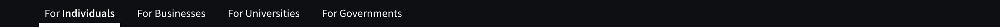 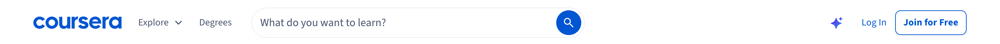 

#### Audience link
Audience tab in the top bar. The current audience is bold with a white underline bar. Measured as `header-audience-link` on the home page.

| State | Values (later rows list only what changes from the first row) |
|---|---|
| default | size 114.63 x 40; padding 0 8px; border B: 6px solid transparent; radius 0px; background transparent; shadow none; font 16/40 400; colour #ffffff `--cds-color-neutral-primary-invert` |
| selected | size 117.34 x 40; border B: 6px solid #ffffff `--cds-color-neutral-stroke-primary-invert`; font 16/40 600 |
| hover | background #ffffff `--cds-color-neutral-background-primary`; colour #0d0f12 `--cds-color-interactive-secondary` |
| focus-visible | radius 4px `--cds-border-radius-50`; background #ffffff `--cds-color-neutral-background-primary`; shadow #804ee4 0px 0px 0px 1px, #f0f6ff 0px 0px 0px 2px, no token; colour #0d0f12 `--cds-color-interactive-secondary` |
| pressed | background #ffffff `--cds-color-neutral-background-primary`; colour #0d0f12 `--cds-color-interactive-secondary` |

 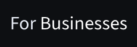 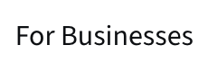 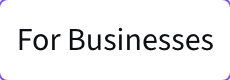 

#### Explore menu button
Explore menu trigger: ghost button with a chevron end icon; turns into a tinted pill when the menu is open. Measured as `button-ghost-nav` on the home page.

| State | Values (later rows list only what changes from the first row) |
|---|---|
| default | size 83.8 x 36; padding 8px; radius 8px `--cds-border-radius-100`; background transparent; font 14/20 400 `--cds-typography-body2`; colour #48546e `--cds-color-neutral-primary-weak`; icon 20 x 20, colour #48546e `--cds-color-neutral-primary-weak` |
| hover, focus-visible, pressed, expanded | background #f0f6ff `--cds-color-interactive-background-primary-hover-weak`; colour #0b408b `--cds-color-interactive-primary-hover` |

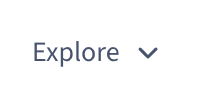  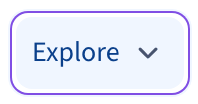  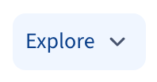

#### Degrees link
Degrees: a ghost button rendered as a link. Measured as `header-degrees-link` on the home page.

| State | Values (later rows list only what changes from the first row) |
|---|---|
| default | size 62.95 x 36; padding 8px; radius 8px `--cds-border-radius-100`; background transparent; font 14/20 400 `--cds-typography-body2`; colour #48546e `--cds-color-neutral-primary-weak` |
| hover, focus-visible | background #f0f6ff `--cds-color-interactive-background-primary-hover-weak`; colour #0b408b `--cds-color-interactive-primary-hover` |

 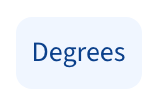 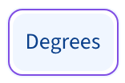

#### Global search field
Global search: rounded field (cds-Search-base) with a round primary icon button inside the right end. Measured as `search-input` on the home page.

| State | Values (later rows list only what changes from the first row) |
|---|---|
| default (same: hover, focus-visible, filled) | size 480 x 44; padding 0; radius 0px; background transparent; font 16/24 400 `--cds-typography-body1`; colour #0d0f12 `--cds-color-interactive-secondary`; icon 0 x 0, colour #0d0f12 `--cds-color-interactive-secondary` |

Child layers that carry the look: div, 480x44, background #ffffff `--cds-color-neutral-background-primary`, border 1px solid #e9eef7 `--cds-color-interactive-background-secondary-pressed-weak`, radius 24px; button, 36x36, background #0056d2 `--cds-color-interactive-primary`, shadow #0056d2 0px 0px 0px 1px inset, no token, radius 24px.

| Part | Values (default) |
|---|---|
| `search-input-outline` | size 478 x 47; padding 0 8px; radius 8px `--cds-border-radius-100`; font 16/19.0016 400; colour #0d0f12 `--cds-color-interactive-secondary`; states measured: default, hover, focus-visible |
| `search-input-field` | size 394 x 48; padding 12px 0 12px 12px; font 16/24 400 `--cds-typography-body1`; colour #0d0f12 `--cds-color-interactive-secondary`; placeholder #48546e `--cds-color-neutral-primary-weak`, opacity 1; states measured: default, focus-visible |

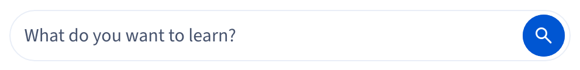 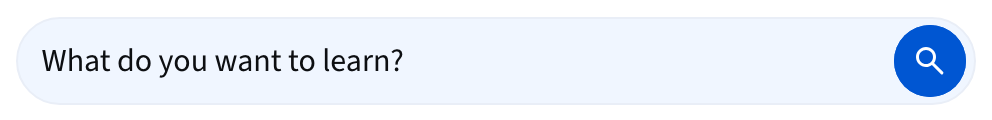 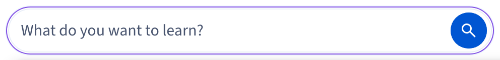 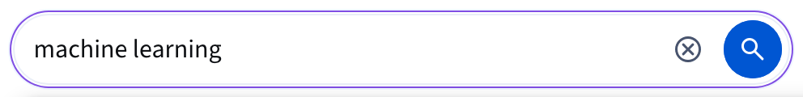

#### Search submit button
Round search submit inside the field: cds-iconButton-small primary, 36x36, 20px icon. Measured as `icon-button-search` on the home page.

| State | Values (later rows list only what changes from the first row) |
|---|---|
| default | size 36 x 36; padding 0; radius 24px `--cds-border-radius-300`; background #0056d2 `--cds-color-interactive-primary`; shadow #0056d2 0px 0px 0px 1px inset, no token; font 14/20 400 `--cds-typography-body2`; colour #ffffff `--cds-color-neutral-primary-invert`; icon 20 x 20, colour #ffffff `--cds-color-neutral-primary-invert` |
| hover, focus-visible | background #0b408b `--cds-color-emphasis-primary-background-xstrong`; shadow #0b408b 0px 0px 0px 1px inset, no token |
| pressed | background #3c0f8a `--cds-color-interactive-primary-selected`; shadow #3c0f8a 0px 0px 0px 1px inset, no token |

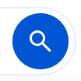 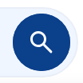 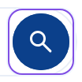 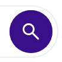

#### Search clear button
Clear (x) button inside a filled search field. Measured as `search-clear-button` on the search page.

| State | Values (later rows list only what changes from the first row) |
|---|---|
| default (same: hover, focus-visible, pressed) | size 36 x 36; padding 0; radius 8px `--cds-border-radius-100`; background transparent; font 14/20 400 `--cds-typography-body2`; colour #0d0f12 `--cds-color-interactive-secondary`; icon 20 x 20, colour #0d0f12 `--cds-color-interactive-secondary` |

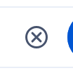 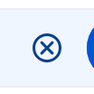 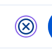 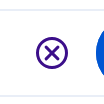

#### Search autocomplete
Autocomplete suggestions under the search field. Measured as `search-autocomplete` on the home page.

**Values.** size 770 x 524; padding 8px; gap 4px; radius 0px; background transparent; font 16/24 400 `--cds-typography-body1`; colour #0d0f12 `--cds-color-interactive-secondary`; icon 20 x 20, colour #0d0f12 `--cds-color-interactive-secondary`.

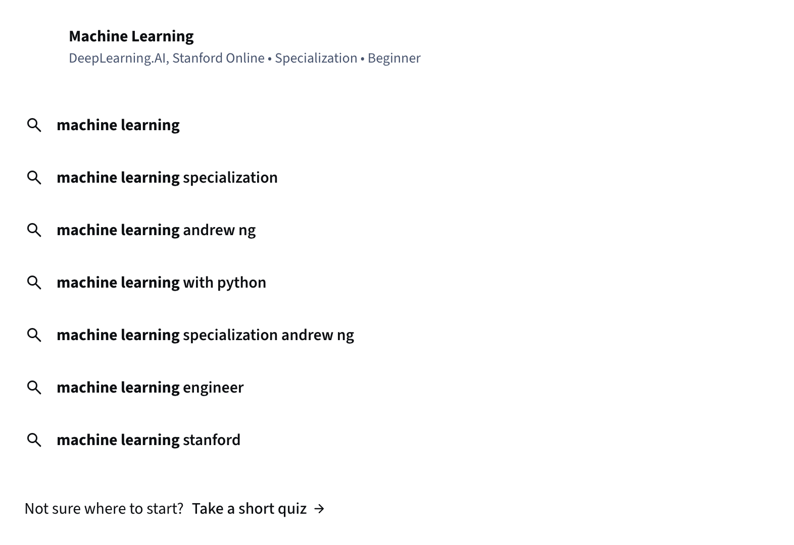

#### Autocomplete option
One autocomplete suggestion row. Measured as `search-autocomplete-option` on the home page.

| State | Values (later rows list only what changes from the first row) |
|---|---|
| default | size 754 x 60; padding 8px; gap 12px; radius 8px `--cds-border-radius-100`; background transparent; font 16/24 400 `--cds-typography-body1`; colour #0d0f12 `--cds-color-interactive-secondary` |
| hover | background #f0f6ff `--cds-color-interactive-background-primary-hover-weak` |

 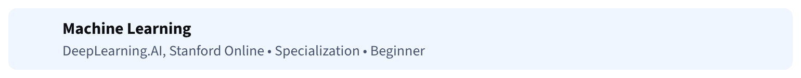

#### AI coach button
Ghost icon button, medium (AI coach trigger in the header): 48x48, 24px icon. Measured as `icon-button-ghost` on the course page.

| State | Values (later rows list only what changes from the first row) |
|---|---|
| default | size 48 x 48; padding 0; radius 8px `--cds-border-radius-100`; background transparent; shadow transparent 0px 0px 0px 1px inset, no token; font 16/24 400 `--cds-typography-body1`; colour #0056d2 `--cds-color-interactive-primary`; icon 24 x 24, colour #0056d2 `--cds-color-interactive-primary` |
| hover, focus-visible | background #f0f6ff `--cds-color-interactive-background-primary-hover-weak`; colour #0b408b `--cds-color-interactive-primary-hover`; icon 24 x 24, colour #0b408b `--cds-color-interactive-primary-hover` |
| pressed | background #f9f5ff `--cds-color-interactive-background-primary-selected-weak`; colour #3c0f8a `--cds-color-interactive-primary-selected`; icon 24 x 24, colour #3c0f8a `--cds-color-interactive-primary-selected` |

 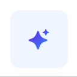 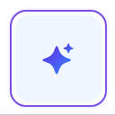 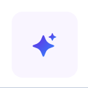

#### Explore mega menu
Explore mega menu: full-width white sheet under the header, four link columns, a divider and a footer line. Page behind is dimmed. Measured as `mega-menu` on the home page.

**Values.** size 1440 x 835; padding 0; radius 0px; background #000000 @ 0.2, no token; font 16/24 400 `--cds-typography-body1`; colour #0d0f12 `--cds-color-interactive-secondary`.

| Part | Values (default) |
|---|---|
| `mega-menu-heading` | size 168.73 x 20; font 16/20 600 `--cds-typography-subtitle-medium`, ls -0.048px; colour #0d0f12 `--cds-color-interactive-secondary` |
| `mega-menu-divider` | size 1168 x 1; background #c1cbdb `--cds-color-neutral-stroke-primary-weak`; font 16/24 400 `--cds-typography-body1`; colour #808080, no token |

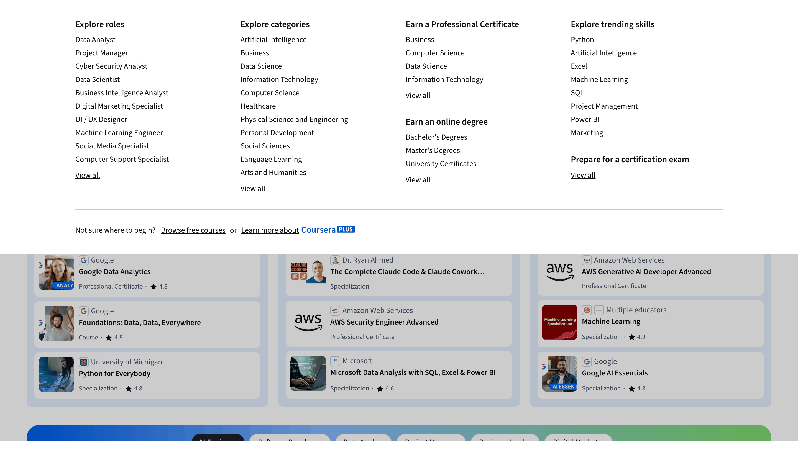 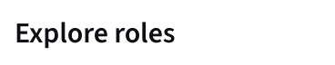 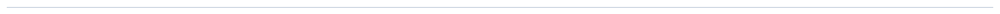

#### Mega menu link
Link in a mega menu column. Measured as `mega-menu-link` on the home page.

| State | Values (later rows list only what changes from the first row) |
|---|---|
| default | size 72.55 x 36; padding 8px 0; radius 0px; background transparent; outline none; font 14/20 400 `--cds-typography-body2`; colour #0d0f12 `--cds-color-interactive-secondary`; decoration none |
| hover | decoration underline |
| focus-visible | outline 1px auto #005fcc, no token offset 1px; decoration underline |

Child layers that carry the look: a, 72.5x36, outline 1px auto #005fcc offset 1px.

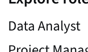 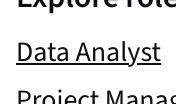 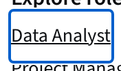

#### Mega menu view all link
"View all" link under a column: underlined. Measured as `mega-menu-view-all` on the home page.

| State | Values (later rows list only what changes from the first row) |
|---|---|
| default | size 44.75 x 20; padding 0; radius 0px; background transparent; outline none; font 14/20 400 `--cds-typography-body2`; colour #0d0f12 `--cds-color-interactive-secondary`; decoration underline |
| hover | decoration none |
| focus-visible | outline 1px auto #005fcc, no token offset 1px; decoration none |

Child layers that carry the look: a, 44.8x20, outline 1px auto #005fcc offset 1px.

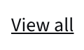 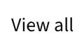 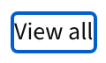

#### Page shell: course home
Three white cards on a grey ground under a 64px header: course sidebar, main module column, right rail of two stacked cards. The body is a fixed 100vh layout; the sidebar, main column and rail scroll inside it. Measured as `shell-course-home` on course home, module 1 (in progress).

**Values.** size 1440 x 836; padding 0 0 0 16px `--cds-spacing-200`; gap 16px `--cds-spacing-200`; background #f2f5fa `--cds-color-neutral-background-primary-weak`; font 16/24 400 `--cds-typography-body1`; colour #0d0f12 `--cds-color-neutral-primary`.

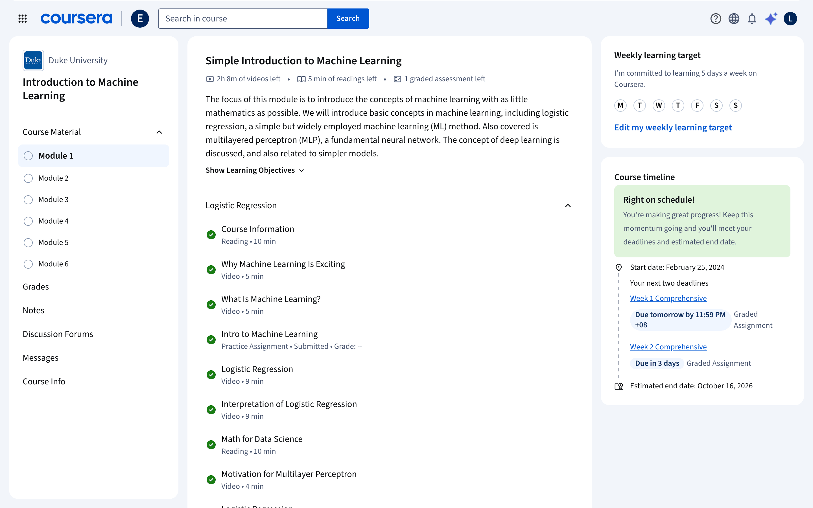

#### Page shell: grades
Two cards: sidebar and a wide main card; no right rail. Measured as `shell-course-grades` on grades.

**Values.** size 1440 x 836; padding 0 0 0 16px `--cds-spacing-200`; gap 16px `--cds-spacing-200`; background #f2f5fa `--cds-color-neutral-background-primary-weak`; font 16/24 400 `--cds-typography-body1`; colour #0d0f12 `--cds-color-neutral-primary`.

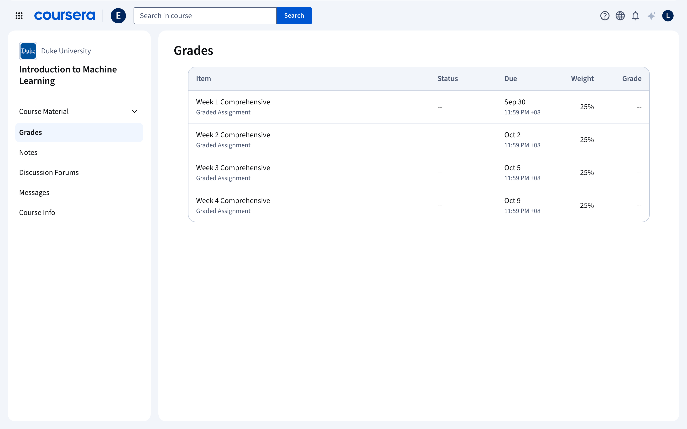

#### Page shell: course info
Same two-card layout as grades. Measured as `shell-course-info` on course info.

**Values.** size 1440 x 836; padding 0 0 0 16px `--cds-spacing-200`; gap 16px `--cds-spacing-200`; background #f2f5fa `--cds-color-neutral-background-primary-weak`; font 16/24 400 `--cds-typography-body1`; colour #0d0f12 `--cds-color-neutral-primary`.

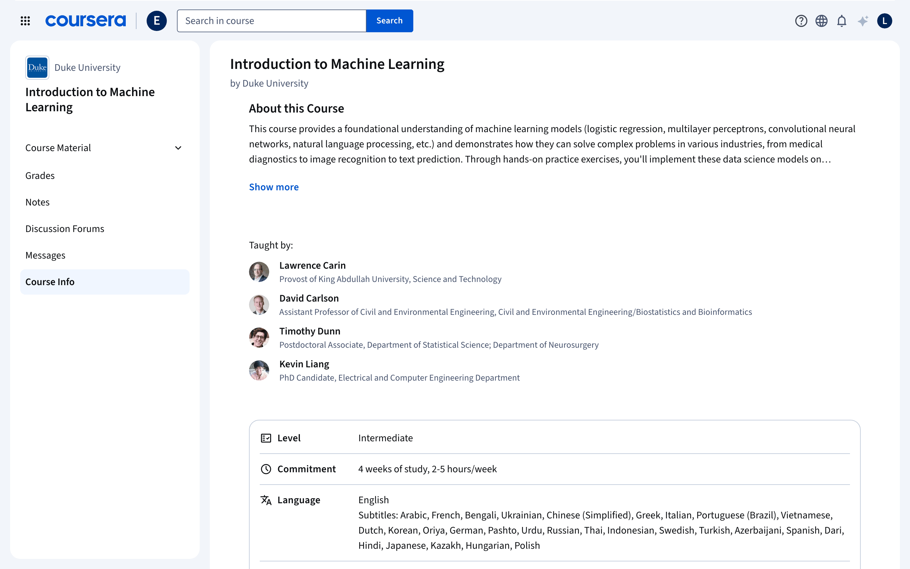

#### Page shell: video item
Item view: collapsible outline card on the left, the item card, then a tool strip (Transcript, Notes, Files) at the right edge. The header drops the search and shows the partner logo instead. Measured as `shell-item-video` on video item.

**Values.** size 1440 x 900; background #f2f5fa `--cds-color-neutral-background-primary-weak`; font 16/24 400 `--cds-typography-body1`; colour #0d0f12 `--cds-color-neutral-primary`.

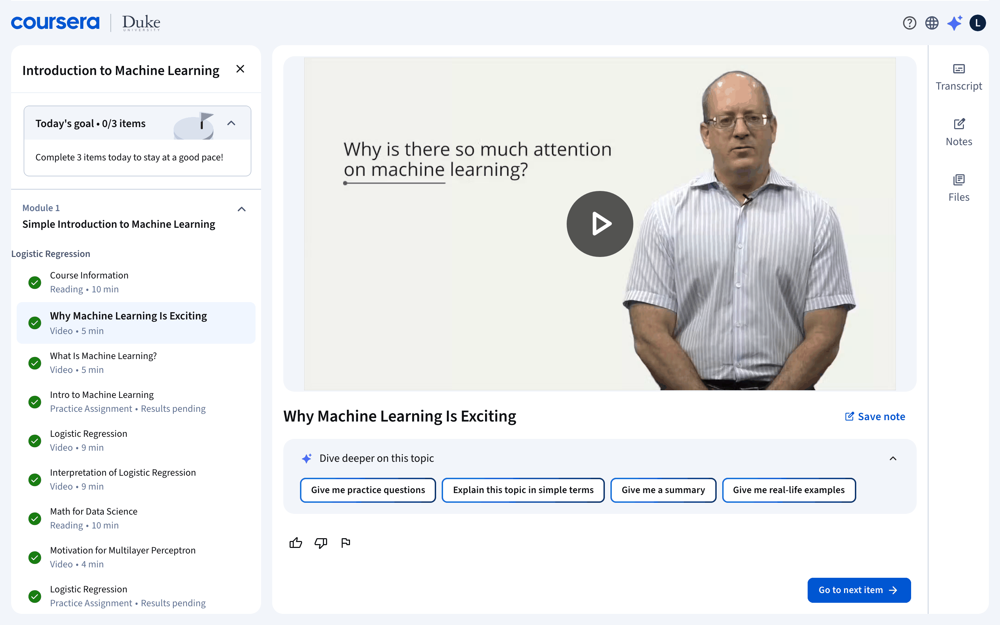

#### Page shell: video item with transcript
The tool pane opens between the item and the tool strip, behind a 10px drag separator. Measured as `shell-item-video-transcript` on video item, transcript open.

**Values.** size 1440 x 900; background #f2f5fa `--cds-color-neutral-background-primary-weak`; font 16/24 400 `--cds-typography-body1`; colour #0d0f12 `--cds-color-neutral-primary`.

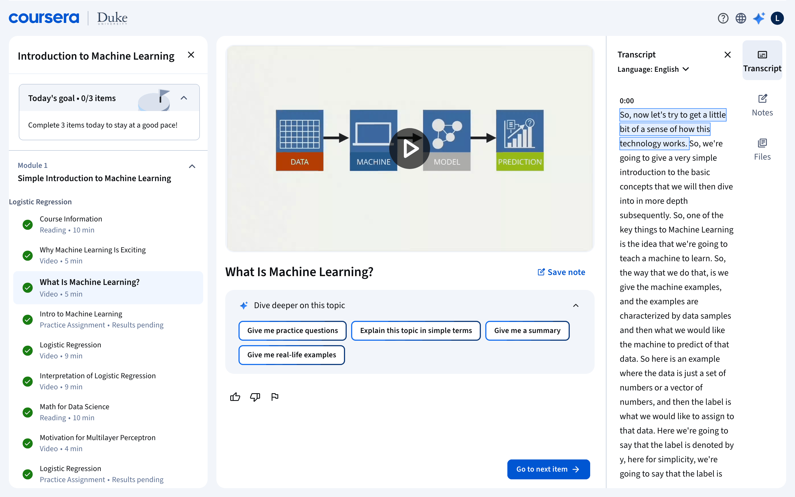

#### Page shell: reading item
Outline card plus one wide item card; the reading column is centred inside it. Measured as `shell-item-reading` on reading item.

**Values.** size 1440 x 900; background #f2f5fa `--cds-color-neutral-background-primary-weak`; font 16/24 400 `--cds-typography-body1`; colour #0d0f12 `--cds-color-neutral-primary`.

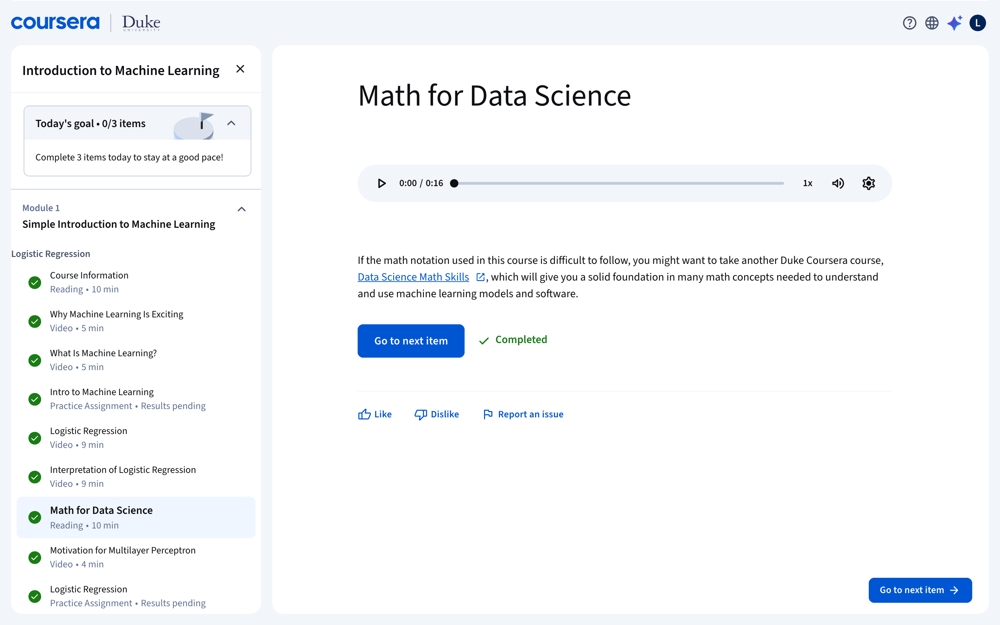

#### Page shell: assignment item
Outline card plus the item card holding the assignment cover. Measured as `shell-item-assignment` on assignment item (submitted).

**Values.** size 1440 x 900; background #f2f5fa `--cds-color-neutral-background-primary-weak`; font 16/24 400 `--cds-typography-body1`; colour #0d0f12 `--cds-color-neutral-primary`.

#### Page shell: My Learning
White page, full-width sticky header with a bottom rule, a greeting band, tabs, then a two-column grid: course cards on the left, calendar/stats and certificates cards on the right. Measured as `shell-my-learning` on My Learning, In Progress.

**Values.** size 1440 x 2224.98; background #ffffff `--cds-color-neutral-background-primary`; font 16/24 400 `--cds-typography-body1`; colour #0d0f12 `--cds-color-neutral-primary`.

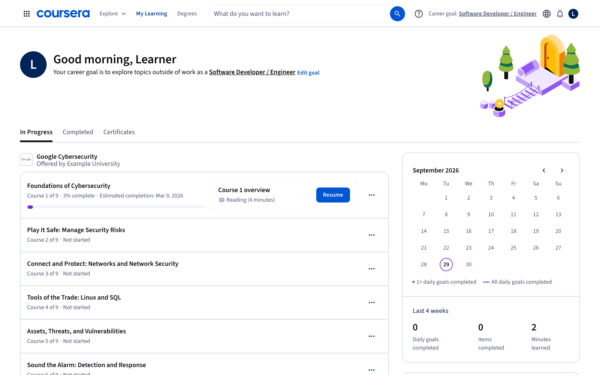

#### Course top bar
The in-course header: app switcher, Coursera wordmark, a 1px divider, the programme badge, the "Search in course" input with an attached Search button, and help, language, bell, AI and avatar icon buttons on the right. It sits on the grey ground with no bottom rule. Measured as `topbar-course` on course home, module 1 (in progress).

**Values.** size 1440 x 64; background transparent; font 16/24 400 `--cds-typography-body1`; colour #0d0f12 `--cds-color-neutral-primary`.

Child layers that carry the look: div 1392x64 border T:1px solid #ffffff `--cds-color-neutral-stroke-primary-invert`; button 32x32 radius 8px shadow rgba(0, 0, 0, 0) 0px 0px 0px 1px inset; div 1x26 border L:1px solid #a7b4c9 `--cds-color-neutral-disabled-strong`.

| Part | Values (default) |
|---|---|
| `topbar-program-badge` | size 32 x 32; radius 50% `--cds-border-radius-max`; background #00255d, no token; font 16/24 400 `--cds-typography-body1`; colour #0056d2 `--cds-color-interactive-primary` |
| `topbar-item` | size 1440 x 64; font 16/24 400 `--cds-typography-body1`; colour #0d0f12 `--cds-color-neutral-primary` |

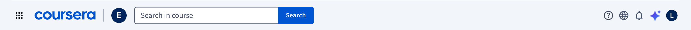  

#### App switcher button
Ghost small icon button, 32x32 with a 24px icon. Measured as `topbar-switcher` on course home, module 1 (in progress).

| State | Values (later rows list only what changes from the first row) |
|---|---|
| default (same: focus-visible) | size 32 x 32; radius 8px `--cds-border-radius-100`; background transparent; shadow transparent 0px 0px 0px 1px inset; outline none; font 16/24 400 `--cds-typography-body1`; colour #0d0f12 `--cds-color-neutral-primary`; icon 24 x 24, fill none, no token, color #0d0f12 `--cds-color-neutral-primary` |
| hover | background #f0f6ff `--cds-color-interactive-background-primary-hover-weak` |
| focus-visible-cds | background #f0f6ff `--cds-color-interactive-background-primary-hover-weak`; outline 1px solid transparent, no token offset 2px |
| pressed | background #f9f5ff `--cds-color-callouts-background-secondary-weak` |

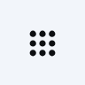 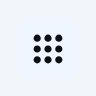  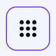 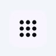

#### Top bar logo link
Coursera wordmark (127x32 svg), a 1x26 divider, then the programme badge. One link. Measured as `topbar-logo` on course home, module 1 (in progress).

| State | Values (later rows list only what changes from the first row) |
|---|---|
| default | size 192 x 32; background transparent; outline none; font 16/24 400 `--cds-typography-body1`; colour #0056d2 `--cds-color-interactive-primary`; decoration none; icon 127 x 32, fill #0056d2, color #0056d2 (`--cds-color-interactive-primary`) |
| hover | decoration underline auto offset auto |
| focus-visible, focus-visible-cds | outline 1px auto #005fcc, no token offset 1px; decoration underline auto offset auto |

Child layers that carry the look: div 1x26 border L:1px solid #a7b4c9 `--cds-color-neutral-disabled-strong`; div 32x32 background #00255d, no token radius 50%.

   

#### Course search input
Square-cornered 300x36 input; its right edge meets the Search button. Measured as `topbar-course-search-input` on course home, module 1 (in progress).

| State | Values (later rows list only what changes from the first row) |
|---|---|
| default (same: hover) | size 299.59 x 36; padding 12px `--cds-spacing-150`; border 1px solid #53617e `--cds-color-grey-700`; radius 4px 0px 0px 4px (`--cds-border-radius-50`); background #ffffff `--cds-color-neutral-background-primary`; font 16/24 400 `--cds-typography-body1`; colour #0d0f12 `--cds-color-neutral-primary` |
| focus-visible | border 1px solid #227af9 `--cds-color-blue-600` |

  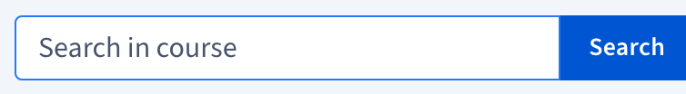

#### Course search button
Primary button, 36px tall, joined to the input. Measured as `topbar-course-search-button` on course home, module 1 (in progress).

| State | Values (later rows list only what changes from the first row) |
|---|---|
| default (same: focus-visible) | size 73.98 x 36; padding 8px / 16px (`--cds-spacing-100`, `--cds-spacing-200`); radius 0px 4px 4px 0px (`--cds-border-radius-50`); background #0056d2 `--cds-color-interactive-primary`; shadow #0056d2 0px 0px 0px 1px inset; outline none; font 14/20 600, 0.14px `--cds-typography-action-secondary`; colour #ffffff `--cds-color-neutral-primary-invert` |
| hover | background #0b408b `--cds-color-interactive-primary-hover` |
| focus-visible-cds | outline 1px solid transparent, no token offset 2px |
| pressed | background #3c0f8a `--cds-color-interactive-primary-pressed` |

 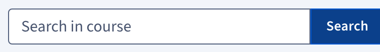   

#### Top bar icon button
Ghost small icon button (help, language, bell and avatar share it): 32x32, 24px icon. Measured as `topbar-icon-button` on course home, module 1 (in progress).

| State | Values (later rows list only what changes from the first row) |
|---|---|
| default (same: focus-visible) | size 32 x 32; radius 8px `--cds-border-radius-100`; background transparent; shadow transparent 0px 0px 0px 1px inset; outline none; font 16/24 400 `--cds-typography-body1`; colour #0056d2 `--cds-color-interactive-primary`; icon 24 x 24, fill none, no token, color #404b5e `--cds-color-interactive-secondary-inactive` |
| hover | background #f0f6ff `--cds-color-interactive-background-primary-hover-weak`; colour #0b408b `--cds-color-interactive-primary-hover` |
| focus-visible-cds | background #f0f6ff `--cds-color-interactive-background-primary-hover-weak`; outline 1px solid transparent, no token offset 2px; colour #0b408b `--cds-color-interactive-primary-hover` |
| pressed | background #f9f5ff `--cds-color-callouts-background-secondary-weak`; colour #3c0f8a `--cds-color-interactive-primary-pressed` |

| Part | Values (default) |
|---|---|
| `topbar-ai-button` | size 36 x 36; radius 4px `--cds-border-radius-50`; box shadow transparent 0px 0px 0px 1px inset; font 16/24 400 `--cds-typography-body1`; colour #0056d2 `--cds-color-interactive-primary`; states measured: default, hover |

     

#### Avatar menu button
User avatar, 24px navy disc with the initial, inside a 32px ghost icon button. Measured as `topbar-avatar` on course home, module 1 (in progress).

| State | Values (later rows list only what changes from the first row) |
|---|---|
| default (same: focus-visible) | size 32 x 32; radius 8px `--cds-border-radius-100`; background transparent; shadow transparent 0px 0px 0px 1px inset; outline none; font 16/24 400 `--cds-typography-body1`; colour #0056d2 `--cds-color-interactive-primary` |
| hover | background #f0f6ff `--cds-color-interactive-background-primary-hover-weak`; colour #0b408b `--cds-color-interactive-primary-hover` |
| focus-visible-cds | background #f0f6ff `--cds-color-interactive-background-primary-hover-weak`; outline 1px solid transparent, no token offset 2px; colour #0b408b `--cds-color-interactive-primary-hover` |

   

#### My Learning top bar
White sticky header with a 1px bottom rule: switcher, wordmark, Explore menu button, My Learning (current), Degrees, a pill search field with a round search button, then help, career goal link, language, bell and avatar. Measured as `topbar-ml` on My Learning, In Progress.

**Values.** size 1440 x 65; background #ffffff `--cds-color-neutral-background-primary`; font 16/24 400 `--cds-typography-body1`; colour #0d0f12 `--cds-color-neutral-primary`; transition transform 0.2s ease-in-out.

#### Explore button (My Learning)
Ghost button with a 20px chevron end icon. Measured as `topbar-ml-explore` on My Learning, In Progress.

| State | Values (later rows list only what changes from the first row) |
|---|---|
| default | size 83.8 x 36; padding 8px `--cds-spacing-100`; radius 8px `--cds-border-radius-100`; background transparent; outline none; font 14/20 400 `--cds-typography-body2`; colour #48546e `--cds-color-neutral-primary-weak`; icon 20 x 20, fill none, no token, color #48546e `--cds-color-neutral-primary-weak` |
| hover, focus-visible | background #f0f6ff `--cds-color-interactive-background-primary-hover-weak`; colour #0b408b `--cds-color-interactive-primary-hover` |
| focus-visible-cds | background #f0f6ff `--cds-color-interactive-background-primary-hover-weak`; outline 1px solid transparent, no token offset 2px; colour #0b408b `--cds-color-interactive-primary-hover` |
| pressed | background #f0f6ff `--cds-color-interactive-background-primary-hover-weak`; colour #0b408b `--cds-color-interactive-primary-hover` |

    

#### Nav link (My Learning)
Ghost buttons rendered as links. The current page (My Learning) is marked isCurrent and aria-current=page. Measured as `topbar-ml-nav-link` on My Learning, In Progress.

| State | Values (later rows list only what changes from the first row) |
|---|---|
| default | size 62.95 x 36; padding 8px `--cds-spacing-100`; radius 8px `--cds-border-radius-100`; background transparent; outline none; font 14/20 400 `--cds-typography-body2`; colour #48546e `--cds-color-neutral-primary-weak` |
| hover, focus-visible | background #f0f6ff `--cds-color-interactive-background-primary-hover-weak`; colour #0b408b `--cds-color-interactive-primary-hover` |
| focus-visible-cds | background #f0f6ff `--cds-color-interactive-background-primary-hover-weak`; outline 1px solid transparent, no token offset 2px; colour #0b408b `--cds-color-interactive-primary-hover` |
| pressed | background #f0f6ff `--cds-color-interactive-background-primary-hover-weak`; colour #0b408b `--cds-color-interactive-primary-hover` |
| current, current-default | size 90.53 x 36; font 14/20 600, 0.14px `--cds-typography-action-secondary`; colour #0b408b `--cds-color-interactive-primary-hover` |
| current-hover | size 90.53 x 36; background #f0f6ff `--cds-color-interactive-background-primary-hover-weak`; font 14/20 600, 0.14px `--cds-typography-action-secondary`; colour #0b408b `--cds-color-interactive-primary-hover` |

       

#### Catalog search (My Learning)
Pill search field (cds-Search) 476x44, notched outline, with a round primary icon button at the right end. Measured as `topbar-ml-search` on My Learning, In Progress.

| State | Values (later rows list only what changes from the first row) |
|---|---|
| default (same: focus-visible) | size 476.39 x 44; border 1px solid #e9eef7 `--cds-color-interactive-background-secondary-pressed-weak`; radius 24px `--cds-border-radius-300`; background #ffffff `--cds-color-neutral-background-primary`; font 16/19.0016 400; colour #0d0f12 `--cds-color-neutral-primary`; icon 0 x 0, fill none, no token, color #0d0f12 `--cds-color-neutral-primary` |
| hover | background #f0f6ff `--cds-color-interactive-background-primary-hover-weak` |

  

#### Round search button
Primary small icon button, 36x36, 20px magnifier, fully round. Measured as `topbar-ml-search-button` on My Learning, In Progress.

| State | Values (later rows list only what changes from the first row) |
|---|---|
| default (same: focus-visible) | size 36 x 36; radius 24px `--cds-border-radius-300`; background #0056d2 `--cds-color-interactive-primary`; shadow #0056d2 0px 0px 0px 1px inset; outline none; font 14/20 400 `--cds-typography-body2`; colour #ffffff `--cds-color-neutral-primary-invert`; icon 20 x 20, fill none, no token, color #ffffff `--cds-color-neutral-primary-invert` |
| hover | background #0b408b `--cds-color-interactive-primary-hover`; shadow #0b408b 0px 0px 0px 1px inset |
| focus-visible-cds | background #0b408b `--cds-color-interactive-primary-hover`; shadow #0b408b 0px 0px 0px 1px inset; outline 1px solid transparent, no token offset 2px |
| pressed | background #3c0f8a `--cds-color-interactive-primary-pressed`; shadow #3c0f8a 0px 0px 0px 1px inset |

    

#### Career goal link (top bar)
"Career goal:" label followed by an underlined link. Measured as `topbar-ml-career-goal` on My Learning, In Progress.

| State | Values (later rows list only what changes from the first row) |
|---|---|
| default (same: focus-visible) | size 186.81 x 20; radius 0; background transparent; shadow none; outline none; font 14/20 400 `--cds-typography-body2`; colour #0056d2 `--cds-color-interactive-primary`; decoration underline auto offset auto |
| hover | colour #0b408b `--cds-color-interactive-primary-hover`; decoration none |
| focus-visible-cds | radius 4px `--cds-border-radius-50`; shadow #804ee4 0px 0px 0px 1px, #f0f6ff 0px 0px 0px 2px; outline 1px solid transparent, no token offset 2px; colour #0b408b `--cds-color-interactive-primary-hover` |
| pressed | colour #0b408b `--cds-color-interactive-primary-hover`; decoration none |

    

### Buttons and links

Buttons are 8px radius (`--cds-border-radius-100`), medium 36px and large 48px, with no transition on any public-page state. The signed-in variants (Resume, Go to next item, Get started, Add to LinkedIn) are the same primary button and are listed with the page that uses them: [Resume button (course home)](#resume-button-course-home), [Next item button](#next-item-button), [Reading next button (large)](#reading-next-button-large), [Resume button (My Learning)](#resume-button-my-learning), [Add to LinkedIn (primary)](#add-to-linkedin-primary).

#### Primary button
Primary filled button, medium (View in the filter popover): solid blue, white label, 8px radius. Measured as `button-primary` on the search page.

| State | Values (later rows list only what changes from the first row) |
|---|---|
| default (same: focus-visible) | size 61.3 x 36; padding 8px 16px; radius 8px `--cds-border-radius-100`; background #0056d2 `--cds-color-interactive-primary`; shadow #0056d2 0px 0px 0px 1px inset, no token; font 14/20 600 `--cds-typography-action-secondary`, ls 0.14px; colour #ffffff `--cds-color-neutral-primary-invert` |
| hover | background #0b408b `--cds-color-emphasis-primary-background-xstrong` |
| pressed | background #3c0f8a `--cds-color-interactive-primary-selected` |

| Part | Values (default) |
|---|---|
| `button-primary-dialog` | size 68.66 x 48; padding 12px 24px; radius 8px `--cds-border-radius-100`; background #0056d2 `--cds-color-interactive-primary`; box shadow #0056d2 0px 0px 0px 1px inset, no token; text span 16/24 600 `--cds-typography-title3`, ls 0.16px, #ffffff `--cds-color-neutral-primary-invert` |

    

#### Block primary button
Full-width primary button at the foot of the sheet (View). Measured as `button-primary-block` on the search page.

| State | Values (later rows list only what changes from the first row) |
|---|---|
| default (same: focus-visible) | size 328 x 36; padding 8px 16px; radius 8px `--cds-border-radius-100`; background #0056d2 `--cds-color-interactive-primary`; shadow #0056d2 0px 0px 0px 1px inset, no token; font 14/20 600 `--cds-typography-action-secondary`, ls 0.14px; colour #ffffff `--cds-color-neutral-primary-invert` |
| hover | background #0b408b `--cds-color-emphasis-primary-background-xstrong` |

  

#### Enroll button
"Enroll for free" large two-line CTA: primary filled, 64px tall, label plus a small "Starts <date>" line. It is a submit button; pressed is forced with CDP, it is never clicked. Measured as `button-enroll` on the course page. The label is 16/24 600 over a 12.8/16 600 "Starts <date>" line, both white, with padding 11px 80px 13px. The compact sticky-nav copy is 180x60 with 32px side padding.

| State | Values (later rows list only what changes from the first row) |
|---|---|
| default (same: focus-visible) | size 256.39 x 64; padding 11px 80px 13px 80px; radius 8px `--cds-border-radius-100`; background #0056d2 `--cds-color-interactive-primary`; shadow #0056d2 0px 0px 0px 1px inset, no token; font 16/24 600 `--cds-typography-title3`, ls 0.16px; colour #ffffff `--cds-color-neutral-primary-invert` |
| hover | background #0b408b `--cds-color-emphasis-primary-background-xstrong` |
| pressed | background #3c0f8a `--cds-color-interactive-primary-selected` |

| Part | Values (default) |
|---|---|
| `button-enroll-compact` | size 180 x 60; padding 11px 32px 13px 32px; radius 8px `--cds-border-radius-100`; background #0056d2 `--cds-color-interactive-primary`; box shadow #0056d2 0px 0px 0px 1px inset, no token; text span 14/20 600 `--cds-typography-action-secondary`, ls 0.14px, #ffffff `--cds-color-neutral-primary-invert` |

    

#### Secondary button
Secondary outlined button (Join for Free): white fill, 1px blue border, blue label. Measured as `button-secondary` on the home page. The 1px edge is an inset box shadow in the label colour; the CSS border is 0.

| State | Values (later rows list only what changes from the first row) |
|---|---|
| default | size 103.17 x 36; padding 8px 12px; radius 8px `--cds-border-radius-100`; background #ffffff `--cds-color-neutral-background-primary`; shadow #0056d2 0px 0px 0px 1px inset, no token; font 14/20 700 `--cds-typography-title4`, ls 0.14px; colour #0056d2 `--cds-color-interactive-primary` |
| hover, focus-visible | background #f0f6ff `--cds-color-interactive-background-primary-hover-weak`; shadow #0b408b 0px 0px 0px 1px inset, no token; colour #0b408b `--cds-color-interactive-primary-hover` |
| pressed | background #f9f5ff `--cds-color-interactive-background-primary-selected-weak`; shadow #3c0f8a 0px 0px 0px 1px inset, no token; colour #3c0f8a `--cds-color-interactive-primary-selected` |

| Part | Values (default) |
|---|---|
| `button-disabled-secondary` | size 328 x 36; padding 8px 16px; radius 8px `--cds-border-radius-100`; background #f2f5fa `--cds-color-interactive-background-secondary-hover-weak`; box shadow #a7b4c9 0px 0px 0px 1px inset, no token; text span 14/20 600 `--cds-typography-action-secondary`, ls 0.14px, #a7b4c9 `--cds-color-neutral-disabled-strong` |

    

#### Ghost button
Ghost button (Log In in the header): no fill, blue label. Measured as `button-ghost` on the home page.

| State | Values (later rows list only what changes from the first row) |
|---|---|
| default | size 60.27 x 44; padding 12px; radius 8px `--cds-border-radius-100`; background transparent; outline none; font 14/20 400 `--cds-typography-body2`, ls 0.14px; colour #0056d2 `--cds-color-interactive-primary`; decoration none |
| hover | decoration underline |
| focus-visible | outline 5px auto #005fcc, no token offset -2px; colour #0b408b `--cds-color-interactive-primary-hover`; decoration underline |
| pressed | decoration underline |

| Part | Values (default) |
|---|---|
| `button-ghost-enabled` | size 82.7 x 36; padding 8px 16px; radius 8px `--cds-border-radius-100`; text span 14/20 600 `--cds-typography-action-secondary`, ls 0.14px, #0056d2 `--cds-color-interactive-primary` |
| `button-disabled-ghost` | size 82.7 x 36; padding 8px 16px; radius 8px `--cds-border-radius-100`; text span 14/20 600 `--cds-typography-action-secondary`, ls 0.14px, #a7b4c9 `--cds-color-neutral-disabled-strong` |

     

#### Ghost inline button
"+3 more" inline ghost button in the instructor row. Measured as `button-ghost-inline` on the course page.

| State | Values (later rows list only what changes from the first row) |
|---|---|
| default | size 55.47 x 20; padding 0; radius 8px `--cds-border-radius-100`; background transparent; font 14/20 600 `--cds-typography-action-secondary`, ls 0.14px; colour #0056d2 `--cds-color-interactive-primary`; decoration none |
| hover | colour #0b408b `--cds-color-interactive-primary-hover`; decoration underline |
| focus-visible | background #f0f6ff `--cds-color-interactive-background-primary-hover-weak`; colour #0b408b `--cds-color-interactive-primary-hover`; decoration underline |
| pressed | colour #3c0f8a `--cds-color-interactive-primary-selected`; decoration underline |

   

#### Ghost bold button
"View all 4 instructors": ghost button, bold, blue. Measured as `button-ghost-bold` on the course page.

| State | Values (later rows list only what changes from the first row) |
|---|---|
| default | size 127.55 x 20; padding 0; radius 8px `--cds-border-radius-100`; background transparent; font 14/20 600 `--cds-typography-action-secondary`, ls 0.14px; colour #0056d2 `--cds-color-interactive-primary`; decoration none |
| hover | colour #0b408b `--cds-color-interactive-primary-hover`; decoration underline |
| focus-visible | background #f0f6ff `--cds-color-interactive-background-primary-hover-weak`; colour #0b408b `--cds-color-interactive-primary-hover`; decoration underline |
| pressed | colour #3c0f8a `--cds-color-interactive-primary-selected`; decoration underline |

   

#### Ghost secondary button
Ghost secondary button (Show all after the skills): dark text, underlined. Measured as `button-ghost-secondary` on the course page.

| State | Values (later rows list only what changes from the first row) |
|---|---|
| default | size 52.25 x 20; padding 0; radius 8px `--cds-border-radius-100`; background transparent; font 14/20 600 `--cds-typography-action-secondary`, ls 0.14px; colour #0d0f12 `--cds-color-interactive-secondary`; decoration underline |
| hover | colour #232b3a `--cds-color-interactive-secondary-hover`; decoration none |
| focus-visible | background #f2f5fa `--cds-color-interactive-background-secondary-hover-weak`; colour #232b3a `--cds-color-interactive-secondary-hover` |
| pressed | colour #1c2026 `--cds-color-interactive-secondary-selected`; decoration none |

   

#### Ghost text button
Text-sized ghost button ("30 languages available"). Measured as `button-ghost-text` on the course page.

| State | Values (later rows list only what changes from the first row) |
|---|---|
| default | size 138.92 x 20; padding 0; radius 8px `--cds-border-radius-100`; background transparent; font 14/20 600 `--cds-typography-action-secondary`, ls 0.14px; colour #0056d2 `--cds-color-interactive-primary`; decoration none |
| hover | colour #0b408b `--cds-color-interactive-primary-hover`; decoration underline |
| focus-visible | background #f0f6ff `--cds-color-interactive-background-primary-hover-weak`; colour #0b408b `--cds-color-interactive-primary-hover`; decoration underline |
| pressed | colour #3c0f8a `--cds-color-interactive-primary-selected`; decoration underline |

   

#### Text toggle
Legacy "Show more" text toggle (button.bold.body-2-text) under long descriptions and reviews. Measured as `button-text-toggle` on the course page.

| State | Values (later rows list only what changes from the first row) |
|---|---|
| default (same: hover, pressed) | size 77.27 x 21; padding 0; radius 0px; background transparent; outline none; font OpenSans 14/21 700; colour #136ef0 `--cds-color-callouts-background-primary` |
| focus-visible | outline 1px auto #005fcc, no token offset 0px |

Child layers that carry the look: button, 77.3x21, outline 1px auto #005fcc offset 0px.

   

#### Show more button
"Show more" under a facet list: ghost button, 24px tall. Measured as `button-show-more` on the search page.

| State | Values (later rows list only what changes from the first row) |
|---|---|
| default | size 67.61 x 24; padding 0; radius 8px `--cds-border-radius-100`; background transparent; font 14/24 400, ls 0.14px; colour #0d0f12 `--cds-color-interactive-secondary`; decoration underline |
| hover, focus-visible | background #f0f6ff `--cds-color-interactive-background-primary-hover-weak`; colour #0b408b `--cds-color-interactive-primary-hover` |
| pressed | background #f9f5ff `--cds-color-interactive-background-primary-selected-weak`; colour #3c0f8a `--cds-color-interactive-primary-selected` |

   

#### Show more container button
"Show info about module content": ghostSecondary with a 16px chevron (cds-ShowMoreContainer-ctaButton). Measured as `show-more-container-button` on the course page.

| State | Values (later rows list only what changes from the first row) |
|---|---|
| default | size 220.55 x 20; padding 0; radius 4px `--cds-border-radius-50`; background transparent; font 14/20 600 `--cds-typography-action-secondary`, ls 0.14px; colour #0d0f12 `--cds-color-interactive-secondary`; decoration none; icon 16 x 16, colour #0d0f12 `--cds-color-interactive-secondary` |
| hover, focus-visible | background #f2f5fa `--cds-color-interactive-background-secondary-hover-weak`; colour #232b3a `--cds-color-interactive-secondary-hover`; decoration underline; icon 16 x 16, colour #232b3a `--cds-color-interactive-secondary-hover` |
| pressed | background #e9eef7 `--cds-color-interactive-background-secondary-pressed-weak`; colour #1c2026 `--cds-color-interactive-secondary-selected`; decoration underline; icon 16 x 16, colour #1c2026 `--cds-color-interactive-secondary-selected` |
| expanded | size 214.97 x 20; background #f2f5fa `--cds-color-interactive-background-secondary-hover-weak`; colour #232b3a `--cds-color-interactive-secondary-hover`; decoration underline; icon 16 x 16, colour #232b3a `--cds-color-interactive-secondary-hover` |

    

#### Show more list button
"Show all 25 frequently asked questions": cds-ShowMoreList-ctaButton, ghost with chevron. Measured as `show-more-list-button` on the specialization page.

| State | Values (later rows list only what changes from the first row) |
|---|---|
| default | size 259.05 x 20; padding 0; radius 8px `--cds-border-radius-100`; background transparent; font 14/20 600 `--cds-typography-action-secondary`, ls 0.14px; colour #0d0f12 `--cds-color-interactive-secondary`; decoration none; icon 16 x 16, colour #0d0f12 `--cds-color-interactive-secondary` |
| hover, focus-visible | background #f2f5fa `--cds-color-interactive-background-secondary-hover-weak`; colour #232b3a `--cds-color-interactive-secondary-hover`; decoration underline; icon 16 x 16, colour #232b3a `--cds-color-interactive-secondary-hover` |
| pressed | background #e9eef7 `--cds-color-interactive-background-secondary-pressed-weak`; colour #1c2026 `--cds-color-interactive-secondary-selected`; decoration underline; icon 16 x 16, colour #1c2026 `--cds-color-interactive-secondary-selected` |

   

#### Course row toggle
Chevron toggle button at the right of a course row. Measured as `spec-course-toggle` on the specialization page.

| State | Values (later rows list only what changes from the first row) |
|---|---|
| default | size 56 x 77; padding 12px 16px; radius 8px `--cds-border-radius-100`; background transparent; font 16/24 600 `--cds-typography-title3`, ls 0.16px; colour #0056d2 `--cds-color-interactive-primary`; decoration none; icon 20 x 20, colour #0056d2 `--cds-color-interactive-primary` |
| hover, focus-visible | size 155.33 x 77; background #f0f6ff `--cds-color-interactive-background-primary-hover-weak`; colour #0b408b `--cds-color-interactive-primary-hover`; decoration underline |
| pressed | background #f9f5ff `--cds-color-interactive-background-primary-selected-weak`; colour #3c0f8a `--cds-color-interactive-primary-selected`; decoration underline |

   

#### Close icon button
Close (x) in the sheet: cds-iconButton-medium ghostSecondary round. Measured as `icon-button-close` on the search page.

| State | Values (later rows list only what changes from the first row) |
|---|---|
| default | size 24 x 24; padding 0; radius 50px `--cds-border-radius-max`; background transparent; shadow transparent 0px 0px 0px 1px inset, no token; font 16/24 400 `--cds-typography-body1`; colour #0d0f12 `--cds-color-interactive-secondary`; icon 24 x 24, colour #0d0f12 `--cds-color-interactive-secondary` |
| hover, focus-visible | background #f2f5fa `--cds-color-interactive-background-secondary-hover-weak` |
| pressed | background #e9eef7 `--cds-color-interactive-background-secondary-pressed-weak` |

| Part | Values (default) |
|---|---|
| `icon-button-dialog-close` | size 24 x 24; radius 50px `--cds-border-radius-max`; box shadow transparent 0px 0px 0px 1px inset, no token; font 14/20 400 `--cds-typography-body2`; colour #0d0f12 `--cds-color-interactive-secondary`; icon 24 x 24, colour #0d0f12 `--cds-color-interactive-secondary`; states measured: default, hover |

    

#### Help toggle
Info (i) toggle next to "Recommended experience": 20px button, 16px icon. Measured as `contextual-help-button` on the course page.

| State | Values (later rows list only what changes from the first row) |
|---|---|
| default | size 20 x 20; padding 0; radius 8px `--cds-border-radius-100`; background transparent; font 14/20 400 `--cds-typography-body2`; colour #0d0f12 `--cds-color-interactive-secondary`; icon 16 x 16, colour #0d0f12 `--cds-color-interactive-secondary` |
| hover, focus-visible | colour #232b3a `--cds-color-interactive-secondary-hover`; icon 16 x 16, colour #232b3a `--cds-color-interactive-secondary-hover` |
| pressed | colour #1c2026 `--cds-color-interactive-secondary-selected`; icon 16 x 16, colour #1c2026 `--cds-color-interactive-secondary-selected` |
| expanded | icon 22.63 x 22.63, colour #0d0f12 `--cds-color-interactive-secondary` |

    

#### Breadcrumbs
Breadcrumb trail (cds-breadcrumbs-list): home icon button, chevron separators (20x28), grey links. Measured as `breadcrumbs` on the course page.

**Values.** size 904 x 36; padding 0; radius 0px; background transparent; font 16/24 400 `--cds-typography-body1`; colour #0d0f12 `--cds-color-interactive-secondary`; icon 20 x 20, colour #48546e `--cds-color-neutral-primary-weak`.

Child layers that carry the look: a, 36x36, shadow transparent 0px 0px 0px 1px inset, no token, radius 8px.

#### Breadcrumb link
Breadcrumb link. Measured as `breadcrumb-link` on the course page.

| State | Values (later rows list only what changes from the first row) |
|---|---|
| default | size 77.78 x 36; padding 8px; radius 0px; background transparent; shadow none; font 14/20 400 `--cds-typography-body2`; colour #48546e `--cds-color-neutral-primary-weak`; decoration none |
| hover | decoration underline |
| focus-visible | radius 4px `--cds-border-radius-50`; shadow #804ee4 0px 0px 0px 1px, #f0f6ff 0px 0px 0px 2px, no token; decoration underline |
| pressed | decoration underline |

   

#### Breadcrumb home icon
Home icon at the start of the trail: cds-iconButton-small ghostSecondary. Measured as `breadcrumb-home` on the course page.

| State | Values (later rows list only what changes from the first row) |
|---|---|
| default | size 36 x 36; padding 0; radius 8px `--cds-border-radius-100`; background transparent; shadow transparent 0px 0px 0px 1px inset, no token; font 16/24 400 `--cds-typography-body1`; colour #48546e `--cds-color-neutral-primary-weak`; decoration none; icon 20 x 20, colour #48546e `--cds-color-neutral-primary-weak` |
| hover, focus-visible | background #f2f5fa `--cds-color-interactive-background-secondary-hover-weak`; decoration underline |
| pressed | background #e9eef7 `--cds-color-interactive-background-secondary-pressed-weak`; decoration underline |

   

#### Inline link
Inline link in body text (the specialization name in the hero): underlined, inherits colour. Measured as `link-inline` on the course page.

| State | Values (later rows list only what changes from the first row) |
|---|---|
| default | size 221.22 x 22; padding 0; radius 0px; background transparent; shadow none; font 16/24 400 `--cds-typography-body1`; colour #0056d2 `--cds-color-interactive-primary`; decoration underline |
| hover | colour #0b408b `--cds-color-interactive-primary-hover`; decoration none |
| focus-visible | radius 4px `--cds-border-radius-50`; shadow #804ee4 0px 0px 0px 1px, #f0f6ff 0px 0px 0px 2px, no token; colour #0b408b `--cds-color-interactive-primary-hover` |
| pressed | colour #0b408b `--cds-color-interactive-primary-hover`; decoration none |

   

#### Standalone link
Standalone link in body copy (the specialization link in Outcomes): blue, no underline until hover. Measured as `link-standalone` on the course page.

| State | Values (later rows list only what changes from the first row) |
|---|---|
| default | size 221.22 x 22; padding 0; radius 0px; background transparent; shadow none; font 16/24 600 `--cds-typography-title3`; colour #0056d2 `--cds-color-interactive-primary`; decoration none |
| hover | colour #0b408b `--cds-color-interactive-primary-hover`; decoration underline |
| focus-visible | radius 4px `--cds-border-radius-50`; shadow #804ee4 0px 0px 0px 1px, #f0f6ff 0px 0px 0px 2px, no token; colour #0b408b `--cds-color-interactive-primary-hover`; decoration underline |
| pressed | colour #0b408b `--cds-color-interactive-primary-hover`; decoration underline |

   

#### Instructor name link
Instructor name link (underlined, semibold). Measured as `instructor-name` on the course page.

| State | Values (later rows list only what changes from the first row) |
|---|---|
| default | size 74.39 x 22; padding 0; radius 0px; background transparent; shadow none; font 16/24 400 `--cds-typography-body1`; colour #0056d2 `--cds-color-interactive-primary`; decoration underline |
| hover | colour #0b408b `--cds-color-interactive-primary-hover`; decoration none |
| focus-visible | radius 4px `--cds-border-radius-50`; shadow #804ee4 0px 0px 0px 1px, #f0f6ff 0px 0px 0px 2px, no token; colour #0b408b `--cds-color-interactive-primary-hover` |

  

#### View more reviews link
"View more reviews" link. Measured as `link-view-more` on the course page.

| State | Values (later rows list only what changes from the first row) |
|---|---|
| default | size 124.41 x 22; padding 0; radius 0px; background transparent; shadow none; font 16/24 400 `--cds-typography-body1`; colour #0d0f12 `--cds-color-interactive-secondary`; decoration underline |
| hover | decoration none |
| focus-visible | radius 4px `--cds-border-radius-50`; shadow #804ee4 0px 0px 0px 1px, #f0f6ff 0px 0px 0px 2px, no token |

  

#### Course title link
Course title link in the series list. Measured as `spec-course-title-link` on the specialization page.

| State | Values (later rows list only what changes from the first row) |
|---|---|
| default | size 505.53 x 28; padding 0; radius 0px; background transparent; shadow none; font 20/28 600 `--cds-typography-title2`, ls -0.1px; colour #0d0f12 `--cds-color-interactive-secondary`; decoration underline |
| hover | colour #0056d2 `--cds-color-interactive-primary` |
| focus-visible | radius 4px `--cds-border-radius-50`; shadow #804ee4 0px 0px 0px 1px, #f0f6ff 0px 0px 0px 2px, no token; colour #0b408b `--cds-color-interactive-primary-hover` |

  

### Inputs and filters

Search results filter through a sticky bar of pill dropdowns that open a checkbox popover, plus a Filter and sort side sheet (in Feedback and overlays). The filter pills are not CDS components and fall back to the browser focus outline. Sort is a radio group in the sheet, not a dropdown.

#### Results heading
Results for "machine learning" heading. Measured as `search-results-heading` on the search page.

**Values.** size 261.91 x 24; padding 0; radius 0px; background transparent; font 20/24 600 `--cds-typography-subtitle-large`, ls -0.06px; colour #0d0f12 `--cds-color-interactive-secondary`.

#### Suggestion chip
"More to explore" suggestion chip: pill outlined button, 32px tall. Measured as `chip-suggestion` on the search page.

| State | Values (later rows list only what changes from the first row) |
|---|---|
| default | size 209.13 x 32; padding 8px 10px 8px 8px; gap 4px; border 1px solid #dae1ed `--cds-color-neutral-disabled`; radius 20px; background #ffffff `--cds-color-neutral-background-primary`; outline none; font 14/20 400 `--cds-typography-body2`, ls 0.14px; colour #0d0f12 `--cds-color-interactive-secondary` |
| hover | background #f2f5fa `--cds-color-interactive-background-secondary-hover-weak` |
| focus-visible | outline 1px auto #005fcc, no token offset 3px |
| pressed | background #f2f5fa `--cds-color-interactive-background-secondary-hover-weak` |

| Part | Values (default) |
|---|---|
| `chip-suggestion-label` | size 111.41 x 32; font 16/24 600 `--cds-typography-title3`; colour #0d0f12 `--cds-color-interactive-secondary` |

   

#### Filter bar
Sticky filter bar: Filter & Sort button, a vertical divider, then a pill dropdown per facet and AI-suggested topic pills. Measured as `filter-bar` on the search page.

**Values.** size 1392 x 96; padding 8px; gap 8px; radius 0px; background transparent; font 16/24 400 `--cds-typography-body1`; colour #0d0f12 `--cds-color-interactive-secondary`; icon 16 x 16, colour #0d0f12 `--cds-color-interactive-secondary`.

Child layers that carry the look: button, 127.7x36, background #ffffff `--cds-color-neutral-background-primary`, border 1px solid #dae1ed `--cds-color-neutral-disabled`, radius 20px; hr, 1x36, background #c1cbdb `--cds-color-neutral-stroke-primary-weak`; button, 87.1x36, background #ffffff `--cds-color-neutral-background-primary`, border 1px solid #dae1ed `--cds-color-neutral-disabled`, radius 20px.

| Part | Values (default) |
|---|---|
| `filter-bar-divider` | size 1 x 36; background #c1cbdb `--cds-color-neutral-stroke-primary-weak`; font 16/24 400 `--cds-typography-body1`; colour #808080, no token |

 

#### Filter and sort button
Filter & Sort: pill outlined button with a 16px sliders icon. Measured as `filter-and-sort-button` on the search page.

| State | Values (later rows list only what changes from the first row) |
|---|---|
| default | size 127.7 x 36; padding 8px 16px; gap 4px; border 1px solid #dae1ed `--cds-color-neutral-disabled`; radius 20px; background #ffffff `--cds-color-neutral-background-primary`; outline none; font 14/20 600 `--cds-typography-action-secondary`, ls 0.14px; colour #0d0f12 `--cds-color-interactive-secondary`; icon 16 x 16, colour #0d0f12 `--cds-color-interactive-secondary` |
| hover | background #f2f5fa `--cds-color-interactive-background-secondary-hover-weak` |
| focus-visible | outline 1px auto #005fcc, no token offset 3px |
| pressed | background #f2f5fa `--cds-color-interactive-background-secondary-hover-weak` |

   

#### Filter dropdown
Facet dropdown trigger (Topic, Duration, ...): pill outlined button with a 16px chevron. Measured as `filter-dropdown` on the search page.

| State | Values (later rows list only what changes from the first row) |
|---|---|
| default (same: expanded) | size 87.06 x 36; padding 8px 16px; gap 4px; border 1px solid #dae1ed `--cds-color-neutral-disabled`; radius 20px; background #ffffff `--cds-color-neutral-background-primary`; outline none; font 14/20 600 `--cds-typography-action-secondary`, ls 0.14px; colour #0d0f12 `--cds-color-interactive-secondary`; icon 16 x 16, colour #0d0f12 `--cds-color-interactive-secondary` |
| hover | background #f2f5fa `--cds-color-interactive-background-secondary-hover-weak` |
| focus-visible | outline 1px auto #005fcc, no token offset 3px |
| pressed | background #f2f5fa `--cds-color-interactive-background-secondary-hover-weak` |

    

#### AI suggestion pill
AI-suggested topic pill in the filter bar, with a sparkle prefix icon. Measured as `filter-ai-pill` on the search page.

| State | Values (later rows list only what changes from the first row) |
|---|---|
| default | size 372.22 x 36; padding 8px 16px; gap 4px; border 1px solid #dae1ed `--cds-color-neutral-disabled`; radius 20px; background #ffffff `--cds-color-neutral-background-primary`; outline none; font 14/20 600 `--cds-typography-action-secondary`, ls 0.14px; colour #0d0f12 `--cds-color-interactive-secondary`; icon 16 x 16, colour #0d0f12 `--cds-color-interactive-secondary` |
| hover | background #f2f5fa `--cds-color-interactive-background-secondary-hover-weak` |
| focus-visible | outline 1px auto #005fcc, no token offset 3px |

  

#### Filter popover
Facet popover (cds-popoverDropdown-paper): heading, scrolling checkbox list, footer with View (primary) and Clear All (ghost, disabled until something is checked). Measured as `filter-popover` on the search page.

**Values.** size 384 x 372; padding 8px; radius 16px `--cds-border-radius-200`; background #ffffff `--cds-color-neutral-background-primary`; shadow #0f1114 @ 0.2 0px 4px 12px 4px, no token; font 16/24 400 `--cds-typography-body1`; colour #000000 @ 0.87, no token; icon 18 x 18, colour #8495b0 `--cds-color-neutral-stroke-primary`.

| Part | Values (default) |
|---|---|
| `filter-popover-heading` | size 352 x 24; font 20/24 600 `--cds-typography-subtitle-large`, ls -0.06px; colour #0d0f12 `--cds-color-interactive-secondary` |
| `filter-popover-footer` | size 384 x 53; padding 8px 16px; border T: 1px solid #c1cbdb `--cds-color-neutral-stroke-primary-weak`; background #ffffff `--cds-color-neutral-background-primary`; text span 14/20 600 `--cds-typography-action-secondary`, ls 0.14px, #ffffff `--cds-color-neutral-primary-invert` |

 

#### Checkbox row
Filter checkbox row (cds-checkboxAndRadio-label): 18px box, label, count in brackets. Measured as `checkbox` on the search page.

| State | Values (later rows list only what changes from the first row) |
|---|---|
| default | size 360 x 32; padding 4px 0; gap 8px; radius 0px; background transparent; font 16/16 400; colour #000000 @ 0.87, no token; icon 18 x 18, colour #8495b0 `--cds-color-neutral-stroke-primary` |
| hover, focus-visible, checked | icon 18 x 18, colour #0b408b `--cds-color-interactive-primary-hover` |

Child layers that carry the look: input, 18x20, outline 1px dotted #0b408b offset -2px; svg, 18x18, shadow #ffffff 0px 0px 0px 2px, #804ee4 0px 0px 0px 3px, #f0f6ff 0px 0px 0px 4px, no token, radius 4px.

| Part | Values (default) |
|---|---|
| `checkbox-count` | size 45.52 x 24; font 16/24 400 `--cds-typography-body1`; colour #53617e `--cds-color-grey-700` |
| `checkbox-label` | size 334 x 24; text span 16/24 400 `--cds-typography-body1`, #0d0f12 `--cds-color-interactive-secondary` |

   

#### Checkbox glyph
The 18x18 checkbox glyph (svg) itself. Measured as `checkbox-box` on the search page.

| State | Values (later rows list only what changes from the first row) |
|---|---|
| default | size 18 x 20; padding 1px 0; radius 4px `--cds-border-radius-50`; background transparent; font 24/24 400; colour #8495b0 `--cds-color-neutral-stroke-primary`; transition background-color 0.15s cubic-bezier(0.4, 0, 0.2, 1); icon 18 x 18, colour #8495b0 `--cds-color-neutral-stroke-primary` |
| hover, focus-visible, checked, checked-focus-visible | colour #0b408b `--cds-color-interactive-primary-hover`; icon 18 x 18, colour #0b408b `--cds-color-interactive-primary-hover` |

    

#### Radio
Sort radio (Best Match / Newest): 20px circle. Measured as `radio` on the search page.

| State | Values (later rows list only what changes from the first row) |
|---|---|
| default | size 101.02 x 40; padding 0; radius 0px; background transparent; font 16/24 400 `--cds-typography-body1`; colour #0d0f12 `--cds-color-interactive-secondary`; icon 20 x 20, colour #8495b0 `--cds-color-neutral-stroke-primary` |
| checked | icon 20 x 20, colour #0056d2 `--cds-color-interactive-primary` |
| hover, focus-visible | icon 20 x 20, colour #0b408b `--cds-color-interactive-primary-hover` |

Child layers that carry the look: input, 20x20, outline 1px dotted #0b408b offset -2px; svg, 20x20, shadow #ffffff 0px 0px 0px 2px, #804ee4 0px 0px 0px 3px, #f0f6ff 0px 0px 0px 4px, no token, radius 50%.

   

#### Filter accordion
Facet group in the sheet: cds-AccordionRoot silent, header 48px, chevron at the end. Measured as `filter-accordion` on the search page.

| State | Values (later rows list only what changes from the first row) |
|---|---|
| expanded | size 356 x 152; padding 0; border 1px solid transparent; radius 16px `--cds-border-radius-200`; background #ffffff `--cds-color-neutral-background-primary`; font 16/24 400 `--cds-typography-body1`; colour #0d0f12 `--cds-color-interactive-secondary`; icon 24 x 24, colour #0d0f12 `--cds-color-interactive-secondary` |
| collapsed | size 356 x 50 |

 

#### Filter accordion header
Accordion header button in the sheet. Measured as `filter-accordion-header` on the search page.

| State | Values (later rows list only what changes from the first row) |
|---|---|
| default (same: hover, focus-visible, pressed) | size 354 x 48; padding 12px 16px; radius 8px `--cds-border-radius-100`; background transparent; font 30/36 600 `--cds-typography-title-small`; colour #0d0f12 `--cds-color-interactive-secondary`; icon 24 x 24, colour #0d0f12 `--cds-color-interactive-secondary` |

   

#### Select
Select field ("All courses" in reviews): cds-input-root with notched outline, 16px chevron. Measured as `select` on the specialization page.

| State | Values (later rows list only what changes from the first row) |
|---|---|
| default (same: focus-visible, opened) | size 121.66 x 32; padding 0; radius 32px `--cds-border-radius-400`; background #ffffff `--cds-color-neutral-background-primary`; font 16/19.0016 400; colour #0d0f12 `--cds-color-interactive-secondary`; icon 16 x 16, colour #0d0f12 `--cds-color-interactive-secondary` |
| hover | background #f0f6ff `--cds-color-interactive-background-primary-hover-weak` |

| Part | Values (default) |
|---|---|
| `select-menu` | size 400 x 252; radius 16px `--cds-border-radius-200`; background #ffffff `--cds-color-neutral-background-primary`; box shadow #0f1114 @ 0.1 0px 0px 4px 0px, #0f1114 @ 0.1 0px 4px 12px 4px, matches `--cds-elevation-level2`; text div 16/24 400 `--cds-typography-body1`, #0b408b `--cds-color-interactive-primary-hover`; icon 20 x 20, colour #0b408b `--cds-color-interactive-primary-hover` |

    

#### Select option
Option row in the select menu. Measured as `select-option` on the specialization page.

| State | Values (later rows list only what changes from the first row) |
|---|---|
| selected (same: focus-visible) | size 368 x 40; padding 4px 0; radius 8px `--cds-border-radius-100`; background #f0f6ff `--cds-color-interactive-background-primary-hover-weak`; font 16/24 400 `--cds-typography-body1`; colour #000000 @ 0.87, no token; icon 20 x 20, colour #0b408b `--cds-color-interactive-primary-hover` |
| hover | size 368 x 64 |

 

### Cards

The product card is the one repeating card on public pages: four per row at 1440, three at 1024, two at 768, one at 390. Right rail cards are documented under Course home, the program card under My Learning. The table compares the card shapes side by side (default state values).

#### Product card
Search result card (cds-ProductCard-grid): bordered white card, 16:9 image inset 8px, partner logo + name, title, skills line, metadata line, tags. Measured as `product-card` on the search page. Four per row at 1440 with a 12px gutter. Tags are 20px tall and 14/18 600: Free trial is `#0d2f60` on `#f0f6ff`, Top AI program is `#2c0b65` on `#e8d6ff`.

| State | Values (later rows list only what changes from the first row) |
|---|---|
| default (same: focus-visible) | size 335 x 418.31; padding 0; border 1px solid #c1cbdb `--cds-color-neutral-stroke-primary-weak`; radius 16px `--cds-border-radius-200`; background #ffffff `--cds-color-neutral-background-primary`; shadow none; font 16/24 400 `--cds-typography-body1`; colour #0d0f12 `--cds-color-interactive-secondary`; transition all 0.3s cubic-bezier(0, 0, 0.5, 1) |
| hover | shadow #e9eef7 0px 0px 4px 0px, #0f1114 @ 0.1 0px 4px 12px 4px, no token |
| pressed | shadow #e9eef7 0px 0px 4px 0px, #0f1114 @ 0.1 0px 4px 12px 4px, no token |

| Part | Values (default) |
|---|---|
| `product-card-click-area` | size 333 x 416.31; text p 16/24 400 `--cds-typography-body1`, #0d0f12 `--cds-color-interactive-secondary` |
| `product-card-image-container` | size 317 x 178.31; font 16/24 400 `--cds-typography-body1`; colour #0d0f12 `--cds-color-interactive-secondary` |
| `product-card-image` | size 317 x 178.31; radius 8px `--cds-border-radius-100`; font 16/24 400 `--cds-typography-body1`; colour #0d0f12 `--cds-color-interactive-secondary` |
| `product-card-content` | size 317 x 222; padding 8px; gap 8px; text p 16/24 400 `--cds-typography-body1`, #0d0f12 `--cds-color-interactive-secondary` |
| `product-card-partner-logo` | size 38 x 38; padding 2px; border 1px solid #c1cbdb `--cds-color-neutral-stroke-primary-weak`; radius 5px; font 16/24 400 `--cds-typography-body1`; colour #0d0f12 `--cds-color-interactive-secondary` |
| `product-card-partner-name` | size 124.42 x 24; font 16/24 400 `--cds-typography-body1`; colour #0d0f12 `--cds-color-interactive-secondary` |
| `product-card-title` | size 301 x 20; font 16/20 600 `--cds-typography-subtitle-medium`, ls -0.048px; colour #0d0f12 `--cds-color-interactive-secondary` |
| `product-card-skills` | size 301 x 54; text span 12/18 400 `--cds-typography-body-tertiary`, #48546e `--cds-color-neutral-primary-weak` |
| `product-card-skills-label` | size 85.78 x 17; font 12/18 400 `--cds-typography-body-tertiary`; colour #48546e `--cds-color-neutral-primary-weak` |
| `product-card-metadata` | size 301 x 18; font 12/18 400 `--cds-typography-body-tertiary`; colour #48546e `--cds-color-neutral-primary-weak` |
| `product-card-footer` | size 301 x 64; gap 4px; text p 12/18 400 `--cds-typography-body-tertiary`, #48546e `--cds-color-neutral-primary-weak` |

           

#### Product card title link
The title link (stretched to cover the card). Measured as `product-card-title-link` on the search page.

| State | Values (later rows list only what changes from the first row) |
|---|---|
| default | size 301 x 20; padding 0; radius 0px; background transparent; shadow none; font 16/24 400 `--cds-typography-body1`; colour #0d0f12 `--cds-color-interactive-secondary` |
| hover | colour #0b408b `--cds-color-interactive-primary-hover` |
| focus-visible | radius 4px `--cds-border-radius-50`; shadow #804ee4 0px 0px 0px 1px, #f0f6ff 0px 0px 0px 2px, no token; colour #0b408b `--cds-color-interactive-primary-hover` |

 

#### Product card, list variant
List variant of the product card (cds-ProductCard-list): image left (315 wide), text right. Measured as `product-card-list` on the course page.

| State | Values (later rows list only what changes from the first row) |
|---|---|
| default (same: focus-visible) | size 664 x 189; padding 8px; border 1px solid #c1cbdb `--cds-color-neutral-stroke-primary-weak`; radius 16px `--cds-border-radius-200`; background #ffffff `--cds-color-neutral-background-primary`; shadow none; font 16/24 400 `--cds-typography-body1`; colour #0d0f12 `--cds-color-interactive-secondary`; transition all 0.3s cubic-bezier(0, 0, 0.5, 1) |
| hover | shadow #e9eef7 0px 0px 4px 0px, #0f1114 @ 0.1 0px 4px 12px 4px, no token |

| Part | Values (default) |
|---|---|
| `product-card-list-image` | size 315 x 171; radius 8px `--cds-border-radius-100`; background #dae1ed `--cds-color-neutral-disabled`; font 16/24 400 `--cds-typography-body1`; colour #0d0f12 `--cds-color-interactive-secondary` |
| `product-card-list-title` | size 315 x 20; font 16/20 600 `--cds-typography-subtitle-medium`, ls -0.048px; colour #0d0f12 `--cds-color-interactive-secondary` |

  

#### Pill
cds-Pill-root: partner or domain pill on the home page. Measured as `pill` on the home page.

| State | Values (later rows list only what changes from the first row) |
|---|---|
| default (same: focus-visible) | size 100.08 x 42; padding 8px 12px; gap 8px; border 1px solid #e9eef7 `--cds-color-interactive-background-secondary-pressed-weak`; radius 100px; background #ffffff `--cds-color-neutral-background-primary`; font 14/20 400 `--cds-typography-body2`; colour #0d0f12 `--cds-color-interactive-secondary`; decoration none; transition all 0.3s cubic-bezier(0, 0, 0.5, 1) |
| hover | decoration underline |

 

### Course landing

The course page top to bottom: hero band with a floating stats card, in-page tabs, About (what you will learn, skills, details), Outcomes, Modules with the instructor rail, Recommendations, Testimonials, Reviews, FAQ. The hero and stats card are shared with specializations and professional certificates. A 146px sticky nav replaces the tabs once they scroll away.

#### Course hero
Course hero: pale blue full-bleed band with a large decorative Coursera-C graphic at the right, partner logos, title, part-of line, instructors, the Enroll CTA and the enrolled count. Measured as `course-hero` on the course page. The tint is a full-bleed 2880x524 layer at `rgba(0,86,210,.05)` (sampled `#f2f6fd` on white, no token) with a 566x465 decorative Coursera C in `#e3eeff` and `#6d7c99`. Partner logos are 36px tall, split by a 2x32 `#a7b4c9` rule.

**Values.** size 1360 x 372; padding 0; radius 0px; background transparent; font 16/24 400 `--cds-typography-body1`; colour #0d0f12 `--cds-color-interactive-secondary`.

Child layers that carry the look: div, 2x32, background #a7b4c9 `--cds-color-neutral-disabled-strong`; div, 36x36, background #ffffff `--cds-color-neutral-background-primary`, border 1px solid #e9eef7 `--cds-color-interactive-background-secondary-pressed-weak`, radius 50%; div, 36x36, background #ffffff `--cds-color-neutral-background-primary`, border 1px solid #e9eef7 `--cds-color-interactive-background-secondary-pressed-weak`, radius 50%.

| Part | Values (default) |
|---|---|
| `spec-hero` | size 1360 x 368; text span 44/52 600 `--cds-typography-display2`, ls -0.1px, #0d0f12 `--cds-color-interactive-secondary` |
| `course-hero-background` | size 2880 x 524; background #0056d2 @ 0.05, no token; font 16/24 400 `--cds-typography-body1`; colour #0d0f12 `--cds-color-interactive-secondary` |
| `course-hero-art` | size 566 x 465; font 16/24 400 `--cds-typography-body1`; colour #0d0f12 `--cds-color-interactive-secondary`; icon 566 x 465, colour #0d0f12 `--cds-color-interactive-secondary` |
| `hero-partner-logo` | size 149.5 x 36; font 16/24 400 `--cds-typography-body1`; colour #0d0f12 `--cds-color-interactive-secondary` |
| `hero-partner-divider` | size 2 x 32; background #a7b4c9 `--cds-color-neutral-disabled-strong`; font 16/24 400 `--cds-typography-body1`; colour #0d0f12 `--cds-color-interactive-secondary` |
| `hero-title` | size 777.33 x 104; text span 44/52 600 `--cds-typography-display2`, ls -0.1px, #0d0f12 `--cds-color-interactive-secondary` |
| `hero-part-of` | size 777.33 x 24; text span 16/24 400 `--cds-typography-body1`, #0d0f12 `--cds-color-interactive-secondary` |
| `hero-instructors` | size 777.33 x 36; text span 16/24 400 `--cds-typography-body1`, #0d0f12 `--cds-color-interactive-secondary` |
| `hero-avatar` | size 30 x 30; radius 50%; font 16/24 400 `--cds-typography-body1`; colour #0d0f12 `--cds-color-interactive-secondary` |
| `hero-enrolled-count` | size 777.33 x 24; text span 16/24 700 `--cds-typography-title3-strong`, #0d0f12 `--cds-color-interactive-secondary` |

         

#### Stats card
Floating stats card that overlaps the bottom of the hero: modules, rating, level, schedule, with vertical dividers; white, rounded, elevated. Measured as `stats-card` on the course page. It overlaps the bottom of the hero with `margin-top: -76px`. Cells are split by 1px `#e9eef7` left borders; values are 20/24 600 and sub-lines 14/20 `#48546e`.

**Values.** size 1344 x 114; padding 0; border 1px solid #e9eef7 `--cds-color-interactive-background-secondary-pressed-weak`; radius 8px `--cds-border-radius-100`; background #ffffff `--cds-color-neutral-background-primary`; shadow #0f1114 @ 0.2 0px 8px 16px 0px, no token; font 16/24 400 `--cds-typography-body1`; colour #0d0f12 `--cds-color-interactive-secondary`; icon 0 x 0, colour #0d0f12 `--cds-color-interactive-secondary`.

| Part | Values (default) |
|---|---|
| `stats-card-value` | size 177.25 x 24; font 20/24 600 `--cds-typography-subtitle-large`, ls -0.06px; colour #0d0f12 `--cds-color-interactive-secondary` |
| `stats-card-sub` | size 120 x 20; font 14/20 400 `--cds-typography-body2`; colour #48546e `--cds-color-neutral-primary-weak` |
| `stats-card-rating` | size 25.84 x 28; font 20/24 600 `--cds-typography-subtitle-large`, ls -0.06px; colour #0d0f12 `--cds-color-interactive-secondary` |
| `stats-card-star` | size 20 x 20; font 16/24 400 `--cds-typography-body1`; colour #0d0f12 `--cds-color-interactive-secondary`; icon 20 x 20, colour #0d0f12 `--cds-color-interactive-secondary` |

#### Stats card link
"3 modules" heading link (underlined, 20px semibold). Measured as `stats-card-link` on the course page.

| State | Values (later rows list only what changes from the first row) |
|---|---|
| default | size 88.14 x 28; padding 0; radius 0px; background transparent; shadow none; font 20/24 600 `--cds-typography-subtitle-large`, ls -0.06px; colour #0d0f12 `--cds-color-interactive-secondary`; decoration underline |
| hover | decoration none |
| focus-visible | radius 4px `--cds-border-radius-50`; shadow #804ee4 0px 0px 0px 1px, #f0f6ff 0px 0px 0px 2px, no token |

 

#### Tab bar
In-page section nav (About, Outcomes, Modules, ...): links 44px tall; selected tab gets a tinted fill and an underlined blue label. A rule sits under the bar. A chevron button scrolls the overflow. Measured as `tab-bar` on the course page.

**Values.** size 885.33 x 68; padding 0; radius 0px; background transparent; font 16/24 400 `--cds-typography-body1`; colour #0d0f12 `--cds-color-interactive-secondary`; icon 0 x 0, colour #0d0f12 `--cds-color-interactive-secondary`.

Child layers that carry the look: a, 65.4x44, background #f2f5fa `--cds-color-interactive-background-secondary-hover-weak`, radius 4px; button, 0x0, bg-image linear-gradient(270deg, rgba(255, 255, 255, 0) 0%, rgba(255, 255, 255, 0.8) 80%); button, 0x0, bg-image linear-gradient(90deg, rgba(255, 255, 255, 0) 0%, rgba(255, 255, 255, 0.8) 80%).

#### Tab
One section tab link. Measured as `tab` on the course page.

| State | Values (later rows list only what changes from the first row) |
|---|---|
| default | size 81.97 x 44; padding 10px 12px; radius 4px `--cds-border-radius-50`; background transparent; outline none; font 16/24 600 `--cds-typography-title3`; colour #0d0f12 `--cds-color-interactive-secondary`; decoration none |
| selected | size 65.41 x 44; background #f2f5fa `--cds-color-interactive-background-secondary-hover-weak`; colour #0056d2 `--cds-color-interactive-primary`; decoration underline |
| hover | background #f0f6ff `--cds-color-interactive-background-primary-hover-weak`; colour #0056d2 `--cds-color-interactive-primary` |
| focus-visible | background #f0f6ff `--cds-color-interactive-background-primary-hover-weak`; outline 1px solid #0056d2 `--cds-color-interactive-primary` offset -1px; colour #0056d2 `--cds-color-interactive-primary` |
| pressed | background #f0f6ff `--cds-color-interactive-background-primary-hover-weak`; colour #0056d2 `--cds-color-interactive-primary` |
| selected-sticky | size 65.41 x 44; background #f2f5fa `--cds-color-interactive-background-secondary-hover-weak`; colour #0056d2 `--cds-color-interactive-primary`; decoration underline |

     

#### Sticky nav
Sticky course nav that replaces the header once the hero scrolls away: partner marks + course title, a compact Enroll button at the right, the tab bar under it; white with a drop shadow, fixed at top 0. Measured as `sticky-nav` on the course page.

**Values.** size 1440 x 146; padding 0; radius 0px; background #ffffff `--cds-color-neutral-background-primary`; shadow #000000 @ 0.24 0px 2px 12px 0px, no token; font 16/24 400 `--cds-typography-body1`; colour #0d0f12 `--cds-color-interactive-secondary`; icon 0 x 0, colour #0d0f12 `--cds-color-interactive-secondary`.

| Part | Values (default) |
|---|---|
| `sticky-nav-title` | size 406.28 x 20; font 16/20 600 `--cds-typography-subtitle-medium`, ls -0.048px; colour #0d0f12 `--cds-color-interactive-secondary` |
| `sticky-nav-rule` | size 1344 x 78; padding 8px 0; gap 32px; border B: 2px solid #e9eef7 `--cds-color-interactive-background-secondary-pressed-weak`; text h2 16/20 600 `--cds-typography-subtitle-medium`, ls -0.048px, #0d0f12 `--cds-color-interactive-secondary` |

#### What you'll learn
"What you'll learn": two-column list, 24px check icon, body text. Measured as `learn-checklist` on the course page.

**Values.** size 901.33 x 88; padding 0; radius 0px; background transparent; font 16/24 400 `--cds-typography-body1`; colour #0d0f12 `--cds-color-interactive-secondary`; icon 24 x 24, colour #0d0f12 `--cds-color-interactive-secondary`.

| Part | Values (default) |
|---|---|
| `section-heading` | size 885.33 x 28; font 20/28 600 `--cds-typography-title2`, ls -0.1px; colour #0d0f12 `--cds-color-interactive-secondary` |
| `section-heading-small` | size 885.33 x 24; font 20/24 600 `--cds-typography-subtitle-large`, ls -0.06px; colour #0d0f12 `--cds-color-interactive-secondary` |
| `learn-checklist-item` | size 434.66 x 48; gap 12px; text span 16/24 400 `--cds-typography-body1`, #0d0f12 `--cds-color-interactive-secondary`; icon 24 x 24, colour #0d0f12 `--cds-color-interactive-secondary` |

 

#### Skill chip
"Skills you'll gain" chip: grey-filled pill link, 30px tall. Measured as `skill-chip` on the course page.

| State | Values (later rows list only what changes from the first row) |
|---|---|
| default | size 126.89 x 30; padding 4px 12px; border 1px solid #dae1ed `--cds-color-neutral-disabled`; radius 50px `--cds-border-radius-max`; background #dae1ed `--cds-color-neutral-disabled`; shadow none; font 14/20 400 `--cds-typography-body2`; colour #0d0f12 `--cds-color-interactive-secondary`; decoration none |
| hover | decoration underline |
| focus-visible | shadow #804ee4 0px 0px 0px 1px, #f0f6ff 0px 0px 0px 2px, no token; colour #0b408b `--cds-color-interactive-primary-hover`; decoration underline |
| pressed | decoration underline |

   

#### Details to know
"Details to know": 2-column grid of icon tiles (24px icon, title, sub line). Measured as `details-to-know` on the course page.

**Values.** size 901.33 x 120; padding 0; radius 0px; background transparent; font 16/24 400 `--cds-typography-body1`; colour #0d0f12 `--cds-color-interactive-secondary`; icon 24 x 24, colour #0d0f12 `--cds-color-interactive-secondary`.

| Part | Values (default) |
|---|---|
| `details-tile` | size 450.66 x 52; padding 8px; text div 16/20 600 `--cds-typography-subtitle-medium`, ls -0.048px, #0d0f12 `--cds-color-interactive-secondary` |

 

#### Outcomes section
"Build your subject-matter expertise": heading, part-of line, bullet list, image at right. Measured as `outcomes-section` on the course page.

**Values.** size 1344 x 236; padding 0; radius 0px; background transparent; font 16/24 400 `--cds-typography-body1`; colour #0d0f12 `--cds-color-interactive-secondary`.

| Part | Values (default) |
|---|---|
| `heading-lg` | size 640 x 36; font 28/36 600 `--cds-typography-title1`, ls -0.1px; colour #0d0f12 `--cds-color-interactive-secondary` |
| `outcomes-image` | size 560 x 220.2; radius 8px `--cds-border-radius-100`; font 16/24 400 `--cds-typography-body1`; colour #0d0f12 `--cds-color-interactive-secondary` |
| `bullet-list` | size 616 x 120; text li 16/24 400 `--cds-typography-body1`, #0d0f12 `--cds-color-interactive-secondary` |

 

#### Module list
Bordered box holding the module accordions (a card around the list). Measured as `module-list` on the course page. Module headers are full-width 76px ghost buttons (hover `#f0f6ff`); items are split by 2px `#e9eef7` rules.

**Values.** size 885.33 x 432; padding 0; border 2px solid #e9eef7 `--cds-color-interactive-background-secondary-pressed-weak`; radius 8px `--cds-border-radius-100`; background transparent; font 16/24 400 `--cds-typography-body1`; colour #0d0f12 `--cds-color-interactive-secondary`; icon 20 x 20, colour #0056d2 `--cds-color-interactive-primary`.

| Part | Values (default) |
|---|---|
| `modules-heading` | size 885.33 x 24; text span 20/24 600 `--cds-typography-subtitle-large`, ls -0.06px, #0d0f12 `--cds-color-interactive-secondary` |

#### Module accordion
Module accordion item (cds-AccordionRoot silent): header row is a full-width ghost button with h3, a meta line ("Week 1 • 7 hours to complete"), "Module details" and a chevron. Items are separated by a rule. Measured as `module-accordion` on the course page.

| State | Values (later rows list only what changes from the first row) |
|---|---|
| collapsed | size 817.33 x 82; padding 0; radius 0px; background transparent; font 16/24 400 `--cds-typography-body1`; colour #0d0f12 `--cds-color-interactive-secondary`; icon 20 x 20, colour #0056d2 `--cds-color-interactive-primary` |
| expanded | size 817.33 x 290 |

Child layers that carry the look: div, 813.3x78, background #ffffff `--cds-color-neutral-background-primary`, border 1px solid transparent, radius 16px.

| Part | Values (default) |
|---|---|
| `module-title` | size 352.36 x 28; font 20/28 600 `--cds-typography-title2`, ls -0.1px; colour #0d0f12 `--cds-color-interactive-secondary` |
| `module-meta` | size 352.36 x 20; font 14/20 400 `--cds-typography-body2`; colour #48546e `--cds-color-neutral-primary-weak` |
| `module-details-label` | size 160 x 24; font 16/24 600 `--cds-typography-title3`, ls 0.16px; colour #0056d2 `--cds-color-interactive-primary`; opacity 0 |
| `module-chevron` | size 20 x 20; font 16/24 600 `--cds-typography-title3`, ls 0.16px; colour #0056d2 `--cds-color-interactive-primary`; icon 20 x 20, colour #0056d2 `--cds-color-interactive-primary`; states measured: collapsed, expanded |

 

#### Module accordion header
The header button of a module accordion. Measured as `module-accordion-header` on the course page.

| State | Values (later rows list only what changes from the first row) |
|---|---|
| default | size 843.33 x 76; padding 12px 16px; radius 8px `--cds-border-radius-100`; background transparent; font 16/24 600 `--cds-typography-title3`, ls 0.16px; colour #0056d2 `--cds-color-interactive-primary`; icon 20 x 20, colour #0056d2 `--cds-color-interactive-primary` |
| hover, focus-visible | background #f0f6ff `--cds-color-interactive-background-primary-hover-weak`; colour #0b408b `--cds-color-interactive-primary-hover` |
| pressed | background #f9f5ff `--cds-color-interactive-background-primary-selected-weak`; colour #3c0f8a `--cds-color-interactive-primary-selected` |
| expanded | background #f0f6ff `--cds-color-interactive-background-primary-hover-weak`; colour #0b408b `--cds-color-interactive-primary-hover` |

    

#### Module panel
Expanded panel: description, "What's included" h4, a row of counts with 24px icons, then "Show info about module content". Measured as `module-panel` on the course page.

**Values.** size 811.33 x 208; padding 0; radius 0px; background transparent; font 16/24 400 `--cds-typography-body1`; colour #0d0f12 `--cds-color-interactive-secondary`; icon 24 x 24, colour #0d0f12 `--cds-color-interactive-secondary`.

| Part | Values (default) |
|---|---|
| `module-h4` | size 811.33 x 20; font 16/20 600 `--cds-typography-subtitle-medium`, ls -0.048px; colour #0d0f12 `--cds-color-interactive-secondary` |
| `module-included` | size 811.33 x 24; gap 32px; text span 16/24 400 `--cds-typography-body1`, #0d0f12 `--cds-color-interactive-secondary`; icon 24 x 24, colour #0d0f12 `--cds-color-interactive-secondary` |
| `module-item-list` | size 811.33 x 856; padding 16px 0; text span 16/20 600 `--cds-typography-subtitle-medium`, ls -0.048px, #0d0f12 `--cds-color-interactive-secondary`; icon 24 x 24, colour #0d0f12 `--cds-color-interactive-secondary` |

  

#### Course list item
Specialization course list item: 94x53 thumbnail, title link (h3), "Course 1 • 33 hours", chevron button at the right; expands to What you'll learn and skill tags. Measured as `spec-course-accordion` on the specialization page.

| State | Values (later rows list only what changes from the first row) |
|---|---|
| collapsed | size 817.33 x 83; padding 0; radius 0px; background transparent; font 16/24 400 `--cds-typography-body1`; colour #0d0f12 `--cds-color-interactive-secondary`; icon 20 x 20, colour #0056d2 `--cds-color-interactive-primary` |
| expanded | size 817.33 x 435 |

Child layers that carry the look: div, 813.3x79, background #ffffff `--cds-color-neutral-background-primary`, border 1px solid transparent, radius 16px; span, 132.2x22, background #dae1ed, border 1px solid #dae1ed, radius 50px (`--cds-color-neutral-disabled`); span, 129.5x22, background #dae1ed, border 1px solid #dae1ed, radius 50px (`--cds-color-neutral-disabled`).

 

#### Credits callout
"Build toward a degree" callout under the course list. Measured as `credits-callout` on the specialization page.

**Values.** size 817.33 x 96; padding 0; radius 0px; background transparent; font 16/24 400 `--cds-typography-body1`; colour #0d0f12 `--cds-color-interactive-secondary`; icon 34 x 34, colour #0056d2 `--cds-color-interactive-primary`.

Child layers that carry the look: div, 76x54, background #f2f5fa `--cds-color-interactive-background-secondary-hover-weak`, radius 8px.

#### Instructor card
Instructors card in the right column beside Modules: heading, ratings line with (i), avatar + Top Instructor badge + name link + org + counts, "View all 4 instructors", rule, then "Offered by". Measured as `instructor-card` on the course page.

**Values.** size 426.66 x 502; padding 8px 32px; border 2px solid #e9eef7 `--cds-color-interactive-background-secondary-pressed-weak`; radius 8px `--cds-border-radius-100`; background transparent; font 16/24 400 `--cds-typography-body1`; colour #0d0f12 `--cds-color-interactive-secondary`; icon 16 x 16, colour #0056d2 `--cds-color-interactive-primary`.

| Part | Values (default) |
|---|---|
| `instructor-avatar` | size 44 x 44; radius 50%; font 16/24 400 `--cds-typography-body1`; colour #0d0f12 `--cds-color-interactive-secondary` |
| `instructor-card-spec` | size 426.66 x 482; padding 8px 32px; border 2px solid #e9eef7 `--cds-color-interactive-background-secondary-pressed-weak`; radius 8px `--cds-border-radius-100`; text span 20/24 600 `--cds-typography-subtitle-large`, ls -0.06px, #0d0f12 `--cds-color-interactive-secondary` |

  

#### Recommendation chip
Filter chip used as a tab (cds-Chip-root): Related / Degrees; the selected one is filled. Measured as `chip` on the course page.

| State | Values (later rows list only what changes from the first row) |
|---|---|
| default (same: focus-visible) | size 75.28 x 32; padding 4px 12px; border 1px solid #c1cbdb `--cds-color-neutral-stroke-primary-weak`; radius 32px `--cds-border-radius-400`; background #ffffff `--cds-color-neutral-background-primary`; font 14/20 400 `--cds-typography-body2`; colour #0d0f12 `--cds-color-interactive-secondary` |
| selected | size 72.84 x 32; border 1px solid #1c2026 `--cds-color-interactive-secondary-selected`; background #1c2026 `--cds-color-interactive-secondary-selected`; font 14/20 600 `--cds-typography-action-secondary`, ls 0.14px; colour #ffffff `--cds-color-neutral-primary-invert` |
| hover | border 1px solid #0b408b `--cds-color-interactive-primary-hover`; background #f0f6ff `--cds-color-interactive-background-primary-hover-weak`; colour #0b408b `--cds-color-interactive-primary-hover` |
| pressed | border 1px solid #3c0f8a `--cds-color-interactive-primary-selected`; background #f9f5ff `--cds-color-interactive-background-primary-selected-weak`; colour #3c0f8a `--cds-color-interactive-primary-selected` |

| Part | Values (default) |
|---|---|
| `chip-home` | size 95.66 x 32; padding 4px 12px; border 1px solid #1c2026 `--cds-color-interactive-secondary-selected`; radius 32px `--cds-border-radius-400`; background #1c2026 `--cds-color-interactive-secondary-selected`; text span 14/20 600 `--cds-typography-action-secondary`, ls 0.14px, #ffffff `--cds-color-neutral-primary-invert` |

     

#### Testimonial card
Testimonial card: 64px round photo, name (h3), "Learner since", quote. Measured as `testimonial-card` on the course page.

**Values.** size 312 x 202; padding 16px; border 1px solid #c1cbdb `--cds-color-neutral-stroke-primary-weak`; radius 8px `--cds-border-radius-100`; background transparent; font 16/24 400 `--cds-typography-body1`; colour #0d0f12 `--cds-color-interactive-secondary`.

| Part | Values (default) |
|---|---|
| `testimonials-home` | size 1440 x 294; text h2 20/24 600 `--cds-typography-subtitle-large`, ls -0.06px, #0d0f12 `--cds-color-interactive-secondary`; icon 0 x 0, colour #0d0f12 `--cds-color-interactive-secondary` |

 

#### Ratings summary
Ratings summary: star + big "4.9", "32,925 reviews", then a 5-row bar graph (6px bars, percent labels). Measured as `ratings-summary` on the course page.

**Values.** size 426.66 x 304; padding 32px 0; radius 0px; background transparent; font 16/24 400 `--cds-typography-body1`; colour #0d0f12 `--cds-color-interactive-secondary`; icon 20 x 20, colour #0d0f12 `--cds-color-interactive-secondary`.

Child layers that carry the look: li, 315x28, border B:8px solid transparent; div, 212x6, background #e9eef7 `--cds-color-interactive-background-secondary-pressed-weak`, radius 8px; div, 194.1x6, background #0056d2 `--cds-color-interactive-primary`, radius 8px.

#### Review card
Review card: initial avatar circle, initials, star line (16px stars) · date, review text, Show more. Measured as `review-card` on the course page.

**Values.** size 885.33 x 202; padding 24px 32px; border 2px solid #e9eef7 `--cds-color-interactive-background-secondary-pressed-weak`; radius 8px `--cds-border-radius-100`; background transparent; font 16/24 400 `--cds-typography-body1`; colour #0d0f12 `--cds-color-interactive-secondary`; icon 16 x 16, colour #0d0f12 `--cds-color-interactive-secondary`.

#### FAQ accordion
FAQ item (cds-AccordionRoot with a leading 24px chevron, question 16px semibold); items are separated by rules. Measured as `faq-accordion` on the course page. Items are split by 1px `#e9eef7` rules, with a leading 24px chevron that rotates in 150ms ease-in-out.

| State | Values (later rows list only what changes from the first row) |
|---|---|
| collapsed | size 825.33 x 71; padding 0; radius 0px; background transparent; font 16/24 400 `--cds-typography-body1`; colour #0d0f12 `--cds-color-interactive-secondary`; icon 24 x 24, colour #0d0f12 `--cds-color-interactive-secondary` |
| expanded | size 825.33 x 191 |

Child layers that carry the look: div, 825.3x71, border B:1px solid #e9eef7 `--cds-color-interactive-background-secondary-pressed-weak`; div, 821.3x58, background #ffffff `--cds-color-neutral-background-primary`, border 1px solid transparent, radius 16px.

| Part | Values (default) |
|---|---|
| `faq-question` | size 383.47 x 20; text span 16/20 600 `--cds-typography-subtitle-medium`, ls -0.048px, #0d0f12 `--cds-color-interactive-secondary` |
| `faq-chevron` | size 24 x 24; font 30/36 600 `--cds-typography-title-small`; colour #0d0f12 `--cds-color-interactive-secondary`; icon 24 x 24, colour #0d0f12 `--cds-color-interactive-secondary`; transition transform 0.15s ease-in-out; states measured: collapsed, expanded |
| `faq-panel` | size 819.33 x 96; text span 16/24 400 `--cds-typography-body1`, #0d0f12 `--cds-color-interactive-secondary` |

 

#### FAQ accordion header
FAQ header button (cds-AccordionHeader-button). Measured as `faq-accordion-header` on the course page.

| State | Values (later rows list only what changes from the first row) |
|---|---|
| default (same: hover, focus-visible, pressed, expanded) | size 819.33 x 56; padding 16px; radius 8px `--cds-border-radius-100`; background transparent; font 30/36 600 `--cds-typography-title-small`; colour #0d0f12 `--cds-color-interactive-secondary`; icon 24 x 24, colour #0d0f12 `--cds-color-interactive-secondary` |

   

#### More questions card
"More questions" aside next to the FAQ. Measured as `more-questions` on the course page.

**Values.** size 426.66 x 238; padding 32px 24px; border 2px solid #e9eef7 `--cds-color-interactive-background-secondary-pressed-weak`; radius 8px `--cds-border-radius-100`; background transparent; font 16/24 400 `--cds-typography-body1`; colour #0d0f12 `--cds-color-interactive-secondary`; icon 20 x 20, colour #0d0f12 `--cds-color-interactive-secondary`.

#### Promo band
"See how employees at top companies..." promo band with a logo strip. Measured as `promo-band` on the course page.

**Values.** size 1278 x 116; padding 0; radius 0px; background transparent; font 16/24 400 `--cds-typography-body1`; colour #0d0f12 `--cds-color-interactive-secondary`.

### Course home

Signed-in course home at 1440: a 64px header on the grey ground, then three white cards with 16px gutters: sidebar 300 (x 16), main 716 (x 332), right rail 360 (x 1064). Grades and Course info drop the rail and the main card grows to 1092. The body is a fixed 100vh layout and each card scrolls inside it.

#### Course sidebar card
White card on the grey ground holding the partner row, the course title and the navigation. Measured as `sidebar-card` on course home, module 1 (in progress).

**Values.** size 300 x 820; padding 16px `--cds-spacing-200`; radius 16px `--cds-border-radius-200`; background #ffffff `--cds-color-neutral-background-primary`; font 16/24 400 `--cds-typography-body1`; colour #0d0f12 `--cds-color-neutral-primary`.

| Part | Values (default) |
|---|---|
| `sidebar-partner` | size 252 x 38; gap 8px `--cds-spacing-100`; font 16/24 400 `--cds-typography-body1`; colour #0d0f12 `--cds-color-neutral-primary` |
| `sidebar-course-title` | size 252 x 48; font 20/24 600, -0.06px `--cds-typography-subtitle-large`; colour #0d0f12 `--cds-color-neutral-primary` |

  

#### Course Material heading
Full-width button with the label and a 20px chevron at the right; it opens and closes the module list. Measured as `sidebar-course-material` on course home, module 1 (in progress), grades.

| State | Values (later rows list only what changes from the first row) |
|---|---|
| default (same: focus-visible, focus-visible-cds, collapsed) | size 268 x 40; padding 8px `--cds-spacing-100`; gap 8px `--cds-spacing-100`; radius 8px `--cds-border-radius-100`; background transparent; font 16/24 400 `--cds-typography-body1`; colour #0d0f12 `--cds-color-neutral-primary`; icon 20 x 20, fill none, no token, color #0d0f12 `--cds-color-neutral-primary` |
| hover | background #f0f6ff `--cds-color-interactive-background-primary-hover-weak` |
| pressed | background #f0f6ff `--cds-color-interactive-background-primary-hover-weak` |

     

#### Sidebar module row
Module link with a 16px progress circle at the left. The current module gets a tinted background and a heavier, larger label. Measured as `sidebar-module-row` on course home, module 1 (in progress). A 16px ring (1px `#8495b0`) sits in a 20px box before the label, which is 400 14/20. Module rows are 268x36 and 2px apart; the selected row is 268x40 and its label steps up to 600 16/24.

| State | Values (later rows list only what changes from the first row) |
|---|---|
| default | size 268 x 36; padding 8px `--cds-spacing-100`; gap 8px `--cds-spacing-100`; radius 8px `--cds-border-radius-100`; background transparent; outline none; font 16/24 400 `--cds-typography-body1`; colour #0d0f12 `--cds-color-neutral-primary` |
| hover | background #f0f6ff `--cds-color-interactive-background-primary-hover-weak` |
| focus-visible, focus-visible-cds | outline 2px solid #804ee4 `--cds-color-interactive-stroke-primary-focus` offset -3px |
| pressed | background #f0f6ff `--cds-color-interactive-background-primary-hover-weak` |
| selected, selected-hover | size 268 x 40; background #f0f6ff `--cds-color-interactive-background-primary-hover-weak` |
| selected-focus-visible, selected-focus-visible-cds | size 268 x 40; background #f0f6ff `--cds-color-interactive-background-primary-hover-weak`; outline 2px solid #804ee4 `--cds-color-interactive-stroke-primary-focus` offset -3px |

| Part | Values (default) |
|---|---|
| `sidebar-progress-circle` | size 16 x 16; border 1px solid #8495b0 `--cds-color-neutral-stroke-primary`; radius 50% `--cds-border-radius-max`; font 16/24 400 `--cds-typography-body1`; colour #0d0f12 `--cds-color-neutral-primary`; states measured: default, selected |

         

#### Sidebar nav link
Plain full-width links under Course Material, 40px rows. Measured as `sidebar-nav-link` on course home, module 1 (in progress), grades, course info.

| State | Values (later rows list only what changes from the first row) |
|---|---|
| default | size 268 x 40; padding 8px `--cds-spacing-100`; gap 8px `--cds-spacing-100`; radius 8px `--cds-border-radius-100`; background transparent; outline none; font 16/24 400 `--cds-typography-body1`; colour #0d0f12 `--cds-color-neutral-primary` |
| hover | background #f0f6ff `--cds-color-interactive-background-primary-hover-weak` |
| focus-visible, focus-visible-cds | outline 2px solid #804ee4 `--cds-color-interactive-stroke-primary-focus` offset -3px |
| pressed, selected-grades, selected-grades-hover | background #f0f6ff `--cds-color-interactive-background-primary-hover-weak` |
| selected-grades-focus-visible, selected-grades-focus-visible-cds | background #f0f6ff `--cds-color-interactive-background-primary-hover-weak`; outline 2px solid #804ee4 `--cds-color-interactive-stroke-primary-focus` offset -3px |
| selected-course-info | background #f0f6ff `--cds-color-interactive-background-primary-hover-weak` |

         

#### Module title and meta
Module name, h2 at the top of the main card. Measured as `module-title` on course home, module 1 (in progress).

**Values.** size 347.38 x 24; background transparent; font 20/24 600, -0.06px `--cds-typography-subtitle-large`; colour #0d0f12 `--cds-color-neutral-primary`.

| Part | Values (default) |
|---|---|
| `module-meta-row` | size 652 x 24; gap 8px 12px `--cds-spacing-100`; font 16/24 400 `--cds-typography-body1`; colour #0d0f12 `--cds-color-neutral-primary`; icon 16 x 16, fill none, no token, color #48546e `--cds-color-neutral-primary-weak` |
| `module-description` | size 652 x 120; font 16/24 400 `--cds-typography-body1`; colour #0d0f12 `--cds-color-neutral-primary` |

  

#### Learning objectives toggle
Ghost secondary button (cds-ShowMoreContainer) with a 16px chevron end icon. Measured as `module-objectives-toggle` on course home, module 1 (in progress), course home, module 1 with objectives shown.

| State | Values (later rows list only what changes from the first row) |
|---|---|
| default (same: focus-visible) | size 178.42 x 20; radius 4px `--cds-border-radius-50`; background transparent; outline none; font 14/20 600, 0.14px `--cds-typography-action-secondary`; colour #0d0f12 `--cds-color-neutral-primary`; decoration none; icon 16 x 16, fill none, no token, color #0d0f12 `--cds-color-neutral-primary` |
| hover | background #f2f5fa `--cds-color-neutral-background-primary-weak`; colour #232b3a `--cds-color-interactive-secondary-hover`; decoration underline auto offset auto; icon 16 x 16, fill none, no token, color #232b3a `--cds-color-interactive-secondary-hover` |
| focus-visible-cds | background #f2f5fa `--cds-color-neutral-background-primary-weak`; outline 1px solid transparent, no token offset 2px; colour #232b3a `--cds-color-interactive-secondary-hover`; decoration underline auto offset auto; icon 16 x 16, fill none, no token, color #232b3a `--cds-color-interactive-secondary-hover` |
| pressed | background #e9eef7 `--cds-color-interactive-background-secondary-pressed-weak`; colour #1c2026 `--cds-color-interactive-secondary-pressed`; decoration underline auto offset auto; icon 16 x 16, fill none, no token, color #1c2026 `--cds-color-interactive-secondary-pressed` |
| expanded | size 172.86 x 20 |

| Part | Values (default) |
|---|---|
| `module-objectives-list` | size 652 x 48; font 16/24 400 `--cds-typography-body1`; colour #0d0f12 `--cds-color-neutral-primary` |

      

#### Lesson group header
Collapsible header for a lesson group: label and a 20px chevron, full width, 40px tall. Measured as `lesson-header` on course home, module 1 (in progress).

| State | Values (later rows list only what changes from the first row) |
|---|---|
| default (same: focus-visible, focus-visible-cds) | size 668 x 40; padding 8px `--cds-spacing-100`; gap 8px `--cds-spacing-100`; radius 8px `--cds-border-radius-100`; background transparent; font 16/24 400 `--cds-typography-body1`; colour #0d0f12 `--cds-color-neutral-primary`; icon 20 x 20, fill none, no token, color #0d0f12 `--cds-color-neutral-primary` |
| hover | background #f0f6ff `--cds-color-interactive-background-primary-hover-weak` |
| pressed | background #f0f6ff `--cds-color-interactive-background-primary-hover-weak` |

| Part | Values (default) |
|---|---|
| `lesson-divider` | size 668 x 9; padding 4px / 8px (`--cds-spacing-50`, `--cds-spacing-100`); font 16/24 400 `--cds-typography-body1`; colour #0d0f12 `--cds-color-neutral-primary` |

     

#### Item row
One learning item: a 20px status icon (green check when done, the item-type icon otherwise), title, and a meta line ("Video • 5 min"). The whole row is a link. Measured as `item-row` on course home, module 1 (in progress), course home, module 2 (not started). The status icon is 20px (completed is a green check, `#197d12`), the title is 400 16/24 and the meta line 400 14/20 `#48546e` (`--cds-color-neutral-primary-weak`), for example "Video • 5 min". Rows are 2px apart (62px pitch). There is no :active rule, so pressed looks like hover. The current item keeps the tint at rest, its title goes to 600, and a Resume button sits at the right end.

| State | Values (later rows list only what changes from the first row) |
|---|---|
| default | size 668 x 60; padding 8px `--cds-spacing-100`; gap 8px `--cds-spacing-100`; radius 8px `--cds-border-radius-100`; background transparent; outline none; font 16/24 400 `--cds-typography-body1`; colour #0d0f12 `--cds-color-neutral-primary`; icon 20 x 24, fill none, no token, color #197d12 `--cds-color-feedback-success` |
| hover | background #f0f6ff `--cds-color-interactive-background-primary-hover-weak` |
| focus-visible, focus-visible-cds | outline 2px solid #804ee4 `--cds-color-interactive-stroke-primary-focus` offset -3px |
| pressed | background #f0f6ff `--cds-color-interactive-background-primary-hover-weak` |
| current, current-hover | background #f0f6ff `--cds-color-interactive-background-primary-hover-weak`; icon 20 x 20, fill none, no token, color #0d0f12 `--cds-color-neutral-primary` |
| current-focus-visible, current-focus-visible-cds | background #f0f6ff `--cds-color-interactive-background-primary-hover-weak`; outline 2px solid #804ee4 `--cds-color-interactive-stroke-primary-focus` offset -3px; icon 20 x 20, fill none, no token, color #0d0f12 `--cds-color-neutral-primary` |
| current-pressed | background #f0f6ff `--cds-color-interactive-background-primary-hover-weak`; icon 20 x 20, fill none, no token, color #0d0f12 `--cds-color-neutral-primary` |
| not-started | icon 20 x 20, fill none, no token, color #0d0f12 `--cds-color-neutral-primary` |

          

#### Resume button (course home)
Primary button (a span with role=button inside the row link) at the right end of the current item. Measured as `item-resume-button` on course home, module 1 (in progress). The medium primary button is 36px tall with 600 14/20 and 0.14px tracking; the large variant (reading, assignment) is 48px tall, padding 12/24, 600 16/24 with 0.16px tracking. No transition.

| State | Values (later rows list only what changes from the first row) |
|---|---|
| default | size 80.81 x 36; padding 8px / 16px (`--cds-spacing-100`, `--cds-spacing-200`); radius 8px `--cds-border-radius-100`; background #0056d2 `--cds-color-interactive-primary`; shadow #0056d2 0px 0px 0px 1px inset; font 14/20 600, 0.14px `--cds-typography-action-secondary`; colour #ffffff `--cds-color-neutral-primary-invert` |
| hover | background #0b408b `--cds-color-interactive-primary-hover` |
| pressed | background #3c0f8a `--cds-color-interactive-primary-pressed` |

  

#### Item status icons
Completed check (filled green circle), and the outline type icons shown before an item is done. Measured as `item-status-icon` on course home, module 1 (in progress), course home, module 2 (not started).

| State | Values (later rows list only what changes from the first row) |
|---|---|
| completed | size 20 x 24; background transparent; font 16/24 400 `--cds-typography-body1`; colour #197d12 `--cds-color-feedback-success`; icon 20 x 24, fill none, no token, color #197d12 `--cds-color-feedback-success` |
| reading-current, video, practice, graded, lab | size 20 x 20; colour #0d0f12 `--cds-color-neutral-primary`; icon 20 x 20, fill none, no token, color #0d0f12 `--cds-color-neutral-primary` |

     

#### Weekly goal card
White card: heading, a sentence, seven day circles, and an "Edit my weekly learning target" link button. Measured as `rail-goal-card` on course home, module 1 (in progress).

**Values.** size 360 x 198; radius 16px `--cds-border-radius-200`; background #ffffff `--cds-color-neutral-background-primary`; font 16/24 400 `--cds-typography-body1`; colour #0d0f12 `--cds-color-neutral-primary`; transition all 0.25s ease-in-out.

| Part | Values (default) |
|---|---|
| `rail-day-circle` | size 22 x 22; border 1px solid #c1cbdb `--cds-color-neutral-stroke-primary-weak`; radius 50% `--cds-border-radius-max`; font 16/24 400 `--cds-typography-body1`; colour #0d0f12 `--cds-color-neutral-primary`; states measured: default, today |

 

#### Edit goal link
Link-styled button. Measured as `rail-goal-edit` on course home, module 1 (in progress).

| State | Values (later rows list only what changes from the first row) |
|---|---|
| default (same: focus-visible) | size 208.52 x 24; radius 0; background transparent; shadow none; outline none; font 16/24 600 `--cds-typography-title3`; colour #0056d2 `--cds-color-interactive-primary`; decoration none |
| hover | colour #0b408b `--cds-color-interactive-primary-hover`; decoration underline auto offset auto |
| focus-visible-cds | radius 4px `--cds-border-radius-50`; shadow #804ee4 0px 0px 0px 1px, #f0f6ff 0px 0px 0px 2px; outline 1px solid transparent, no token offset 2px; colour #0b408b `--cds-color-interactive-primary-hover`; decoration underline auto offset auto |
| pressed | colour #0b408b `--cds-color-interactive-primary-hover`; decoration underline auto offset auto |

    

#### Timeline card
Heading, a green "Right on schedule!" callout, then a timeline: start date, the next two deadlines (link, due tag, type), estimated end date, joined by a dashed vertical line between two 16px icons. Measured as `rail-timeline-card` on course home, module 1 (in progress).

**Values.** size 360 x 440; padding 24px `--cds-spacing-300`; radius 16px `--cds-border-radius-200`; background #ffffff `--cds-color-neutral-background-primary`; font 16/24 400 `--cds-typography-body1`; colour #0d0f12 `--cds-color-neutral-primary`.

| Part | Values (default) |
|---|---|
| `rail-timeline-callout` | size 312 x 128; padding 16px `--cds-spacing-200`; radius 8px `--cds-border-radius-100`; background #e0f4dc `--cds-color-feedback-background-success-weak`; font 16/24 400 `--cds-typography-body1`; colour #0d0f12 `--cds-color-neutral-primary` |
| `rail-timeline-line` | size 16 x 190; font 16/24 400 `--cds-typography-body1`; colour #0d0f12 `--cds-color-neutral-primary` |

  

#### Deadline link
Underlined blue link to the graded item. Measured as `rail-deadline-link` on course home, module 1 (in progress).

| State | Values (later rows list only what changes from the first row) |
|---|---|
| default (same: focus-visible) | size 135.94 x 20; radius 0; background transparent; shadow none; outline none; font 14/20 400 `--cds-typography-body2`; colour #0056d2 `--cds-color-interactive-primary`; decoration underline auto offset auto |
| hover | colour #0b408b `--cds-color-interactive-primary-hover` |
| focus-visible-cds | radius 4px `--cds-border-radius-50`; shadow #804ee4 0px 0px 0px 1px, #f0f6ff 0px 0px 0px 2px; outline 1px solid transparent, no token offset 2px; colour #0b408b `--cds-color-interactive-primary-hover` |
| pressed | colour #0b408b `--cds-color-interactive-primary-hover` |

    

#### Grades table
Rounded bordered table (div role=table): a grey header row, then one 68px row per graded item. Columns: Item, Status, Due, Weight, Grade. Measured as `grades-table` on grades.

**Values.** size 966 x 324; background transparent; font 16/24 400 `--cds-typography-body1`; colour #0d0f12 `--cds-color-neutral-primary`.

Child layers that carry the look: div 966x48 background #f2f5fa `--cds-color-neutral-background-primary-weak`; div 966x69 border T:1px solid #c1cbdb `--cds-color-neutral-stroke-primary-weak`; div 966x69 border T:1px solid #c1cbdb `--cds-color-neutral-stroke-primary-weak`.

| Part | Values (default) |
|---|---|
| `grades-title` | size 1028 x 36; font 28/36 600, -0.1px `--cds-typography-title1`; colour #0d0f12 `--cds-color-neutral-primary` |
| `grades-header-row` | size 966 x 48; font 16/24 400 `--cds-typography-body1`; colour #0d0f12 `--cds-color-neutral-primary` |

  

#### Grades row
One graded item: title link and type on the left, then status, due date (date over time), weight and grade. Measured as `grades-row` on grades.

| State | Values (later rows list only what changes from the first row) |
|---|---|
| default | size 966 x 69; border T: 1px solid #c1cbdb `--cds-color-neutral-stroke-primary-weak`; background transparent; font 16/24 400 `--cds-typography-body1`; colour #0d0f12 `--cds-color-neutral-primary` |
| hover | background #f2f5fa `--cds-color-neutral-background-primary-weak` |

 

#### Grade item link
Link styled as plain text (cds Link, no underline at rest). Measured as `grades-item-link` on grades.

| State | Values (later rows list only what changes from the first row) |
|---|---|
| default | size 155.36 x 22; radius 0; background transparent; shadow none; outline none; font 16/24 400 `--cds-typography-body1`; colour #0d0f12 `--cds-color-neutral-primary`; decoration none |
| hover | colour #232b3a `--cds-color-interactive-secondary-hover`; decoration underline auto offset auto |
| focus-visible | decoration underline auto offset auto |
| focus-visible-cds | radius 4px `--cds-border-radius-50`; shadow #804ee4 0px 0px 0px 1px, #f0f6ff 0px 0px 0px 2px; outline 1px solid transparent, no token offset 2px; colour #232b3a `--cds-color-interactive-secondary-hover`; decoration underline auto offset auto |
| pressed | colour #232b3a `--cds-color-interactive-secondary-hover`; decoration underline auto offset auto |

    

#### Course info header
Course name (h1) and "by Duke University". Measured as `info-title` on course info.

**Values.** size 339.22 x 28; background transparent; font 24/28 600, -0.12px `--cds-typography-title-x-small`; colour #0d0f12 `--cds-color-neutral-primary`.

| Part | Values (default) |
|---|---|
| `info-about` | size 968 x 160; font 16/24 400 `--cds-typography-body1`; colour #0d0f12 `--cds-color-neutral-primary` |

 

#### Show more button (course info)
Ghost button, 48px tall, blue label. Measured as `info-show-more` on course info.

| State | Values (later rows list only what changes from the first row) |
|---|---|
| default (same: focus-visible) | size 111.14 x 48; padding 12px / 16px (`--cds-spacing-150`, `--cds-spacing-200`); radius 8px `--cds-border-radius-100`; background transparent; outline none; font 16/24 600, 0.16px `--cds-typography-title3`; colour #0056d2 `--cds-color-interactive-primary`; decoration none |
| hover | background #f0f6ff `--cds-color-interactive-background-primary-hover-weak`; colour #0b408b `--cds-color-interactive-primary-hover`; decoration underline auto offset auto |
| focus-visible-cds | background #f0f6ff `--cds-color-interactive-background-primary-hover-weak`; outline 1px solid transparent, no token offset 2px; colour #0b408b `--cds-color-interactive-primary-hover`; decoration underline auto offset auto |
| pressed | background #f9f5ff `--cds-color-callouts-background-secondary-weak`; colour #3c0f8a `--cds-color-interactive-primary-pressed`; decoration underline auto offset auto |

    

#### Course info instructor
32px round photo, name link over a muted title line. Measured as `info-instructor` on course info.

**Values.** size 968 x 44; gap 16px `--cds-spacing-200`; background transparent; font 16/24 400 `--cds-typography-body1`; colour #0d0f12 `--cds-color-neutral-primary`.

#### Instructor name link (course info)
Bold link styled as text. Measured as `info-instructor-link` on course info.

| State | Values (later rows list only what changes from the first row) |
|---|---|
| default | size 351.73 x 24; radius 0; background transparent; shadow none; outline none; font 16/24 400 `--cds-typography-body1`; colour #0056d2 `--cds-color-interactive-primary`; decoration none |
| hover | colour #0b408b `--cds-color-interactive-primary-hover`; decoration underline auto offset auto |
| focus-visible | decoration underline auto offset auto |
| focus-visible-cds | radius 4px `--cds-border-radius-50`; shadow #804ee4 0px 0px 0px 1px, #f0f6ff 0px 0px 0px 2px; outline 1px solid transparent, no token offset 2px; colour #0b408b `--cds-color-interactive-primary-hover`; decoration underline auto offset auto |
| pressed | colour #0b408b `--cds-color-interactive-primary-hover`; decoration underline auto offset auto |

    

#### Details box
Rounded bordered box of label/value rows (Level, Commitment, Language, How To Pass, User Ratings) split by 1px rules; each label has a 20px icon. Measured as `info-details` on course info.

**Values.** size 968 x 326; padding 16px `--cds-spacing-200`; border 1px solid #c1cbdb `--cds-color-neutral-stroke-primary-weak`; radius 16px `--cds-border-radius-200`; background transparent; font 16/24 400 `--cds-typography-body1`; colour #0d0f12 `--cds-color-neutral-primary`.

#### Syllabus module card
Bordered card with a grey header strip ("Module 1"), then the module title, description, a "23 videos, 3 readings" disclosure and the graded item. Measured as `info-syllabus-module` on course info.

**Values.** size 968 x 270; border 1px solid #c1cbdb `--cds-color-neutral-stroke-primary-weak`; radius 16px `--cds-border-radius-200`; background transparent; font 16/24 400 `--cds-typography-body1`; colour #0d0f12 `--cds-color-neutral-primary`.

#### View in catalog button
Secondary (outlined) button, 48px tall. Measured as `info-catalog-button` on course info.

| State | Values (later rows list only what changes from the first row) |
|---|---|
| default | size 229.69 x 48; padding 12px / 24px (`--cds-spacing-150`, `--cds-spacing-300`); radius 8px `--cds-border-radius-100`; background #ffffff `--cds-color-neutral-background-primary`; shadow #0056d2 0px 0px 0px 1px inset; outline none; font 16/24 600, 0.16px `--cds-typography-title3`; colour #0056d2 `--cds-color-interactive-primary`; decoration none |
| hover | background #f0f6ff `--cds-color-interactive-background-primary-hover-weak`; shadow #0b408b 0px 0px 0px 1px inset; colour #0b408b `--cds-color-interactive-primary-hover`; decoration underline auto offset auto |
| focus-visible | decoration underline auto offset auto |
| focus-visible-cds | background #f0f6ff `--cds-color-interactive-background-primary-hover-weak`; shadow #0b408b 0px 0px 0px 1px inset; outline 1px solid transparent, no token offset 2px; colour #0b408b `--cds-color-interactive-primary-hover`; decoration underline auto offset auto |
| pressed | background #f9f5ff `--cds-color-callouts-background-secondary-weak`; shadow #3c0f8a 0px 0px 0px 1px inset; colour #3c0f8a `--cds-color-interactive-primary-pressed`; decoration underline auto offset auto |

    

### Item pages

Video, reading and assignment pages share an outline card on the left (360 at x 16) and an item card from x 392: 944 wide on a video (plus an 88px tool strip), 1032 on a reading or assignment. With the transcript open the item is 700.5 wide, then a 10px drag separator, a 233.5 transcript pane and the 88px strip.

#### Item outline panel
Left card on item pages: course title with a close (collapse) button, the "Today's goal" accordion, then one accordion per module listing lesson headings and item rows. Measured as `outline-panel` on video item.

**Values.** size 360 x 819; background #ffffff `--cds-color-neutral-background-primary`; font 16/24 400 `--cds-typography-body1`; colour #0d0f12 `--cds-color-neutral-primary`; transition transform 0.225s cubic-bezier(0.2, 0, 0, 1) + opacity 0.225s cubic-bezier(0.2, 0, 0, 1) + visibility 0s ease; transform matrix(1, 0, 0, 1, 0, 0).

| Part | Values (default) |
|---|---|
| `outline-goal-card` | size 328 x 102; border 1px solid #c1cbdb `--cds-color-neutral-stroke-primary-weak`; radius 8px `--cds-border-radius-100`; background #ffffff `--cds-color-neutral-background-primary`; font 16/24 400 `--cds-typography-body1`; colour #0d0f12 `--cds-color-neutral-primary`; icon 24 x 24, fill #48546e, color #48546e (`--cds-color-neutral-primary-weak`) |
| `outline-lesson-heading` | size 360 x 26; padding 8px `--cds-spacing-100` 0 0 0; font 14/18 600, -0.042px `--cds-typography-subtitle-small`; colour #48546e `--cds-color-neutral-primary-weak` |
| `outline-divider` | size 328 x 1; border T: 1px solid #c1cbdb `--cds-color-neutral-stroke-primary-weak`; font 16/24 400 `--cds-typography-body1`; colour #0d0f12 `--cds-color-neutral-primary` |

   

#### Outline course link
Course name at the top of the outline, a link back to the course home. Measured as `outline-course-link` on video item.

| State | Values (later rows list only what changes from the first row) |
|---|---|
| default (same: pressed) | size 283.97 x 28; padding 0; radius 0; background transparent; outline none; font 20/24 600, -0.06px `--cds-typography-subtitle-large`; colour #0d0f12 `--cds-color-neutral-primary`; decoration none |
| hover | decoration underline auto offset auto |
| focus-visible, focus-visible-cds | size 295.97 x 32; padding 2px / 6px (`--cds-spacing-25`, `--cds-spacing-75`); radius 8px `--cds-border-radius-100`; outline 1px solid #804ee4 `--cds-color-interactive-stroke-primary-focus` offset -2px |

    

#### Outline collapse button
Ghost small icon button, 36x36 with a 20px icon. Measured as `outline-close` on video item.

| State | Values (later rows list only what changes from the first row) |
|---|---|
| default (same: focus-visible) | size 36 x 36; radius 8px `--cds-border-radius-100`; background transparent; shadow transparent 0px 0px 0px 1px inset; outline none; font 16/24 400 `--cds-typography-body1`; colour #0d0f12 `--cds-color-neutral-primary`; icon 20 x 20, fill none, no token, color #0d0f12 `--cds-color-neutral-primary` |
| hover | background #f0f6ff `--cds-color-interactive-background-primary-hover-weak` |
| focus-visible-cds | background #f0f6ff `--cds-color-interactive-background-primary-hover-weak`; outline 1px solid transparent, no token offset 2px |
| pressed | background #f9f5ff `--cds-color-callouts-background-secondary-weak` |

    

#### Outline goal header
The accordion header button. Measured as `outline-goal-header` on video item.

| State | Values (later rows list only what changes from the first row) |
|---|---|
| default (same: focus-visible) | size 326 x 56; padding 16px `--cds-spacing-200`; radius 8px `--cds-border-radius-100`; background transparent; outline none; font 30/36 600 `--cds-typography-title-small`; colour #0d0f12 `--cds-color-neutral-primary`; icon 24 x 24, fill #48546e, color #48546e (`--cds-color-neutral-primary-weak`) |
| hover | icon 24 x 24, fill #0d0f12, color #0d0f12 (`--cds-color-neutral-primary`) |
| focus-visible-cds | outline 1px solid transparent, no token offset 2px |
| pressed | icon 24 x 24, fill #0d0f12, color #0d0f12 (`--cds-color-neutral-primary`) |

    

#### Outline module header
Silent CDS accordion header: "Module 1" small label over the module title, 24px chevron. Measured as `outline-module-header` on video item.

| State | Values (later rows list only what changes from the first row) |
|---|---|
| default (same: focus-visible, collapsed) | size 360 x 76; padding 16px `--cds-spacing-200`; background transparent; outline none; font 30/36 600 `--cds-typography-title-small`; colour #0d0f12 `--cds-color-neutral-primary`; icon 24 x 24, fill #48546e, color #48546e (`--cds-color-neutral-primary-weak`) |
| hover | icon 24 x 24, fill #0d0f12, color #0d0f12 (`--cds-color-neutral-primary`) |
| focus-visible-cds | outline 1px solid transparent, no token offset 2px |
| pressed | icon 24 x 24, fill #0d0f12, color #0d0f12 (`--cds-color-neutral-primary`) |

     

#### Outline item row
Item link: 20px status icon, title, and a type • duration line. The link spans the card; the visible row (tint, radius) is its inner content wrapper, which is what is measured here. The current item is tinted. Measured as `outline-item` on video item. Each row is a 344px-wide wrapper with radius 8 inside a full-width link; the current row gets the `#f0f6ff` tint and its title steps from 400 14/20 to 600 16/24.

| State | Values (later rows list only what changes from the first row) |
|---|---|
| default | size 344 x 60; padding 12px 16px 8px 16px (`--cds-spacing-150`, `--cds-spacing-200`, `--cds-spacing-100`); gap 12px `--cds-spacing-150`; radius 8px `--cds-border-radius-100`; background #ffffff `--cds-color-neutral-background-primary`; outline none; font 16/24 400 `--cds-typography-body1`; colour #0056d2 `--cds-color-interactive-primary`; icon 20 x 20, fill none, no token, color #197d12 `--cds-color-feedback-success` |
| hover | background #f0f6ff `--cds-color-interactive-background-primary-hover-weak` |
| focus-visible, focus-visible-cds | outline 1px solid #804ee4 `--cds-color-interactive-stroke-primary-focus` offset -1px |
| pressed | background #f0f6ff `--cds-color-interactive-background-primary-hover-weak` |
| selected, selected-hover | padding 8px / 16px (`--cds-spacing-100`, `--cds-spacing-200`); background #f0f6ff `--cds-color-interactive-background-primary-hover-weak` |
| selected-focus-visible, selected-focus-visible-cds | padding 8px / 16px (`--cds-spacing-100`, `--cds-spacing-200`); background #f0f6ff `--cds-color-interactive-background-primary-hover-weak`; outline 1px solid #804ee4 `--cds-color-interactive-stroke-primary-focus` offset -1px |
| not-started | size 344 x 56; padding 8px / 16px (`--cds-spacing-100`, `--cds-spacing-200`); icon 20 x 20, fill none, no token, color #0056d2 `--cds-color-interactive-primary` |

         

#### Video player frame
The player container (the video itself is a poster frame in the snapshot): centre play button, control bar with a progress rail. Measured as `video-player` on video item.

**Values.** size 912 x 483; border 2px solid transparent, no token; radius 16px `--cds-border-radius-200`; background #f2f5fa `--cds-color-neutral-background-primary-weak`; font 16/24 400 `--cds-typography-body1`; colour #0d0f12 `--cds-color-neutral-primary`; transition border-color 0.2s linear.

| Part | Values (default) |
|---|---|
| `video-title` | size 335.34 x 28; font 24/28 600, -0.12px `--cds-typography-title-x-small`; colour #0d0f12 `--cds-color-neutral-primary` |

 

#### Play button
Full-frame button; the visible part is a 74px dark disc with a 70px play glyph. Measured as `video-play-button` on video item.

| State | Values (later rows list only what changes from the first row) |
|---|---|
| default (same: hover) | size 908 x 479; radius 8px `--cds-border-radius-100`; background transparent; font 16/24 400 `--cds-typography-body1`; colour #0d0f12 `--cds-color-neutral-primary`; transition opacity 0.15s ease-out |

 

#### Save note button
Ghost button, 48px tall, 16px pencil start icon. Measured as `video-save-note` on video item.

| State | Values (later rows list only what changes from the first row) |
|---|---|
| default (same: focus-visible) | size 120.58 x 48; padding 12px / 16px (`--cds-spacing-150`, `--cds-spacing-200`); radius 8px `--cds-border-radius-100`; background transparent; outline none; font 16/24 600, 0.16px `--cds-typography-title3`; colour #0056d2 `--cds-color-interactive-primary`; decoration none; icon 16 x 16, fill none, no token, color #0056d2 `--cds-color-interactive-primary` |
| hover | background #f0f6ff `--cds-color-interactive-background-primary-hover-weak`; colour #0b408b `--cds-color-interactive-primary-hover`; decoration underline auto offset auto; icon 16 x 16, fill none, no token, color #0b408b `--cds-color-interactive-primary-hover` |
| focus-visible-cds | background #f0f6ff `--cds-color-interactive-background-primary-hover-weak`; outline 1px solid transparent, no token offset 2px; colour #0b408b `--cds-color-interactive-primary-hover`; decoration underline auto offset auto; icon 16 x 16, fill none, no token, color #0b408b `--cds-color-interactive-primary-hover` |
| pressed | background #f9f5ff `--cds-color-callouts-background-secondary-weak`; colour #3c0f8a `--cds-color-interactive-primary-pressed`; decoration underline auto offset auto; icon 16 x 16, fill none, no token, color #3c0f8a `--cds-color-interactive-primary-pressed` |

    

#### AI panel
Grey rounded disclosure: sparkle icon and heading, chevron at the right, then the suggestion chips. Measured as `ai-panel` on video item.

**Values.** size 912 x 108; radius 16px `--cds-border-radius-200`; background #f2f5fa `--cds-color-neutral-background-primary-weak`; font 16/24 400 `--cds-typography-body1`; colour #0d0f12 `--cds-color-neutral-primary`.

#### AI panel header
The disclosure header (role=button). Measured as `ai-panel-header` on video item.

| State | Values (later rows list only what changes from the first row) |
|---|---|
| default (same: hover, pressed) | size 912 x 56; padding 16px / 24px (`--cds-spacing-200`, `--cds-spacing-300`); radius 16px `--cds-border-radius-200`; background transparent; shadow none; font 20/24 600, -0.06px `--cds-typography-subtitle-large`; colour #0d0f12 `--cds-color-neutral-primary`; icon 20 x 20, fill none, no token, color #0d0f12 `--cds-color-neutral-primary` |
| focus-visible | shadow #804ee4 0px 0px 0px 1px, #f0f6ff 0px 0px 0px 2px |

   

#### AI suggestion chip
Secondary button (outlined) used as a chip: "Give me practice questions". Measured as `ai-chip` on video item.

| State | Values (later rows list only what changes from the first row) |
|---|---|
| default (same: focus-visible) | size 196.41 x 36; padding 8px / 16px (`--cds-spacing-100`, `--cds-spacing-200`); radius 8px `--cds-border-radius-100`; background transparent + linear-gradient(279deg, rgb(13, 47, 96) -5.78%, rgb(19, 110, 240) 83.48%); outline none; font 14/20 600, 0.14px `--cds-typography-action-secondary`; colour #0056d2 `--cds-color-interactive-primary`; transition none; transform none |
| hover | background transparent + linear-gradient(310deg, rgb(13, 47, 96) -10.46%, rgb(19, 110, 240) 78.54%, rgb(126, 216, 116) 116.68%); colour #0b408b `--cds-color-interactive-primary-hover` |
| focus-visible-cds | background transparent + linear-gradient(310deg, rgb(13, 47, 96) -10.46%, rgb(19, 110, 240) 78.54%, rgb(126, 216, 116) 116.68%); outline 1px solid transparent, no token offset 2px; colour #0b408b `--cds-color-interactive-primary-hover` |
| pressed | size 192.48 x 35.28; radius 12px; background transparent + linear-gradient(310deg, rgb(13, 47, 96) -10.46%, rgb(19, 110, 240) 78.54%, rgb(126, 216, 116) 116.68%); colour #3c0f8a `--cds-color-interactive-primary-pressed`; transition all 0.2s cubic-bezier(0, 1, 0.9, 1); transform matrix3d(0.98, 0, 0, 0, 0, 0.98, 0, 0, 0, 0, 0.98, 0, 0, 0, 0, 1) |

    

#### Feedback icon button
Ghost-secondary small icon buttons, 36x36 with 20px icons, in a row under the AI panel. Measured as `item-feedback-icon` on video item.

| State | Values (later rows list only what changes from the first row) |
|---|---|
| default (same: focus-visible) | size 36 x 36; radius 8px `--cds-border-radius-100`; background transparent; shadow transparent 0px 0px 0px 1px inset; outline none; font 16/24 400 `--cds-typography-body1`; colour #0d0f12 `--cds-color-neutral-primary`; icon 20 x 20, fill none, no token, color #0d0f12 `--cds-color-neutral-primary` |
| hover | background #f2f5fa `--cds-color-neutral-background-primary-weak`; colour #232b3a `--cds-color-interactive-secondary-hover`; icon 20 x 20, fill none, no token, color #232b3a `--cds-color-interactive-secondary-hover` |
| focus-visible-cds | background #f2f5fa `--cds-color-neutral-background-primary-weak`; outline 1px solid transparent, no token offset 2px; colour #232b3a `--cds-color-interactive-secondary-hover`; icon 20 x 20, fill none, no token, color #232b3a `--cds-color-interactive-secondary-hover` |
| pressed | background #e9eef7 `--cds-color-interactive-background-secondary-pressed-weak`; colour #1c2026 `--cds-color-interactive-secondary-pressed`; icon 20 x 20, fill none, no token, color #1c2026 `--cds-color-interactive-secondary-pressed` |

    

#### Next item button
Primary button with a 20px arrow end icon, bottom right of the item card. Measured as `next-item-button` on video item.

| State | Values (later rows list only what changes from the first row) |
|---|---|
| default (same: focus-visible) | size 149.08 x 36; padding 8px / 16px (`--cds-spacing-100`, `--cds-spacing-200`); radius 8px `--cds-border-radius-100`; background #0056d2 `--cds-color-interactive-primary`; shadow #0056d2 0px 0px 0px 1px inset; outline none; font 14/20 600, 0.14px `--cds-typography-action-secondary`; colour #ffffff `--cds-color-neutral-primary-invert`; icon 20 x 20, fill none, no token, color #ffffff `--cds-color-neutral-primary-invert` |
| hover | background #0b408b `--cds-color-interactive-primary-hover` |
| focus-visible-cds | outline 1px solid transparent, no token offset 2px |
| pressed | background #3c0f8a `--cds-color-interactive-primary-pressed` |

    

#### Item footer bar
The 68px footer that holds "Go to next item" at the bottom right of the item card. Measured as `item-footer` on reading item.

**Values.** size 1032 x 68; background transparent; font 16/24 400 `--cds-typography-body1`; colour #0d0f12 `--cds-color-neutral-primary`.

Child layers that carry the look: button 149.1x36 background #0056d2 `--cds-color-interactive-primary` radius 8px shadow rgb(0, 86, 210) 0px 0px 0px 1px inset.

#### Tool strip
Right-edge column of 72x72 buttons: a 20px icon over a small label. Measured as `tool-strip` on video item.

**Values.** size 88 x 819; padding 8px `--cds-spacing-100`; gap 8px `--cds-spacing-100`; border L: 1px solid #c1cbdb `--cds-color-neutral-stroke-primary-weak`; radius 0px 16px 16px 0px (`--cds-border-radius-200`); background #ffffff `--cds-color-neutral-background-primary`; font 16/24 400 `--cds-typography-body1`; colour #0d0f12 `--cds-color-neutral-primary`.

#### Tool strip button
72x72 button, icon over label. The open tool gets a tinted square. Measured as `tool-strip-button` on video item, video item, transcript open.

| State | Values (later rows list only what changes from the first row) |
|---|---|
| default | size 72 x 72; padding 16px `--cds-spacing-200`; gap 4px `--cds-spacing-50`; radius 8px `--cds-border-radius-100`; background transparent; outline none; font 16/24 400 `--cds-typography-body1`; colour #0d0f12 `--cds-color-neutral-primary`; transition background-color 0.2s ease; icon 20 x 20, fill none, no token, color #48546e `--cds-color-neutral-primary-weak` |
| hover | background #f2f5fa `--cds-color-neutral-background-primary-weak` |
| focus-visible, focus-visible-cds | outline 1px solid #925ceb `--cds-color-emphasis-quaternary-stroke-default` offset 1px |
| pressed | background #f2f5fa `--cds-color-neutral-background-primary-weak` |
| selected, selected-hover | background #e9eef7 `--cds-color-interactive-background-secondary-pressed-weak`; icon 20 x 20, fill none, no token, color #0d0f12 `--cds-color-neutral-primary` |
| selected-focus-visible | background #e9eef7 `--cds-color-interactive-background-secondary-pressed-weak`; outline 1px solid #925ceb `--cds-color-emphasis-quaternary-stroke-default` offset 1px; icon 20 x 20, fill none, no token, color #0d0f12 `--cds-color-neutral-primary` |

       

#### Tool pane separator
10px drag handle (role=separator) between the item and the transcript pane. Measured as `tool-panel-separator` on video item, transcript open.

| State | Values (later rows list only what changes from the first row) |
|---|---|
| default (same: hover) | size 10 x 819; background #ffffff `--cds-color-neutral-background-primary`; font 16/24 400 `--cds-typography-body1`; colour #0d0f12 `--cds-color-neutral-primary`; transition width 0.225s cubic-bezier(0.2, 0, 0, 1) |

No crop was saved for this entry; the values are from the computed styles.

#### Transcript panel
Tool pane: "Transcript" heading, close button, "Language: English" silent select, then the interactive transcript (a timestamp per paragraph, phrases as inline buttons). Measured as `transcript-panel` on video item, transcript open.

**Values.** size 233.5 x 819; background transparent; font 16/24 400 `--cds-typography-body1`; colour #0d0f12 `--cds-color-neutral-primary`.

Child layers that carry the look: div 233.5x819 background #ffffff `--cds-color-neutral-background-primary`; div 233.5x819 background #ffffff `--cds-color-neutral-background-primary`; div 233.5x819 background #ffffff `--cds-color-neutral-background-primary`.

#### Transcript close button
Ghost-secondary small icon button, 36x36 with a 20px X. Measured as `transcript-close` on video item, transcript open.

| State | Values (later rows list only what changes from the first row) |
|---|---|
| default (same: focus-visible) | size 36 x 36; radius 8px `--cds-border-radius-100`; background transparent; shadow transparent 0px 0px 0px 1px inset; outline none; font 16/24 400 `--cds-typography-body1`; colour #0d0f12 `--cds-color-neutral-primary`; icon 20 x 20, fill none, no token, color #0d0f12 `--cds-color-neutral-primary` |
| hover | background #f2f5fa `--cds-color-neutral-background-primary-weak`; colour #232b3a `--cds-color-interactive-secondary-hover`; icon 20 x 20, fill none, no token, color #232b3a `--cds-color-interactive-secondary-hover` |
| focus-visible-cds | background #f2f5fa `--cds-color-neutral-background-primary-weak`; outline 1px solid transparent, no token offset 2px; colour #232b3a `--cds-color-interactive-secondary-hover`; icon 20 x 20, fill none, no token, color #232b3a `--cds-color-interactive-secondary-hover` |
| pressed | background #e9eef7 `--cds-color-interactive-background-secondary-pressed-weak`; colour #1c2026 `--cds-color-interactive-secondary-pressed`; icon 20 x 20, fill none, no token, color #1c2026 `--cds-color-interactive-secondary-pressed` |

    

#### Transcript language select
Silent select: bold label and value, 24px chevron, no visible box. Measured as `transcript-language` on video item, transcript open.

| State | Values (later rows list only what changes from the first row) |
|---|---|
| default (same: hover, focus-visible) | size 135.5 x 32; radius 8px `--cds-border-radius-100`; background transparent; font 16/19.0016 400; colour #0d0f12 `--cds-color-neutral-primary`; icon 24 x 24, fill none, no token, color #0d0f12 `--cds-color-neutral-primary` |

  

#### Transcript timestamp
Paragraph timestamp as a button ("0:00"). Measured as `transcript-timestamp` on video item, transcript open.

| State | Values (later rows list only what changes from the first row) |
|---|---|
| default (same: focus-visible) | size 25.95 x 20; radius 8px `--cds-border-radius-100`; background transparent; outline none; font 14/20 600, 0.14px `--cds-typography-action-secondary`; colour #0d0f12 `--cds-color-neutral-primary`; decoration none |
| hover | decoration underline auto offset auto |
| focus-visible-cds | outline 1px solid transparent, no token offset 2px |
| pressed | decoration underline auto offset auto |

    

#### Transcript phrase
Each sentence fragment is an inline role=button span. The current phrase gets a 1px blue outline box; hover tints a phrase. Measured as `transcript-phrase` on video item, transcript open.

| State | Values (later rows list only what changes from the first row) |
|---|---|
| default (same: focus-visible) | size 192.06 x 48; background transparent; outline none; font 16/26 400; colour #0d0f12 `--cds-color-neutral-primary` |
| hover | background #e3eeff `--cds-color-callouts-background-primary-weak` |
| pressed | background #e3eeff `--cds-color-callouts-background-primary-weak` |
| current | size 192.31 x 74; background #e3eeff `--cds-color-callouts-background-primary-weak`; outline 1px solid #3587fc `--cds-color-emphasis-primary-stroke-default` offset 0px |

    

#### Reading body
CML paragraph. This reading has no subheadings or lists, so only the paragraph and link styles are on the page. Measured as `reading-body` on reading item.

**Values.** size 770 x 72; background transparent; font 16/24 400 `--cds-typography-body1`; colour #0d0f12 `--cds-color-neutral-primary`; icon 16 x 16, fill none, no token, color #0056d2 `--cds-color-interactive-primary`.

| Part | Values (default) |
|---|---|
| `reading-title` | size 770 x 52; font 44/52 400, -0.1px `--cds-typography-display2-weak`; colour #0d0f12 `--cds-color-neutral-primary` |
| `reading-completed` | size 127.03 x 24; font 16/24 400 `--cds-typography-body1`; colour #0d0f12 `--cds-color-neutral-primary`; icon 24 x 24, fill none, no token, color #197d12 `--cds-color-feedback-success` |

  

#### Reading audio player
Grey pill bar: play button, time, a progress rail with a thumb, playback rate, mute and settings. Measured as `reading-audio-player` on reading item.

**Values.** size 770 x 54; radius 50px `--cds-border-radius-max`; background #f2f5fa `--cds-color-neutral-background-primary-weak`; font 16/24 400 `--cds-typography-body1`; colour #0d0f12 `--cds-color-neutral-primary`; icon 28 x 28, fill none, no token, color #0d0f12 `--cds-color-neutral-primary`.

#### Reading link
Underlined blue link with a 16px external-link icon after it. Measured as `reading-link` on reading item.

| State | Values (later rows list only what changes from the first row) |
|---|---|
| default (same: hover, pressed) | size 184.64 x 24; background transparent; outline none; font 16/24 400 `--cds-typography-body1`; colour #0056d2 `--cds-color-interactive-primary`; decoration underline auto offset auto; icon 16 x 16, fill none, no token, color #0056d2 `--cds-color-interactive-primary` |
| focus-visible, focus-visible-cds | outline 1px auto #005fcc, no token offset 1px |

    

#### Reading next button (large)
Primary large button (48px) at the end of the reading, followed by a green "Completed" check. Measured as `reading-next-button` on reading item.

| State | Values (later rows list only what changes from the first row) |
|---|---|
| default (same: focus-visible) | size 154.36 x 48; padding 12px / 24px (`--cds-spacing-150`, `--cds-spacing-300`); radius 8px `--cds-border-radius-100`; background #0056d2 `--cds-color-interactive-primary`; shadow #0056d2 0px 0px 0px 1px inset; outline none; font 16/24 600, 0.16px `--cds-typography-title3`; colour #ffffff `--cds-color-neutral-primary-invert` |
| hover | background #0b408b `--cds-color-interactive-primary-hover` |
| focus-visible-cds | outline 1px solid transparent, no token offset 2px |
| pressed | background #3c0f8a `--cds-color-interactive-primary-pressed` |

    

#### Feedback row
Below a top rule, ghost buttons with 20px start icons. Measured as `reading-feedback-row` on reading item.

**Values.** size 770 x 67; padding 15px / 0; border T: 1px solid #f2f5fa `--cds-color-neutral-disabled-weak`; background transparent; font 16/24 400 `--cds-typography-body1`; colour #0d0f12 `--cds-color-neutral-primary`; icon 20 x 20, fill none, no token, color #0056d2 `--cds-color-interactive-primary`.

#### Feedback text button
Ghost button with a 20px start icon, 36px tall. Measured as `item-feedback-text-button` on reading item.

| State | Values (later rows list only what changes from the first row) |
|---|---|
| default (same: focus-visible) | size 65.33 x 36; padding 8px `--cds-spacing-100`; radius 8px `--cds-border-radius-100`; background transparent; outline none; font 14/20 600, 0.14px `--cds-typography-action-secondary`; colour #0056d2 `--cds-color-interactive-primary`; decoration none; icon 20 x 20, fill none, no token, color #0056d2 `--cds-color-interactive-primary` |
| hover | background #f0f6ff `--cds-color-interactive-background-primary-hover-weak`; colour #0b408b `--cds-color-interactive-primary-hover`; decoration underline auto offset auto |
| focus-visible-cds | background #f0f6ff `--cds-color-interactive-background-primary-hover-weak`; outline 1px solid transparent, no token offset 2px; colour #0b408b `--cds-color-interactive-primary-hover`; decoration underline auto offset auto |
| pressed | background #f9f5ff `--cds-color-callouts-background-secondary-weak`; colour #3c0f8a `--cds-color-interactive-primary-pressed`; decoration underline auto offset auto |

    

#### Assignment cover
Rounded bordered article: a blue-tinted header (type, title, primary action, AI button, illustration), then a white body with the result banner, "What to expect" card and Report an issue. Measured as `assignment-cover` on assignment item (submitted).

**Values.** size 900 x 522; border 1px solid #c1cbdb `--cds-color-neutral-stroke-primary-weak`; radius 16px `--cds-border-radius-200`; background transparent; font 16/24 400 `--cds-typography-body1`; colour #0d0f12 `--cds-color-neutral-primary`.

| Part | Values (default) |
|---|---|
| `assignment-type` | size 391.17 x 24; font 16/24 400 `--cds-typography-body1`; colour #48546e `--cds-color-neutral-primary-weak` |
| `assignment-title` | size 391.17 x 42; font 36/42 600, -0.18px `--cds-typography-title-medium`; colour #0d0f12 `--cds-color-neutral-primary` |

  

#### Assignment primary button
Primary large button (48px). Measured as `assignment-primary` on assignment item (submitted).

| State | Values (later rows list only what changes from the first row) |
|---|---|
| default (same: focus-visible) | size 112.5 x 48; padding 12px / 24px (`--cds-spacing-150`, `--cds-spacing-300`); radius 8px `--cds-border-radius-100`; background #0056d2 `--cds-color-interactive-primary`; shadow #0056d2 0px 0px 0px 1px inset; outline none; font 16/24 600, 0.16px `--cds-typography-title3`; colour #ffffff `--cds-color-neutral-primary-invert` |
| hover | background #0b408b `--cds-color-interactive-primary-hover` |
| focus-visible-cds | outline 1px solid transparent, no token offset 2px |
| pressed | background #3c0f8a `--cds-color-interactive-primary-pressed` |

    

#### Assignment AI button
Ghost large button with a 24px sparkle start icon, dark label. Measured as `assignment-ai-button` on assignment item (submitted).

| State | Values (later rows list only what changes from the first row) |
|---|---|
| default (same: focus-visible) | size 177.8 x 48; padding 12px / 16px (`--cds-spacing-150`, `--cds-spacing-200`); radius 8px `--cds-border-radius-100`; background transparent; outline none; font 16/24 600, 0.16px `--cds-typography-title3`; colour #0056d2 `--cds-color-interactive-primary`; transition none; transform none; icon 24 x 24, fill none, no token, color #0d0f12 `--cds-color-neutral-primary` |
| hover | background #f0f6ff `--cds-color-interactive-background-primary-hover-weak`; colour #0b408b `--cds-color-interactive-primary-hover` |
| focus-visible-cds | background #f0f6ff `--cds-color-interactive-background-primary-hover-weak`; outline 1px solid transparent, no token offset 2px; colour #0b408b `--cds-color-interactive-primary-hover` |
| pressed | size 174.24 x 47.04; radius 12px; background #f0f6ff `--cds-color-interactive-background-primary-hover-weak`; colour #3c0f8a `--cds-color-interactive-primary-pressed`; transition all 0.2s cubic-bezier(0, 1, 0.9, 1); transform matrix3d(0.98, 0, 0, 0, 0, 0.98, 0, 0, 0, 0, 0.98, 0, 0, 0, 0, 1); icon 23.52 x 23.52, fill none, no token, color #0d0f12 `--cds-color-neutral-primary` |

    

#### Assignment result banner
Blue-tinted box: "Submitted : results pending", two secondary-neutral buttons, and the submission time. Measured as `assignment-result-banner` on assignment item (submitted).

**Values.** size 552 x 116; padding 12px / 16px (`--cds-spacing-150`, `--cds-spacing-200`); gap 8px `--cds-spacing-100`; radius 8px `--cds-border-radius-100`; background #e3eeff `--cds-color-callouts-background-primary-weak`; font 16/24 400 `--cds-typography-body1`; colour #0d0f12 `--cds-color-neutral-primary`.

#### Assignment secondary button
White outlined button with a dark label, 36px tall. Measured as `assignment-secondary-button` on assignment item (submitted).

| State | Values (later rows list only what changes from the first row) |
|---|---|
| default (same: focus-visible) | size 134.06 x 36; padding 8px / 16px (`--cds-spacing-100`, `--cds-spacing-200`); radius 8px `--cds-border-radius-100`; background #ffffff `--cds-color-neutral-background-primary`; shadow #c1cbdb 0px 0px 0px 1px inset; outline none; font 14/20 600, 0.14px `--cds-typography-action-secondary`; colour #0d0f12 `--cds-color-neutral-primary` |
| hover | background #f0f6ff `--cds-color-interactive-background-primary-hover-weak`; shadow #8495b0 0px 0px 0px 1px inset; colour #232b3a `--cds-color-interactive-secondary-hover` |
| focus-visible-cds | background #f2f5fa `--cds-color-neutral-background-primary-weak`; shadow #8495b0 0px 0px 0px 1px inset; outline 1px solid transparent, no token offset 2px; colour #232b3a `--cds-color-interactive-secondary-hover` |
| pressed | background #e9eef7 `--cds-color-interactive-background-secondary-pressed-weak`; shadow #8495b0 0px 0px 0px 1px inset; colour #1c2026 `--cds-color-interactive-secondary-pressed` |
| disabled, disabled-hover | size 120.45 x 36; background #f2f5fa `--cds-color-neutral-background-primary-weak`; colour #a7b4c9 `--cds-color-neutral-disabled-strong` |

      

#### Assignment expectations card
Bordered card: heading, then rows of a 20px icon and a line of text. Measured as `assignment-expect-card` on assignment item (submitted).

**Values.** size 250 x 118; padding 16px `--cds-spacing-200`; gap 8px `--cds-spacing-100`; border 1px solid #c1cbdb `--cds-color-neutral-stroke-primary-weak`; radius 8px `--cds-border-radius-100`; background #ffffff `--cds-color-neutral-background-primary`; font 16/24 400 `--cds-typography-body1`; colour #0d0f12 `--cds-color-neutral-primary`; icon 20 x 20, fill none, no token, color #0d0f12 `--cds-color-neutral-primary`.

#### Report an issue button
Ghost-secondary button with a 20px flag start icon. Measured as `assignment-report` on assignment item (submitted).

| State | Values (later rows list only what changes from the first row) |
|---|---|
| default (same: focus-visible) | size 134.48 x 36; padding 8px `--cds-spacing-100`; radius 8px `--cds-border-radius-100`; background transparent; outline none; font 14/20 600, 0.14px `--cds-typography-action-secondary`; colour #0d0f12 `--cds-color-neutral-primary`; decoration none; icon 20 x 20, fill none, no token, color #0d0f12 `--cds-color-neutral-primary` |
| hover | background #f2f5fa `--cds-color-neutral-background-primary-weak`; colour #232b3a `--cds-color-interactive-secondary-hover`; decoration underline auto offset auto; icon 20 x 20, fill none, no token, color #232b3a `--cds-color-interactive-secondary-hover` |
| focus-visible-cds | background #f2f5fa `--cds-color-neutral-background-primary-weak`; outline 1px solid transparent, no token offset 2px; colour #232b3a `--cds-color-interactive-secondary-hover`; decoration underline auto offset auto; icon 20 x 20, fill none, no token, color #232b3a `--cds-color-interactive-secondary-hover` |
| pressed | background #e9eef7 `--cds-color-interactive-background-secondary-pressed-weak`; colour #1c2026 `--cds-color-interactive-secondary-pressed`; decoration underline auto offset auto; icon 20 x 20, fill none, no token, color #1c2026 `--cds-color-interactive-secondary-pressed` |

    

### My Learning

A white page under a 65px sticky header with a 1px `#c1cbdb` rule (`--cds-color-neutral-stroke-primary-weak`). The content container is 1376 wide (32px margins), split two thirds and one third: left column 917.3, right 458.7, each with 16px inner padding, so cards are 885.3 and 426.7 wide. Cards carry a 1px edge, radius 16 and padding 24, 24 apart.

#### Greeting
64px navy avatar with the initial, "Good morning, Learner" (h1), and the career goal line with an underlined link and an "Edit goal" ghost button. An isometric illustration sits at the right. Measured as `ml-greeting` on My Learning, In Progress.

**Values.** size 1104.64 x 80; background transparent; font 16/24 400 `--cds-typography-body1`; colour #0d0f12 `--cds-color-neutral-primary`.

Child layers that carry the look: div 64x64 background #002457 `--cds-color-callouts-background-primary-strong` radius 50%.

#### Career goal link (greeting)
Underlined dark link inside the sentence. Measured as `ml-career-goal-link` on My Learning, In Progress.

| State | Values (later rows list only what changes from the first row) |
|---|---|
| default (same: focus-visible) | size 207.47 x 22; radius 0; background transparent; shadow none; outline none; font 16/24 600, -0.048px `--cds-typography-title3`; colour #0d0f12 `--cds-color-neutral-primary`; decoration underline auto offset auto |
| hover | decoration none |
| focus-visible-cds | radius 4px `--cds-border-radius-50`; shadow #804ee4 0px 0px 0px 1px, #f0f6ff 0px 0px 0px 2px; outline 1px solid transparent, no token offset 2px |
| pressed | decoration none |

    

#### Edit goal button
Ghost button with no padding, blue label. Measured as `ml-edit-goal` on My Learning, In Progress.

| State | Values (later rows list only what changes from the first row) |
|---|---|
| default | size 53.64 x 24; padding 4px `--cds-spacing-50` 0 0 0; radius 8px `--cds-border-radius-100`; background transparent; outline none; font 14/20 600, 0.14px `--cds-typography-action-secondary`; colour #0056d2 `--cds-color-interactive-primary`; decoration none |
| hover | background #f0f6ff `--cds-color-interactive-background-primary-hover-weak`; colour #0b408b `--cds-color-interactive-primary-hover`; decoration underline auto offset auto |
| focus-visible | decoration underline auto offset auto |
| focus-visible-cds | background #f0f6ff `--cds-color-interactive-background-primary-hover-weak`; outline 1px solid transparent, no token offset 2px; colour #0b408b `--cds-color-interactive-primary-hover`; decoration underline auto offset auto |
| pressed | background #f9f5ff `--cds-color-callouts-background-secondary-weak`; colour #3c0f8a `--cds-color-interactive-primary-pressed`; decoration underline auto offset auto |

    

#### Tab bar (My Learning)
In Progress / Completed / Certificates: text tabs over a full-width 1px rule; the selected tab has a 4px dark indicator. Measured as `ml-tabs` on My Learning, In Progress.

**Values.** size 1344 x 49; border B: 1px solid #c1cbdb `--cds-color-neutral-stroke-primary-weak`; background transparent; font 16/24 400 `--cds-typography-body1`; colour #0d0f12 `--cds-color-neutral-primary`.

#### Tab (My Learning)
Unselected tab ("Completed"); the selected one is "In Progress". Measured as `ml-tab` on My Learning, In Progress, My Learning, Completed. Tabs are 48px tall, padding 12/0 and 24px apart, label 400 16/24 `#404b5e`. The selected tab is 600 16/24 `#0d0f12` with 0.16px tracking over a 4px `#0d0f12` indicator (radius 2 2 0 0) on a full-width 1px `#c1cbdb` rule. Hover darkens the label to `#232b3a` and draws a 4px `#c1cbdb` bar with the same radius.

| State | Values (later rows list only what changes from the first row) |
|---|---|
| default (same: focus-visible) | size 73.81 x 48; padding 12px `--cds-spacing-150` / 0; radius 0; background transparent; outline none; font 16/24 400 `--cds-typography-body1`; colour #404b5e `--cds-color-interactive-secondary-inactive` |
| hover | radius 4px `--cds-border-radius-50`; colour #232b3a `--cds-color-interactive-secondary-hover` |
| focus-visible-cds | radius 8px `--cds-border-radius-100`; outline 1px solid #804ee4 `--cds-color-interactive-stroke-primary-focus` offset 2px; colour #232b3a `--cds-color-interactive-secondary-hover` |
| pressed | radius 4px `--cds-border-radius-50`; colour #232b3a `--cds-color-interactive-secondary-hover` |
| selected | size 78.36 x 48; font 16/24 600, 0.16px `--cds-typography-title3`; colour #0d0f12 `--cds-color-neutral-primary` |
| selected-hover | size 78.36 x 48; radius 4px `--cds-border-radius-50`; font 16/24 600, 0.16px `--cds-typography-title3`; colour #0d0f12 `--cds-color-neutral-primary` |
| selected-focus-visible | size 78.36 x 48; font 16/24 600, 0.16px `--cds-typography-title3`; colour #0d0f12 `--cds-color-neutral-primary` |
| selected-focus-visible-cds | size 78.36 x 48; radius 8px `--cds-border-radius-100`; outline 1px solid #804ee4 `--cds-color-interactive-stroke-primary-focus` offset 2px; font 16/24 600, 0.16px `--cds-typography-title3`; colour #232b3a `--cds-color-interactive-secondary-hover` |
| selected-pressed | size 78.36 x 48; radius 4px `--cds-border-radius-50`; font 16/24 600, 0.16px `--cds-typography-title3`; colour #0d0f12 `--cds-color-neutral-primary` |
| selected-completed | size 76.91 x 48; font 16/24 600, 0.16px `--cds-typography-title3`; colour #0d0f12 `--cds-color-neutral-primary` |

          

#### Program card
Bordered rounded card holding one row per course in the programme, split by 1px rules. Measured as `ml-program-card` on My Learning, In Progress.

**Values.** size 885.33 x 760; border 1px solid #c1cbdb `--cds-color-neutral-stroke-primary-weak`; radius 16px `--cds-border-radius-200`; background transparent; font 16/24 400 `--cds-typography-body1`; colour #0d0f12 `--cds-color-neutral-primary`; transition all 0.25s ease-in-out.

| Part | Values (default) |
|---|---|
| `ml-program-header` | size 885.33 x 34; gap 8px `--cds-spacing-100`; font 16/24 400 `--cds-typography-body1`; colour #0d0f12 `--cds-color-neutral-primary`; transition all 0.25s ease-in-out |

 

#### Program course row
Title link, then "Course 2 of 9 · Not started"; the overflow button at the right. The first row also has a progress bar and the next-item card. Measured as `ml-course-row` on My Learning, In Progress.

| State | Values (later rows list only what changes from the first row) |
|---|---|
| default (same: hover) | size 883.33 x 81; padding 16px `--cds-spacing-200`; border T: 1px solid #c1cbdb `--cds-color-neutral-stroke-primary-weak`; background #ffffff `--cds-color-neutral-background-primary`; font 16/24 400 `--cds-typography-body1`; colour #0d0f12 `--cds-color-neutral-primary` |
| in-progress, in-progress-hover | size 883.33 x 110; border none |

   

#### Course title link (My Learning)
Course name as a link, bold, dark, no underline at rest. Measured as `ml-course-title-link` on My Learning, In Progress.

| State | Values (later rows list only what changes from the first row) |
|---|---|
| default | size 374.8 x 20; border none; background transparent; outline none; font 16/24 400 `--cds-typography-body1`; colour #0056d2 `--cds-color-interactive-primary`; decoration none |
| hover | border B: 1px solid #0d0f12 `--cds-color-neutral-primary` |
| focus-visible, focus-visible-cds | outline 1px auto #005fcc, no token offset 1px; decoration underline auto offset auto |
| pressed | border B: 1px solid #0d0f12 `--cds-color-neutral-primary` |

    

#### Progress bar
Pill track with a purple fill ("3% complete"); 8px tall. Measured as `ml-progress-bar` on My Learning, In Progress. The values below are for the fill. The track is `#f2f5fa` with a 1px `#f2f5fa` border, 8px tall, radius 8, 425.7 wide under the course title (12px above it); the fill is `#6f29e5`.

| State | Values (later rows list only what changes from the first row) |
|---|---|
| default | size 12.7 x 8; radius 8px `--cds-border-radius-100`; background #6f29e5 `--cds-color-emphasis-quaternary-background-strong`; font 16/24 400 `--cds-typography-body1`; colour #0d0f12 `--cds-color-neutral-primary` |
| course-card | size 38.13 x 8 |

 

#### Next item card
Bordered inset card inside a course row: next item title, a 16px type icon and "Reading (4 minutes)", and the Resume / Get started button. Measured as `ml-next-item-card` on My Learning, In Progress.

| State | Values (later rows list only what changes from the first row) |
|---|---|
| default (same: hover) | size 350 x 78; padding 16px `--cds-spacing-200`; gap 16px `--cds-spacing-200`; border 1px solid #f2f5fa `--cds-color-neutral-disabled-weak`; radius 12px; background transparent; font 16/24 400 `--cds-typography-body1`; colour #0d0f12 `--cds-color-neutral-primary`; icon 16 x 16, fill none, no token, color #48546e `--cds-color-neutral-primary-weak` |

 

#### Resume button (My Learning)
Primary button, 36px tall. Measured as `ml-resume-button` on My Learning, In Progress.

| State | Values (later rows list only what changes from the first row) |
|---|---|
| default | size 80.81 x 36; padding 8px / 16px (`--cds-spacing-100`, `--cds-spacing-200`); radius 8px `--cds-border-radius-100`; background #0056d2 `--cds-color-interactive-primary`; shadow #0056d2 0px 0px 0px 1px inset; outline none; font 14/20 600, 0.14px `--cds-typography-action-secondary`; colour #ffffff `--cds-color-neutral-primary-invert`; decoration none |
| hover | background #0b408b `--cds-color-interactive-primary-hover`; decoration underline auto offset auto |
| focus-visible | decoration underline auto offset auto |
| focus-visible-cds | outline 1px solid transparent, no token offset 2px; decoration underline auto offset auto |
| pressed | background #3c0f8a `--cds-color-interactive-primary-pressed`; decoration underline auto offset auto |
| get-started | size 99.94 x 36 |

     

#### Overflow button
Ghost medium icon button, 48x48 with a 24px blue dots icon. Measured as `ml-overflow-button` on My Learning, In Progress.

| State | Values (later rows list only what changes from the first row) |
|---|---|
| default (same: focus-visible) | size 48 x 48; radius 8px `--cds-border-radius-100`; background transparent; shadow transparent 0px 0px 0px 1px inset; outline none; font 16/24 400 `--cds-typography-body1`; colour #0056d2 `--cds-color-interactive-primary`; icon 24 x 24, fill none, no token, color #0056d2 `--cds-color-interactive-primary` |
| hover | background #f0f6ff `--cds-color-interactive-background-primary-hover-weak`; colour #0b408b `--cds-color-interactive-primary-hover`; icon 24 x 24, fill none, no token, color #0b408b `--cds-color-interactive-primary-hover` |
| focus-visible-cds | background #f0f6ff `--cds-color-interactive-background-primary-hover-weak`; outline 1px solid transparent, no token offset 2px; colour #0b408b `--cds-color-interactive-primary-hover`; icon 24 x 24, fill none, no token, color #0b408b `--cds-color-interactive-primary-hover` |
| pressed | background #f9f5ff `--cds-color-callouts-background-secondary-weak`; colour #3c0f8a `--cds-color-interactive-primary-pressed`; icon 24 x 24, fill none, no token, color #3c0f8a `--cds-color-interactive-primary-pressed` |

    

#### Standalone course card
Bordered rounded card: partner logo and name, "Offered by", course title link, "Course · 9% complete · Estimated completion", progress bar, next-item card and overflow button. Measured as `ml-course-card` on My Learning, In Progress.

| State | Values (later rows list only what changes from the first row) |
|---|---|
| default (same: hover) | size 885.33 x 132; padding 24px / 16px (`--cds-spacing-300`, `--cds-spacing-200`); border 1px solid #c1cbdb `--cds-color-neutral-stroke-primary-weak`; radius 16px `--cds-border-radius-200`; background #ffffff `--cds-color-neutral-background-primary`; font 16/24 400 `--cds-typography-body1`; colour #0d0f12 `--cds-color-neutral-primary` |
| with-progress | size 885.33 x 152 |

  

#### Calendar
Bordered card: month title with previous/next icon buttons, a 7-column grid (weekday header row, 32px day cells, today ringed), a legend, a rule, then "Last 4 weeks" with three stats. Measured as `ml-calendar` on My Learning, In Progress.

**Values.** size 426.66 x 503.8; padding 24px `--cds-spacing-300`; border 1px solid #c1cbdb `--cds-color-neutral-stroke-primary-weak`; radius 16px `--cds-border-radius-200`; background #ffffff `--cds-color-neutral-background-primary`; font 16/24 400 `--cds-typography-body1`; colour #0d0f12 `--cds-color-neutral-primary`.

| Part | Values (default) |
|---|---|
| `ml-calendar-day` | size 32 x 32; border 2px solid transparent, no token; radius 50% `--cds-border-radius-max`; font 16/24 400 `--cds-typography-body1`; colour #0d0f12 `--cds-color-neutral-primary`; states measured: default, today |

 

#### Calendar nav button
Ghost small icon buttons, 36x36 with 20px chevrons. Measured as `ml-calendar-nav` on My Learning, In Progress.

| State | Values (later rows list only what changes from the first row) |
|---|---|
| default (same: focus-visible) | size 36 x 36; radius 8px `--cds-border-radius-100`; background transparent; shadow transparent 0px 0px 0px 1px inset; outline none; font 16/24 400 `--cds-typography-body1`; colour #0d0f12 `--cds-color-neutral-primary`; icon 20 x 20, fill none, no token, color #0d0f12 `--cds-color-neutral-primary` |
| hover | background #f0f6ff `--cds-color-interactive-background-primary-hover-weak` |
| focus-visible-cds | background #f0f6ff `--cds-color-interactive-background-primary-hover-weak`; outline 1px solid transparent, no token offset 2px |
| pressed | background #f9f5ff `--cds-color-callouts-background-secondary-weak` |

    

#### Certificates card
Bordered card: heading, then rows of a 48px logo in a 60px tile, the course name, an "Add to LinkedIn" ghost-invert button and a "View certificate" link. Measured as `ml-certificates-card` on My Learning, In Progress.

**Values.** size 426.66 x 222; padding 24px `--cds-spacing-300`; border 1px solid #c1cbdb `--cds-color-neutral-stroke-primary-weak`; radius 16px `--cds-border-radius-200`; background #ffffff `--cds-color-neutral-background-primary`; font 16/24 400 `--cds-typography-body1`; colour #0d0f12 `--cds-color-neutral-primary`.

#### Add to LinkedIn (ghost)
Ghost-invert button with no padding, 24px tall. Measured as `ml-cert-linkedin` on My Learning, In Progress.

| State | Values (later rows list only what changes from the first row) |
|---|---|
| default | size 96.11 x 24; radius 8px `--cds-border-radius-100`; background transparent; outline none; font 14/24 600, 0.14px; colour #0056d2 `--cds-color-interactive-primary`; decoration none |
| hover, focus-visible | decoration underline auto offset auto |
| focus-visible-cds | outline 1px solid transparent, no token offset 2px; decoration underline auto offset auto |
| pressed | decoration underline auto offset auto |

    

#### View certificate link
cds Link, bold blue. Measured as `ml-cert-view` on My Learning, In Progress.

| State | Values (later rows list only what changes from the first row) |
|---|---|
| default | size 92.06 x 25; radius 0; background transparent; shadow none; outline none; font 16/24 400 `--cds-typography-body1`; colour #0d0f12 `--cds-color-neutral-primary`; decoration none |
| hover | colour #232b3a `--cds-color-interactive-secondary-hover`; decoration underline auto offset auto |
| focus-visible | decoration underline auto offset auto |
| focus-visible-cds | radius 4px `--cds-border-radius-50`; shadow #804ee4 0px 0px 0px 1px, #f0f6ff 0px 0px 0px 2px; outline 1px solid transparent, no token offset 2px; colour #232b3a `--cds-color-interactive-secondary-hover`; decoration underline auto offset auto |
| pressed | colour #232b3a `--cds-color-interactive-secondary-hover`; decoration underline auto offset auto |

    

#### Completed course card
Wide bordered card: a 26px green check disc, partner, title and "Course · 100% complete"; the actions (Add to LinkedIn primary, View certificate, or Purchase Certificate) and the overflow button at the right. Measured as `mlc-course-card` on My Learning, Completed.

| State | Values (later rows list only what changes from the first row) |
|---|---|
| default (same: hover) | size 1344 x 118; padding 24px / 16px (`--cds-spacing-300`, `--cds-spacing-200`); border 1px solid #c1cbdb `--cds-color-neutral-stroke-primary-weak`; radius 16px `--cds-border-radius-200`; background #ffffff `--cds-color-neutral-background-primary`; font 16/24 400 `--cds-typography-body1`; colour #0d0f12 `--cds-color-neutral-primary` |

 

#### Add to LinkedIn (primary)
Primary button, 36px tall. Measured as `mlc-linkedin-button` on My Learning, Completed.

| State | Values (later rows list only what changes from the first row) |
|---|---|
| default | size 128.11 x 36; padding 8px / 16px (`--cds-spacing-100`, `--cds-spacing-200`); radius 8px `--cds-border-radius-100`; background #0056d2 `--cds-color-interactive-primary`; shadow #0056d2 0px 0px 0px 1px inset; outline none; font 14/20 600, 0.14px `--cds-typography-action-secondary`; colour #ffffff `--cds-color-neutral-primary-invert`; decoration none |
| hover | background #0b408b `--cds-color-interactive-primary-hover`; decoration underline auto offset auto |
| focus-visible | decoration underline auto offset auto |
| focus-visible-cds | outline 1px solid transparent, no token offset 2px; decoration underline auto offset auto |
| pressed | background #3c0f8a `--cds-color-interactive-primary-pressed`; decoration underline auto offset auto |

    

#### View certificate button (legacy)
Legacy link button (primary invert classes, not a cds-button): blue text, no fill. Measured as `mlc-view-certificate` on My Learning, Completed.

| State | Values (later rows list only what changes from the first row) |
|---|---|
| default | size 126.3 x 36; padding 8px / 16px (`--cds-spacing-100`, `--cds-spacing-200`); radius 8px `--cds-border-radius-100`; background #ffffff `--cds-color-neutral-background-primary`; outline none; font 14/20 600, 0.14px `--cds-typography-action-secondary`; colour #0056d2 `--cds-color-interactive-primary`; decoration none; transition none |
| hover | background #f0f6ff `--cds-color-interactive-background-primary-hover-weak`; colour #0b408b `--cds-color-interactive-primary-hover`; decoration underline auto offset auto; transition all 0.25s ease-in-out |
| focus-visible | decoration underline auto offset auto |
| focus-visible-cds | background #f0f6ff `--cds-color-interactive-background-primary-hover-weak`; outline 1px solid transparent, no token offset 2px; colour #0b408b `--cds-color-interactive-primary-hover`; decoration underline auto offset auto |
| pressed | background #f9f5ff `--cds-color-callouts-background-secondary-weak`; colour #3c0f8a `--cds-color-interactive-primary-pressed`; decoration underline auto offset auto; transition all 0.25s ease-in-out |

    

#### Purchase certificate button
Primary button. Measured as `mlc-purchase` on My Learning, Completed.

| State | Values (later rows list only what changes from the first row) |
|---|---|
| default | size 155.72 x 36; padding 8px / 16px (`--cds-spacing-100`, `--cds-spacing-200`); radius 8px `--cds-border-radius-100`; background #0056d2 `--cds-color-interactive-primary`; shadow #0056d2 0px 0px 0px 1px inset; font 14/20 600, 0.14px `--cds-typography-action-secondary`; colour #ffffff `--cds-color-neutral-primary-invert`; decoration none |
| hover | background #0b408b `--cds-color-interactive-primary-hover`; decoration underline auto offset auto |

 

### Feedback and overlays

Tooltips, the help dialog, the Filter and sort side sheet, and the badges and tags. The (i) next to "Recommended experience" opens a modal dialog, not a hover tooltip. Overlays that appear elsewhere in this file: [Explore mega menu](#explore-mega-menu), [Filter popover](#filter-popover), [Select](#select).

#### Tooltip
cds-Tooltip: dark inverted tooltip shown on hovering the partner logos of a product card. Measured as `tooltip` on the search page.

**Values.** size 200 x 61; padding 0; radius 0px; background transparent; font 16/24 400 `--cds-typography-body1`; colour #0d0f12 `--cds-color-interactive-secondary`; transform matrix(1, 0, 0, 1, 53, 496).

Child layers that carry the look: div, 200x48, background #002457 `--cds-color-emphasis-primary-background-xxstrong`, radius 4px; span, 20pxx8px, background #002457 `--cds-color-emphasis-primary-background-xxstrong`, radius 3px 0px.

| Part | Values (default) |
|---|---|
| `tooltip-icon` | size 51.27 x 41; text div 14/20 400 `--cds-typography-body2`, #ffffff `--cds-color-neutral-primary-invert`; transform matrix(1, 0, 0, 1, 32, 68) |

 

#### Help dialog
The (i) next to "Recommended experience" opens a small modal dialog (not a hover tooltip): title, level, text, primary OK and a close icon button; the page behind is dimmed. Measured as `help-dialog` on the course page.

**Values.** size 568 x 280; padding 0; radius 16px `--cds-border-radius-200`; background #ffffff `--cds-color-neutral-background-primary`; font 14/20 400 `--cds-typography-body2`; colour #48546e `--cds-color-neutral-primary-weak`; transform matrix(1, 0, 0, 1, -284, -140); icon 24 x 24, colour #0d0f12 `--cds-color-interactive-secondary`.

#### Filter and sort side sheet
Filter & Sort side sheet (cds-Dialog-dialog): 360px panel from the right, full height, title, rule, accordion per facet (Sort by first, radio), sticky footer with View (primary, full width) and Clear all (secondary, disabled). Measured as `filter-sheet` on the search page.

**Values.** size 360 x 900; padding 0; radius 0px; background #ffffff `--cds-color-neutral-background-primary`; font 16/24 400 `--cds-typography-body1`; colour #0d0f12 `--cds-color-interactive-secondary`; icon 24 x 24, colour #0d0f12 `--cds-color-interactive-secondary`.

| Part | Values (default) |
|---|---|
| `filter-sheet-footer` | size 360 x 104; padding 8px 16px 16px 16px; gap 8px; text span 14/20 600 `--cds-typography-action-secondary`, ls 0.14px, #ffffff `--cds-color-neutral-primary-invert` |

 

#### Badges and tags
Status tags: the public product card tags (Free trial, Top AI program, category, skill) and the due tags on learner pages. The first measurement is the Free trial tag (cds-tag-status, secondary, highlight1). Measured as `tag-free-trial` on the search page.

**Values.** size 71.48 x 20; padding 0 8px; border 1px solid #f0f6ff `--cds-color-interactive-stroke-primary-focus-invert`; radius 50px `--cds-border-radius-max`; background #f0f6ff `--cds-color-interactive-background-primary-hover-weak`; font 16/24 400 `--cds-typography-body1`; colour #0d2f60 `--cds-color-emphasis-primary-content-default`.

| Part | Values (default) |
|---|---|
| `tag-top-ai` | size 106.83 x 20; padding 1px 8px; radius 50px `--cds-border-radius-max`; background #e8d6ff `--cds-color-purple-100`; text span 14/18 600 `--cds-typography-subtitle-small`, ls -0.042px, #2c0b65 `--cds-color-emphasis-quaternary-content-default` |
| `tag-category` | size 44.14 x 22; padding 0 8px; border 1px solid #c1cbdb `--cds-color-neutral-stroke-primary-weak`; radius 50px `--cds-border-radius-max`; text span 14/20 400 `--cds-typography-body2`, #0d0f12 `--cds-color-interactive-secondary` |
| `tag-skill` | size 132.2 x 22; padding 0 8px; border 1px solid #dae1ed `--cds-color-neutral-disabled`; radius 50px `--cds-border-radius-max`; background #dae1ed `--cds-color-neutral-disabled`; text span 14/20 400 `--cds-typography-body2`, #0d0f12 `--cds-color-interactive-secondary` |
| `item-due-tag` | size 146.86 x 18; padding 0 / 6px `--cds-spacing-75`; border 1px solid #f2f5fa `--cds-color-neutral-disabled-weak`; radius 50px `--cds-border-radius-max`; background #f2f5fa `--cds-color-neutral-background-primary-weak`; font 16/24 400 `--cds-typography-body1`; colour #48546e `--cds-color-neutral-primary-weak` |
| `lesson-header-tag` | size 140.8 x 18; padding 0 / 6px `--cds-spacing-75`; border 1px solid #f2f5fa `--cds-color-neutral-disabled-weak`; radius 50px `--cds-border-radius-max`; background #f2f5fa `--cds-color-neutral-background-primary-weak`; font 16/24 400 `--cds-typography-body1`; colour #48546e `--cds-color-neutral-primary-weak` |
| `rail-due-tag` | size 96.25 x 20; padding 0 / 8px `--cds-spacing-100`; border 1px solid #f0f6ff `--cds-color-interactive-stroke-primary-focus-invert`; radius 50px `--cds-border-radius-max`; background #f0f6ff `--cds-color-interactive-background-primary-hover-weak`; font 16/24 400 `--cds-typography-body1`; colour #0d2f60 `--cds-color-callouts-tertiary`; states measured: default, two-line |

      

#### Top Instructor badge
"Top Instructor" badge in the hero: light blue fill, dark blue text. Measured as `badge-top-instructor` on the course page. The fill and radius sit on a wrapper: 16/20 600 `#0d2f60` on `#cfe2ff`, radius 4, padding 1px 5px.

**Values.** size 96.13 x 20; padding 0; radius 0px; background transparent; font 16/20 600 `--cds-typography-subtitle-medium`, ls -0.048px; colour #0d2f60 `--cds-color-emphasis-primary-content-default`.

### Footer

Full width, about 1745px tall on course pages: column headings, then Coursera, Community and More with app store badges, social icons and the copyright line.

#### Footer
Global footer: link columns (Skills, Certificates, ...), then a bottom row with the copyright, app badges and social icons. Measured as `footer` on the home page.

**Values.** size 1440 x 1217; padding 0; radius 0px; background #f2f5fa `--cds-color-interactive-background-secondary-hover-weak`; font 16/24 400 `--cds-typography-body1`; colour #0d0f12 `--cds-color-interactive-secondary`.

| Part | Values (default) |
|---|---|
| `footer-heading` | size 304 x 28; font 20/28 600 `--cds-typography-title2`, ls -0.1px; colour #0d0f12 `--cds-color-interactive-secondary` |
| `footer-copyright` | size 231.23 x 20; font 14/20 400 `--cds-typography-body2`; colour #0d0f12 `--cds-color-interactive-secondary` |

  

#### Footer link
Footer column link. Measured as `footer-link` on the home page.

| State | Values (later rows list only what changes from the first row) |
|---|---|
| default | size 65.53 x 20; padding 0; radius 0px; background transparent; outline none; font 14/20 400 `--cds-typography-body2`; colour #0d0f12 `--cds-color-interactive-secondary`; decoration none |
| hover | decoration underline |
| focus-visible | outline 1px auto #005fcc, no token offset 1px; decoration underline |

Child layers that carry the look: a, 65.5x20, outline 1px auto #005fcc offset 1px.

  

#### Footer social icon
Social icon link in the footer bottom row. Measured as `footer-social-icon` on the home page.

| State | Values (later rows list only what changes from the first row) |
|---|---|
| default | size 28 x 28; padding 0; radius 0px; background transparent; outline none; font 16/24 400 `--cds-typography-body1`; colour #0056d2 `--cds-color-interactive-primary`; decoration none |
| hover | decoration underline |
| focus-visible | outline 1px auto #005fcc, no token offset 1px; decoration underline |

Child layers that carry the look: a, 28x28, outline 1px auto #005fcc offset 1px.

  

## Icons

58 SVGs were extracted from the public pages into [icons/](icons), with the source table in [icons/INDEX.tsv](icons/INDEX.tsv). The view box column is each SVG's own coordinate space and every one is a fill icon. The SVGs are Coursera's property, exported for reference use only.

| Icon | Rendered sizes | View box | Seen on | Text next to it |
|---|---|---|---|---|
| [chevron-down.svg](icons/chevron-down.svg) | 20x20 16x16 24x24 | 0 0 20 20 | course; search; home; browse; specialization; certificate; course2 | Explore our catalog |
| [search.svg](icons/search.svg) | 20x20 | 0 0 20 20 | course; search; home; browse; specialization; certificate; course2 | Search |
| [coursera-wordmark.svg](icons/coursera-wordmark.svg) | 127x32 0x0 | 0 0 1155 164 | course; search; home; browse; specialization; certificate; course2 | Coursera |
| [arrow-right.svg](icons/arrow-right.svg) | 20x20 16x16 | 0 0 20 20 | course; search; home; browse; specialization; certificate; course2 | Start trial / Explore degrees |
| [ai-sparkle-gradient.svg](icons/ai-sparkle-gradient.svg) | 24x24 | 0 0 20 20 | course; home; browse; specialization; certificate; course2 | Ask Coursera |
| [chevron-right.svg](icons/chevron-right.svg) | 20x28 24x24 20x20 | 0 0 20 20 | course; home; browse; specialization; certificate; course2 | Categories / Data Science |
| [star-filled.svg](icons/star-filled.svg) | 20x20 16x16 | 0 0 20 20 | course; home; specialization; certificate; course2 | 5.0 / 4.9 32,925 reviews |
| [help-circle.svg](icons/help-circle.svg) | 20x20 | 0 0 20 20 | course; browse; specialization; certificate; course2 | More questions Visit the learner help ce |
| [home.svg](icons/home.svg) | 20x20 | 0 0 20 20 | course; browse; specialization; certificate; course2 | Home |
| [closed-captions.svg](icons/closed-captions.svg) | 24x24 | 0 0 20 20 | course; specialization; certificate; course2 | Taught in English 30 languages available |
| [contextual-help.svg](icons/contextual-help.svg) | 16x16 | 0 0 24 24 | course; browse; specialization; certificate | Information about difficulty level pre-r |
| [certificate-laptop.svg](icons/certificate-laptop.svg) | 34x34 | 0 0 20 20 | course; specialization; certificate | - |
| [check.svg](icons/check.svg) | 24x24 | 0 0 20 20 | course; specialization; certificate | Build machine learning models in Python |
| [rocket-white.svg](icons/rocket-white.svg) | 24x24 | 0 0 24 24 | search; home; browse | - |
| [trending-up-white.svg](icons/trending-up-white.svg) | 24x24 | 0 0 24 24 | search; home; browse | - |
| [binoculars-white.svg](icons/binoculars-white.svg) | 24x24 | 0 0 24 24 | search; home; browse | - |
| [shuffle-white.svg](icons/shuffle-white.svg) | 24x24 | 0 0 24 24 | search; home; browse | - |
| [assessments-clipboard.svg](icons/assessments-clipboard.svg) | 24x24 | 0 0 20 20 | course; course2 | Assessments 9 assignments |
| [reading-book.svg](icons/reading-book.svg) | 24x24 | 0 0 20 20 | course; course2 | 1 reading |
| [thumbs-up.svg](icons/thumbs-up.svg) | 24x24 | 0 0 20 20 | course; course2 | 98% Most learners liked this course |
| [video-play.svg](icons/video-play.svg) | 24x24 | 0 0 20 20 | course; course2 | 20 videos |
| [assignment-list.svg](icons/assignment-list.svg) | 24x24 | 0 0 20 20 | course; course2 | 3 assignments |
| [info-filled.svg](icons/info-filled.svg) | 16x16 | 0 0 20 20 | course; course2 | Information about instructor ratings |
| [code-brackets.svg](icons/code-brackets.svg) | 24x24 | 0 0 20 20 | course | - |
| [lab-window.svg](icons/lab-window.svg) | 24x24 | 0 0 20 20 | course | 4 ungraded labs |
| [app-item-enter.svg](icons/app-item-enter.svg) | 24x24 | 0 0 20 20 | course | 1 app item |
| [chevron-down-alt.svg](icons/chevron-down-alt.svg) | 24x24 16x16 | 0 0 20 20 | browse; specialization; certificate | Sort by: Best Match / All courses |
| [ai-sparkle-blue.svg](icons/ai-sparkle-blue.svg) | 16x16 | 0 0 20 20 | search | Core Machine Learning Concepts and Techn |
| [graduation-cap.svg](icons/graduation-cap.svg) | 24x24 34x34 | 0 0 20 20 | specialization; certificate | Build toward a degree Learn more |
| [open-in-new.svg](icons/open-in-new.svg) | 16x16 | 0 0 20 20 | specialization; certificate | - |
| [ai-sparkle-black.svg](icons/ai-sparkle-black.svg) | 20x20 16x16 | 0 0 20 20 | home; certificate | Artificial Intelligence / New AI skills |
| [filter-sliders.svg](icons/filter-sliders.svg) | 16x16 | 0 0 20 20 | search | Filter & Sort |
| [close.svg](icons/close.svg) | 36x36 24x24 20x20 | 0 0 20 20 | course; search; certificate | Close chat / Close |
| [clear-circle-x.svg](icons/clear-circle-x.svg) | 20x20 | - | search | Clear search |
| [checkbox-outline.svg](icons/checkbox-outline.svg) | 18x18 | 0 0 20 20 | search; browse | - |
| [chevron-left.svg](icons/chevron-left.svg) | 20x20 24x24 | 0 0 20 20 | browse; certificate | Go to previous page / Previous |
| [info-filled-alt.svg](icons/info-filled-alt.svg) | 20x20 | 0 0 20 20 | course | - |
| [radio-selected.svg](icons/radio-selected.svg) | 20x20 | 0 0 20 20 | search | - |
| [more-horizontal.svg](icons/more-horizontal.svg) | 16x16 | 0 0 20 20 | browse | - |
| [search-alt.svg](icons/search-alt.svg) | 20x20 | 0 0 20 20 | search | - |
| [radio-unselected.svg](icons/radio-unselected.svg) | 20x20 | 0 0 20 20 | search | - |
| [chevron-up.svg](icons/chevron-up.svg) | 16x16 | 0 0 20 20 | search | Learning Product |
| [ai-launcher-star.svg](icons/ai-launcher-star.svg) | 24x24 | 0 0 32 32 | course | Close Ask Coursera |
| [star-outline.svg](icons/star-outline.svg) | 16x16 | 0 0 20 20 | course2 | - |
| [arrow-up.svg](icons/arrow-up.svg) | 20x20 | 0 0 20 20 | course | Earlier messages / Jump to top |
| [assignment-edit.svg](icons/assignment-edit.svg) | 24x24 | 0 0 20 20 | course2 | - |
| [arrow-down.svg](icons/arrow-down.svg) | 20x20 | 0 0 20 20 | course | Jump to most recent message |
| category-* (11) | 20x20 | 0 0 20 20 | home; browse | category pills: [social-sciences](icons/category-social-sciences.svg), [data-science](icons/category-data-science.svg), [language-learning](icons/category-language-learning.svg), [information-technology](icons/category-information-technology.svg), [computer-science](icons/category-computer-science.svg), [math-and-logic](icons/category-math-and-logic.svg), [physical-science-and-engineering](icons/category-physical-science-and-engineering.svg), [personal-development](icons/category-personal-development.svg), [business](icons/category-business.svg), [healthcare](icons/category-healthcare.svg), [arts-and-humanities](icons/category-arts-and-humanities.svg) |

## Gaps

### Public pages

- **Left filter panel:** none exists on the search page. Filters are pill dropdowns (Topic, Duration, Learning Product, Language, Level, AI topic pills) plus the Filter and sort sheet, and sort is the "Sort by" radio group (Best Match, Newest) in that sheet, not a dropdown.
- **Pill hover:** the home page partner pills sit in a horizontal carousel that Playwright reports as outside the viewport, so only default and focus-visible were read.
- **Select option focus-visible:** after ArrowDown in the open select no option carried focus, so that state is missing. Selected and hover are measured.
- **Tab bar overflow chevron:** not reported visible at 1440, so it has no entry. Its two gradient fades are in the `tab-bar` paint list.
- **Help (i):** opens a modal dialog, not a hover tooltip. Both are measured (`help-dialog`, `tooltip`, `tooltip-icon`).
- **Disabled primary button:** none appeared. Disabled ghost and disabled secondary were measured in the filter popover and sheet.
- **Not measured on purpose:** the AI coach panel contents, the cookie banner (OneTrust is in the DOM but showed nothing in a fresh context, so nothing was declined), sign-in and enrolment flows.
- **Footer link lists:** the link lists under the footer headings did not render in the headless captures, so the footer screenshots show headings over empty space. The footer link entry was measured on the home page.
- **Empty and error states, toasts:** none appeared on any captured page.

### Signed-in pages

The learner pages were measured from static snapshots with scripts stripped, so anything that needs JavaScript is missing:

- every menu: app switcher, help, language, notifications, avatar, the Explore mega menu on signed-in pages, and the course overflow menu
- the Coursera AI chat panel
- opening or closing any accordion or disclosure: only the states captured are measured (Course Material open and closed, objectives shown and hidden, outline modules open and closed)
- "Show more" expansions, the language select list, calendar month paging, tooltips, the Save note dialog
- video playback: the player is a poster frame, the control bar's show and hide is scripted, and the transcript highlight does not move
- CDS keyboard focus rings are emulated (`focus-visible-cds`), because CDS adds its focus class from JavaScript
- the reading in the snapshot has no subheadings, lists, code or tables; their styles come from a probe block the script inserted into the reading viewer, marked as such in [raw/measurements-signed-in.md](raw/measurements-signed-in.md)

### Themes

- **Dark is a forced flip, not a shipped theme.** Coursera has no dark setting and ignores `prefers-color-scheme` (a dark-scheme context still loads with `data-color-theme="light"`). Setting `data-color-theme="dark"` and `color-scheme: dark` on the root after load re-renders every page, because each colour token is a `light-dark()` pair. Learners are never offered it.
- **Dark quirks:** partner logos and some art keep their light look (logos gain a white pill), the audience strip is black in both themes, and the tab bar overflow fade stays light.
- **Dark screenshots** exist only for the search and course pages. No component was measured in dark, and the signed-in pages are light only.

### Screenshots

- Full-page shots (`-full`) are stored at 1x (1440 wide); the viewport shots are 2x.
- Page heights move by a few hundred pixels between loads because carousels, promo banners and lazy images differ.
- The AI panel opens by default on desktop course, specialization and certificate pages and pushes the content into 1024px. Component measurements were taken with it closed; the `ai-panel` screenshots show it.
- In full-page mobile shots the fixed bottom CTA bar shows up mid-page where the tile boundary fell; ignore it.
- Learner shots are rendered from redacted DOM snapshots, not from the live app, and the learner's name is replaced by "Learner".

### Content left out

- **Discussion forums, messages and notes** were not captured: they hold other people's posts or the learner's own notes.
- **Mobile:** the learner pages were captured at desktop width only, and the public mobile pages have screenshots but no component measurements; their layout facts are in [raw/pages.md](raw/pages.md).
- **Learner-page icons:** the SVG set was extracted from the public pages only, so an icon that appears only on a learner page has a crop but no SVG file in [icons/](icons).
- **Sign-in and enrolment flows** were not entered, and nothing was submitted; the assignment page was captured in its submitted state only.

