# Duolingo: component reference

Captured from www.duolingo.com on 2026-09-25, signed in (free account, Japanese course), in both themes. Every measurement is a computed style read from the running app, or a CSS rule from its own stylesheets where a state could not be held live; each spec row names its source. Token names refer to [tokens.json](tokens.json); the rendered versions are in [style-guide.html](style-guide.html).

This file is the inventory: the discovery list, one entry per component with its crops, and the Gaps. The full specs (anatomy, measurement tables, state tables with sources, tokens per theme) are in [components/core.md](components/core.md) (generic components) and [components/product.md](components/product.md) (Duolingo-specific components), with machine-readable copies in `components/*.json`.

Screenshots are named `{page}-{theme}-{state}.png` and are 2x. Desktop captures are 1200x797 CSS px (early dark captures) or 1384x797 (later dark lesson captures and all light captures, after the browser sidebar collapsed); mobile captures are 570px wide, inside Duolingo's `max-width: 699px` layout. The viewport edges carry a faint orange glow and some shots show an orange-outlined pointer: both come from the browser automation, not from Duolingo.

## Discovery list

Every page, view and overlay reached on www.duolingo.com (signed in, Japanese course, free account), and whether it was captured. ✅ means a screenshot and a computed-style dump; "values only" means a dump or computed-style reading without a screenshot.

| # | Surface | Kind | Light | Dark | Mobile (570px) | Notes |
|---|---|---|---|---|---|---|
| 1 | Learn: path, current unit | page | ✅ | ✅ | ✅ light, ✅ dark | `learn-*-default`, `learn-*-mobile` |
| 2 | Learn: completed unit (unit colour) | view | ✅ | ✅ | – | `learn-*-completed-unit` |
| 3 | Learn: end of path, locked next section, footer | view | ✅ | ✅ | – | `learn-*-path-end` |
| 4 | Path node popover: current (START +XP) | overlay | ✅ | ✅ | – | plus button hover (dark) |
| 5 | Path node popover: locked (disabled LOCKED) | overlay | ✅ | ✅ | – | disabled button state |
| 6 | Path node popover: completed (REVIEW +5 XP) | overlay | ✅ | ✅ | – | |
| 7 | Top bar hover: courses dropdown | menu | ✅ | ✅ | – | |
| 8 | Top bar hover: streak dropdown | menu | ✅ | ✅ | – | |
| 9 | Top bar hover: gems dropdown | menu | ✅ | ✅ | – | |
| 10 | Top bar hover: hearts dropdown | menu | ✅ | ✅ | – | |
| 11 | Sidebar MORE menu (+ item hover) | menu | ✅ | ✅ | – | |
| 12 | Sidebar nav hover | state | ✅ (in more-menu shot) | values only | – | |
| 13 | "Stay on track" notifications modal | modal | – | ✅ | – | appears once per visit; not dismissed permanently |
| 14 | Sections overview | page | ✅ | ✅ | – | |
| 15 | Guidebook (unit 12) | page | ✅ | ✅ | – | |
| 16 | Characters (hiragana grid, tabs) | page | ✅ | ✅ | – | tab and cell hover: values only |
| 17 | Practice hub | page | ✅ | ✅ (+ scrolled) | – | |
| 18 | Leaderboard: not joined (skeleton rows, status picker) | page / empty state | – | ✅ | – | before the first lesson of the week |
| 19 | Leaderboard: populated, top, promotion zone, current user | page | ✅ | ✅ | ✅ light, ✅ dark | row hover (dark) |
| 20 | Quests | page | ✅ | ✅ | ✅ light, ✅ dark | |
| 21 | Shop | page | ✅ | ✅ | ✅ light, ✅ dark | disabled FULL button (dark), EQUIPPED (light) |
| 22 | Profile (+ scrolled: friend suggestions, achievements) | page | ✅ | ✅ | ✅ light, ✅ dark | |
| 23 | Find friends: empty state + focused search | page / empty state | – | ✅ | – | |
| 24 | Find friends: results list | view | ✅ | ✅ | – | row hover: values only |
| 25 | Invite friends modal (+ COPIED state) | modal | ✅ | ✅ | – | copied state: values only |
| 26 | Settings: Preferences (toggles, dark mode select) | page | ✅ | ✅ | ✅ light, ✅ dark | native select open: not renderable |
| 27 | Settings: Profile (inputs, password, disabled save) | page | ✅ | ✅ | – | input focus ✅ both; email blurred |
| 28 | Settings: Notifications (checkboxes, disabled select) | page | ✅ | ✅ | – | checkbox hover: values only |
| 29 | Settings: Courses (danger text buttons) | page | ✅ | ✅ | – | side-nav hover (dark) |
| 30 | Remove course confirmation | bottom sheet | ✅ | ✅ | – | cancelled, nothing removed |
| 31 | Settings: Duolingo for Schools | page | ✅ | ✅ | – | |
| 32 | Settings: Social accounts | page | ✅ | ✅ | – | |
| 33 | Settings: Privacy (toggles, disabled save) | page | ✅ | ✅ | – | |
| 34 | Settings: Choose a plan (Super) | page | ✅ | ✅ | – | |
| 35 | Lesson: translate with word bank (default, partial, CHECK enabled) | view | ✅ | ✅ | – | tile hover and CHECK hover (dark) |
| 36 | Lesson: select meaning (choice rows default / selected) | view | ✅ selected | ✅ | – | |
| 37 | Lesson: image select cards (default / selected) | view | ✅ | – | – | only served in the light lesson |
| 38 | Lesson: match pairs (default, selected, matched) | view | ✅ | ✅ | – | wrong-pair flash: values only (dark) |
| 39 | Lesson: dialogue (complete the chat) | view | – | ✅ | – | |
| 40 | Lesson: listen and tap | view | – | values only | – | "Can't listen now" used |
| 41 | Lesson: feedback bar, correct | state | ✅ | ✅ | – | |
| 42 | Lesson: feedback bar, incorrect | state | derived | ✅ | – | light not captured (last heart) |
| 43 | Lesson: quit modal ("Wait, don't go!") | modal | ✅ | ✅ | – | |
| 44 | Lesson: interstitials (review mistakes, 5 in a row, make it harder) | view | ✅ combo | ✅ review | – | |
| 45 | Lesson complete (TOTAL XP, accuracy) | view | ❌ | ✅ | – | light hidden behind an ad; see Gaps |
| 46 | Post-lesson: streak celebration, streak calendar | view | – | ✅ | – | |
| 47 | Post-lesson: streak goal list (default, row hover) | view | – | ✅ | – | not committed |
| 48 | Post-lesson: friend streak invite list | view | – | ✅ | – | nobody invited |
| 49 | Post-lesson: Super upsell, trial reminder, video ad | view | ✅ trial, ad | ✅ upsell | – | declined |
| 50 | Error 404 | error page | ✅ | – (not themed) | – | static page |
| 51 | Logged-out landing page | page | values only | – | – | built-in browser, 525px; no screenshot |
| 52 | Log-in and sign-up flow | page / modal | ❌ | ❌ | – | see Gaps |
| 53 | Toasts | toast | ❌ | ❌ | – | none appeared in any flow; see Gaps |
| 54 | Out of hearts screen | view | ❌ | ❌ | – | would have needed losing the last heart |

Themes offered: **Light** and **Dark**, chosen in Settings > Preferences > Dark mode (System Default / On / Off). There is no high-contrast or custom theme. The logged-out marketing site and the static 404 page are light only.

## Core components

Generic building blocks. Full specs: [components/core.md](components/core.md).

### Button variants

Face = `::before` fill (legacy FOLLOW: `::after`). Lip = `::before` box-shadow colour. Border = `::before` 2px border. Text = button `color`. Every value below is read from the named dump node and checked against the CSS rule in the last column (0 mismatches).

| Variant | Theme | Face | Lip | Border | Text | Size (WxH, radius) | Dump node | Crop |
| --- | --- | --- | --- | --- | --- | --- | --- | --- |
| primary-green | light | #58CC02 (owl, light) | #58A700 (tree-frog, light) | none | #FFFFFF (snow, light) | 150x50, 16px | lesson-light-challenge-tiles-partial#167 | [light](components/crops/button-primary-green-light.png) |
| primary-green | dark | #93D333 (owl, dark) | #79B933 (tree-frog, dark) | none | #131F24 (snow, dark) | 150x50, 16px | lesson-dark-challenge-tiles-partial#136 | [dark](components/crops/button-primary-green-dark.png) |
| primary-blue | light | #1CB0F6 (macaw, light) | #1899D6 (whale, light) | none | #FFFFFF (snow, light) | 336x50, 16px | lesson-light-quit-modal#153 | [light](components/crops/button-primary-blue-light.png) |
| primary-blue | dark | #49C0F8 (macaw, dark) | #1899D6 (whale, dark) | none | #131F24 (snow, dark) | 336x50, 16px | learn-dark-modal-notifications#477 | [dark](components/crops/button-primary-blue-dark.png) |
| primary-blue-juicy | light | #1CB0F6 (macaw, light) | #1899D6 (whale, light) | none | #FFFFFF (snow, light) | 331x48, 16px | characters-light-default#176 | [light](components/crops/button-primary-blue-juicy-light.png) |
| primary-blue-juicy | dark | #49C0F8 (macaw, dark) | #1899D6 (whale, dark) | none | #131F24 (snow, dark) | 264x48, 16px | characters-dark-default#168 | [dark](components/crops/button-primary-blue-juicy-dark.png) |
| secondary | light | #FFFFFF (snow, light) | #E5E5E5 (swan, light) | #E5E5E5 (swan, light) | #AFAFAF (hare, light) | 150x50, 16px | lesson-light-challenge-tiles-partial#164 | [light](components/crops/button-secondary-light.png) |
| secondary | dark | #131F24 (snow, dark) | #37464F (swan, dark) | #37464F (swan, dark) | #52656D (hare, dark) | 150x50, 16px | lesson-dark-challenge-tiles-partial#133 | [dark](components/crops/button-secondary-dark.png) |
| secondary-macaw | light | #FFFFFF (snow, light) | #E5E5E5 (swan, light) | #E5E5E5 (swan, light) | #1CB0F6 (macaw, light) | 528x50, 16px | learn-light-path-end#485 | [light](components/crops/button-secondary-macaw-light.png) |
| secondary-macaw | dark | #131F24 (snow, dark) | #37464F (swan, dark) | #37464F (swan, dark) | #49C0F8 (macaw, dark) | 416x50, 16px | learn-dark-path-end#475 | [dark](components/crops/button-secondary-macaw-dark.png) |
| secondary-eel | light | #FFFFFF (snow, light) | #E5E5E5 (swan, light) | #E5E5E5 (swan, light) | #4B4B4B (eel, light) | 149x50, 16px | profile-light-default#104 | [light](components/crops/button-secondary-eel-light.png) |
| secondary-eel | dark | #131F24 (snow, dark) | #37464F (swan, dark) | #37464F (swan, dark) | #F1F7FB (eel, dark) | 149x50, 16px | profile-dark-default#103 | [dark](components/crops/button-secondary-eel-dark.png) |
| secondary-juicy-macaw | light | #FFFFFF (snow, light) | #E5E5E5 (swan, light) | #E5E5E5 (swan, light) | #1CB0F6 (macaw, light) | 331x48, 16px | characters-light-default#174 | [light](components/crops/button-secondary-juicy-macaw-light.png) |
| secondary-juicy-macaw | dark | #131F24 (snow, dark) | #37464F (swan, dark) | #37464F (swan, dark) | #49C0F8 (macaw, dark) | 264x48, 16px | characters-dark-default#166 | [dark](components/crops/button-secondary-juicy-macaw-dark.png) |
| super | light | #3C4DFF (cosmos, light) | #3F22EC (nebula, light) | none | #FFFFFF (snow-always-light, light) | 328x50, 16px | characters-light-default#93 | [light](components/crops/button-super-light.png) |
| super | dark | #3C4DFF (cosmos, dark) | #3F22EC (nebula, dark) | none | #FFFFFF (snow-always-light, dark) | 328x50, 16px | characters-dark-default#93 | [dark](components/crops/button-super-dark.png) |
| super-inverse | light | #FFFFFF (snow-always-light, light) | #FFFFFF (snow-always-light, light) @ 0.5 alpha | none | #000437 (eclipse, light) | 552x50, 12px | settings-super-light-default#109 | [light](components/crops/button-super-inverse-light.png) |
| super-inverse | dark | #FFFFFF (snow-always-light, dark) | #FFFFFF (snow-always-light, dark) @ 0.5 alpha | none | #000437 (eclipse, dark) | 260x50, 12px | settings-super-dark-default#109 | [dark](components/crops/button-super-inverse-dark.png) |
| danger | light | #FF4B4B (cardinal, light) | #EA2B2B (fire-ant, light) | none | #FFFFFF (snow, light) | 184x50, 16px | settings-courses-light-remove-confirm#144 | [light](components/crops/button-danger-light.png) |
| danger | dark | #EE5555 (cardinal, dark) | #D84848 (fire-ant, dark) | none | #131F24 (snow, dark) | 184x50, 16px | settings-courses-dark-remove-confirm#142 | [dark](components/crops/button-danger-dark.png) |
| popover-cta | light | #FFFFFF (snow-always-light, light) | #FFFFFF (snow-always-light, light) @ 0.7 alpha | none | #58CC02 (owl-always-light, light) | 263x50, 16px | learn-light-node-popover#1254 | [light](components/crops/button-popover-cta-light.png) |
| popover-cta | dark | #FFFFFF (snow-always-light, dark) | #FFFFFF (snow-always-light, dark) @ 0.7 alpha | none | #58CC02 (owl-always-light, dark) | 263x50, 16px | learn-dark-node-popover#1244 | [dark](components/crops/button-popover-cta-dark.png) |
| streak-cta | light | #FFFFFF (snow-always-light, light) | #FFFFFF (snow-always-light, light) @ 0.6 alpha | none | #FF5F00 (streak-panel-friend-background, light) | 196x36, 8px | learn-light-streak-dropdown#140 | [light](components/crops/button-streak-cta-light.png) |
| streak-cta | dark | #FFFFFF (snow-always-light, dark) | #FFFFFF (snow-always-light, dark) @ 0.6 alpha | none | #FF5F00 (streak-panel-friend-background, dark) | 196x36, 8px | learn-dark-streak-dropdown#120 | [dark](components/crops/button-streak-cta-dark.png) |
| outline-on-colour | light | none | #000000 (black, light) @ 0.2 alpha | #000000 (black, light) @ 0.2 alpha | #FFFFFF (snow, light) | 148x54, 16px | learn-light-completed-popover#168 | [light](components/crops/button-outline-on-colour-light.png) |
| outline-on-colour | dark | none | #000000 (black, dark) @ 0.2 alpha | #000000 (black, dark) @ 0.2 alpha | #131F24 (snow, dark) (label renders #FFFFFF (celestia, dark)) | 148x54, 16px | learn-dark-completed-popover#159 | [dark](components/crops/button-outline-on-colour-dark.png) |
| text-macaw | light | none | none | none | #1CB0F6 (macaw, light) | 65x18, - | characters-light-default#114 | [light](components/crops/button-text-macaw-light.png) |
| text-macaw | dark | none | none | none | #49C0F8 (macaw, dark) | 336x32, - | learn-dark-modal-notifications#479 | [dark](components/crops/button-text-macaw-dark.png) |
| text-cardinal | light | none | none | none | #FF4B4B (cardinal, light) | 336x32, - | lesson-light-quit-modal#155 | [light](components/crops/button-text-cardinal-light.png) |
| text-cardinal | dark | none | none | none | #EE5555 (cardinal, dark) | 336x32, - | lesson-dark-quit-modal#139 | [dark](components/crops/button-text-cardinal-dark.png) |
| link-juicy-cardinal | light | none | none | none | #FF4B4B (cardinal, light) | 85x48, - | settings-courses-light-default#107 | [light](components/crops/button-link-juicy-cardinal-light.png) |
| link-juicy-cardinal | dark | none | none | none | #EE5555 (cardinal, dark) | 85x48, - | settings-courses-dark-default#105 | [dark](components/crops/button-link-juicy-cardinal-dark.png) |
| link-juicy-macaw-small | light | none | none | none | #1CB0F6 (macaw, light) | 83x32, - | characters-light-default#61 | [light](components/crops/button-link-juicy-macaw-small-light.png) |
| link-juicy-macaw-small | dark | none | none | none | #49C0F8 (macaw, dark) | 83x32, - | characters-dark-default#62 | [dark](components/crops/button-link-juicy-macaw-small-dark.png) |
| disabled-solid | light | #E5E5E5 (swan, light) | none | none | #AFAFAF (hare, light) | 150x50, 16px | lesson-light-challenge-default#156 | [light](components/crops/button-disabled-solid-light.png) |
| disabled-solid | dark | #37464F (swan, dark) | none | none | #52656D (hare, dark) | 150x50, 16px | lesson-dark-challenge-default#152 | [dark](components/crops/button-disabled-solid-dark.png) |
| disabled-stroke | light | #FFFFFF (snow, light) | none | #E5E5E5 (swan, light) | #E5E5E5 (swan, light) | 150x50, 16px | shop-light-default#183 | [light](components/crops/button-disabled-stroke-light.png) |
| disabled-stroke | dark | #131F24 (snow, dark) | none | #37464F (swan, dark) | #37464F (swan, dark) | 150x50, 16px | shop-dark-default#159 | [dark](components/crops/button-disabled-stroke-dark.png) |
| follow-pill | light | #1CB0F6 (macaw, light) | #1899D6 (whale, light) | none | #FFFFFF (snow, light) | 127x36, 8px | user-search-light-results#85 | [light](components/crops/button-follow-pill-light.png) |
| follow-pill | dark | #49C0F8 (macaw, dark) | #1899D6 (whale, dark) | none | #131F24 (snow, dark) | 127x36, 8px | user-search-dark-results#85 | [dark](components/crops/button-follow-pill-dark.png) |
| invite-small | light | not captured | | | | | | |
| invite-small | dark | #49C0F8 (macaw, dark) | #1899D6 (whale, dark) | none | #131F24 (snow, dark) | 60x32, 8px | lesson-dark-friend-streak-invite#22 | [dark](components/crops/button-invite-small-dark.png) |
| icon-tile | light | #FFFFFF (snow, light) | #E5E5E5 (swan, light) | #E5E5E5 (swan, light) | #AFAFAF (hare, light) | 48x48, 12px | leaderboard-light-default#103 | [light](components/crops/button-icon-tile-light.png) |
| icon-tile | dark | #131F24 (snow, dark) | #37464F (swan, dark) | #37464F (swan, dark) | #52656D (hare, dark) | 48x48, 12px | leaderboard-dark-default#102 | [dark](components/crops/button-icon-tile-dark.png) |
| icon-tile-selected | light | #58CC02 (owl, light) | #84D8FF (blue-jay, light) | #84D8FF (blue-jay, light) | #AFAFAF (hare, light) | 48x48, 12px | leaderboard-light-default#101 | [light](components/crops/button-icon-tile-selected-light.png) |
| icon-tile-selected | dark | #93D333 (owl, dark) | #3F85A7 (blue-jay, dark) | #3F85A7 (blue-jay, dark) | #52656D (hare, dark) | 48x48, 12px | leaderboard-dark-default#100 | [dark](components/crops/button-icon-tile-selected-dark.png) |
| fab-stroke | light | #FFFFFF (snow, light) | #E5E5E5 (swan, light) | #E5E5E5 (swan, light) | #AFAFAF (hare, light) | 52x52, 16px | learn-light-completed-popover#1674 | [light](components/crops/button-fab-stroke-light.png) |
| fab-stroke | dark | #131F24 (snow, dark) | #37464F (swan, dark) | #37464F (swan, dark) | #52656D (hare, dark) | 52x52, 16px | learn-dark-completed-popover#1664 | [dark](components/crops/button-fab-stroke-dark.png) |

| Variant | Label | web-ui variant | Classes | CSS rule(s) defining the colours | Notes |
| --- | --- | --- | --- | --- | --- |
| primary-green | Primary (green, "Check" / "Continue") | variant-solid + --web-ui_button-* override | `_1rcV8 _1VYyp _1ursp _7jW2t + _2oGJR` | css:app-f2ef02f8.css ._2oGJR { --web-ui_button-background-color:rgb(var(--color-owl)); --web-ui_button-border-color:rgb(var(--color-tree-frog)); --web-ui_button-color:rgb(var(--color-snow)) } css:4779-c36ad395.css ._1VYyp:before { background-color:var(--__internal__background-color); border-radius:var(--__internal__border-radius); bottom:0; box-shadow:0 var(--__internal__lip-width) 0; color:var(--__internal__border-color); content:""; left:0; position:absolute; right:0; top:0; transition:box-shadow var(--web-ui_button-transition-lip); z-index:-1 } | Dark theme keeps a light-green face and flips the label to snow(dark) #131F24, i.e. dark text on green. |
| primary-blue | Primary blue CTA ("macaw", web-ui default solid) | variant-solid (defaults) / variant-solid-macaw (_1i82L) | `_1rcV8 _1VYyp _1ursp _7jW2t (optionally _1i82L)` | css:4779-c36ad395.css ._1VYyp { --__internal__background-color:var(--web-ui_button-background-color,rgb(var(--color-macaw))); --__internal__background-color-disabled:var(--web-ui_button-background-color-disabled,rgb(var(--color-swan))); --__internal__border-color:var(--web-ui_button-border-color,rgb(var(--color-whale))); --__internal__border-radius:var(--web-ui_button-border-radius,12px); --__internal__color:var(--web-ui_button-color,rgb(var(--color-snow))); --__internal__color-active:var(--web-ui_button-color-active,var(--__internal__color)); --__internal__color-disabled:var(--web-ui_button-color-disabled,rgb(var(--color-hare))); --__internal__filter-hover:var(--web-ui_button-filter-hover,brightness(1.1)); --__internal__h … } css:4779-c36ad395.css ._1i82L { --__internal__background-color:var(--web-ui_button-background-color,rgb(var(--color-macaw))); --__internal__border-color:var(--web-ui_button-border-color,rgb(var(--color-whale))); --__internal__color:var(--web-ui_button-color,rgb(var(--color-snow))) } | The web-ui solid button defaults to macaw/whale; _1i82L sets the same values explicitly. |
| primary-blue-juicy | Primary blue, "juicy" 48px size | variant-solid-juicy-macaw | `_3q--f _20olS _1VYyp _1ursp _7jW2t` | css:4779-c36ad395.css ._1VYyp { --__internal__background-color:var(--web-ui_button-background-color,rgb(var(--color-macaw))); --__internal__background-color-disabled:var(--web-ui_button-background-color-disabled,rgb(var(--color-swan))); --__internal__border-color:var(--web-ui_button-border-color,rgb(var(--color-whale))); --__internal__border-radius:var(--web-ui_button-border-radius,12px); --__internal__color:var(--web-ui_button-color,rgb(var(--color-snow))); --__internal__color-active:var(--web-ui_button-color-active,var(--__internal__color)); --__internal__color-disabled:var(--web-ui_button-color-disabled,rgb(var(--color-hare))); --__internal__filter-hover:var(--web-ui_button-filter-hover,brightness(1.1)); --__internal__h … } css:4779-c36ad395.css ._20olS { --__internal__font-size:var(--web-ui_button-font-size,16px); --__internal__height:var(--web-ui_button-height,48px); --__internal__letter-spacing:var(--web-ui_button-letter-spacing,0.04em); --__internal__line-height:var(--web-ui_button-line-height,calc(var(--__internal__height) - var(--__internal__lip-width))); --__internal__padding:var(--web-ui_button-padding,0 12px) } | Same colours as primary-blue; 48px tall, 16px label, 0.04em tracking. Radius 16px from the root --web-ui_button-border-radius; settings pages re-set it to 12px on their wrapper (css:settingsPage .unX5-), which is why settings save/super buttons measure 12px. |
| secondary | Secondary / outline (grey label) | variant-stroke | `_2V6ug _1ursp _7jW2t` | css:4779-c36ad395.css ._2V6ug { --__internal__background-color:var(--web-ui_button-background-color,rgb(var(--color-snow))); --__internal__background-color-disabled:var(--web-ui_button-background-color-disabled,rgb(var(--color-swan))); --__internal__border-color:var(--web-ui_button-border-color,rgb(var(--color-swan))); --__internal__border-color-disabled:var(--web-ui_button-border-color-disabled,var(--__internal__border-color)); --__internal__border-radius:var(--web-ui_button-border-radius,12px); --__internal__color:var(--web-ui_button-color,rgb(var(--color-hare))); --__internal__color-active:var(--web-ui_button-color-active,var(--__internal__color)); --__internal__color-disabled:var(--web-ui_button-color-disabled,rgb(var( … } css:4779-c36ad395.css ._2V6ug:before { background-color:var(--__internal__background-color); border:2px solid var(--__internal__switchable__border-color); border-radius:var(--__internal__border-radius); bottom:-2px; box-shadow:0 2px 0; color:var(--__internal__switchable__border-color); content:""; left:-2px; position:absolute; right:-2px; top:-2px; transition:box-shadow var(--web-ui_button-transition-lip); z-index:-1 } | 3D lip = 2px ::before border + 0 2px 0 box-shadow = 4px visual bottom edge. |
| secondary-macaw | Outline with blue label | variant-stroke-macaw | `_3xDVI _2V6ug _1ursp _7jW2t` | css:4779-c36ad395.css ._3xDVI { --__internal__color:var(--web-ui_button-color,rgb(var(--color-macaw))) } css:4779-c36ad395.css ._2V6ug:before { background-color:var(--__internal__background-color); border:2px solid var(--__internal__switchable__border-color); border-radius:var(--__internal__border-radius); bottom:-2px; box-shadow:0 2px 0; color:var(--__internal__switchable__border-color); content:""; left:-2px; position:absolute; right:-2px; top:-2px; transition:box-shadow var(--web-ui_button-transition-lip); z-index:-1 } | Captured at the end of the path where a background fade overlaps the lower edge of the crop. Hover captured: learn-dark-secondary-button-hover#475 brightness(0.9). |
| secondary-eel | Outline with dark label | variant-stroke-eel | `_2ZO5y _2V6ug _1ursp _7jW2t` | css:4779-c36ad395.css ._2ZO5y { --__internal__color:var(--web-ui_button-color,rgb(var(--color-eel))) } css:4779-c36ad395.css ._2V6ug:before { background-color:var(--__internal__background-color); border:2px solid var(--__internal__switchable__border-color); border-radius:var(--__internal__border-radius); bottom:-2px; box-shadow:0 2px 0; color:var(--__internal__switchable__border-color); content:""; left:-2px; position:absolute; right:-2px; top:-2px; transition:box-shadow var(--web-ui_button-transition-lip); z-index:-1 } |  |
| secondary-juicy-macaw | Outline "juicy" (1px outline, 48px) | variant-stroke-juicy-macaw | `_2paU5 rdtAy _2V6ug _1ursp _7jW2t` | css:4779-c36ad395.css .rdtAy { --__internal__background-color-disabled:var(--web-ui_button-background-color-disabled,rgb(var(--color-snow))); --__internal__color:var(--web-ui_button-color,rgb(var(--color-macaw))); --__internal__color-active:var(--web-ui_button-color-active,var(--__internal__color)); --__internal__font-size:var(--web-ui_button-font-size,16px); --__internal__height:var(--web-ui_button-height,48px); --__internal__letter-spacing:var(--web-ui_button-letter-spacing,0.04em); --__internal__line-height:var(--web-ui_button-line-height,calc(var(--__internal__height) - 6px)); --__internal__padding:var(--web-ui_button-padding,0 11px); border-width:1px 1px 5px } css:4779-c36ad395.css .rdtAy:before { border-width:1px; bottom:-1px; box-shadow:0 3px 0 1px; left:-1px; outline:1px solid var(--__internal__border-color); right:-1px; top:-1px } css:4779-c36ad395.css ._2paU5 { --__internal__color:var(--web-ui_button-color,rgb(var(--color-macaw))); --__internal__color-active:var(--web-ui_button-color-active,rgb(var(--color-whale))) } | Border is 1px + 1px outline, lip is box-shadow 0 3px 0 1px, element border 1px 1px 5px; pressed moves 4px. |
| super | Super / premium (indigo) | variant-solid-macaw + _3b8r8 override | `_1i82L _1rcV8 _1VYyp _1ursp _7jW2t _3b8r8` | css:app-f2ef02f8.css ._3b8r8 { --web-ui_button-background-color:rgb(var(--color-cosmos)); --web-ui_button-background-color-disabled:rgb(var(--color-swan-always-light)); --web-ui_button-border-color:rgb(var(--color-nebula)); --web-ui_button-color:rgb(var(--color-snow-always-light)); --web-ui_button-color-disabled:rgb(var(--color-hare-always-light)) } css:4779-c36ad395.css ._1VYyp:before { background-color:var(--__internal__background-color); border-radius:var(--__internal__border-radius); bottom:0; box-shadow:0 var(--__internal__lip-width) 0; color:var(--__internal__border-color); content:""; left:0; position:absolute; right:0; top:0; transition:box-shadow var(--web-ui_button-transition-lip); z-index:-1 } | Disabled overrides: swan-always-light face, hare-always-light label (same rule). |
| super-inverse | White on Super surfaces | variant-solid + _19taU override | `_1rcV8 _1VYyp _1ursp _7jW2t _19taU` | css:app-f2ef02f8.css ._19taU { --web-ui_button-background-color:rgb(var(--color-snow-always-light)); --web-ui_button-background-color-disabled:rgb(var(--color-snow-always-light),0.3); --web-ui_button-border-color:rgb(var(--color-snow-always-light),0.5); --web-ui_button-color:rgb(var(--color-eclipse)); --web-ui_button-color-disabled:rgb(var(--color-eclipse),0.6) } css:4779-c36ad395.css ._1VYyp:before { background-color:var(--__internal__background-color); border-radius:var(--__internal__border-radius); bottom:0; box-shadow:0 var(--__internal__lip-width) 0; color:var(--__internal__border-color); content:""; left:0; position:absolute; right:0; top:0; transition:box-shadow var(--web-ui_button-transition-lip); z-index:-1 } | Used on Super-branded (eclipse) surfaces. The practice-hub "Unlock" instance (practice-hub-dark-default#162) overrides the label to nebula and height to 42px via _1M4wz. Lip is 50% white. |
| danger | Danger / destructive | variant-solid + _3S8jJ override | `_1rcV8 _1VYyp _1ursp _7jW2t _3S8jJ` | css:app-f2ef02f8.css ._3S8jJ { --web-ui_button-background-color:rgb(var(--color-cardinal)); --web-ui_button-border-color:rgb(var(--color-fire-ant)); --web-ui_button-color:rgb(var(--color-snow)) } css:4779-c36ad395.css ._1VYyp:before { background-color:var(--__internal__background-color); border-radius:var(--__internal__border-radius); bottom:0; box-shadow:0 var(--__internal__lip-width) 0; color:var(--__internal__border-color); content:""; left:0; position:absolute; right:0; top:0; transition:box-shadow var(--web-ui_button-transition-lip); z-index:-1 } |  |
| popover-cta | CTA inside path node popover | variant-solid + _19ped override | `_1rcV8 _1VYyp _1ursp _7jW2t PbV1v _2sYfM _19ped` | css:app-f2ef02f8.css ._19ped { --web-ui_button-background-color:rgb(var(--color-snow-always-light)); --web-ui_button-background-color-disabled:rgb(var(--color-snow-always-light),0.4); --web-ui_button-border-color:rgb(var(--color-snow-always-light),0.7); --web-ui_button-color:rgb(var(--color-macaw)); --web-ui_button-color-disabled:rgb(var(--color-macaw)) } css:path-e50cab6b.css ._2yBgn .PbV1v { --web-ui_button-color:var(--path-unit-character-color) } css:path-e50cab6b.css ._2sYfM { --web-ui_button-height:auto; --web-ui_button-padding:8px 16px; margin-top:16px; min-height:50px; text-align:center; white-space:normal; width:100% } | Label colour = --path-unit-character-color (the unit colour, green in this capture), overriding _19ped macaw. |
| streak-cta | White CTA on streak panel (36px) | variant-solid + _2loTO override | `_1rcV8 _1VYyp _1ursp _7jW2t _2loTO` | css:5275-8898b509.css ._2loTO { --web-ui_button-background-color:rgb(var(--color-snow-always-light)); --web-ui_button-border-color:rgb(var(--color-snow-always-light),0.6); --web-ui_button-border-radius:8px; --web-ui_button-color:rgb(var(--color-streak-panel-friend-background)); --web-ui_button-height:36px } |  |
| outline-on-colour | Transparent outline on coloured banner (Guidebook) | variant-stroke-snow-transparent | `_1ORKS _1yhVg _2V6ug _1ursp _7jW2t` | css:4779-c36ad395.css ._1yhVg { --__internal__color:var(--web-ui_button-color,rgb(var(--color-snow))); --__internal__background-color:var(--web-ui_button-background-color,transparent); --__internal__background-color-disabled:var(--web-ui_button-background-color-disabled,transparent); --__internal__border-color:var(--web-ui_button-border-color,rgba(0,0,0,.2)); --__internal__border-color-disabled:var(--web-ui_button-border-color-disabled,rgba(0,0,0,.08)); --__internal__color-disabled:var(--web-ui_button-color-disabled,rgb(var(--color-snow),0.4)); --__internal__filter-hover:var(--web-ui_button-filter-hover,opacity(0.8)) } css:path-e50cab6b.css ._1ORKS { --web-ui_button-background-color:var(--path-unit-background-color); --web-ui_button-border-color:var(     --path-unit-border-color,rgb(var(--color-black),0.2)   ); --web-ui_button-color:var(--path-unit-foreground-color); --web-ui_button-height:auto; --web-ui_button-padding:12px 14px 12px 12px; grid-column:2; grid-row:1/3 } | Face is var(--path-unit-background-color) when set, transparent otherwise; the dump reports the ::before fill as transparent so the banner colour shows through. |
| text-macaw | Ghost / text-only (blue) | variant-text | `c1Mv- _1ursp _7jW2t` | css:4779-c36ad395.css .c1Mv- { --__internal__color:var(--web-ui_button-color,rgb(var(--color-macaw))); --__internal__filter-hover:var(--web-ui_button-filter-hover,brightness(1.1)); --__internal__height:var(--web-ui_button-height,48px); --__internal__padding:var(--web-ui_button-padding,0 16px); background:none; border:none; color:var(--__internal__color); height:var(--__internal__height); padding:var(--__internal__padding); transition:filter .2s } | Light instance is the no-padding size (_1nf6U, "View all"); dark instance is 32px (_2xxrg sets --web-ui_button-height:32px). |
| text-cardinal | Ghost / text-only (red) | variant-text + _27kss | `c1Mv- _1ursp _7jW2t _27kss` | css:4779-c36ad395.css .c1Mv- { --__internal__color:var(--web-ui_button-color,rgb(var(--color-macaw))); --__internal__filter-hover:var(--web-ui_button-filter-hover,brightness(1.1)); --__internal__height:var(--web-ui_button-height,48px); --__internal__padding:var(--web-ui_button-padding,0 16px); background:none; border:none; color:var(--__internal__color); height:var(--__internal__height); padding:var(--__internal__padding); transition:filter .2s } css:app-f2ef02f8.css ._27kss { --web-ui_button-color:rgb(var(--color-cardinal)) } |  |
| link-juicy-cardinal | Link-juicy danger ("REMOVE") | variant-link-juicy-macaw + _4ViGC | `_2rQ98 _1GQxS _1ursp _7jW2t _4ViGC` | css:4779-c36ad395.css ._1GQxS { --__internal__color:var(--web-ui_button-color,rgb(var(--color-macaw))); --__internal__color-active:var(--web-ui_button-color-active,var(--__internal__color)); --__internal__color-disabled:var(--web-ui_button-color-disabled,rgb(var(--color-hare))); --__internal__filter-hover:var(--web-ui_button-filter-hover,brightness(1.1)); --__internal__font-size:var(--web-ui_button-font-size,16px); --__internal__height:var(--web-ui_button-height,48px); --__internal__letter-spacing:var(--web-ui_button-letter-spacing,0.04em); --__internal__line-height:var(--web-ui_button-line-height,calc(var(--__internal__height) - 4px)); --__internal__padding:var(--web-ui_button-padding,0 11px); background:none; border-colo … } css:settingsPage-f3f7f16a.css ._4ViGC { --web-ui_button-color:rgb(var(--color-cardinal)); --web-ui_button-color-active:rgb(var(--color-cardinal)); margin-bottom:-4px; margin-right:-12px } |  |
| link-juicy-macaw-small | Link-juicy small ("TRY CHESS") | variant-link-juicy-macaw + small | `_2rQ98 _1GQxS _1ursp _7jW2t _1W_p8` | css:4779-c36ad395.css ._1GQxS { --__internal__color:var(--web-ui_button-color,rgb(var(--color-macaw))); --__internal__color-active:var(--web-ui_button-color-active,var(--__internal__color)); --__internal__color-disabled:var(--web-ui_button-color-disabled,rgb(var(--color-hare))); --__internal__filter-hover:var(--web-ui_button-filter-hover,brightness(1.1)); --__internal__font-size:var(--web-ui_button-font-size,16px); --__internal__height:var(--web-ui_button-height,48px); --__internal__letter-spacing:var(--web-ui_button-letter-spacing,0.04em); --__internal__line-height:var(--web-ui_button-line-height,calc(var(--__internal__height) - 4px)); --__internal__padding:var(--web-ui_button-padding,0 11px); background:none; border-colo … } css:4779-c36ad395.css ._1GQxS._1W_p8 { --__internal__border-radius:var(--web-ui_button-border-radius,8px); --__internal__font-size:var(--web-ui_button-font-size,14px); --__internal__height:var(--web-ui_button-height,32px); --__internal__padding:var(--web-ui_button-padding,0 7px) } css:4779-c36ad395.css ._2rQ98 { --__internal__color:var(--web-ui_button-color,rgb(var(--color-macaw))); --__internal__color-active:var(--web-ui_button-color-active,rgb(var(--color-whale))) } |  |
| disabled-solid | Disabled (solid variants) | variant-solid + fake-disabled (_2wryV) | `_2wryV _1rcV8 _1VYyp ...` | css:4779-c36ad395.css ._1VYyp._2wryV:not(._3fmUm) { color:var(--__internal__color-active); transform:translateY(var(--__internal__lip-width)) translateZ(0) } css:4779-c36ad395.css ._1VYyp._2wryV:not(._3fmUm):before { box-shadow:none } | Disabled keeps the pressed geometry: lip removed and face translated down 4px (transform matrix(...,0,4)). |
| disabled-stroke | Disabled (outline variants) | variant-stroke + fake-disabled | `_2wryV _3xDVI _2V6ug ...` | css:4779-c36ad395.css ._2V6ug._2wryV:not(._3fmUm) { color:var(--__internal__color-active); transform:translateY(2px) translateZ(0) } css:4779-c36ad395.css ._2V6ug._2wryV:not(._3fmUm):before { box-shadow:none } | Captured with a local override (kbxOW) that keeps a snow face and swan label; the web-ui default disabled face is swan. |
| follow-pill | FOLLOW pill (legacy button library) | legacy _3XEA0 + _11FQZ | `eiTQu DCN49 _11FQZ vcPR2 _23gY2 VzbUl _1AgKJ _1w2Ut _3wPHf _2Rt1l _1saKQ _3XEA0` | css:app-f2ef02f8.css ._11FQZ { background-color:rgb(var(--color-whale)); color:rgb(var(--color-snow)) } css:app-f2ef02f8.css ._11FQZ:after { background-color:rgb(var(--color-macaw)) } css:app-f2ef02f8.css ._3XEA0 { border-color:transparent; border-top-left-radius:8px; border-top-right-radius:8px; border-width:0 0 4px; padding:6px 8px } css:app-f2ef02f8.css ._3XEA0:after { border-color:transparent; border-width:0 0 4px; bottom:-4px; content:""; left:0; right:0; top:0 } | Different library from web-ui: face is ::after (macaw), the lip is the element background (whale) showing under a 4px transparent bottom border. |
| invite-small | Small solid pill ("INVITE", 32px) | variant-solid-juicy-macaw + small | `_3q--f _20olS _1VYyp _1ursp _7jW2t _1W_p8 _38OE1` | css:4779-c36ad395.css ._20olS._1W_p8 { --__internal__border-radius:var(--web-ui_button-border-radius,8px); --__internal__font-size:var(--web-ui_button-font-size,14px); --__internal__height:var(--web-ui_button-height,32px); --__internal__padding:var(--web-ui_button-padding,0 8px) } css:2634-6b22725c.css ._38OE1 { --web-ui_button-border-radius:8px; min-width:60px } |  |
| icon-tile | Square icon button (48px, reaction picker) | variant-stroke + _2FxcQ | `_2V6ug _1ursp _7jW2t _2FxcQ (+_333Yq selected, +_3cwVc owl fill)` | css:app-f2ef02f8.css ._2FxcQ { --web-ui_button-height:48px; --web-ui_button-padding:0; --web-ui_button-border-radius:12px; width:48px } css:app-f2ef02f8.css ._333Yq { --web-ui_button-border-color:rgb(var(--color-blue-jay)) } css:app-f2ef02f8.css ._3cwVc { --web-ui_button-background-color:rgb(var(--color-owl)) } |  |
| icon-tile-selected | Square icon button, selected | variant-stroke + _2FxcQ _333Yq _3cwVc | `_2V6ug _1ursp _7jW2t _333Yq _3cwVc _2FxcQ` | css:app-f2ef02f8.css ._333Yq { --web-ui_button-border-color:rgb(var(--color-blue-jay)) } css:app-f2ef02f8.css ._3cwVc { --web-ui_button-background-color:rgb(var(--color-owl)) } | Selected = blue-jay border and lip. The owl fill comes from _3cwVc and belongs to this one tile, not to the selected state. |
| fab-stroke | Floating round-cornered icon button (52px, "Go to current unit") | variant-stroke + _2dnkd | `_2V6ug _1ursp _7jW2t _2dnkd _1KSEa eAlyQ _2El3L _3AJpR` | css:path-e50cab6b.css ._2dnkd { --web-ui_button-height:52px; --web-ui_button-padding:0; width:52px } css:4779-c36ad395.css ._2V6ug:before { background-color:var(--__internal__background-color); border:2px solid var(--__internal__switchable__border-color); border-radius:var(--__internal__border-radius); bottom:-2px; box-shadow:0 2px 0; color:var(--__internal__switchable__border-color); content:""; left:-2px; position:absolute; right:-2px; top:-2px; transition:box-shadow var(--web-ui_button-transition-lip); z-index:-1 } |  |

### Button (web-ui "juicy" 3D button)

root <button>/<a> (class _7jW2t base + variant class); face = ::before pseudo-element (fill, border, radius) sitting at z-index -1; 3D lip = ::before box-shadow "0 <lip> 0" in the lip colour (solid) or 2px border + 0 2px. [Full spec](components/core.md#button-web-ui-juicy-3d-button)

 

### Text input (incl. password with eye toggle, clearable)

wrapper _3zSI5 (flex column, gap 4px); label <label class="_17QjI"> (heading-small); field box _1Um2j (polar fill, 2px swan border, 12px radius, overflow hidden). [Full spec](components/core.md#text-input-incl-password-with-eye-toggle-clearable)

 

### Search input (friend search) with clear button

form JW88y (polar fill, 2px swan border, 12px radius, 16px 20px padding); leading search glyph (sprite b3fgl 14x15, scaled 1.4, 17px right margin); <input class="t40Pr"> (transparent, eel, 22px/400). [Full spec](components/core.md#search-input-friend-search-with-clear-button)

 

### Select (native <select> behind a 3D face)

wrapper _1l2WX; face _3QwUP _1dgwa: 50px, border 2/2/4 transparent, ::before snow fill + 2px swan border + 0 2px 0 swan lip; value text _3xxe1 (15px 700 uppercase, ellipsis). [Full spec](components/core.md#select-native-select-behind-a-3d-face)

 

### Checkbox (square toggle button)

hit area _31gfP 32x32; <button aria-pressed class="Ug-rb"> 30x30, 2px border, 8px radius; checkmark-small svg 24x24 (glyph 13x10), snow, only when checked. [Full spec](components/core.md#checkbox-square-toggle-button)

 

### Radio / selectable card (web-ui Card, role=radio)

radiogroup container (column gap 12px for streak goal; 2-col grid gap 16px in settings); card _8dMUn: border 2/2/4 transparent + ::before fill with 2px border and 0 2px 0 lip; content: title (body-spacious bold) + traili. [Full spec](components/core.md#radio--selectable-card-web-ui-card-roleradio)

 

### Toggle / switch

<button aria-pressed class="_2mkWS"> 56x32, macaw; track span _1gwYP 56x24, 12px radius, background linear-gradient(to left, swan 50%, macaw 50%); knob = track ::before 30x32, snow fill, 2/2/4 border, 8px radius; transla. [Full spec](components/core.md#toggle--switch)

 

### Tabs: underline tabs (Characters page)

row _7WPBm of equal-width tabs; tab _3ugho: text + 2px bottom border, 15px vertical padding. [Full spec](components/core.md#tabs-underline-tabs-characters-page)

 

### Tabs: bordered-list tabs (Profile Following / Followers)

bordered box _2G9SS (2px swan, 16px radius); tab strip ul _1SZs_ _3Jy0n (2px swan bottom rule, label font 700 15px uppercase 0.8px); tab li cwfCJ (padding-top 16px) > span bsF09 (16px, 12px bottom padding, 2px bottom bor. [Full spec](components/core.md#tabs-bordered-list-tabs-profile-following--followers)

 

### Tabs: full-width top tabs (web-ui, mobile Quests/Badges)

nav role=tablist _1L0JB _1UMEd; tab <button role=tab class="_3Ji0r"> flex:1, 48px, 2px transparent top border + 2px bottom rule; selected (_2d5P5): ::after 4px indicator bar, 2px radius, bottom -2px. [Full spec](components/core.md#tabs-full-width-top-tabs-web-ui-mobile-questsbadges)

 

### Badges and pills

"UP NEXT" section chip _1Qswf _3LDH7: swan fill, hare text, 6px radius, 4px 8px padding; "30+" count badge _2TZCt: cardinal fill, white text, 16px radius, absolutely placed top/right -12px; "x / 2 EQUIPPED" status pill _. [Full spec](components/core.md#badges-and-pills)

 

### Avatar

photo  circle (border-radius 50%); or letter avatar _1N32S: coloured circle, first letter, 700, font-size = 0.46 x size; self "ghost" letter avatar: 2px dashed hare border (_1wd57). [Full spec](components/core.md#avatar)

 

### Popover / dropdown shell (web-ui Popover: top-bar dropdowns, MORE menu, path popover)

wrap _3zpnU (positioned _1o3g5; direction class _3OfAS down / _37pE2 up / D0iFS right / Z0Dvv left adds an 8px offset); bubble _36bu_: fill, 2px border, 15px radius, overflow hidden; stem container _3T97b 20x10 (overflow. [Full spec](components/core.md#popover--dropdown-shell-web-ui-popover-top-bar-dropdowns-more-menu-path-popover)

 

### Tooltip bubble (small popover, e.g. "START" / "JUMP HERE?")

web-ui popover wrap _3zpnU _37pE2 (direction up) with --web-ui_popover-border-radius:10px; bubble _36bu_ _27IMa: 12px padding, 700 17px uppercase, unit-coloured text; stem pointing down (rotated square, 20x10 container). [Full spec](components/core.md#tooltip-bubble-small-popover-eg-start--jump-here)

 

### Menu (MORE menu flyout, courses menu)

popover bubble (see popover) opening to the right of the sidebar item (D0iFS, 8px gap); section _1fv9a: 8px 0 padding, 2px swan divider below; link row _2ifes GHXZL: 52px, 32px icon + 20px gap, label. [Full spec](components/core.md#menu-more-menu-flyout-courses-menu)

 

### Modal (centered dialog)

backdrop _1ATOC: fixed, black @ 0.4, z-index 300; centering layer _3Mzt6 (flex center, z 310); dialog _1yFTM _3fFQQ FohH5: snow fill, 16px radius, 24px margin, --modal-padding 30px (24px with _3tUNa/_3Dms8, width 384px). [Full spec](components/core.md#modal-centered-dialog)

 

### Bottom sheet (remove-course confirm drawer)

backdrop _1ATOC _1Fnem (black @ 0.4); sheet rs95t _3fIZ6 _19idO: fixed bottom, full width, snow fill, z 320, no radius, no border; inner _3qIEH: max-width 1140px, padding 40px 24px (32px 16px mobile). [Full spec](components/core.md#bottom-sheet-remove-course-confirm-drawer)

 

### List: settings side navigation

card _1uIIO _1T_BQ (see card); section title h2 _7yUNn (heading-medium, wolf, 0 30px 16px margin); ul _1lpXi (grid, 4px gap). [Full spec](components/core.md#list-settings-side-navigation)

 

### List rows: courses list, search results, following list, settings rows

courses row Ej0kW: 64px, flag 34x26 (18% radius, 2px white outline) + name (heading-small) + trailing REMOVE link button, 2px swan divider (_3hY-r); search result row nAD2k _39QMj: 18px 24px padding, 70px avatar, name 70. [Full spec](components/core.md#list-rows-courses-list-search-results-following-list-settings-rows)

 

### Cards (right-rail cards, settings side cards, stat tiles)

right-rail card _2cnFr _1T_BQ: snow fill, 2px swan border, 16px radius, 18px padding; optional eyebrow (bVnHX 700 15px hare uppercase), title (700 19px/28px), body (wolf, 25px lh), full-width CTA; settings side card _1uI. [Full spec](components/core.md#cards-right-rail-cards-settings-side-cards-stat-tiles)

 

### Dividers

section rule 
: 2px swan top border, 0 margin (settings sections); list row divider: 2px swan border-bottom (_3hY-r, _39QMj, hpqEH on mobile); menu section divider: 2px swan border-bottom (_1fv9a). [Full spec](components/core.md#dividers)

 

### Progress bar (web-ui)

root oCRfA role=progressbar (sets --__internal__progress-bar-height, default 16px); track _3yKMC: swan (or --web-ui_progress-bar-background), radius = height/2; fill _27NV6: currentColor (default owl), clip-path inset re. [Full spec](components/core.md#progress-bar-web-ui)

 

### Links

inline text-button link (web-ui variant-text-no-padding-macaw, MVjvO _1nf6U c1Mv-): 700 15px/18px uppercase macaw ("VIEW ALL", "GO TO SHOP"); settings footer links hBgxi (hare) / _2FVDQ (cardinal): label-medium 700 16px/. [Full spec](components/core.md#links)

 

### Icon buttons (unstyled and framed)

unstyled (variant-unstyled _1gEmM): no background/border/padding, hover brightness(1.1), glyph only (quit X 18px, close X 24px, eye 24px, clear 24px, dismiss 12px); framed square: web-ui stroke 48x48 (_2FxcQ, radius 12px. [Full spec](components/core.md#icon-buttons-unstyled-and-framed)

 

### Toast / snackbar

not captured. [Full spec](components/core.md#toast--snackbar)

## Product-specific components

Components distinctive to Duolingo. Full specs: [components/product.md](components/product.md).

### App shell

#### Sidebar navigation

container: fixed full-height column with 2px right border (cl=_3P5E_); logo block (wordmark 128x30; 40x40 mark when collapsed); nav list: 8 items in a 8px-gap column. Where: every desktop page at >=700px wide (absent from all *-mobile dumps); nav items dt=home-nav, characters-nav, practice-hub-nav, leaderboard-nav, quests-nav, shop-. [Full spec](components/product.md#sidebar-navigation)

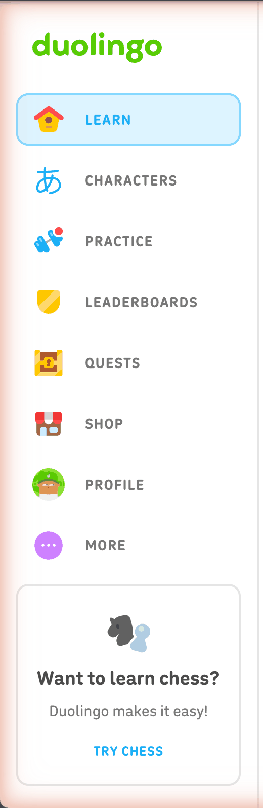 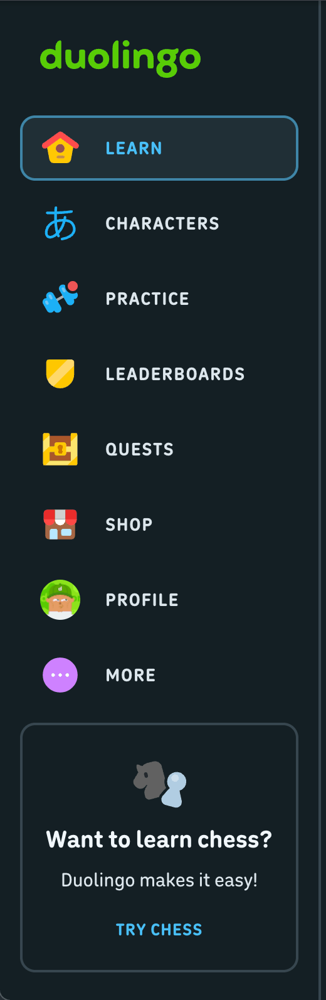

#### Stat bar (desktop)

row container 368 x 44, space-between; course trigger: flag (+ number in the light captures); streak trigger: flame icon + count. Where: top of the right rail on /learn, /leaderboard, /quests, /shop, /profile, /practice-hub, /characters, /sections (not on /settings): dt=courses-menu, streak-menu,. [Full spec](components/product.md#stat-bar-desktop)

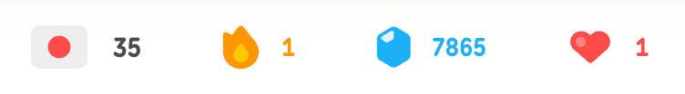 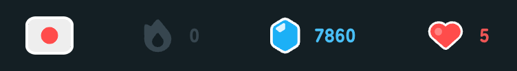

#### Right rail

outer column (cl=_1UT5d, width 368px) with a JS-sized ::before spacer; inner sticky stack (cl=_1GhPE) with 16px gaps; stat bar first, then page-specific cards, then footer links. Where: right column of every desktop page at >=700px (learn, leaderboard, quests, shop, profile, practice-hub, characters, sections, settings). [Full spec](components/product.md#right-rail)

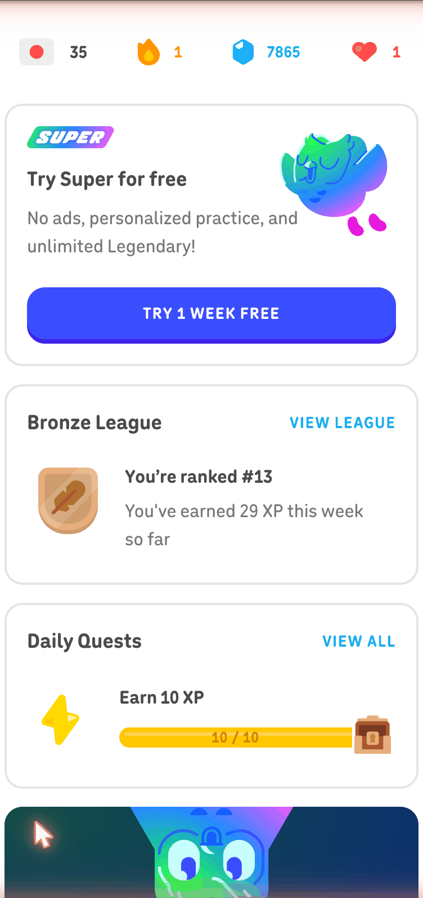 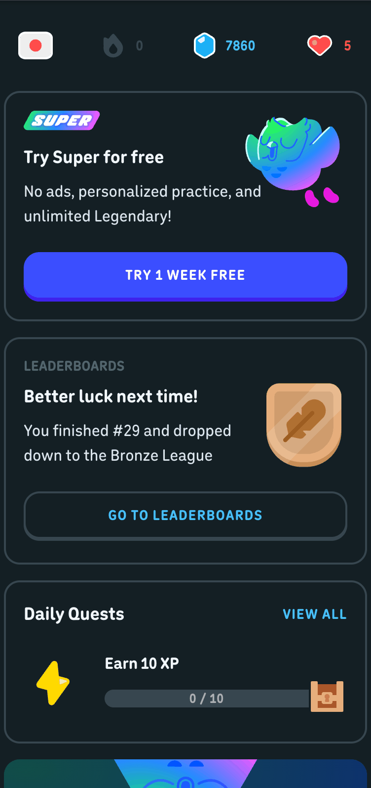

#### Mobile top bar

fixed full-width bar, 58px tall; four stat triggers spread with space-between: course (flag + number), streak, gems, hearts. Where: <700px on /learn and /shop only (cl=_3sbzq _1lHE4); not rendered on /leaderboard, /quests, /profile, /settings mobile. [Full spec](components/product.md#mobile-top-bar)

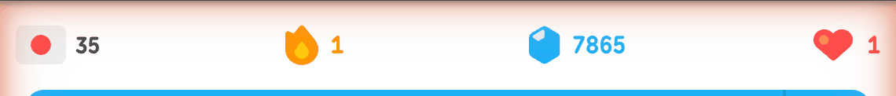 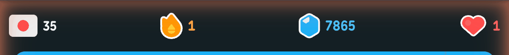

#### Mobile tab bar

fixed bottom bar, 82px, top border; 6 icon-only tabs: Learn, Characters, Practice, Leaderboards, Quests, Profile (no Shop, no More); active tab: 48x48 chip with fill and border. Where: <700px on /learn, /leaderboard, /quests, /profile, /shop (cl=_1p0jQ > nav _2_E8y > _2zdkO); absent on /settings/* mobile. [Full spec](components/product.md#mobile-tab-bar)

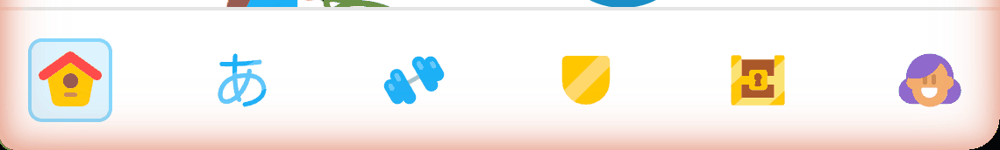 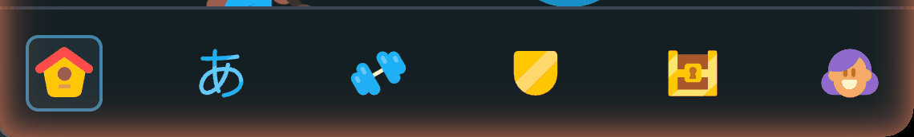

#### Page grid

fixed sidebar (256 / 88 / none); content wrapper: max-width 1056, centred, padding-top 24; flex row-reverse: main column (flex 1) + 48px gap + 368px right rail, 24px side and bottom padding. Where: all logged-in pages: app wrapper cl=_3Cy6o _2kkzG (kPqwA on some pages) > _19E80 > AkzqY (max 1056) > wl71D (dt=home on /learn) > [rail _1UT5d, main _2HEhk] in . [Full spec](components/product.md#page-grid)

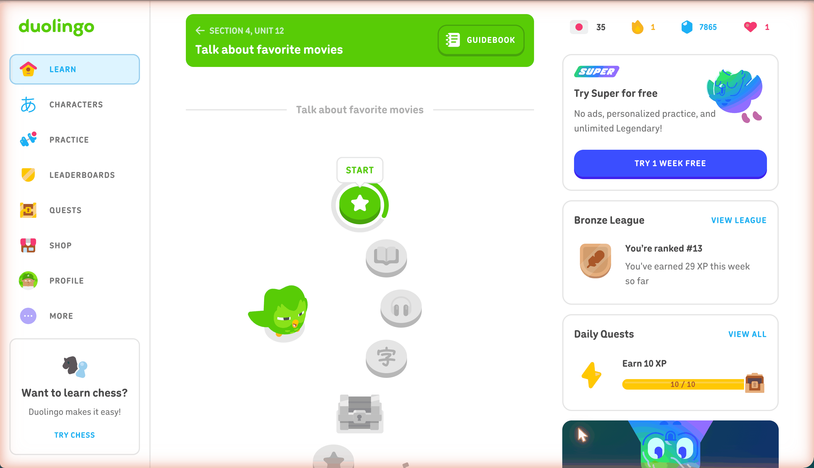 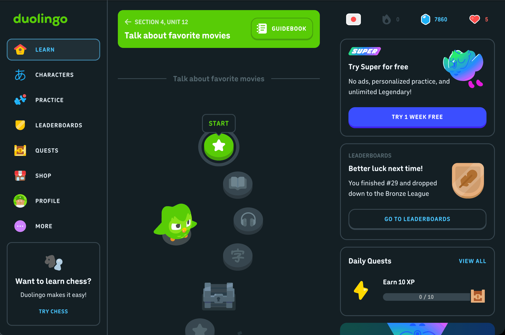

### Learn path

#### Unit header banner

sticky wrapper (_1g8jV) with 24px page-colour spacer above (_3LueZ, desktop only); banner (PsNCe): 2-column grid, unit colour background, radius 13; back link row: arrow icon 16x16 + label "SECTION 4, UNIT 12" (links to . Where: /learn, sticky at the top of the path column; div.PsNCe + unit colour class (LJB6r owl, _1p2Lt starfish, ...) inside div._1g8jV. [Full spec](components/product.md#unit-header-banner)

 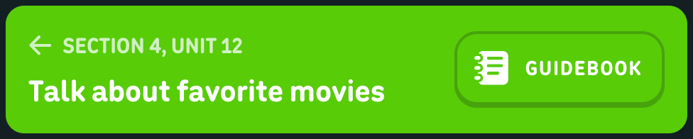

#### Unit divider

left rule (hr._1JA0o, flex-grow); unit title (h2._3qGKs); right rule. Where: /learn, first child of every section[dt=skill-path-unit-N]: header._10Xfk. [Full spec](components/product.md#unit-divider)

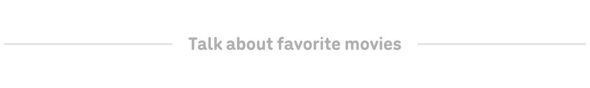 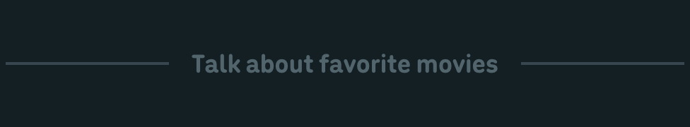

#### Path node

offset wrapper (R7x3_, position relative, left = zig-zag offset); face: ::after ellipse 70x57, radius 50%; lip: ::after box-shadow 0 8px (black @0.20 over the face colour) plus ::before 8px band at top 28.5px that fills . Where: /learn, button[dt="skill-path-level-N skill-path-level-{skill|story|duo_radio|alphabet|practice|unit_review}"] cl=_1gEmM _7jW2t {_1333i|G_Z0K} [_22TV_] _3Jm09; . [Full spec](components/product.md#path-node)

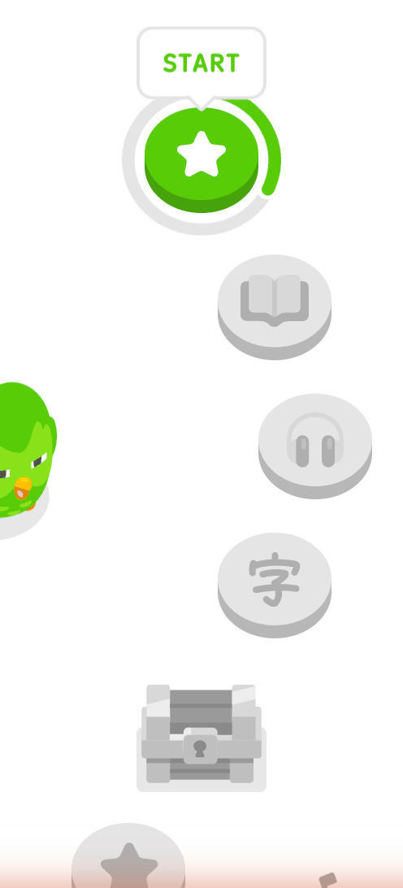 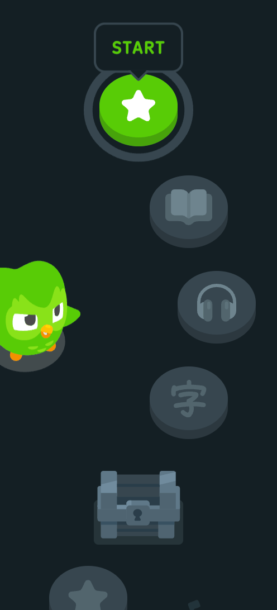

#### Node popover

popover shell (generic) 295px wide, below the node; arrow (20x10 clip with a rotated 20x20 square) at the top, aimed at the node; title (h1.QPQgr). Where: /learn, opens under a clicked node: div._3zpnU._3OfAS._1o3g5._2dBq4._27rki > div._36bu_._3RP1Q. [Full spec](components/product.md#node-popover)

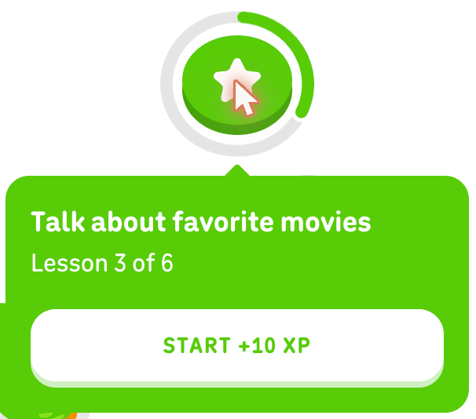 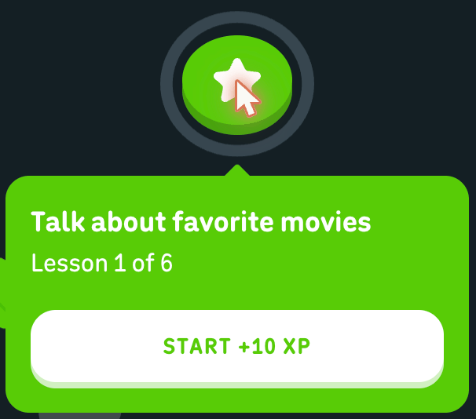

#### Path character

absolute box on the left or right half of the column; animated lottie svg (span.u_TP-) for units reached so far, or a static img (pathCharacters/dark/*.svg in dark, pathCharacters/locked/*.svg in light) for units ahead. Where: /learn, div._3jOjF (position absolute) inside each unit's node column div._2QaYj. [Full spec](components/product.md#path-character)

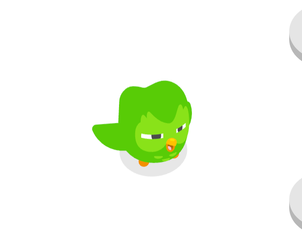 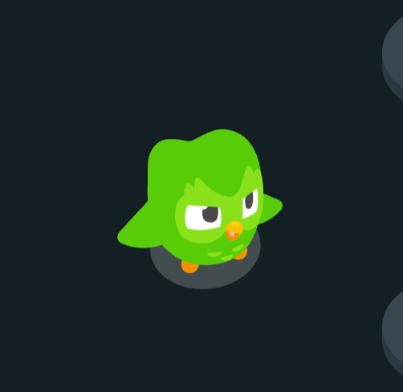

#### Go to current unit button

square secondary button, sticky to the bottom right of the path column; arrow icon 18x20: points up when the current unit is above, rotated 180deg (_3wVBw) when it is below. Where: /learn, button[aria-label="Go to current unit"] cl=_2V6ug _1ursp _7jW2t _2dnkd _1KSEa eAlyQ _2El3L _3AJpR. [Full spec](components/product.md#go-to-current-unit-button)

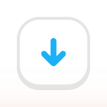 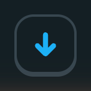

#### Section end card

outlined card; UP NEXT pill; lock icon + "Section 5" title. Where: /learn, after the last unit of the section: div._1wgqa. [Full spec](components/product.md#section-end-card)

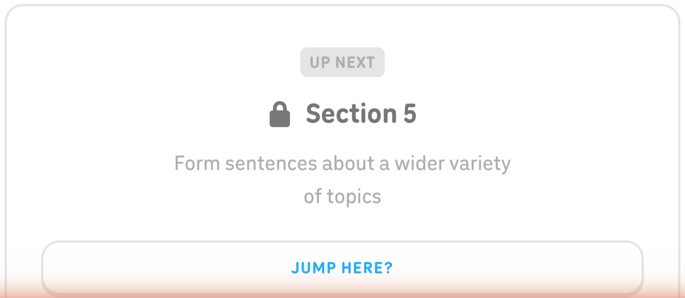 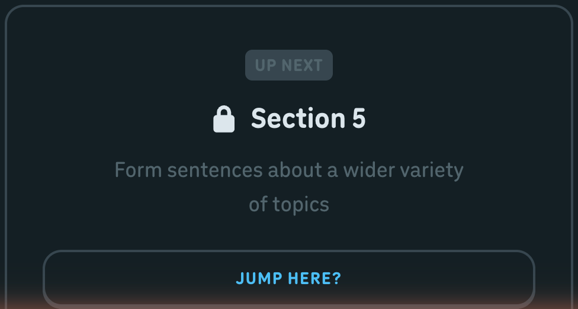

#### Section card (sections page)

card (radius 16, padding 0 24, grid 1fr + min-content); CEFR link button "A1 • SEE DETAILS"; section title. Where: /sections, div.JTQLF (grid, gap 16px) of div._3AIkT cards: completed ._2UWvP, in progress ._1pT8b._2E1uv, locked ._36wSS._2E1uv. [Full spec](components/product.md#section-card-sections-page)

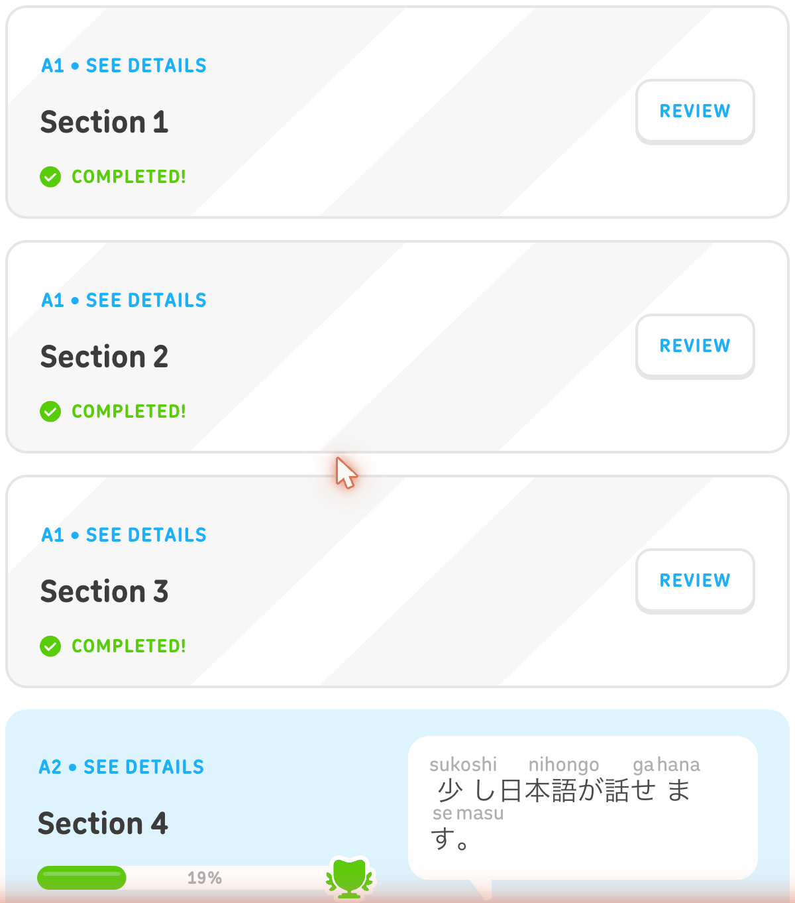 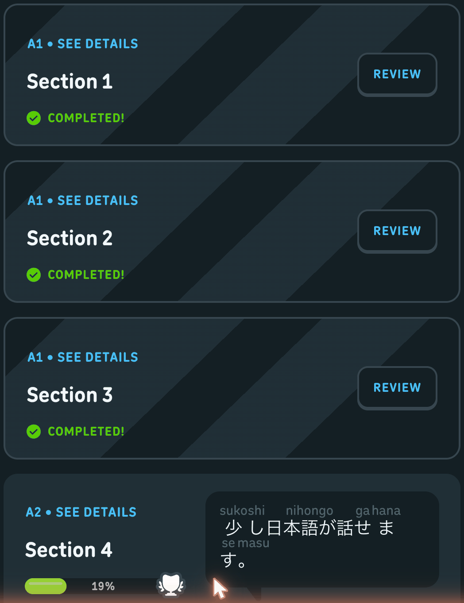

### Lesson screen

#### Lesson top bar

row: grid min-content | min-content | 1fr | min-content, gap 24px; close X (dt=quit-button, 18x18 img); settings gear (22x22 background-image button). Where: /lesson, header row (cl=wqSzE > _3v4ux > _18N2Q _1zcW8): dt=quit-button, settings button, role=progressbar, hearts. [Full spec](components/product.md#lesson-top-bar)

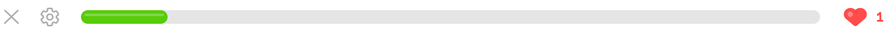 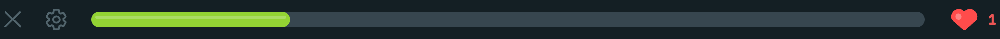

#### Challenge header and badges

badge (optional): 32x32 icon + uppercase label; title h1 ("Write this in English"). Where: /lesson, cl=U41Ye: badge cl=w2K8w + h1 dt=challenge-header. [Full spec](components/product.md#challenge-header-and-badges)

 

#### Character with speech bubble

character (animated canvas, 118x175 max); bubble (snow face, 2px swan border); bubble tail (svg, two paths). Where: /lesson translate/assist challenges, cl=_31yjb (character cl=_2qg6J + bubble cl=_1tbN5 > _1lWtm > _20npu). [Full spec](components/product.md#character-with-speech-bubble)

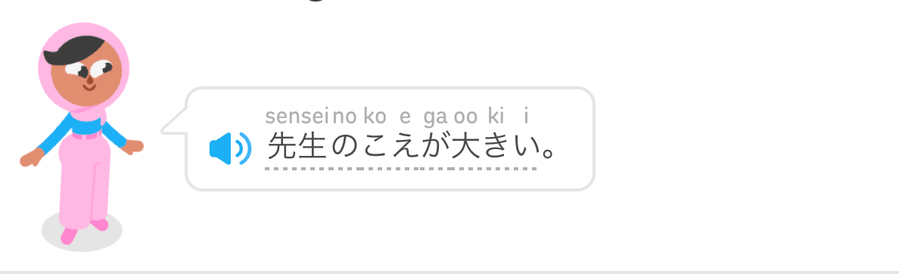 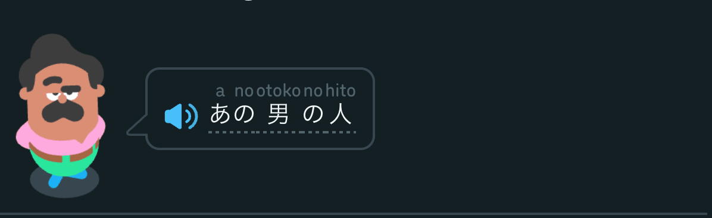

#### Answer lines

top rule (2px); ruled rows (60px each, 2px bottom rule); answer tiles overlay (cl=_2-F7v, absolute, flex-wrap). Where: /lesson word-bank challenges, cl=MvChQ v1KUv fUvcy > eWdJ5 > _1arte > _3gJ3o D0fy9 rows. [Full spec](components/product.md#answer-lines)

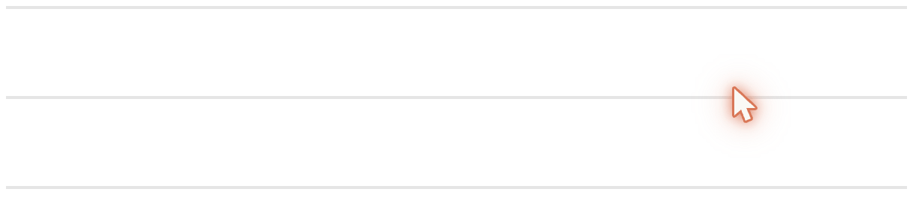 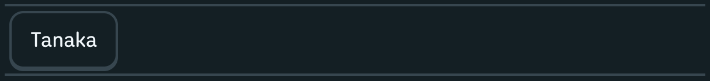

#### Word bank tile

slot (cl=_1uV0Q, 60px tall); button (transparent 2/2/4 border for the lip space); ::before face (2px border, radius 12, 2px lip as box-shadow). Where: /lesson, dt=word-bank > button dt=<word>-challenge-tap-token. [Full spec](components/product.md#word-bank-tile)

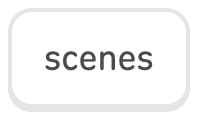 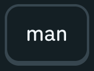

#### Choice row

card (2/2/4 transparent border, ::before face with 2px lip); number badge 30x30 (keyboard shortcut); label with ruby (dt=challenge-judge-text). Where: /lesson select-meaning and dialogue challenges, role=radiogroup > div dt=challenge-choice cl=_8dMUn _1G3d-. [Full spec](components/product.md#choice-row)

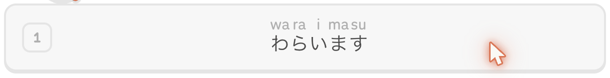 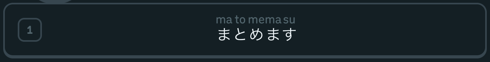

#### Image select card

card (same shell as choice row, padding 24px); illustration 143x160 (background-image); footer: word with ruby (left) + number badge 30x30 (right). Where: /lesson "Which one of these is ...", role=radiogroup cl=HsVVL > div dt=challenge-choice cl=_8dMUn _2_Y8r. [Full spec](components/product.md#image-select-card)

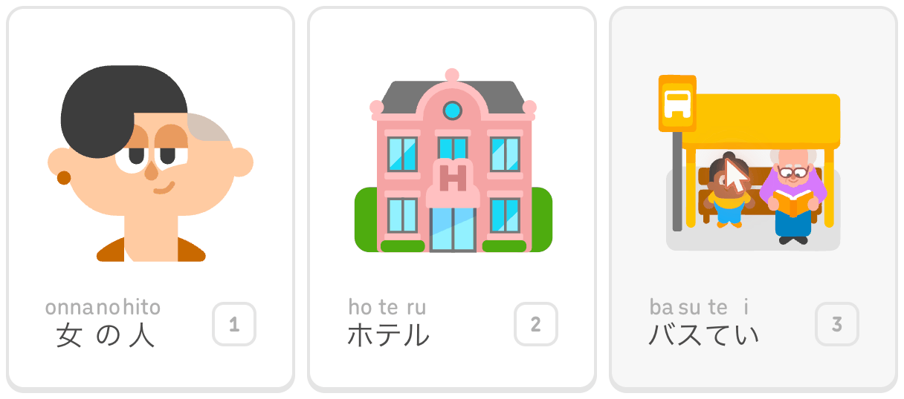

#### Match tile

tile (tap-token shell, 255x68); number badge 30x30 at left 16px; label (word or ruby). Where: /lesson "Select the matching pairs", cl=_1bmNz grid > button dt=<word>-challenge-tap-token cl=... _1YHBP _3Ymqr. [Full spec](components/product.md#match-tile)

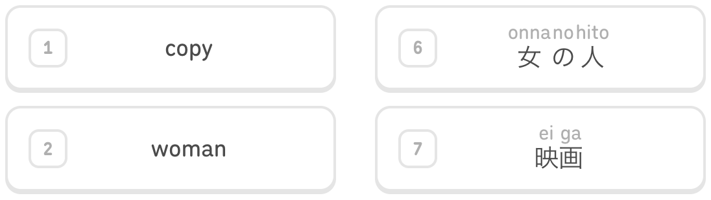 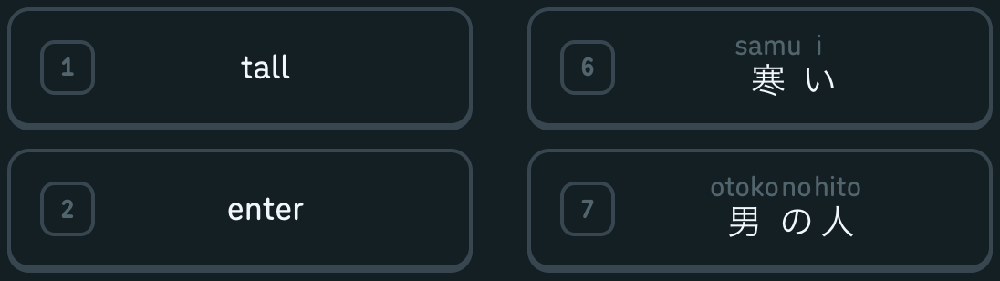

#### Dialogue challenge

left message: 64px avatar + bubble with speaker and hint tokens; right message: bubble with blank line + 64px avatar; choice rows (see choice-row). Where: /lesson "Complete the chat", dt=challenge challenge-dialogue. [Full spec](components/product.md#dialogue-challenge)

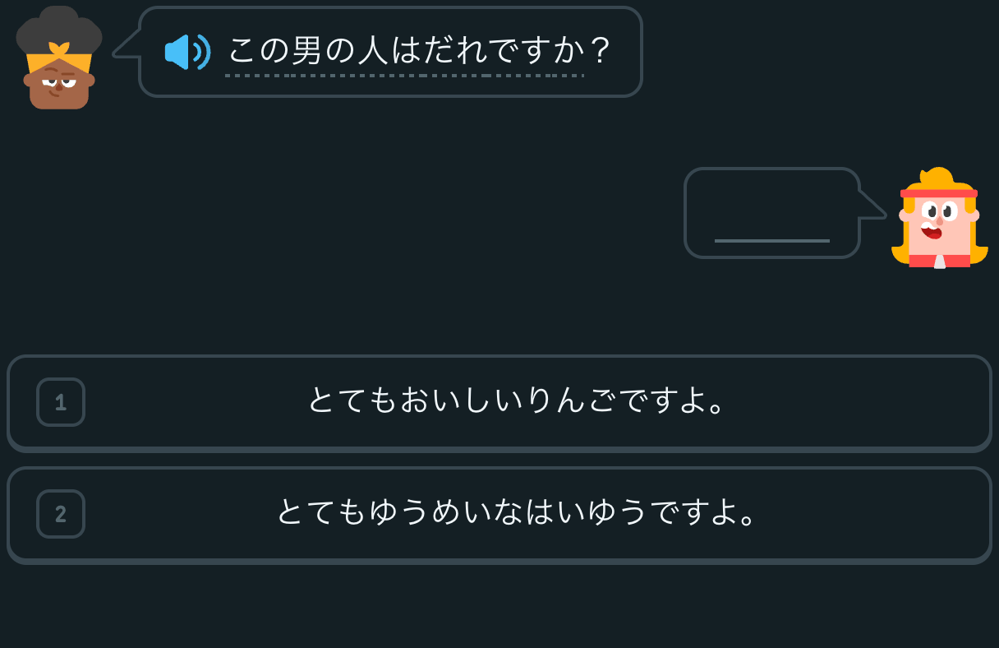

#### Listen challenge

large speaker button 100x100 (normal speed); small speaker button 70x70 with snow ring (slow); answer lines + word bank (74px rows, furigana tokens). Where: /lesson "Tap what you hear", dt=challenge challenge-listenTap. [Full spec](components/product.md#listen-challenge)

#### Lesson footer

bar (140px, 2px top rule); inner 1000px grid of 5 columns; SKIP (secondary button, column 1). Where: /lesson bottom row, cl=_3rB4d _1VTif > U8jH3 jHbiF: dt=player-skip, dt=player-next. [Full spec](components/product.md#lesson-footer)

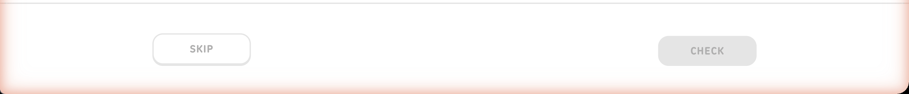 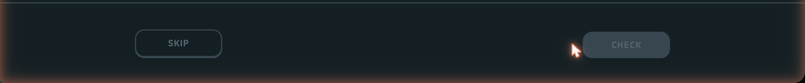

#### Feedback bar

bar (140px, tinted, no top rule); icon circle 80x80 with check / cross image; title h2 ("Great job!", "Correct solution:"). Where: /lesson after CHECK, footer switches to cl=_3FB5S + _3yMvO (correct) / _2cfV0 (incorrect) / _2mseZ (neutral); dt=blame blame-correct|blame-incorrect. [Full spec](components/product.md#feedback-bar)

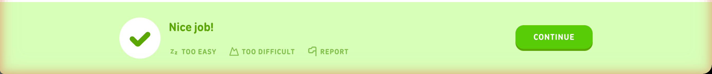 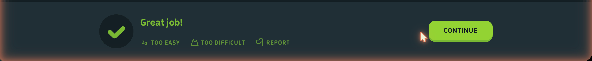

#### Review mistakes interstitial

lesson top bar (quit, settings, progress bar, hearts; documented by the challenge-screen part); Duo character (dt=session-duo, 200x123, mirrored with scaleX(-1), anchored to the bottom of the content area); speech bubble. Where: /lesson, between the last new challenge and the replay of missed ones; dt=session-duo + speech bubble, footer dt=player-next. [Full spec](components/product.md#review-mistakes-interstitial)

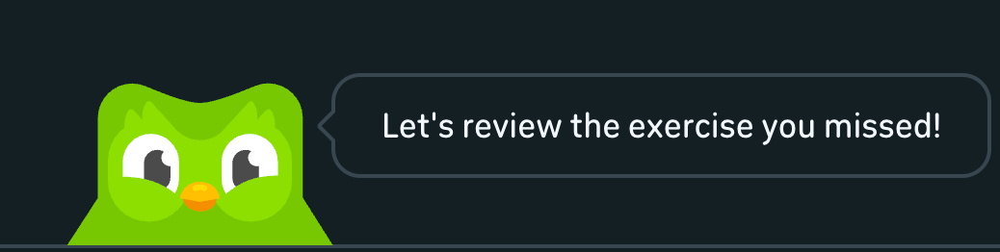

#### Combo interstitial ("5 in a row!")

full-width canvas animation (content area 1384 x 557); caption "5 IN A ROW!" centred at 27% from the top; footer: CONTINUE (primary, owl). Where: /lesson, after 5 correct answers in a row; full content area canvas animation plus caption. [Full spec](components/product.md#combo-interstitial-5-in-a-row)

#### Make-it-harder interstitial

Duo lottie (320 x 418) centred in the content area; speech bubble above Duo (popover shell, caret at the bottom pointing down), pops in with a scale animation. Where: /lesson, captured only behind the quit modal in lesson-light-quit-modal (Duo lottie + speech bubble "Great work! Let's make this a bit harder..."). [Full spec](components/product.md#make-it-harder-interstitial)

#### Quit lesson modal

backdrop (black 40%); card (384 wide, 16 radius, 24 padding); art: sad Duo image 120 x 120. Where: /lesson after clicking dt=quit-button; modal card inside cl=_3Mzt6 over dt=drawer-backdrop. [Full spec](components/product.md#quit-lesson-modal)

 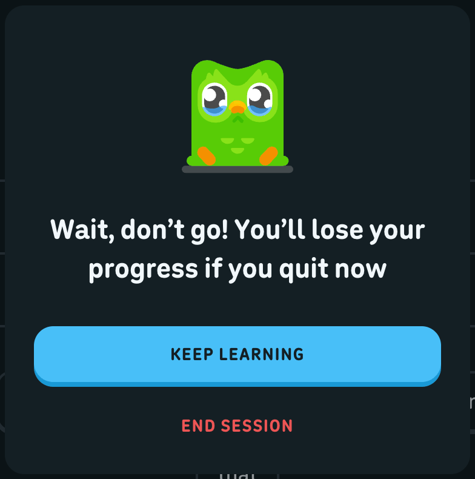

#### Lesson complete screen

illustration (Duo + character, lottie; not in the dump); title "Lesson Complete!"; stat cards row (2 cards, gap 16): each card = outer coloured frame (strip) + label strip text + inner value box (icon + animated counter). Where: /lesson end screen: title cl=_3z6AH, stat cards cl=_23WOw, footer Review lesson + dt=player-next. [Full spec](components/product.md#lesson-complete-screen)

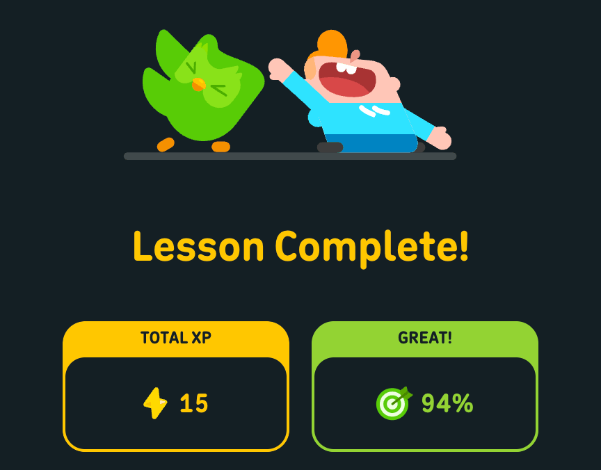

#### Post-lesson streak screen

celebration: flame animation (canvas, max 340 square); count number (canvas, 340 square); "day streak" label. Where: /lesson after the lesson complete screen: dt=streak-slide (celebration: flame + count + week card) and the calendar variant ("Can you make it to a 2 day streak?. [Full spec](components/product.md#post-lesson-streak-screen)

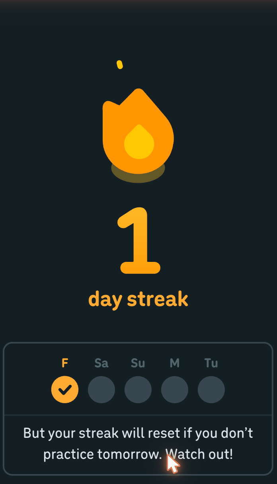

#### Streak goal picker

speech bubble (254 wide) with caret image, text revealed letter by letter; illustration (calendar flame + Duo svg, 254 x 204) with a "7" numeral overlay; radio list: 4 rows (label left, grade right). Where: /lesson after the streak screen: speech bubble + illustration, then role=radiogroup aria-label=goal with 4 role=radio rows (dt=streak-goal-option on the right-h. [Full spec](components/product.md#streak-goal-picker)

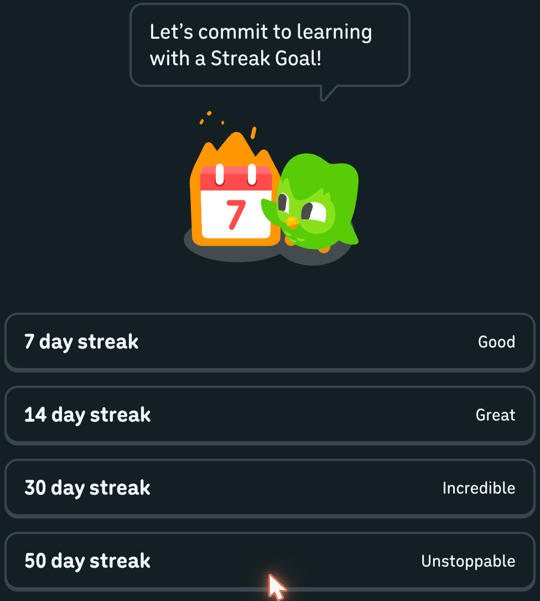

#### Friend streak invite list

sticky header: illustration 214 x 199, heading, "5 invites remaining", hidden divider shown on scroll; table: 2px bordered box, radius 16; row: avatar 40 round, name, INVITE small primary (macaw). Where: /lesson after the streak screens: sticky header (illustration, h2, remaining count) + bordered friend table with INVITE buttons. [Full spec](components/product.md#friend-streak-invite-list)

#### Super upsell screens

practice-hub ad (dark capture): eclipse background, SUPER logo top right, hero image 400 x 428, h1, footer with NO THANKS (outline white) and GET STARTED (white); trial reminder (light capture): gradient sky, close X top. Where: /lesson end flow: practice-hub ad (dt=practice-hub-ad-*), trial reminder picker (dt=trial-reminder, dt=plus-continue, dt=plus-no-thanks), and a full-screen vide. [Full spec](components/product.md#super-upsell-screens)

 

### Gamification

#### Streak dropdown

popover shell (generic), background swapped per streak state by a modifier class on dt=streak-panel; header: title "N day streak" (dt=streak-panel-header), subtitle, flame illustration right (64x77); week calendar card: . Where: /learn (any page with the top stat bar), hover dt=streak-menu; panel dt=streak-panel. [Full spec](components/product.md#streak-dropdown)

 

#### Gems dropdown

popover shell (generic); gem chest illustration (100px tall); text column: title "Gems", balance line "You have N gems", GO TO SHOP text button (dt=shop-nav). Where: /learn top stat bar, hover dt=lingot-menu; content dt=lingots-menu-content. [Full spec](components/product.md#gems-dropdown)

 

#### Hearts dropdown

popover shell (generic); title "Hearts"; heart row: 5 hearts (full / refilling animated / empty). Where: /learn top stat bar, hover dt=hearts-menu. [Full spec](components/product.md#hearts-dropdown)

 

#### Courses dropdown

popover shell (generic, _2xxCs modifier); header "MY COURSES" with bottom rule; scrolling list of course rows (flag + name), current course highlighted. Where: /learn top stat bar, hover dt=courses-menu; content dt=courses-menu-content (role=menu). [Full spec](components/product.md#courses-dropdown)

 

#### Leaderboard

league badge row: current league badge 80x91, locked badges 52x58, 28px gap, grid of 11 shifted by --offset; header (sticky, snow bg): league name, subtitle ("Top 11 advance..." or join prompt), time left (bee), 2px swan. Where: /leaderboard main column; list dt=leaderboard. [Full spec](components/product.md#leaderboard)

 

#### Status picker

bordered card; header: title + CLEAR text button; preview: 80px avatar, 46px status bubble top-right, 17px online dot. Where: /leaderboard right rail card "Set your status". [Full spec](components/product.md#status-picker)

 

#### Daily quest card

section header: "Daily Quests" + timer (16px clock icon + "N HOURS")  [page]; or card header with VIEW ALL [rail]; quest card: quest icon 60x60, title, progress row (bar + chest 35x35); progress bar: track, fill (clip-pa. Where: /quests "Daily Quests" section (page variant) and /learn right rail (rail variant). [Full spec](components/product.md#daily-quest-card)

 

#### Monthly badges list

bordered card (transparent fill); header: title + VIEW ALL text button; rows: badge image 45x45, name, month/year. Where: /quests right rail card "Monthly Badges". [Full spec](components/product.md#monthly-badges-list)

 

#### Achievement row

list container (2px swan border, radius 16, rows separated by 2px swan rule; last row has no rule); level badge tile (77 x 96 SVG background image per achievement, contain, no-repeat); level label ("LEVEL 9") absolutely . Where: /profile/<user>, Achievements section: ul.cl=_1dDcV > li.cl=m_b-V _27zqm (no data-test). [Full spec](components/product.md#achievement-row)

 

#### Profile header

avatar banner (full column width x 224, radius 15, background = user avatar colour, avatar rendered in a <canvas>); edit-avatar icon button (48 x 48) top-right of banner; clickable avatar hit area (220px wide, centred). Where: /profile/<user>: banner div.cl=eGQis + info block div.cl=_3byCv _2C8UD (name h1 dt=profile-username). [Full spec](components/product.md#profile-header)

 

#### Profile statistics tile

2-column grid, 12px gap; tile (2px swan border, radius 16); icon (21px wide, top-aligned). Where: /profile/<user>, Statistics: div.cl=_37tLJ grid > div.cl=_2Hzv5 > div.cl=_2uSOC. [Full spec](components/product.md#profile-statistics-tile)

 

#### Friend suggestion card

card (2px swan border, radius 16, flex column, equal flex 1 1 0); dismiss X (12 x 12) top-right; avatar (48, circle). Where: /profile/<user>, Friend suggestions: div.cl=_3tDH0 > div.cl=_18ikm (a dt=friend-entry, button dt=friend-add-button). [Full spec](components/product.md#friend-suggestion-card)

 

#### Friend update (kudos) card

panel (2px swan border, radius 16) holding stacked updates + "View all" row; update item (2px swan bottom rule); avatar 50 + name (bold) + relative time. Where: /profile/<user> right rail: div.cl=_2G9SS > div.cl=_27qWC -V8Gl _2tJ8I (per update), a.cl=_1eHsP "View all". [Full spec](components/product.md#friend-update-kudos-card)

 

#### Characters grid cell

cell = web-ui secondary button (snow face, swan border, 2px lip); glyph (kana); romaji. Where: /characters: div.cl=_22vCj > div.cl=_11ETR (row) > button.cl=_2V6ug _3Dsa-. [Full spec](components/product.md#characters-grid-cell)

 

#### Characters script tabs

three equal tabs (33% each): Hiragana, Katakana, Kanji; label (uppercase); 2px bottom rule per tab (macaw when selected, swan otherwise). Where: /characters: div.cl=_7WPBm > div.cl=_1V2d9 _1xZUP > div.cl=_3ugho (selected adds _1H-vp). [Full spec](components/product.md#characters-script-tabs)

 

#### Guidebook key phrase bubble

"KEY PHRASES" section label; speech bubble = web-ui popover shell with left-pointing arrow; speaker button (animated lottie svg, 29 x 22). Where: /guidebook/<lang>/<unit>, KEY PHRASES: div.cl=_1kJSC > div.cl=_3zpnU D0iFS (popover, arrow left) > div.cl=_36bu_ _1KdWa. [Full spec](components/product.md#guidebook-key-phrase-bubble)

 

#### Shop item row

section heading (Hearts, Power-Ups); row with 2px swan top rule; item icon (100 x 100, floated into a 110px left gutter). Where: /shop: ul > li.cl=_3-o-j (button dt=purchase-button, icon dt=purchase-icon for power-ups). [Full spec](components/product.md#shop-item-row)

 

#### Super promo card

variant A, rail card: standard rail card (snow, 2px swan, radius 16) + SUPER wordmark (78 x 21) + Duo art (98px, absolute top/right 24) + title + body + full-width cosmos button "TRY 1 WEEK FREE"; variant B, hero banner . Where: right rail on /learn, /characters, /guidebook (div.cl=_16rRh _2cnFr _1T_BQ, logo dt=plus-offer-logo); hero banner on /shop and /settings/super (div.cl=MGk8p, bu. [Full spec](components/product.md#super-promo-card)

 

#### Ad-blocker card

card with eclipse background + gamma/starlight/quasar radial gradient; Duo art strip at the top (full bleed, 91px); title. Where: right rail on /learn, /characters, /guidebook, /practice-hub, /sections, /shop: div.cl=_3D_HB > div.cl=_3Mmv9 ("Using an ad blocker?"). [Full spec](components/product.md#ad-blocker-card)

 

## Icons

- **Exported:** 13 distinct inline SVGs (`icons/inline/`) + 210 distinct CDN SVGs (`icons/cdn/`, all from `d35aaqx5ub95lt.cloudfront.net` or `*.duolingo.com`).

- **Two-tier system.** Inline SVGs are UI chrome: single-colour glyphs that inherit `currentColor` (chevrons, X, pencil, headphone/badge overlays on path nodes, the session progress-ring) so they retint with theme/state via CSS, not the SVG file. CDN-hosted SVGs are static illustration assets with colours baked into the file as literal `rgb()`/hex values (flags, gems, hearts, streak flame, league badges, achievement art, mascot poses); none of the 210 CDN files used `currentColor`.

- **Fill vs stroke:** every inline UI glyph is fill-only (`fill="currentColor"`, no `stroke`), except the quests circle-check icon which combines a 2px stroke circle with filled interior marks. Of the 210 CDN files: 90 are flat multi-colour illustrations (3+ literal fill colours, e.g. the streak icon's `#FF9600`/`#FFC800` duo-tone plus outline), 88 are two-tone flat icons (1-2 literal colours), and 32 set no inline colour at all (styled entirely through CSS classes in `css/*.css`). Stroke widths seen in the CDN set cluster at 1px and 2px.

- **Sizes actually used** (rendered CSS px, from the dump node rects, counting distinct icon assets per size): 16-24px glyphs dominate nav/top-bar/lesson UI (16x16, 18x18, 20x20, 24x24, 32x32), 34-46px covers path-node type badges and small stat icons (34x26, 42x34, 44x42, 46x46), 55-100px covers achievement/character art and the path's current-node ring (98x93), and 236-300px wide illustrations are the unit-intro banner scenes on `/learn` (243x236, 288x236, 299x236).

- **Known public icon set?** No evidence of one. Path data, `id`/class hashes (`_2FMGJ`, `_3N2pE`), and the Lottie-exported `__lottie_element_*` ids all point to a custom, in-house icon and illustration system built alongside the app's own `--color-*` design-token palette (see `palettes-raw.json`). Treat everything here as custom to Duolingo.

The per-icon table (file, source, where used, rendered size, fill or stroke, colours) is in [icons.md](icons.md). The SVGs in [icons/](icons) are Duolingo's property, exported for reference use only.

## Gaps

### Capture

- **Log-in and sign-up flow:** not captured. Opening it needs a logged-out session, and the only logged-out browser available could not save screenshots or reach the local capture sink. The landing page has computed values only ([raw/landing-light-values.json](raw/landing-light-values.json)).
- **Toasts:** none appeared in any flow. The one transient confirmation is the inline "Copy link" to "Copied" label swap in the invite modal.
- **Out-of-hearts screen:** not captured, because reaching it would have spent the account's last heart.
- **Light lesson complete:** the screen was covered by a video ad before it could be captured. The dark version is complete, and the light colours follow from the same rules.
- **Light incorrect-answer bar:** not captured, to keep the last heart. It is derived from the CSS rules plus the light palette and marked `derived, not captured` in the spec.
- **Native select menu:** the open state is drawn by the OS, not the DOM.
- **Mobile:** the viewport was 570px (Chrome's minimum window width with the tab sidebar), not a phone width. The 360 to 375px rules come from `@media` rules only. Mobile popovers, menus, modals and sheets were not captured.
- **Tablet range 700 to 1159px:** the compact 88px icon-only sidebar was never on screen, so it comes from CSS only.
- **Screenshot vs dump mismatches:** some dark lesson and leaderboard screenshots were retaken during a second lesson while their dumps come from the first, and `leaderboard-dark-mobile` differs too. The component crops from those were offset and checked by eye. See `SHOT_MISMATCH` in the product spec.
- **Pressed / active states:** a static dump cannot hold a mouse press, so every pressed value comes from CSS `:active` rules.
- **Personal data:** the email field in the four `settings-profile-*` screenshots is blurred. Other users' names and avatars appear in leaderboard, profile and search captures as they did on screen.

### Tokens

- **Inferred, not observed:** `status.warning` in light. The dark value comes from the "Previous mistake" label, whose colour is set inline (no class rule); there is no light capture, so light uses the same palette name (fox).
- **CSS only, never rendered in that theme:** light `feedback.incorrect.*`, `status.danger{Text,Background}` and `feedback.tile.wrong*` (no light wrong-answer capture; from `._3FB5S._2cfV0`, `.o-3Ru`, `._3S8jJ`, `._2noWf`); dark `feedback.tile.correct*` (`._3v-Hx`), `gamification.combo` (`._1xB7m`), `dataViz.avatar.red` (`.XS0Dh`); light `gamification.streakInactive` (`._2HAQo`); both themes for `gamification.league.{demotion,promotedRow,demotedRow,diamond}` and `unitColors.{orange,purple,magenta,teal,red,brown,legendary,foreground}`.
- **Not tokenised:** league tier colours (Bronze to Diamond badges are SVG images with no CSS colour); charts (no chart was on any captured screen). A dark-theme rule sets `--path-unit-background-color` to polar-always-dark on unit sections, but no rendered node used it.
- **Colours matching no palette entry:** `#8ce31b` (profile avatar banner, the user's chosen avatar colour, 12 nodes); 58 distinct fills in inline SVG illustrations and icons (3,883 path nodes). Excluded as capture artefacts: the Claude-in-Chrome overlay (`#d97757`, `#faf9f5`, `#111111`) and the UA link blue `#0000ee` inherited by anchor wrappers with no text.
- **Palette:** light values were checked against the live `<html>` vars (300/300 match); dark values were only checked where a dump used them (no dark root-var capture). The JS palette names `refresh` and `refresh-progress-bar` are `--color-daily_refresh*` live.
- **Typography:** `--text-pageTitle-*-large` (40/44) and `--text-label-*-large` (24/24 uppercase) are declared but not rendered, so they are not tokens. feather is not rendered in the app (marketing page only).
- **Layout:** every desktop capture is 1200px or wider, so the compact 88px sidebar (700 to 1159px) is CSS only, and the breakpoint that hides the right rail was not identified. Breakpoint names other than 700px (mobile/desktop split) and 1160px (sidebar labels) describe what their rules mostly change, taken from rule counts.
- **Resolution method:** names shared by one hex were picked from the CSS rule on the node (or an ancestor's custom property). Three tokens (`border.divider`, `status.danger`, `feedback.tile.selectedBorder`) had no class rule; their name is the only palette entry matching both the light and the dark observation.

### Core components

- Toasts / snackbars: none captured in any dump; no CSS or class map identifies one.
- Focus / focus-visible: never captured live; CSS shows focus rings are suppressed globally, so "no ring" is the documented state, not a missing capture.
- Active / pressed: not captured live for any component (static dumps); all pressed values are from CSS.
- Button pill variant (_17LYs, 26px) and solid owl/snow/humpback colour variants exist in the class map and CSS but appear in no dump.
- Disabled text input, error input and helper text: CSS/JS only, no capture.
- Select open state: native OS menu, not in the DOM; select-open dump has no screenshot and no style diff.
- Light theme has no captures of: notifications modal, streak-goal radio rows, friend-streak INVITE button, "Not now" text button at 32px. A bee/camel solid variant (_1lyVV: face bee, lip camel, css:app ._1lyVV) exists only in lesson-dark-cant-listen#174, which has no screenshot, so it is left out of the variant table.
- Mobile (570px) captures exist only for learn, leaderboard, profile, quests, settings-account, shop; no mobile capture of modals, bottom sheet, inputs, popovers or menus. Responsive notes for those come from @media rules.
- Several hover dumps have no screenshot (characters-dark-tab-hover, settings-courses-dark-danger-hover, settings-notifications-dark-checkbox-hover, user-search-dark-row-hover, learn-dark-nav-hover); their values are from the dump only.
- characters-dark-cell-hover and settings-notifications-dark-checkbox-hover show no style change because those components set --web-ui_button-filter-hover:none; they are not failed captures.
- "gray-text" (profile tab labels) resolves to #999999 in dumps/rootvars-light.json but is absent from palettes-raw.json; its dark value renders as #DCE6EC.
- Profile avatar edit button face #8CE31B comes from --avatars-background-color (user avatar colour) and matches no palette name.
- Sidebar navigation items (_2dvyl / _3Dchg hover polar) are app-shell components and not documented here.

### Product-specific components

- sidebar-nav: Collapsed 88px sidebar (700-1159px) never captured: values come from CSS only.
- sidebar-nav: learn-dark-nav-hover has no screenshot (dump diff only), and there is no light hover dump; light hover colour is from CSS.
- sidebar-nav: Keyboard focus ring not captured and no focus rule found on the nav classes.
- sidebar-nav: Dump never records font-family (it equals the reference div); family comes from css:app-f2ef02f8.css * rule.
- sidebar-nav: Screenshots show the capture tool's pointer (orange-outlined arrow); it is not part of the UI.
- stat-bar: Active streak on desktop dark and inactive streak on desktop light were not captured; the colours come from CSS.
- stat-bar: What the course number (35) counts is not labelled in any dump.
- stat-bar: Hearts at 0 or refilling, and Super (unlimited hearts) variants, not captured.
- right-rail: --sidebar-offset and --app-offset are set by JS; their live values were not dumped (derived from rects).
- right-rail: No CSS rule hides the rail between 700px and 1159px; it stays 368 wide there (derived, not captured).
- mobile-top-bar: Border-bottom variant (without hJZ_L) was not seen on any captured page.
- mobile-top-bar: Dropdown/open state and any themed (--web-ui_topbar-*) variant not captured on mobile.
- mobile-tab-bar: Safe-area (iOS home indicator) handling not visible in CSS or captures.
- mobile-tab-bar: What opens the scrim (_1gNU8) was not captured.
- page-grid: No capture between 700 and 1199 px, so the collapsed-sidebar and 900px-floor layouts are derived from CSS only.
- page-grid: Dark captures are all 1200 wide and light 1384, so theme and width vary together; widths do not depend on theme.
- page-grid: --app-offset value not dumped (0 in these captures, judging by rects).
- unit-header: Only owl and starfish banners were captured on desktop; other unit colours are from CSS only.
- unit-header: Legendary (gold) banner not in any dump.
- unit-header: GUIDEBOOK hover/active not captured (CSS only).
- unit-header: Mobile screenshots do not match the mobile dumps (screenshot shows unit 1 macaw, dump shows unit 12 owl); mobile colours are taken from the dump only.
- path-node: Legendary node (_2ucCV) not present in any dump; CSS only.
- path-node: Active/pressed state not captured; CSS only.
- path-node: No dump shows the progress arc in dark theme (dark was at Lesson 1 of 6).
- path-node: Icon image dumps/icons-_learn.json lists .../images/path/5b531828e59ae83aadb3d88e6b3a98a8.svg, which no dump node references.
- path-node: Unit colours other than owl, macaw, starfish, fox and cardinal were not captured on nodes.
- path-node: Icon descriptions (star, check, book, trophy) are read from the screenshots, not from the files.
- node-popover: Mobile popover not captured.
- node-popover: Legendary and chest popovers not captured.
- node-popover: Open/close animation not captured.
- path-character: Lottie animation timing is not in the dumps.
- jump-to-current: Hover not captured: learn-dark-secondary-button-hover hovers the JUMP HERE? button, not this one.
- jump-to-current: Mobile instance not in any dump.
- section-end-card: Card bottom (y 797-835) is below the viewport in both screenshots; crops cut 38px of the bottom padding.
- section-end-card: Unlocked variant not captured.
- section-end-card: Mobile not captured.
- section-card: In-progress card is cut at the viewport bottom (797) in both screenshots; locked cards are off screen, so no crop shows them.
- section-card: No mobile capture of /sections.
- section-card: Hover states not captured.
- section-card: Title colour on completed/in-progress cards is not recorded in the dump.
- lesson-top-bar: Progress bar height (16px) comes from an inline --__internal__progress-bar-height; no CSS rule sets it.
- lesson-top-bar: What triggers bee versus fox fill is not recorded; both captured only as inline colours.
- lesson-top-bar: Light bee fill not captured.
- lesson-top-bar: Settings gear hover not captured, only CSS.
- challenge-header: HARD EXERCISE badge: not in any dump; the badge colour is set inline, so no CSS rule names its colour.
- challenge-header: Badge icon SVGs are inline and not saved in any icons-*.json (no lesson icon capture).
- challenge-header: PREVIOUS MISTAKE captured in dark only.
- character-speech-bubble: Hint-token popover (word definitions) never opened.
- character-speech-bubble: Character art is a canvas animation; not extractable.
- character-speech-bubble: Dark crop is from lesson-dark-feedback-incorrect (different sentence than the dark challenge dumps) because the dark challenge-default screenshot shows a later moment.
- answer-lines: Dark crop comes from the feedback-incorrect screenshot (one row visible, a tile in it).
- word-bank-tile: Keyboard-focus ring for tiles not captured.
- choice-row: lesson-light-choice-selected screenshot shows the moment before selection (row 3 unselected, CHECK disabled) although its dump has row 3 selected; the light selected crop was deleted. Light selected values come from the dump.
- choice-row: No light choice-default dump.
- choice-row: Correct/incorrect choice rows not captured (CSS only).
- image-select-card: No dark image-select dump: dark tokens would follow the choice-row values (same ._8dMUn rules) but were not captured.
- match-tile: Wrong-pair flash: dark dump only, no screenshot, no light capture (the colours are inline, so no CSS rule gives the light values; by palette name flamingo light is #FFB2B2, fire-ant light #EA2B2B, unverified).
- match-tile: Correct-pair flash (before the tiles go swan) not captured.
- match-tile: lesson-light-match-pair-matched has no screenshot.
- dialogue-challenge: No light dialogue capture.
- dialogue-challenge: Avatars are external SVGs (simg-ssl.duolingo.com/world-characters/avatars/bea_avatar_icon.svg, eddy_avatar_icon.svg).
- listen-challenge: lesson-dark-listen-default and lesson-dark-cant-listen have no screenshots, so no crops.
- listen-challenge: No light listen capture.
- lesson-footer: CHECK hover screenshot (lesson-dark-check-hover) does not match its dump; no hover crop.
- lesson-footer: lesson-dark-challenge-check-enabled has no screenshot; enabled dark crop taken from lesson-dark-choice-selected.
- lesson-footer: Light enabled crop deleted: lesson-light-choice-selected screenshot shows CHECK still disabled.
- feedback-bar: Light incorrect not captured: every light incorrect value is derived from the CSS rules the dark incorrect nodes use.
- feedback-bar: Light incorrect icon image and report icon not captured; REPORT icon class for light incorrect is probably .o8H6C (images/0f625e0c64ba72c0cd96755abcc4bcdf.svg), inferred only from the order of the report-icon rules in css:1008-b4d34396.css (light correct _26G6u, dark correct Htiq_, then o8H6C, dark incorrect _2M-GA).
- feedback-bar: TOO EASY / TOO DIFFICULT icons are inline stroke SVGs (stroke = state colour, 2px).
- review-interstitial: light theme not captured: light values derived from CSS variables and palette
- review-interstitial: mobile layout not captured
- review-interstitial: the body text of the bubble has no own colour on the node, so its colour comes from the body rule
- combo-interstitial: screenshot lesson-light-combo-interstitial shows the previous challenge (transition not yet painted), so no crop and no visual of the canvas animation
- combo-interstitial: the canvas artwork (flame or Duo animation) is not inspectable from the dump
- combo-interstitial: final (fully animated) caption size and opacity not captured; only CSS start values and a mid-animation computed size
- harder-interstitial: only present behind the quit modal: the screenshot shows the modal over it, so no crop
- harder-interstitial: no standalone dump or dark capture; footer state during this interstitial unknown
- quit-modal: art image URL not recorded in the dump (img src not captured)
- quit-modal: card box-shadow: none present in dump or CSS
- lesson-complete: dump captured mid-animation: first card label reads "combo" and the second card is opacity 0 with no children; the screenshot (later moment) shows "TOTAL XP 15" (bee) and "GREAT! 94%" (owl). Label texts and accuracy card colour are estimated from screenshot
- lesson-complete: illustration is a lottie not present in the dump; crop top 160px above the title is included only to show it (estimated from screenshot)
- lesson-complete: light theme lesson-complete body not captured (footer light values come from lesson-light-video-ad, which sits on the same end-screen footer)
- lesson-complete: stat icon images (bolt, target) URLs not captured
- streak-screen: the streak count ("1") and flame are canvas animations: no type style or colour recorded for the number (it looks fox in the screenshot, estimated)
- streak-screen: celebration screenshot is a later moment than the dump (layout shifted about 37px left; footer button reads "I CAN DO IT!"); crop uses dx=-37, dy=-5
- streak-screen: light theme not captured: all light values derived
- streak-screen: streak freeze or perfect-week day states not present
- streak-goal-list: selected row not captured (only CSS)
- streak-goal-list: light theme not captured
- streak-goal-list: bubble text is split into per-letter spans (typing reveal); final typography only
- friend-streak-invite: light theme not captured
- friend-streak-invite: INVITE pressed / invited state not captured
- friend-streak-invite: list continues below the footer (rows to y=975), only 4 rows visible
- super-upsell: each upsell captured in one theme only; these screens use always-light/always-dark and branded colours (eclipse, cosmos, gradient) so theme differences are limited to the lower trial panel (eel, swan)
- super-upsell: hero and lottie artwork, logo and video URLs not recorded
- super-upsell: trial option selected state not captured
- super-upsell: the video ad is a house ad; the dump shows the lesson-complete footer (light) under it, reused for lesson-complete light tokens
- streak-dropdown: dark theme shows the unextended header and light the extended one; the opposite pairings are from CSS only
- streak-dropdown: frozen, streak society and milestone header variants not captured
- streak-dropdown: multi-day streak connector bar not captured (streak was 0 or 1 day)
- streak-dropdown: mobile streak dropdown/page not captured
- gems-dropdown: mobile not captured
- hearts-dropdown: out-of-hearts (0 hearts) state not captured
- hearts-dropdown: mobile not captured
- hearts-dropdown: svg fill #FFE7E7 in the refilling heart matches no palette name (NO PALETTE MATCH)
- courses-dropdown: row hover not captured (css only)
- courses-dropdown: in dark, hover (polar) and current (iguana) resolve to the same #202F36
- courses-dropdown: horizontal ._3wAnu variant not captured
- leaderboard: leaderboard-dark-top/-row-hover/-populated screenshots are 1200x800 against a 797 dump; crops use dy=+3 (verified visually)
- leaderboard: demotion zone rows and divider not present (Bronze league, 15 rows, nobody demoted)
- leaderboard: not-joined state captured in dark only
- leaderboard: light-default hover on row 4 was incidental (pointer rested there), not a deliberate state capture
- leaderboard: leaderboard-dark-mobile screenshot does not match its dump: the shot is scrolled with the user at rank 13 (swan row), the dump has the user at rank 10 in the promotion zone; crop kept only as a layout reference, values come from the dump
- status-picker: hover/active on tiles not captured (css only)
- status-picker: empty status (after CLEAR) not captured
- status-picker: mobile location of the picker not captured
- daily-quest-card: partial progress (between 0 and max) not captured
- daily-quest-card: multiple unlocked quests not captured (only one quest plus the locked card)
- daily-quest-card: why the mobile timer uses bee rather than fox is not determined
- monthly-badges: mobile Badges tab not captured
- monthly-badges: earned vs unearned badge styling not distinguishable (all shown badges are past months)
- achievement-row: light crop shows only the first two rows (third row is below the light scrolled viewport)
- achievement-row: completed/locked achievement tile variants beyond these three were not on the page
- achievement-row: mobile rows not in any screenshot (below the fold); mobile values are from the dump only
- profile-header: avatar art is drawn in a <canvas>, so its layers are not in the dump
- profile-header: no hover/active state dump for the header; states are from CSS only
- profile-header: another user's profile (Follow button instead of edit) was not captured
- profile-stat-tile: light crop shows only the first row plus the WEEK badge (second row is below the fold)
- friend-suggestion-card: no hover/pressed dump for FOLLOW or dismiss; states are CSS only
- friend-suggestion-card: mobile row layout not in any screenshot (below the fold)
- friend-suggestion-card: the dark crop shows the mouse pointer over the first card (screenshot artefact)
- friend-update-card: no hover/pressed dump for CELEBRATE; celebrated (reacted) state not captured
- friend-update-card: anchor colour #0000EE on avatar/reaction links is the UA default and has no visible text; ignore
- characters-cell: account has no character mastery, so partial and full bars are not in any dump
- characters-cell: no mobile dump
- characters-cell: characters-dark-tips dump is identical to default apart from an overlay opacity node (#1271): the tips view itself was not captured
- characters-tabs: tab hover dump has no screenshot (characters-dark-tab-hover); no hover crop
- guidebook-phrase: no mobile dump
- guidebook-phrase: no hover or audio-playing dump
- shop-item-row: no hover/pressed dump on /shop
- shop-item-row: only hearts refill, unlimited hearts and streak freeze exist on this account's shop
- super-promo-card: no hover/pressed dump for any Super button
- super-promo-card: shop trial variant (B) only captured in dark; family plan (C) in light shop and both settings-super dumps
- adblock-card: card height (330px) is the measured rect; no CSS rule in the captured chunks sets it explicitly

### Icons

- **2 `claude-phantom-cursor-*` inline SVGs excluded.** Present on every page dump; they are the browser-automation tool's own cursor overlay, not part of Duolingo's UI.

- **Unit-banner scene B (3 layers) placement unresolved.** `learn-unit-banner-sceneB-layer{1,2,3}.svg` (svgs[5..7] in `icons-_learn.json`) are confirmed Lottie-rendered illustration layers (same 1080x1080 viewBox family as scene A) but no page dump node could be matched to them by rect/size; scene A was matched via the `skill-path-unit-79/80/81` section dt. Not guessing which UI moment they belong to.

- **`profile-close-x-icon.svg`'s host card is not confirmed.** The dump node it traces to (`profile-light-default.json` node 236) has no `dt`/`aria-label`/`role` on itself or its 8 ancestors, only a rect. The parent card (316,458,592,158 css px) was not cross-referenced against a screenshot.

- **3 CDN SVGs never matched to a visible node**: `0cecd302cf0bcd0f73d51768feff75fe.svg`, `5e94de838dc2a2144e85adde332e85a1.svg`, `e074e6f4976a2a67f4ed21818a304613.svg` – they were only present in an `icons-*.json` `imgs`/`bgs` list, so page/dt/size are unknown.

- **CDN colour-to-palette matching mostly failed.** Illustration assets bake literal `rgb()`/hex colours at export time rather than referencing the app's `--color-*` tokens, so only a handful of the 210 files resolved to a named palette colour (reported inline where found); the rest are reported as raw hex/rgb only, as the rules require.

- **Out-of-scope hosts, listed but not downloaded** (per the CDN allowlist rule):

  - `d3gq3s1iyyx31w.cloudfront.net` – 40 distinct URLs, avatar-builder character renders (e.g. `.../BackgroundColor-1/Body-2/.../Zodiac-0`), no file extension, presumed raster – wrong CDN host, and effectively user-configurable avatar art, not a fixed icon.

  - `simg-ssl.duolingo.com/ssr-avatars/...` – 12 distinct URLs, user profile-photo renders, no extension, presumed raster – excluded as user-generated per instructions.

  - `d1b8nqdff6d679.cloudfront.net/assets/*_badge-*.svg` – 5 distinct URLs, league/season badge SVGs – valid SVGs but on a CDN host outside the allowlist (`d35aaqx5ub95lt.cloudfront.net` / `*.duolingo.com`), so not downloaded.

  - `d2pur3iezf4d1j.cloudfront.net/images/*` – 3 distinct URLs, no extension, presumed raster – wrong CDN host.

  - `js.stripe.com` – 1 URL, a Stripe Elements iframe resource; not a Duolingo asset, excluded entirely.
