# Duolingo core components

Generic (core) components of the Duolingo web app, extracted from computed-style dumps, CSS chunks and the palette. Duolingo-specific components (path nodes, lesson screen, leaderboard rows) are documented elsewhere.

Conventions: colours are `#HEX (palette-name, theme)`; traces are `dump#node` or `css:<file> [@media] <selector>`. A font value missing from a dump equals the body default (duolingo-sans 500 17px/20px). Screenshots are 2x; crops are rect x2 + 8px.

Capture caveat: Captures include an injected agent overlay (orange inset glow at the viewport edges, a pointer svg). Ignore the orange tint near crop edges and the #D97757 / #111111 / #FAF9F5 values.

## Global rules

| Rule | Value and source |
| --- | --- |
| focus | No focus ring anywhere in the button system: css:app-f2ef02f8.css * {outline:none}, button:focus {outline:none}, css:4779 ._7jW2t:not(._1ZhE5) {outline:none}. The only :focus-visible rule in all 182 CSS files is pathSections ._3DGr8:focus-visible {outline:2px solid macaw; outline-offset:-2px}. |
| hover | All button hovers are gated by @media (hover:hover) and implemented as CSS filter (brightness 1.1 on coloured faces, 0.9 on white faces). Text/unstyled buttons animate it over .2s; solid/outline web-ui buttons switch instantly because their transition references an undefined variable (see Button notes). |
| press | Solid: face moves down by the lip width (4px) and the ::before box-shadow lip is removed. Outline: moves 2px, shadow removed, 2px border stays. Cards: 2px. |
| root_button_radius | css:app :root { --web-ui_button-border-radius:16px } makes 16px the effective default radius; component defaults (12px) apply only where the var is re-set. |

## Button variants (colour table)

Face = `::before` fill (legacy FOLLOW: `::after`). Lip = `::before` box-shadow colour. Border = `::before` 2px border. Text = button `color`. Every value below is read from the named dump node and checked against the CSS rule in the last column (0 mismatches).

| Variant | Theme | Face | Lip | Border | Text | Size (WxH, radius) | Dump node | Crop |
| --- | --- | --- | --- | --- | --- | --- | --- | --- |
| primary-green | light | #58CC02 (owl, light) | #58A700 (tree-frog, light) | none | #FFFFFF (snow, light) | 150x50, 16px | lesson-light-challenge-tiles-partial#167 | [light](crops/button-primary-green-light.png) |
| primary-green | dark | #93D333 (owl, dark) | #79B933 (tree-frog, dark) | none | #131F24 (snow, dark) | 150x50, 16px | lesson-dark-challenge-tiles-partial#136 | [dark](crops/button-primary-green-dark.png) |
| primary-blue | light | #1CB0F6 (macaw, light) | #1899D6 (whale, light) | none | #FFFFFF (snow, light) | 336x50, 16px | lesson-light-quit-modal#153 | [light](crops/button-primary-blue-light.png) |
| primary-blue | dark | #49C0F8 (macaw, dark) | #1899D6 (whale, dark) | none | #131F24 (snow, dark) | 336x50, 16px | learn-dark-modal-notifications#477 | [dark](crops/button-primary-blue-dark.png) |
| primary-blue-juicy | light | #1CB0F6 (macaw, light) | #1899D6 (whale, light) | none | #FFFFFF (snow, light) | 331x48, 16px | characters-light-default#176 | [light](crops/button-primary-blue-juicy-light.png) |
| primary-blue-juicy | dark | #49C0F8 (macaw, dark) | #1899D6 (whale, dark) | none | #131F24 (snow, dark) | 264x48, 16px | characters-dark-default#168 | [dark](crops/button-primary-blue-juicy-dark.png) |
| secondary | light | #FFFFFF (snow, light) | #E5E5E5 (swan, light) | #E5E5E5 (swan, light) | #AFAFAF (hare, light) | 150x50, 16px | lesson-light-challenge-tiles-partial#164 | [light](crops/button-secondary-light.png) |
| secondary | dark | #131F24 (snow, dark) | #37464F (swan, dark) | #37464F (swan, dark) | #52656D (hare, dark) | 150x50, 16px | lesson-dark-challenge-tiles-partial#133 | [dark](crops/button-secondary-dark.png) |
| secondary-macaw | light | #FFFFFF (snow, light) | #E5E5E5 (swan, light) | #E5E5E5 (swan, light) | #1CB0F6 (macaw, light) | 528x50, 16px | learn-light-path-end#485 | [light](crops/button-secondary-macaw-light.png) |
| secondary-macaw | dark | #131F24 (snow, dark) | #37464F (swan, dark) | #37464F (swan, dark) | #49C0F8 (macaw, dark) | 416x50, 16px | learn-dark-path-end#475 | [dark](crops/button-secondary-macaw-dark.png) |
| secondary-eel | light | #FFFFFF (snow, light) | #E5E5E5 (swan, light) | #E5E5E5 (swan, light) | #4B4B4B (eel, light) | 149x50, 16px | profile-light-default#104 | [light](crops/button-secondary-eel-light.png) |
| secondary-eel | dark | #131F24 (snow, dark) | #37464F (swan, dark) | #37464F (swan, dark) | #F1F7FB (eel, dark) | 149x50, 16px | profile-dark-default#103 | [dark](crops/button-secondary-eel-dark.png) |
| secondary-juicy-macaw | light | #FFFFFF (snow, light) | #E5E5E5 (swan, light) | #E5E5E5 (swan, light) | #1CB0F6 (macaw, light) | 331x48, 16px | characters-light-default#174 | [light](crops/button-secondary-juicy-macaw-light.png) |
| secondary-juicy-macaw | dark | #131F24 (snow, dark) | #37464F (swan, dark) | #37464F (swan, dark) | #49C0F8 (macaw, dark) | 264x48, 16px | characters-dark-default#166 | [dark](crops/button-secondary-juicy-macaw-dark.png) |
| super | light | #3C4DFF (cosmos, light) | #3F22EC (nebula, light) | none | #FFFFFF (snow-always-light, light) | 328x50, 16px | characters-light-default#93 | [light](crops/button-super-light.png) |
| super | dark | #3C4DFF (cosmos, dark) | #3F22EC (nebula, dark) | none | #FFFFFF (snow-always-light, dark) | 328x50, 16px | characters-dark-default#93 | [dark](crops/button-super-dark.png) |
| super-inverse | light | #FFFFFF (snow-always-light, light) | #FFFFFF (snow-always-light, light) @ 0.5 alpha | none | #000437 (eclipse, light) | 552x50, 12px | settings-super-light-default#109 | [light](crops/button-super-inverse-light.png) |
| super-inverse | dark | #FFFFFF (snow-always-light, dark) | #FFFFFF (snow-always-light, dark) @ 0.5 alpha | none | #000437 (eclipse, dark) | 260x50, 12px | settings-super-dark-default#109 | [dark](crops/button-super-inverse-dark.png) |
| danger | light | #FF4B4B (cardinal, light) | #EA2B2B (fire-ant, light) | none | #FFFFFF (snow, light) | 184x50, 16px | settings-courses-light-remove-confirm#144 | [light](crops/button-danger-light.png) |
| danger | dark | #EE5555 (cardinal, dark) | #D84848 (fire-ant, dark) | none | #131F24 (snow, dark) | 184x50, 16px | settings-courses-dark-remove-confirm#142 | [dark](crops/button-danger-dark.png) |
| popover-cta | light | #FFFFFF (snow-always-light, light) | #FFFFFF (snow-always-light, light) @ 0.7 alpha | none | #58CC02 (owl-always-light, light) | 263x50, 16px | learn-light-node-popover#1254 | [light](crops/button-popover-cta-light.png) |
| popover-cta | dark | #FFFFFF (snow-always-light, dark) | #FFFFFF (snow-always-light, dark) @ 0.7 alpha | none | #58CC02 (owl-always-light, dark) | 263x50, 16px | learn-dark-node-popover#1244 | [dark](crops/button-popover-cta-dark.png) |
| streak-cta | light | #FFFFFF (snow-always-light, light) | #FFFFFF (snow-always-light, light) @ 0.6 alpha | none | #FF5F00 (streak-panel-friend-background, light) | 196x36, 8px | learn-light-streak-dropdown#140 | [light](crops/button-streak-cta-light.png) |
| streak-cta | dark | #FFFFFF (snow-always-light, dark) | #FFFFFF (snow-always-light, dark) @ 0.6 alpha | none | #FF5F00 (streak-panel-friend-background, dark) | 196x36, 8px | learn-dark-streak-dropdown#120 | [dark](crops/button-streak-cta-dark.png) |
| outline-on-colour | light | none | #000000 (black, light) @ 0.2 alpha | #000000 (black, light) @ 0.2 alpha | #FFFFFF (snow, light) | 148x54, 16px | learn-light-completed-popover#168 | [light](crops/button-outline-on-colour-light.png) |
| outline-on-colour | dark | none | #000000 (black, dark) @ 0.2 alpha | #000000 (black, dark) @ 0.2 alpha | #131F24 (snow, dark) (label renders #FFFFFF (celestia, dark)) | 148x54, 16px | learn-dark-completed-popover#159 | [dark](crops/button-outline-on-colour-dark.png) |
| text-macaw | light | none | none | none | #1CB0F6 (macaw, light) | 65x18, - | characters-light-default#114 | [light](crops/button-text-macaw-light.png) |
| text-macaw | dark | none | none | none | #49C0F8 (macaw, dark) | 336x32, - | learn-dark-modal-notifications#479 | [dark](crops/button-text-macaw-dark.png) |
| text-cardinal | light | none | none | none | #FF4B4B (cardinal, light) | 336x32, - | lesson-light-quit-modal#155 | [light](crops/button-text-cardinal-light.png) |
| text-cardinal | dark | none | none | none | #EE5555 (cardinal, dark) | 336x32, - | lesson-dark-quit-modal#139 | [dark](crops/button-text-cardinal-dark.png) |
| link-juicy-cardinal | light | none | none | none | #FF4B4B (cardinal, light) | 85x48, - | settings-courses-light-default#107 | [light](crops/button-link-juicy-cardinal-light.png) |
| link-juicy-cardinal | dark | none | none | none | #EE5555 (cardinal, dark) | 85x48, - | settings-courses-dark-default#105 | [dark](crops/button-link-juicy-cardinal-dark.png) |
| link-juicy-macaw-small | light | none | none | none | #1CB0F6 (macaw, light) | 83x32, - | characters-light-default#61 | [light](crops/button-link-juicy-macaw-small-light.png) |
| link-juicy-macaw-small | dark | none | none | none | #49C0F8 (macaw, dark) | 83x32, - | characters-dark-default#62 | [dark](crops/button-link-juicy-macaw-small-dark.png) |
| disabled-solid | light | #E5E5E5 (swan, light) | none | none | #AFAFAF (hare, light) | 150x50, 16px | lesson-light-challenge-default#156 | [light](crops/button-disabled-solid-light.png) |
| disabled-solid | dark | #37464F (swan, dark) | none | none | #52656D (hare, dark) | 150x50, 16px | lesson-dark-challenge-default#152 | [dark](crops/button-disabled-solid-dark.png) |
| disabled-stroke | light | #FFFFFF (snow, light) | none | #E5E5E5 (swan, light) | #E5E5E5 (swan, light) | 150x50, 16px | shop-light-default#183 | [light](crops/button-disabled-stroke-light.png) |
| disabled-stroke | dark | #131F24 (snow, dark) | none | #37464F (swan, dark) | #37464F (swan, dark) | 150x50, 16px | shop-dark-default#159 | [dark](crops/button-disabled-stroke-dark.png) |
| follow-pill | light | #1CB0F6 (macaw, light) | #1899D6 (whale, light) | none | #FFFFFF (snow, light) | 127x36, 8px | user-search-light-results#85 | [light](crops/button-follow-pill-light.png) |
| follow-pill | dark | #49C0F8 (macaw, dark) | #1899D6 (whale, dark) | none | #131F24 (snow, dark) | 127x36, 8px | user-search-dark-results#85 | [dark](crops/button-follow-pill-dark.png) |
| invite-small | light | not captured | | | | | | |
| invite-small | dark | #49C0F8 (macaw, dark) | #1899D6 (whale, dark) | none | #131F24 (snow, dark) | 60x32, 8px | lesson-dark-friend-streak-invite#22 | [dark](crops/button-invite-small-dark.png) |
| icon-tile | light | #FFFFFF (snow, light) | #E5E5E5 (swan, light) | #E5E5E5 (swan, light) | #AFAFAF (hare, light) | 48x48, 12px | leaderboard-light-default#103 | [light](crops/button-icon-tile-light.png) |
| icon-tile | dark | #131F24 (snow, dark) | #37464F (swan, dark) | #37464F (swan, dark) | #52656D (hare, dark) | 48x48, 12px | leaderboard-dark-default#102 | [dark](crops/button-icon-tile-dark.png) |
| icon-tile-selected | light | #58CC02 (owl, light) | #84D8FF (blue-jay, light) | #84D8FF (blue-jay, light) | #AFAFAF (hare, light) | 48x48, 12px | leaderboard-light-default#101 | [light](crops/button-icon-tile-selected-light.png) |
| icon-tile-selected | dark | #93D333 (owl, dark) | #3F85A7 (blue-jay, dark) | #3F85A7 (blue-jay, dark) | #52656D (hare, dark) | 48x48, 12px | leaderboard-dark-default#100 | [dark](crops/button-icon-tile-selected-dark.png) |
| fab-stroke | light | #FFFFFF (snow, light) | #E5E5E5 (swan, light) | #E5E5E5 (swan, light) | #AFAFAF (hare, light) | 52x52, 16px | learn-light-completed-popover#1674 | [light](crops/button-fab-stroke-light.png) |
| fab-stroke | dark | #131F24 (snow, dark) | #37464F (swan, dark) | #37464F (swan, dark) | #52656D (hare, dark) | 52x52, 16px | learn-dark-completed-popover#1664 | [dark](crops/button-fab-stroke-dark.png) |

| Variant | Label | web-ui variant | Classes | CSS rule(s) defining the colours | Notes |
| --- | --- | --- | --- | --- | --- |
| primary-green | Primary (green, "Check" / "Continue") | variant-solid + --web-ui_button-* override | `_1rcV8 _1VYyp _1ursp _7jW2t + _2oGJR` | css:app-f2ef02f8.css ._2oGJR { --web-ui_button-background-color:rgb(var(--color-owl)); --web-ui_button-border-color:rgb(var(--color-tree-frog)); --web-ui_button-color:rgb(var(--color-snow)) } css:4779-c36ad395.css ._1VYyp:before { background-color:var(--__internal__background-color); border-radius:var(--__internal__border-radius); bottom:0; box-shadow:0 var(--__internal__lip-width) 0; color:var(--__internal__border-color); content:""; left:0; position:absolute; right:0; top:0; transition:box-shadow var(--web-ui_button-transition-lip); z-index:-1 } | Dark theme keeps a light-green face and flips the label to snow(dark) #131F24, i.e. dark text on green. |
| primary-blue | Primary blue CTA ("macaw", web-ui default solid) | variant-solid (defaults) / variant-solid-macaw (_1i82L) | `_1rcV8 _1VYyp _1ursp _7jW2t (optionally _1i82L)` | css:4779-c36ad395.css ._1VYyp { --__internal__background-color:var(--web-ui_button-background-color,rgb(var(--color-macaw))); --__internal__background-color-disabled:var(--web-ui_button-background-color-disabled,rgb(var(--color-swan))); --__internal__border-color:var(--web-ui_button-border-color,rgb(var(--color-whale))); --__internal__border-radius:var(--web-ui_button-border-radius,12px); --__internal__color:var(--web-ui_button-color,rgb(var(--color-snow))); --__internal__color-active:var(--web-ui_button-color-active,var(--__internal__color)); --__internal__color-disabled:var(--web-ui_button-color-disabled,rgb(var(--color-hare))); --__internal__filter-hover:var(--web-ui_button-filter-hover,brightness(1.1)); --__internal__h … } css:4779-c36ad395.css ._1i82L { --__internal__background-color:var(--web-ui_button-background-color,rgb(var(--color-macaw))); --__internal__border-color:var(--web-ui_button-border-color,rgb(var(--color-whale))); --__internal__color:var(--web-ui_button-color,rgb(var(--color-snow))) } | The web-ui solid button defaults to macaw/whale; _1i82L sets the same values explicitly. |
| primary-blue-juicy | Primary blue, "juicy" 48px size | variant-solid-juicy-macaw | `_3q--f _20olS _1VYyp _1ursp _7jW2t` | css:4779-c36ad395.css ._1VYyp { --__internal__background-color:var(--web-ui_button-background-color,rgb(var(--color-macaw))); --__internal__background-color-disabled:var(--web-ui_button-background-color-disabled,rgb(var(--color-swan))); --__internal__border-color:var(--web-ui_button-border-color,rgb(var(--color-whale))); --__internal__border-radius:var(--web-ui_button-border-radius,12px); --__internal__color:var(--web-ui_button-color,rgb(var(--color-snow))); --__internal__color-active:var(--web-ui_button-color-active,var(--__internal__color)); --__internal__color-disabled:var(--web-ui_button-color-disabled,rgb(var(--color-hare))); --__internal__filter-hover:var(--web-ui_button-filter-hover,brightness(1.1)); --__internal__h … } css:4779-c36ad395.css ._20olS { --__internal__font-size:var(--web-ui_button-font-size,16px); --__internal__height:var(--web-ui_button-height,48px); --__internal__letter-spacing:var(--web-ui_button-letter-spacing,0.04em); --__internal__line-height:var(--web-ui_button-line-height,calc(var(--__internal__height) - var(--__internal__lip-width))); --__internal__padding:var(--web-ui_button-padding,0 12px) } | Same colours as primary-blue; 48px tall, 16px label, 0.04em tracking. Radius 16px from the root --web-ui_button-border-radius; settings pages re-set it to 12px on their wrapper (css:settingsPage .unX5-), which is why settings save/super buttons measure 12px. |
| secondary | Secondary / outline (grey label) | variant-stroke | `_2V6ug _1ursp _7jW2t` | css:4779-c36ad395.css ._2V6ug { --__internal__background-color:var(--web-ui_button-background-color,rgb(var(--color-snow))); --__internal__background-color-disabled:var(--web-ui_button-background-color-disabled,rgb(var(--color-swan))); --__internal__border-color:var(--web-ui_button-border-color,rgb(var(--color-swan))); --__internal__border-color-disabled:var(--web-ui_button-border-color-disabled,var(--__internal__border-color)); --__internal__border-radius:var(--web-ui_button-border-radius,12px); --__internal__color:var(--web-ui_button-color,rgb(var(--color-hare))); --__internal__color-active:var(--web-ui_button-color-active,var(--__internal__color)); --__internal__color-disabled:var(--web-ui_button-color-disabled,rgb(var( … } css:4779-c36ad395.css ._2V6ug:before { background-color:var(--__internal__background-color); border:2px solid var(--__internal__switchable__border-color); border-radius:var(--__internal__border-radius); bottom:-2px; box-shadow:0 2px 0; color:var(--__internal__switchable__border-color); content:""; left:-2px; position:absolute; right:-2px; top:-2px; transition:box-shadow var(--web-ui_button-transition-lip); z-index:-1 } | 3D lip = 2px ::before border + 0 2px 0 box-shadow = 4px visual bottom edge. |
| secondary-macaw | Outline with blue label | variant-stroke-macaw | `_3xDVI _2V6ug _1ursp _7jW2t` | css:4779-c36ad395.css ._3xDVI { --__internal__color:var(--web-ui_button-color,rgb(var(--color-macaw))) } css:4779-c36ad395.css ._2V6ug:before { background-color:var(--__internal__background-color); border:2px solid var(--__internal__switchable__border-color); border-radius:var(--__internal__border-radius); bottom:-2px; box-shadow:0 2px 0; color:var(--__internal__switchable__border-color); content:""; left:-2px; position:absolute; right:-2px; top:-2px; transition:box-shadow var(--web-ui_button-transition-lip); z-index:-1 } | Captured at the end of the path where a background fade overlaps the lower edge of the crop. Hover captured: learn-dark-secondary-button-hover#475 brightness(0.9). |
| secondary-eel | Outline with dark label | variant-stroke-eel | `_2ZO5y _2V6ug _1ursp _7jW2t` | css:4779-c36ad395.css ._2ZO5y { --__internal__color:var(--web-ui_button-color,rgb(var(--color-eel))) } css:4779-c36ad395.css ._2V6ug:before { background-color:var(--__internal__background-color); border:2px solid var(--__internal__switchable__border-color); border-radius:var(--__internal__border-radius); bottom:-2px; box-shadow:0 2px 0; color:var(--__internal__switchable__border-color); content:""; left:-2px; position:absolute; right:-2px; top:-2px; transition:box-shadow var(--web-ui_button-transition-lip); z-index:-1 } |  |
| secondary-juicy-macaw | Outline "juicy" (1px outline, 48px) | variant-stroke-juicy-macaw | `_2paU5 rdtAy _2V6ug _1ursp _7jW2t` | css:4779-c36ad395.css .rdtAy { --__internal__background-color-disabled:var(--web-ui_button-background-color-disabled,rgb(var(--color-snow))); --__internal__color:var(--web-ui_button-color,rgb(var(--color-macaw))); --__internal__color-active:var(--web-ui_button-color-active,var(--__internal__color)); --__internal__font-size:var(--web-ui_button-font-size,16px); --__internal__height:var(--web-ui_button-height,48px); --__internal__letter-spacing:var(--web-ui_button-letter-spacing,0.04em); --__internal__line-height:var(--web-ui_button-line-height,calc(var(--__internal__height) - 6px)); --__internal__padding:var(--web-ui_button-padding,0 11px); border-width:1px 1px 5px } css:4779-c36ad395.css .rdtAy:before { border-width:1px; bottom:-1px; box-shadow:0 3px 0 1px; left:-1px; outline:1px solid var(--__internal__border-color); right:-1px; top:-1px } css:4779-c36ad395.css ._2paU5 { --__internal__color:var(--web-ui_button-color,rgb(var(--color-macaw))); --__internal__color-active:var(--web-ui_button-color-active,rgb(var(--color-whale))) } | Border is 1px + 1px outline, lip is box-shadow 0 3px 0 1px, element border 1px 1px 5px; pressed moves 4px. |
| super | Super / premium (indigo) | variant-solid-macaw + _3b8r8 override | `_1i82L _1rcV8 _1VYyp _1ursp _7jW2t _3b8r8` | css:app-f2ef02f8.css ._3b8r8 { --web-ui_button-background-color:rgb(var(--color-cosmos)); --web-ui_button-background-color-disabled:rgb(var(--color-swan-always-light)); --web-ui_button-border-color:rgb(var(--color-nebula)); --web-ui_button-color:rgb(var(--color-snow-always-light)); --web-ui_button-color-disabled:rgb(var(--color-hare-always-light)) } css:4779-c36ad395.css ._1VYyp:before { background-color:var(--__internal__background-color); border-radius:var(--__internal__border-radius); bottom:0; box-shadow:0 var(--__internal__lip-width) 0; color:var(--__internal__border-color); content:""; left:0; position:absolute; right:0; top:0; transition:box-shadow var(--web-ui_button-transition-lip); z-index:-1 } | Disabled overrides: swan-always-light face, hare-always-light label (same rule). |
| super-inverse | White on Super surfaces | variant-solid + _19taU override | `_1rcV8 _1VYyp _1ursp _7jW2t _19taU` | css:app-f2ef02f8.css ._19taU { --web-ui_button-background-color:rgb(var(--color-snow-always-light)); --web-ui_button-background-color-disabled:rgb(var(--color-snow-always-light),0.3); --web-ui_button-border-color:rgb(var(--color-snow-always-light),0.5); --web-ui_button-color:rgb(var(--color-eclipse)); --web-ui_button-color-disabled:rgb(var(--color-eclipse),0.6) } css:4779-c36ad395.css ._1VYyp:before { background-color:var(--__internal__background-color); border-radius:var(--__internal__border-radius); bottom:0; box-shadow:0 var(--__internal__lip-width) 0; color:var(--__internal__border-color); content:""; left:0; position:absolute; right:0; top:0; transition:box-shadow var(--web-ui_button-transition-lip); z-index:-1 } | Used on Super-branded (eclipse) surfaces. The practice-hub "Unlock" instance (practice-hub-dark-default#162) overrides the label to nebula and height to 42px via _1M4wz. Lip is 50% white. |
| danger | Danger / destructive | variant-solid + _3S8jJ override | `_1rcV8 _1VYyp _1ursp _7jW2t _3S8jJ` | css:app-f2ef02f8.css ._3S8jJ { --web-ui_button-background-color:rgb(var(--color-cardinal)); --web-ui_button-border-color:rgb(var(--color-fire-ant)); --web-ui_button-color:rgb(var(--color-snow)) } css:4779-c36ad395.css ._1VYyp:before { background-color:var(--__internal__background-color); border-radius:var(--__internal__border-radius); bottom:0; box-shadow:0 var(--__internal__lip-width) 0; color:var(--__internal__border-color); content:""; left:0; position:absolute; right:0; top:0; transition:box-shadow var(--web-ui_button-transition-lip); z-index:-1 } |  |
| popover-cta | CTA inside path node popover | variant-solid + _19ped override | `_1rcV8 _1VYyp _1ursp _7jW2t PbV1v _2sYfM _19ped` | css:app-f2ef02f8.css ._19ped { --web-ui_button-background-color:rgb(var(--color-snow-always-light)); --web-ui_button-background-color-disabled:rgb(var(--color-snow-always-light),0.4); --web-ui_button-border-color:rgb(var(--color-snow-always-light),0.7); --web-ui_button-color:rgb(var(--color-macaw)); --web-ui_button-color-disabled:rgb(var(--color-macaw)) } css:path-e50cab6b.css ._2yBgn .PbV1v { --web-ui_button-color:var(--path-unit-character-color) } css:path-e50cab6b.css ._2sYfM { --web-ui_button-height:auto; --web-ui_button-padding:8px 16px; margin-top:16px; min-height:50px; text-align:center; white-space:normal; width:100% } | Label colour = --path-unit-character-color (the unit colour, green in this capture), overriding _19ped macaw. |
| streak-cta | White CTA on streak panel (36px) | variant-solid + _2loTO override | `_1rcV8 _1VYyp _1ursp _7jW2t _2loTO` | css:5275-8898b509.css ._2loTO { --web-ui_button-background-color:rgb(var(--color-snow-always-light)); --web-ui_button-border-color:rgb(var(--color-snow-always-light),0.6); --web-ui_button-border-radius:8px; --web-ui_button-color:rgb(var(--color-streak-panel-friend-background)); --web-ui_button-height:36px } |  |
| outline-on-colour | Transparent outline on coloured banner (Guidebook) | variant-stroke-snow-transparent | `_1ORKS _1yhVg _2V6ug _1ursp _7jW2t` | css:4779-c36ad395.css ._1yhVg { --__internal__color:var(--web-ui_button-color,rgb(var(--color-snow))); --__internal__background-color:var(--web-ui_button-background-color,transparent); --__internal__background-color-disabled:var(--web-ui_button-background-color-disabled,transparent); --__internal__border-color:var(--web-ui_button-border-color,rgba(0,0,0,.2)); --__internal__border-color-disabled:var(--web-ui_button-border-color-disabled,rgba(0,0,0,.08)); --__internal__color-disabled:var(--web-ui_button-color-disabled,rgb(var(--color-snow),0.4)); --__internal__filter-hover:var(--web-ui_button-filter-hover,opacity(0.8)) } css:path-e50cab6b.css ._1ORKS { --web-ui_button-background-color:var(--path-unit-background-color); --web-ui_button-border-color:var(     --path-unit-border-color,rgb(var(--color-black),0.2)   ); --web-ui_button-color:var(--path-unit-foreground-color); --web-ui_button-height:auto; --web-ui_button-padding:12px 14px 12px 12px; grid-column:2; grid-row:1/3 } | Face is var(--path-unit-background-color) when set, transparent otherwise; the dump reports the ::before fill as transparent so the banner colour shows through. |
| text-macaw | Ghost / text-only (blue) | variant-text | `c1Mv- _1ursp _7jW2t` | css:4779-c36ad395.css .c1Mv- { --__internal__color:var(--web-ui_button-color,rgb(var(--color-macaw))); --__internal__filter-hover:var(--web-ui_button-filter-hover,brightness(1.1)); --__internal__height:var(--web-ui_button-height,48px); --__internal__padding:var(--web-ui_button-padding,0 16px); background:none; border:none; color:var(--__internal__color); height:var(--__internal__height); padding:var(--__internal__padding); transition:filter .2s } | Light instance is the no-padding size (_1nf6U, "View all"); dark instance is 32px (_2xxrg sets --web-ui_button-height:32px). |
| text-cardinal | Ghost / text-only (red) | variant-text + _27kss | `c1Mv- _1ursp _7jW2t _27kss` | css:4779-c36ad395.css .c1Mv- { --__internal__color:var(--web-ui_button-color,rgb(var(--color-macaw))); --__internal__filter-hover:var(--web-ui_button-filter-hover,brightness(1.1)); --__internal__height:var(--web-ui_button-height,48px); --__internal__padding:var(--web-ui_button-padding,0 16px); background:none; border:none; color:var(--__internal__color); height:var(--__internal__height); padding:var(--__internal__padding); transition:filter .2s } css:app-f2ef02f8.css ._27kss { --web-ui_button-color:rgb(var(--color-cardinal)) } |  |
| link-juicy-cardinal | Link-juicy danger ("REMOVE") | variant-link-juicy-macaw + _4ViGC | `_2rQ98 _1GQxS _1ursp _7jW2t _4ViGC` | css:4779-c36ad395.css ._1GQxS { --__internal__color:var(--web-ui_button-color,rgb(var(--color-macaw))); --__internal__color-active:var(--web-ui_button-color-active,var(--__internal__color)); --__internal__color-disabled:var(--web-ui_button-color-disabled,rgb(var(--color-hare))); --__internal__filter-hover:var(--web-ui_button-filter-hover,brightness(1.1)); --__internal__font-size:var(--web-ui_button-font-size,16px); --__internal__height:var(--web-ui_button-height,48px); --__internal__letter-spacing:var(--web-ui_button-letter-spacing,0.04em); --__internal__line-height:var(--web-ui_button-line-height,calc(var(--__internal__height) - 4px)); --__internal__padding:var(--web-ui_button-padding,0 11px); background:none; border-colo … } css:settingsPage-f3f7f16a.css ._4ViGC { --web-ui_button-color:rgb(var(--color-cardinal)); --web-ui_button-color-active:rgb(var(--color-cardinal)); margin-bottom:-4px; margin-right:-12px } |  |
| link-juicy-macaw-small | Link-juicy small ("TRY CHESS") | variant-link-juicy-macaw + small | `_2rQ98 _1GQxS _1ursp _7jW2t _1W_p8` | css:4779-c36ad395.css ._1GQxS { --__internal__color:var(--web-ui_button-color,rgb(var(--color-macaw))); --__internal__color-active:var(--web-ui_button-color-active,var(--__internal__color)); --__internal__color-disabled:var(--web-ui_button-color-disabled,rgb(var(--color-hare))); --__internal__filter-hover:var(--web-ui_button-filter-hover,brightness(1.1)); --__internal__font-size:var(--web-ui_button-font-size,16px); --__internal__height:var(--web-ui_button-height,48px); --__internal__letter-spacing:var(--web-ui_button-letter-spacing,0.04em); --__internal__line-height:var(--web-ui_button-line-height,calc(var(--__internal__height) - 4px)); --__internal__padding:var(--web-ui_button-padding,0 11px); background:none; border-colo … } css:4779-c36ad395.css ._1GQxS._1W_p8 { --__internal__border-radius:var(--web-ui_button-border-radius,8px); --__internal__font-size:var(--web-ui_button-font-size,14px); --__internal__height:var(--web-ui_button-height,32px); --__internal__padding:var(--web-ui_button-padding,0 7px) } css:4779-c36ad395.css ._2rQ98 { --__internal__color:var(--web-ui_button-color,rgb(var(--color-macaw))); --__internal__color-active:var(--web-ui_button-color-active,rgb(var(--color-whale))) } |  |
| disabled-solid | Disabled (solid variants) | variant-solid + fake-disabled (_2wryV) | `_2wryV _1rcV8 _1VYyp ...` | css:4779-c36ad395.css ._1VYyp._2wryV:not(._3fmUm) { color:var(--__internal__color-active); transform:translateY(var(--__internal__lip-width)) translateZ(0) } css:4779-c36ad395.css ._1VYyp._2wryV:not(._3fmUm):before { box-shadow:none } | Disabled keeps the pressed geometry: lip removed and face translated down 4px (transform matrix(...,0,4)). |
| disabled-stroke | Disabled (outline variants) | variant-stroke + fake-disabled | `_2wryV _3xDVI _2V6ug ...` | css:4779-c36ad395.css ._2V6ug._2wryV:not(._3fmUm) { color:var(--__internal__color-active); transform:translateY(2px) translateZ(0) } css:4779-c36ad395.css ._2V6ug._2wryV:not(._3fmUm):before { box-shadow:none } | Captured with a local override (kbxOW) that keeps a snow face and swan label; the web-ui default disabled face is swan. |
| follow-pill | FOLLOW pill (legacy button library) | legacy _3XEA0 + _11FQZ | `eiTQu DCN49 _11FQZ vcPR2 _23gY2 VzbUl _1AgKJ _1w2Ut _3wPHf _2Rt1l _1saKQ _3XEA0` | css:app-f2ef02f8.css ._11FQZ { background-color:rgb(var(--color-whale)); color:rgb(var(--color-snow)) } css:app-f2ef02f8.css ._11FQZ:after { background-color:rgb(var(--color-macaw)) } css:app-f2ef02f8.css ._3XEA0 { border-color:transparent; border-top-left-radius:8px; border-top-right-radius:8px; border-width:0 0 4px; padding:6px 8px } css:app-f2ef02f8.css ._3XEA0:after { border-color:transparent; border-width:0 0 4px; bottom:-4px; content:""; left:0; right:0; top:0 } | Different library from web-ui: face is ::after (macaw), the lip is the element background (whale) showing under a 4px transparent bottom border. |
| invite-small | Small solid pill ("INVITE", 32px) | variant-solid-juicy-macaw + small | `_3q--f _20olS _1VYyp _1ursp _7jW2t _1W_p8 _38OE1` | css:4779-c36ad395.css ._20olS._1W_p8 { --__internal__border-radius:var(--web-ui_button-border-radius,8px); --__internal__font-size:var(--web-ui_button-font-size,14px); --__internal__height:var(--web-ui_button-height,32px); --__internal__padding:var(--web-ui_button-padding,0 8px) } css:2634-6b22725c.css ._38OE1 { --web-ui_button-border-radius:8px; min-width:60px } |  |
| icon-tile | Square icon button (48px, reaction picker) | variant-stroke + _2FxcQ | `_2V6ug _1ursp _7jW2t _2FxcQ (+_333Yq selected, +_3cwVc owl fill)` | css:app-f2ef02f8.css ._2FxcQ { --web-ui_button-height:48px; --web-ui_button-padding:0; --web-ui_button-border-radius:12px; width:48px } css:app-f2ef02f8.css ._333Yq { --web-ui_button-border-color:rgb(var(--color-blue-jay)) } css:app-f2ef02f8.css ._3cwVc { --web-ui_button-background-color:rgb(var(--color-owl)) } |  |
| icon-tile-selected | Square icon button, selected | variant-stroke + _2FxcQ _333Yq _3cwVc | `_2V6ug _1ursp _7jW2t _333Yq _3cwVc _2FxcQ` | css:app-f2ef02f8.css ._333Yq { --web-ui_button-border-color:rgb(var(--color-blue-jay)) } css:app-f2ef02f8.css ._3cwVc { --web-ui_button-background-color:rgb(var(--color-owl)) } | Selected = blue-jay border and lip. The owl fill comes from _3cwVc and belongs to this one tile, not to the selected state. |
| fab-stroke | Floating round-cornered icon button (52px, "Go to current unit") | variant-stroke + _2dnkd | `_2V6ug _1ursp _7jW2t _2dnkd _1KSEa eAlyQ _2El3L _3AJpR` | css:path-e50cab6b.css ._2dnkd { --web-ui_button-height:52px; --web-ui_button-padding:0; width:52px } css:4779-c36ad395.css ._2V6ug:before { background-color:var(--__internal__background-color); border:2px solid var(--__internal__switchable__border-color); border-radius:var(--__internal__border-radius); bottom:-2px; box-shadow:0 2px 0; color:var(--__internal__switchable__border-color); content:""; left:-2px; position:absolute; right:-2px; top:-2px; transition:box-shadow var(--web-ui_button-transition-lip); z-index:-1 } |  |

## Button (web-ui "juicy" 3D button)

**Anatomy**

- root <button>/<a> (class _7jW2t base + variant class)
- face = ::before pseudo-element (fill, border, radius) sitting at z-index -1
- 3D lip = ::before box-shadow "0 <lip> 0" in the lip colour (solid) or 2px border + 0 2px 0 shadow (outline)
- label =  (wrapped children), uppercase
- optional leading icon /<svg>
- loading state: three 8px dots (NHKbl) replace the label (submitting)

**Measurements**

| Property | Value |
| --- | --- |
| size: default (variant-solid / variant-stroke) | height: 50px; padding: 0 16px; radius: 16px (root --web-ui_button-border-radius:16px overrides the 12px component default); font: 700 15px/1.2 duolingo-sans, 0.8px tracking, uppercase; 17px at >=700px when _3DbUj/_3fo6Q is present (player buttons); lip: 4px css:4779-c36ad395.css ._1ursp { --__internal__font-size:var(--web-ui_button-font-size,15px); --__internal__letter-spacing:var(--web-ui_button-letter-spacing,0.8px); --__internal__line-height:var(--web-ui_button-line-height,1.2); letter-spacing:var(--__internal__letter-spacing) } css:4779-c36ad395.css ._1VYyp { --__internal__background-color:var(--web-ui_button-background-color,rgb(var(--color-macaw))); --__internal__background-color-disabled:var(--web-ui_button-background-color-disabled,rgb(var(--color-swan))); --__internal__border-color:var(--web-ui_button-border-color,rgb(var(--color-whale))); --__internal__border-radius:var(--web-ui_button-border-radius,12px); --__internal__color:var(--web-ui_button-color,rgb(var(--color-snow))); --__internal__color-active:var(--web-ui_button-color-active,var(--__internal__color)); --__internal__color-disabled:var(--web-ui_button-color-disabled,rgb(var(--color-hare))); --__internal__filter-hover:var(--web-ui_button-filter-hover,brightness(1.1)); --__internal__h … } css:app-f2ef02f8.css :root { --viewport-height:100dvh; --web-ui_button-border-radius:16px; --rtl-sign:1; --text-pageTitle-casing-large:none; --text-pageTitle-letter-spacing-large:0; --text-pageTitle-line-height-large:2.75rem; --text-pageTitle-size-large:2.5rem; --text-pageTitle-weight-large:700; --text-pageTitle-casing-small:none; --text-pageTitle-letter-spacing-small:0; --text-pageTitle-line-height-small:2.25rem; --text-pageTitle-size-small:2rem; --text-pageTitle-weight-small:700; --text-heading-casing-large:none; --text-heading-letter-spacing-large:0; --text-heading-line-height-large:2rem; --text-heading-size-large:1.75rem; --text-heading-weight-large:700; --text-heading-casing-medium:none; --text-heading-letter-spaci … } css:1008-b4d34396.css @media (min-width:700px) ._3DbUj { --web-ui_button-font-size:17px; width:auto } |
| size: juicy (variant-solid-juicy / stroke-juicy / link-juicy) | height: 48px; padding: 0 12px (solid-juicy) / 0 11px (stroke-juicy, link-juicy); radius: 16px measured (characters-dark-default#168, root var); 12px inside settings pages (settingsPage .unX5-), 8px when small; font: 700 16px, 0.04em tracking (0.64px), line-height = height minus lip (44px solid, 42px stroke-juicy); lip: 4px solid; stroke-juicy 1px outline + 3px shadow css:4779-c36ad395.css ._20olS { --__internal__font-size:var(--web-ui_button-font-size,16px); --__internal__height:var(--web-ui_button-height,48px); --__internal__letter-spacing:var(--web-ui_button-letter-spacing,0.04em); --__internal__line-height:var(--web-ui_button-line-height,calc(var(--__internal__height) - var(--__internal__lip-width))); --__internal__padding:var(--web-ui_button-padding,0 12px) } css:4779-c36ad395.css .rdtAy { --__internal__background-color-disabled:var(--web-ui_button-background-color-disabled,rgb(var(--color-snow))); --__internal__color:var(--web-ui_button-color,rgb(var(--color-macaw))); --__internal__color-active:var(--web-ui_button-color-active,var(--__internal__color)); --__internal__font-size:var(--web-ui_button-font-size,16px); --__internal__height:var(--web-ui_button-height,48px); --__internal__letter-spacing:var(--web-ui_button-letter-spacing,0.04em); --__internal__line-height:var(--web-ui_button-line-height,calc(var(--__internal__height) - 6px)); --__internal__padding:var(--web-ui_button-padding,0 11px); border-width:1px 1px 5px } css:4779-c36ad395.css ._1GQxS { --__internal__color:var(--web-ui_button-color,rgb(var(--color-macaw))); --__internal__color-active:var(--web-ui_button-color-active,var(--__internal__color)); --__internal__color-disabled:var(--web-ui_button-color-disabled,rgb(var(--color-hare))); --__internal__filter-hover:var(--web-ui_button-filter-hover,brightness(1.1)); --__internal__font-size:var(--web-ui_button-font-size,16px); --__internal__height:var(--web-ui_button-height,48px); --__internal__letter-spacing:var(--web-ui_button-letter-spacing,0.04em); --__internal__line-height:var(--web-ui_button-line-height,calc(var(--__internal__height) - 4px)); --__internal__padding:var(--web-ui_button-padding,0 11px); background:none; border-colo … } css:settingsPage-f3f7f16a.css .unX5- { --web-ui_button-border-radius:12px } |
| size: small (_1W_p8) | height: 32px; padding: 0 8px (solid-juicy) / 0 7px (link, stroke-juicy); radius: 8px; font: 700 14px; lip: 4px css:4779-c36ad395.css ._20olS._1W_p8 { --__internal__border-radius:var(--web-ui_button-border-radius,8px); --__internal__font-size:var(--web-ui_button-font-size,14px); --__internal__height:var(--web-ui_button-height,32px); --__internal__padding:var(--web-ui_button-padding,0 8px) } css:4779-c36ad395.css ._1GQxS._1W_p8 { --__internal__border-radius:var(--web-ui_button-border-radius,8px); --__internal__font-size:var(--web-ui_button-font-size,14px); --__internal__height:var(--web-ui_button-height,32px); --__internal__padding:var(--web-ui_button-padding,0 7px) } |
| size: pill (variant-pill, _17LYs) | height: 26px; padding: 0 9px; radius: 16px; font: 700 14px; lip: 2px; captured: not captured in any dump (CSS only) css:4779-c36ad395.css ._17LYs { --__internal__border-radius:var(--web-ui_button-border-radius,16px); --__internal__font-size:var(--web-ui_button-font-size,14px); --__internal__height:var(--web-ui_button-height,26px); --__internal__lip-width:2px; --__internal__padding:var(--web-ui_button-padding,0 9px) } |
| size: text (variant-text c1Mv-) | height: 48px (32px with _2xxrg); padding: 0 16px; radius: n/a (no face); font: 700 15px/1.2, 0.8px, uppercase; lip: none css:4779-c36ad395.css .c1Mv- { --__internal__color:var(--web-ui_button-color,rgb(var(--color-macaw))); --__internal__filter-hover:var(--web-ui_button-filter-hover,brightness(1.1)); --__internal__height:var(--web-ui_button-height,48px); --__internal__padding:var(--web-ui_button-padding,0 16px); background:none; border:none; color:var(--__internal__color); height:var(--__internal__height); padding:var(--__internal__padding); transition:filter .2s } |
| size: text no-padding (_1nf6U) | height: auto (18px measured); padding: 0 css:4779-c36ad395.css ._1nf6U { --__internal__height:var(--web-ui_button-height,auto); --__internal__padding:var(--web-ui_button-padding,0) } |
| size: streak CTA (_2loTO) | height: 36px; radius: 8px css:5275-8898b509.css ._2loTO { --web-ui_button-background-color:rgb(var(--color-snow-always-light)); --web-ui_button-border-color:rgb(var(--color-snow-always-light),0.6); --web-ui_button-border-radius:8px; --web-ui_button-color:rgb(var(--color-streak-panel-friend-background)); --web-ui_button-height:36px } |
| size: full-width player button (_3DbUj) | width: 100% below 700px, auto with min-width 150px at >=700px css:1008-b4d34396.css ._3DbUj { min-width:150px; width:100% } css:1008-b4d34396.css @media (min-width:700px) ._3DbUj { --web-ui_button-font-size:17px; width:auto } |
| label_icon_gap | FOLLOW: 8px (margin-left on label, user-search-dark-results#87 _2NaX_); web-ui buttons have no built-in gap, icons are laid out by the caller |

Measured instances:

| Instance | Trace | WxH | Padding | Radius | Border | Fill | Text colour | Font |
| --- | --- | --- | --- | --- | --- | --- | --- | --- |
| primary-green (dark) | lesson-dark-challenge-tiles-partial#136 <button> cl='_1rcV8 _1VYyp _1ursp _7jW2t _3DbUj _38g3s _2oGJR' dt='player-next' | 150x50 | 0px 16px 0px 16px | 16px | 0px 0px 4px 0px transparent | ::before #93D333 (owl, dark); lip #79B933 (tree-frog, dark) 0px 4px 0px 0px | #131F24 (snow, dark) | label 700 17px/20.4px ls 0.8px uppercase |
| primary-green (light) | lesson-light-challenge-tiles-partial#167 <button> cl='_1rcV8 _1VYyp _1ursp _7jW2t _3DbUj _38g3s _2oGJR' dt='player-next' | 150x50 | 0px 16px 0px 16px | 16px | 0px 0px 4px 0px transparent | ::before #58CC02 (owl, light); lip #58A700 (tree-frog, light) 0px 4px 0px 0px | #FFFFFF (snow, light) | label 700 17px/20.4px ls 0.8px uppercase |
| secondary (dark) | lesson-dark-challenge-tiles-partial#133 <button> cl='_2V6ug _1ursp _7jW2t _2x7Co _3fo6Q' dt='player-skip' | 150x50 | 0px 16px 0px 16px | 16px | 2px 2px 4px 2px transparent | ::before #131F24 (snow, dark); lip #37464F (swan, dark) 0px 2px 0px 0px | #52656D (hare, dark) | label 700 17px/20.4px ls 0.8px uppercase |
| juicy 48px (dark) | characters-dark-default#168 <a> cl='_3q--f _20olS _1VYyp _1ursp _7jW2t' | 264x48 | 0px 12px 0px 12px | 16px | 0px 0px 4px 0px transparent | ::before #49C0F8 (macaw, dark); lip #1899D6 (whale, dark) 0px 4px 0px 0px | #131F24 (snow, dark) | label 700 16px/44px ls 0.64px uppercase |
| small 32px (dark) | lesson-dark-friend-streak-invite#22 <button> cl='_3q--f _20olS _1VYyp _1ursp _7jW2t _1W_p8 _2bkKc _38OE1' | 60x32 | 0px 8px 0px 8px | 8px | 0px 0px 4px 0px transparent | ::before #49C0F8 (macaw, dark); lip #1899D6 (whale, dark) 0px 4px 0px 0px | #131F24 (snow, dark) | label 700 14px/28px ls 0.56px uppercase |
| popover CTA auto-height (dark) | learn-dark-node-popover#1244 <a> cl='_1rcV8 _1VYyp _1ursp _7jW2t PbV1v _2sYfM _19ped' dt='skill-path-state-active skill-path-unit-test-81' | 263x50 | 8px 16px 8px 16px | 16px | 0px 0px 4px 0px transparent | ::before #FFFFFF (celestia, dark); lip #FFFFFF (celestia, dark) @ 0.7 alpha 0px 4px 0px 0px | #58CC02 (owl-always-light, dark) | 700 15px/18px |

**States**

| State | What changes | Source |
| --- | --- | --- |
| default | face + 4px lip | captured:lesson-dark-challenge-tiles-partial#136 |
| hover (solid) | filter: brightness(1.1) on the whole button; only under @media (hover:hover) | captured:lesson-dark-check-hover#136 (filter brightness(1.1)); css:4779-c36ad395.css @media (hover:hover) ._1VYyp:hover:not(._2wryV):not(.ypJiL) |
| hover (outline) | filter: brightness(0.9) (darkens the white face) | captured:learn-dark-secondary-button-hover#475 (filter brightness(0.9)); css:4779-c36ad395.css @media (hover:hover) ._2V6ug:hover:not(._2wryV):not(.ypJiL) |
| hover (popover CTA) | filter: brightness(1.1) | captured:learn-dark-popover-button-hover#1256 |
| hover (danger) | filter: brightness(1.1) | captured:settings-courses-dark-danger-hover#142 |
| hover (text / link-juicy) | filter: brightness(1.1) | captured:settings-courses-dark-default#110 (REMOVE under the pointer, filter brightness(1.1)); css:4779-c36ad395.css @media (hover:hover) ._1GQxS:hover:not(._2wryV):not(.ypJiL) |
| hover suppressed | no filter when the button has ypJiL ("unstyled-hover") or --web-ui_button-filter-hover:none (checkbox, toggle, character cells, menu rows) | css:4779-c36ad395.css @media (hover:hover) ._1VYyp:hover:not(._2wryV):not(.ypJiL); css:9416-975668fa.css ._3Dsa- |
| active / pressed (solid) | face translateY(<lip>) = 4px, ::before box-shadow none (lip collapses), label colour -> --web-ui_button-color-active (defaults to label colour) | css:4779-c36ad395.css ._1VYyp:active:not(._2wryV); css:4779-c36ad395.css ._1VYyp:active:not(._2wryV):before |
| active / pressed (outline) | translateY(2px), ::before box-shadow none (2px border remains) | css:4779-c36ad395.css ._2V6ug:active:not(._2wryV); css:4779-c36ad395.css ._2V6ug:active:not(._2wryV):before |
| active (stroke-juicy / link-juicy) | translateY(4px); link-juicy only changes label to colour-active (whale for macaw links) | css:4779-c36ad395.css .rdtAy:active:not(._2wryV); css:4779-c36ad395.css ._1GQxS:active:not(._2wryV) |
| fake-active (_2cMtD) | same as :active, applied by prop fakeActive (used for held/selected look) | css:4779-c36ad395.css ._1VYyp._2cMtD:not(._2wryV) (class map js/4779-9b5aed3c.js (web-ui Button class map, module 71814)) |
| focus / focus-visible | NO visible focus ring. Global * {outline:none} and ._7jW2t:not(._1ZhE5){outline:none}; only focusOutline="system" (_1ZhE5) keeps the browser outline, and no captured button uses it | css:app-f2ef02f8.css *; css:4779-c36ad395.css ._7jW2t:not(._1ZhE5) |
| disabled (solid) | face swan, lip removed, face stays translated down 4px, label hare, cursor default | captured:lesson-dark-challenge-default#152, learn-dark-locked-popover#1275; css:4779-c36ad395.css ._1VYyp._2wryV:not(._3fmUm):before |
| disabled (outline) | face swan, border stays, label hare, translateY(2px) | css:4779-c36ad395.css ._2V6ug._2wryV:not(._3fmUm); captured variant with local override: shop-dark-default#159 |
| disabled (text) | opacity .4 | css:4779-c36ad395.css .c1Mv-._2wryV:not(._3fmUm) |
| loading / submitting | label hidden (wrapped-invisible oGt9I opacity 0) and three 8px dots shown; disabled styles suppressed by _3fmUm | css:4779-c36ad395.css .oGt9I; css:4779-c36ad395.css ._99iuQ .NHKbl (class map js/4779-9b5aed3c.js (web-ui Button class map, module 71814)) |
| selected (icon tile) | border + lip blue-jay | captured:leaderboard-dark-default#100 |

**Tokens**

- see: button_variants table (face / lip / border / label per theme)

Type style: Button label: duolingo-sans 700, 15px, line-height 1.2 (18px), letter-spacing 0.8px, uppercase (css:4779 ._1ursp). Juicy: 16px, 0.04em. Small: 14px.

Responsive (570px): Player buttons (_3DbUj) are width:100% with min-width 150px below 700px and auto width at >=700px; label 17px only at >=700px. Mobile profile CTA "GET STARTED" spans 506px (profile-dark-mobile#72). FOLLOW collapses to an icon-only 41x32 button with 6px 8px padding in the mobile friend list (profile-dark-mobile#115) vs 127x36 with 6px 18px padding (eiTQu) on desktop.

Screenshots: dark: `out/screenshots/lesson-dark-challenge-tiles-partial.png`; light: `out/screenshots/lesson-light-challenge-tiles-partial.png`

Crops: [dark: button-dark.png](crops/button-dark.png) [light: button-light.png](crops/button-light.png)

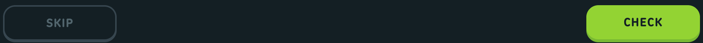

Notes: Transition: css:4779 ._1VYyp declares "filter .2s, transform var(--web-ui_button-transition-lip)", but that variable is only defined on ._2O7Ua._3Ymqr (css:1008, 100ms linear, lesson tap tokens). Elsewhere the declaration is invalid, so solid/outline buttons change instantly on hover and press (dumps show no transition on player-next, while text/unstyled buttons show "filter 0.2s"). Web-ui variant names come from the class map in js/4779-9b5aed3c.js (web-ui Button class map, module 71814).

## Text input (incl. password with eye toggle, clearable)

**Anatomy**

- wrapper _3zSI5 (flex column, gap 4px)
- label <label class="_17QjI"> (heading-small)
- field box _1Um2j (polar fill, 2px swan border, 12px radius, overflow hidden)
- <input class="_298F2"> (body text, 8px 14px padding)
- trailing 24px icon button (ypJiL _1gEmM rQJD2): eye/eye-hidden for password, circle-x clear (_3as_M) for text
- optional helper/error text _3c2kP (caption, wolf; fire-ant + circle-exclamation icon when error)

**Measurements**

| Property | Value |
| --- | --- |
| height | 48px (44px input + 2px border top/bottom) |
| input_padding | 8px 14px |
| border | 2px |
| radius | 12px |
| font | body: 500 20px/28px (var(--text-body-*) = 1.25rem/1.75rem) |
| label | 700 20px/24px (heading-small), 24px tall, 4px gap to the field (_3zSI5 gap) |
| trailing_icon_button | 24x24, margin 0 6px 0 -6px (rQJD2); eye glyph 24x17, clear glyph 18x18 |
| CSS source | css:4779-c36ad395.css ._1Um2j { background:rgb(var(--color-polar)); border:2px solid rgb(var(--color-swan)); border-radius:12px; display:flex; overflow:hidden } css:4779-c36ad395.css ._298F2 { -moz-osx-font-smoothing:grayscale; -webkit-font-smoothing:antialiased; -webkit-appearance:none; -moz-appearance:none; appearance:none; background:none; border:none; box-sizing:border-box; caret-color:rgb(var(--color-macaw)); color:rgb(var(--color-eel)); font:var(--text-body-weight) var(--text-body-size) /var(--text-body-line-height) duolingo-sans,sans-serif; font-size:var(--__internal__input-font-size,var(--text-body-size)); letter-spacing:var(--text-body-letter-spacing); line-height:var(--__internal__input-line-height,var(--text-body-line-height)); min-width:0; outline:none; padding:var(--__internal__input-padding,8px 14px); text-transform:var(--text-body-casing); width:100% } css:4779-c36ad395.css .rQJD2 { align-self:center; margin-left:-6px; margin-right:6px } css:4779-c36ad395.css ._3zSI5 { display:inline-flex; flex-direction:column; gap:4px } css:4779-c36ad395.css ._17QjI { -moz-osx-font-smoothing:grayscale; -webkit-font-smoothing:antialiased; color:rgb(var(--color-eel)); font:var(--text-heading-weight-small) var(--text-heading-size-small) /var(--text-heading-line-height-small) duolingo-sans,sans-serif; letter-spacing:var(--text-heading-letter-spacing-small); text-transform:var(--text-heading-casing-small) } |

Measured instances:

| Instance | Trace | WxH | Padding | Radius | Border | Fill | Text colour | Font |
| --- | --- | --- | --- | --- | --- | --- | --- | --- |
| text (dark, focused) | settings-profile-dark-input-focus#109 
 cl='_1Um2j' | 480x48 |  | 12px | 2px #49C0F8 (macaw, dark) | #202F36 (polar, dark) | #F1F7FB (black-text = eel, dark) [not in dump: equals the body default rgb(var(--color-black-text))] | 500 17px/20px |
| input (dark) | settings-profile-dark-input-focus#110 <input> cl='_298F2' | 452x44 | 8px 14px 8px 14px |  |  |  | #F1F7FB (black-text = eel, dark) [not in dump: equals the body default rgb(var(--color-black-text))] | 500 20px/28px |
| clear button (dark, focus only) | settings-profile-dark-input-focus#111 <button> cl='ypJiL _1gEmM _7jW2t _3as_M rQJD2' | 24x24 |  |  |  |  | #000000 (black, dark) | 400 17px/19.55px |
| password field (dark) | settings-profile-dark-input-focus#124 
 cl='_1Um2j' | 480x48 |  | 12px | 2px #37464F (swan, dark) | #202F36 (polar, dark) | #F1F7FB (black-text = eel, dark) [not in dump: equals the body default rgb(var(--color-black-text))] | 500 17px/20px |
| eye toggle (dark) | settings-profile-dark-input-focus#126 <button> cl='ypJiL _1gEmM _7jW2t rQJD2' | 24x24 |  |  |  |  | #000000 (black, dark) | 400 17px/19.55px |
| text (light, default) | settings-profile-light-default#111 
 cl='_1Um2j' | 592x48 |  | 12px | 2px #E5E5E5 (swan, light) | #F7F7F7 (polar, light) | #3C3C3C (black-text, light) [not in dump: equals the body default rgb(var(--color-black-text))] | 500 17px/20px |
| input (light) | settings-profile-light-default#112 <input> cl='_298F2' | 588x44 | 8px 14px 8px 14px |  |  |  | #4B4B4B (eel, light) | 500 20px/28px |
| label (dark) | settings-profile-dark-default#108 <label> cl='_17QjI' | 480x24 |  |  |  |  | #F1F7FB (black-text = eel, dark) [not in dump: equals the body default rgb(var(--color-black-text))] | 700 20px/24px |

**States**

| State | What changes | Source |
| --- | --- | --- |
| default | 2px swan border, polar fill | captured:settings-profile-light-default#111, settings-profile-dark-default#109 |
| hover | no hover style defined | not captured; no :hover rule on _1Um2j/_298F2 in css/*.css |
| focus (focus-within) | border -> macaw; clear button (_3as_M) becomes visible | captured:settings-profile-dark-input-focus#109, settings-profile-light-input-focus#111; css:4779-c36ad395.css ._1Um2j:focus-within:not(._2ogGd); css:4779-c36ad395.css ._1Um2j:not(:focus-within) ._3as_M |
| focus-visible | no outline (global * {outline:none}) | css:app-f2ef02f8.css * |
| error | border fire-ant; helper text fire-ant with circle-exclamation icon | css:4779-c36ad395.css ._3iU2v; css:4779-c36ad395.css ._90spc (state from JS input component in js/4779-9b5aed3c.js) |
| disabled | border polar (_1Um2j.GNpHC), text + placeholder hare, label hare (_25iRS) | css:4779-c36ad395.css .GNpHC; css:4779-c36ad395.css ._298F2:disabled; css:4779-c36ad395.css ._25iRS |
| password reveal | eye icon swaps to eye-hidden; input type -> text | JS input component (js/4779-9b5aed3c.js), not captured |

**Tokens**

| Role | Light | Dark |
| --- | --- | --- |
| field fill | #F7F7F7 (polar, light) | #202F36 (polar, dark) |
| field border | #E5E5E5 (swan, light) | #37464F (swan, dark) |
| focus border | #1CB0F6 (macaw, light) | #49C0F8 (macaw, dark) |
| error border | #EA2B2B (fire-ant, light) | #D84848 (fire-ant, dark) |
| disabled border | #F7F7F7 (polar, light) | #202F36 (polar, dark) |
| text | #4B4B4B (eel, light) | #F1F7FB (eel, dark) |
| placeholder | #777777 (wolf, light) | #DCE6EC (wolf, dark) |
| disabled text | #AFAFAF (hare, light) | #52656D (hare, dark) |
| caret | #1CB0F6 (macaw, light) | #49C0F8 (macaw, dark) |
| label | #4B4B4B (eel, light) | #F1F7FB (eel, dark) |
| eye icon | #1CB0F6 (macaw, light) | #49C0F8 (macaw, dark) |
| clear icon | #AFAFAF (hare, light) | #52656D (hare, dark) |

Type style: Input: body (500, 20px/28px at desktop). Label: heading-small (700, 20px/24px). Helper: caption (500, 16px/24px).

Responsive (570px): No mobile capture of settings/profile. --text-body-size is 1.25rem everywhere in the :root rule (css:7459), so the input stays 20px.

Screenshots: dark: `out/screenshots/settings-profile-dark-input-focus.png`; light: `out/screenshots/settings-profile-light-default.png`

Crops: [dark: text-input-dark.png](crops/text-input-dark.png) [light: text-input-light.png](crops/text-input-light.png)

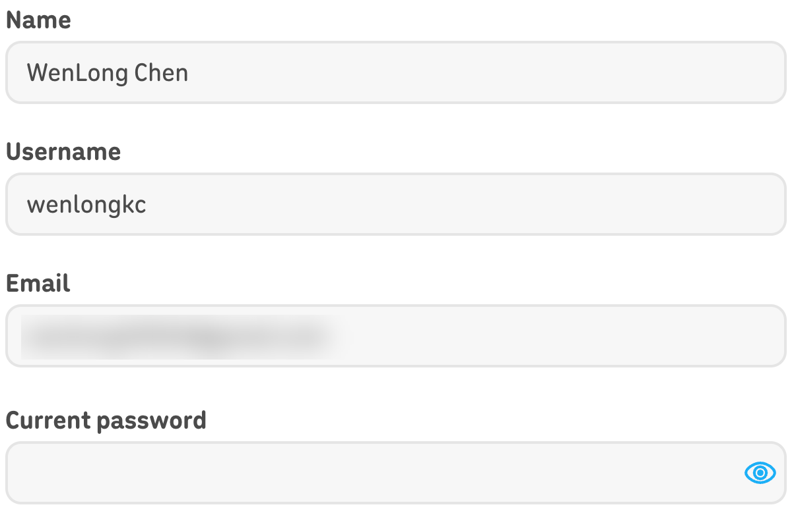
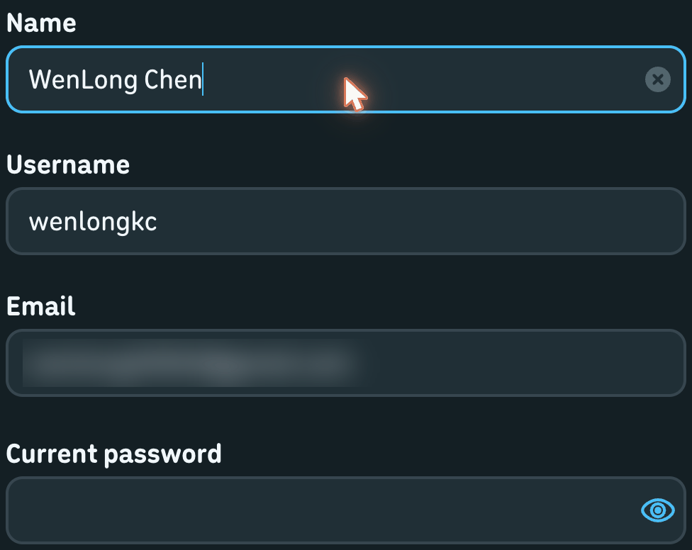

## Search input (friend search) with clear button

**Anatomy**

- form JW88y (polar fill, 2px swan border, 12px radius, 16px 20px padding)
- leading search glyph (sprite b3fgl 14x15, scaled 1.4, 17px right margin)
- <input class="t40Pr"> (transparent, eel, 22px/400)
- trailing clear  20x20, only when the field has text

**Measurements**

| Property | Value |
| --- | --- |
| height | 63px (27px input + 16px padding x2 + 2px border x2) |
| padding | 16px 20px |
| border | 2px |
| radius | 12px |
| font | 400 22px / 25.3px |
| icon | search 20x21 rendered, clear 20x20 |
| CSS source | css:2173-53849902.css .JW88y { align-items:center; background-color:rgb(var(--color-polar)); border:2px solid rgb(var(--color-swan)); border-radius:12px; color:rgb(var(--color-eel)); display:flex; font-size:22px; margin-bottom:48px; padding:16px 20px } css:2173-53849902.css .t40Pr { background-color:transparent; border:0; color:rgb(var(--color-eel)); flex:1 1 auto } css:2173-53849902.css ._1QdIO { margin-right:17px; transform:scale(1.4); transform-origin:50% 50% } css:2173-53849902.css ._36I3w { cursor:pointer; flex:0 0 auto } |

Measured instances:

| Instance | Trace | WxH | Padding | Radius | Border | Fill | Text colour | Font |
| --- | --- | --- | --- | --- | --- | --- | --- | --- |
| dark | user-search-dark-results#68 <form> cl='JW88y' | 896x63 | 16px 20px 16px 20px | 12px | 2px #37464F (swan, dark) | #202F36 (polar, dark) | #F1F7FB (black-text = eel, dark) [not in dump: equals the body default rgb(var(--color-black-text))] | 500 22px/20px |
| input dark | user-search-dark-results#70 <input> cl='t40Pr' dt='user-search-input' | 801x27 | 1px 2px 1px 2px |  |  |  | #F1F7FB (black-text = eel, dark) [not in dump: equals the body default rgb(var(--color-black-text))] | 400 22px/25.3px |
| clear dark | user-search-dark-results#71  cl='_36I3w' | 20x20 |  |  |  |  | #F1F7FB (black-text = eel, dark) [not in dump: equals the body default rgb(var(--color-black-text))] | 500 22px/20px |
| light | user-search-light-results#68 <form> cl='JW88y' | 1008x63 | 16px 20px 16px 20px | 12px | 2px #E5E5E5 (swan, light) | #F7F7F7 (polar, light) | #4B4B4B (eel, light) | 500 22px/20px |
| focused, empty (dark) | user-search-dark-input-focus#68 <form> cl='JW88y' | 896x63 | 16px 20px 16px 20px | 12px | 2px #37464F (swan, dark) | #202F36 (polar, dark) | #F1F7FB (black-text = eel, dark) [not in dump: equals the body default rgb(var(--color-black-text))] | 500 22px/20px |

**States**

| State | What changes | Source |
| --- | --- | --- |
| default (with query) | clear icon visible | captured:user-search-dark-results#71 |
| focus | no border change (JW88y has no :focus-within rule); in the capture the page swaps to the empty-state illustration | captured:user-search-dark-input-focus#68 (border still swan) |
| empty | clear icon removed from DOM | captured:user-search-dark-input-focus (no _36I3w node) |
| hover | no rule | not captured; no :hover rule for JW88y |
| disabled | no rule | not captured |

**Tokens**

| Role | Light | Dark |
| --- | --- | --- |
| fill | #F7F7F7 (polar, light) | #202F36 (polar, dark) |
| border | #E5E5E5 (swan, light) | #37464F (swan, dark) |
| text | #4B4B4B (eel, light) | #F1F7FB (eel, dark) |

Type style: 22px / weight 400 (desktop); 19px below 700px.

Responsive (570px): @media (max-width:699px): font-size 19px, margin 0 16px 16px, padding 16px (css:2173 .JW88y). No 570px capture of this page.

Screenshots: dark: `out/screenshots/user-search-dark-results.png`; light: `out/screenshots/user-search-light-results.png`

Crops: [dark: search-input-dark.png](crops/search-input-dark.png) [light: search-input-light.png](crops/search-input-light.png)

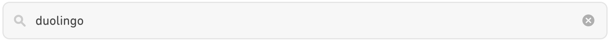
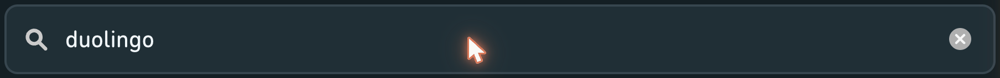

Notes: The web-ui input (_298F2) also has a type=search mode (RPjiw search icon, wolf) but no captured page uses it.

## Select (native <select> behind a 3D face)

**Anatomy**

- wrapper _1l2WX
- face _3QwUP _1dgwa: 50px, border 2/2/4 transparent, ::before snow fill + 2px swan border + 0 2px 0 swan lip
- value text _3xxe1 (15px 700 uppercase, ellipsis)
- chevron svg _3N2pE 15x9, hare, 16px from right
- invisible native <select class="_2bftX"> stretched over the face (opacity 0) that opens the OS menu

**Measurements**

| Property | Value |
| --- | --- |
| height | 50px |
| padding | 0 41px 0 12px |
| border | 2px 2px 4px (transparent) + ::before 2px border |
| lip | 2px box-shadow (4px visual) |
| radius | 12px |
| font | 700 15px/18px, 0.8px, uppercase (value); face font 500 17px/25px |
| chevron | 15x9 |
| CSS source | css:2833-494f8efd.css ._3QwUP { border:solid transparent; border-radius:12px; border-width:2px 2px 4px; color:rgb(var(--color-wolf)); height:50px; padding:0 41px 0 12px } css:2833-494f8efd.css ._3QwUP:before { background:rgb(var(--color-snow)); border:2px solid rgb(var(--color-swan)); border-radius:12px; bottom:-2px; box-shadow:0 2px 0 rgb(var(--color-swan)); content:""; left:-2px; position:absolute; right:-2px; top:-2px } css:2833-494f8efd.css ._3xxe1 { position:relative } css:2833-494f8efd.css ._3QwUP ._3N2pE { color:rgb(var(--color-hare)); position:absolute; right:16px } |

Measured instances:

| Instance | Trace | WxH | Padding | Radius | Border | Fill | Text colour | Font |
| --- | --- | --- | --- | --- | --- | --- | --- | --- |
| dark | settings-account-dark-default#140 
 cl='_3QwUP _1dgwa' | 480x50 | 0px 41px 0px 12px | 12px | 2px 2px 4px 2px transparent | ::before #131F24 (snow, dark); lip #37464F (swan, dark) 0px 2px 0px 0px | #DCE6EC (wolf, dark) | label 700 15px/18px ls 0.8px uppercase |
| value dark | settings-account-dark-default#141  cl='_3xxe1' | 423x18 |  |  |  |  | #DCE6EC (wolf, dark) | 700 15px/18px |
| chevron dark | settings-account-dark-default#142 <svg> cl='_3N2pE' | 15x9 |  |  |  |  | #52656D (hare, dark) | 500 17px/25px |
| light | settings-account-light-default#143 
 cl='_3QwUP _1dgwa' | 592x50 | 0px 41px 0px 12px | 12px | 2px 2px 4px 2px transparent | ::before #FFFFFF (snow, light); lip #E5E5E5 (swan, light) 0px 2px 0px 0px | #777777 (wolf, light) | label 700 15px/18px ls 0.8px uppercase |
| disabled light | settings-notifications-light-default#163 
 cl='_3QwUP _1dgwa _2MogS' | 592x50 | 0px 41px 0px 12px | 12px | 2px 2px 4px 2px transparent | ::before #E5E5E5 (swan, light) | #AFAFAF (hare, light) | label 700 15px/18px ls 0.8px uppercase |
| disabled dark | settings-notifications-dark-default#161 
 cl='_3QwUP _1dgwa _2MogS' | 480x50 | 0px 41px 0px 12px | 12px | 2px 2px 4px 2px transparent | ::before #37464F (swan, dark) | #52656D (hare, dark) | label 700 15px/18px ls 0.8px uppercase |

**States**

| State | What changes | Source |
| --- | --- | --- |
| default | snow face, swan border/lip | captured:settings-account-dark-default#140 |
| open | OS-native menu; no DOM change | captured:settings-account-dark-select-open (no style diff vs default; native popup not in DOM, no screenshot) |
| hover | no rule | not captured; no :hover rule on _3QwUP |
| focus | no rule; global outline:none | css:app-f2ef02f8.css * |
| disabled (_2MogS) | face swan, lip removed, translateY(2px), value + chevron hare | captured:settings-notifications-light-default#163, settings-notifications-dark-default#161; css:2833-494f8efd.css ._3QwUP._2MogS:before |
| placeholder (_4tAgT) | value hare | css:2833-494f8efd.css ._3QwUP._4tAgT |

**Tokens**

| Role | Light | Dark |
| --- | --- | --- |
| face | #FFFFFF (snow, light) | #131F24 (snow, dark) |
| border + lip | #E5E5E5 (swan, light) | #37464F (swan, dark) |
| value | #777777 (wolf, light) | #DCE6EC (wolf, dark) |
| chevron | #AFAFAF (hare, light) | #52656D (hare, dark) |
| disabled face | #E5E5E5 (swan, light) | #37464F (swan, dark) |
| disabled value | #AFAFAF (hare, light) | #52656D (hare, dark) |

Type style: Value: 700 15px/18px uppercase 0.8px.

Responsive (570px): Mobile (settings-account-dark-mobile#50): same 50px face, full column width 502px.

Screenshots: dark: `out/screenshots/settings-account-dark-default.png`; light: `out/screenshots/settings-account-light-default.png`

Crops: [dark: select-dark.png](crops/select-dark.png) [light: select-light.png](crops/select-light.png) [light: select-disabled-light.png](crops/select-disabled-light.png)

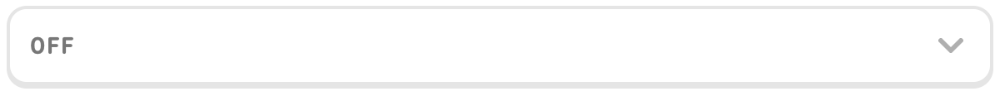
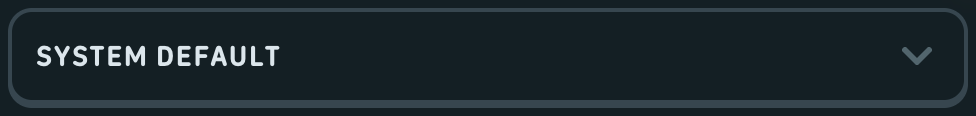

## Checkbox (square toggle button)

**Anatomy**

- hit area _31gfP 32x32
- <button aria-pressed class="Ug-rb"> 30x30, 2px border, 8px radius
- checkmark-small svg 24x24 (glyph 13x10), snow, only when checked

**Measurements**

| Property | Value |
| --- | --- |
| size | 30x30 inside a 32x32 box |
| border | 2px |
| radius | 8px |
| icon | 24x24 box, 13x10 glyph |
| CSS source | css:4779-c36ad395.css .Ug-rb { --web-ui_button-filter-hover:none; align-items:center; border:2px solid rgb(var(--color-swan))!important; border-radius:8px; box-sizing:border-box; color:rgb(var(--color-macaw)); height:30px; justify-content:center; width:30px } css:4779-c36ad395.css .Ug-rb._2u5BZ { background:rgb(var(--color-macaw))!important; border-color:rgb(var(--color-macaw))!important } css:4779-c36ad395.css ._31gfP { align-items:center; display:inline-flex; height:32px; justify-content:center; width:32px } |

Measured instances:

| Instance | Trace | WxH | Padding | Radius | Border | Fill | Text colour | Font |
| --- | --- | --- | --- | --- | --- | --- | --- | --- |
| unchecked dark | settings-notifications-dark-default#112 <button> cl='_1gEmM _7jW2t Ug-rb' | 30x30 |  | 8px | 2px #37464F (swan, dark) |  | #49C0F8 (macaw, dark) | 400 17px/19.55px |
| checked dark | settings-notifications-dark-default#142 <button> cl='_1gEmM _7jW2t Ug-rb _2u5BZ' | 30x30 |  | 8px | 2px #49C0F8 (macaw, dark) | #49C0F8 (macaw, dark) | #49C0F8 (macaw, dark) | 400 17px/19.55px |
| unchecked light | settings-notifications-light-default#114 <button> cl='_1gEmM _7jW2t Ug-rb' | 30x30 |  | 8px | 2px #E5E5E5 (swan, light) |  | #1CB0F6 (macaw, light) | 400 17px/19.55px |
| checked light | settings-notifications-light-default#144 <button> cl='_1gEmM _7jW2t Ug-rb _2u5BZ' | 30x30 |  | 8px | 2px #1CB0F6 (macaw, light) | #1CB0F6 (macaw, light) | #1CB0F6 (macaw, light) | 400 17px/19.55px |

**States**

| State | What changes | Source |
| --- | --- | --- |
| unchecked | transparent fill, 2px swan border | captured:settings-notifications-light-default#114 |
| checked (aria-pressed=true, _2u5BZ) | fill + border macaw, white check | captured:settings-notifications-light-default#144, settings-notifications-dark-default#142 |
| hover | none: Ug-rb sets --web-ui_button-filter-hover:none | captured:settings-notifications-dark-checkbox-hover (pointer at 743,190 over #112, no style change); css:4779-c36ad395.css .Ug-rb |
| active | no lip, so no press offset (unstyled button) | css:4779-c36ad395.css ._1gEmM |
| focus-visible | none | css:app-f2ef02f8.css * |
| disabled (_2iy1h) | fill polar, border swan; checked+disabled fill swan; glyph hare | css:4779-c36ad395.css .Ug-rb._2iy1h; css:4779-c36ad395.css .Ug-rb._2iy1h._2u5BZ |
| loading (v_y2w) | no fill, no border (spinner dots) | css:4779-c36ad395.css .Ug-rb.v_y2w |

**Tokens**

| Role | Light | Dark |
| --- | --- | --- |
| border | #E5E5E5 (swan, light) | #37464F (swan, dark) |
| checked fill + border | #1CB0F6 (macaw, light) | #49C0F8 (macaw, dark) |
| check glyph | #FFFFFF (snow, light) | #131F24 (snow, dark) |
| disabled fill | #F7F7F7 (polar, light) | #202F36 (polar, dark) |
| disabled checked fill | #E5E5E5 (swan, light) | #37464F (swan, dark) |
| disabled glyph | #AFAFAF (hare, light) | #52656D (hare, dark) |

Type style: n/a (icon only)

Responsive (570px): No 570px capture of this component.

Screenshots: dark: `out/screenshots/settings-notifications-dark-default.png`; light: `out/screenshots/settings-notifications-light-default.png`

Crops: [dark: checkbox-dark.png](crops/checkbox-dark.png) [light: checkbox-light.png](crops/checkbox-light.png)

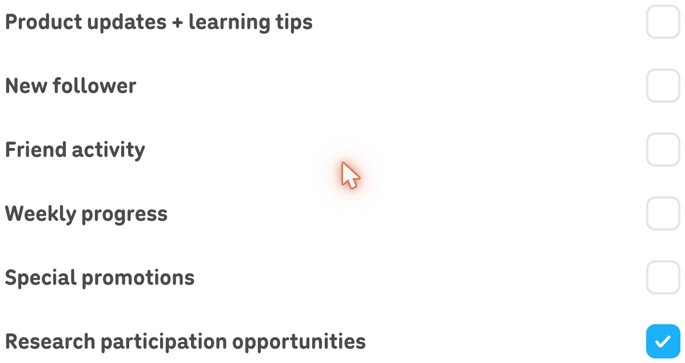
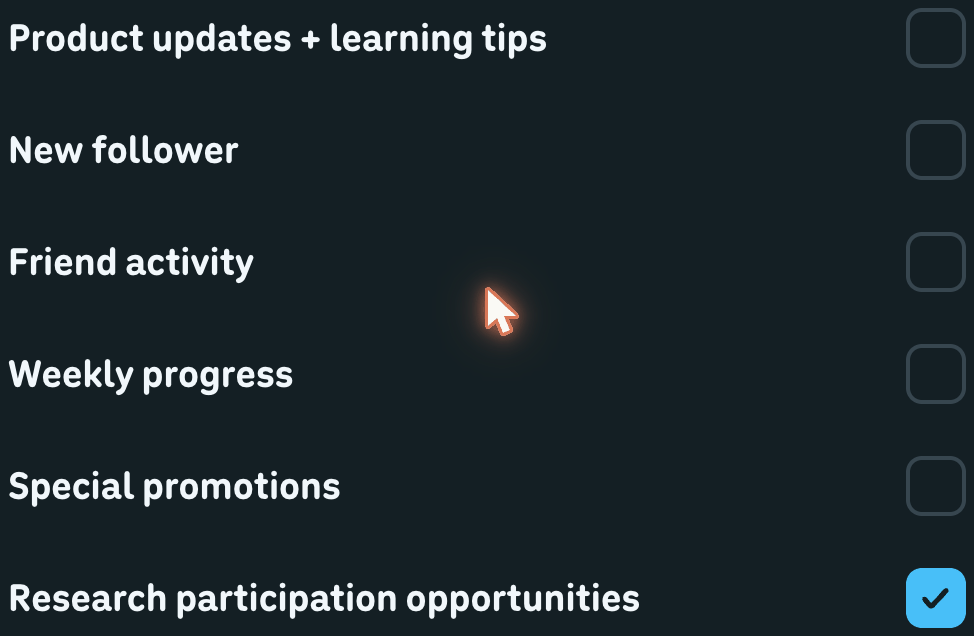

## Radio / selectable card (web-ui Card, role=radio)

**Anatomy**

- radiogroup container (column gap 12px for streak goal; 2-col grid gap 16px in settings)
- card _8dMUn: border 2/2/4 transparent + ::before fill with 2px border and 0 2px 0 lip
- content: title (body-spacious bold) + trailing caption (streak goal row) or image + caption (settings card)

**Measurements**

| Property | Value |
| --- | --- |
| row_height | 54px (streak goal) |
| row_padding | 8px 16px (a3yOs) |
| row_gap | 12px |
| card_padding | 30px desktop / 15px below 700px (_8YNCv) |
| border | 2px, bottom 4px space for the lip |
| lip | 0 2px 0 (4px visual) |
| radius | 12px |
| title_font | 700 20px/32px (streak goal, body-spacious-bold via .WMgCJ) |
| caption_font | 500 16px/24px (caption) |
| CSS source | css:4779-c36ad395.css ._8dMUn { --__internal__border-color:var(     --web-ui_card-border-color,rgb(var(--color-swan))   ); border:solid transparent; border-radius:var(--web-ui_card-border-radius,12px); border-width:2px 2px 4px; cursor:pointer; display:inline-flex; outline:0; position:relative; touch-action:manipulation; transform:translateZ(0); -webkit-user-select:none; -moz-user-select:none; user-select:none } css:4779-c36ad395.css ._8dMUn:before { background-color:var(--web-ui_card-background-color,rgb(var(--color-snow))); border:2px solid var(--__internal__border-color); border-radius:var(--web-ui_card-border-radius,12px); bottom:-2px; box-shadow:0 2px 0 var(--__internal__border-color); content:""; left:-2px; position:absolute; right:-2px; top:-2px; z-index:-1 } css:1008-b4d34396.css .a3yOs { align-items:center; display:flex; justify-content:space-between; padding:8px 16px } css:1008-b4d34396.css ._13-RH { display:flex; flex-direction:column; gap:12px; justify-content:center; margin:0 auto; max-width:480px; opacity:calc(1 - var(--streak-goal-before-slide-up, 1)); transition:opacity .35s ease-in-out; width:100% } css:4243-a8d324a8.css ._8YNCv { color:rgb(var(--color-eel)); padding:15px } |

Measured instances:

| Instance | Trace | WxH | Padding | Radius | Border | Fill | Text colour | Font |
| --- | --- | --- | --- | --- | --- | --- | --- | --- |
| streak goal row (dark) | lesson-dark-streak-goal-default#245 
 cl='_8dMUn a3yOs' | 480x54 | 8px 16px 8px 16px | 12px | 2px 2px 4px 2px transparent | ::before #131F24 (snow, dark); lip #37464F (swan, dark) 0px 2px 0px 0px | #F1F7FB (black-text = eel, dark) [not in dump: equals the body default rgb(var(--color-black-text))] | label 700 20px/32px ls normal none |
| streak goal row hover (dark) | lesson-dark-streak-goal-row-hover#242 
 cl='_8dMUn a3yOs' | 480x54 | 8px 16px 8px 16px | 12px | 2px 2px 4px 2px transparent | ::before #202F36 (polar, dark); lip #37464F (swan, dark) 0px 2px 0px 0px | #F1F7FB (black-text = eel, dark) [not in dump: equals the body default rgb(var(--color-black-text))] | label 700 20px/32px ls normal none |
| settings card checked (dark) | settings-account-dark-default#159 
 cl='_8dMUn _1pRZ7 _8YNCv' | 232x138 | 30px | 12px | 2px 2px 4px 2px transparent | ::before #202F36 (polar, dark); lip #3F85A7 (blue-jay, dark) 0px 2px 0px 0px | #1899D6 (whale, dark) | label 500 17px/20px ls normal none |
| settings card unchecked (dark) | settings-account-dark-default#163 
 cl='_8dMUn _8YNCv' | 232x138 | 30px | 12px | 2px 2px 4px 2px transparent | ::before #131F24 (snow, dark); lip #37464F (swan, dark) 0px 2px 0px 0px | #F1F7FB (black-text = eel, dark) [not in dump: equals the body default rgb(var(--color-black-text))] | label 500 17px/20px ls normal none |
| settings card checked (light) | settings-account-light-default#162 
 cl='_8dMUn _1pRZ7 _8YNCv' | 288x138 | 30px | 12px | 2px 2px 4px 2px transparent | ::before #DDF4FF (iguana, light); lip #84D8FF (blue-jay, light) 0px 2px 0px 0px | #1899D6 (whale, light) | label 500 17px/20px ls normal none |
| lesson choice selected (dark, same _8dMUn card) | lesson-dark-choice-selected#59 
 cl='_8dMUn _1pRZ7 _2cKzl _1G3d-' dt='challenge-choice' | 600x70 | 12px 16px 12px 16px | 12px | 2px 2px 4px 2px transparent | ::before #202F36 (polar, dark); lip #3F85A7 (blue-jay, dark) 0px 2px 0px 0px | #1899D6 (whale, dark) | label 700 15px/21px ls normal none |
| settings card unchecked (light) | settings-account-light-default#166 
 cl='_8dMUn _8YNCv' | 288x138 | 30px | 12px | 2px 2px 4px 2px transparent | ::before #FFFFFF (snow, light); lip #E5E5E5 (swan, light) 0px 2px 0px 0px | #4B4B4B (eel, light) | label 500 17px/20px ls normal none |

**States**

| State | What changes | Source |
| --- | --- | --- |
| default | snow fill, swan border/lip | captured:lesson-dark-streak-goal-default#245 |
| hover | fill -> polar (only when not active/checked/disabled) | captured:lesson-dark-streak-goal-row-hover#242 (::before fill polar); css:4779-c36ad395.css @media (hover:hover) ._8dMUn:hover:not(:active):not(._1pRZ7):not(._3neHb):before |
| active / pressed | translateY(2px), lip removed, fill iguana, border blue-jay, text whale | css:4779-c36ad395.css ._8dMUn:active:not(._3neHb); css:4779-c36ad395.css ._8dMUn:active:not(._3neHb):before |
| selected (aria-checked=true, _1pRZ7) | fill iguana, border + lip blue-jay, text whale; lip kept (no press offset) | captured:settings-account-dark-default#159, settings-account-light-default#162, lesson-dark-choice-selected#59; css:4779-c36ad395.css ._8dMUn._1pRZ7:before |
| focus-visible | none (outline:0) | css:4779-c36ad395.css ._8dMUn |
| disabled (_3neHb) | pressed geometry (translateY 2px, no lip), text swan, cursor default | css:4779-c36ad395.css ._8dMUn._3neHb:not(._1pRZ7):not(._2cKzl) |

**Tokens**

| Role | Light | Dark |
| --- | --- | --- |
| fill | #FFFFFF (snow, light) | #131F24 (snow, dark) |
| border + lip | #E5E5E5 (swan, light) | #37464F (swan, dark) |
| hover fill | #F7F7F7 (polar, light) | #202F36 (polar, dark) |
| checked fill | #DDF4FF (iguana, light) | #202F36 (iguana, dark) |
| checked border + lip | #84D8FF (blue-jay, light) | #3F85A7 (blue-jay, dark) |
| checked text | #1899D6 (whale, light) | #1899D6 (whale, dark) |
| disabled text | #E5E5E5 (swan, light) | #37464F (swan, dark) |

Type style: Title body-spacious bold (700, 20px/32px here); caption 500 16px/24px.

Responsive (570px): Settings cards: padding 15px below 700px (css:4243 ._8YNCv), 30px at >=700px; mobile capture settings-account-dark-mobile#68 is 243x108.

Screenshots: dark: `out/screenshots/lesson-dark-streak-goal-row-hover.png`; light: `out/screenshots/settings-account-light-default.png`

Crops: [dark: radio-card-dark.png](crops/radio-card-dark.png) [dark: radio-card-selected-dark.png](crops/radio-card-selected-dark.png) [light: radio-card-light.png](crops/radio-card-light.png)

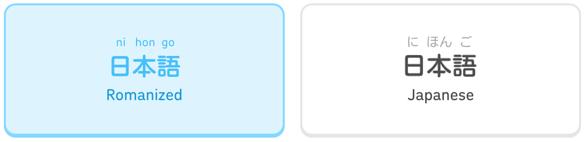
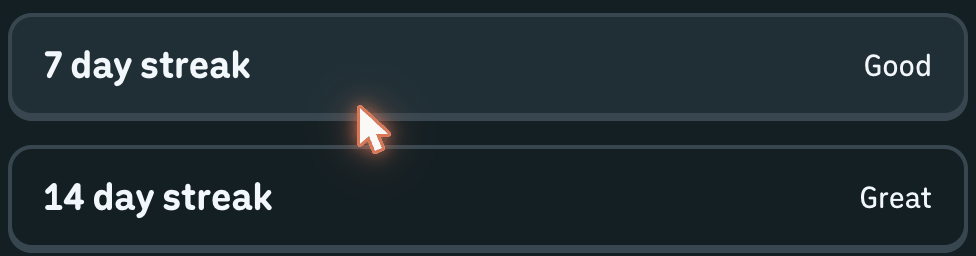

Notes: Lesson multiple-choice options use the same _8dMUn card and belong to the lesson-screen spec (other agent). No light-theme streak-goal capture exists.

## Toggle / switch

**Anatomy**

- <button aria-pressed class="_2mkWS"> 56x32, macaw
- track span _1gwYP 56x24, 12px radius, background linear-gradient(to left, swan 50%, macaw 50%)
- knob = track ::before 30x32, snow fill, 2/2/4 border, 8px radius; translateX(26px) when on (XIyeO)

**Measurements**

| Property | Value |
| --- | --- |
| button | 56x32 |
| track | 56x24, radius 12px |
| knob | 30x32, border 2px 2px 4px, radius 8px |
| travel | 26px |
| transition | transform .2s |
| CSS source | css:4243-a8d324a8.css ._2mkWS { --web-ui_button-filter-hover:none; color:rgb(var(--color-macaw)); height:32px } css:4243-a8d324a8.css ._1gwYP { align-items:center; width:56px } css:4243-a8d324a8.css ._1gwYP:before { background:rgb(var(--color-snow)); border-color:rgb(var(--color-swan)); border-radius:8px; border-style:solid; border-width:2px 2px 4px; box-sizing:border-box; content:""; height:32px; position:absolute; transition:transform .2s; width:30px } css:4243-a8d324a8.css ._1gwYP.XIyeO:before { border-color:rgb(var(--color-macaw)); transform:translateX(26px) } |

Measured instances:

| Instance | Trace | WxH | Padding | Radius | Border | Fill | Text colour | Font |
| --- | --- | --- | --- | --- | --- | --- | --- | --- |
| on (dark) | settings-account-dark-default#110 <button> cl='_1gEmM _7jW2t _2mkWS' | 56x32 |  |  |  |  | #49C0F8 (macaw, dark) | 400 17px/19.55px |
| track on (dark) | settings-account-dark-default#111  cl='_1gwYP XIyeO _9lHjd' | 56x24 |  | 12px |  | ::before #131F24 (snow, dark) | #49C0F8 (macaw, dark) | 400 17px/19.55px |
| off (dark) | settings-social-dark-default#107 <button> cl='_1gEmM _7jW2t _2mkWS' | 56x32 |  |  |  |  | #49C0F8 (macaw, dark) | 400 17px/19.55px |
| track off (dark) | settings-social-dark-default#108  cl='_1gwYP _9lHjd' | 56x24 |  | 12px |  | ::before #131F24 (snow, dark) | #49C0F8 (macaw, dark) | 400 17px/19.55px |
| on (light) | settings-account-light-default#113 <button> cl='_1gEmM _7jW2t _2mkWS' | 56x32 |  |  |  |  | #1CB0F6 (macaw, light) | 400 17px/19.55px |
| off (light) | settings-social-light-default#109 <button> cl='_1gEmM _7jW2t _2mkWS' | 56x32 |  |  |  |  | #1CB0F6 (macaw, light) | 400 17px/19.55px |
| track off (light) | settings-social-light-default#110  cl='_1gwYP _9lHjd' | 56x24 |  | 12px |  | ::before #FFFFFF (snow, light) | #1CB0F6 (macaw, light) | 400 17px/19.55px |

**States**

| State | What changes | Source |
| --- | --- | --- |
| off (aria-pressed=false) | knob at left covering the macaw half: swan track shows, knob border swan | captured:settings-social-dark-default#107/#108, settings-social-light-default#109/#110 |
| on (aria-pressed=true, XIyeO) | knob translateX(26px), knob border macaw, macaw half shows | captured:settings-account-dark-default#110/#111; css:4243-a8d324a8.css ._1gwYP.XIyeO:before |
| hover | none (--web-ui_button-filter-hover:none) | css:4243-a8d324a8.css ._2mkWS |
| focus-visible | none | css:app-f2ef02f8.css * |
| disabled (_22EkB) | track polar, knob border polar | css:4243-a8d324a8.css ._1gwYP._22EkB; css:4243-a8d324a8.css ._1gwYP._22EkB:before |

**Tokens**

| Role | Light | Dark |
| --- | --- | --- |
| track on side | #1CB0F6 (macaw, light) | #49C0F8 (macaw, dark) |
| track off side | #E5E5E5 (swan, light) | #37464F (swan, dark) |
| knob fill | #FFFFFF (snow, light) | #131F24 (snow, dark) |
| knob border off | #E5E5E5 (swan, light) | #37464F (swan, dark) |
| knob border on | #1CB0F6 (macaw, light) | #49C0F8 (macaw, dark) |
| disabled track + knob border | #F7F7F7 (polar, light) | #202F36 (polar, dark) |

Type style: n/a

Responsive (570px): Same size on mobile (settings-account-dark-mobile#21, #39 off).

Screenshots: dark: `out/screenshots/settings-account-dark-default.png`; light: `out/screenshots/settings-account-light-default.png`

Crops: [dark: toggle-dark.png](crops/toggle-dark.png) [dark: toggle-off-dark.png](crops/toggle-off-dark.png) [light: toggle-light.png](crops/toggle-light.png) [light: toggle-off-light.png](crops/toggle-off-light.png)

## Tabs: underline tabs (Characters page)

**Anatomy**

- row _7WPBm of equal-width tabs
- tab _3ugho: text + 2px bottom border, 15px vertical padding

**Measurements**

| Property | Value |
| --- | --- |
| height | 52px |
| padding | 15px 0 |
| border_bottom | 2px |
| font | 700 17px/20px, letter-spacing .03em (0.51px), uppercase |
| width | 158px each at 480px column (dark), 195px at 592px (light) |
| CSS source | css:9416-975668fa.css ._3ugho { border-bottom:2px solid rgb(var(--color-swan)); color:rgb(var(--color-hare)); font-size:17px; letter-spacing:.03em; padding:15px 0; text-transform:uppercase } |

Measured instances:

| Instance | Trace | WxH | Padding | Radius | Border | Fill | Text colour | Font |
| --- | --- | --- | --- | --- | --- | --- | --- | --- |
| selected (dark) | characters-dark-default#155 
 cl='_1H-vp _3ugho' | 158x52 | 15px 0px 15px 0px |  | 0px 0px 2px 0px #49C0F8 (macaw, dark) |  | #49C0F8 (macaw, dark) | 700 17px/20px |
| unselected (dark) | characters-dark-default#157 
 cl='_3ugho' | 158x52 | 15px 0px 15px 0px |  | 0px 0px 2px 0px #37464F (swan, dark) |  | #52656D (hare, dark) | 700 17px/20px |
| hover (dark) | characters-dark-tab-hover#157 
 cl='_3ugho' | 158x52 | 15px 0px 15px 0px |  | 0px 0px 2px 0px #49C0F8 (macaw, dark) |  | #49C0F8 (macaw, dark) | 700 17px/20px |
| selected (light) | characters-light-default#163 
 cl='_1H-vp _3ugho' | 195x52 | 15px 0px 15px 0px |  | 0px 0px 2px 0px #1CB0F6 (macaw, light) |  | #1CB0F6 (macaw, light) | 700 17px/20px |
| unselected (light) | characters-light-default#165 
 cl='_3ugho' | 195x52 | 15px 0px 15px 0px |  | 0px 0px 2px 0px #E5E5E5 (swan, light) |  | #AFAFAF (hare, light) | 700 17px/20px |

**States**

| State | What changes | Source |
| --- | --- | --- |
| default | hare label, swan 2px rule | captured:characters-dark-default#157 |
| hover | label + rule macaw | captured:characters-dark-tab-hover#157; css:9416-975668fa.css ._3ugho:hover |
| active | label + rule macaw | css:9416-975668fa.css ._3ugho:active |
| focus | label + rule macaw | css:9416-975668fa.css ._3ugho:focus |
| selected (_1H-vp) | label + rule macaw | captured:characters-dark-default#155 |
| disabled | no rule | not captured |

**Tokens**

| Role | Light | Dark |
| --- | --- | --- |
| label | #AFAFAF (hare, light) | #52656D (hare, dark) |
| rule | #E5E5E5 (swan, light) | #37464F (swan, dark) |
| selected/hover label + rule | #1CB0F6 (macaw, light) | #49C0F8 (macaw, dark) |

Type style: 700 17px/20px uppercase, 0.03em tracking.

Responsive (570px): No 570px capture of this component.

Screenshots: dark: `out/screenshots/characters-dark-default.png`; light: `out/screenshots/characters-light-default.png`

Crops: [dark: tabs-underline-dark.png](crops/tabs-underline-dark.png) [light: tabs-underline-light.png](crops/tabs-underline-light.png)

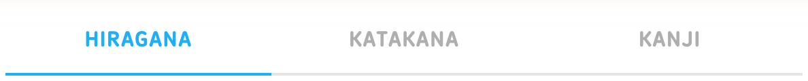
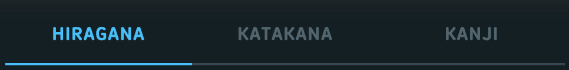

## Tabs: bordered-list tabs (Profile Following / Followers)

**Anatomy**

- bordered box _2G9SS (2px swan, 16px radius)
- tab strip ul _1SZs_ _3Jy0n (2px swan bottom rule, label font 700 15px uppercase 0.8px)
- tab li cwfCJ (padding-top 16px) > span bsF09 (16px, 12px bottom padding, 2px bottom border overlapping the rule by -2px)

**Measurements**

| Property | Value |
| --- | --- |
| tab_height | 48px (16px top padding + 34px label box - 2px overlap) |
| label | 700 16px, 0.8px, uppercase |
| indicator | 2px bottom border |
| CSS source | css:3014-2a6e31d6.css ._36qf- { flex:1 1 0; padding-top:16px } css:3014-2a6e31d6.css .bsF09 { display:block; margin-bottom:-2px; text-align:center } css:3014-2a6e31d6.css ._3Jy0n { border-bottom:2px solid rgb(var(--color-swan)); position:relative } css:3014-2a6e31d6.css ._3o5O9>.bsF09 { border-bottom-color:rgb(var(--color-macaw)); color:rgb(var(--color-macaw)) } |

Measured instances:

| Instance | Trace | WxH | Padding | Radius | Border | Fill | Text colour | Font |
| --- | --- | --- | --- | --- | --- | --- | --- | --- |
| selected (dark) | profile-dark-default#144  cl='_38_oS bsF09' | 182x34 | 0px 0px 12px 10px |  | 0px 0px 2px 0px #49C0F8 (macaw, dark) |  | #49C0F8 (macaw, dark) | label 700 16px/20px ls 0.8px uppercase |
| unselected (dark) | profile-dark-default#147  cl='_38_oS bsF09' | 182x34 | 0px 10px 12px 0px |  | 0px 0px 2px 0px transparent |  | #DCE6EC (wolf, dark) | label 700 16px/20px ls 0.8px uppercase |
| strip (dark) | profile-dark-default#142 <ul> cl='_1SZs_ _3Jy0n _2Rt1l' | 364x50 |  |  | 0px 0px 2px 0px #37464F (swan, dark) |  | #F1F7FB (black-text = eel, dark) [not in dump: equals the body default rgb(var(--color-black-text))] | label 700 16px/20px ls 0.8px uppercase |
| selected (light) | profile-light-default#145  cl='_38_oS bsF09' | 182x34 | 0px 0px 12px 10px |  | 0px 0px 2px 0px #1CB0F6 (macaw, light) |  | #1CB0F6 (macaw, light) | label 700 16px/20px ls 0.8px uppercase |
| unselected (light) | profile-light-default#148  cl='_38_oS bsF09' | 182x34 | 0px 10px 12px 0px |  | 0px 0px 2px 0px transparent |  | #999999 (NO-PALETTE-MATCH, light) | label 700 16px/20px ls 0.8px uppercase |

**States**

| State | What changes | Source |
| --- | --- | --- |
| default | label gray-text, transparent indicator | captured:profile-dark-default#147 |
| hover | label + indicator macaw | css:3014-2a6e31d6.css .cwfCJ:hover>.bsF09 |
| selected (_3o5O9) | label + indicator macaw | captured:profile-dark-default#144 |
| focus / active / disabled | no rules | not captured |

**Tokens**

| Role | Light | Dark |
| --- | --- | --- |
| label | rgb(var(--color-gray-text)) = #999999 per dumps/rootvars-light.json (name not in palettes-raw.json) | #DCE6EC (renders as wolf, dark; gray-text dark value not in palette file) |
| selected label + indicator | #1CB0F6 (macaw, light) | #49C0F8 (macaw, dark) |
| strip rule | #E5E5E5 (swan, light) | #37464F (swan, dark) |

Type style: 700 16px uppercase, 0.8px tracking.

Responsive (570px): No 570px capture of this component.

Screenshots: dark: `out/screenshots/profile-dark-default.png`; light: `out/screenshots/profile-light-default.png`

Crops: [dark: tabs-list-dark.png](crops/tabs-list-dark.png) [light: tabs-list-light.png](crops/tabs-list-light.png)

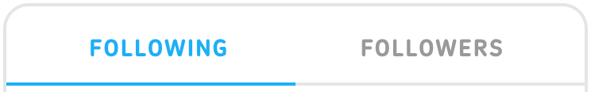
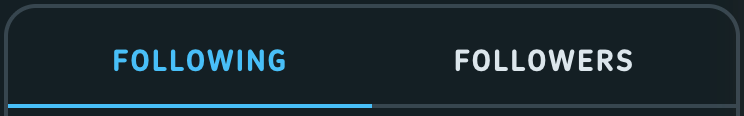

## Tabs: full-width top tabs (web-ui, mobile Quests/Badges)

**Anatomy**

- nav role=tablist _1L0JB _1UMEd
- tab <button role=tab class="_3Ji0r"> flex:1, 48px, 2px transparent top border + 2px bottom rule
- selected (_2d5P5): ::after 4px indicator bar, 2px radius, bottom -2px

**Measurements**

| Property | Value |
| --- | --- |
| height | 48px |
| padding | 0 16px |
| indicator | 4px bar (::after), 2px radius |
| rule | 2px |
| font | label-medium: 700 16px/16px, 0.04em, uppercase |
| CSS source | css:5823-96f39733.css ._3Ji0r { -moz-osx-font-smoothing:grayscale; -webkit-font-smoothing:antialiased; --web-ui_button-filter-hover:none; align-items:center; border-bottom:2px solid rgb(var(--color-swan))!important; border-top:2px solid transparent!important; box-sizing:border-box; color:rgb(var(--color-eel)); flex:1; font:var(--text-label-weight-medium) var(--text-label-size-medium) /var(--text-label-line-height-medium) duolingo-sans,sans-serif; height:48px; justify-content:center; letter-spacing:var(--text-label-letter-spacing-medium); min-width:0; padding:0 16px!important; text-transform:var(--text-label-casing-medium) } css:5823-96f39733.css ._2d5P5:after { background:rgb(var(--color-whale)); border-radius:2px; bottom:-2px; content:""; height:4px; position:absolute; width:100% } css:5823-96f39733.css ._1L0JB ._3Ji0r { border-bottom:2px solid rgb(var(--color-snow-always-light))!important; color:rgb(var(--color-snow-always-light)) } |

Measured instances:

| Instance | Trace | WxH | Padding | Radius | Border | Fill | Text colour | Font |
| --- | --- | --- | --- | --- | --- | --- | --- | --- |
| selected (dark) | quests-dark-mobile#30 <button> cl='_1gEmM _7jW2t _2d5P5 _3Ji0r' | 285x48 | 0px 16px 0px 16px | 0px 0px 0px 2px | 2px 0px 2px 0px transparent / - / #FFFFFF (celestia, dark) / - | ::after #FFFFFF (celestia, dark) | #FFFFFF (celestia, dark) | label 700 16px/16px ls 0.64px uppercase |
| unselected (dark) | quests-dark-mobile#32 <button> cl='_1gEmM _7jW2t _3Ji0r' | 285x48 | 0px 16px 0px 16px |  | 2px 0px 2px 0px transparent / - / #FFFFFF (celestia, dark) / - |  | #FFFFFF (celestia, dark) | label 700 16px/16px ls 0.64px uppercase |
| selected (light) | quests-light-mobile#30 <button> cl='_1gEmM _7jW2t _2d5P5 _3Ji0r' | 285x48 | 0px 16px 0px 16px | 0px 0px 0px 2px | 2px 0px 2px 0px transparent / - / #FFFFFF (snow, light) / - | ::after #FFFFFF (snow, light) | #FFFFFF (snow, light) | label 700 16px/16px ls 0.64px uppercase |
| unselected (light) | quests-light-mobile#32 <button> cl='_1gEmM _7jW2t _3Ji0r' | 285x48 | 0px 16px 0px 16px |  | 2px 0px 2px 0px transparent / - / #FFFFFF (snow, light) / - |  | #FFFFFF (snow, light) | label 700 16px/16px ls 0.64px uppercase |

**States**

| State | What changes | Source |
| --- | --- | --- |
| default | label + rule white on the coloured quests header | captured:quests-dark-mobile#32 |
| selected (aria-selected=true, _2d5P5) | 4px white indicator bar | captured:quests-dark-mobile#30 |
| hover | none (--web-ui_button-filter-hover:none) | css:5823-96f39733.css ._3Ji0r |
| focus / disabled | no rules | not captured |

**Tokens**

| Role | Light | Dark |
| --- | --- | --- |
| label default | #4B4B4B (eel, light) | #F1F7FB (eel, dark) |
| selected | #1899D6 (whale, light) | #1899D6 (whale, dark) |
| rule | #E5E5E5 (swan, light) | #37464F (swan, dark) |
| on coloured header (_1L0JB, as captured) | #FFFFFF (snow-always-light, light) | #FFFFFF (snow-always-light, dark) |

Type style: label-medium: 700 16px/16px, 0.04em, uppercase.

Responsive (570px): Only rendered below 700px (quests mobile); desktop Quests has no tabs.

Screenshots: dark: `out/screenshots/quests-dark-mobile.png`; light: `out/screenshots/quests-light-mobile.png`

Crops: [dark: tabs-segmented-dark.png](crops/tabs-segmented-dark.png) [light: tabs-segmented-light.png](crops/tabs-segmented-light.png)

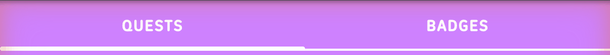
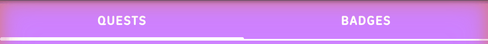

## Badges and pills

**Anatomy**

- "UP NEXT" section chip _1Qswf _3LDH7: swan fill, hare text, 6px radius, 4px 8px padding
- "30+" count badge _2TZCt: cardinal fill, white text, 16px radius, absolutely placed top/right -12px
- "x / 2 EQUIPPED" status pill _2I6Qk: 25px tall, 16px radius, 8px padding; empty = swan/hare, full = sea-sponge/owl
- "SUPER" logo badge: SVG image asset (plus-offer-logo) 78x21, not CSS

**Measurements**

| Property | Value |
| --- | --- |
| up_next | 74x26, padding 4px 8px, radius 6px, 700 15px/18px, 0.04em (dump 0.6px), uppercase |
| count | 42x25, padding 4px 8px, radius 16px, 700 15px/17.25px, 0.8px, uppercase |
| equipped | 110x25, padding 8px, radius 16px, 700 15px uppercase |
| super_logo | 78x21 image |
| CSS source | css:path-e50cab6b.css ._3LDH7 { background:rgb(var(--color-iguana-always-light)); border-radius:6px; color:rgb(var(--color-macaw)); display:inline-block; font-size:15px; font-weight:700; letter-spacing:.04em; line-height:18px; margin-bottom:16px; padding:4px 8px; text-transform:uppercase } css:path-e50cab6b.css ._1Qswf { background:rgb(var(--color-swan)); color:rgb(var(--color-hare)) } css:2820-18cf65ab.css ._2TZCt { align-items:center; background:rgb(var(--color-cardinal)); color:rgb(var(--color-snow-always-light)); padding:4px 8px; position:absolute; right:-12px; top:-12px } css:8566-1e4d7a6c.css ._2I6Qk { align-items:center; border-radius:16px; border-width:0; display:flex; font-size:15px; font-weight:700; height:25px; justify-content:center; padding:8px; text-transform:uppercase; white-space:nowrap; width:-moz-min-content; width:min-content } css:8566-1e4d7a6c.css ._2tJ-w { background:rgb(var(--color-swan)); color:rgb(var(--color-hare)) } css:8566-1e4d7a6c.css ._1-6PO { background:rgb(var(--color-sea-sponge)); color:rgb(var(--color-owl)) } |

Measured instances:

| Instance | Trace | WxH | Padding | Radius | Border | Fill | Text colour | Font |
| --- | --- | --- | --- | --- | --- | --- | --- | --- |
| up next (dark) | learn-dark-path-end#470 
 cl='_1Qswf _3LDH7' | 74x26 | 4px 8px 4px 8px | 6px |  | #37464F (swan, dark) | #52656D (hare, dark) | 700 15px/18px |
| up next (light) | learn-light-path-end#480 
 cl='_1Qswf _3LDH7' | 74x26 | 4px 8px 4px 8px | 6px |  | #E5E5E5 (swan, light) | #AFAFAF (hare, light) | 700 15px/18px |
| 30+ (dark) | practice-hub-dark-default#187  cl='_2TZCt _2Rt1l' | 42x25 | 4px 8px 4px 8px | 16px |  | #EE5555 (cardinal, dark) | #FFFFFF (celestia, dark) | 700 15px/17.25px |
| 30+ (light) | practice-hub-light-default#195  cl='_2TZCt _2Rt1l' | 42x25 | 4px 8px 4px 8px | 16px |  | #FF4B4B (cardinal, light) | #FFFFFF (snow, light) | 700 15px/17.25px |
| equipped empty (dark) | shop-dark-default#177 
 cl='_2tJ-w _2I6Qk' | 111x25 | 8px | 16px |  | #37464F (swan, dark) | #52656D (hare, dark) | 700 15px/20px |
| equipped full (light) | shop-light-default#187 
 cl='_1-6PO _2I6Qk' | 110x25 | 8px | 16px |  | #D7FFB8 (sea-sponge, light) | #58CC02 (owl, light) | 700 15px/20px |
| equipped full (dark mobile) | shop-dark-mobile#83 
 cl='_1-6PO _2I6Qk' | 110x25 | 8px | 16px |  | #202F36 (polar, dark) | #93D333 (owl, dark) | 700 15px/20px |
| SUPER logo (dark) | characters-dark-default#88  cl='' dt='plus-offer-logo' | 78x21 |  |  |  |  | #DCE6EC (wolf, dark) | 500 17px/20px |

**States**

| State | What changes | Source |
| --- | --- | --- |
| default | static labels | captured (see instances) |
| hover / focus / active / disabled | not interactive; no rules | not captured |
| variant: base _3LDH7 without _1Qswf | iguana-always-light fill, macaw text (the "current section" look) | css:path-e50cab6b.css ._3LDH7 |

**Tokens**

| Role | Light | Dark |
| --- | --- | --- |
| up next fill | #E5E5E5 (swan, light) | #37464F (swan, dark) |
| up next text | #AFAFAF (hare, light) | #52656D (hare, dark) |
| count fill | #FF4B4B (cardinal, light) | #EE5555 (cardinal, dark) |
| count text | #FFFFFF (snow-always-light, light) | #FFFFFF (snow-always-light, dark) |
| equipped empty fill/text | #E5E5E5 (swan, light) / #AFAFAF (hare, light) | #37464F (swan, dark) / #52656D (hare, dark) |
| equipped full fill/text | #D7FFB8 (sea-sponge, light) / #58CC02 (owl, light) | #202F36 (sea-sponge, dark) / #93D333 (owl, dark) |

Type style: 700 15px uppercase (all three CSS pills).

Responsive (570px): Shop mobile: same pill 110x25 (shop-dark-mobile#83).

Screenshots: dark: `out/screenshots/learn-dark-path-end.png / practice-hub-dark-default.png / shop-dark-default.png`; light: `out/screenshots/learn-light-path-end.png / practice-hub-light-default.png / shop-light-default.png`

Crops: [dark: badge-upnext-dark.png](crops/badge-upnext-dark.png) [dark: badge-count-dark.png](crops/badge-count-dark.png) [dark: badge-equipped-dark.png](crops/badge-equipped-dark.png) [dark: badge-super-dark.png](crops/badge-super-dark.png) [light: badge-upnext-light.png](crops/badge-upnext-light.png) [light: badge-count-light.png](crops/badge-count-light.png) [light: badge-equipped-light.png](crops/badge-equipped-light.png) [light: badge-super-light.png](crops/badge-super-light.png)

Notes: Super logo src: https://d35aaqx5ub95lt.cloudfront.net/images/super/2e50c3e8358914df5285dc8cf45d0b4c.svg (characters-dark-default#88 src).

## Avatar

**Anatomy**

- photo  circle (border-radius 50%)
- or letter avatar _1N32S: coloured circle, first letter, 700, font-size = 0.46 x size
- self "ghost" letter avatar: 2px dashed hare border (_1wd57)
- online dot _2NNBf: 12px owl circle, 2px border in the row background, bottom 1px / right 3px
- settings edit badge _1VC2W: 31px macaw circle, 3px snow border, top-right -11px

**Measurements**

| Property | Value |
| --- | --- |
| sizes | web-ui avatar: small 30, medium 48 (default), large 63, xlarge 77, xxlarge 90 (letter avatar small is 36); captured: 48 (lists, leaderboard), 70 (search results) |
| letter_font | 700, 0.46 x size (22.08px at 48) |
| online_dot | 12x12, 2px border |
| ring | no ring on list avatars; edit badge border 3px snow |
| CSS source | css:4779-c36ad395.css ._1N32S { -moz-osx-font-smoothing:grayscale; -webkit-font-smoothing:antialiased; align-items:center; border-radius:50%; box-sizing:border-box; color:rgb(var(--color-snow)); display:inline-flex; font:700 17px/25px duolingo-sans,sans-serif; justify-content:center; vertical-align:middle } css:1008-b4d34396.css ._2NNBf { background-color:rgb(var(--color-owl)); border:2px solid rgb(var(--color-snow)); border-radius:50%; bottom:1px; height:12px; position:absolute; right:3px; width:12px } css:4779-c36ad395.css ._1wd57 { border-style:dashed; border-width:2px; color:rgb(var(--color-hare)) } css:settingsPage-f3f7f16a.css ._1VC2W { background:rgb(var(--color-macaw)); border:3px solid rgb(var(--color-snow)); border-radius:50%; display:flex; height:31px; justify-content:center; position:absolute; right:-11px; top:0; width:31px } js/4779-9b5aed3c.js module 80645 sizes {large:63,medium:48,small:30,xlarge:77,xxlarge:90}; module 30254 letter avatar {large:63,medium:48,small:36,xlarge:77}, fontSize .46*size |

Measured instances:

| Instance | Trace | WxH | Padding | Radius | Border | Fill | Text colour | Font |
| --- | --- | --- | --- | --- | --- | --- | --- | --- |
| photo 48 (dark) | profile-dark-default#153  cl='_1yM9n fs-exclude' | 48x48 |  | 50% |  |  | #F1F7FB (black-text = eel, dark) [not in dump: equals the body default rgb(var(--color-black-text))] | 500 17px/20px |
| letter 48 (dark) | leaderboard-dark-top#184 
 cl='_1a-Dv _1N32S BfIim fs-exclude' | 48x48 |  | 50% |  | #FFAB33 (fox, dark) | #131F24 (snow, dark) | 700 22.08px/25px |
| online dot (dark) | leaderboard-dark-top#185  cl='_2NNBf' | 12x12 |  | 50% | 2px #131F24 (snow, dark) | #93D333 (owl, dark) | #F1F7FB (black-text = eel, dark) [not in dump: equals the body default rgb(var(--color-black-text))] | 500 17px/20px |
| letter 48 (light) | leaderboard-light-default#187 
 cl='_1gexH _1N32S BfIim fs-exclude' | 48x48 |  | 50% |  | #CE82FF (beetle, light) | #FFFFFF (snow, light) | 700 22.08px/25px |
| online dot (light) | leaderboard-light-default#188  cl='_2NNBf' | 12x12 |  | 50% | 2px #FFFFFF (snow, light) | #58CC02 (owl, light) | #3C3C3C (black-text, light) [not in dump: equals the body default rgb(var(--color-black-text))] | 500 17px/20px |
| photo 70 (search result, dark) | user-search-dark-results#81  cl='_1yM9n fs-exclude' | 70x70 |  | 50% |  |  | #F1F7FB (black-text = eel, dark) [not in dump: equals the body default rgb(var(--color-black-text))] | 500 17px/20px |
| edit badge (dark) | settings-profile-dark-default#105 <a> cl='_1VC2W' | 31x31 |  | 50% | 3px #131F24 (snow, dark) | #49C0F8 (macaw, dark) | #0000EE (browser default, not painted) | 500 17px/20px |

**States**

| State | What changes | Source |
| --- | --- | --- |
| default | static | captured |
| hover / focus | none on the avatar itself; the row gets the hover | not captured |
| online | green dot | captured:leaderboard-dark-top#185 |

**Tokens**

| Role | Light | Dark |
| --- | --- | --- |
| letter colours (by user id % 5) | beetle, cardinal, fox, macaw, tree-frog | beetle, cardinal, fox, macaw, tree-frog |
| letter text | #FFFFFF (snow, light) | #131F24 (snow, dark) (dark text on colour in dark theme) |
| online dot | #58CC02 (owl, light) | #93D333 (owl, dark) |
| dot border | #FFFFFF (snow, light) (swan/sea-sponge/etc inside highlighted leaderboard rows) | #131F24 (snow, dark) |
| ghost border | #AFAFAF (hare, light) | #52656D (hare, dark) |

Type style: Letter: 700, 0.46 x size.

Responsive (570px): No 570px capture of this component.

Screenshots: dark: `out/screenshots/leaderboard-dark-top.png`; light: `out/screenshots/leaderboard-light-default.png`

Crops: [dark: avatar-dark.png](crops/avatar-dark.png) [dark: avatar-edit-dark.png](crops/avatar-edit-dark.png) [light: avatar-light.png](crops/avatar-light.png)

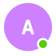
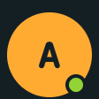

## Popover / dropdown shell (web-ui Popover: top-bar dropdowns, MORE menu, path popover)

**Anatomy**

- wrap _3zpnU (positioned _1o3g5; direction class _3OfAS down / _37pE2 up / D0iFS right / Z0Dvv left adds an 8px offset)
- bubble _36bu_: fill, 2px border, 15px radius, overflow hidden
- stem container _3T97b 20x10 (overflow hidden) holding a 20x20 square _1TMn5 rotated 45deg with the same fill/border and 2px radius
- content (e.g. _3cG-N: 380px wide, 24px 12px padding)

**Measurements**

| Property | Value |
| --- | --- |
| border | 2px |
| radius | 15px (var --web-ui_popover-border-radius; 10px on path tooltips, 5px on progress-bar popover) |
| offset | 8px from trigger (margin on direction class); path node popover 12px |
| stem | 20x10 visible, square 14.14px CSS (20px rendered bbox) rotated 45deg |
| gems_content | 380x148, padding 24px 12px; 100px illustration + 12px gap; title 700 24px/26px; body wolf |
| path_popover | 295px wide, padding 16px, 700 19px/1.4, centered, no border |
| CSS source | css:4779-c36ad395.css ._36bu_ { background-color:var(--web-ui_popover-background-color,rgb(var(--color-snow))); border:2px solid var(--web-ui_popover-border-color,rgb(var(--color-swan))); border-radius:var(--web-ui_popover-border-radius,15px); box-sizing:border-box; overflow:hidden; transform:translateZ(0) } css:4779-c36ad395.css ._1TMn5 { background-color:var(--web-ui_popover-background-color,rgb(var(--color-snow))); border:2px solid var(--web-ui_popover-border-color,rgb(var(--color-swan))); border-radius:2px; content:""; height:14.14427157px; left:50%; transform:translateZ(0) rotate(45deg); transform-origin:top left; width:14.14427157px } css:4779-c36ad395.css ._3T97b { box-sizing:border-box; position:absolute } css:4779-c36ad395.css ._3OfAS { margin-top:8px } css:5275-8898b509.css ._3cG-N { align-items:center; box-sizing:border-box; display:flex; padding:24px 12px; width:380px } css:path-e50cab6b.css ._3RP1Q { font-size:19px; font-weight:700; line-height:1.4; padding:16px; text-align:center } css:path-e50cab6b.css ._1Fbw- { background-color:var(--path-unit-character-color); border:0; color:rgb(var(--color-snow-always-light)) } |

Measured instances:

| Instance | Trace | WxH | Padding | Radius | Border | Fill | Text colour | Font |
| --- | --- | --- | --- | --- | --- | --- | --- | --- |
| gems dropdown bubble (dark) | learn-dark-gems-dropdown#84 
 cl='_36bu_' | 384x152 |  | 15px | 2px #37464F (swan, dark) | #131F24 (snow, dark) | #F1F7FB (black-text = eel, dark) [not in dump: equals the body default rgb(var(--color-black-text))] | label 700 24px/26px ls normal none |
| gems content (dark) | learn-dark-gems-dropdown#85 
 cl='_3n4Rk _3cG-N' dt='lingots-menu-content' | 380x148 | 24px 12px 24px 12px |  |  |  | #F1F7FB (black-text = eel, dark) [not in dump: equals the body default rgb(var(--color-black-text))] | label 700 24px/26px ls normal none |
| stem (dark) | learn-dark-gems-dropdown#92 
 cl='_1TMn5' | 20x20 |  | 2px | 2px #37464F (swan, dark) | #131F24 (snow, dark) | #F1F7FB (black-text = eel, dark) [not in dump: equals the body default rgb(var(--color-black-text))] | 500 17px/20px |
| gems dropdown bubble (light) | learn-light-gems-dropdown#85 
 cl='_36bu_' | 384x152 |  | 15px | 2px #E5E5E5 (swan, light) | #FFFFFF (snow, light) | #3C3C3C (black-text, light) [not in dump: equals the body default rgb(var(--color-black-text))] | label 700 24px/26px ls normal none |
| path node popover (dark) | learn-dark-node-popover#1239 
 cl='_36bu_ _3RP1Q _1Fbw-' | 295x151 | 16px | 15px |  | #58CC02 (owl-always-light, dark) | #FFFFFF (celestia, dark) | label 500 17px/26.6px ls normal none |
| path node popover (light) | learn-light-node-popover#1249 
 cl='_36bu_ _3RP1Q _1Fbw-' | 295x151 | 16px | 15px |  | #58CC02 (owl, light) | #FFFFFF (snow, light) | label 500 17px/26.6px ls normal none |

**States**

| State | What changes | Source |
| --- | --- | --- |
| closed | not rendered | captured:learn-dark-default (no bubble) |
| open (hover on top-bar item) | bubble appears below trigger; trigger gets polar hover fill (_1LP0k) with a 10px invisible bridge ::after | captured:learn-dark-gems-dropdown, learn-dark-streak-dropdown, learn-dark-hearts-dropdown, learn-dark-courses-dropdown (+ light); css:5275-8898b509.css @media (hover:hover) ._1LP0k:not(._1cy5G):hover |
| path node popover open | unit-colour bubble with white CTA | captured:learn-dark-node-popover#1239, learn-light-node-popover#1249 |
| locked path popover | CTA disabled (see button disabled-solid) | captured:learn-dark-locked-popover#1275 |
| focus / keyboard | no rules | not captured |

**Tokens**

| Role | Light | Dark |
| --- | --- | --- |
| fill | #FFFFFF (snow, light) | #131F24 (snow, dark) |
| border | #E5E5E5 (swan, light) | #37464F (swan, dark) |
| title | #4B4B4B (eel, light) | #F1F7FB (eel, dark) |
| body | #777777 (wolf, light) | #DCE6EC (wolf, dark) |

Type style: Dropdown title 700 24px/26px; body 17px/20px wolf. Path popover 700 19px/26.6px white.

Responsive (570px): No 570px capture of this component.

Screenshots: dark: `out/screenshots/learn-dark-gems-dropdown.png`; light: `out/screenshots/learn-light-gems-dropdown.png`

Crops: [dark: popover-dark.png](crops/popover-dark.png) [dark: popover-path-dark.png](crops/popover-path-dark.png) [light: popover-light.png](crops/popover-light.png) [light: popover-path-light.png](crops/popover-path-light.png)

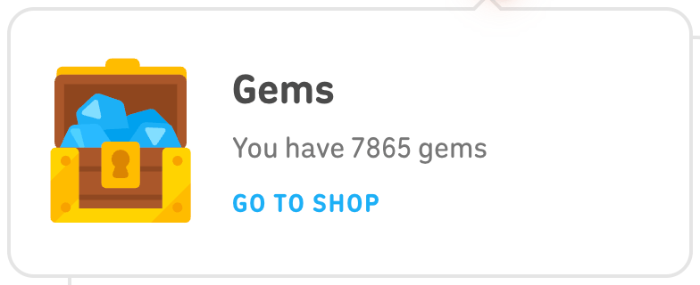
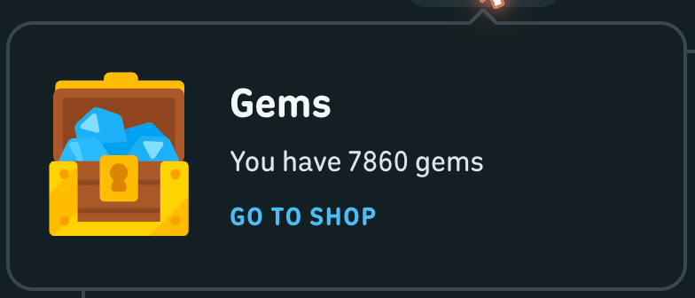

## Tooltip bubble (small popover, e.g. "START" / "JUMP HERE?")

**Anatomy**

- web-ui popover wrap _3zpnU _37pE2 (direction up) with --web-ui_popover-border-radius:10px
- bubble _36bu_ _27IMa: 12px padding, 700 17px uppercase, unit-coloured text
- stem pointing down (rotated square, 20x10 container)

**Measurements**

| Property | Value |
| --- | --- |
| size | 80x45 (min-width 80px) |
| padding | 12px |
| radius | 10px |
| border | 2px |
| font | 700 17px, line-height 1, 0.03em, uppercase |
| CSS source | css:path-e50cab6b.css ._27IMa { background:rgb(var(--color-snow)); border-color:rgb(var(--color-swan)); color:var(--path-unit-character-color); font-size:17px; font-weight:700; letter-spacing:.03em; line-height:1; padding:12px; text-align:center; text-transform:uppercase; white-space:nowrap } css:path-e50cab6b.css ._kJVz { --web-ui_popover-border-radius:10px; margin-bottom:-2px; min-width:80px } css:path-e50cab6b.css .YxHCU { background:rgb(var(--color-snow)); border-color:rgb(var(--color-swan)) } |

Measured instances:

| Instance | Trace | WxH | Padding | Radius | Border | Fill | Text colour | Font |
| --- | --- | --- | --- | --- | --- | --- | --- | --- |
| START (dark) | learn-dark-default#1239 
 cl='_36bu_ _27IMa' | 80x45 | 12px | 10px | 2px #37464F (swan, dark) | #131F24 (snow, dark) | #58CC02 (owl-always-light, dark) | 700 17px/17px |
| START (light) | learn-light-default#1261 
 cl='_36bu_ _27IMa' | 80x45 | 12px | 10px | 2px #E5E5E5 (swan, light) | #FFFFFF (snow, light) | #58CC02 (owl, light) | 700 17px/17px |
| stem (dark) | learn-dark-default#1241 
 cl='_1TMn5 YxHCU' | 20x20 |  | 2px | 2px #37464F (swan, dark) | #131F24 (snow, dark) | #F1F7FB (black-text = eel, dark) [not in dump: equals the body default rgb(var(--color-black-text))] | 500 17px/20px |

**States**

| State | What changes | Source |
| --- | --- | --- |
| default | bobbing tooltip above the current node | captured:learn-dark-default#1239 |
| hover (on node) | tooltip nudges 2px (animation), no colour change | captured:learn-dark-secondary-button-hover vs learn-dark-path-end rect delta 2px |
| variant _2fviP (legendary/special) | unit-colour fill with white text and snow border | css:path-e50cab6b.css ._2fviP ._27IMa |

**Tokens**

| Role | Light | Dark |
| --- | --- | --- |
| fill | #FFFFFF (snow, light) | #131F24 (snow, dark) |
| border | #E5E5E5 (swan, light) | #37464F (swan, dark) |
| text | --path-unit-character-color (captured #58CC02 owl-always-light) | --path-unit-character-color (captured #58CC02 owl-always-light) |

Type style: 700 17px, line-height 1, uppercase.

Responsive (570px): No 570px capture of this component.

Screenshots: dark: `out/screenshots/learn-dark-default.png`; light: `out/screenshots/learn-light-default.png`

Crops: [dark: tooltip-dark.png](crops/tooltip-dark.png) [light: tooltip-light.png](crops/tooltip-light.png)

Notes: No hover tooltips on icons/buttons were found; these path bubbles are the only tooltip-shaped components captured.

## Menu (MORE menu flyout, courses menu)

**Anatomy**

- popover bubble (see popover) opening to the right of the sidebar item (D0iFS, 8px gap)
- section _1fv9a: 8px 0 padding, 2px swan divider below
- link row _2ifes GHXZL: 52px, 32px icon + 20px gap, label
- action row _3QrGV GHXZL: 40px, label only
- courses menu: header _34_P_ (48px, hare 15px uppercase, divider), items _1aVVk (55px, flag 32x25 scaled .8), footer item _2jW-1 with 2px top divider

**Measurements**

| Property | Value |
| --- | --- |
| width | 291px bubble (fit-content) |
| row_heights | 52px (icon rows), 40px (text rows), 55-56px (courses) |
| row_padding | 0 40px 0 20px |
| icon | 32x32, 20px right margin |
| font | 700 15px/16px, 0.8px, uppercase |
| section_padding | 8px 0 |
| divider | 2px swan |
| CSS source | css:9071-d035f2e5.css .GHXZL { -moz-osx-font-smoothing:grayscale; -webkit-font-smoothing:antialiased; --web-ui_button-filter-hover:none; align-items:center; box-sizing:border-box; color:rgb(var(--color-wolf)); display:flex; font:700 15px/16px duolingo-sans,sans-serif; min-width:100px; padding:0 40px 0 20px; text-transform:uppercase; white-space:nowrap; width:100% } css:9071-d035f2e5.css ._2ifes { height:52px } css:9071-d035f2e5.css ._3QrGV { height:40px } css:9071-d035f2e5.css ._1fv9a { border-bottom:2px solid rgb(var(--color-swan)) } css:5275-8898b509.css ._2xxCs ._1aVVk { align-items:center; display:flex; flex-direction:row } |

Measured instances:

| Instance | Trace | WxH | Padding | Radius | Border | Fill | Text colour | Font |
| --- | --- | --- | --- | --- | --- | --- | --- | --- |
| MORE bubble (dark) | learn-dark-more-menu#59 
 cl='_36bu_' | 291x262 |  | 15px | 2px #37464F (swan, dark) | #131F24 (snow, dark) | #52656D (hare, dark) | label 700 15px/16px ls normal uppercase |
| link row (dark) | learn-dark-more-menu#61 <a> cl='_2ifes GHXZL' dt='det-nav' | 287x52 | 0px 40px 0px 20px |  |  |  | #DCE6EC (wolf, dark) | label 700 15px/16px ls 0.8px uppercase |
| action row (dark) | learn-dark-more-menu#68 <button> cl='_1gEmM _7jW2t _3QrGV GHXZL' dt='settings-button' | 287x40 | 0px 40px 0px 20px |  |  |  | #DCE6EC (wolf, dark) | label 700 15px/16px ls normal uppercase |
| action row hover (dark) | learn-dark-more-menu-item-hover#68 <button> cl='_1gEmM _7jW2t _3QrGV GHXZL' dt='settings-button' | 287x40 | 0px 40px 0px 20px |  |  | #202F36 (polar, dark) | #DCE6EC (wolf, dark) | label 700 15px/16px ls normal uppercase |
| MORE bubble (light) | learn-light-more-menu#59 
 cl='_36bu_' | 291x262 |  | 15px | 2px #E5E5E5 (swan, light) | #FFFFFF (snow, light) | #AFAFAF (hare, light) | label 700 15px/16px ls normal uppercase |
| action row (light) | learn-light-more-menu#68 <button> cl='_1gEmM _7jW2t _3QrGV GHXZL' dt='settings-button' | 287x40 | 0px 40px 0px 20px |  |  |  | #777777 (wolf, light) | label 700 15px/16px ls normal uppercase |
| courses menu item selected (dark) | learn-dark-courses-dropdown#79 
 cl='_1aVVk _1WRXX' | 240x55 | 10px 12px 10px 20px |  |  | #202F36 (polar, dark) | #1899D6 (whale, dark) | 700 17px/20px |
| courses menu item (light) | learn-light-courses-dropdown#83 
 cl='_1aVVk' | 240x55 | 10px 12px 10px 20px |  |  |  | #4B4B4B (eel, light) | 700 17px/20px |

**States**

| State | What changes | Source |
| --- | --- | --- |
| default | wolf label | captured:learn-dark-more-menu#68 |
| hover | row fill polar; no filter (--web-ui_button-filter-hover:none) | captured:learn-dark-more-menu-item-hover#68 (background polar); css:9071-d035f2e5.css @media (hover:hover) .GHXZL:hover |
| focus (courses menu) | polar fill on :focus / :focus-within | css:5275-8898b509.css ._2xxCs ._1aVVk:focus:not(._3dQ3c):not(._1WRXX) |
| selected (courses menu, _1WRXX) | polar fill, whale text | captured:learn-dark-courses-dropdown#79 |
| trigger hover (sidebar MORE) | polar fill, 12px radius | captured:learn-dark-more-menu#54; css:9071-d035f2e5.css @media (hover:hover) ._3tK_c:hover |

**Tokens**

| Role | Light | Dark |
| --- | --- | --- |
| fill | #FFFFFF (snow, light) | #131F24 (snow, dark) |
| border | #E5E5E5 (swan, light) | #37464F (swan, dark) |
| row label | #777777 (wolf, light) | #DCE6EC (wolf, dark) |
| hover row fill | #F7F7F7 (polar, light) | #202F36 (polar, dark) |
| selected course fill | #F7F7F7 (polar, light) | #202F36 (polar, dark) |
| selected course text | #1899D6 (whale, light) | #1899D6 (whale, dark) |
| header | #AFAFAF (hare, light) | #52656D (hare, dark) |

Type style: 700 15px/16px uppercase, 0.8px.

Responsive (570px): No 570px capture of this component.

Screenshots: dark: `out/screenshots/learn-dark-more-menu.png`; light: `out/screenshots/learn-light-more-menu.png`

Crops: [dark: menu-dark.png](crops/menu-dark.png) [dark: menu-hover-dark.png](crops/menu-hover-dark.png) [dark: menu-courses-dark.png](crops/menu-courses-dark.png) [light: menu-light.png](crops/menu-light.png)

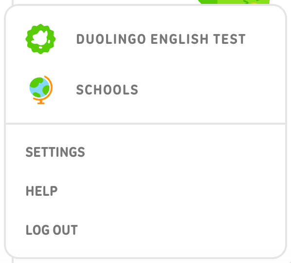
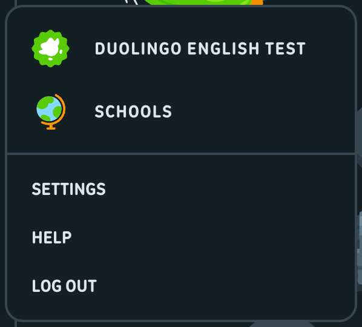

## Modal (centered dialog)

**Anatomy**

- backdrop _1ATOC: fixed, black @ 0.4, z-index 300
- centering layer _3Mzt6 (flex center, z 310)
- dialog _1yFTM _3fFQQ FohH5: snow fill, 16px radius, 24px margin, --modal-padding 30px (24px with _3tUNa/_3Dms8, width 384px)
- optional close button rXoiv: 35px snow circle, 2px swan border, straddles the top-right corner (translate 50%/-50%)
- illustration, title (heading-medium), body (caption, wolf), stacked full-width buttons (primary 50px + 16px gap + text button 32px)

**Measurements**

| Property | Value |
| --- | --- |
| width | 384px (notifications, quit) / 480px (invite) |
| padding | 24px (notifications, quit) / 30px (invite) |
| radius | 16px |
| margin | 24px |
| border | none |
| shadow | none |
| title | 700 24px/32px (heading-medium), 12px top margin |
| body | 500 16px/24px caption, wolf, 12px top margin |
| button_stack | primary 50px, margin-top 32px; secondary text 32px, margin-top 16px |
| close | 35x35, 2px border, radius 98px, 16px icon |
| CSS source | css:app-f2ef02f8.css ._1yFTM { border-radius:var(--modal-border-radius,16px); margin:var(--modal-margin,24px) } css:app-f2ef02f8.css .FohH5 { --modal-padding:30px; background:rgb(var(--color-snow)) } css:1527-94387874.css ._3tUNa { --modal-padding:24px; width:384px } css:4779-c36ad395.css ._1ATOC { background:rgb(var(--color-black),.4); bottom:0; left:0; position:fixed; right:0; top:0 } css:app-f2ef02f8.css .rXoiv { align-items:center; background:rgb(var(--color-snow)); cursor:pointer; display:flex; height:35px; justify-content:center; position:absolute; right:4px; top:4px; width:35px; z-index:10 } css:app-f2ef02f8.css @media (min-width:700px) .rXoiv { backface-visibility:hidden; border:2px solid rgb(var(--color-swan)); border-radius:98px; right:0; top:0; transform:translateX(50%) translateY(-50%) } css:1060-a4cddb41.css ._3r1YP { color:rgb(var(--color-eel)) } css:1060-a4cddb41.css ._3WCnS { -moz-osx-font-smoothing:grayscale; -webkit-font-smoothing:antialiased; color:rgb(var(--color-wolf)); font:var(--text-caption-weight) var(--text-caption-size) /var(--text-caption-line-height) duolingo-sans,sans-serif; letter-spacing:var(--text-caption-letter-spacing); margin-top:12px; text-transform:var(--text-caption-casing) } |

Measured instances:

| Instance | Trace | WxH | Padding | Radius | Border | Fill | Text colour | Font |
| --- | --- | --- | --- | --- | --- | --- | --- | --- |
| notifications modal (dark) | learn-dark-modal-notifications#358 
 cl='_1yFTM _3fFQQ FohH5 _3tUNa' | 384x442 | 24px | 16px |  | #131F24 (snow, dark) | #F1F7FB (black-text = eel, dark) [not in dump: equals the body default rgb(var(--color-black-text))] | label 700 24px/32px ls normal none |
| backdrop (dark) | learn-dark-modal-notifications#353 
 cl='_1ATOC _1Fnem' dt='drawer-backdrop' | 1200x797 |  |  |  | #000000 (black, dark) @ 0.4 alpha | #F1F7FB (black-text = eel, dark) [not in dump: equals the body default rgb(var(--color-black-text))] | 500 17px/20px |
| title (dark) | learn-dark-modal-notifications#475  cl='_3r1YP' | 336x32 |  |  |  |  | #F1F7FB (black-text = eel, dark) [not in dump: equals the body default rgb(var(--color-black-text))] | 700 24px/32px |
| body (dark) | learn-dark-modal-notifications#476  cl='_3WCnS' | 336x48 |  |  |  |  | #DCE6EC (wolf, dark) | 500 16px/24px |
| invite modal (dark) | user-search-dark-invite-modal#196 
 cl='_1yFTM _3fFQQ FohH5' | 480x477 | 30px | 16px |  | #131F24 (snow, dark) | #F1F7FB (black-text = eel, dark) [not in dump: equals the body default rgb(var(--color-black-text))] | label 700 24px/26px ls normal none |
| close button (dark) | user-search-dark-invite-modal#197 
 cl='rXoiv' dt='close-button' | 35x35 |  | 98px | 2px #37464F (swan, dark) | #131F24 (snow, dark) | #F1F7FB (black-text = eel, dark) [not in dump: equals the body default rgb(var(--color-black-text))] | 500 17px/20px |
| copy-link field (dark) | user-search-dark-invite-modal#202 
 cl='_1CdbA DLitl' | 420x48 | 5px 10px 5px 10px | 16px | 2px #37464F (swan, dark) | #131F24 (snow, dark) | #F1F7FB (black-text = eel, dark) [not in dump: equals the body default rgb(var(--color-black-text))] | label 700 15px/20px ls 0.8px uppercase |
| invite modal (light) | user-search-light-invite-modal#196 
 cl='_1yFTM _3fFQQ FohH5' | 480x477 | 30px | 16px |  | #FFFFFF (snow, light) | #3C3C3C (black-text, light) [not in dump: equals the body default rgb(var(--color-black-text))] | label 700 24px/26px ls normal none |
| quit modal (dark) | lesson-dark-quit-modal#132 
 cl='_1yFTM _3fFQQ FohH5 _3Dms8' | 384x387 | 24px | 16px |  | #131F24 (snow, dark) | #F1F7FB (black-text = eel, dark) [not in dump: equals the body default rgb(var(--color-black-text))] | label 700 24px/32px ls normal none |
| quit modal (light) | lesson-light-quit-modal#148 
 cl='_1yFTM _3fFQQ FohH5 _3Dms8' | 384x387 | 24px | 16px |  | #FFFFFF (snow, light) | #3C3C3C (black-text, light) [not in dump: equals the body default rgb(var(--color-black-text))] | label 700 24px/32px ls normal none |

**States**

| State | What changes | Source |
| --- | --- | --- |
| open | backdrop + dialog | captured:learn-dark-modal-notifications, user-search-dark-invite-modal, lesson-dark-quit-modal (+ light) |
| close button hover | fill swan | css:app-f2ef02f8.css @media (min-width:700px) .rXoiv:hover |
| copy link -> copied | inline label swaps "Copy link" (macaw) to "Copied" (hare); no toast | captured:user-search-dark-copy-link#204 (no screenshot) |
| focus | no focus ring rules | not captured |

**Tokens**

| Role | Light | Dark |
| --- | --- | --- |
| dialog fill | #FFFFFF (snow, light) | #131F24 (snow, dark) |
| title | #4B4B4B (eel, light) | #F1F7FB (eel, dark) |
| body | #777777 (wolf, light) | #DCE6EC (wolf, dark) |
| close fill | #FFFFFF (snow, light) | #131F24 (snow, dark) |
| close border | #E5E5E5 (swan, light) | #37464F (swan, dark) |
| close hover fill | #E5E5E5 (swan, light) | #37464F (swan, dark) |
| field border | #E5E5E5 (swan, light) | #37464F (swan, dark) |
| backdrop | rgb(var(--color-black)) @ 0.4 = #000000 @ 0.4 alpha in both themes (css:4779 ._1ATOC) | |

Type style: Title heading-medium (700 24px/32px); body caption (500 16px/24px).

Responsive (570px): Below 700px the close button sits inside the corner (right/top 4px, no border) instead of straddling it (css:app .rXoiv vs @media (min-width:700px)). No mobile modal capture.

Screenshots: dark: `out/screenshots/learn-dark-modal-notifications.png`; light: `out/screenshots/lesson-light-quit-modal.png`

Crops: [dark: modal-dark.png](crops/modal-dark.png) [dark: modal-invite-dark.png](crops/modal-invite-dark.png) [light: modal-light.png](crops/modal-light.png) [light: modal-invite-light.png](crops/modal-invite-light.png)

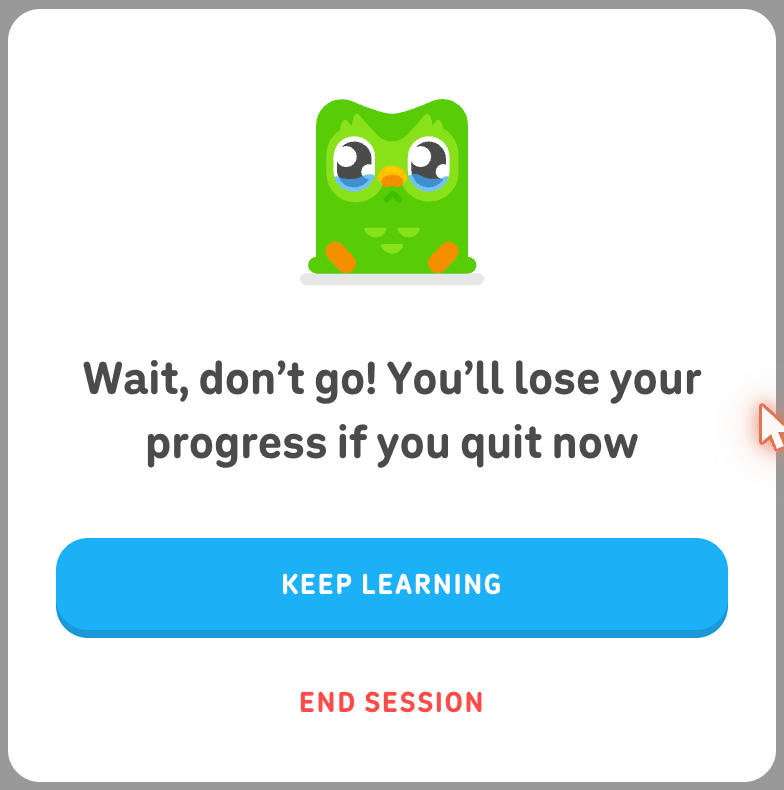
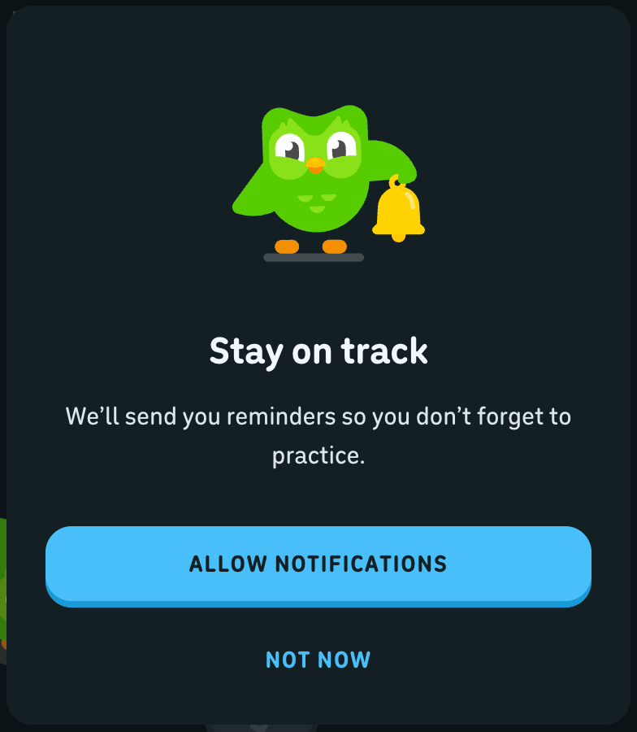

## Bottom sheet (remove-course confirm drawer)

**Anatomy**

- backdrop _1ATOC _1Fnem (black @ 0.4)
- sheet rs95t _3fIZ6 _19idO: fixed bottom, full width, snow fill, z 320, no radius, no border
- inner _3qIEH: max-width 1140px, padding 40px 24px (32px 16px mobile)
- grid _1fZrK: image | title+description | dismiss | cta (columns min-content 1fr 172px 172px, gap 16px 40px)
- buttons: secondary outline "Cancel" + danger "Remove", each 184x50

**Measurements**

| Property | Value |
| --- | --- |
| height | 195px (content-driven) |
| padding | 40px 24px |
| grid_gap | 16px 40px |
| radius | none |
| title | 700 24px/32px heading-medium |
| description | 19px/24px wolf |
| image | 109x110 |
| buttons | 184x50 each |
| CSS source | css:1060-a4cddb41.css .rs95t { background:rgb(var(--color-snow)); bottom:0; left:0; position:fixed; width:100% } css:1060-a4cddb41.css ._3qIEH { margin:0 auto; padding:32px 16px } css:1060-a4cddb41.css @media (min-width:700px) ._3qIEH { max-width:1140px; padding:40px 24px } css:1060-a4cddb41.css ._1fZrK { grid-gap:16px 40px; display:grid; text-align:center } css:1060-a4cddb41.css @media (min-width:700px) ._3OWkn { align-self:flex-start; font-size:19px; grid-area:description; line-height:24px; padding:0 } |

Measured instances:

| Instance | Trace | WxH | Padding | Radius | Border | Fill | Text colour | Font |
| --- | --- | --- | --- | --- | --- | --- | --- | --- |
| sheet (dark) | settings-courses-dark-remove-confirm#134 
 cl='rs95t _3fIZ6 _19idO' | 1200x195 |  |  |  | #131F24 (snow, dark) | #F1F7FB (black-text = eel, dark) [not in dump: equals the body default rgb(var(--color-black-text))] | label 700 24px/32px ls normal none |
| inner (dark) | settings-courses-dark-remove-confirm#135 
 cl='_3qIEH' | 1140x195 | 40px 24px 40px 24px |  |  |  | #F1F7FB (black-text = eel, dark) [not in dump: equals the body default rgb(var(--color-black-text))] | label 700 24px/32px ls normal none |
| grid (dark) | settings-courses-dark-remove-confirm#136 
 cl='_1fZrK _25RZD eDTjy _3tWO8' | 1092x115 |  |  |  |  | #F1F7FB (black-text = eel, dark) [not in dump: equals the body default rgb(var(--color-black-text))] | label 700 24px/32px ls normal none |
| title (dark) | settings-courses-dark-remove-confirm#139  cl='_2ac0P' | 519x32 |  |  |  |  | #F1F7FB (black-text = eel, dark) [not in dump: equals the body default rgb(var(--color-black-text))] | 700 24px/32px |
| description (dark) | settings-courses-dark-remove-confirm#140  cl='_3OWkn' | 519x48 |  |  |  |  | #DCE6EC (wolf, dark) | 500 19px/24px |
| cancel (dark) | settings-courses-dark-remove-confirm#145 <button> cl='_3fmUm _2V6ug _1ursp _7jW2t _1wMvQ _3Lflf _1yKZz' dt='notification-drawer-no-thanks-button' | 184x50 | 0px 16px 0px 16px | 16px | 2px 2px 4px 2px transparent | ::before #131F24 (snow, dark); lip #37464F (swan, dark) 0px 2px 0px 0px | #52656D (hare, dark) | label 700 15px/18px ls 0.8px uppercase |
| sheet (light) | settings-courses-light-remove-confirm#136 
 cl='rs95t _3fIZ6 _19idO' | 1384x195 |  |  |  | #FFFFFF (snow, light) | #3C3C3C (black-text, light) [not in dump: equals the body default rgb(var(--color-black-text))] | label 700 24px/32px ls normal none |

**States**

| State | What changes | Source |
| --- | --- | --- |
| open | slid in (translateY(0) via _3fIZ6) | captured:settings-courses-dark-remove-confirm, settings-courses-light-remove-confirm |
| danger button hover | brightness(1.1) | captured:settings-courses-dark-danger-hover#142 |
| closed / animating | not captured | not captured |

**Tokens**

| Role | Light | Dark |
| --- | --- | --- |
| sheet fill | #FFFFFF (snow, light) | #131F24 (snow, dark) |
| title | #4B4B4B (eel, light) | #F1F7FB (eel, dark) |
| description | #777777 (wolf, light) | #DCE6EC (wolf, dark) |
| backdrop | #000000 @ 0.4 alpha (css:4779 ._1ATOC) | |

Type style: Title heading-medium 700 24px/32px; description 19px/24px.

Responsive (570px): Below 700px the grid is a single centered column and the description gets 0 24px padding with line-height 1.4 (css:1060 ._1fZrK, ._3OWkn). No mobile capture.

Screenshots: dark: `out/screenshots/settings-courses-dark-remove-confirm.png`; light: `out/screenshots/settings-courses-light-remove-confirm.png`

Crops: [dark: bottom-sheet-dark.png](crops/bottom-sheet-dark.png) [light: bottom-sheet-light.png](crops/bottom-sheet-light.png)

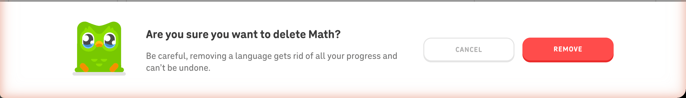
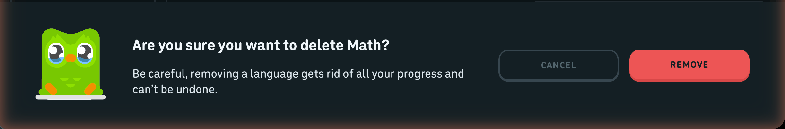

Notes: Same drawer classes (rs95t) are shared across 40+ CSS chunks (lesson feedback drawers use them too).

## List: settings side navigation

**Anatomy**

- card _1uIIO _1T_BQ (see card)
- section title h2 _7yUNn (heading-medium, wolf, 0 30px 16px margin)
- ul _1lpXi (grid, 4px gap)
- li wgPZT (12px radius) > a bigAx (heading-small, eel, 8px 30px padding)

**Measurements**

| Property | Value |
| --- | --- |
| row_height | 40px |
| row_gap | 4px |
| padding | 8px 30px |
| radius | 12px |
| font | 700 20px/24px (heading-small) |
| title | 700 24px/32px wolf |
| CSS source | css:settingsPage-f3f7f16a.css .bigAx { -moz-osx-font-smoothing:grayscale; -webkit-font-smoothing:antialiased; color:rgb(var(--color-eel)); display:block; font:var(--text-heading-weight-small) var(--text-heading-size-small) /var(--text-heading-line-height-small) duolingo-sans,sans-serif; letter-spacing:var(--text-heading-letter-spacing-small); padding:8px 30px; text-transform:var(--text-heading-casing-small) } css:settingsPage-f3f7f16a.css .wgPZT { border-radius:12px } css:settingsPage-f3f7f16a.css ._1lpXi { display:grid; gap:4px } css:settingsPage-f3f7f16a.css ._7yUNn { -webkit-font-smoothing:antialiased; font:var(--text-heading-weight-medium) var(--text-heading-size-medium) /var(--text-heading-line-height-medium) duolingo-sans,sans-serif; letter-spacing:var(--text-heading-letter-spacing-medium); margin:0 30px 16px; text-transform:var(--text-heading-casing-medium) } |

Measured instances:

| Instance | Trace | WxH | Padding | Radius | Border | Fill | Text colour | Font |
| --- | --- | --- | --- | --- | --- | --- | --- | --- |
| row (dark) | settings-courses-dark-default#71 <li> cl='wgPZT' | 332x40 |  | 12px |  |  | #F1F7FB (black-text = eel, dark) [not in dump: equals the body default rgb(var(--color-black-text))] | label 700 20px/24px ls normal none |
| link (dark) | settings-courses-dark-default#72 <a> cl='bigAx' | 332x40 | 8px 30px 8px 30px |  |  |  | #F1F7FB (black-text = eel, dark) [not in dump: equals the body default rgb(var(--color-black-text))] | 700 20px/24px |
| row hover (dark) | settings-courses-dark-sidenav-hover#93 <li> cl='wgPZT' | 332x40 |  | 12px |  | #37464F (swan, dark) | #F1F7FB (black-text = eel, dark) [not in dump: equals the body default rgb(var(--color-black-text))] | label 700 20px/24px ls normal none |
| row (light) | settings-courses-light-default#71 <li> cl='wgPZT' | 332x40 |  | 12px |  |  | #3C3C3C (black-text, light) [not in dump: equals the body default rgb(var(--color-black-text))] | label 700 20px/24px ls normal none |
| row hover (light, pointer resting in default capture) | settings-profile-light-default#83 <li> cl='wgPZT' | 332x40 |  | 12px |  | #E5E5E5 (swan, light) | #3C3C3C (black-text, light) [not in dump: equals the body default rgb(var(--color-black-text))] | label 700 20px/24px ls normal none |
| section title (dark) | settings-courses-dark-default#69 <h2> cl='_7yUNn' | 272x32 |  |  |  |  | #DCE6EC (wolf, dark) | 700 24px/32px |

**States**

| State | What changes | Source |
| --- | --- | --- |
| default | no fill | captured:settings-courses-dark-default#71 |
| hover | fill swan, 12px radius | captured:settings-courses-dark-sidenav-hover#93, settings-profile-light-default#83; css:settingsPage-f3f7f16a.css @media (hover:hover) .wgPZT:hover |
| current page | no distinct style | captured:settings-courses-dark-default#77 ("Courses" identical to siblings) |
| focus / active | no rules | not captured |

**Tokens**

| Role | Light | Dark |
| --- | --- | --- |
| label | #4B4B4B (eel, light) | #F1F7FB (eel, dark) |
| hover fill | #E5E5E5 (swan, light) | #37464F (swan, dark) |
| section title | #777777 (wolf, light) | #DCE6EC (wolf, dark) |

Type style: Row: heading-small 700 20px/24px. Title: heading-medium 700 24px/32px.

Responsive (570px): Side nav is desktop only; mobile settings (settings-account-dark-mobile) shows a back-arrow header instead.

Screenshots: dark: `out/screenshots/settings-courses-dark-sidenav-hover.png`; light: `out/screenshots/settings-courses-light-default.png`

Crops: [dark: list-settings-nav-dark.png](crops/list-settings-nav-dark.png) [light: list-settings-nav-light.png](crops/list-settings-nav-light.png)

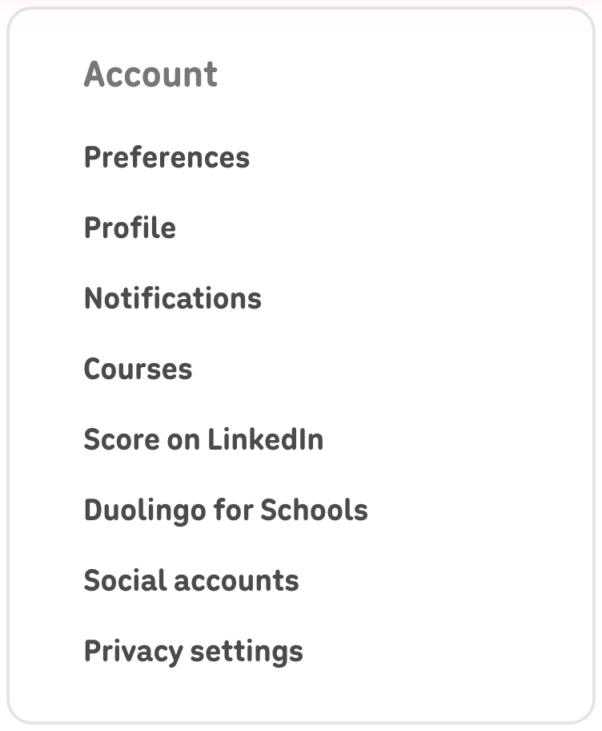
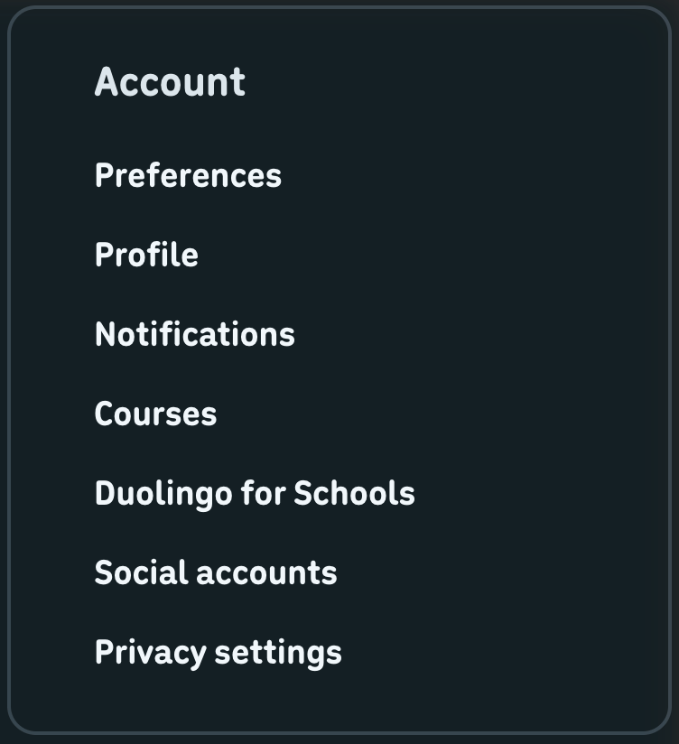

## List rows: courses list, search results, following list, settings rows

**Anatomy**

- courses row Ej0kW: 64px, flag 34x26 (18% radius, 2px white outline) + name (heading-small) + trailing REMOVE link button, 2px swan divider (_3hY-r)
- search result row nAD2k _39QMj: 18px 24px padding, 70px avatar, name 700 24px + @handle 18px hare, trailing FOLLOW, 2px swan divider; list wrapped in _2G9SS box (2px swan, 16px radius)
- following row _1xR2j _39QMj _2SROJ: 16px padding, 48px avatar, 12px text margin, name 20px + XP 16px hare, no divider (_2SROJ border 0)
- settings preference row hpqEH > _2R7tY: label + control, space-between, 48px gap; 24px row gap on desktop
- "View N more" footer button _3jvnF: 16px padding, 2px top swan border, 700 eel

**Measurements**

| Property | Value |
| --- | --- |
| course_row | 64px, gap 16px |
| search_row | 113px, padding 18px 24px, avatar 70, text margin 0 16px |
| following_row | 85px, padding 16px, avatar 48 |
| divider | 2px swan |
| container | 2px swan border, 16px radius |
| CSS source | css:settingsPage-f3f7f16a.css .Ej0kW { align-items:center; box-sizing:content-box; display:flex; gap:16px; height:64px; padding:0 16px } css:settingsPage-f3f7f16a.css ._3hY-r { border-bottom:2px solid rgb(var(--color-swan)) } css:1081-5a510dac.css .nAD2k { padding:18px 24px } css:1081-5a510dac.css ._39QMj { align-items:center; border-bottom:2px solid rgb(var(--color-swan)); display:flex } css:1081-5a510dac.css ._1xR2j { padding:16px } css:1081-5a510dac.css ._2G9SS { border:2px solid rgb(var(--color-swan)); border-radius:16px } css:5515-e83f96c1.css ._3jvnF { border-top:2px solid rgb(var(--color-swan)); color:rgb(var(--color-eel)); display:flex; font-weight:700; justify-content:space-between; padding:16px; width:100% } css:settingsPage-f3f7f16a.css ._2R7tY { align-items:center; display:flex; gap:48px; justify-content:space-between } |

Measured instances:

| Instance | Trace | WxH | Padding | Radius | Border | Fill | Text colour | Font |
| --- | --- | --- | --- | --- | --- | --- | --- | --- |
| course row (dark) | settings-courses-dark-default#102 <li> cl='_3hY-r Ej0kW' | 480x66 |  |  | 0px 0px 2px 0px #37464F (swan, dark) |  | #F1F7FB (black-text = eel, dark) [not in dump: equals the body default rgb(var(--color-black-text))] | label 700 20px/24px ls normal none |
| course row (light) | settings-courses-light-default#104 <li> cl='_3hY-r Ej0kW' | 592x66 |  |  | 0px 0px 2px 0px #E5E5E5 (swan, light) |  | #3C3C3C (black-text, light) [not in dump: equals the body default rgb(var(--color-black-text))] | label 700 20px/24px ls normal none |
| search result (dark) | user-search-dark-results#78 
 cl='nAD2k _39QMj' | 482x113 | 18px 24px 18px 24px |  | 0px 0px 2px 0px #37464F (swan, dark) |  | #F1F7FB (black-text = eel, dark) [not in dump: equals the body default rgb(var(--color-black-text))] | label 700 15px/20px ls 0.8px uppercase |
| search result (light) | user-search-light-results#78 
 cl='nAD2k _39QMj' | 594x113 | 18px 24px 18px 24px |  | 0px 0px 2px 0px #E5E5E5 (swan, light) |  | #3C3C3C (black-text, light) [not in dump: equals the body default rgb(var(--color-black-text))] | label 700 15px/20px ls 0.8px uppercase |
| result name (dark) | user-search-dark-results#83 <h3> cl='_25Afh _2jQO8' | 93x33 |  |  |  |  | #F1F7FB (black-text = eel, dark) [not in dump: equals the body default rgb(var(--color-black-text))] | 700 24px/normal |
| result handle (dark) | user-search-dark-results#84 
 cl='_347DQ LH3xS' | 93x20 |  |  |  |  | #52656D (hare, dark) | 500 18px/20px |
| following row (dark) | profile-dark-default#150 
 cl='_1xR2j _39QMj _2SROJ' | 364x85 | 16px |  |  |  | #F1F7FB (black-text = eel, dark) [not in dump: equals the body default rgb(var(--color-black-text))] | label 700 20px/normal ls normal none |
| following row (light) | profile-light-default#151 
 cl='_1xR2j _39QMj _2SROJ' | 364x85 | 16px |  |  |  | #3C3C3C (black-text, light) [not in dump: equals the body default rgb(var(--color-black-text))] | label 700 20px/normal ls normal none |
| view more (dark) | profile-dark-default#171 <button> cl='_1gEmM _7jW2t _3jvnF' | 364x54 | 16px |  | 2px 0px 0px 0px #37464F (swan, dark) |  | #F1F7FB (black-text = eel, dark) [not in dump: equals the body default rgb(var(--color-black-text))] | 700 17px/19.55px |
| settings row (dark) | settings-account-dark-default#106 <li> cl='hpqEH' | 480x32 |  |  |  |  | #F1F7FB (black-text = eel, dark) [not in dump: equals the body default rgb(var(--color-black-text))] | label 700 20px/24px ls normal none |

**States**

| State | What changes | Source |
| --- | --- | --- |
| default | static rows | captured |
| hover (search result) | no style change | captured:user-search-dark-row-hover (pointer at 450,488 on row #88, no diff) |
| hover (leaderboard-style rows _5W_8K) | fill polar, 16px radius | captured:leaderboard-dark-row-hover#165; css:1008-b4d34396.css @media (hover:hover) ._5W_8K:hover |
| focus / selected / disabled | no rules | not captured |

**Tokens**

| Role | Light | Dark |
| --- | --- | --- |
| name | #4B4B4B (eel, light) | #F1F7FB (eel, dark) |
| secondary text | #AFAFAF (hare, light) | #52656D (hare, dark) |
| divider / container border | #E5E5E5 (swan, light) | #37464F (swan, dark) |

Type style: Course name heading-small 700 20px/24px; search name 700 24px; handle 18px; following name 20px, XP 16px.

Responsive (570px): Below 700px: settings lists become one bordered group (2px swan, 12px radius) with 16px row padding and 2px dividers (css:settingsPage ._2QqPx, .hpqEH; settings-account-dark-mobile#16-#35); courses list gets the same border (._1GEp7) and 0 16px row padding.

Screenshots: dark: `out/screenshots/settings-courses-dark-default.png`; light: `out/screenshots/settings-courses-light-default.png`

Crops: [dark: list-rows-courses-dark.png](crops/list-rows-courses-dark.png) [dark: list-rows-search-dark.png](crops/list-rows-search-dark.png) [dark: list-rows-following-dark.png](crops/list-rows-following-dark.png) [light: list-rows-courses-light.png](crops/list-rows-courses-light.png) [light: list-rows-search-light.png](crops/list-rows-search-light.png) [light: list-rows-following-light.png](crops/list-rows-following-light.png)

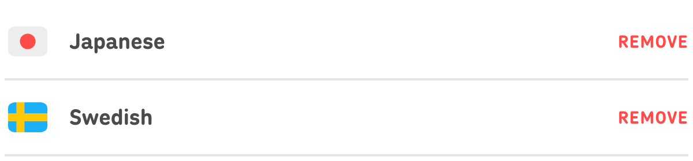
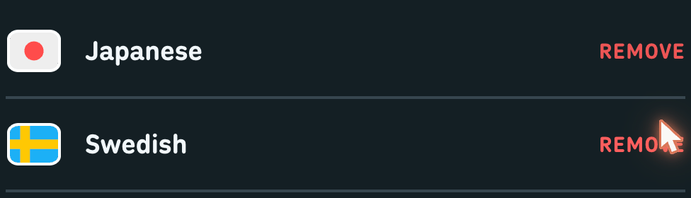

## Cards (right-rail cards, settings side cards, stat tiles)

**Anatomy**

- right-rail card _2cnFr _1T_BQ: snow fill, 2px swan border, 16px radius, 18px padding; optional eyebrow (bVnHX 700 15px hare uppercase), title (700 19px/28px), body (wolf, 25px lh), full-width CTA
- settings side card _1uIIO _1T_BQ: same shell, 24px 16px padding
- Super promo card _3Mmv9: eclipse fill + radial gradient, no border, 16px radius, 24px side padding
- stat tile _2uSOC: 2px swan border, 16px radius, 15px 24px padding, icon 21px + 15px gap, value 700 20px, caption 16px hare; inactive tile (_1kcT_) all hare

**Measurements**

| Property | Value |
| --- | --- |
| rail_card | 368px wide, padding 18px, border 2px, radius 16px, 16px vertical gap between cards |
| settings_card | padding 24px 16px |
| stat_tile | 234x78 (desktop 480 column), padding 15px 24px, gap 12px between tiles |
| CSS source | css:1008-b4d34396.css ._1T_BQ { background:rgb(var(--color-snow)); border:2px solid rgb(var(--color-swan)); border-radius:16px } css:settingsPage-f3f7f16a.css ._1uIIO { padding:24px 16px } css:5515-e83f96c1.css ._2uSOC { border:2px solid rgb(var(--color-swan)); border-radius:16px; display:flex; overflow:hidden; padding:15px 24px } css:5515-e83f96c1.css @media (max-width:699px) ._2uSOC { padding:12px 14px 10px } css:5515-e83f96c1.css ._1kcT_ { color:rgb(var(--color-hare)) } css:5515-e83f96c1.css .-TMd4 { font-size:20px; margin-bottom:4px } |

Measured instances:

| Instance | Trace | WxH | Padding | Radius | Border | Fill | Text colour | Font |
| --- | --- | --- | --- | --- | --- | --- | --- | --- |
| rail card (dark) | characters-dark-default#95 
 cl='_2cnFr _1T_BQ' | 368x230 | 18px | 16px | 2px #37464F (swan, dark) | #131F24 (snow, dark) | #F1F7FB (black-text = eel, dark) [not in dump: equals the body default rgb(var(--color-black-text))] | label 700 15px/18px ls normal uppercase |
| rail card eyebrow (dark) | characters-dark-default#96 
 cl='bVnHX' | 328x18 |  |  |  |  | #52656D (hare, dark) | 700 15px/18px |
| rail card title (dark) | characters-dark-default#99 <h2> cl='_3yevs _1d_-b' | 224x28 |  |  |  |  | #F1F7FB (black-text = eel, dark) [not in dump: equals the body default rgb(var(--color-black-text))] | 700 19px/28px |
| rail card body (dark) | characters-dark-default#100 
 cl='_1MY88 OWSZL' | 224x50 |  |  |  |  | #DCE6EC (wolf, dark) | 500 17px/25px |
| rail card (light) | characters-light-default#96 
 cl='_2cnFr _1T_BQ' | 368x178 | 18px | 16px | 2px #E5E5E5 (swan, light) | #FFFFFF (snow, light) | #3C3C3C (black-text, light) [not in dump: equals the body default rgb(var(--color-black-text))] | label 500 17px/25px ls normal none |
| settings side card (dark) | settings-courses-dark-default#68 
 cl='_1uIIO _1T_BQ' | 368x404 | 24px 16px 24px 16px | 16px | 2px #37464F (swan, dark) | #131F24 (snow, dark) | #F1F7FB (black-text = eel, dark) [not in dump: equals the body default rgb(var(--color-black-text))] | label 700 24px/32px ls normal none |
| super promo card (dark) | characters-dark-default#123 
 cl='_3Mmv9' | 368x330 | 0px 24px 0px 24px | 16px |  | #000437 (eclipse, dark) | #FFFFFF (celestia, dark) | label 700 15px/20px ls 1px uppercase |
| stat tile (dark) | profile-dark-default#245 
 cl='_2uSOC' | 234x78 | 15px 24px 15px 24px | 16px | 2px #37464F (swan, dark) |  | #F1F7FB (black-text = eel, dark) [not in dump: equals the body default rgb(var(--color-black-text))] | label 700 20px/20px ls normal none |
| stat tile inactive (dark) | profile-dark-default#239 
 cl='_2uSOC _1kcT_' | 234x78 | 15px 24px 15px 24px | 16px | 2px #37464F (swan, dark) |  | #52656D (hare, dark) | label 700 20px/20px ls normal none |
| stat tile (light) | profile-light-default#255 
 cl='_2uSOC' | 290x78 | 15px 24px 15px 24px | 16px | 2px #E5E5E5 (swan, light) |  | #3C3C3C (black-text, light) [not in dump: equals the body default rgb(var(--color-black-text))] | label 700 20px/20px ls normal none |
| stat tile (dark mobile) | profile-dark-mobile#80 
 cl='_2uSOC' | 263x70 | 12px 14px 10px 14px | 16px | 2px #37464F (swan, dark) |  | #F1F7FB (black-text = eel, dark) [not in dump: equals the body default rgb(var(--color-black-text))] | label 700 19px/20px ls normal none |

**States**

| State | What changes | Source |
| --- | --- | --- |
| default | static | captured |
| hover | cards are not interactive; no rules | not captured |
| inactive stat (_1kcT_) | icon, value and caption hare | captured:profile-dark-default#239 |

**Tokens**

| Role | Light | Dark |
| --- | --- | --- |
| fill | #FFFFFF (snow, light) | #131F24 (snow, dark) |
| border | #E5E5E5 (swan, light) | #37464F (swan, dark) |
| title | #4B4B4B (eel, light) | #F1F7FB (eel, dark) |
| body | #777777 (wolf, light) | #DCE6EC (wolf, dark) |
| eyebrow | #AFAFAF (hare, light) | #52656D (hare, dark) |
| stat caption | #AFAFAF (hare, light) | #52656D (hare, dark) |
| super card fill | #000437 (eclipse, light) | #000437 (eclipse, dark) |

Type style: Title 700 19px/28px; body 17px/25px wolf; eyebrow 700 15px/18px uppercase hare; stat value 700 20px; stat caption 16px.

Responsive (570px): Stat tile below 700px: padding 12px 14px 10px, icon 15px wide with 7.5px gap, value 19px, caption 15px (css:5515 @media (max-width:699px); profile-dark-mobile#80 263x70). Right rail is hidden in the 570px captures.

Screenshots: dark: `out/screenshots/characters-dark-default.png`; light: `out/screenshots/characters-light-default.png`

Crops: [dark: card-dark.png](crops/card-dark.png) [dark: card-stat-dark.png](crops/card-stat-dark.png) [dark: card-settings-dark.png](crops/card-settings-dark.png) [light: card-light.png](crops/card-light.png) [light: card-stat-light.png](crops/card-stat-light.png)

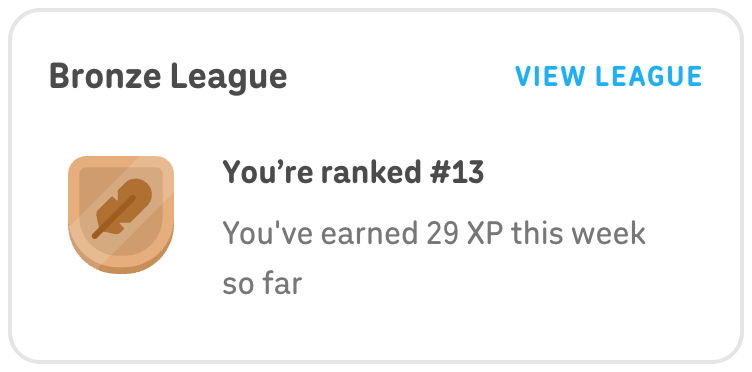
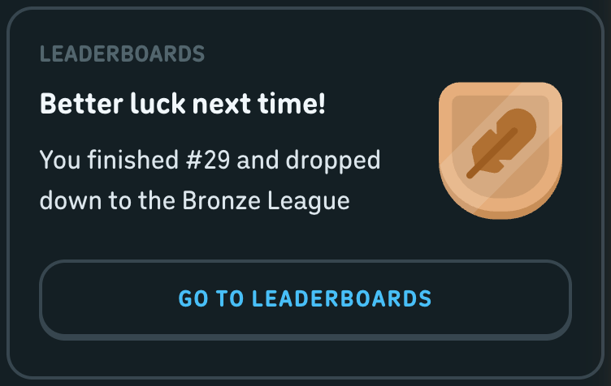

## Dividers

**Anatomy**

- section rule 
: 2px swan top border, 0 margin (settings sections)
- list row divider: 2px swan border-bottom (_3hY-r, _39QMj, hpqEH on mobile)
- menu section divider: 2px swan border-bottom (_1fv9a)
- tab strip rule: 2px swan (see tabs)
- page header rule: 2px swan border-bottom (_74cF6 search header)

**Measurements**

| Property | Value |
| --- | --- |
| thickness | 2px everywhere |
| CSS source | css:settingsPage-f3f7f16a.css ._3D1uH { margin:0 } css:settingsPage-f3f7f16a.css ._3hY-r { border-bottom:2px solid rgb(var(--color-swan)) } css:9071-d035f2e5.css ._1fv9a { border-bottom:2px solid rgb(var(--color-swan)) } |

Measured instances:

| Instance | Trace | WxH | Padding | Radius | Border | Fill | Text colour | Font |
| --- | --- | --- | --- | --- | --- | --- | --- | --- |
| hr (dark) | settings-account-dark-default#104 
 cl='_3D1uH' | 480x2 |  |  | 2px 0px 0px 0px #37464F (swan, dark) |  | #808080 (browser default, not painted) | 500 17px/20px |
| hr (light) | settings-account-light-default#137 
 cl='_3D1uH' | 592x2 |  |  | 2px 0px 0px 0px #E5E5E5 (swan, light) |  | #808080 (browser default, not painted) | 500 17px/20px |
| menu divider (dark) | learn-dark-more-menu#60 
 cl='_1fv9a' | 287x122 | 8px 0px 8px 0px |  | 0px 0px 2px 0px #37464F (swan, dark) |  | #52656D (hare, dark) | label 700 15px/16px ls 0.8px uppercase |

**States**

| State | What changes | Source |
| --- | --- | --- |
| default | static | captured |

**Tokens**

| Role | Light | Dark |
| --- | --- | --- |
| rule | #E5E5E5 (swan, light) | #37464F (swan, dark) |

Type style: n/a

Responsive (570px): hr._3D1uH is display:none below 700px (css:settingsPage @media not all and (min-width:700px)).

Screenshots: dark: `out/screenshots/settings-account-dark-default.png`; light: `out/screenshots/settings-account-light-default.png`

Crops: [dark: divider-dark.png](crops/divider-dark.png) [light: divider-light.png](crops/divider-light.png)

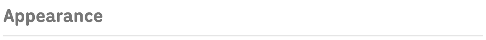
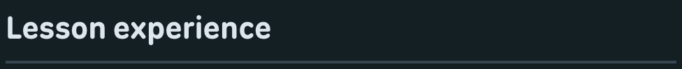

## Progress bar (web-ui)

**Anatomy**

- root oCRfA role=progressbar (sets --__internal__progress-bar-height, default 16px)
- track _3yKMC: swan (or --web-ui_progress-bar-background), radius = height/2
- fill _27NV6: currentColor (default owl), clip-path inset reveals the value, min-width 1.5 x height
- secondary fill _1qzJe (bee) for a second value
- shine _1EFTr: white 20% opacity pill, 30% of height, inset height/4 from left, top 25%
- optional inner text _2spfn (14px 700 uppercase) and cap icon (quests chest)

**Measurements**

| Property | Value |
| --- | --- |
| height | 16px default (lesson header), 18px (sections, quests), 8px (character cells), 14px (achievements) |
| radius | height / 2 |
| shine | height 30%, opacity .2, top 25% |
| inner_text | 700 14px/18px, 0.04em, uppercase |
| transition | width/clip-path .4s |
| CSS source | css:4779-c36ad395.css ._3yKMC { background:var(--web-ui_progress-bar-background,rgb(var(--color-swan))); border-radius:calc(var(--__internal__progress-bar-height)/2); position:relative } css:4779-c36ad395.css ._27NV6 { border-radius:inherit; color:var(--web-ui_progress-bar-color,rgb(var(--color-owl))); height:var(--__internal__progress-bar-height); min-width:calc(var(--__internal__progress-bar-height)*1.5); transition-duration:.4s } css:4779-c36ad395.css ._1EFTr { background:rgb(var(--color-snow-always-light)); border-radius:9999px; height:var(--web-ui_progress-bar-shine-height,30%); left:calc(var(--__internal__progress-bar-height)/4); opacity:.2; position:absolute; top:25%; transition-duration:.4s; transition-property:width; width:calc(var(--__internal__progress-bar-value) - var(--__internal__progress-bar-height)/2) } css:4779-c36ad395.css ._1qzJe { -webkit-clip-path:inset(0 calc(100% - var(--__internal__progress-bar-inner-value)) 0 0 round calc(var(--__internal__progress-bar-height)/2)); clip-path:inset(0 calc(100% - var(--__internal__progress-bar-inner-value)) 0 0 round calc(var(--__internal__progress-bar-height)/2)); color:var(--web-ui_progress-bar-color-secondary,rgb(var(--color-bee))) } css:4779-c36ad395.css ._2spfn { color:var(--web-ui_progress-bar-inner-text-color,rgb(var(--color-snow))); font-size:14px; line-height:var(--__internal__progress-bar-height); top:0 } js/4779-9b5aed3c.js progress bar component default height:u=16 |

Measured instances:

| Instance | Trace | WxH | Padding | Radius | Border | Fill | Text colour | Font |
| --- | --- | --- | --- | --- | --- | --- | --- | --- |
| sections bar 18px (dark) | sections-dark-default#197 
 cl='oCRfA _2MB9M' | 178x18 |  |  |  |  | #F1F7FB (black-text = eel, dark) [not in dump: equals the body default rgb(var(--color-black-text))] | label 700 14px/18px ls 0.56px uppercase |
| track (dark) | sections-dark-default#198 
 cl='_3yKMC' | 178x18 |  | 9px |  | #131F24 (snow, dark) | #F1F7FB (black-text = eel, dark) [not in dump: equals the body default rgb(var(--color-black-text))] | label 700 14px/18px ls 0.56px uppercase |
| fill (dark) | sections-dark-default#200 
 cl='_27NV6' | 178x18 |  | 9px |  | #93D333 (owl, dark) | #93D333 (owl, dark) | label 700 14px/18px ls 0.56px uppercase |
| shine (dark) | sections-dark-default#202 
 cl='_1EFTr' | 38x3 |  | 9999px |  | #FFFFFF (celestia, dark) | #93D333 (owl, dark) | 500 17px/20px |
| sections bar (light) | sections-light-default#206 
 cl='oCRfA _2MB9M' | 254x18 |  |  |  |  | #3C3C3C (black-text, light) [not in dump: equals the body default rgb(var(--color-black-text))] | label 700 14px/18px ls 0.56px uppercase |
| quest bar 18px empty (dark) | characters-dark-default#115 
 cl='ThLWu _3yKMC' | 207x18 |  | 9px 0px 0px 9px |  | #37464F (swan, dark) | #F1F7FB (black-text = eel, dark) [not in dump: equals the body default rgb(var(--color-black-text))] | label 700 14px/18px ls 0.56px uppercase |

**States**

| State | What changes | Source |
| --- | --- | --- |
| empty (value 0) | fill opacity 0, only track + text | captured:characters-dark-default#115 |
| partial | fill clipped to value, shine visible | captured:sections-dark-default#197 (19%) |
| increase | animated over .4s | css:4779-c36ad395.css ._27NV6 |
| hover / focus / disabled | not interactive | not captured |

**Tokens**

| Role | Light | Dark |
| --- | --- | --- |
| track | #E5E5E5 (swan, light) | #37464F (swan, dark) |
| fill (default) | #58CC02 (owl, light) | #93D333 (owl, dark) |
| secondary fill | #FFC800 (bee, light) | #FFC700 (bee, dark) |
| shine | #FFFFFF (snow-always-light, light) | #FFFFFF (snow-always-light, dark) |
| inner text on fill | #FFFFFF (snow, light) | #131F24 (snow, dark) |
| note | Sections page sets the track to snow (_2MB9M); quest bars use a bee fill and guinea-pig-always-light inner text (_2nasW). | |

Type style: Inner text 700 14px/18px uppercase.

Responsive (570px): No 570px capture of this component.

Screenshots: dark: `out/screenshots/sections-dark-default.png`; light: `out/screenshots/sections-light-default.png`

Crops: [dark: progress-bar-dark.png](crops/progress-bar-dark.png) [light: progress-bar-light.png](crops/progress-bar-light.png)

Notes: The lesson header bar (16px, fox/bee streak colours) is part of the lesson screen spec.

## Links

**Anatomy**

- inline text-button link (web-ui variant-text-no-padding-macaw, MVjvO _1nf6U c1Mv-): 700 15px/18px uppercase macaw ("VIEW ALL", "GO TO SHOP")
- settings footer links hBgxi (hare) / _2FVDQ (cardinal): label-medium 700 16px/16px uppercase 0.04em
- site footer links _1oCct: 700 13px/16px uppercase hare
- copy-link action _1WLlV _1KSsU: macaw 700 15px uppercase
- plain <a> inside Super card: white 700 15px uppercase, 1px tracking

**Measurements**

| Property | Value |
| --- | --- |
| height | 18px (no-padding text button), 16px (settings, footer) |
| font | 700, uppercase; 15px/0.8px (text button), 16px/0.04em (settings), 13px (footer) |
| underline | none (text-decoration none on _1ursp) |
| CSS source | css:4779-c36ad395.css .c1Mv- { --__internal__color:var(--web-ui_button-color,rgb(var(--color-macaw))); --__internal__filter-hover:var(--web-ui_button-filter-hover,brightness(1.1)); --__internal__height:var(--web-ui_button-height,48px); --__internal__padding:var(--web-ui_button-padding,0 16px); background:none; border:none; color:var(--__internal__color); height:var(--__internal__height); padding:var(--__internal__padding); transition:filter .2s } css:4779-c36ad395.css ._1nf6U { --__internal__height:var(--web-ui_button-height,auto); --__internal__padding:var(--web-ui_button-padding,0) } css:settingsPage-f3f7f16a.css .hBgxi { -moz-osx-font-smoothing:grayscale; -webkit-font-smoothing:antialiased; color:rgb(var(--color-hare)); font:var(--text-label-weight-medium) var(--text-label-size-medium) /var(--text-label-line-height-medium) duolingo-sans,sans-serif; justify-self:start; letter-spacing:var(--text-label-letter-spacing-medium); text-transform:var(--text-label-casing-medium) } css:settingsPage-f3f7f16a.css ._2FVDQ { -moz-osx-font-smoothing:grayscale; -webkit-font-smoothing:antialiased; color:rgb(var(--color-cardinal)); font:var(--text-label-weight-medium) var(--text-label-size-medium) /var(--text-label-line-height-medium) duolingo-sans,sans-serif; justify-self:start; letter-spacing:var(--text-label-letter-spacing-medium); text-transform:var(--text-label-casing-medium) } css:5275-8898b509.css ._1oCct { color:rgb(var(--color-hare)); font-size:13px; font-weight:700; line-height:16px; text-transform:uppercase } |

Measured instances:

| Instance | Trace | WxH | Padding | Radius | Border | Fill | Text colour | Font |
| --- | --- | --- | --- | --- | --- | --- | --- | --- |
| view all (dark) | characters-dark-default#107 <a> cl='_1nf6U c1Mv- _1ursp _7jW2t' | 65x18 |  |  |  |  | #49C0F8 (macaw, dark) | 700 15px/18px |
| view all (light) | characters-light-default#114 <a> cl='_1nf6U c1Mv- _1ursp _7jW2t' | 65x18 |  |  |  |  | #1CB0F6 (macaw, light) | 700 15px/18px |
| go to shop (dark) | learn-dark-gems-dropdown#90 <a> cl='MVjvO _1nf6U c1Mv- _1ursp _7jW2t _1PQJw' dt='shop-nav' | 83x18 |  |  |  |  | #49C0F8 (macaw, dark) | 700 15px/18px |
| export data (dark) | settings-profile-dark-default#137 <a> cl='hBgxi' | 125x16 |  |  |  |  | #52656D (hare, dark) | 700 16px/16px |
| delete account (dark) | settings-profile-dark-default#138 <a> cl='_2FVDQ' | 153x16 |  |  |  |  | #EE5555 (cardinal, dark) | 700 16px/16px |
| footer (dark) | characters-dark-default#136 <a> cl='_1oCct' | 38x16 |  |  |  |  | #52656D (hare, dark) | 700 13px/16px |
| copy link (dark) | user-search-dark-invite-modal#204  cl='_2Go8B _1NHFn _1WLlV _1KSsU _2Rt1l' | 73x20 |  |  |  |  | #49C0F8 (macaw, dark) | 700 15px/20px |

**States**

| State | What changes | Source |
| --- | --- | --- |
| default | coloured uppercase text, no underline | captured |
| hover (text-button links) | brightness(1.1) | css:4779-c36ad395.css @media (hover:hover) .c1Mv-:hover:not(._2wryV):not(.ypJiL) |
| hover (settings links) | brightness(1.1) | css:settingsPage-f3f7f16a.css @media (hover:hover) .hBgxi:hover |
| hover (footer links) | colour -> macaw | css:5275-8898b509.css @media (hover:hover) ._1oCct:hover |
| hover (copy link) | brightness(1.2) | css:app-f2ef02f8.css @media (hover:hover) ._1KSsU:hover:not(:disabled):not(._1bjzW):not(._1hIFd) |
| visited / focus | no rules | not captured |
| disabled (text button) | opacity .4 | css:4779-c36ad395.css .c1Mv-._2wryV:not(._3fmUm) |

**Tokens**

| Role | Light | Dark |
| --- | --- | --- |
| primary link | #1CB0F6 (macaw, light) | #49C0F8 (macaw, dark) |
| muted link | #AFAFAF (hare, light) | #52656D (hare, dark) |
| destructive link | #FF4B4B (cardinal, light) | #EE5555 (cardinal, dark) |

Type style: 700 uppercase; see sizes.

Responsive (570px): No 570px capture of this component.

Screenshots: dark: `out/screenshots/characters-dark-default.png`; light: `out/screenshots/characters-light-default.png`

Crops: [dark: link-dark.png](crops/link-dark.png) [light: link-light.png](crops/link-light.png)

## Icon buttons (unstyled and framed)

**Anatomy**

- unstyled (variant-unstyled _1gEmM): no background/border/padding, hover brightness(1.1), glyph only (quit X 18px, close X 24px, eye 24px, clear 24px, dismiss 12px)
- framed square: web-ui stroke 48x48 (_2FxcQ, radius 12px) or 52x52 floating (_2dnkd)
- round close: rXoiv 35px circle with 2px swan border (modals)

**Measurements**

| Property | Value |
| --- | --- |
| sizes | 12, 18, 24 (unstyled glyph boxes); 35 (round close); 48 (square tile); 52 (floating) |
| radius | 12px (tile, _2FxcQ); 16px (fab, root button radius); 50% (close) |
| CSS source | css:4779-c36ad395.css ._1gEmM { background:none; border:none; padding:0; transition:filter .2s } css:4779-c36ad395.css @media (hover:hover) ._1gEmM:hover:not(._2wryV):not(.ypJiL) { filter:var(--web-ui_button-filter-hover,brightness(1.1)) } css:app-f2ef02f8.css ._2FxcQ { --web-ui_button-height:48px; --web-ui_button-padding:0; --web-ui_button-border-radius:12px; width:48px } css:path-e50cab6b.css ._2dnkd { --web-ui_button-height:52px; --web-ui_button-padding:0; width:52px } css:4779-c36ad395.css .GEQ3b { --web-ui_button-filter-hover:none; align-items:center; border-radius:12px; height:48px; justify-content:center; width:48px } |

Measured instances:

| Instance | Trace | WxH | Padding | Radius | Border | Fill | Text colour | Font |
| --- | --- | --- | --- | --- | --- | --- | --- | --- |
| quit X (dark) | lesson-dark-challenge-default#7 <button> cl='_1gEmM _7jW2t _3X5b9' dt='quit-button' | 18x18 |  |  |  |  | #000000 (black, dark) | 400 17px/19.55px |
| quit X (light) | lesson-light-challenge-default#7 <button> cl='_1gEmM _7jW2t _3X5b9' dt='quit-button' | 18x18 |  |  |  |  | #000000 (black, light) | 400 17px/19.55px |
| close X on upsell (light) | lesson-light-trial-upsell#21 <button> cl='_1gEmM _7jW2t GEQ3b _2pYm_ bafGS _2LoNU VzbUl _1saKQ _1AgKJ' dt='plus-close-x' | 19x19 |  |  |  |  | #000000 (black, light) | 400 17px/0px |
| password eye (light) | settings-profile-light-default#125 <button> cl='ypJiL _1gEmM _7jW2t rQJD2' | 24x24 |  |  |  |  | #000000 (black, light) | 400 17px/19.55px |
| suggestion dismiss (dark) | profile-dark-scrolled#278 <button> cl='_1gEmM _7jW2t _2FpYw' | 12x12 |  |  |  |  | #000000 (black, dark) | 400 17px/19.55px |
| fab 52 (dark) | learn-dark-completed-popover#1664 <button> cl='_2V6ug _1ursp _7jW2t _2dnkd _1KSEa eAlyQ _2El3L _3AJpR' | 52x52 |  | 16px | 2px 2px 4px 2px transparent | ::before #131F24 (snow, dark); lip #37464F (swan, dark) 0px 2px 0px 0px | #52656D (hare, dark) | 700 15px/18px |
| fab 52 (light) | learn-light-completed-popover#1674 <button> cl='_2V6ug _1ursp _7jW2t _2dnkd _1KSEa eAlyQ _2El3L _3AJpR' | 52x52 |  | 16px | 2px 2px 4px 2px transparent | ::before #FFFFFF (snow, light); lip #E5E5E5 (swan, light) 0px 2px 0px 0px | #AFAFAF (hare, light) | 700 15px/18px |
| tile 48 (dark) | leaderboard-dark-default#102 <button> cl='_2V6ug _1ursp _7jW2t _5Keb0 _2FxcQ' | 48x48 |  | 12px | 2px 2px 4px 2px transparent | ::before #131F24 (snow, dark); lip #37464F (swan, dark) 0px 2px 0px 0px | #52656D (hare, dark) | 700 15px/18px |

**States**

| State | What changes | Source |
| --- | --- | --- |
| default | glyph | captured |
| hover (unstyled) | brightness(1.1) unless ypJiL/--web-ui_button-filter-hover:none (eye/clear buttons use ypJiL) | css:4779-c36ad395.css @media (hover:hover) ._1gEmM:hover:not(._2wryV):not(.ypJiL) |
| hover (framed) | brightness(0.9) | css:4779-c36ad395.css @media (hover:hover) ._2V6ug:hover:not(._2wryV):not(.ypJiL) |
| active (framed) | translateY(2px), lip removed | css:4779-c36ad395.css ._2V6ug:active:not(._2wryV) |
| selected (tile) | blue-jay border + lip | captured:leaderboard-dark-default#100 |
| focus-visible | none | css:app-f2ef02f8.css * |

**Tokens**

| Role | Light | Dark |
| --- | --- | --- |
| framed face | #FFFFFF (snow, light) | #131F24 (snow, dark) |
| framed border + lip | #E5E5E5 (swan, light) | #37464F (swan, dark) |
| glyph (quit X) | #AFAFAF (hare, light) | #52656D (hare, dark) |

Type style: n/a

Responsive (570px): No 570px capture of this component.

Screenshots: dark: `out/screenshots/lesson-dark-challenge-default.png`; light: `out/screenshots/lesson-light-challenge-default.png`

Crops: [dark: icon-button-dark.png](crops/icon-button-dark.png) [dark: icon-button-fab-dark.png](crops/icon-button-fab-dark.png) [dark: icon-button-tile-dark.png](crops/icon-button-tile-dark.png) [light: icon-button-light.png](crops/icon-button-light.png) [light: icon-button-fab-light.png](crops/icon-button-fab-light.png) [light: icon-button-tile-light.png](crops/icon-button-tile-light.png)

## Toast / snackbar

**Anatomy**

- not captured

**Measurements**

| Property | Value |
| --- | --- |
| note | No toast, snackbar or role=alert/status element exists in any of the 140 dumps. |

**States**

| State | What changes | Source |
| --- | --- | --- |
| all | not captured | not captured |

**Tokens**

Type style: n/a

Responsive (570px): No 570px capture of this component.

Notes: Searched every dump for role alert/status and data-test containing toast/snack; the only transient feedback captured is the inline "Copy link" -> "Copied" label swap (user-search-dark-copy-link#204).

## Gaps

- Toasts / snackbars: none captured in any dump; no CSS or class map identifies one.
- Focus / focus-visible: never captured live; CSS shows focus rings are suppressed globally, so "no ring" is the documented state, not a missing capture.
- Active / pressed: not captured live for any component (static dumps); all pressed values are from CSS.
- Button pill variant (_17LYs, 26px) and solid owl/snow/humpback colour variants exist in the class map and CSS but appear in no dump.
- Disabled text input, error input and helper text: CSS/JS only, no capture.
- Select open state: native OS menu, not in the DOM; select-open dump has no screenshot and no style diff.
- Light theme has no captures of: notifications modal, streak-goal radio rows, friend-streak INVITE button, "Not now" text button at 32px. A bee/camel solid variant (_1lyVV: face bee, lip camel, css:app ._1lyVV) exists only in lesson-dark-cant-listen#174, which has no screenshot, so it is left out of the variant table.
- Mobile (570px) captures exist only for learn, leaderboard, profile, quests, settings-account, shop; no mobile capture of modals, bottom sheet, inputs, popovers or menus. Responsive notes for those come from @media rules.
- Several hover dumps have no screenshot (characters-dark-tab-hover, settings-courses-dark-danger-hover, settings-notifications-dark-checkbox-hover, user-search-dark-row-hover, learn-dark-nav-hover); their values are from the dump only.
- characters-dark-cell-hover and settings-notifications-dark-checkbox-hover show no style change because those components set --web-ui_button-filter-hover:none; they are not failed captures.
- "gray-text" (profile tab labels) resolves to #999999 in dumps/rootvars-light.json but is absent from palettes-raw.json; its dark value renders as #DCE6EC.
- Profile avatar edit button face #8CE31B comes from --avatars-background-color (user avatar colour) and matches no palette name.
- Sidebar navigation items (_2dvyl / _3Dchg hover polar) are app-shell components and not documented here.
