# Gauth components

The discovery list of every page and view captured, then one entry per component with crops of the real product, the icon index and the Gaps. Captured from www.gauth.com on 2026-10-04, signed out, in headless Chromium at 1440 x 900 (the Mobile group at 390 x 844), with computed styles read from the running page. Nothing was signed into, created, sent or uploaded.

The full per-state readings are in [raw/measurements.md](raw/measurements.md), with the machine-readable copy in [raw/components-computed.json](raw/components-computed.json) (152 components, 308 states). The page layouts are described in [raw/pages.md](raw/pages.md).

How to read an entry:

- A colour is its value followed by the palette token in [tokens.json](tokens.json) with the same value, when there is one. Text is written family size/line-height weight, then its colour, for example `SF Pro 14/21 500, #21252e`, and is read from the first text node inside the component.
- The state table has one row per state that differs. The first row lists every value; later rows list only what changes. A state with the same values as the first is named in its label, for example "default (same: focus-visible)". When the root paints nothing, "Child layers" names the first nodes inside it that do.
- Crops are images of the component read from the live page, in [components/crops/](components/crops) (296 files, named `{component}-{state}.png`, at 2x). Screenshots are in [screenshots/](screenshots).

## Discovery list

Screenshots are named `{page}-light-{state}.png` (Gauth has one theme). Desktop shots are 1440 x 900 at 1x; `-full` shots are whole pages at 1x; mobile shots are `mobile-{page}-light-{state}.png`, 780 wide (390 at 2x).

| Surface | URL | Screenshots |
|---|---|---|
| Homework home. Serif hero, question field, upload panel, subject chips, then the Atlas, AI solution and live tutor bands, comments and the footer. The promo dialog, the field focused and the folded sidebar captured. | `/` | [default](screenshots/home-light-default.png), [full](screenshots/home-light-full.png), [promo](screenshots/home-light-promo.png), [question-focused](screenshots/home-light-question-focused.png), [sidebar-folded](screenshots/home-light-sidebar-folded.png) |
| Academy, Science Labs. Title, Create Course, tabs, course sections of lesson cards. | `/course/science` | [default](screenshots/academy-science-light-default.png), [full](screenshots/academy-science-light-full.png) |
| Academy, Math Curriculum. Unit cards, six per course, and Show more expanded (the toolbar sticks with Create Course in it). | `/course/math` | [default](screenshots/academy-math-light-default.png), [show-more](screenshots/academy-math-light-show-more.png) |
| Academy, History Signature. Illustrated lesson cards. | `/course/history` | [default](screenshots/academy-history-light-default.png) |
| Academy, My Course. The signed-out empty state, and the Create a Course dialog. | `/course/my` | [create-dialog](screenshots/academy-my-light-create-dialog.png), [default](screenshots/academy-my-light-default.png) |
| Unit page (Algebra 1). Banner, unit rail, topic path, Start panel; scrolled down the path; Unit 2 chosen in the rail. | `/course/math/algebra-1?unit=real-numbers-and-sets` | [default](screenshots/unit-light-default.png), [path](screenshots/unit-light-path.png), [unit-2](screenshots/unit-light-unit-2.png) |
| Science lesson. The audio dialog, the first chapter, Settings open, Ask Tutor opened, a figure with its callout and list, and a quiz. | `/course/science/how-things-work-1/learn` | [ask-tutor](screenshots/lesson-science-light-ask-tutor.png), [audio-dialog](screenshots/lesson-science-light-audio-dialog.png), [default](screenshots/lesson-science-light-default.png), [figure](screenshots/lesson-science-light-figure.png), [quiz](screenshots/lesson-science-light-quiz.png), [settings](screenshots/lesson-science-light-settings.png) |
| Math lesson. The audio gate, the playing slide with the tutor column, the chapters panel. | `/course/math/algebra-1/fundamentals-of-set-theory/learn` | [audio-gate](screenshots/lesson-math-light-audio-gate.png), [chapters](screenshots/lesson-math-light-chapters.png), [default](screenshots/lesson-math-light-default.png) |
| History lesson. The opening scene, the chapter panel. | `/course/history/crossing-the-ocean-wall/learn` | [chapters](screenshots/lesson-history-light-chapters.png), [default](screenshots/lesson-history-light-default.png) |
| Atlas. Landing, prompt box, chips, Popular Stories, FAQ; a story card's video preview; the Apollo 11 story page, and its Video Settings popover. | `/atlas` | [default](screenshots/atlas-light-default.png), [full](screenshots/atlas-light-full.png), [story-preview](screenshots/atlas-light-story-preview.png), [story-video-settings](screenshots/atlas-light-story-video-settings.png), [story](screenshots/atlas-light-story.png) |
| Insights. Breadcrumb, News and Blog tabs, featured article, article rows. | `/news` | [default](screenshots/news-light-default.png), [full](screenshots/news-light-full.png) |
| Homework home at 390: the promo dialog, the hero, the full page with the app banner. | `/` | [default](screenshots/mobile-home-light-default.png), [full](screenshots/mobile-home-light-full.png), [promo](screenshots/mobile-home-light-promo.png) |
| Academy at 390: Math Curriculum (Science Labs is not offered on a phone). | `/course/math` | [default](screenshots/mobile-academy-light-default.png), [full](screenshots/mobile-academy-light-full.png) |
| Unit page at 390, and scrolled down the path. | `/course/math/algebra-1?unit=real-numbers-and-sets` | [default](screenshots/mobile-unit-light-default.png), [path](screenshots/mobile-unit-light-path.png) |
| Math lesson at 390: the audio gate and the slide. | `/course/math/algebra-1/fundamentals-of-set-theory/learn` | [audio-gate](screenshots/mobile-lesson-math-light-audio-gate.png), [default](screenshots/mobile-lesson-math-light-default.png) |
| Atlas at 390, and a story page (Artemis II). | `/atlas` | [default](screenshots/mobile-atlas-light-default.png), [story](screenshots/mobile-atlas-light-story.png) |

### Overlays and transient states

| State | Where | How it was reached | Captured |
|---|---|---|---|
| Promo dialog ("Introducing Gauth Academy") | every page, on load | at rest; then dismissed with its own close button for every other capture | [home-light-promo](screenshots/home-light-promo.png), [promo-dialog](#promo-dialog) |
| Create a Course dialog | Academy | Create Course pressed (opens the dialog); a prompt typed and deleted, no suggestion pressed | [academy-my-light-create-dialog](screenshots/academy-my-light-create-dialog.png), [create-a-course-dialog](#create-a-course-dialog) |
| Enable audio dialog | science lesson | on load; Not now pressed, Enable audio never pressed | [lesson-science-light-audio-dialog](screenshots/lesson-science-light-audio-dialog.png) |
| Audio gate | math lesson | on load; Continue pressed to start playback | [lesson-math-light-audio-gate](screenshots/lesson-math-light-audio-gate.png) |
| Settings popover | science lesson | the lesson's Settings button | [lesson-science-light-settings](screenshots/lesson-science-light-settings.png) |
| Ask Tutor, opened | science lesson | clicked into the bar; sample text typed and deleted, nothing sent | [lesson-science-light-ask-tutor](screenshots/lesson-science-light-ask-tutor.png) |
| Quiz | science lesson | reached by letting the lesson play about three minutes; no option chosen | [lesson-science-light-quiz](screenshots/lesson-science-light-quiz.png) |
| Chapters panel | math and history lessons | the chapters button | [lesson-math-light-chapters](screenshots/lesson-math-light-chapters.png), [lesson-history-light-chapters](screenshots/lesson-history-light-chapters.png) |
| Show more | Math Curriculum | the Show 14 more button | [academy-math-light-show-more](screenshots/academy-math-light-show-more.png) |
| Folded sidebar | Homework home | the sidebar's collapse button | [home-light-sidebar-folded](screenshots/home-light-sidebar-folded.png) |
| Story preview | Atlas | a story card pressed (opens a video preview) | [atlas-light-story-preview](screenshots/atlas-light-story-preview.png) |
| Story page | Atlas | Explore in the preview (opens the published story) | [atlas-light-story](screenshots/atlas-light-story.png), [mobile-atlas-light-story](screenshots/mobile-atlas-light-story.png) |
| Video Settings popover | Atlas story | hovering Generate Video; nothing in it pressed | [atlas-light-story-video-settings](screenshots/atlas-light-story-video-settings.png) |

## Shared values

Values that apply across entries, from the measurement files.

**Focus.** 48 components were given a real keyboard focus. 10 draw a ring: `canvas-exit` (2px solid #0064e0 `blue.focus`, offset 3px), `canvas-control` (2px solid #0064e0 `blue.focus`, offset 3px), `outline-item` (2px solid #0064e0 `blue.focus`, offset 3px), `ask-tutor-mic` (2px solid #000000 `ink.black`, offset 2px), `switch` (2px solid #307aff `blue.focus-2`, offset -2px), `quiz-option` (2px solid #0064e0 `blue.focus`, offset 3px), `search-toggle` (2px solid rgba(23, 20, 16, 0.18), offset 2px), `pill-tab-active` (2px solid #f0023a, offset 2px), `pill-tab` (2px solid #f0023a, offset 2px), `featured-article` (2px solid #f00039 `brand.pink-text`, offset 4px). The other 38 draw none, so a keyboard user sees no change: `promo-confirm`, `promo-close`, `side-menu-link`, `side-menu-collapse`, `question-input`, `subject-chip`, `atlas-cta`, `create-course-button`, `category-tab-active`, `category-tab`, `lesson-card`, `unit-card`, `show-more`, `unit-row`, `create-button`, `create-suggestion`, `create-close`, `back-link`, `unit-button-active`, `topic-node-current`, `topic-node`, `start-button`, `audio-not-now`, `audio-enable`, `page-nav`, `header-round-button`, `chapter-option`, `chapter-pill`, `play-button`, `chapter-panel-item`, `new-topic`, `recommendation-chip`, `story-card`, `explore-button`, `share-button`, `generate-video-button`, `rail-item`, `continue-button`. The Upgrade and Sign in buttons in the top bar are a `div` and a `span` and cannot take focus at all.

**Pressed.** Gauth's primary buttons shrink when pressed instead of changing colour much: Create, Start, Create Course and the Astryx buttons scale to 0.98, the math player's round buttons to 0.94, the promo button to 0.99. Cards deepen their shadow on hover and keep it when pressed.

**Motion.** Transitions measured on the components, by duration.

| Duration | Easing | Property | Where |
|---|---|---|---|
| 0.12s | `ease` | background-color, color, transform | chapter-pill, chapter-pill-active, continue-button, header-round-button, page-nav, play-button, search-toggle, speed-button |
| 0.125s | `cubic-bezier(0.24, 1, 0.4, 1)` | background-color, background-image, border-color, box-shadow, color, opacity, transform | audio-enable, audio-not-now, canvas-control, canvas-exit, outline-item, outline-item-active, quiz-option |
| 0.15s | `ease` | background, border-color, box-shadow, color | search-toggle |
| 0.16s | `ease` | background, background-color, box-shadow, opacity, transform | continue-button, explore-button, header-round-button, history-card, lesson-card, m-unit-card, page-nav, play-icon and more |
| 0.18s | `ease` | background, background-color, border-color, box-shadow, color, opacity, transform | chapter-panel, generate-video-button, player-frame, rail-item, recommendation-chip, send-button |
| 0.2s | `ease` | background, border-color, box-shadow | atlas-composer |
| 0.25s | `ease` | border-color, box-shadow, opacity, transform | story-card, video-settings |
| 0.26s | `cubic-bezier(0.22, 1, 0.36, 1)` | width | ask-tutor, ask-tutor-open |
| 0.26s | `ease` | opacity | side-menu-link |
| 0.3s | `cubic-bezier(0.34, 1.56, 0.64, 1)` | transform | video-settings |
| 0.3s | `ease` | all | m-question-box |
| 0.5s | `ease-in-out` | margin-left, max-width, width | side-menu, side-menu-link, side-menu-warm |

**Layout grid.** Read on each page at each width ([raw/layout.json](raw/layout.json)).

| Page | 1440 | 1920 | 1024 | 390 |
|---|---|---|---|---|
| home | content x 220, 1220 wide; grid 228 228 228 228 gap 16px | content x 220, 1700 wide; grid 228 228 228 228 gap 16px | content x 220, 804 wide; grid 173 173 173 173 gap 16px | content x 0, 390 wide |
| academy-science | content x 220, 1220 wide; grid 325.6 325.6 325.6 gap 24px | content x 220, 1700 wide; grid 325.6 325.6 325.6 gap 24px | content x 220, 804 wide; grid 358 358 gap 24px | content x 0, 390 wide; grid 72 217 12 gap 16px |
| academy-math | content x 220, 1220 wide; grid 325.6 325.6 325.6 gap 24px | content x 220, 1700 wide; grid 325.6 325.6 325.6 gap 24px | content x 220, 804 wide; grid 358 358 gap 24px | content x 0, 390 wide; grid 72 217 12 gap 16px |
| unit | content x 220, 1220 wide; grid 310 683 gap 32px | content x 220, 1700 wide; grid 310 683 gap 32px | content x 220, 804 wide; grid 248 460 gap 32px | content x 0, 390 wide |
| lesson-math | content x 360, 1080 wide; grid 360 1080 gap normal | content x 360, 1560 wide; grid 360 1560 gap normal | content x 300, 724 wide; grid 300 724 gap normal | content x 0, 390 wide |
| atlas | content full width; grid 338.6 338.6 338.6 gap 32px | content full width; grid 338.6 338.6 338.6 gap 32px | content full width; grid 480 480 gap 24px | content x 0, 390 wide; grid 20 302 20 gap normal |

**Card shapes.** Default-state values; the entries hold the states.

| Card | Size | Border | Radius | Background | Shadow | Padding |
|---|---|---|---|---|---|---|
| [Lesson card (Science Labs, History Signature)](#lesson-card-science-labs-history-signature) | 325.66 x 294.09 | 1px solid rgba(0, 0, 0, 0.08) `paper.card-line` | 16px | #ffffff `paper.white` | rgba(0, 0, 0, 0.04) 0px 4px 7px 0px | 8px 8px 16px 8px |
| [Unit card (Math Curriculum)](#unit-card-math-curriculum) | 325.66 x 178 | 1px solid rgba(0, 0, 0, 0.08) `paper.card-line` | 16px | #ffffff `paper.white` | rgba(0, 0, 0, 0.04) 0px 4px 7px 0px | 20px |
| [Story card](#story-card) | 338.67 x 313.5 | 1px solid rgba(0, 0, 0, 0.08) `paper.card-line` | 16px | #ffffff `paper.white` | rgba(0, 0, 0, 0.04) 0px 6px 18px 0px | 14px 14px 18px 14px |
| [Feature card](#feature-card) | 228 x 150 | 1px solid rgba(80, 88, 101, 0.1) | 32px | #ffffff `paper.white` | none | 20px 20px 18px 20px |
| [Solution option row](#solution-option-row) | 369.81 x 102 | - | 20px | #ff013e `brand.red` | rgba(168, 0, 0, 0.1) 0px 7px 14px 0px | 16px 24px 16px 20px |
| [Course suggestion chip](#course-suggestion-chip) | 310 x 54 | 1px solid #eeeeee `paper.line-light` | 16px | #ffffff `paper.white` | none | 14px 20px |
| [Quiz card](#quiz-card) | 560 x 296 | 1px solid #e3e3e3 `astryx.quiz-line` | 20px | #ffffff `paper.white` | rgba(0, 0, 0, 0.07) 0px 6px 24px 0px | 20px |
| [Quiz option](#quiz-option) | 518 x 44 | 1px solid #e6e6e7 `astryx.option-line` | 10px | #ffffff `paper.white` | none | 0px 12px |
| [Start panel](#start-panel) | 460 x 145.8 | 1px solid rgba(80, 88, 101, 0.1) | 28px | #ffffff `paper.white` | rgba(46, 61, 107, 0.14) 0px 12px 14px 0px | 26px 24px 22px 24px |
| [Settings popover](#settings-popover) | 298 x 246 | 1px solid #f2f2f2 | 24px | #ffffff `paper.white` | rgba(0, 0, 0, 0.09) 0px 8px 14px 0px | 0 |
| [Chapters panel](#chapters-panel) | 320 x 460 | - | 16px | #ffffff `paper.white` | rgba(0, 0, 0, 0.08) 0px 0px 10px 0px | 12px 8px |
| [Video Settings popover](#video-settings-popover) | 314.88 x 365.04 | 1px solid #eeeeee `paper.line-light` | 16px | #ffffff `paper.white` | rgba(0, 0, 0, 0.12) 0px 10px 40px 0px | 0 |
| [View and Details rail](#view-and-details-rail) | 70 x 132 | 1px solid #eeeeee `paper.line-light` | 16px | #ffffff `paper.white` | rgba(0, 0, 0, 0.06) 0px 4px 20px 0px | 6px |
| [Unit card (mobile)](#unit-card-mobile) | 358 x 112 | 1px solid rgba(0, 0, 0, 0.08) `paper.card-line` | 20px | #ffffff `paper.white` | rgba(0, 0, 0, 0.04) 0px 4px 7px 0px | 11px 12px 12px 11px |

## Components

### Shell and navigation

The app shell shared by Homework, Academy and Insights: a fixed 220px sidebar and a 60px top bar over the content. The sidebar is white with a cool grey current item on Homework and Insights, and takes the warm `#faf9f5` ground with a beige current item on Academy. Atlas and the lesson players have shells of their own (their groups below).

#### Top bar
The 60px bar over the content column: white with a 1px bottom rule on Homework and Insights, transparent on Academy. Holds the question field on inner pages, Upgrade and Sign in. Read as `header` on the Homework home page.

**Values (default).** size 1440 x 60; border B: 1px solid #e4e6eb `slate.neutral-line`; background #ffffff `paper.white`; text -apple-system 14/21 600, #76542a `gold.text`; icon 24 x 24, #000000 `ink.black`.

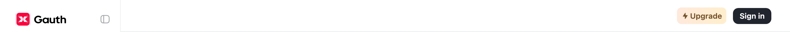

#### Upgrade button
The gold Upgrade pill: a warm gradient fill with brown text and a bolt icon. A div, so it takes no keyboard focus. Measured, never pressed. Read as `upgrade-button` on the Homework home page.

| State | Values (later rows list only what changes from the first row) |
|---|---|
| default | size 90.28 x 31; padding 5px 8px; radius 8px; background transparent; image linear-gradient(90deg, #ffe9dc `gold.start`, #ffeecd `gold.end`); text -apple-system 14/21 600, #76542a `gold.text`; icon 14 x 15, #76542a `gold.text` |
| hover | background rgba(255, 196, 106, 0.55) `gold.accent-55`; image none |
| pressed | background rgba(255, 196, 106, 0.7) `gold.accent-70`; image none |

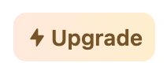 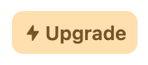 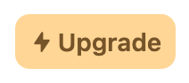

#### Sign in button
The near-black primary button in the top bar. A span in a div, so it takes no keyboard focus. Measured, never pressed. Read as `sign-in-button` on the Homework home page.

| State | Values (later rows list only what changes from the first row) |
|---|---|
| default | size 70 x 30; padding 0px 6px; radius 10px; background #21252e `ink.900`; text -apple-system 14/normal 600, #ffffff `paper.white` |
| hover, pressed | background #3e424b `ink.800` |

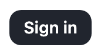  

#### Sidebar
The 220px left rail: logo and collapse button, the four destinations, a rule, App, and the Gauth PLUS card pinned to the bottom. Read as `side-menu` on the Homework home page.

**Values (default).** size 220 x 900; padding 24px 16px 0px 16px; border R: 1px solid #edeef1 `slate.divider`; background #ffffff `paper.white`; text -apple-system 14/21 600, #21252e `ink.900`; transition width 0.5s ease-in-out; icon 24 x 24, #000000 `ink.black`.

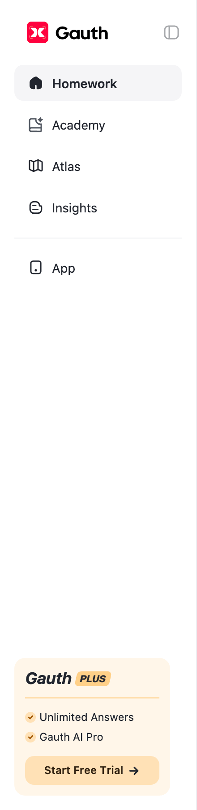

#### Sidebar item, current (cool)
The current destination on Homework and Insights: a #f5f5f7 pill with the label in 600. Read as `side-menu-item-active` on the Homework home page.

**Values (default).** size 187 x 40; padding 8px 12px; radius 10px; background #f5f5f7 `paper.cool`; text -apple-system 14/21 600, #21252e `ink.900`; icon 24 x 25, #000000 `ink.black`.

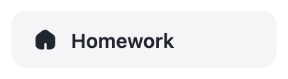

#### Sidebar item
A destination row: 40px tall, radius 10, 20px icon, 14/21 label. Read as `side-menu-item` on the Homework home page.

| State | Values (later rows list only what changes from the first row) |
|---|---|
| default | size 187 x 40; padding 8px 12px; radius 10px; background transparent; text -apple-system 14/21 400, #21252e `ink.900`; icon 24 x 24, #000000 `ink.black` |
| hover, pressed | background #f5f5f7 `paper.cool` |

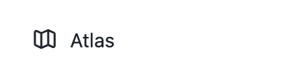  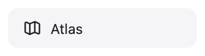

#### Sidebar link, keyboard focus
The link inside a sidebar row, which is what takes keyboard focus. Read as `side-menu-link` on the Homework home page.

**Values (focus-visible).** size 31.95 x 21; background transparent; text -apple-system 14/21 400, #21252e `ink.900`; transition opacity 0.26s ease, max-width 0.5s ease-in-out, margin-left 0.5s ease-in-out.

#### Sidebar collapse button
Read as `side-menu-collapse` on the Homework home page.

| State | Values (later rows list only what changes from the first row) |
|---|---|
| default (same: focus-visible) | size 24 x 24; background transparent; text Arial 13.33/normal 400, #21252e `ink.900`; opacity 0.4; icon 24 x 24, #21252e `ink.900` |
| hover | opacity none |
| pressed | opacity 0.7 |

 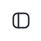  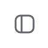

#### Gauth PLUS card
The upsell card at the foot of the sidebar: cream fill, radius 12, a gold rule under the title and a gold "Start Free Trial" button. Read as `plus-card` on the Homework home page.

**Values (default).** size 174 x 153; padding 10px 12px 12px 12px; radius 12px; background #fff6e9 `gold.cream`; text -apple-system 18/26 700, #21252e `ink.900`; icon 44 x 19, #21252e `ink.900`.

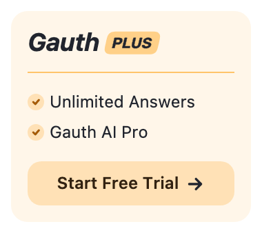

#### Gauth PLUS card button
Measured, never pressed. Read as `plus-card-button` on the Homework home page.

| State | Values (later rows list only what changes from the first row) |
|---|---|
| default | size 150 x 32; radius 10px; background rgba(255, 196, 106, 0.4) `gold.accent-40`; text -apple-system 12/18 600, #322211 `gold.text-dark`; icon 15 x 15, #322211 `gold.text-dark` |
| hover | background rgba(255, 196, 106, 0.7) `gold.accent-70` |
| pressed | background rgba(255, 196, 106, 0.8) |

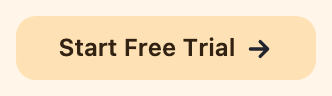 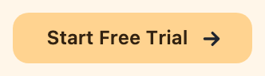 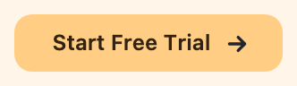

#### Logo
Read as `logo` on the Homework home page.

**Values (default).** size 90 x 24; background transparent; text -apple-system 16/normal 400, #000000 `ink.black`; icon 24 x 24, #000000 `ink.black`.

#### Sidebar, warm
On Academy the sidebar takes the page ground and the current item turns beige. Read as `side-menu-warm` on the Academy (Science Labs) page.

**Values (default).** size 220 x 900; padding 24px 16px 0px 16px; border R: 1px solid #edeef1 `slate.divider`; background #faf9f5 `paper.warm`; text -apple-system 14/21 400, #21252e `ink.900`; transition width 0.5s ease-in-out; icon 24 x 24, #0000ee.

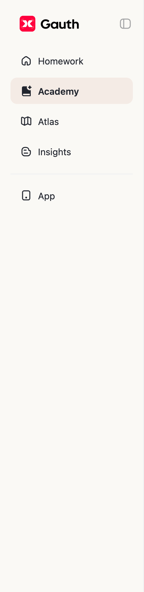

#### Sidebar item, current (warm)
The current destination on Academy: a #f4ebe5 pill (--lesson-primary-fill-2). Read as `side-menu-item-warm-active` on the Academy (Science Labs) page.

**Values (default).** size 187 x 40; padding 8px 12px; radius 10px; background #f4ebe5 `sand.fill-2`; text -apple-system 14/21 600, #21252e `ink.900`; icon 24 x 24, #000000 `ink.black`.

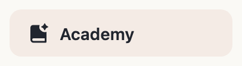

#### Top bar question field
On inner pages the question field moves into the top bar: 640 x 40, white at 84%, a 1px #e4e6eb border, radius 30, image and send buttons. Sample text was typed and deleted. Read as `header-question` on the Insights page.

| State | Values (later rows list only what changes from the first row) |
|---|---|
| default (same: hover, focused, filled) | size 640 x 40; background transparent; text -apple-system 18/27 400, rgba(62, 71, 132, 0.4) `indigo.upload-text`; icon 24 x 24, #333333 |

Child layers that carry the look: div 640x40 background rgba(255, 255, 255, 0.84) border 1px solid #e4e6eb `slate.neutral-line` radius 30px; div 1x14 background #c7c7cc; div 30x30 background #f5f5f7 `paper.cool` radius 15px.

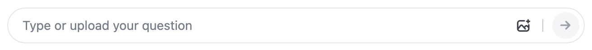  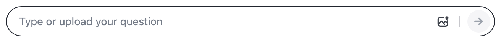 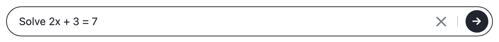

### Homework home

The question-first home page: a serif hero over a lilac gradient, the question field, an upload panel and subject chips, then marketing sections. Nothing was ever sent or uploaded.

#### Homework hero
The first band of the home page: a pale lilac gradient ground, the two-line serif title, the question field, the upload panel and the subject chips. Read as `home-hero` on the Homework home page.

**Values (default).** size 1220 x 673; padding 0px 0px 70px 0px; background transparent; image linear-gradient(0deg, rgba(245, 246, 255, 0) -13.47%, #f5f6ff `indigo.ground` 0px); text Gauth Home Libre Baskerville 40/52 600, #21252e `ink.900`; icon 29 x 28, #000000 `ink.black`.

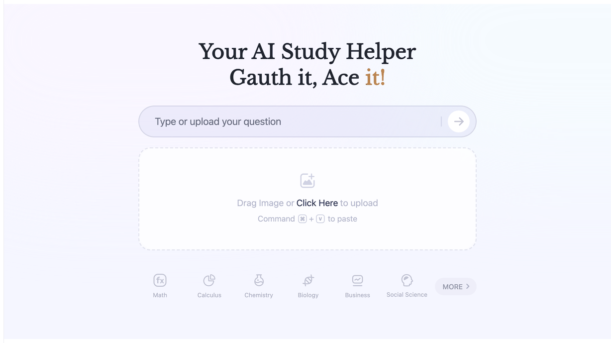

#### Hero title
"Your AI Study Helper / Gauth it, Ace it!" in Gauth Home Libre Baskerville; the second line is filled with a gradient through background-clip. Read as `home-title` on the Homework home page.

**Values (default).** size 680 x 104; background #21252e `ink.900`; image an image (data URI); text Gauth Home Libre Baskerville 40/52 600, #21252e `ink.900`.

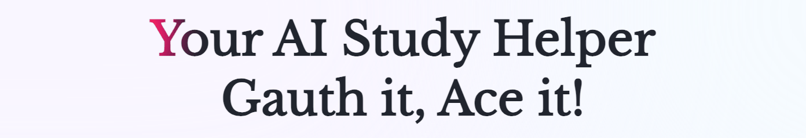

#### Question field
The 680 x 64 pill the home page is built around: a faint indigo tint, a 2px indigo-alpha border, radius 38, a round white submit button at the right end. Text was typed and deleted; nothing was sent. Read as `question-box` on the Homework home page.

| State | Values (later rows list only what changes from the first row) |
|---|---|
| default | size 680 x 64; padding 10px 12px 10px 30px; border 2px solid rgba(23, 30, 86, 0.1) `indigo.line`; radius 38px; background rgba(48, 46, 183, 0.06) `indigo.tint`; text -apple-system 16/normal 400, #000000 `ink.black`; icon 29 x 28, #000000 `ink.black` |
| hover, focused, filled | border 2px solid rgba(23, 30, 86, 0.2) `indigo.line-hover` |

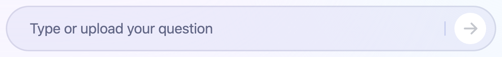  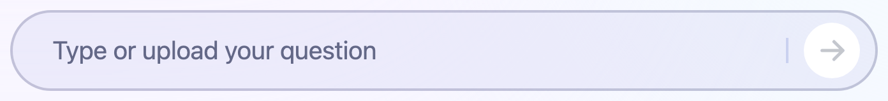 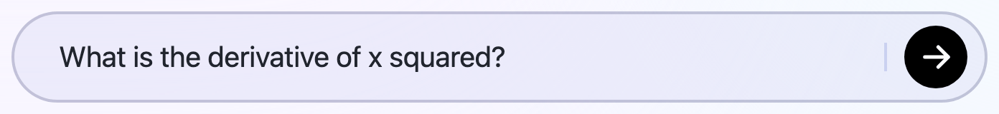

#### Question field input
Read as `question-input` on the Homework home page.

| State | Values (later rows list only what changes from the first row) |
|---|---|
| default (same: focus-visible) | size 562 x 48; radius 12px; background transparent; text -apple-system 20/26 400, #21252e `ink.900`; placeholder rgba(41, 48, 86, 0.7) `indigo.placeholder` |

No crop was saved for this entry (a whole page or a hidden element); the values are from the computed styles.

#### Question submit button
The round white arrow button; measured, never pressed. Read as `question-submit` on the Homework home page.

| State | Values (later rows list only what changes from the first row) |
|---|---|
| default | size 44 x 44; radius 24px; background #ffffff `paper.white`; text Arial 13.33/normal 400, #000000 `ink.black`; icon 29 x 28, #000000 `ink.black` |
| hover | background rgba(48, 46, 183, 0.08) `indigo.tint-hover` |

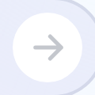 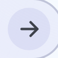

#### Upload panel
The dashed drop zone under the field. Hovered only; no file was chosen. Read as `upload-panel` on the Homework home page.

| State | Values (later rows list only what changes from the first row) |
|---|---|
| default | size 680 x 207; border 2px dashed rgba(23, 30, 86, 0.1) `indigo.line`; radius 24px; background rgba(255, 255, 255, 0.4); text -apple-system 18/27 400, rgba(62, 71, 132, 0.4) `indigo.upload-text`; icon 30 x 30, #000000 `ink.black` |
| hover | border 2px dashed rgba(23, 30, 86, 0.4) `indigo.line-strong` |

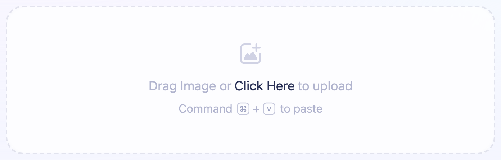 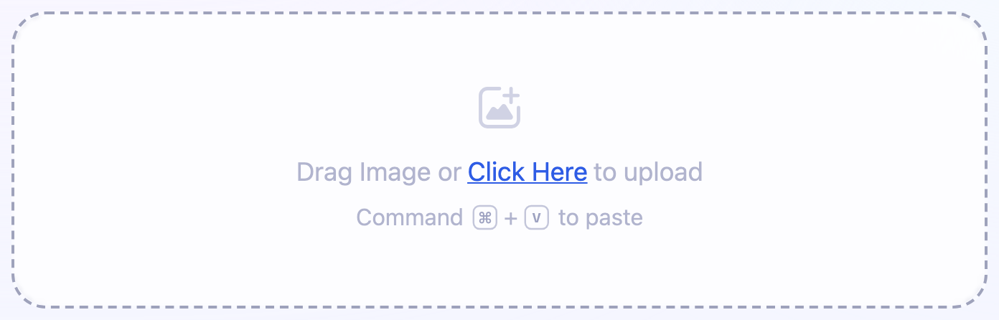

#### Subject chip
Icon over label, 87 x 72, radius 10, in a muted grey-violet. Read as `subject-chip` on the Homework home page.

| State | Values (later rows list only what changes from the first row) |
|---|---|
| default (same: focus-visible) | size 87.25 x 72; radius 10px; background transparent; text -apple-system 12/18 400, #acafc0 `indigo.chip-text`; icon 29 x 29, #000000 `ink.black` |
| hover | background #eceeff `indigo.chip-hover`; text -apple-system 12/18 400, #7f83a0 `indigo.chip-text-hover` |
| pressed | background #e5e8ff `indigo.chip-pressed`; text -apple-system 12/18 400, #7f83a0 `indigo.chip-text-hover` |

 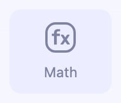 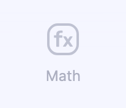 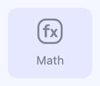

#### More subjects chip
The "MORE" pill at the end of the chip row. Read as `subject-more` on the Homework home page.

| State | Values (later rows list only what changes from the first row) |
|---|---|
| default | size 84.47 x 35; padding 9px 12px 9px 16px; radius 18px; background #eeeef9 `indigo.more`; text -apple-system 14/normal 500, #9397aa `indigo.more-text`; icon 12 x 12, #000000 `ink.black` |
| hover | background #ececf5; icon 12 x 12, #5c627f |
| pressed | background #e6e7f2; icon 12 x 12, #5c627f |

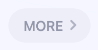 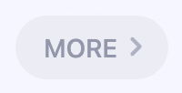 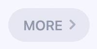

#### Section headline
The marketing sections below the fold open with a 32/41.6 700 headline and a 16/24 500 grey line; a word can carry a gradient shine. Read as `atlas-band-title` on the Homework home page.

**Values (default).** size 960 x 115.59; padding 0px 0px 40px 0px; background transparent; text -apple-system 32/41.6 700, #21252e `ink.900`.

Child layers that carry the look: span 254x41.6 image linear-gradient(90deg, #8a6024, #ff8d1f 18%, #ff6404 34%, #ff4004 52%, #e92472 70%, #4b1f4.

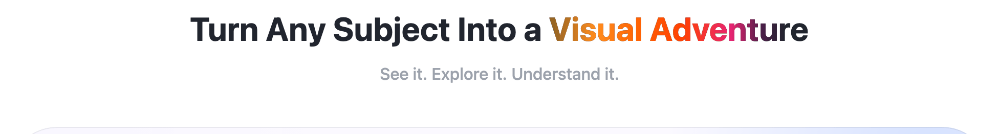

#### Atlas showcase
A radius-48 panel with soft radial colour washes holding the copy, a CTA and a demo video. Read as `atlas-showcase` on the Homework home page.

**Values (default).** size 960 x 341; padding 28px 28px 28px 47px; radius 48px; background #fbf9ff; image radial-gradient(420px 260px at 6% 92%, rgba(181, 197, 255, 0.76), transparent 72%), radial-gradient(360px 280px at 94% 5%, rgba(208, 222, 255, 0.88), transparent 72%), radial-gradient(440px 260px at 2; text -apple-system 30/39 700, #21252e `ink.900`; icon 20 x 20, #21252e `ink.900`.

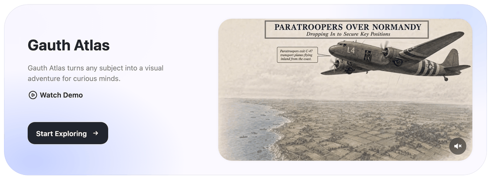

#### Start Exploring button
A dark radius-14 link button. Measured, never followed. Read as `atlas-cta` on the Homework home page.

| State | Values (later rows list only what changes from the first row) |
|---|---|
| default (same: focus-visible) | size 160 x 44; radius 14px; background #21252e `ink.900`; text -apple-system 14/21 600, #ffffff `paper.white`; icon 16 x 16, #ffffff `paper.white` |
| hover, pressed | background #303541 `ink.hover-2` |

   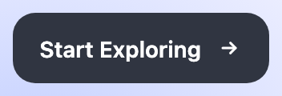

#### Feature card
White, 1px #5058651a border, radius 32: icon, 16/24 600 title, 14/21 grey line. Read as `feature-card` on the Homework home page.

| State | Values (later rows list only what changes from the first row) |
|---|---|
| default (same: hover) | size 228 x 150; padding 20px 20px 18px 20px; border 1px solid rgba(80, 88, 101, 0.1); radius 32px; background #ffffff `paper.white`; text -apple-system 16/24 600, #21252e `ink.900`; icon 32 x 36, #21252e `ink.900` |

 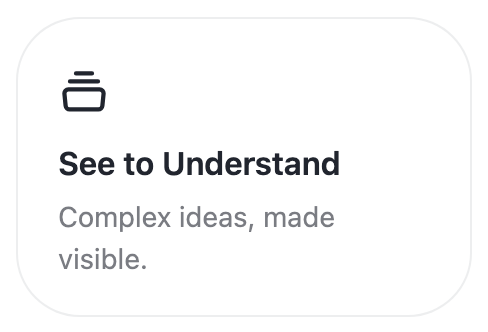

#### Solution option row
A radius-20 row with an icon, a 16/22 600 title and a 14/22 description. The rows take turns being the active one, which turns Gauth red (#ff013e) with white text and a red-tinted shadow; the measured row was active. Read as `solution-option` on the Homework home page.

| State | Values (later rows list only what changes from the first row) |
|---|---|
| default (same: hover) | size 369.81 x 102; padding 16px 24px 16px 20px; radius 20px; background #ff013e `brand.red`; shadow rgba(168, 0, 0, 0.1) 0px 7px 14px 0px; text -apple-system 16/22 600, #ffffff `paper.white`; icon 24 x 24, #000000 `ink.black` |

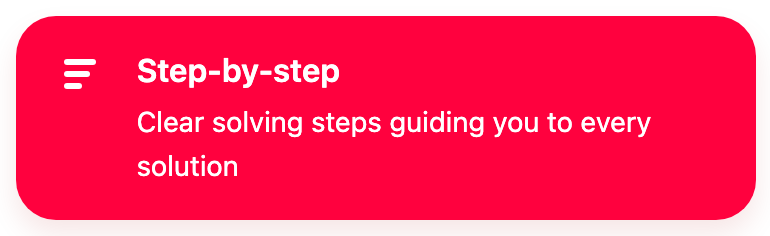 

#### Live tutor band
A pink block with one oversized corner radius (54 54 200 54). Read as `live-tutor-band` on the Homework home page.

**Values (default).** size 960 x 349.2; radius 54px 200px 54px 54px; background #ffebf0 `brand.pink-band`; text -apple-system 36/46.8 600, #1f2556 `indigo.heading`; icon 13 x 10, #1f2556 `indigo.heading`.

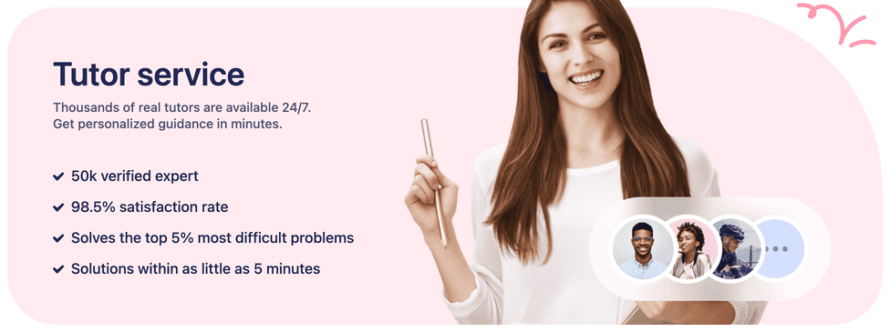

#### Footer
White with a 1px #f5f5f7 top rule: brand line, email, socials and a language select, then Company, Legal and Download App columns. Read as `footer` on the Homework home page.

**Values (default).** size 1220 x 244; border T: 1px solid #f5f5f7 `paper.cool`; background #ffffff `paper.white`; text -apple-system 20/26 600, #21252e `ink.900`; icon 24 x 24, #21252e `ink.900`.

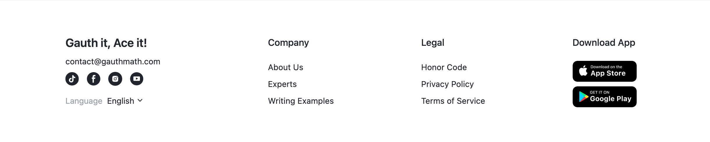

### Academy catalogue

The course catalogue: the Playfair title and Create Course, four category tabs, then course sections of card grids. Science Labs and History Signature use cover cards with a progress track; Math Curriculum uses unit cards with an 80px cover tile.

#### Academy page
The catalogue page: #faf9f5 ground under a transparent top bar, the warm sidebar, a 1025px column. Read as `academy-ground` on the Academy (Science Labs) page.

**Values (default).** size 1220 x 2094.38; background #faf9f5 `paper.warm`; text SF Pro 14/21 500, #21252e `ink.900`; icon 20 x 20, #21252e `ink.900`.

No crop was saved for this entry (a whole page or a hidden element); the values are from the computed styles.

#### Academy title
"Gauth Academy" in Playfair Display 700 at 36px. Read as `academy-title` on the Academy (Science Labs) page.

**Values (default).** size 259.25 x 48; background transparent; text Playfair Display 36/normal 700, #21252e `ink.900`.

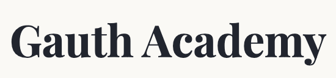

#### Create Course button
A pale blue pill: an image fill of a soft blue-to-cream gradient, a 1px #d5e3f4 border, radius 12, a sparkle icon and SF Pro 14/21 500. Read as `create-course-button` on the Academy (Science Labs) page.

| State | Values (later rows list only what changes from the first row) |
|---|---|
| default (same: focus-visible) | size 140.83 x 37; padding 0px 10px; border 1px solid #d5e3f4 `blue.fill-1`; radius 12px; background #fff8f8 `sand.create`; image an image (data URI); text SF Pro 14/21 500, #21252e `ink.900`; icon 20 x 20, #21252e `ink.900` |
| hover | border 1px solid #c5d8ee `blue.line-hover` |
| pressed | size 138.01 x 36.26; border 1px solid #c5d8ee `blue.line-hover`; transform scale(0.98); icon 19.6 x 19.6, #21252e `ink.900` |

   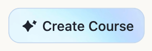

#### Category tab, current
The current catalogue tab: #f4ebe5 fill, transparent border, 700 label. Read as `category-tab-active` on the Academy (Science Labs) page.

| State | Values (later rows list only what changes from the first row) |
|---|---|
| default (same: focus-visible) | size 122.98 x 36; padding 0px 15px; border 1px solid transparent; radius 12px; background #f4ebe5 `sand.fill-2`; text -apple-system 14/19.6 700, #21252e `ink.900` |

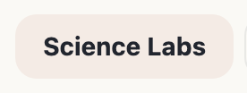 

#### Category tab
A 36px tab with a 1px #5058651a border, radius 12, 14/19.6 grey label. Read as `category-tab` on the Academy (Science Labs) page.

| State | Values (later rows list only what changes from the first row) |
|---|---|
| default (same: focus-visible) | size 139.19 x 36; padding 0px 15px; border 1px solid rgba(80, 88, 101, 0.1); radius 12px; background transparent; text -apple-system 14/19.6 400, #515761 `ink.700` |
| hover, pressed | background #f4f0ec `sand.hover`; text -apple-system 14/19.6 400, #21252e `ink.900` |

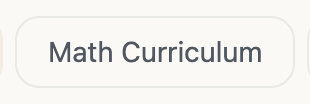 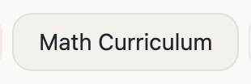  

#### Course section heading
An 80px rounded cover beside a 22/28.6 600 title and a 16/22.4 grey line. Read as `section-heading` on the Academy (Science Labs) page.

**Values (default).** size 1025 x 80; background transparent; text -apple-system 22/28.6 600, #21252e `ink.900`.

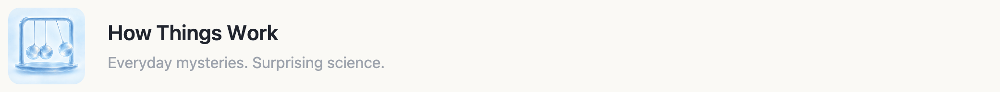

#### Course section
One course: its heading and a three-column card grid, closed by a 1px #e7e6e3 rule. Read as `course-section` on the Academy (Science Labs) page.

**Values (default).** size 1025 x 464.09; padding 29px 0px 36px 0px; border B: 1px solid #e7e6e3 `paper.warm-rule`; background transparent; text -apple-system 22/28.6 600, #21252e `ink.900`.

Child layers that carry the look: section 1025x464.1 border 1px solid #e7e6e3 `paper.warm-rule`; a 325.7x294.1 background #ffffff `paper.white` border 1px solid rgba(0, 0, 0, 0.08) `paper.card-line` radius 16px shadow rgba(0, 0, 0, 0.04) `paper.hairline` 0px 4px 7px 0px; div 283.7x6 background #f5f5f7 `paper.cool` radius 4px.

No crop was saved for this entry (a whole page or a hidden element); the values are from the computed styles.

#### Lesson card (Science Labs, History Signature)
A white card, 1px rgba(0,0,0,.08) border, radius 16, a 0 4 7 shadow at 4%: a 147px cover inset 9px at radius 12, a 700 category label, a 16/24 600 title, a 12/16.8 subtitle and a 6px progress track. Read as `lesson-card` on the Academy (Science Labs) page.

| State | Values (later rows list only what changes from the first row) |
|---|---|
| default (same: focus-visible) | size 325.66 x 294.09; padding 8px 8px 16px 8px; border 1px solid rgba(0, 0, 0, 0.08) `paper.card-line`; radius 16px; background #ffffff `paper.white`; shadow rgba(0, 0, 0, 0.04) 0px 4px 7px 0px; text -apple-system 12/16.8 700, #757c88 `ink.500`; transition box-shadow 0.16s ease |
| hover | shadow rgba(0, 0, 0, 0.08) 0px 8px 10px 0px |
| pressed | border 1px solid #aeb7c4 `slate.pressed-line`; shadow rgba(0, 0, 0, 0.08) 0px 8px 10px 0px |

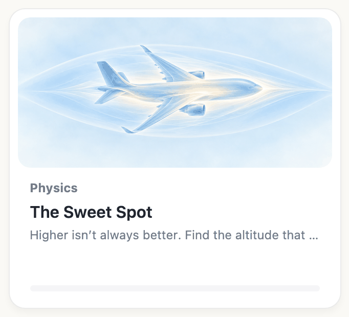   

#### Lesson card category
Read as `lesson-card-category` on the Academy (Science Labs) page.

**Values (default).** size 283.66 x 16.8; background transparent; text -apple-system 12/16.8 700, #757c88 `ink.500`.

No crop was saved for this entry (a whole page or a hidden element); the values are from the computed styles.

#### Lesson card title
Read as `lesson-card-title` on the Academy (Science Labs) page.

**Values (default).** size 283.66 x 24; background transparent; text -apple-system 16/24 600, #21252e `ink.900`.

No crop was saved for this entry (a whole page or a hidden element); the values are from the computed styles.

#### Lesson card subtitle
Read as `lesson-card-subtitle` on the Academy (Science Labs) page.

**Values (default).** size 283.66 x 16.8; background transparent; text -apple-system 12/16.8 400, #757c88 `ink.500`.

No crop was saved for this entry (a whole page or a hidden element); the values are from the computed styles.

#### Lesson card progress track
Read as `lesson-card-progress` on the Academy (Science Labs) page.

**Values (default).** size 283.66 x 6; radius 4px; background #f5f5f7 `paper.cool`; text -apple-system 16/normal 400, #21252e `ink.900`.

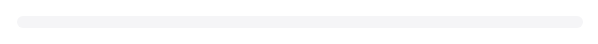

#### Unit card (Math Curriculum)
A white card 326 x 178: an 80px cover tile at radius 12 beside an Inter 17/23.8 600 title, a "Unit 1 | 42 Topics" meta line and a 6px pill track. Read as `unit-card` on the Academy (Math Curriculum) page.

| State | Values (later rows list only what changes from the first row) |
|---|---|
| default (same: focus-visible) | size 325.66 x 178; padding 20px; border 1px solid rgba(0, 0, 0, 0.08) `paper.card-line`; radius 16px; background #ffffff `paper.white`; shadow rgba(0, 0, 0, 0.04) 0px 4px 7px 0px; text Inter 17/23.8 600, #21252e `ink.900`; transition box-shadow 0.16s ease |
| hover, pressed | shadow rgba(0, 0, 0, 0.08) 0px 8px 10px 0px |

   

#### Unit card title
Read as `unit-card-title` on the Academy (Math Curriculum) page.

**Values (default).** size 187.66 x 47.59; background transparent; text Inter 17/23.8 600, #21252e `ink.900`.

No crop was saved for this entry (a whole page or a hidden element); the values are from the computed styles.

#### Unit card meta line
Read as `unit-card-meta` on the Academy (Math Curriculum) page.

**Values (default).** size 283.66 x 20; background transparent; text Inter 14/19.6 400, #757c88 `ink.500`.

Child layers that carry the look: span::before 1pxx12px background #d9dde3 `slate.meta-rule`.

#### Unit card progress track
Read as `unit-card-progress` on the Academy (Math Curriculum) page.

**Values (default).** size 283.66 x 6; radius 999px; background #f2f2f4 `paper.track`; text -apple-system 16/normal 400, #21252e `ink.900`.

No crop was saved for this entry (a whole page or a hidden element); the values are from the computed styles.

#### Show more button
"Show 14 more" with a chevron: 1px #e0e3e8 border, radius 12, 14/19.6 grey. Pressing it lists the remaining units as compact rows. Read as `show-more` on the Academy (Math Curriculum) page.

| State | Values (later rows list only what changes from the first row) |
|---|---|
| default (same: focus-visible) | size 145.28 x 40; padding 0px 16px; border 1px solid #e0e3e8 `slate.control-line`; radius 12px; background transparent; text Arial 14/19.6 400, #757c88 `ink.500`; icon 14 x 14, #757c88 `ink.500` |
| hover | border 1px solid #c5ccd7 `slate.control-line-hover`; background #f4f0ec `sand.hover`; text Arial 14/19.6 400, #21252e `ink.900`; icon 14 x 14, #21252e `ink.900` |
| pressed | border 1px solid #c5ccd7 `slate.control-line-hover`; background #e9ecf1 `slate.pressed-fill`; text Arial 14/19.6 400, #21252e `ink.900`; icon 14 x 14, #21252e `ink.900` |
| expanded | size 118.81 x 40 |

    

#### Unit card revealed by Show more
Show more reveals the units past the sixth as the same cards. Read as `unit-row` on the Academy (Math Curriculum) page.

| State | Values (later rows list only what changes from the first row) |
|---|---|
| default (same: focus-visible) | size 325.66 x 178; padding 20px; border 1px solid rgba(0, 0, 0, 0.08) `paper.card-line`; radius 16px; background #ffffff `paper.white`; shadow rgba(0, 0, 0, 0.04) 0px 4px 7px 0px; text Inter 17/23.8 600, #21252e `ink.900`; transition box-shadow 0.16s ease |
| hover | shadow rgba(0, 0, 0, 0.08) 0px 8px 10px 0px |

  

#### History lesson card
The same card as Science Labs with a full-bleed illustrated cover. Read as `history-card` on the Academy (History Signature) page.

| State | Values (later rows list only what changes from the first row) |
|---|---|
| default | size 325.66 x 264.25; padding 8px 8px 16px 8px; border 1px solid rgba(0, 0, 0, 0.08) `paper.card-line`; radius 16px; background #ffffff `paper.white`; shadow rgba(0, 0, 0, 0.04) 0px 4px 7px 0px; text -apple-system 12/16.8 700, #757c88 `ink.500`; transition box-shadow 0.16s ease |
| hover | shadow rgba(0, 0, 0, 0.08) 0px 8px 10px 0px |

 

#### My Course empty state
A fan of three course cards, a 20px 600 title, a grey line and a dark Create button. Read as `my-empty` on the Academy (My Course) page.

**Values (default).** size 1025 x 557; padding 36px 0px; background transparent; text -apple-system 20/26 700, #000000 `ink.black`.

Child layers that carry the look: button 120x44 background #21252e `ink.900` radius 12px.

#### Create button (empty state)
The dark primary button: #21252e, radius 12, 44px, white 16/22.4 500. Hover lightens it to #333943; pressed also scales it to 0.98. Measured, never pressed. Read as `create-button` on the Academy (My Course) page.

| State | Values (later rows list only what changes from the first row) |
|---|---|
| default (same: focus-visible) | size 120 x 44; padding 0px 18px; radius 12px; background #21252e `ink.900`; text Arial 16/22.4 500, #ffffff `paper.white` |
| hover | background #333943 `ink.hover` |
| pressed | size 117.6 x 43.12; background #333943 `ink.hover`; transform scale(0.98) |

   

### Unit page

A math course's page: a back link, a tinted course banner, the unit rail at the left and the topic path at the right, with a floating Start panel.

#### Back link
An arrow and the catalogue tab name, SF Pro 16/22.4 in #646a77. Read as `back-link` on the unit page.

| State | Values (later rows list only what changes from the first row) |
|---|---|
| default (same: hover, focus-visible) | size 148.05 x 22.39; background transparent; text SF Pro 20/20 400, #757c88 `ink.500` |

  

#### Course banner
A radius-20 band tinted with the course colour (Algebra 1 is green #ecf4e5): an SF Pro 22/28.6 700 course title, a lessons and topics count, a 7px progress bar and the percent. Read as `course-banner` on the unit page.

**Values (default).** size 1025 x 89; padding 16px 20px 16px 28px; radius 20px; background #ecf4e5 `green.course`; text SF Pro 22/28.6 700, #21252e `ink.900`.

#### Unit rail
The 310px list of units: a 1px rgba(0,0,0,.04) border, radius 16; the current unit is marked by a 5px green bar on its ::before and green #3c6b26 text. Read as `unit-rail` on the unit page.

**Values (default).** size 310 x 632; padding 4px 4px 4px 0px; border 1px solid rgba(0, 0, 0, 0.04) `paper.hairline`; radius 16px; background transparent; text SF Pro 12/16.8 400, #3c6b26 `green.course-text`.

#### Unit rail item, current
Read as `unit-button-active` on the unit page.

| State | Values (later rows list only what changes from the first row) |
|---|---|
| default (same: focus-visible) | size 304 x 62; padding 10px 16px; radius 12px; background transparent; text SF Pro 12/16.8 400, #3c6b26 `green.course-text` |

Child layers that carry the look: button::before 5pxx42px background #3c6b26 `green.course-text`.

 

#### Unit rail item
A 62px row: 12/16.8 "Unit n" over a 14/21 700 title. Read as `unit-button` on the unit page.

| State | Values (later rows list only what changes from the first row) |
|---|---|
| default | size 304 x 62; padding 10px 16px; radius 12px; background transparent; text SF Pro 12/16.8 400, #757c88 `ink.500` |
| hover | background rgba(80, 88, 101, 0.04) |
| pressed | background rgba(80, 88, 101, 0.06) `slate.fill-2` |

  

#### Unit header
A white-on-ground header card with radius 20 over the topic path. Read as `unit-header` on the unit page.

**Values (default).** size 683 x 84; padding 18px 38px 12px 38px; border 1px solid rgba(0, 0, 0, 0.04) `paper.hairline`; radius 20px; background transparent; text SF Pro 12/18 500, #757c88 `ink.500`.

#### Topic path
Topics as round coin buttons on a winding dotted connector, the label to the right; the current topic has a halo ring. Read as `topic-path` on the unit page.

**Values (default).** size 457 x 553; background transparent; text SF Pro 15/21 700, #21252e `ink.900`.

#### Topic node, current
Read as `topic-node-current` on the unit page.

| State | Values (later rows list only what changes from the first row) |
|---|---|
| default (same: hover, focus-visible) | size 316 x 105; background transparent; text SF Pro 15/21 700, #21252e `ink.900`; icon 108 x 105, #21252e `ink.900` |

  

#### Topic node, not started
A pale coin with a star and a grey label. Read as `topic-node` on the unit page.

| State | Values (later rows list only what changes from the first row) |
|---|---|
| default (same: focus-visible) | size 332 x 108; padding 10px; background transparent; text SF Pro 15/21 500, #9ca2ac `ink.400`; icon 96 x 88, #9ca2ac `ink.400` |
| hover | text SF Pro 15/21 500, #757c88 `ink.500`; icon 96 x 88, #757c88 `ink.500` |
| pressed | text SF Pro 15/21 500, #757c88 `ink.500`; icon 94.08 x 86.24, #757c88 `ink.500` |

   

#### Start panel
The floating card under the current topic: white, a 1px #5058651a border, radius 28, a 0 12 14 shadow tinted navy at 14%, a 17/23.8 700 topic title and a full-width dark Start button. Read as `learning-panel` on the unit page.

**Values (default).** size 460 x 145.8; padding 26px 24px 22px 24px; border 1px solid rgba(80, 88, 101, 0.1); radius 28px; background #ffffff `paper.white`; shadow rgba(46, 61, 107, 0.14) 0px 12px 14px 0px; text SF Pro 17/23.8 700, #21252e `ink.900`.

#### Start button
The primary button: #21252e, radius 12, 48px, white 16/24 700, with a moving light sheen drawn on ::after. Pressed scales it to 0.98. Read as `start-button` on the unit page.

| State | Values (later rows list only what changes from the first row) |
|---|---|
| default (same: hover, focus-visible) | size 410 x 48; radius 12px; background #21252e `ink.900`; text SF Pro 16/24 700, #ffffff `paper.white` |
| pressed | size 401.8 x 47.04; transform scale(0.98) |

   

### Lesson player: science canvas

The science player is built in Astryx, a separate design system (`astryx-*` classes, StyleX variables, the "stone" theme): a narrated canvas that pans by itself, a section rail, transport controls and a docked Ask Tutor bar. Its focus ring is the only blue one on the site.

#### Lesson header
Exit button and the lesson title in Playfair Display 16/21 600 at the left; the transport (previous, play or pause, next), Reset view and Settings at the right, all 32px round ghost buttons. Read as `canvas-header` on the science lesson page.

**Values (default).** size 1396 x 40; background transparent; text Playfair Display 16/21 600, #21252e `ink.900`; icon 40 x 40, #25252a `astryx.ink`.

Child layers that carry the look: div 0x0 background #25252a `astryx.ink` radius 12px; div 0x0 background #25252a `astryx.ink` radius 12px; div 0x0 background #25252a `astryx.ink` radius 12px.

#### Exit button
Read as `canvas-exit` on the science lesson page.

| State | Values (later rows list only what changes from the first row) |
|---|---|
| default | size 40 x 40; radius 9999px; background transparent; text Canvas Print 14/20.00 500, #25252a `astryx.ink`; transition background-image 0.125s cubic-bezier(0.24, 1, 0.4, 1), background-color 0.125s cubic-bezier(0.24, 1, 0.4, 1), color 0.125s cubic-bezier(0.24, 1, 0.4, 1), opacity 0.125s cubic-bezier(0.24, 1, 0.4, 1), transform 0.125s cubic-bezier(0.24, 1, 0.4, 1); icon 40 x 40, #25252a `astryx.ink` |
| hover | image linear-gradient(rgba(37, 37, 42, 0.05) `astryx.film-5`, rgba(37, 37, 42, 0.05) `astryx.film-5`) |
| focus-visible | outline 2px solid #0064e0 `blue.focus`, offset 3px |
| pressed | size 39.2 x 39.2; image linear-gradient(rgba(37, 37, 42, 0.1) `astryx.film-10`, rgba(37, 37, 42, 0.1) `astryx.film-10`); transform scale(0.98); icon 39.2 x 39.2, #25252a `astryx.ink` |

   

#### Transport and view buttons
A 32px round ghost button holding a 32px icon. Hover lays a 5% ink film over it, pressed 10% and a 0.98 scale; keyboard focus draws Astryx's 2px #0064e0 ring 3px out. Read as `canvas-control` on the science lesson page.

| State | Values (later rows list only what changes from the first row) |
|---|---|
| default | size 32 x 32; radius 9999px; background transparent; text Canvas Print 14/20.00 500, #25252a `astryx.ink`; transition background-image 0.125s cubic-bezier(0.24, 1, 0.4, 1), background-color 0.125s cubic-bezier(0.24, 1, 0.4, 1), color 0.125s cubic-bezier(0.24, 1, 0.4, 1), opacity 0.125s cubic-bezier(0.24, 1, 0.4, 1), transform 0.125s cubic-bezier(0.24, 1, 0.4, 1); icon 32 x 32, #25252a `astryx.ink` |
| hover | image linear-gradient(rgba(37, 37, 42, 0.05) `astryx.film-5`, rgba(37, 37, 42, 0.05) `astryx.film-5`) |
| focus-visible | outline 2px solid #0064e0 `blue.focus`, offset 3px |
| pressed | size 31.36 x 31.36; image linear-gradient(rgba(37, 37, 42, 0.1) `astryx.film-10`, rgba(37, 37, 42, 0.1) `astryx.film-10`); transform scale(0.98); icon 31.36 x 31.36, #25252a `astryx.ink` |

   

#### Section rail
The right-hand outline: right-aligned 14/20 section names beside a 2px track whose dark segment marks the current section. Read as `canvas-outline` on the science lesson page.

**Values (default).** size 240 x 118; background transparent; text Canvas Print 14/20.00 600, #25252a `astryx.ink`; transform translate(0px, -59px).

Child layers that carry the look: span 2x118 background #e2e2e8 `astryx.track` radius 9999px; span 2x28 background #25252a `astryx.ink` radius 9999px.

#### Section rail item, current
Read as `outline-item-active` on the science lesson page.

**Values (default).** size 236 x 28; padding 4px 12px 4px 8px; radius 8px; background transparent; text Canvas Print 14/20.00 600, #25252a `astryx.ink`; transition background-color 0.125s cubic-bezier(0.24, 1, 0.4, 1), color 0.125s cubic-bezier(0.24, 1, 0.4, 1).

#### Section rail item
Read as `outline-item` on the science lesson page.

| State | Values (later rows list only what changes from the first row) |
|---|---|
| default | size 236 x 28; padding 4px 12px 4px 8px; radius 8px; background transparent; text Canvas Print 14/20.00 400, #5e5e63 `astryx.ink-2`; transition background-color 0.125s cubic-bezier(0.24, 1, 0.4, 1), color 0.125s cubic-bezier(0.24, 1, 0.4, 1) |
| hover | background rgba(37, 37, 42, 0.05) `astryx.film-5`; text Canvas Print 14/20.00 400, #25252a `astryx.ink` |
| focus-visible | outline 2px solid #0064e0 `blue.focus`, offset 3px |

  

#### Ask Tutor bar
The compact pill docked at the bottom centre: white, 1px #e2e2e8 border, radius 9999, a two-layer soft shadow, the Gauth mascot, an "Ask Tutor" placeholder and a microphone button. It widens to 820px when opened (0.26s). Read as `ask-tutor` on the science lesson page.

| State | Values (later rows list only what changes from the first row) |
|---|---|
| default (same: hover) | size 820 x 52; border 1px solid #e2e2e8 `astryx.track`; radius 9999px; background #ffffff `paper.white`; shadow rgba(40, 40, 42, 0.05) 0px 2px 4px 0px, rgba(40, 40, 42, 0.1) 0px 4px 12px 0px; text SF Pro 16/24 400, #9ca2ac `ink.400`; transition width 0.26s cubic-bezier(0.22, 1, 0.36, 1); icon 40 x 40, #000000 `ink.black` |

 

#### Ask Tutor microphone button
Measured, never pressed. Read as `ask-tutor-mic` on the science lesson page.

| State | Values (later rows list only what changes from the first row) |
|---|---|
| default (same: hover) | size 40 x 40; radius 50%; background transparent; text Arial 13.33/normal 400, #000000 `ink.black`; icon 40 x 40, #000000 `ink.black` |
| focus-visible | outline 2px solid #000000 `ink.black`, offset 2px |

  

#### Ask Tutor bar, opened
Clicking the bar widens it into a text field. Sample text was typed and deleted; no message was sent. Read as `ask-tutor-open` on the science lesson page.

| State | Values (later rows list only what changes from the first row) |
|---|---|
| opened | size 820 x 52; border 1px solid #e2e2e8 `astryx.track`; radius 9999px; background #ffffff `paper.white`; shadow rgba(40, 40, 42, 0.05) 0px 2px 4px 0px, rgba(40, 40, 42, 0.1) 0px 4px 12px 0px; text SF Pro 16/24 400, #9ca2ac `ink.400`; transition width 0.26s cubic-bezier(0.22, 1, 0.36, 1); icon 40 x 40, #000000 `ink.black` |
| filled | text SF Pro 16/24 400, #1f2021 |

 

#### Settings popover
Speed, Narration and Captions switches, a Zoom stepper and Export PDF (not pressed): a white card with a 1px #f2f2f2 border, radius 24 and a 0 8 14 shadow at 9%. Read as `settings-popover` on the science lesson page.

**Values (opened).** size 298 x 246; radius 24px; background transparent; text SF Pro 14/21 400, #0d0d0d; icon 20 x 20, #0d0d0d.

Child layers that carry the look: section 298x246 background #ffffff `paper.white` border 1px solid #f2f2f2 radius 24px shadow rgba(0, 0, 0, 0.09) 0px 8px 14px 0px; button 119x32 background rgba(37, 37, 42, 0.06) radius 9999px.

#### Switch
A Settings row holding the Narration toggle, off: 44px, radius 12; hover fills it #f3f3f3 and keyboard focus draws a 2px #307aff ring inside. Not toggled. Read as `switch` on the science lesson page.

| State | Values (later rows list only what changes from the first row) |
|---|---|
| default | size 264 x 44; padding 0px 8px; radius 12px; background transparent; text SF Pro 14/21 400, #0d0d0d; icon 36 x 36, #0d0d0d |
| hover | background #f3f3f3 `paper.hover` |
| focus-visible | background #f3f3f3 `paper.hover`; outline 2px solid #307aff `blue.focus-2`, offset -2px |

  

#### Chapter title
"Canvas Chapter", which is Libre Baskerville Bold, 24/30. Read as `chapter-title` on the science lesson page.

**Values (default).** size 470 x 57; padding 27px 26px 0px 32px; background transparent; text Canvas Chapter 24/30 700, #292827 `astryx.chapter-ink`.

#### Note heading
"Canvas Heading" (Satoshi Medium) 18/26 600; the note being read is blue #2e70ed. Read as `note-heading` on the science lesson page.

**Values (default).** size 416 x 26; background transparent; text Canvas Heading 18/26 600, #2e70ed `blue.note`.

#### Note body text
"Canvas Print" (Satoshi) 16/28 in a warm grey #45433f. Read as `note-text` on the science lesson page.

**Values (default).** size 416 x 84; background transparent; text Canvas Print 16/28 400, #45433f `astryx.print-ink`.

#### Canvas ground
A #fcfcfc board with a dot grid, panned and zoomed by drag and Ctrl/Cmd + scroll. Read as `canvas-ground` on the science lesson page.

**Values (default).** size 1440 x 900; background #fcfcfc `paper.canvas`; text Canvas Chapter 24/30 700, #292827 `astryx.chapter-ink`.

No crop was saved for this entry (a whole page or a hidden element); the values are from the computed styles.

#### Figure card
An animated diagram in a white radius-20 frame. Read as `figure-card` on the science lesson page.

**Values (default).** size 416 x 257.83; radius 20px; background #ffffff `paper.white`; text Canvas Print 16/normal 400, #292827 `astryx.chapter-ink`.

#### Takeaway callout
A #e8fbef radius-14 box with a bulb icon for the one-line takeaway. Read as `callout` on the science lesson page.

**Values (default).** size 416 x 88; padding 14px 10px; radius 14px; background #e8fbef `green.callout`; text Canvas Print 14/20 500, #202522; icon 24 x 24, #202522.

#### Numbered list
Points with a small number in a pale blue disc and 16/24 text. Read as `numbered-list` on the science lesson page.

**Values (default).** size 416 x 240; background transparent; text Canvas Print 12/20 700, #093c83 `blue.marker`.

Child layers that carry the look: span 20x20 background #eef5ff `blue.marker-fill` radius 50%; span 20x20 background #eef5ff `blue.marker-fill` radius 50%; span 20x20 background #eef5ff `blue.marker-fill` radius 50%.

#### Quiz card
A check-in question docked over the canvas: white, 1px #e3e3e3 border, radius 20, a 0 6 24 shadow at 7%, an Inter 16/24 600 question, four outlined options and a small close button. No option was chosen. Read as `quiz-card` on the science lesson page.

**Values (default).** size 560 x 296; padding 20px; border 1px solid #e3e3e3 `astryx.quiz-line`; radius 20px; background #ffffff `paper.white`; shadow rgba(0, 0, 0, 0.07) 0px 6px 24px 0px; text Inter 16/24 600, #20242d; icon 16 x 16, #737373.

#### Quiz option
A 44px option, 1px #e6e6e7 border, radius 10, SF Pro 14/20, over a visually hidden radio. Hover fills it #f3f3f3; keyboard focus draws Astryx's 2px #0064e0 ring 3px out. Hovered and focused only. Read as `quiz-option` on the science lesson page.

| State | Values (later rows list only what changes from the first row) |
|---|---|
| default | size 518 x 44; padding 0px 12px; border 1px solid #e6e6e7 `astryx.option-line`; radius 10px; background #ffffff `paper.white`; text SF Pro 14/20 400, #2c323d; transition box-shadow 0.125s cubic-bezier(0.24, 1, 0.4, 1), border-color 0.125s cubic-bezier(0.24, 1, 0.4, 1) |
| hover | background #f3f3f3 `paper.hover` |
| focus-visible | outline 2px solid #0064e0 `blue.focus`, offset 3px |

  

### Lesson player: math

The math player puts a tutor column at the left and the slide in a white frame at the right, on the warm ground.

#### Math lesson page
Two columns on #faf9f5: a 360px tutor column at the left and the slide in a white radius-32 frame at the right, under a 66px header with the progress bar. Read as `math-lesson-page` on the math lesson page.

**Values (default).** size 1440 x 900; background #faf9f5 `paper.warm`; text -apple-system 14/21 400, #646a77 `ink.600`; icon 40 x 40, #21252e `ink.900`.

No crop was saved for this entry (a whole page or a hidden element); the values are from the computed styles.

#### Tutor column
The mascot, a status line ("Explaining ...") with a shimmer, the running transcript and the "Ask gauth" field at the foot. Read as `tutor-panel` on the math lesson page.

**Values (default).** size 360 x 900; background #faf9f5 `paper.warm`; text -apple-system 14/21 400, #646a77 `ink.600`; icon 12.72 x 13.55, #646a77 `ink.600`.

#### Tutor status line
Read as `tutor-status` on the math lesson page.

**Values (default).** size 296 x 42; background transparent; text -apple-system 14/21 400, #646a77 `ink.600`; icon 12.72 x 13.55, #646a77 `ink.600`.

Child layers that carry the look: span 276x42 image linear-gradient(100deg, #7c818c 0px, #7c818c 38%, #a9adb5 47%, #d4d6da 52%, #a9adb5 57%, #.

#### Ask gauth field
White, 1px #e4e6eb border, radius 16, 48px, Inter 16, a microphone at the right; it grows with the text. Sample text was typed and deleted; nothing was sent. Read as `tutor-input` on the math lesson page.

| State | Values (later rows list only what changes from the first row) |
|---|---|
| default (same: hover, focused) | size 296 x 48; padding 9px 12px; border 1px solid #e4e6eb `slate.neutral-line`; radius 16px; background #ffffff `paper.white`; text Inter 16/normal 400, #21252e `ink.900`; icon 30 x 30, #21252e `ink.900` |
| filled | size 296 x 71; padding 12px; text Inter 16/22.4 400, #21252e `ink.900`; icon 10.19 x 10.19, #000000 `ink.black` |

   

#### Lesson progress
Previous and next page arrows around an 8px track (#edeade fill, #27220c value) and one 20px dot per later chapter. Read as `progress-bar` on the math lesson page.

**Values (default).** size 718 x 40; background transparent; text -apple-system 16/normal 400, #21252e `ink.900`; icon 40 x 40, #646a77 `ink.600`.

Child layers that carry the look: div 532x8 background #edeade `lesson-math.track` radius 100px; span 22.2x8 background #27220c `lesson-math.value` radius 100px; span 20x8 background #edeade `lesson-math.track` radius 100px.

#### Page arrow button
Read as `page-nav` on the math lesson page.

| State | Values (later rows list only what changes from the first row) |
|---|---|
| default (same: focus-visible) | size 40 x 40; radius 50%; background transparent; text Arial 13.33/normal 400, #646a77 `ink.600`; transition background 0.16s ease, opacity 0.16s ease, transform 0.12s ease; icon 40 x 40, #646a77 `ink.600` |
| hover | background rgba(0, 0, 0, 0.05) `lesson-math.film` |
| pressed | size 37.6 x 37.6; background rgba(0, 0, 0, 0.05) `lesson-math.film`; transform scale(0.94); icon 37.6 x 37.6, #646a77 `ink.600` |

   

#### Header round button
Pause, speed ("1x") and chapters: 40px round ghost buttons. Read as `header-round-button` on the math lesson page.

| State | Values (later rows list only what changes from the first row) |
|---|---|
| default (same: focus-visible) | size 40 x 40; radius 50%; background transparent; text -apple-system 15/normal 600, #21252e `ink.900`; transition background 0.16s ease, transform 0.12s ease; icon 26.81 x 26.81, #21252e `ink.900` |
| hover | background rgba(0, 0, 0, 0.05) `lesson-math.film` |
| pressed | size 37.6 x 37.6; background rgba(0, 0, 0, 0.05) `lesson-math.film`; transform scale(0.94); icon 25.2 x 25.2, #21252e `ink.900` |

   

#### Speed button
Read as `speed-button` on the math lesson page.

| State | Values (later rows list only what changes from the first row) |
|---|---|
| default | size 40 x 40; radius 50%; background transparent; text -apple-system 15/normal 600, #21252e `ink.900`; transition background 0.16s ease, transform 0.12s ease |
| hover | background rgba(0, 0, 0, 0.05) `lesson-math.film` |

 

#### Slide frame
The white radius-32 frame the slide plays in, title in Playfair Display. Read as `player-frame` on the math lesson page.

**Values (default).** size 1048 x 820; border 1px solid transparent; radius 32px; background #ffffff `paper.white`; text -apple-system 16/normal 400, #21252e `ink.900`; transition border-color 0.18s ease.

#### Chapters panel
Opened from the list button at the top right: a white panel of chapter rows, the current one tinted. Read as `chapters-panel` on the math lesson page.

**Values (opened).** size 320 x 460; padding 12px 8px; radius 16px; background #ffffff `paper.white`; shadow rgba(0, 0, 0, 0.08) 0px 0px 10px 0px; text -apple-system 16/normal 700, #21252e `ink.900`.

#### Chapter row, current
Read as `chapter-option-active` on the math lesson page.

**Values (default).** size 304 x 37; padding 8px 12px; radius 10px; background #f5f5f7 `paper.cool`; text -apple-system 14/normal 600, #21252e `ink.900`.

#### Chapter row
A 37px row. Hovered and focused only. Read as `chapter-option` on the math lesson page.

| State | Values (later rows list only what changes from the first row) |
|---|---|
| default | size 304 x 37; padding 8px 12px; radius 10px; background transparent; text -apple-system 14/normal 400, #21252e `ink.900` |
| hover, focus-visible | background #f5f5f7 `paper.cool` |

  

#### Tutor transcript
The column under the mascot. While the tutor narrates it holds the status line with a shimmer; no transcript text appeared in 25 seconds of playback. Read as `tutor-transcript` on the math lesson page.

**Values (default).** size 296 x 748; padding 73px 0px 20px 0px; background transparent; text -apple-system 14/21 400, #646a77 `ink.600`; icon 12.72 x 13.55, #646a77 `ink.600`.

Child layers that carry the look: span 230.7x21 image linear-gradient(100deg, #7c818c 0px, #7c818c 38%, #a9adb5 47%, #d4d6da 52%, #a9adb5 57%, #.

### Lesson player: history

The history player is immersive: chapter pills at the top, the scene in the middle, a play disc and a caption line.

#### History lesson page
An immersive player on #faf9f5: chapter pills centred in the header, the scene in the middle, a round play button and a caption line at the foot. Read as `history-lesson-page` on the history lesson page.

**Values (default).** size 1440 x 900; background #faf9f5 `paper.warm`; text SF Pro 14/21 500, #21252e `ink.900`; icon 40 x 40, #21252e `ink.900`.

No crop was saved for this entry (a whole page or a hidden element); the values are from the computed styles.

#### Chapter pills
The current chapter as a grey pill with an icon and its name; later chapters as numbered pills joined by dashed lines; a chapters list button at the end. Read as `chapter-pills` on the history lesson page.

**Values (default).** size 382.92 x 44; padding 0px 6px; radius 22px; background transparent; image linear-gradient(#f7f9fa, #fcfcfc `paper.canvas`); text SF Pro 14/21 500, #21252e `ink.900`; icon 14 x 14, #21252e `ink.900`.

#### Chapter pill, current
Read as `chapter-pill-active` on the history lesson page.

**Values (default).** size 122.19 x 32; padding 8px 14px; radius 999px; background rgba(33, 37, 46, 0.07) `ink.a07`; text SF Pro 14/21 500, #21252e `ink.900`; transition background-color 0.12s ease, color 0.12s ease; icon 14 x 14, #21252e `ink.900`.

#### Chapter pill, upcoming
An upcoming chapter: a 32px pill at 4% ink with its number at 25% ink; hover doubles both. Read as `chapter-pill` on the history lesson page.

| State | Values (later rows list only what changes from the first row) |
|---|---|
| default (same: focus-visible) | size 50.56 x 32; padding 0px 12px; radius 999px; background rgba(33, 37, 46, 0.04) `ink.a04`; text SF Pro 16/22.4 500, rgba(33, 37, 46, 0.25) `ink.a25`; transition background-color 0.12s ease, color 0.12s ease; icon 14 x 14, rgba(33, 37, 46, 0.25) `ink.a25` |
| hover | background rgba(33, 37, 46, 0.08); text SF Pro 16/22.4 500, rgba(33, 37, 46, 0.48); icon 14 x 14, rgba(33, 37, 46, 0.48) |

  

#### Play button
A 60px disc, white at 82%, with a 0 8 28 navy shadow and a black play glyph. Not pressed. Read as `play-button` on the history lesson page.

| State | Values (later rows list only what changes from the first row) |
|---|---|
| default (same: hover, focus-visible) | size 60 x 60; radius 50%; background rgba(255, 255, 255, 0.82); shadow rgba(36, 48, 77, 0.16) 0px 8px 28px 0px; text SF Pro 16/normal 400, #161823; transition transform 0.12s ease; icon 26 x 26, #161823 |

  

#### Chapter panel
A 400px white panel from the right edge, radius 28 on the leading corners, a -8 0 40 shadow: each chapter with a number, a 600 name and a two-line description; the current chapter is pink #fff0f3 with red text. Read as `chapter-panel` on the history lesson page.

**Values (opened).** size 400 x 900; padding 8px 16px; radius 28px 0px 0px 28px; background #ffffff `paper.white`; shadow rgba(0, 0, 0, 0.12) -8px 0px 40px 0px; text SF Pro 16/22.4 700, #21252e `ink.900`; transition opacity 0.18s ease, transform 0.18s ease; icon 24 x 24, #21252e `ink.900`.

#### Chapter panel row
Read as `chapter-panel-item` on the history lesson page.

| State | Values (later rows list only what changes from the first row) |
|---|---|
| default | size 368 x 94; padding 16px 4px; radius 16px; background transparent; text SF Pro 16/normal 700, #21252e `ink.900` |
| hover, focus-visible | background rgba(33, 37, 46, 0.04) `ink.a04` |

  

#### Caption line
The narration as one centred grey line under the scene. Read as `caption` on the history lesson page.

**Values (default).** size 284.52 x 22.41; background transparent; text SF Pro 20/22.4 400, #757c88 `ink.500`.

### Atlas

Atlas has its own shell (a 56px header and a 230px drawer), a prompt box, recommendation chips and a grid of story cards. A story opens as a video preview, then a story page.

#### Atlas top bar
Atlas has its own 56px shell: logo and a menu button at the left, Sign in at the right. Read as `atlas-header` on the Atlas page.

**Values (default).** size 1440 x 56; padding 0px 20px; background #ffffff `paper.white`; text -apple-system 14/normal 600, #ffffff `paper.white`; icon 24 x 24, #1f2556 `indigo.heading`.

#### Atlas sidebar
A 230px white drawer: New Topic, a search field and the topic list (empty when signed out). Read as `atlas-drawer` on the Atlas page.

**Values (default).** size 230 x 844; padding 0px 12px 20px 12px; background #ffffff `paper.white`; text Rubik 12/normal 400, #2f343d `atlas.drawer-ink`; icon 20 x 20, #2f343d `atlas.drawer-ink`.

#### New Topic button
A 44px row, radius 12, plus icon and Rubik 12px label. Read as `new-topic` on the Atlas page.

| State | Values (later rows list only what changes from the first row) |
|---|---|
| default (same: focus-visible) | size 206 x 44; padding 0px 10px; radius 12px; background transparent; text Rubik 12/normal 400, #2f343d `atlas.drawer-ink`; icon 20 x 20, #2f343d `atlas.drawer-ink` |
| hover, pressed | background #f7f7f9 `paper.hover-2` |

   

#### Topic search field
Read as `atlas-search` on the Atlas page.

| State | Values (later rows list only what changes from the first row) |
|---|---|
| default | size 206 x 44; padding 0px 10px 0px 40px; radius 12px; background transparent; text -apple-system 16/normal 400, #000000 `ink.black`; icon 20 x 20, #000000 `ink.black` |
| hover, focused, filled | background #f7f7f9 `paper.hover-2` |

   

#### Atlas title
"Turn any topic into a visual story" in Libre Baskerville 40/48 700, the first letter filled with a red gradient. Read as `atlas-title` on the Atlas page.

**Values (default).** size 682.92 x 48; background #21252e `ink.900`; image an image (data URI); text Libre Baskerville 40/48 700, #000000 `ink.black`.

#### Atlas prompt box
A 920 x 148 white box, 1px #e4e6eb border, radius 20, a peach glow (0 6 20 rgba(255,215,199,.4)) that deepens on focus, a Search toggle pill and a round send button. Sample text was typed and deleted; nothing was sent. Read as `atlas-composer` on the Atlas page.

| State | Values (later rows list only what changes from the first row) |
|---|---|
| default (same: hover) | size 920 x 148; padding 12px 12px 10px 12px; border 1px solid #e4e6eb `slate.neutral-line`; radius 20px; background #ffffff `paper.white`; shadow rgba(255, 215, 199, 0.4) 0px 6px 20px 0px; text SF Pro 15/22 400, #9ca2ac `ink.400`; transition border-color 0.2s ease, box-shadow 0.2s ease, background 0.2s ease; icon 13 x 13, #ffffff `paper.white` |
| focused | border 1px solid #d9dce3 `atlas.line-focus`; shadow rgba(255, 215, 199, 0.52) 0px 8px 24px 0px |
| filled | border 1px solid #d9dce3 `atlas.line-focus`; shadow rgba(255, 215, 199, 0.52) 0px 8px 24px 0px; text -apple-system 15/23.57 400, #21252e `ink.900` |

   

#### Search toggle pill
The web-search switch, on: a near-black #171410 pill, radius 20, with a 0 5 12 shadow; hover lightens it to #2a2d34. Not toggled. Read as `search-toggle` on the Atlas page.

| State | Values (later rows list only what changes from the first row) |
|---|---|
| default | size 85.17 x 30; padding 0px 12px; border 1px solid #171410 `atlas.toggle`; radius 20px; background #171410 `atlas.toggle`; shadow rgba(17, 20, 16, 0.16) 0px 5px 12px 0px; text -apple-system 12/12 600, #ffffff `paper.white`; transition background 0.15s ease, border-color 0.15s ease, color 0.15s ease, box-shadow 0.15s ease, transform 0.12s ease; icon 13 x 13, #ffffff `paper.white` |
| hover | border 1px solid #2a2d34 `atlas.toggle-hover`; background #2a2d34 `atlas.toggle-hover`; shadow rgba(17, 20, 16, 0.18) 0px 6px 14px 0px |
| focus-visible | outline 2px solid rgba(23, 20, 16, 0.18), offset 2px |

  

#### Send button
Grey #eef0f3 disc while the box is empty. Never pressed. Read as `send-button` on the Atlas page.

| State | Values (later rows list only what changes from the first row) |
|---|---|
| default (same: hover) | size 36 x 36; radius 50%; background #eef0f3 `atlas.send`; text Arial 13.33/normal 400, #9ca2ac `ink.400`; transition background 0.18s ease, color 0.18s ease, transform 0.18s ease; icon 18 x 18, #9ca2ac `ink.400` |

 

#### Recommendation chip
A white chip, 1px #dcdcdc border, radius 10, SF Pro 13/19.5 black; hover lifts it 1px onto #f5f5f7 with a soft shadow. Pressing one would start a story, so it was only hovered, focused and forced. Read as `recommendation-chip` on the Atlas page.

| State | Values (later rows list only what changes from the first row) |
|---|---|
| default (same: focus-visible) | size 170.5 x 41.5; padding 10px 16px; border 1px solid #dcdcdc `atlas.chip-line`; radius 10px; background #ffffff `paper.white`; text SF Pro 13/19.5 400, #000000 `ink.black`; transition box-shadow 0.18s ease, transform 0.18s ease, border-color 0.18s ease |
| hover, pressed | border 1px solid #cfcfcf `atlas.chip-line-hover`; background #f5f5f7 `paper.cool`; shadow rgba(0, 0, 0, 0.04) 0px 4px 14px 0px; transform translate(0px, -1px) |

   

#### Popular Stories heading
Read as `stories-title` on the Atlas page.

**Values (default).** size 1080 x 24; background transparent; text Libre Baskerville 20/24 700, #000000 `ink.black`.

#### Story card
A 339px white card, 1px rgba(0,0,0,.08) border, radius 16, a 0 6 18 shadow at 4%: a radius-12 thumbnail (video or image) and a 16/24 600 title. Hover lifts it 4px with a 0 18 42 shadow at 10%. Read as `story-card` on the Atlas page.

| State | Values (later rows list only what changes from the first row) |
|---|---|
| default (same: focus-visible) | size 338.67 x 313.5; padding 14px 14px 18px 14px; border 1px solid rgba(0, 0, 0, 0.08) `paper.card-line`; radius 16px; background #ffffff `paper.white`; shadow rgba(0, 0, 0, 0.04) 0px 6px 18px 0px; text Arial 12/24 600, #ffffff `paper.white`; transition transform 0.25s ease, box-shadow 0.25s ease, border-color 0.25s ease |
| hover, pressed | border 1px solid rgba(0, 0, 0, 0.12); shadow rgba(0, 0, 0, 0.1) 0px 18px 42px 0px; transform translate(0px, -4px) |

   

#### Video badge
A dark translucent radius-8 label over the thumbnail. Read as `video-badge` on the Atlas page.

**Values (default).** size 48.47 x 24; padding 0px 8px; radius 8px; background rgba(0, 0, 0, 0.42) `atlas.badge`; text Arial 12/24 600, #ffffff `paper.white`; transition opacity 0.16s ease.

#### New badge
A red #ff013e radius-8 label. Read as `new-badge` on the Atlas page.

**Values (default).** size 40.8 x 20; radius 8px; background #ff013e `brand.red`; text Rubik 15/18 600, #ffffff `paper.white`; transform scale(0.8).

#### Play disc
A 48px white-alpha disc over a video thumbnail. Read as `play-icon` on the Atlas page.

**Values (default).** size 48 x 48; radius 50%; background rgba(255, 255, 255, 0.66); shadow rgba(15, 23, 42, 0.22) 0px 12px 28px 0px, rgba(255, 255, 255, 0.24) 0px 1px 0px 0px inset; text Arial 13.33/normal 400, #000000 `ink.black`; transition opacity 0.16s ease, transform 0.16s ease; transform translate(-24px, -24px).

#### Story canvas
The story image in a radius-20 frame, hotspot rings over places in it, a "Content generated by AI" note under it. Read as `story-stage` on the Atlas story page.

**Values (default).** size 1034 x 581.63; background transparent; text Libre Baskerville 12/normal 400, rgba(156, 162, 172, 0.5); icon 18 x 18, #000000 `ink.black`.

Child layers that carry the look: span 18x18 background rgba(121, 92, 255, 0.14) `atlas.hotspot` border 2px solid rgba(255, 255, 255, 0.94) radius 999px shadow rgba(122, 92, 255, 0.16) 0px 0px 0px 5px, rgba(80, 41, 255, 0.2) 0px 8px 18px 0px; span 18x18 background rgba(121, 92, 255, 0.14) `atlas.hotspot` border 2px solid rgba(255, 255, 255, 0.94) radius 999px shadow rgba(122, 92, 255, 0.16) 0px 0px 0px 5px, rgba(80, 41, 255, 0.2) 0px 8px 18px 0px; span 18x18 background rgba(121, 92, 255, 0.14) `atlas.hotspot` border 2px solid rgba(255, 255, 255, 0.94) radius 999px shadow rgba(122, 92, 255, 0.16) 0px 0px 0px 5px, rgba(80, 41, 255, 0.2) 0px 8px 18px 0px.

#### Share button
The dark #21252e radius-8 button, Rubik 12/20 600. It shows no hover, focus or pressed change. Measured, never pressed. Read as `share-button` on the Atlas story page.

| State | Values (later rows list only what changes from the first row) |
|---|---|
| default (same: hover, focus-visible, pressed) | size 70 x 30; padding 0px 6px; border 1px solid #21252e `ink.900`; radius 8px; background #21252e `ink.900`; text Rubik 12/20 600, #ffffff `paper.white` |

   

#### Generate Video button
A white button, 1px #dfe3ea border, radius 8, Rubik 12/20 600, a red guide dot; hover greys it to #f9fafb. Never pressed. Read as `generate-video-button` on the Atlas story page.

| State | Values (later rows list only what changes from the first row) |
|---|---|
| default (same: focus-visible) | size 141.83 x 34; padding 0px 14px; border 1px solid #dfe3ea `atlas.button-line`; radius 8px; background #ffffff `paper.white`; shadow rgba(16, 24, 40, 0.02) 0px 1px 2px 0px; text Rubik 12/20 600, #374151 `atlas.button-ink`; transition border-color 0.18s ease, background-color 0.18s ease, color 0.18s ease, box-shadow 0.18s ease; icon 16 x 16, #374151 `atlas.button-ink` |
| hover | border 1px solid #cbd5e1; background #f9fafb; text Rubik 12/20 600, #111827; icon 16 x 16, #111827 |

  

#### Video Settings popover
Source image tiles, a language select and a dark Generate Video button with an estimate line, in a white radius-16 popover with a 0 10 40 shadow that springs in (cubic-bezier(0.34, 1.56, 0.64, 1)). Nothing in it was pressed. Read as `video-settings` on the Atlas story page.

**Values (opened).** size 314.88 x 365.04; border 1px solid #eeeeee `paper.line-light`; radius 16px; background #ffffff `paper.white`; shadow rgba(0, 0, 0, 0.12) 0px 10px 40px 0px; text Rubik 12/18 700, #111827; transition opacity 0.25s ease, transform 0.3s cubic-bezier(0.34, 1.56, 0.64, 1); transform matrix(0.96, 0, 0, 0.96, 0, -8); opacity 0; icon 19.2 x 19.2, #000000 `ink.black`.

#### View and Details rail
A floating white radius-16 rail at the right edge of the canvas, 1px #eeeeee border, with View (current, a 3px black bar) and Details. Read as `view-rail` on the Atlas story page.

**Values (default).** size 70 x 132; padding 6px; border 1px solid #eeeeee `paper.line-light`; radius 16px; background #ffffff `paper.white`; shadow rgba(0, 0, 0, 0.06) 0px 4px 20px 0px; text Rubik 12/13.2 700, #000000 `ink.black`; transform translate(0px, -66px); icon 18 x 18, #000000 `ink.black`.

#### Rail item
Read as `rail-item` on the Atlas story page.

| State | Values (later rows list only what changes from the first row) |
|---|---|
| default (same: focus-visible) | size 56 x 56; radius 12px; background transparent; text Rubik 12/13.2 700, #9ca3af `atlas.rail-ink`; transition background-color 0.18s ease, color 0.18s ease; icon 18 x 18, #9ca3af `atlas.rail-ink` |
| hover | text Rubik 12/13.2 700, #4b5563 `atlas.rail-ink-hover`; icon 18 x 18, #4b5563 `atlas.rail-ink-hover` |

  

#### Story strip item
The current story under the canvas: thumbnail and a 600 title on a #f5f6f9 radius-12 tile. Read as `story-strip-item` on the Atlas story page.

| State | Values (later rows list only what changes from the first row) |
|---|---|
| default (same: hover) | size 289 x 62; padding 8px; radius 11px; background #f5f7fa `atlas.strip`; text Rubik 12/15.6 510, #1f2021 |

 

### Insights

The news and blog list in the app shell.

#### Breadcrumb
Read as `breadcrumb` on the Insights page.

**Values (default).** size 720 x 82; padding 35px 0px 29px 0px; background transparent; text -apple-system 12/18 400, #9ca2ac `ink.400`; icon 12 x 13, #9ca2ac `ink.400`.

#### Pill tab, current
News: pink #fff0f3 fill, 1px #ffe5ec border, red #f00039 label, radius 100. Keyboard focus draws a 2px red ring 2px out. Read as `pill-tab-active` on the Insights page.

| State | Values (later rows list only what changes from the first row) |
|---|---|
| default | size 70.52 x 37; padding 0px 16px; border 1px solid #ffe5ec `brand.pink-line`; radius 100px; background #fff0f3 `brand.pink-fill`; text -apple-system 14/21 500, #f00039 `brand.pink-text` |
| focus-visible | outline 2px solid #f0023a, offset 2px |

 

#### Pill tab
White, 1px #e4e6eb border, radius 100, 14/21 500; pressed fills it #f5f5f7. Read as `pill-tab` on the Insights page.

| State | Values (later rows list only what changes from the first row) |
|---|---|
| default (same: hover) | size 63.63 x 37; padding 0px 16px; border 1px solid #e4e6eb `slate.neutral-line`; radius 100px; background #ffffff `paper.white`; text -apple-system 14/21 500, #21252e `ink.900` |
| focus-visible | outline 2px solid #f0023a, offset 2px |
| pressed | background #f5f5f7 `paper.cool`; opacity 0.8 |

   

#### Featured article
A 26/36 700 title and a 16/24 description beside a 333 x 200 radius-12 image. Read as `featured-article` on the Insights page.

| State | Values (later rows list only what changes from the first row) |
|---|---|
| default (same: hover) | size 720 x 200; background transparent; text -apple-system 26/36 700, #21252e `ink.900` |
| focus-visible | radius 12px; outline 2px solid #f00039 `brand.pink-text`, offset 4px |

Child layers that carry the look: span::after 333pxx200px background rgba(0, 0, 0, 0.05) `lesson-math.film`.

  

#### Article row
A 171 x 96 radius-8 image beside an 18px title and a two-line grey summary, rows split by a 1px rule. Read as `article-row` on the Insights page.

| State | Values (later rows list only what changes from the first row) |
|---|---|
| default (same: hover) | size 720 x 128; background transparent; text -apple-system 18/27 600, #21252e `ink.900` |

Child layers that carry the look: li::after 720pxx1px background #f5f5f7 `paper.cool`; span::after 170.656pxx96px background rgba(0, 0, 0, 0.05) `lesson-math.film`.

 

### Dialogs and overlays

The promo dialog every page opens with, the Create a Course dialog, the science player's audio dialog, the math player's audio gate and the Atlas story preview. The promo's overlay is `rgba(15, 17, 20, 0.45)`.

#### Promo dialog
The announcement every page opens with ("Introducing Gauth Academy"): a 600px white card at radius 24 with a 0 8 20 shadow, a Playfair Display 24/31.2 800 title, a 14/19.6 grey subtitle, a media panel, a full-width black button and a round close button. Read as `promo-dialog` on the Homework home page.

**Values (default).** size 600 x 542.14; radius 24px; background #ffffff `paper.white`; shadow rgba(15, 17, 20, 0.1) 0px 8px 20px 0px; text Playfair Display 24/31.2 800, #21252e `ink.900`.

#### Promo dialog title
Read as `promo-title` on the Homework home page.

**Values (default).** size 540 x 31.2; background transparent; text Playfair Display 24/31.2 800, #21252e `ink.900`.

#### Promo dialog subtitle
Read as `promo-subtitle` on the Homework home page.

**Values (default).** size 540 x 39.19; background transparent; text Playfair Display 14/19.6 400, #646a77 `ink.600`.

#### Promo dialog button
"Explore now": black, radius 14, 48px tall, Playfair Display 18/27 600. Hover turns it #21252e; pressed scales it to 0.99. Measured, never pressed. Read as `promo-confirm` on the Homework home page.

| State | Values (later rows list only what changes from the first row) |
|---|---|
| default (same: focus-visible) | size 540 x 48; padding 10.5px 16px; radius 14px; background #000000 `ink.black`; text Playfair Display 18/27 600, #ffffff `paper.white`; transition background-color 0.16s ease, transform 0.16s ease |
| hover | background #21252e `ink.900` |
| pressed | size 534.6 x 47.52; background #21252e `ink.900`; transform scale(0.99) |

   

#### Promo dialog close button
Read as `promo-close` on the Homework home page.

| State | Values (later rows list only what changes from the first row) |
|---|---|
| default (same: focus-visible) | size 28 x 28; radius 999px; background transparent; text Arial 13.33/normal 400, #000000 `ink.black`; transition opacity 0.16s ease; icon 28 x 28, #000000 `ink.black` |
| hover, pressed | opacity 0.85 |

   

#### Create a Course dialog
Opened from Create Course: a #faf9f5 sheet with radius 24, a greeting, three suggestion chips, Shuffle, and a prompt field over a blue-to-lilac glow. Nothing was typed into the prompt but sample text, then deleted; no suggestion was pressed. Read as `create-dialog` on the Academy (My Course) page.

**Values (default).** size 720 x 611; radius 24px; background #faf9f5 `paper.warm`; shadow rgba(20, 26, 36, 0.18) 0px 16px 36px 0px; text SF Pro 18/25.2 700, #21252e `ink.900`.

#### Course suggestion chip
A white chip with a 600 label and an arrow; pressing one would start a course, so it was only hovered and focused. Read as `create-suggestion` on the Academy (My Course) page.

| State | Values (later rows list only what changes from the first row) |
|---|---|
| default (same: focus-visible) | size 310 x 54; padding 14px 20px; border 1px solid #eeeeee `paper.line-light`; radius 16px; background #ffffff `paper.white`; text -apple-system 14/21 600, #21252e `ink.900`; icon 13 x 12, #21252e `ink.900` |
| hover | border 1px solid #d9ddd9; background #fcfdfc |

  

#### Course prompt field
The white radius-16 prompt field at the foot of the dialog with a round send button that stays grey until there is text. Read as `create-prompt` on the Academy (My Course) page.

| State | Values (later rows list only what changes from the first row) |
|---|---|
| default (same: focused) | size 648 x 60; padding 13px 10px 13px 16px; border 1px solid #e4e6eb `slate.neutral-line`; radius 16px; background #ffffff `paper.white`; text SF Pro 16/normal 400, #21252e `ink.900`; icon 20 x 20, #ffffff `paper.white` |
| filled | text SF Pro 16/24 400, #21252e `ink.900` |

  

#### Dialog close button
Read as `create-close` on the Academy (My Course) page.

| State | Values (later rows list only what changes from the first row) |
|---|---|
| default (same: focus-visible) | size 32 x 32; radius 10px; background transparent; text Arial 13.33/normal 400, #000000 `ink.black`; icon 16 x 16, #000000 `ink.black` |
| hover | background rgba(33, 37, 46, 0.06) `ink.a06` |

  

#### Enable audio dialog
Shown when a science lesson opens: a 400px white Astryx dialog at radius 20 with a 0 12 32 shadow at 16%, an Inter 24/32 600 title, a 14/20 grey line and two 48px buttons at radius 16. Read as `audio-dialog` on the science lesson page.

**Values (default).** size 400 x 238; radius 20px; background #ffffff `paper.white`; shadow rgba(0, 0, 0, 0.16) 0px 12px 32px 0px; text Inter 24/32 600, #1f232b `astryx.dialog-ink`.

#### Secondary button (Not now)
White, 1px #d0d5dd border, radius 16, Inter 15/20 500. Pressed scales it to 0.98. Its focus ring is Astryx's 2px #0064e0 outline. Read as `audio-not-now` on the science lesson page.

| State | Values (later rows list only what changes from the first row) |
|---|---|
| default (same: hover, focus-visible) | size 165 x 48; border 1px solid #d0d5dd `astryx.dialog-line`; radius 16px; background #ffffff `paper.white`; text Inter 15/20 500, #1f232b `astryx.dialog-ink`; transition background-image 0.125s cubic-bezier(0.24, 1, 0.4, 1), background-color 0.125s cubic-bezier(0.24, 1, 0.4, 1), color 0.125s cubic-bezier(0.24, 1, 0.4, 1), opacity 0.125s cubic-bezier(0.24, 1, 0.4, 1), transform 0.125s cubic-bezier(0.24, 1, 0.4, 1) |
| pressed | size 161.7 x 47.04; transform scale(0.98) |

   

#### Primary button (Enable audio)
Near-black #1f232b, radius 16, white Inter 15/20 500. Measured, never pressed. Read as `audio-enable` on the science lesson page.

| State | Values (later rows list only what changes from the first row) |
|---|---|
| default (same: hover, focus-visible) | size 163 x 48; radius 16px; background #1f232b `astryx.dialog-ink`; text Inter 15/20 500, #ffffff `paper.white`; transition background-image 0.125s cubic-bezier(0.24, 1, 0.4, 1), background-color 0.125s cubic-bezier(0.24, 1, 0.4, 1), color 0.125s cubic-bezier(0.24, 1, 0.4, 1), opacity 0.125s cubic-bezier(0.24, 1, 0.4, 1), transform 0.125s cubic-bezier(0.24, 1, 0.4, 1) |
| pressed | size 159.74 x 47.04; transform scale(0.98) |

   

#### Story preview
A story card opens a video preview over a dark scrim, with a white Explore pill under it. Read as `story-preview` on the Atlas page.

**Values (default).** size 960 x 620; background transparent; text -apple-system 14/36 400, #ffffff `paper.white`; icon 32 x 32, #000000 `ink.black`.

Child layers that carry the look: div 960x540 background #000000 `ink.black` radius 18px shadow rgba(0, 0, 0, 0.48) 0px 28px 80px 0px; div 960x540 background #000000 `ink.black`; video 960x540 background #000000 `ink.black`.

#### Explore button
Read as `explore-button` on the Atlas page.

| State | Values (later rows list only what changes from the first row) |
|---|---|
| default (same: focus-visible) | size 116 x 44; padding 0px 20px; radius 999px; background #ffffff `paper.white`; shadow rgba(255, 255, 255, 0.08) 0px 10px 28px 0px; text Arial 14/44 700, #000000 `ink.black`; transition transform 0.16s ease, background 0.16s ease |
| hover | background #f4f4f4; transform translate(0px, -1px) |

  

#### Audio gate
The math player asks for a tap instead of a dialog: a line of text and a dark Continue button over the blurred slide. Read as `audio-gate` on the math lesson page.

**Values (default).** size 1046 x 818; padding 32px; background rgba(255, 255, 255, 0.82); text -apple-system 16/24 400, #21252e `ink.900`.

#### Continue button
Read as `continue-button` on the math lesson page.

| State | Values (later rows list only what changes from the first row) |
|---|---|
| default (same: focus-visible) | size 180 x 48; padding 0px 24px; radius 16px; background #21252e `ink.900`; text -apple-system 16/normal 700, #ffffff `paper.white`; transition transform 0.12s ease, background 0.16s ease |
| hover | background #343943 |
| pressed | size 176.4 x 47.04; background #343943; transform scale(0.98) |

   

### Mobile (390 wide)

A few components as a phone draws them, at 390 x 844 with an iPhone user agent.

#### Promo dialog (mobile)
Read as `m-promo-dialog` on the Homework home page at 390 wide.

**Values (default).** size 358 x 437.22; radius 24px; background #ffffff `paper.white`; shadow rgba(15, 17, 20, 0.1) 0px 8px 20px 0px; text Playfair Display 24/31.2 800, #21252e `ink.900`.

#### Mobile top bar
Logo and a menu button; the sidebar becomes a drawer. Read as `m-header` on the Homework home page at 390 wide.

**Values (default).** size 390 x 60; background transparent; text -apple-system 16/normal 400, #000000 `ink.black`; icon 24 x 24, #21252e `ink.900`.

#### Mobile menu button
Read as `m-menu-button` on the Homework home page at 390 wide.

**Values (default).** size 44 x 27; background transparent; text -apple-system 16/normal 400, #000000 `ink.black`; icon 24 x 24, #000000 `ink.black`.

#### Mobile question field
Read as `m-question-box` on the Homework home page at 390 wide.

**Values (default).** size 322 x 36; radius 6px; background transparent; text -apple-system 13/18 400, rgba(0, 0, 0, 0.88); transition all 0.3s ease; placeholder #9ca2ac `ink.400`.

#### App banner (mobile)
A bottom banner with the app icon, rating and an Open pill. Open was not pressed. Read as `m-app-banner` on the Homework home page at 390 wide.

**Values (default).** size 390 x 64; padding 14px 12px 14px 14px; radius 16px 16px 0px 0px; background #ffffff `paper.white`; shadow rgba(0, 0, 0, 0.12) 0px -4px 16px 0px; text -apple-system 14/19.6 600, #21252e `ink.900`; icon 12 x 13, #ffffff `paper.white`.

#### Unit card (mobile)
On a phone the unit card is a 112px row card at radius 20 with a 4px track. Read as `m-unit-card` on the Academy (Math Curriculum) page at 390 wide.

**Values (default).** size 358 x 112; padding 11px 12px 12px 11px; border 1px solid rgba(0, 0, 0, 0.08) `paper.card-line`; radius 20px; background #ffffff `paper.white`; shadow rgba(0, 0, 0, 0.04) 0px 4px 7px 0px; text Inter 15/21 600, #21252e `ink.900`; transition box-shadow 0.16s ease.

#### Category tab (mobile)
Read as `m-category-tab` on the Academy (Math Curriculum) page at 390 wide.

**Values (default).** size 147.28 x 36; padding 0px 15px; border 1px solid transparent; radius 12px; background #f4ebe5 `sand.fill-2`; text -apple-system 14/19.6 700, #21252e `ink.900`.

#### Create button (mobile)
On a phone Create Course shrinks to "+ Create" on a #f4f2e6 pill. Read as `m-create-button` on the Academy (Math Curriculum) page at 390 wide.

**Values (default).** size 82 x 32; padding 0px 7px; radius 12px; background #f4f2e6 `sand.create-mobile`; text SF Pro 14/21 500, #21252e `ink.900`; icon 16 x 16, #21252e `ink.900`.

## Icons

99 SVGs were lifted from the pages into [icons/](icons), named by role, with the source table in [icons/INDEX.tsv](icons/INDEX.tsv). Colour is `currentColor` wherever the icon took its colour from the text, so each recolours from CSS `color`. Lesson content (the canvas, slides and formulas) was left out; these are the interface icons. The SVGs are Gauth's property, kept for reference only.

| Icon | Rendered sizes | View box | Style | Seen on | Next to |
|---|---|---|---|---|---|
| [gauth-mark](icons/gauth-mark.svg) | 24x24 | 0 0 24 24 | fill | home; academy; news; unit; atlas; atlas story |  |
| [nav-atlas](icons/nav-atlas.svg) | 24x24 | 0 0 24 24 | fill | home; academy; news; unit | Atlas |
| [gauth-wordmark](icons/gauth-wordmark.svg) | 58x15 | 0 0 69.9824 17.7508 | fill | home; academy; news; unit |  |
| [collapse-sidebar](icons/collapse-sidebar.svg) | 24x24 | 0 0 24 24 | stroke | home; academy; news; unit | Collapse sidebar |
| [nav-app](icons/nav-app.svg) | 24x24 | 0 0 24 24 | fill | home; academy; news; unit | App |
| [nav-insights](icons/nav-insights.svg) | 24x25 | 0 0 24 25 | stroke | home; academy; unit | Insights |
| [exit-lesson](icons/exit-lesson.svg) | 40x40 | 0 0 40 40 | fill | lesson-math; lesson-history | Exit lesson |
| [chevron-down-select](icons/chevron-down-select.svg) | 11x11 | 0 0 11 11 | stroke | home; news; atlas | English English |
| [exit-lesson-canvas](icons/exit-lesson-canvas.svg) | 40x40 | 0 0 40 40 | fill | lesson-science | Exit lesson |
| [next-block](icons/next-block.svg) | 32x32 | 0 0 32 32 | fill | lesson-science | Next block |
| [social-tiktok](icons/social-tiktok.svg) | 24x24 | 0 0 25 24 | fill | home; news; atlas |  |
| [social-facebook](icons/social-facebook.svg) | 24x24 | 0 0 25 24 | fill | home; news; atlas |  |
| [social-youtube](icons/social-youtube.svg) | 24x24 | 0 0 25 24 | fill | home; news; atlas |  |
| [reset-view](icons/reset-view.svg) | 32x32 | 0 0 32 32 | fill | lesson-science | Reset view |
| [previous-block](icons/previous-block.svg) | 32x32 | 0 0 32 32 | fill | lesson-science | Previous block |
| [nav-homework](icons/nav-homework.svg) | 24x25 | 0 0 24 25 | stroke | academy; news; unit | Homework |
| [settings](icons/settings.svg) | 32x32 | 0 0 32 32 | fill | lesson-science | Settings |
| [social-instagram](icons/social-instagram.svg) | 24x24 | 0 0 24 24 | fill | home; news; atlas |  |
| [microphone](icons/microphone.svg) | 40x40 | 0 0 40 40 | fill | lesson-science | Ask by voice |
| [chevron-down-small](icons/chevron-down-small.svg) | 14x14 | 0 0 14 14 | fill | home; news |  |
| [nav-academy](icons/nav-academy.svg) | 24x24 | 0 0 24 24 | fill | home; news | Academy |
| [key-v](icons/key-v.svg) | 18x19 | 0 0 18 19 | fill | home; news | Drag Image orClick Hereto upload Command |
| [bolt](icons/bolt.svg) | 14x15 | 0 0 14 15 | fill | home; news | Upgrade |
| [key-command](icons/key-command.svg) | 18x19 | 0 0 18 19 | fill | home; news | Drag Image orClick Hereto upload Command |
| [plus-badge](icons/plus-badge.svg) | 44x19 | 0 0 44 19 | fill | home; news | Gauth |
| [upload-image](icons/upload-image.svg) | 30x30 | 0 0 34 34 | fill | home; news | Drag Image orClick Hereto upload Command |
| [nav-academy-active](icons/nav-academy-active.svg) | 24x24 | 0 0 24 24 | fill | academy; unit | Academy |
| [check-badge](icons/check-badge.svg) | 12x12 | 0 0 12 12 | fill | home; news | Unlimited Answers / Gauth AI Pro |
| [arrow-right-bold](icons/arrow-right-bold.svg) | 15x15 | 0 0 15 15 | stroke | home; news | Start Free Trial |
| [nav-homework-active](icons/nav-homework-active.svg) | 24x25 | 0 0 24 25 | fill | home | Homework |
| [chapters-list-math](icons/chapters-list-math.svg) | 18x18 | 0 0 18.2 18.2 | fill | lesson-math | Open lesson chapters |
| [question-submit](icons/question-submit.svg) | 29x28 | 0 0 29 28 | stroke | home |  |
| [chevron-left](icons/chevron-left.svg) | 40x40 | 0 0 40 40 | fill | lesson-math | Previous lesson page / Next lesson page |
| [rating-star](icons/rating-star.svg) | 14x14 | 0 0 10 10 | fill | home | 4.8 (1.9M) |
| [solution-steps](icons/solution-steps.svg) | 24x24 | 0 0 24 24 | fill | home |  |
| [app-store](icons/app-store.svg) | 20x20 | 0 0 20 20 | fill | home | App Store |
| [tutor-explaining](icons/tutor-explaining.svg) | 13x14 | 0 0 12.732 13.558 | fill | lesson-math |  |
| [atlas-feature-1](icons/atlas-feature-1.svg) | 32x36 | 0 0 32 35.556 | fill | home |  |
| [arrow-right-grey](icons/arrow-right-grey.svg) | 18x18 | 0 0 19 18 | stroke | home; news |  |
| [carousel-previous](icons/carousel-previous.svg) | 48x48 | 0 0 48 48 | fill | home |  |
| [atlas-feature-2](icons/atlas-feature-2.svg) | 32x36 | 0 0 32 35.556 | stroke | home |  |
| [subject-biology](icons/subject-biology.svg) | 29x29 | 0 0 29 29 | fill | home | Biology |
| [subject-calculus](icons/subject-calculus.svg) | 29x29 | 0 0 29 29 | stroke | home | Calculus |
| [sparkle](icons/sparkle.svg) | 20x20 | 0 0 32 32 | fill | academy | Create Course |
| [pause-thin](icons/pause-thin.svg) | 27x27 | 0 0 26.819 26.819 | fill | lesson-math | Pause lesson |
| [check](icons/check.svg) | 13x10 | 0 0 13 10 | fill | home | 50k verified expert / 98.5% satisfaction rate / Solves the t |
| [chapter-video](icons/chapter-video.svg) | 14x14 | 0 0 14 14 | fill | lesson-history | 2 / 3 / 4 |
| [atlas-feature-3](icons/atlas-feature-3.svg) | 32x36 | 0 0 32 35.556 | fill | home |  |
| [chapters-list](icons/chapters-list.svg) | 20x20 24x24 | 0 0 20 20 | fill | lesson-history | Open chapters / Crossing the Ocean Wall / Close chapters |
| [chapter-playing](icons/chapter-playing.svg) | 14x14 | 0 0 14 14 | stroke | lesson-history | Technology / 1 Technology The borrowed global technol |
| [carousel-next](icons/carousel-next.svg) | 48x48 | 0 0 48 48 | fill | home |  |
| [subject-math](icons/subject-math.svg) | 29x29 | 0 0 29 29 | fill | home | Math |
| [solution-fast](icons/solution-fast.svg) | 24x24 | 0 0 24 24 | fill | home |  |
| [pause](icons/pause.svg) | 32x32 | 0 0 32 32 | fill | lesson-science | Pause |
| [upload-image-small](icons/upload-image-small.svg) | 24x24 | 0 0 30 30 | stroke | home; news |  |
| [play-circle](icons/play-circle.svg) | 20x20 | 0 0 20 20 | stroke | home | Watch Demo |
| [play-large](icons/play-large.svg) | 26x26 | 0 0 26 26 | fill | lesson-history | Play |
| [close](icons/close.svg) | 22x22 | 0 0 24 24 | stroke | lesson-history | Close chapters |
| [play](icons/play.svg) | 32x32 | 0 0 32 32 | fill | lesson-science | Play |
| [sound-off](icons/sound-off.svg) | 20x20 | 0 0 16 16 | fill | home | Unmute preview video |
| [plus](icons/plus.svg) | 20x20 | 0 0 20 20 | fill | atlas; atlas story | New Topic |
| [microphone-small](icons/microphone-small.svg) | 30x30 | 0 0 30 30 | fill | lesson-math | Record a question |
| [atlas-feature-4](icons/atlas-feature-4.svg) | 32x36 | 0 0 32 35.556 | stroke | home |  |
| [gauth-ai-sparkle](icons/gauth-ai-sparkle.svg) | 28x28 | 0 0 24 24 | fill | home | Gauth AI |
| [search](icons/search.svg) | 20x20 | 0 0 20 20 | stroke | atlas; atlas story |  |
| [arrow-right](icons/arrow-right.svg) | 16x16 | 0 0 16 16 | stroke | home | Start Exploring |
| [star](icons/star.svg) | 16x16 | 0 0 20 21 | fill | home |  |
| [subject-business](icons/subject-business.svg) | 29x29 | 0 0 29 29 | fill | home | Business |
| [subject-social-science](icons/subject-social-science.svg) | 28x28 | 0 0 28 28 | fill | home | Social Science |
| [chevron-right-small](icons/chevron-right-small.svg) | 12x12 | 0 0 12 12 | stroke | home | MORE |
| [subject-chemistry](icons/subject-chemistry.svg) | 29x29 | 0 0 29 29 | fill | home | Chemistry |
| [solution-explanations](icons/solution-explanations.svg) | 24x24 | 0 0 24 24 | fill | home |  |
| [google-play](icons/google-play.svg) | 28x28 | 0 0 28 28 | fill | home | Google Play |
| [menu](icons/menu.svg) | 20x24 | 0 0 24 24 | stroke | atlas; atlas story | Toggle atlas session drawer |
| [export-pdf](icons/export-pdf.svg) | 15x17 | 0 0 14.582 16.377 | stroke | lesson-science | Export PDF |
| [zoom-in](icons/zoom-in.svg) | 20x20 | 0 0 20 20 | stroke | lesson-science | Zoom in |
| [send-disabled](icons/send-disabled.svg) | 20x20 | 0 0 17.778 17.778 | stroke | academy | Send |
| [zoom-out](icons/zoom-out.svg) | 20x20 | 0 0 20 20 | stroke | lesson-science | Zoom out |
| [send-up](icons/send-up.svg) | 40x40 | 0 0 40 40 | fill | lesson-science | Send question |
| [speed](icons/speed.svg) | 20x20 | 0 0 20 20 | stroke | lesson-science | Speed 1x |
| [shuffle](icons/shuffle.svg) | 20x20 | 0 0 18.001 18.001 | fill | academy | Shuffle |
| [captions](icons/captions.svg) | 24x24 | 0 0 24 24 | stroke | lesson-science | Captions |
| [narration](icons/narration.svg) | 36x36 | 0 0 36 36 | fill | lesson-science | Narration |
| [solution-4](icons/solution-4.svg) | 24x24 | 0 0 24 24 | fill | home |  |
| [chevron-down](icons/chevron-down.svg) | 14x14 | 0 0 16 16 | stroke | academy | Show 14 more / Show 15 more |
| [view-eye](icons/view-eye.svg) | 18x18 | 0 0 24 24 | stroke | atlas story | View |
| [chevron-right](icons/chevron-right.svg) | 16x16 | 0 0 16 16 | stroke | lesson-science | Speed 1x |
| [arrow-right-thin](icons/arrow-right-thin.svg) | 18x18 | 0 0 18 18 | stroke | atlas | Send atlas prompt |
| [zoom](icons/zoom.svg) | 20x20 | 0 0 20 20 | stroke | lesson-science |  |
| [switch-off](icons/switch-off.svg) | 36x21 | 0 0 36 21 | fill | lesson-science | Narration / Captions |
| [close-round](icons/close-round.svg) | 28x28 | 0 0 28 28 | fill | home | Close |
| [globe](icons/globe.svg) | 13x13 | 0 0 16 16 | stroke | atlas | Search |
| [details-help](icons/details-help.svg) | 18x18 | 0 0 24 24 | fill | atlas story | Details |
| [breadcrumb-separator](icons/breadcrumb-separator.svg) | 12x13 | 0 0 12 13 | fill | news |  |
| [nav-insights-active](icons/nav-insights-active.svg) | 24x25 | 0 0 24 25 | fill | news | Insights |
| [close-small](icons/close-small.svg) | 16x16 | 0 0 16 16 | fill | academy | Close |
| [chevron-down-tiny](icons/chevron-down-tiny.svg) | 14x14 | 0 0 14 14 | fill | atlas |  |
| [generate-video](icons/generate-video.svg) | 16x16 19x19 | 0 0 18 18 | fill | atlas story | Generate Atlas video / Video Settings |
| [arrow-right-small](icons/arrow-right-small.svg) | 13x12 | 0 0 12.738 11.14 | stroke | academy | Perimeter and Area of Rectangles / Rocks, Minerals and the R |

## Gaps

### Pages

- **Signed-in pages.** Nothing behind sign-in was captured: a learner's own My Course list, course progress, history, the homework answer page, Atlas topics a learner made, account settings and the subscription checkout. The kit never signs in.
- **Anything that sends or creates.** No homework question was submitted (so the answer and step-by-step pages are missing), no course was generated from Create a Course, no tutor message or voice question was sent, no Atlas story was generated, no file was uploaded, no quiz option was chosen.
- **Study Resources.** `/study-resources/*` redirects to gauthmath.com, which answers a headless browser with Access Denied.
- **The science lesson's Completed screen** (a cover, a laurel "Completed" title, Share and View Canvas) was seen while exploring, after a lesson played to its end, but the kit does not wait the several minutes it takes, so there is no crop or measurement.
- **Mobile science lessons.** A phone is redirected from `/course/science` to `/course/math`; Science Labs is not offered on a phone.
- **Other lesson kinds.** Math lessons carry interactive steps (matching, drag, number lines, flashcards, graphs; their CSS is in the stylesheets) that only appear as a lesson plays on; the capture saw the first slides only.

### States

- **Pressed** was forced with DevTools on every control except toggles, so a state a script adds on mousedown (if any) is missing.
- **Hover on the feature cards, the article rows, the Share button and the play disc** changed nothing measurable; their entries read 'same'.
- **The tutor transcript** held only the status line during the 25 seconds of playback the kit waits; transcript text was not captured.
- **Disabled states** were not seen on any public control.

### Themes

Gauth shows one light theme. Its stylesheets do declare dark values: TikTok's TUX theme under `[data-theme="dark"]` and `.twv-container` with `prefers-color-scheme: dark`, the lesson palette under `[data-lesson-style="dark"]`, and Astryx's stone theme as `light-dark()` pairs. None of them is applied on any page captured: no page sets a dark attribute, the science player pins `data-theme="light"`, and every page painted the same under `prefers-color-scheme: dark` (`themeChecks` in [raw/css-vars.json](raw/css-vars.json)). There is no theme switch in the sidebar, the lesson Settings or the footer. The token file therefore ships no dark set, and the dark declarations stay in the raw file for reference.

### Fonts

- **SF Pro** is Apple's system face; Gauth declares an "SF Pro" family over `local()` only, so it renders as SF Pro on Apple devices and falls back elsewhere.
- **Satoshi** (the science canvas's "Canvas Print" and "Canvas Heading") is from Fontshare and is not on Google Fonts; the style guide falls back to the system font.
- **Rubik**, named on small Atlas labels, has no `@font-face` on the page and rendered as a fallback in the capture.

### Screenshots

- Covers, illustrations, videos and story images are Gauth's content and appear only inside screenshots and crops. The lesson canvas and the Atlas story keep moving, so two captures of the same view can differ in what the narration has drawn.
- Screenshots are stored as 256-colour PNGs; read exact colours from the tokens or the raw files.

### Content left out

- Lesson content (slides, canvas drawings, formulas, narration) was not transcribed; only the frames around it were measured.
- No personal data was captured: the pages were read signed out, and the Atlas drawer was empty.
