# Manus components

The discovery list of every page and state captured, then one entry per component with crops of the real product, the shared values, the icon index and the Gaps. Captured from manus.im/app on 2026-10-04, signed in, as static copies of each page state rendered in headless Chromium at 1440 x 900 (the Mobile group at 390 x 844), with computed styles read from the rendered copy in both themes. Nothing was created, sent or deleted in the account; the only changes made were opening menus, switching the Library's view options and switching them back, typing a line into the composer and deleting it, and toggling the sidebar.

The full per-state readings are in [raw/measurements.md](raw/measurements.md), with the machine-readable copy in [raw/components-computed.json](raw/components-computed.json) (233 components, 842 states). The page layouts are described in [raw/pages.md](raw/pages.md).

How to read an entry:

- A colour is its value followed by the token in [tokens.json](tokens.json) whose value in that theme is the same, when there is one. Text is written family size/line-height weight, then its colour, for example `System 14/21 400, #e6e6e6`, and is read from the first text node inside the component.
- Dark states come first (every page was captured dark), then the same states read in light. Each theme's first row lists every value; later rows of that theme list only what changes. A state with the same values as its theme's first is named in that label, for example "default (same: focus-visible)". When the root paints nothing, "Child layers" names the first nodes inside it that do.
- Crops are images of the component from the rendered copy, in [components/crops/](components/crops) (834 files, named `{component}-{state}.png`, at 2x). Screenshots are in [screenshots/](screenshots).

## Discovery list

Screenshots are named `{page}-{theme}-{state}.png`. Desktop shots are 1440 x 900 at 2x; `-full` shots are whole pages at 2x, kept for the base pages only; mobile shots are `mobile-{page}-{theme}-{state}.png`, 390 x 844 at 2x. Every state exists in both themes.

| Surface | URL | Screenshots |
|---|---|---|
| Home. The logo and promo carousel, Build and Create, Start from a local file, the composer. Captured at rest, with the model menu, the + attach menu, a line typed in the composer, the sidebar collapsed, the search dialog and the notifications panel. | `/app` | [attach-menu (dark)](screenshots/home-dark-attach-menu.png), [composer-typed (dark)](screenshots/home-dark-composer-typed.png), [full (dark)](screenshots/home-dark-full.png), [model-menu (dark)](screenshots/home-dark-model-menu.png), [notifications (dark)](screenshots/home-dark-notifications.png), [search (dark)](screenshots/home-dark-search.png), [sidebar-collapsed (dark)](screenshots/home-dark-sidebar-collapsed.png), [default (dark)](screenshots/home-dark.png), [attach-menu (light)](screenshots/home-light-attach-menu.png), [composer-typed (light)](screenshots/home-light-composer-typed.png), [model-menu (light)](screenshots/home-light-model-menu.png), [notifications (light)](screenshots/home-light-notifications.png), [search (light)](screenshots/home-light-search.png), [sidebar-collapsed (light)](screenshots/home-light-sidebar-collapsed.png), [default (light)](screenshots/home-light.png) |
| Library. The title bar, the type tabs, groups by day. Captured on All, on Slides, on Images in grid view, with the view options open, grouped by task, with a row's menu open, with the document previewer open, and with the account menu open. | `/app/documents` | [full (dark)](screenshots/library-dark-full.png), [images-grid-by-task-full (dark)](screenshots/library-dark-images-grid-by-task-full.png), [images-grid-by-task (dark)](screenshots/library-dark-images-grid-by-task.png), [images-grid-view-options (dark)](screenshots/library-dark-images-grid-view-options.png), [images-grid (dark)](screenshots/library-dark-images-grid.png), [preview-doc-full (dark)](screenshots/library-dark-preview-doc-full.png), [preview-doc (dark)](screenshots/library-dark-preview-doc.png), [row-menu (dark)](screenshots/library-dark-row-menu.png), [slides (dark)](screenshots/library-dark-slides.png), [user-menu (dark)](screenshots/library-dark-user-menu.png), [default (dark)](screenshots/library-dark.png), [images-grid-by-task (light)](screenshots/library-light-images-grid-by-task.png), [images-grid-view-options (light)](screenshots/library-light-images-grid-view-options.png), [images-grid (light)](screenshots/library-light-images-grid.png), [preview-doc (light)](screenshots/library-light-preview-doc.png), [row-menu (light)](screenshots/library-light-row-menu.png), [slides (light)](screenshots/library-light-slides.png), [user-menu (light)](screenshots/library-light-user-menu.png), [default (light)](screenshots/library-light.png) |
| Settings dialog. General (language, theme cards, chat and communication toggles) and Keyboard shortcuts. | `/app/documents#settings` | [general-full (dark)](screenshots/settings-dark-general-full.png), [general (dark)](screenshots/settings-dark-general.png), [shortcuts (dark)](screenshots/settings-dark-shortcuts.png), [general (light)](screenshots/settings-light-general.png), [shortcuts (light)](screenshots/settings-light-shortcuts.png) |
| Creations. Tabs and two creation cards. | `/app/creations` | [full (dark)](screenshots/creations-dark-full.png), [default (dark)](screenshots/creations-dark.png), [default (light)](screenshots/creations-light.png) |
| Computers. The setup cards and the Customize and Connect bands. | `/app/computers` | [full (dark)](screenshots/computers-dark-full.png), [default (dark)](screenshots/computers-dark.png), [default (light)](screenshots/computers-light.png) |
| Agents. Meet Cue. | `/app/agents` | [full (dark)](screenshots/agents-dark-full.png), [default (dark)](screenshots/agents-dark.png), [default (light)](screenshots/agents-light.png) |
| Automations. The empty state with three example cards. | `/app/automation?tab=updates` | [full (dark)](screenshots/automations-dark-full.png), [default (dark)](screenshots/automations-dark.png), [default (light)](screenshots/automations-light.png) |
| Plugins. The gallery; also the More menu and a project's context menu, opened from the sidebar on this page. | `/app/plugins` | [full (dark)](screenshots/plugins-dark-full.png), [more-menu (dark)](screenshots/plugins-dark-more-menu.png), [project-context-menu (dark)](screenshots/plugins-dark-project-context-menu.png), [default (dark)](screenshots/plugins-dark.png), [more-menu (light)](screenshots/plugins-light-more-menu.png), [project-context-menu (light)](screenshots/plugins-light-project-context-menu.png), [default (light)](screenshots/plugins-light.png) |
| Project page (Hackathons). | `/app/project/<id>` | [full (dark)](screenshots/project-dark-full.png), [default (dark)](screenshots/project-dark.png), [default (light)](screenshots/project-light.png) |
| A finished task. The end of the thread with the deliverable card, the files dialog, the split view with New tab and with the Files tab, the sidebar task menu, and the thread scrolled to its top and middle. | `/app/<task id>` | [completed (dark)](screenshots/task-dark-completed.png), [files-dialog (dark)](screenshots/task-dark-files-dialog.png), [files-tab (dark)](screenshots/task-dark-files-tab.png), [side-panel (dark)](screenshots/task-dark-side-panel.png), [sidebar-task-menu (dark)](screenshots/task-dark-sidebar-task-menu.png), [thread-mid (dark)](screenshots/task-dark-thread-mid.png), [thread-top (dark)](screenshots/task-dark-thread-top.png), [completed (light)](screenshots/task-light-completed.png), [files-dialog (light)](screenshots/task-light-files-dialog.png), [files-tab (light)](screenshots/task-light-files-tab.png), [side-panel (light)](screenshots/task-light-side-panel.png), [sidebar-task-menu (light)](screenshots/task-light-sidebar-task-menu.png), [thread-mid (light)](screenshots/task-light-thread-mid.png), [thread-top (light)](screenshots/task-light-thread-top.png) |
| Home at 390: the app gate, the hero and composer, the drawer. | `/app` | [app-gate (dark)](screenshots/mobile-home-dark-app-gate.png), [drawer (dark)](screenshots/mobile-home-dark-drawer.png), [full (dark)](screenshots/mobile-home-dark-full.png), [default (dark)](screenshots/mobile-home-dark.png), [app-gate (light)](screenshots/mobile-home-light-app-gate.png), [drawer (light)](screenshots/mobile-home-light-drawer.png), [default (light)](screenshots/mobile-home-light.png) |
| Library at 390, and its type dropdown. | `/app/documents` | [full (dark)](screenshots/mobile-library-dark-full.png), [type-menu (dark)](screenshots/mobile-library-dark-type-menu.png), [default (dark)](screenshots/mobile-library-dark.png), [type-menu (light)](screenshots/mobile-library-light-type-menu.png), [default (light)](screenshots/mobile-library-light.png) |
| The finished task at 390. | `/app/<task id>` | [default (dark)](screenshots/mobile-task-dark.png), [default (light)](screenshots/mobile-task-light.png) |

### Overlays and transient states

| State | Where | How it was reached | Captured |
|---|---|---|---|
| Manus Flex promo dialog | home, on load | at rest; dismissed with Got it, not re-opened | not captured as a copy (seen only in the live pane) |
| Model menu | home | the model picker | [home-dark-model-menu](screenshots/home-dark-model-menu.png), [model-menu](#model-menu) |
| Attach menu | home | the composer's + button | [home-dark-attach-menu](screenshots/home-dark-attach-menu.png), [attach-menu](#attach-menu) |
| Composer with text | home | a line typed, then deleted | [home-dark-composer-typed](screenshots/home-dark-composer-typed.png) |
| Collapsed sidebar | home | the collapse button; Cmd+. restores it | [home-dark-sidebar-collapsed](screenshots/home-dark-sidebar-collapsed.png), [sidebar-collapsed](#sidebar-collapsed) |
| Search dialog | home | the sidebar's search button (also Cmd+K) | [home-dark-search](screenshots/home-dark-search.png), [search-dialog](#search-dialog) |
| Notifications panel | home | the bell in the account row | [home-dark-notifications](screenshots/home-dark-notifications.png), [notifications-panel](#notifications-panel) |
| Account menu | Library | the account row | [library-dark-user-menu](screenshots/library-dark-user-menu.png) |
| Settings dialog | Library | Settings in the account menu, then Shortcuts in its nav; closed with Escape | [settings-dark-general](screenshots/settings-dark-general.png), [settings-dark-shortcuts](screenshots/settings-dark-shortcuts.png), [settings-dialog](#settings-dialog) |
| Type tabs, grid view, view options, group by task | Library | the Slides and Images tabs, the grid control, the view options button, Group by task toggled on and back off | [library-dark-slides](screenshots/library-dark-slides.png), [library-dark-images-grid](screenshots/library-dark-images-grid.png), [library-dark-images-grid-view-options](screenshots/library-dark-images-grid-view-options.png), [library-dark-images-grid-by-task](screenshots/library-dark-images-grid-by-task.png) |
| Row menu | Library | a row's more button | [library-dark-row-menu](screenshots/library-dark-row-menu.png), [row-menu](#row-menu) |
| Document previewer | Library | a row pressed; closed with Escape | [library-dark-preview-doc](screenshots/library-dark-preview-doc.png), [previewer](#previewer) |
| More menu | sidebar | the More tab | [plugins-dark-more-menu](screenshots/plugins-dark-more-menu.png), [more-menu](#more-menu) |
| Project context menu | sidebar | right-click on the project row; View project opened the project page | [plugins-dark-project-context-menu](screenshots/plugins-dark-project-context-menu.png), [context-menu](#context-menu) |
| Task menu | sidebar | the more button on a hovered task row | [task-dark-sidebar-task-menu](screenshots/task-dark-sidebar-task-menu.png), [task-menu](#task-menu) |
| Files dialog | task | View all files in this task; closed with Escape | [task-dark-files-dialog](screenshots/task-dark-files-dialog.png), [files-dialog](#files-dialog) |
| Split view | task | the panel toggle, then Files in Start from scratch; closed with the Close sidebar button | [task-dark-side-panel](screenshots/task-dark-side-panel.png), [task-dark-files-tab](screenshots/task-dark-files-tab.png) |
| Mobile app gate and drawer | home at 390 | on load, Continue with web; then the menu button | [mobile-home-dark-app-gate](screenshots/mobile-home-dark-app-gate.png), [mobile-home-dark-drawer](screenshots/mobile-home-dark-drawer.png) |
| Mobile type dropdown | Library at 390 | the All chip | [mobile-library-dark-type-menu](screenshots/mobile-library-dark-type-menu.png) |

## Shared values

Values that apply across entries, tallied from the measurement file.

**Radius.** 8px (298), 12px (116), 9999px (64), 10px (52), 6px (48), 22px (18), 5px (8), 100px (6), 4px (6), 16px (4). The density tokens name four of them: `radius.row` 10 (nav tabs, list rows), `radius.small` 8 (icon buttons, chips, the segmented control), `radius.card` 12 (cards, menus, dialogs), `radius.composer` 22. The 6 is the segmented control's thumb and the smaller icon buttons; 9999 is avatars, pills and the send button.

**Hover.** Manus hovers with a translucent fill, not a colour change. Dark: transparent to rgba(255, 255, 255, 0.04) `fill.tsp-white-light` (44), no change on the element (27), transparent to rgba(255, 255, 255, 0.06) `background.tsp-menu-white` (14), rgba(255, 255, 255, 0.04) `fill.tsp-white-light` to rgba(255, 255, 255, 0.06) `background.tsp-menu-white` (4), opacity 1 to 0.9 (3), #242424 `background.menu-white` to rgba(255, 255, 255, 0.06) `background.tsp-menu-white` (3). Light: transparent to rgba(55, 53, 47, 0.04) `background.tsp-card-gray` (44), no change on the element (27), transparent to rgba(55, 53, 47, 0.06) `fill.tsp-white-main` (14), rgba(55, 53, 47, 0.04) `background.tsp-card-gray` to rgba(55, 53, 47, 0.06) `fill.tsp-white-main` (4), opacity 1 to 0.9 (3), #ffffff `background.menu-white` to rgba(255, 255, 255, 0.08) `background.tsp-menu-white` (3). The two fills are `fill.tsp-white-light` (4%) and `fill.tsp-white-main` (6%); the current nav tab rests on the 6% fill and hovers to it.

**Focus.** Of 51 elements given a real keyboard focus in dark: no ring on the element (37), 1px solid rgba(255, 255, 255, 0.12) `border.dark` offset -1px (7), 2px solid #1a93fe `text.blue` offset 2px (3), 1px solid rgba(255, 255, 255, 0.06) `background.tsp-menu-white` offset -1px (2), 2px solid #b3b3b3 `text.secondary` offset 0px (1), 2px solid transparent offset 2px (1). In light: no ring on the element (37), 1px solid rgba(0, 0, 0, 0.12) `button.border-secondary` offset -1px (7), 2px solid #0081f2 `text.blue` offset 2px (3), 1px solid rgba(0, 0, 0, 0.06) `border.menu-arrow` offset -1px (2), 2px solid #4d4d4d `text.secondary` offset 0px (1), 2px solid transparent offset 2px (1). Most of Manus's controls are `div`s with `role=button` and draw no ring; the inset 1px ring is Radix's menu item focus, the 2px blue ring (`text.blue`, offset 2) is the composer's send button and the theme cards.

**Motion.** 0.15s cubic-bezier(0.4, 0, 0.2, 1) (220), 0.2s cubic-bezier(0.4, 0, 0.2, 1) (20), 0.15s cubic-bezier(0, 0, 0.2, 1) (18), 0.3s cubic-bezier(0.4, 0, 0.2, 1) (4), 0.1s cubic-bezier(0.4, 0, 0.2, 1) (2). Nearly every transition is Tailwind's `transition-colors` at 150 ms on the standard curve; the sidebar's width is 200 ms, the task column's theme cross-fade 500 ms, the segmented thumb 200 ms on transform.

**Layout grid.** The sidebar is 300 wide (52 as a rail), the main column the rest, with a 48 tall bar over it. The home, plugins and task pages set a 768 to 800 wide centred column; the Library, Creations, Computers and Automations a 960 to 1000 wide one. On a phone the sidebar is the same 300 wide column parked off-screen and slid in as a drawer. The numbers per page are in [raw/pages.md](raw/pages.md).

## Components

### Sidebar

The 300px sidebar every page shares: a 48px logo row with search and collapse, eight nav tabs, a Projects section of folders and a Tasks section of recent threads (each with its type glyph, a dashed ring while it runs), the share banner, and the account row with the desktop and notification buttons. Cmd+. folds it to a 52px rail of glyphs.

#### Sidebar (expanded)

`sidebar`, on home-dark. 300 wide, full height, its own --background-nav fill; a 1px rule drawn by nav::after at the inline end.

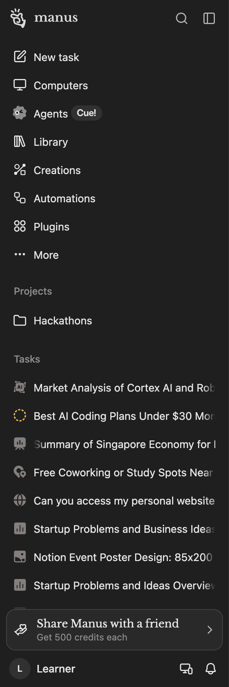 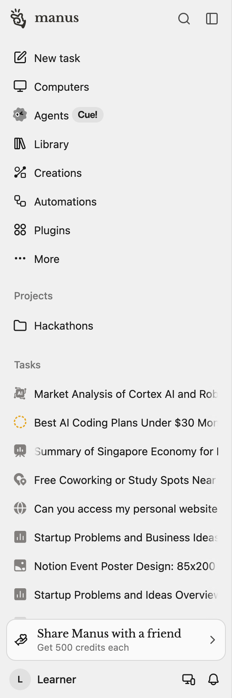 

| State | Values |
|---|---|
| default | size 300 x 900; background #1f1f1f `background.nav`; text System 14/21 400, #e6e6e6 `text.primary`; transition transform 0.2s cubic-bezier(0.4, 0, 0.2, 1); icon 28 x 28, #e6e6e6 `text.primary` |
| light | size 300 x 900; background #f0f0f0 `background.nav`; text System 14/21 400, #1a1a1a `text.primary`; transition transform 0.2s cubic-bezier(0.4, 0, 0.2, 1); icon 28 x 28, #1a1a1a `text.primary` |

Tokens named in its classes: `--background-nav`, `--border-light`, `--border-main`, `--fill-tsp-white-light`, `--icon-secondary`, `--text-primary`, `--text-tertiary`, `--ui-density-nav-icon-box-size`, `--ui-density-nav-item-gap`, `--ui-density-nav-item-padding-start`, `--ui-density-outer-padding`, `--ui-density-row-height`, `--ui-density-row-radius`, `--ui-font-size-sm`.

#### Sidebar logo row

`sidebar-logo-row`, on home-dark. 48 tall: the mark and wordmark at the start, search and collapse icon buttons at the end.

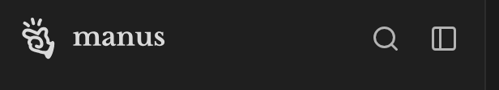 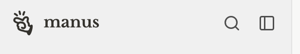 

| State | Values |
|---|---|
| default | size 300 x 48; padding 8px 10px; background transparent; icon 28 x 28, #e6e6e6 `text.primary` |
| light | size 300 x 48; padding 8px 10px; background transparent; icon 28 x 28, #1a1a1a `text.primary` |

Tokens named in its classes: `--fill-tsp-white-light`, `--icon-secondary`.

#### Sidebar logo (mark and wordmark)

`sidebar-logo`, on home-dark.

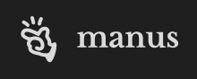   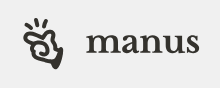 

| State | Values |
|---|---|
| default (same: hover) | size 94.83 x 28; background transparent; icon 28 x 28, #e6e6e6 `text.primary` |
| light (same: light-hover) | size 94.83 x 28; background transparent; icon 28 x 28, #1a1a1a `text.primary` |

#### Sidebar search icon button

`sidebar-search-button`, on home-dark. 32x32, radius 6, the hover fill is --fill-tsp-white-light.

 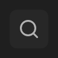 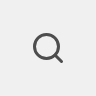  

| State | Values |
|---|---|
| default | size 32 x 32; radius 6px; background transparent; icon 18 x 18, #b3b3b3 `text.secondary` |
| hover | background rgba(255, 255, 255, 0.04) `fill.tsp-white-light` |
| light | size 32 x 32; radius 6px; background transparent; icon 18 x 18, #4d4d4d `text.secondary` |
| light-hover | background rgba(55, 53, 47, 0.04) `background.tsp-card-gray` |

Tokens named in its classes: `--fill-tsp-white-light`, `--icon-secondary`.

#### Sidebar collapse icon button

`sidebar-collapse-button`, on home-dark.

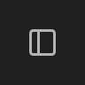 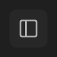 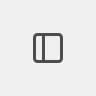 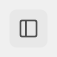 

| State | Values |
|---|---|
| default | size 32 x 32; radius 6px; background transparent; icon 18 x 18, #b3b3b3 `text.secondary` |
| hover | background rgba(255, 255, 255, 0.04) `fill.tsp-white-light` |
| light | size 32 x 32; radius 6px; background transparent; icon 18 x 18, #4d4d4d `text.secondary` |
| light-hover | background rgba(55, 53, 47, 0.04) `background.tsp-card-gray` |

Tokens named in its classes: `--fill-tsp-white-light`, `--icon-secondary`.

#### Nav tab

`nav-tab`, on home-dark, library-dark. A `.group/nav-tab` row, 36 tall at this density, an 18px icon in a 20px box and 14px text. Hover reveals the shortcut hint (⌘⇧O). The current page gets a filled row (`active`, from the Library snapshot).

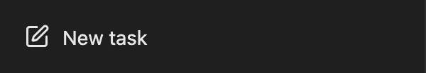  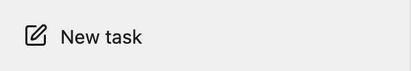 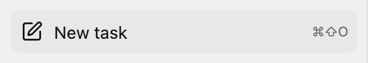 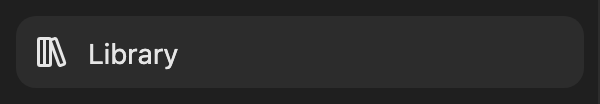 

| State | Values |
|---|---|
| default | size 284 x 36; padding 0px 2px 0px 8px; radius 10px; background transparent; text System 14/21 400, #e6e6e6 `text.primary`; transition color and 5 more 0.15s cubic-bezier(0.4, 0, 0.2, 1); icon 18 x 18, #e6e6e6 `text.primary` |
| hover | background rgba(255, 255, 255, 0.04) `fill.tsp-white-light` |
| active | background rgba(255, 255, 255, 0.06) `background.tsp-menu-white` |
| active-hover | background rgba(255, 255, 255, 0.04) `fill.tsp-white-light` |
| light | size 284 x 36; padding 0px 2px 0px 8px; radius 10px; background transparent; text System 14/21 400, #1a1a1a `text.primary`; transition color and 5 more 0.15s cubic-bezier(0.4, 0, 0.2, 1); icon 18 x 18, #1a1a1a `text.primary` |
| light-hover | background rgba(55, 53, 47, 0.04) `background.tsp-card-gray` |
| light-active | background rgba(55, 53, 47, 0.06) `fill.tsp-white-main` |
| light-active-hover | background rgba(55, 53, 47, 0.04) `background.tsp-card-gray` |

Tokens named in its classes: `--fill-tsp-white-light`, `--text-primary`, `--text-tertiary`, `--ui-density-nav-icon-box-size`, `--ui-density-nav-item-gap`, `--ui-density-nav-item-padding-start`, `--ui-density-row-height`, `--ui-density-row-radius`, `--ui-font-size-sm`.

#### Nav tab shortcut hint

`nav-tab-shortcut`, on home-dark. Opacity 0 at rest, shown with group-hover; measured while its row is hovered.

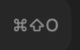 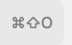 

| State | Values |
|---|---|
| hover | size 35.59 x 16.5; padding 0px 6px 0px 0px; background transparent; text System 11/16.5 400, #8c8c8c `text.tertiary`; transition opacity 0.15s cubic-bezier(0.4, 0, 0.2, 1) |
| light-hover | size 35.59 x 16.5; padding 0px 6px 0px 0px; background transparent; text System 11/16.5 400, #737373 `text.tertiary`; transition opacity 0.15s cubic-bezier(0.4, 0, 0.2, 1) |

Tokens named in its classes: `--text-tertiary`.

#### Nav badge (Cue!)

`nav-badge-cue`, on home-dark.

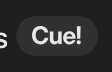 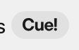 

| State | Values |
|---|---|
| default | size 40.39 x 20; padding 0px 8px; radius 9999px; background rgba(255, 255, 255, 0.08) `fill.tsp-white-dark`; icon 24.39 x 9.2, #e6e6e6 `text.primary` |
| light | size 40.39 x 20; padding 0px 8px; radius 9999px; background rgba(55, 53, 47, 0.08) `fill.tsp-white-dark`; icon 24.39 x 9.2, #1a1a1a `text.primary` |

Tokens named in its classes: `--fill-tsp-white-dark`, `--text-primary`.

#### Nav section header (Projects)

`nav-section-header`, on home-dark. A label in --text-tertiary; hover fills the row and reveals its action buttons (new project, more).

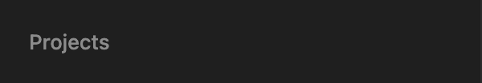 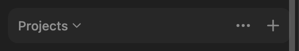 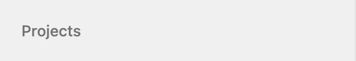 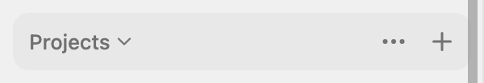 

| State | Values |
|---|---|
| default (same: hover) | size 284 x 36; padding 2px 2px 2px 10px; background #1f1f1f `background.nav`; text System 13/18 500, #8c8c8c `text.tertiary`; icon 14 x 14, #e6e6e6 `text.primary` |
| light (same: light-hover) | size 284 x 36; padding 2px 2px 2px 10px; background #f0f0f0 `background.nav`; text System 13/18 500, #737373 `text.tertiary`; icon 14 x 14, #1a1a1a `text.primary` |

Tokens named in its classes: `--background-nav`, `--fill-tsp-white-dark`, `--fill-tsp-white-light`, `--fill-tsp-white-main`, `--icon-tertiary`, `--text-tertiary`, `--ui-density-row-height`, `--ui-density-row-radius`, `--ui-density-section-padding-start`, `--ui-density-section-row-gap`, `--ui-font-size-label`, `--ui-line-height-label`.

#### Nav section header (Tasks)

`nav-section-header-tasks`, on home-dark. Same row; three actions on hover (filter, sort, new).

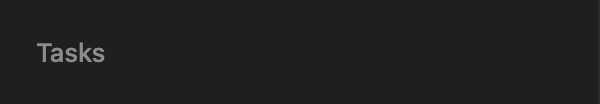 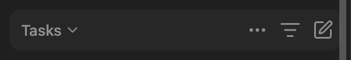 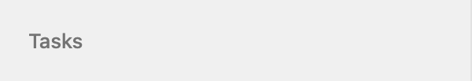 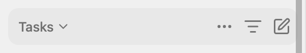 

| State | Values |
|---|---|
| default (same: hover) | size 284 x 36; padding 2px 2px 2px 10px; background #1f1f1f `background.nav`; text System 13/18 500, #8c8c8c `text.tertiary`; icon 14 x 14, #e6e6e6 `text.primary` |
| light (same: light-hover) | size 284 x 36; padding 2px 2px 2px 10px; background #f0f0f0 `background.nav`; text System 13/18 500, #737373 `text.tertiary`; icon 14 x 14, #1a1a1a `text.primary` |

Tokens named in its classes: `--background-nav`, `--fill-tsp-white-dark`, `--fill-tsp-white-light`, `--icon-tertiary`, `--text-tertiary`, `--ui-density-row-height`, `--ui-density-row-radius`, `--ui-density-section-padding-start`, `--ui-density-section-row-gap`, `--ui-font-size-label`, `--ui-line-height-label`.

#### Nav section action button

`nav-section-action`, on home-dark. A 28x28 icon button shown once the section header is hovered (hovering it also hovers the header).

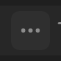 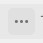 

| State | Values |
|---|---|
| hover | size 28 x 28; radius 6px; background rgba(255, 255, 255, 0.04) `fill.tsp-white-light`; icon 18 x 18, #8c8c8c `text.tertiary` |
| light-hover | size 28 x 28; radius 6px; background rgba(55, 53, 47, 0.04) `background.tsp-card-gray`; icon 18 x 18, #737373 `text.tertiary` |

Tokens named in its classes: `--fill-tsp-white-light`, `--icon-tertiary`.

#### Project row

`nav-project-row`, on home-dark. The folder icon swaps for a chevron on hover, and a more button appears at the end.

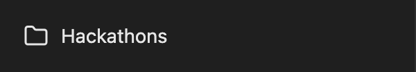 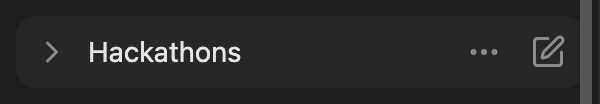 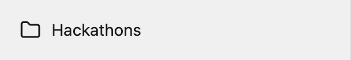 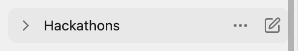  

| State | Values |
|---|---|
| default (same: focus-visible) | size 284 x 36; padding 0px 2px 0px 8px; background #1f1f1f `background.nav`; text System 14/20 400, #e6e6e6 `text.primary`; icon 18 x 18, #e6e6e6 `text.primary` |
| hover | radius 10px; shadow rgba(255, 255, 255, 0.04) 0px 0px 0px 100px inset |
| light (same: light-focus-visible) | size 284 x 36; padding 0px 2px 0px 8px; background #f0f0f0 `background.nav`; text System 14/20 400, #1a1a1a `text.primary`; icon 18 x 18, #1a1a1a `text.primary` |
| light-hover | radius 10px; shadow rgba(55, 53, 47, 0.04) 0px 0px 0px 100px inset |

Tokens named in its classes: `--background-nav`, `--fill-tsp-white-light`, `--text-primary`, `--ui-density-nav-icon-box-size`, `--ui-density-nav-item-gap`, `--ui-density-nav-item-padding-start`, `--ui-density-row-height`, `--ui-density-row-radius`, `--ui-density-section-row-gap`.

#### Task row

`nav-task-row`, on home-dark, task-dark-completed. Inside `[data-context-menu=session]`; the title is masked at the end by a scroll-shadow gradient, not an ellipsis.

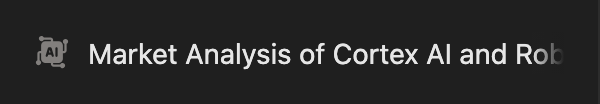 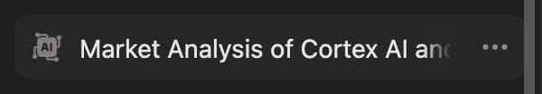 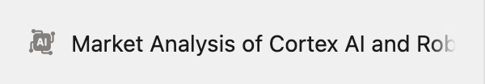 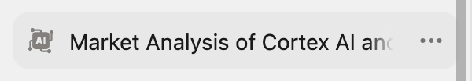 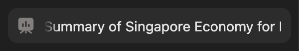 

| State | Values |
|---|---|
| default | size 284 x 36; padding 0px 2px 0px 8px; radius 10px; background transparent; text System 14/21 400, #e6e6e6 `text.primary`; transition color and 5 more 0.15s cubic-bezier(0.4, 0, 0.2, 1) |
| hover | background rgba(255, 255, 255, 0.04) `fill.tsp-white-light`; icon 18 x 18, #e6e6e6 `text.primary` |
| active | background rgba(255, 255, 255, 0.06) `background.tsp-menu-white` |
| light | size 284 x 36; padding 0px 2px 0px 8px; radius 10px; background transparent; text System 14/21 400, #1a1a1a `text.primary`; transition color and 5 more 0.15s cubic-bezier(0.4, 0, 0.2, 1) |
| light-hover | background rgba(55, 53, 47, 0.04) `background.tsp-card-gray`; icon 18 x 18, #1a1a1a `text.primary` |
| light-active | background rgba(55, 53, 47, 0.06) `fill.tsp-white-main` |

Child layers: div 238pxx21px

Tokens named in its classes: `--background-nav`, `--fill-tsp-white-light`, `--scroll-shadow-background`, `--scroll-shadow-block-end-offset`, `--scroll-shadow-block-start-offset`, `--scroll-shadow-height`, `--scroll-shadow-inline-end-offset`, `--scroll-shadow-inline-start-offset`, `--scroll-shadow-width`, `--scroll-shadow-z-index`, `--text-primary`, `--ui-density-nav-icon-box-size`, `--ui-density-nav-item-gap`, `--ui-density-nav-item-padding-start`, `--ui-density-row-height`, `--ui-density-row-radius`, `--ui-font-size-sm`.

#### Task row icon

`nav-task-icon`, on home-dark. An 18px glyph tinted grey with a CSS filter on an .

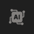  

| State | Values |
|---|---|
| default | size 18 x 18; background transparent |
| light | size 18 x 18; background transparent |

#### Task row status spinner (running task)

`nav-task-running`, on home-dark. A dotted amber ring in place of the task icon.

  

| State | Values |
|---|---|
| default | size 18 x 18; background transparent; icon 18 x 18, #e6e6e6 `text.primary` |
| light | size 18 x 18; background transparent; icon 18 x 18, #1a1a1a `text.primary` |

#### Task list loading skeleton

`nav-skeleton`, on home-dark. Pulsing rows at the end of the task list while more load; the list is scrolled to its end to show them.

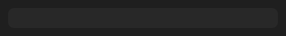 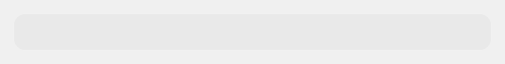 

| State | Values |
|---|---|
| default | size 268 x 20; radius 6px; background rgba(255, 255, 255, 0.04) `fill.tsp-white-light` |
| light | size 268 x 20; radius 6px; background rgba(55, 53, 47, 0.04) `background.tsp-card-gray` |

Tokens named in its classes: `--fill-tsp-white-light`.

#### Share banner ("Share Manus with a friend")

`share-banner`, on home-dark. Radius 12, a 0.5px --border-dark hairline, --background-mask-white fill; serif title over a 12px grey line, a chevron at the end.

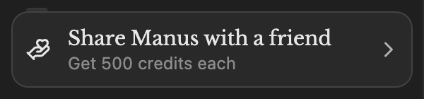 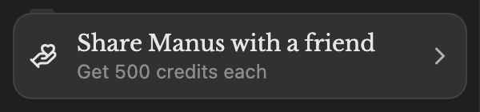 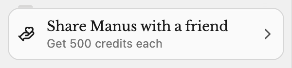 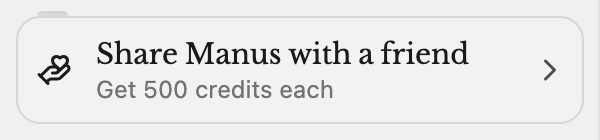  

| State | Values |
|---|---|
| default (same: focus-visible) | size 284 x 54; border 1px solid rgba(255, 255, 255, 0.12) `border.dark`; radius 12px; background rgba(63, 63, 63, 0.32) `background.mask-white`; text Libre Baskerville 14/20 400, #e6e6e6 `text.primary`; transition box-shadow 0.15s cubic-bezier(0.4, 0, 0.2, 1); icon 18 x 18, #e6e6e6 `text.primary` |
| hover | shadow rgba(255, 255, 255, 0.04) 0px 0px 0px 100px inset |
| light (same: light-focus-visible) | size 284 x 54; border 1px solid rgba(0, 0, 0, 0.14) `border.dark`; radius 12px; background rgba(255, 255, 255, 0.65) `background.mask-white`; text Libre Baskerville 14/20 400, #1a1a1a `text.primary`; transition box-shadow 0.15s cubic-bezier(0.4, 0, 0.2, 1); icon 18 x 18, #1a1a1a `text.primary` |
| light-hover | shadow rgba(55, 53, 47, 0.04) 0px 0px 0px 100px inset |

Tokens named in its classes: `--background-mask-white`, `--border-dark`, `--fill-tsp-white-light`, `--text-primary`, `--text-tertiary`, `--ui-density-menu-item-padding-y`, `--ui-density-section-row-gap`, `--ui-density-small-row-height`.

#### Sidebar footer account row

`sidebar-footer`, on home-dark. Avatar, name, then the desktop and bell icon buttons.

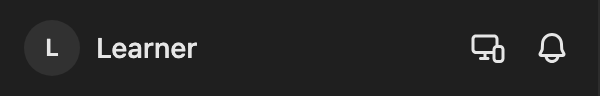 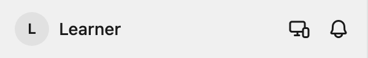 

| State | Values |
|---|---|
| default | size 284 x 32; padding 0px 2px 0px 0px; background transparent; text System 12/20 600, #e6e6e6 `text.primary`; icon 18 x 18, #e6e6e6 `text.primary` |
| light | size 284 x 32; padding 0px 2px 0px 0px; background transparent; text System 12/20 600, #1a1a1a `text.primary`; icon 18 x 18, #1a1a1a `text.primary` |

Child layers: div 28x28 background rgba(255, 255, 255, 0.08) `fill.tsp-white-dark`

Tokens named in its classes: `--fill-tsp-white-light`, `--icon-primary`, `--text-primary`.

#### Account button (avatar and name)

`sidebar-account`, on home-dark.

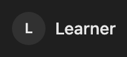   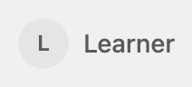 

| State | Values |
|---|---|
| default | size 90.52 x 32; padding 2px; background transparent; text System 12/20 600, #e6e6e6 `text.primary` |
| hover | opacity 0.7 |
| light | size 90.52 x 32; padding 2px; background transparent; text System 12/20 600, #1a1a1a `text.primary` |
| light-hover | opacity 0.7 |

Child layers: div 28x28 background rgba(255, 255, 255, 0.08) `fill.tsp-white-dark`

Tokens named in its classes: `--text-primary`.

#### Avatar (letter)

`sidebar-avatar`, on home-dark.

  

| State | Values |
|---|---|
| default | size 28 x 28; radius 9999px; background transparent; text System 12/20 600, #e6e6e6 `text.primary` |
| light | size 28 x 28; radius 9999px; background transparent; text System 12/20 600, #1a1a1a `text.primary` |

Child layers: div 28x28 background rgba(255, 255, 255, 0.08) `fill.tsp-white-dark`

#### Desktop app icon button

`sidebar-desktop-button`, on home-dark.

    

| State | Values |
|---|---|
| default | size 28 x 28; radius 8px; background transparent; icon 18 x 18, #e6e6e6 `text.primary` |
| hover | background rgba(255, 255, 255, 0.04) `fill.tsp-white-light` |
| light | size 28 x 28; radius 8px; background transparent; icon 18 x 18, #1a1a1a `text.primary` |
| light-hover | background rgba(55, 53, 47, 0.04) `background.tsp-card-gray` |

Tokens named in its classes: `--fill-tsp-white-light`, `--icon-primary`.

#### Notifications bell button

`sidebar-bell-button`, on home-dark, home-dark-notifications.

     

| State | Values |
|---|---|
| default | size 28 x 28; radius 8px; background transparent; icon 18 x 18, #e6e6e6 `text.primary` |
| hover, open | background rgba(255, 255, 255, 0.04) `fill.tsp-white-light` |
| light | size 28 x 28; radius 8px; background transparent; icon 18 x 18, #1a1a1a `text.primary` |
| light-hover, light-open | background rgba(55, 53, 47, 0.04) `background.tsp-card-gray` |

Tokens named in its classes: `--fill-tsp-white-light`, `--icon-primary`.

#### Sidebar collapsed to a rail

`sidebar-collapsed`, on home-dark-sidebar-collapsed. 52 wide: icon-only nav tabs (36x36), a 28px divider in place of the sections, the footer buttons stacked.

  

| State | Values |
|---|---|
| default | size 52 x 900; background #1f1f1f `background.nav`; text System 12/20 600, #e6e6e6 `text.primary`; transition transform 0.2s cubic-bezier(0.4, 0, 0.2, 1); icon 28 x 28, #e6e6e6 `text.primary` |
| light | size 52 x 900; background #f0f0f0 `background.nav`; text System 12/20 600, #1a1a1a `text.primary`; transition transform 0.2s cubic-bezier(0.4, 0, 0.2, 1); icon 28 x 28, #1a1a1a `text.primary` |

Tokens named in its classes: `--background-nav`, `--border-light`, `--border-main`, `--fill-tsp-white-light`, `--scroll-shadow-background`, `--scroll-shadow-block-end-offset`, `--scroll-shadow-block-start-offset`, `--scroll-shadow-height`, `--scroll-shadow-inline-end-offset`, `--scroll-shadow-inline-start-offset`, `--scroll-shadow-width`, `--scroll-shadow-z-index`, `--simplebar-scrollbar-width`, `--text-disable`, `--text-tertiary`, `--ui-density-nav-icon-box-size`, `--ui-density-nav-item-gap`, `--ui-density-outer-padding`, `--ui-density-row-height`, `--ui-density-row-radius`, `--ui-density-section-gap`.

#### Collapsed rail nav tab

`sidebar-collapsed-tab`, on home-dark-sidebar-collapsed.

    

| State | Values |
|---|---|
| default | size 36 x 36; padding 8px; radius 10px; background transparent; transition color and 5 more 0.15s cubic-bezier(0.4, 0, 0.2, 1); icon 18 x 18, #e6e6e6 `text.primary` |
| hover | background rgba(255, 255, 255, 0.04) `fill.tsp-white-light` |
| light | size 36 x 36; padding 8px; radius 10px; background transparent; transition color and 5 more 0.15s cubic-bezier(0.4, 0, 0.2, 1); icon 18 x 18, #1a1a1a `text.primary` |
| light-hover | background rgba(55, 53, 47, 0.04) `background.tsp-card-gray` |

Tokens named in its classes: `--fill-tsp-white-light`, `--ui-density-nav-icon-box-size`, `--ui-density-nav-item-gap`, `--ui-density-outer-padding`, `--ui-density-row-height`, `--ui-density-row-radius`.

### Top bar

The 48px row over the content: the model picker at the left, and at the right the plan chip with its Upgrade link and the credits pill on the home, or Upgrade, Share, more and the panel toggle on a task.

#### Model picker trigger

`model-picker`, on home-dark, home-dark-model-menu. Title-size 18/22 500 text and a 16px chevron that turns 180° when the menu is open.

     

| State | Values |
|---|---|
| default | size 154.09 x 32; padding 7px 6px 7px 8px; radius 8px; background transparent; text System 18/22 500, #e6e6e6 `text.primary`; transition background-color 0.15s cubic-bezier(0, 0, 0.2, 1); icon 16 x 16, #8c8c8c `text.tertiary` |
| hover, open | background rgba(255, 255, 255, 0.06) `background.tsp-menu-white` |
| light | size 154.09 x 32; padding 7px 6px 7px 8px; radius 8px; background transparent; text System 18/22 500, #1a1a1a `text.primary`; transition background-color 0.15s cubic-bezier(0, 0, 0.2, 1); icon 16 x 16, #737373 `text.tertiary` |
| light-hover, light-open | background rgba(55, 53, 47, 0.06) `fill.tsp-white-main` |

Tokens named in its classes: `--fill-tsp-white-main`, `--text-primary`.

#### Plan chip (Free plan | Upgrade)

`plan-chip`, on home-dark.

  

| State | Values |
|---|---|
| default | size 166.7 x 32; padding 4px 12px; border 1px solid rgba(255, 255, 255, 0.06) `background.tsp-menu-white`; radius 8px; background transparent; text System 14/21 400, #8c8c8c `text.tertiary` |
| light | size 166.7 x 32; padding 4px 12px; border 1px solid rgba(0, 0, 0, 0.06) `border.menu-arrow`; radius 8px; background transparent; text System 14/21 400, #737373 `text.tertiary` |

Tokens named in its classes: `--border-dark`, `--border-main`, `--text-blue`, `--text-tertiary`.

#### Upgrade link in the plan chip

`upgrade-link`, on home-dark. Blue text, hover drops opacity to 0.8.

     

| State | Values |
|---|---|
| default (same: focus-visible) | size 56 x 21; radius 8px; background transparent; text System 14/21 400, #1a93fe `text.blue`; transition color and 5 more 0.15s cubic-bezier(0.4, 0, 0.2, 1) |
| hover | opacity 0.8 |
| light (same: light-focus-visible) | size 56 x 21; radius 8px; background transparent; text System 14/21 400, #0081f2 `text.blue`; transition color and 5 more 0.15s cubic-bezier(0.4, 0, 0.2, 1) |
| light-hover | opacity 0.8 |

Tokens named in its classes: `--text-blue`.

#### Credits pill

`credits-pill`, on home-dark.

    

| State | Values |
|---|---|
| default | size 65.88 x 32; padding 0px 12px 0px 8px; border 1px solid rgba(255, 255, 255, 0.06) `background.tsp-menu-white`; radius 8px; background transparent; text System 14/20 500, #e6e6e6 `text.primary`; icon 16 x 16, #e6e6e6 `text.primary` |
| hover | background rgba(255, 255, 255, 0.06) `background.tsp-menu-white` |
| light | size 65.88 x 32; padding 0px 12px 0px 8px; border 1px solid rgba(0, 0, 0, 0.06) `border.menu-arrow`; radius 8px; background transparent; text System 14/20 500, #1a1a1a `text.primary`; icon 16 x 16, #1a1a1a `text.primary` |
| light-hover | background rgba(55, 53, 47, 0.06) `fill.tsp-white-main` |

Tokens named in its classes: `--border-main`, `--fill-tsp-white-main`, `--text-primary`.

#### Upgrade button (task page)

`upgrade-button-task`, on task-dark-completed. On a task the plan chip collapses to one tinted Upgrade button.

     

| State | Values |
|---|---|
| default (same: focus-visible) | size 90.88 x 32; padding 0px 8px; radius 10px; background rgba(0, 129, 242, 0.08); text System 13/18 500, #0081f2 `activity-indicator.running`; transition color and 5 more 0.15s cubic-bezier(0.4, 0, 0.2, 1); icon 16 x 16, #e6e6e6 `text.primary` |
| hover | background rgba(0, 129, 242, 0.12) |
| light (same: light-focus-visible) | size 90.88 x 32; padding 0px 8px; radius 10px; background rgba(0, 129, 242, 0.08) `fill.blue`; text System 13/18 500, #0081f2 `text.blue`; transition color and 5 more 0.15s cubic-bezier(0.4, 0, 0.2, 1); icon 16 x 16, #1a1a1a `text.primary` |
| light-hover | background rgba(0, 129, 242, 0.12) |

Tokens named in its classes: `--text-primary`.

#### Share button

`share-button`, on task-dark-completed.

     

| State | Values |
|---|---|
| default (same: focus-visible) | size 74.22 x 32; padding 0px 8px; radius 8px; background transparent; text System 14/18 500, #b3b3b3 `text.secondary`; transition color and 5 more 0.15s cubic-bezier(0.4, 0, 0.2, 1); icon 16 x 16, #b3b3b3 `text.secondary` |
| hover | background rgba(255, 255, 255, 0.06) `background.tsp-menu-white` |
| light (same: light-focus-visible) | size 74.22 x 32; padding 0px 8px; radius 8px; background transparent; text System 14/18 500, #4d4d4d `text.secondary`; transition color and 5 more 0.15s cubic-bezier(0.4, 0, 0.2, 1); icon 16 x 16, #4d4d4d `text.secondary` |
| light-hover | background rgba(55, 53, 47, 0.06) `fill.tsp-white-main` |

Tokens named in its classes: `--fill-tsp-white-main`, `--text-primary`, `--text-secondary`.

#### More (…) button

`topbar-more-button`, on task-dark-completed.

    

| State | Values |
|---|---|
| default | size 32 x 32; radius 6px; background transparent; icon 16 x 16, #b3b3b3 `text.secondary` |
| hover | background rgba(255, 255, 255, 0.04) `fill.tsp-white-light` |
| light | size 32 x 32; radius 6px; background transparent; icon 16 x 16, #4d4d4d `text.secondary` |
| light-hover | background rgba(55, 53, 47, 0.04) `background.tsp-card-gray` |

Tokens named in its classes: `--fill-tsp-white-light`, `--icon-secondary`.

#### Side panel toggle

`panel-toggle`, on task-dark-completed.

    

| State | Values |
|---|---|
| default | size 32 x 32; radius 8px; background transparent; icon 16 x 16, #b3b3b3 `text.secondary` |
| hover | background rgba(255, 255, 255, 0.04) `fill.tsp-white-light` |
| light | size 32 x 32; radius 8px; background transparent; icon 16 x 16, #4d4d4d `text.secondary` |
| light-hover | background rgba(55, 53, 47, 0.04) `background.tsp-card-gray` |

Tokens named in its classes: `--fill-tsp-white-light`, `--icon-secondary`.

### Home

The new-task page: the logo with the promo carousel beside it, the Build and Create cards, the Start from a local file card, and the composer pinned at the bottom.

#### Home logo (mark and wordmark)

`home-logo`, on home-dark. An h1 holding two SVGs, 376x64, with "Manus Studio" as sr-only text.

  

| State | Values |
|---|---|
| default | size 376 x 64; background transparent; text System 16/24 400, #e6e6e6 `text.primary` |
| light | size 376 x 64; background transparent; text System 16/24 400, #1a1a1a `text.primary` |

#### Promo carousel card

`promo-card`, on home-dark. Black (--background-game-promo) radius 12, 56 tall; a framed 38x30 preview, a serif 13/18 bold title and a 12/16 subtitle in white.

     

| State | Values |
|---|---|
| default (same: hover) | size 252 x 56; padding 1px 14px 1px 10px; border 1px solid transparent; radius 12px; background #000000 `background.studio-only-badge`; text Libre Baskerville 13/18 700, #ffffff `background.tool-used-image-loading`; transition transform 0.2s cubic-bezier(0.4, 0, 0.2, 1) |
| focus-visible | outline 2px solid #1a93fe `text.blue`, offset 2px |
| light (same: light-hover) | size 252 x 56; padding 1px 14px 1px 10px; border 1px solid transparent; radius 12px; background #1a1a19 `illustration.device-frame`; text Libre Baskerville 13/18 700, #ffffff `background.menu-white`; transition transform 0.2s cubic-bezier(0.4, 0, 0.2, 1) |
| light-focus-visible | outline 2px solid #0081f2 `text.blue`, offset 2px |

Tokens named in its classes: `--background-game-promo`, `--background-game-promo-preview`, `--border-game-promo-preview`, `--text-blue`, `--text-white`, `--text-white-tsp`.

#### Promo carousel dot

`promo-dot`, on home-dark. A 5px track in --fill-tsp-white-dark with an --icon-secondary fill that grows as the slide plays; the dots stack vertically at the card end.

   

| State | Values |
|---|---|
| default | size 14 x 18; radius 9999px; background transparent; text System 16/24 400, #e6e6e6 `text.primary` |
| focus-visible | outline 2px solid #b3b3b3 `text.secondary`, offset 0px |
| inactive | size 14 x 12 |
| light | size 14 x 18; radius 9999px; background transparent; text System 16/24 400, #1a1a1a `text.primary` |
| light-focus-visible | outline 2px solid #4d4d4d `text.secondary`, offset 0px |
| light-inactive | size 14 x 12 |

Child layers: span 5x18 background rgba(255, 255, 255, 0.08) `fill.tsp-white-dark` radius 9999px; span 5x3.6 background #b3b3b3 `text.secondary` radius 9999px

Tokens named in its classes: `--fill-tsp-white-dark`, `--icon-secondary`.

#### Build card

`build-card`, on home-dark. 490x130, --fill-tsp-white-light, hover --fill-tsp-white-main; a 16/22 500 title with a chevron, a 14/20 grey line, an illustration bleeding off the end.

     

| State | Values |
|---|---|
| default | size 490 x 130; padding 0px 0px 0px 20px; radius 12px; background rgba(255, 255, 255, 0.04) `fill.tsp-white-light`; text System 16/22 500, #e6e6e6 `text.primary`; transition color and 5 more 0.15s cubic-bezier(0.4, 0, 0.2, 1); icon 18 x 18, #e6e6e6 `text.primary` |
| hover | background rgba(255, 255, 255, 0.06) `background.tsp-menu-white` |
| focus-visible | shadow #ffffff 0px 0px 0px 0px, rgba(255, 255, 255, 0.12) 0px 0px 0px 2px; outline 2px solid transparent, offset 2px |
| light | size 490 x 130; padding 0px 0px 0px 20px; radius 12px; background rgba(55, 53, 47, 0.04) `background.tsp-card-gray`; text System 16/22 500, #1a1a1a `text.primary`; transition color and 5 more 0.15s cubic-bezier(0.4, 0, 0.2, 1); icon 18 x 18, #1a1a1a `text.primary` |
| light-hover | background rgba(55, 53, 47, 0.06) `fill.tsp-white-main` |
| light-focus-visible | shadow #ffffff 0px 0px 0px 0px, rgba(0, 0, 0, 0.14) 0px 0px 0px 2px; outline 2px solid transparent, offset 2px |

Tokens named in its classes: `--border-dark`, `--fill-tsp-white-light`, `--fill-tsp-white-main`, `--text-primary`, `--text-tertiary`.

#### Create card

`create-card`, on home-dark.

    

| State | Values |
|---|---|
| default | size 490 x 130; padding 0px 0px 0px 20px; radius 12px; background rgba(255, 255, 255, 0.04) `fill.tsp-white-light`; text System 16/22 500, #e6e6e6 `text.primary`; transition color and 5 more 0.15s cubic-bezier(0.4, 0, 0.2, 1); icon 18 x 18, #e6e6e6 `text.primary` |
| hover | background rgba(255, 255, 255, 0.06) `background.tsp-menu-white` |
| light | size 490 x 130; padding 0px 0px 0px 20px; radius 12px; background rgba(55, 53, 47, 0.04) `background.tsp-card-gray`; text System 16/22 500, #1a1a1a `text.primary`; transition color and 5 more 0.15s cubic-bezier(0.4, 0, 0.2, 1); icon 18 x 18, #1a1a1a `text.primary` |
| light-hover | background rgba(55, 53, 47, 0.06) `fill.tsp-white-main` |

Tokens named in its classes: `--border-dark`, `--border-main`, `--fill-tsp-white-light`, `--fill-tsp-white-main`, `--illustration-studio-create-paper`, `--text-primary`, `--text-tertiary`.

#### Start from a local file card

`local-file-card`, on home-dark.

    

| State | Values |
|---|---|
| default | size 270 x 270; padding 12px; radius 12px; background rgba(255, 255, 255, 0.04) `fill.tsp-white-light`; text System 12/16 400, #b3b3b3 `text.secondary`; transition color and 5 more 0.15s cubic-bezier(0.4, 0, 0.2, 1) |
| hover | background rgba(255, 255, 255, 0.06) `background.tsp-menu-white` |
| light | size 270 x 270; padding 12px; radius 12px; background rgba(55, 53, 47, 0.04) `background.tsp-card-gray`; text System 12/16 400, #4d4d4d `text.secondary`; transition color and 5 more 0.15s cubic-bezier(0.4, 0, 0.2, 1) |
| light-hover | background rgba(55, 53, 47, 0.06) `fill.tsp-white-main` |

Tokens named in its classes: `--border-dark`, `--fill-tsp-white-light`, `--fill-tsp-white-main`, `--fill-white-primary`, `--text-primary`, `--text-secondary`, `--text-tertiary`.

#### Studio only badge

`studio-only-badge`, on home-dark.

  

| State | Values |
|---|---|
| default | size 75.45 x 20; padding 0px 6px; radius 9999px; background rgba(255, 255, 255, 0.06) `background.tsp-menu-white`; text System 12/16 400, #b3b3b3 `text.secondary` |
| light | size 75.45 x 20; padding 0px 6px; radius 9999px; background rgba(55, 53, 47, 0.06) `fill.tsp-white-main`; text System 12/16 400, #4d4d4d `text.secondary` |

Tokens named in its classes: `--fill-tsp-white-main`, `--text-secondary`.

### Composer

The task composer, shared by the home, the task page, the project page and the phone: a 22px-radius card with a 50px editor, a + button, connector chips, the Manus Desktop chip, and the microphone and send buttons. The disclaimer sits under it on a task.

#### Composer

`composer`, on home-dark, home-dark-composer-typed, task-dark-completed. 768 wide, radius from --ui-density-composer-radius, --background-menu-white fill; a 50 tall editor above a 32px tool row.

    

| State | Values |
|---|---|
| default | size 768 x 120; padding 12px 0px; border 1px solid rgba(255, 255, 255, 0.06) `background.tsp-menu-white`; radius 22px; background #242424 `background.menu-white`; shadow rgba(0, 0, 0, 0.02) 0px 12px 32px 0px; text System 14/18 400, #b3b3b3 `text.secondary`; icon 17 x 17, #b3b3b3 `text.secondary`; placeholder #8c8c8c `text.tertiary` |
| focus-visible | border 1px solid rgba(255, 255, 255, 0.12) `border.dark` |
| typed | text System 16/24 400, #e6e6e6 `text.primary`; placeholder none |
| task | text System 12/16 400, #8c8c8c `text.tertiary` |
| light | size 768 x 120; padding 12px 0px; border 1px solid #e5e7eb; radius 22px; background #ffffff `background.menu-white`; shadow rgba(0, 0, 0, 0.02) 0px 12px 32px 0px; text System 14/18 400, #4d4d4d `text.secondary`; icon 17 x 17, #4d4d4d `text.secondary`; placeholder #737373 `text.tertiary` |
| light-focus-visible | border 1px solid rgba(0, 0, 0, 0.2) `gradient.dark-20` |
| light-typed | text System 16/24 400, #1a1a1a `text.primary`; placeholder none |
| light-task | text System 12/16 400, #737373 `text.tertiary` |

Tokens named in its classes: `--accent-send-button`, `--background-menu-white`, `--border-dark`, `--border-main`, `--fill-tsp-white-dark`, `--fill-tsp-white-light`, `--icon-primary`, `--icon-secondary`, `--text-onblack`, `--text-primary`, `--text-secondary`, `--text-tertiary`, `--ui-density-composer-radius`, `--ui-density-content-padding`, `--ui-density-home-input-editor-min-height`, `--ui-density-outer-padding`, `--ui-density-row-gap`, `--ui-density-section-gap`, `--ui-density-small-row-height`.

#### Composer placeholder

`composer-placeholder`, on home-dark. Tiptap draws it with p.is-editor-empty::before from data-placeholder.

  

| State | Values |
|---|---|
| default | size 742 x 24; background transparent; placeholder #8c8c8c `text.tertiary` |
| light | size 742 x 24; background transparent; placeholder #737373 `text.tertiary` |

#### Composer typed text

`composer-text`, on home-dark-composer-typed.

  

| State | Values |
|---|---|
| default | size 742 x 24; background transparent; text System 16/24 400, #e6e6e6 `text.primary` |
| light | size 742 x 24; background transparent; text System 16/24 400, #1a1a1a `text.primary` |

#### Composer + button

`composer-plus`, on home-dark, home-dark-attach-menu. A 32px circle with a 1px --border-main ring.

      

| State | Values |
|---|---|
| default (same: focus-visible) | size 32 x 32; border 1px solid rgba(255, 255, 255, 0.06) `background.tsp-menu-white`; radius 9999px; background transparent; icon 17 x 17, #b3b3b3 `text.secondary` |
| hover | background rgba(255, 255, 255, 0.04) `fill.tsp-white-light` |
| open | border none; background rgba(255, 255, 255, 0.04) `fill.tsp-white-light` |
| light (same: light-focus-visible) | size 32 x 32; border 1px solid rgba(0, 0, 0, 0.06) `border.menu-arrow`; radius 9999px; background transparent; icon 17 x 17, #4d4d4d `text.secondary` |
| light-hover | background rgba(55, 53, 47, 0.04) `background.tsp-card-gray` |
| light-open | border none; background rgba(55, 53, 47, 0.04) `background.tsp-card-gray` |

Tokens named in its classes: `--border-main`, `--fill-tsp-white-light`, `--text-secondary`, `--ui-density-small-row-height`.

#### Connector chips button

`composer-connectors`, on home-dark. Overlapping 16px app icons in a pill.

     

| State | Values |
|---|---|
| default (same: focus-visible) | size 72 x 32; padding 8px; radius 100px; background transparent; outline 1px solid rgba(255, 255, 255, 0.06) `background.tsp-menu-white`, offset -1px; transition color and 5 more 0.15s cubic-bezier(0.4, 0, 0.2, 1) |
| hover | background rgba(255, 255, 255, 0.04) `fill.tsp-white-light`; opacity 0.9 |
| light (same: light-focus-visible) | size 72 x 32; padding 8px; radius 100px; background transparent; outline 1px solid rgba(0, 0, 0, 0.06) `border.menu-arrow`, offset -1px; transition color and 5 more 0.15s cubic-bezier(0.4, 0, 0.2, 1) |
| light-hover | background rgba(55, 53, 47, 0.04) `background.tsp-card-gray`; opacity 0.9 |

Child layers: button 72x32 radius 100px

Tokens named in its classes: `--border-main`, `--fill-tsp-white-light`, `--text-primary`, `--ui-density-outer-padding`, `--ui-density-small-row-height`.

#### Manus Desktop chip

`composer-desktop-chip`, on home-dark.

     

| State | Values |
|---|---|
| default (same: focus-visible) | size 136.52 x 32; padding 0px 8px; radius 9999px; background transparent; outline 1px solid rgba(255, 255, 255, 0.06) `background.tsp-menu-white`, offset -1px; text System 14/18 400, #b3b3b3 `text.secondary`; transition color and 5 more 0.15s cubic-bezier(0.4, 0, 0.2, 1); icon 16 x 16, #b3b3b3 `text.secondary` |
| hover | background rgba(255, 255, 255, 0.04) `fill.tsp-white-light`; opacity 0.9 |
| light (same: light-focus-visible) | size 136.52 x 32; padding 0px 8px; radius 9999px; background transparent; outline 1px solid rgba(0, 0, 0, 0.06) `border.menu-arrow`, offset -1px; text System 14/18 400, #4d4d4d `text.secondary`; transition color and 5 more 0.15s cubic-bezier(0.4, 0, 0.2, 1); icon 16 x 16, #4d4d4d `text.secondary` |
| light-hover | background rgba(55, 53, 47, 0.04) `background.tsp-card-gray`; opacity 0.9 |

Child layers: button 136.5x32 radius 9999px

Tokens named in its classes: `--border-main`, `--fill-tsp-white-light`, `--icon-primary`, `--icon-secondary`, `--text-secondary`, `--ui-density-small-row-height`.

#### Composer agent-mode icon button

`composer-skill-button`, on home-dark.

    

| State | Values |
|---|---|
| default | size 32 x 32; padding 0px 8px; radius 9999px; background transparent; icon 16 x 16, #b3b3b3 `text.secondary` |
| hover | background rgba(255, 255, 255, 0.04) `fill.tsp-white-light` |
| light | size 32 x 32; padding 0px 8px; radius 9999px; background transparent; icon 16 x 16, #4d4d4d `text.secondary` |
| light-hover | background rgba(55, 53, 47, 0.04) `background.tsp-card-gray` |

Tokens named in its classes: `--fill-tsp-white-light`, `--icon-secondary`.

#### Composer microphone button

`composer-mic`, on home-dark.

    

| State | Values |
|---|---|
| default | size 32 x 32; radius 9999px; background transparent; icon 16 x 16, #b3b3b3 `text.secondary` |
| hover | background rgba(255, 255, 255, 0.04) `fill.tsp-white-light` |
| light | size 32 x 32; radius 9999px; background transparent; icon 16 x 16, #4d4d4d `text.secondary` |
| light-hover | background rgba(55, 53, 47, 0.04) `background.tsp-card-gray` |

Tokens named in its classes: `--fill-tsp-white-light`, `--icon-secondary`, `--ui-density-small-row-height`.

#### Composer send button

`composer-send`, on home-dark, home-dark-composer-typed. Disabled (opacity 0.5) while the composer is empty; `enabled` once text is typed.

  

| State | Values |
|---|---|
| default | size 32 x 32; radius 9999px; background rgba(255, 255, 255, 0.08) `fill.tsp-white-dark`; transition color and 5 more 0.15s cubic-bezier(0.4, 0, 0.2, 1); icon 15 x 15, rgba(0, 0, 0, 0.9) `background.menu-tooltips` |
| enabled | background rgba(255, 255, 255, 0.95) `button.black` |
| enabled-hover | background rgba(255, 255, 255, 0.95) `button.black`; opacity 0.9 |
| enabled-focus-visible | background rgba(255, 255, 255, 0.95) `button.black` |
| light | size 32 x 32; radius 9999px; background rgba(55, 53, 47, 0.08) `fill.tsp-white-dark`; transition color and 5 more 0.15s cubic-bezier(0.4, 0, 0.2, 1); icon 15 x 15, #ffffff `background.menu-white` |
| light-enabled | background #1a1a19 `illustration.device-frame` |
| light-enabled-hover | background #1a1a19 `illustration.device-frame`; opacity 0.9 |
| light-enabled-focus-visible | background #1a1a19 `illustration.device-frame` |

Tokens named in its classes: `--accent-send-button`, `--fill-tsp-white-dark`, `--text-onblack`, `--ui-density-small-row-height`.

#### Footer disclaimer

`disclaimer`, on task-dark-completed. Present but `invisible` on the home page; shown under the composer on a task.

  

| State | Values |
|---|---|
| default | size 768 x 16; background transparent; text System 12/16 400, #8c8c8c `text.tertiary` |
| light | size 768 x 16; background transparent; text System 12/16 400, #737373 `text.tertiary` |

Tokens named in its classes: `--text-tertiary`.

### Menus and dialogs

The popovers and dialogs: the model menu, the + attach menu, the search dialog, the notifications panel, the account menu, the Library's row menu and view options, the sidebar's task menu and project context menu, the More menu, the files dialog, the previewer's and settings' dialogs. All share the 12px radius card on `--background-menu-white` with a hairline border.

#### Model menu

`model-menu`, on home-dark-model-menu. 366 wide, 4px padding, --background-menu-white, shadow-menu, a 40px backdrop blur.

  

| State | Values |
|---|---|
| default | size 366 x 232; padding 4px; radius 12px; background #242424 `background.menu-white`; shadow rgba(255, 255, 255, 0.14) 0px 0px 0px 1px, rgba(0, 0, 0, 0.28) 0px 0px 0px 1px, rgba(0, 0, 0, 0.16) 0px 24px 24px -12px, rgba(0, 0, 0, 0.28) 0px 3px 3px -1.5px, rgba(0, 0, 0, 0.16) 0px 10px 20px 1px; backdrop blur(40px); text System 14/20 400, #e6e6e6 `text.primary`; icon 18 x 18, #e6e6e6 `text.primary` |
| light | size 366 x 232; padding 4px; radius 12px; background #ffffff `background.menu-white`; shadow rgba(0, 0, 0, 0.06) 0px 0px 0px 1px, rgba(0, 0, 0, 0.04) 0px 24px 24px -12px, rgba(0, 0, 0, 0.06) 0px 3px 3px -1.5px, rgba(0, 0, 0, 0.04) 0px 10px 20px 1px; backdrop blur(40px); text System 14/20 400, #1a1a1a `text.primary`; icon 18 x 18, #1a1a1a `text.primary` |

Tokens named in its classes: `--available-width`, `--background-menu-white`, `--border-dark`, `--fill-tsp-white-light`, `--fill-tsp-white-main`, `--text-primary`, `--text-secondary`, `--text-tertiary`.

#### Model menu item

`model-menu-item`, on home-dark-model-menu. Title 14/20 with a serif Pro badge, a 12px description in --text-tertiary. The current model carries a check (`checked`).

     

| State | Values |
|---|---|
| default | size 358 x 52; padding 8px 8px 8px 12px; radius 8px; background transparent; text System 14/20 400, #e6e6e6 `text.primary`; transition background-color 0.15s cubic-bezier(0, 0, 0.2, 1) |
| hover | background rgba(255, 255, 255, 0.04) `fill.tsp-white-light` |
| checked | icon 18 x 18, #e6e6e6 `text.primary` |
| checked-hover | background rgba(255, 255, 255, 0.04) `fill.tsp-white-light`; icon 18 x 18, #e6e6e6 `text.primary` |
| light | size 358 x 52; padding 8px 8px 8px 12px; radius 8px; background transparent; text System 14/20 400, #1a1a1a `text.primary`; transition background-color 0.15s cubic-bezier(0, 0, 0.2, 1) |
| light-hover | background rgba(55, 53, 47, 0.04) `background.tsp-card-gray` |
| light-checked | icon 18 x 18, #1a1a1a `text.primary` |
| light-checked-hover | background rgba(55, 53, 47, 0.04) `background.tsp-card-gray`; icon 18 x 18, #1a1a1a `text.primary` |

Child layers: div 34.5x18 background rgba(255, 255, 255, 0.06) `background.tsp-menu-white` radius 5px

Tokens named in its classes: `--border-dark`, `--fill-tsp-white-light`, `--fill-tsp-white-main`, `--text-primary`, `--text-tertiary`.

#### Pro badge

`model-menu-pro-badge`, on home-dark-model-menu.

  

| State | Values |
|---|---|
| default | size 34.45 x 18; padding 1px 6px; radius 5px; background rgba(255, 255, 255, 0.06) `background.tsp-menu-white`; text Libre Baskerville 12/16 700, #e6e6e6 `text.primary` |
| light | size 34.45 x 18; padding 1px 6px; radius 5px; background rgba(55, 53, 47, 0.06) `fill.tsp-white-main`; text Libre Baskerville 12/16 700, #1a1a1a `text.primary` |

Tokens named in its classes: `--fill-tsp-white-main`, `--text-primary`.

#### Beta badge

`model-menu-beta-badge`, on home-dark-model-menu.

  

| State | Values |
|---|---|
| default | size 40.34 x 18; padding 0px 6px; border 1px solid rgba(255, 255, 255, 0.12) `border.dark`; radius 8px 10px 10px 0px; background transparent; text System 12/16 500, #8c8c8c `text.tertiary` |
| light | size 40.34 x 18; padding 0px 6px; border 1px solid rgba(0, 0, 0, 0.14) `border.dark`; radius 8px 10px 10px 0px; background transparent; text System 12/16 500, #737373 `text.tertiary` |

Tokens named in its classes: `--border-dark`, `--text-tertiary`.

#### Attach (+) menu

`attach-menu`, on home-dark-attach-menu.

  

| State | Values |
|---|---|
| default | size 198.88 x 269; padding 4px; radius 12px; background #242424 `background.menu-white`; shadow rgba(255, 255, 255, 0.14) 0px 0px 0px 1px, rgba(0, 0, 0, 0.28) 0px 0px 0px 1px, rgba(0, 0, 0, 0.16) 0px 24px 24px -12px, rgba(0, 0, 0, 0.28) 0px 3px 3px -1.5px, rgba(0, 0, 0, 0.16) 0px 10px 20px 1px; text System 14/20 400, #e6e6e6 `text.primary`; icon 16 x 16, #e6e6e6 `text.primary` |
| light | size 198.88 x 269; padding 4px; radius 12px; background #ffffff `background.menu-white`; shadow rgba(0, 0, 0, 0.06) 0px 0px 0px 1px, rgba(0, 0, 0, 0.04) 0px 24px 24px -12px, rgba(0, 0, 0, 0.06) 0px 3px 3px -1.5px, rgba(0, 0, 0, 0.04) 0px 10px 20px 1px; text System 14/20 400, #1a1a1a `text.primary`; icon 16 x 16, #1a1a1a `text.primary` |

Tokens named in its classes: `--background-menu-white`, `--border-main`, `--fill-tsp-white-main`, `--text-primary`, `--ui-density-menu-item-padding-y`.

#### Menu item (attach menu)

`menu-item`, on home-dark-attach-menu. The shared menu row: 36 tall, 8px horizontal padding, an icon then 14px text, radius 8, hover --fill-tsp-white-main.

    

| State | Values |
|---|---|
| default | size 190.88 x 36; padding 8px; radius 8px; background transparent; text System 14/20 400, #e6e6e6 `text.primary`; icon 16 x 16, #e6e6e6 `text.primary` |
| hover | background rgba(255, 255, 255, 0.06) `background.tsp-menu-white` |
| light | size 190.88 x 36; padding 8px; radius 8px; background transparent; text System 14/20 400, #1a1a1a `text.primary`; icon 16 x 16, #1a1a1a `text.primary` |
| light-hover | background rgba(55, 53, 47, 0.06) `fill.tsp-white-main` |

Tokens named in its classes: `--fill-tsp-white-main`, `--text-primary`, `--ui-density-menu-item-padding-y`.

#### Menu divider

`menu-divider`, on home-dark-attach-menu.

  

| State | Values |
|---|---|
| default | size 166.88 x 1; background rgba(255, 255, 255, 0.06) `background.tsp-menu-white` |
| light | size 166.88 x 1; background rgba(0, 0, 0, 0.06) `border.menu-arrow` |

Tokens named in its classes: `--border-main`.

#### Search tasks dialog

`search-dialog`, on home-dark-search. 680 wide, centred, over a transparent overlay (no dim).

  

| State | Values |
|---|---|
| default | size 680 x 440; radius 20px; background #242424 `background.menu-white`; shadow rgba(255, 255, 255, 0.14) 0px 0px 0px 1px, rgba(0, 0, 0, 0.28) 0px 0px 0px 1px, rgba(0, 0, 0, 0.16) 0px 24px 24px -12px, rgba(0, 0, 0, 0.28) 0px 3px 3px -1.5px, rgba(0, 0, 0, 0.16) 0px 10px 20px 1px; outline 2px solid transparent, offset 2px; text System 14/20 400, #e6e6e6 `text.primary`; icon 18 x 18, #e6e6e6 `text.primary`; placeholder #8c8c8c `text.tertiary` |
| light | size 680 x 440; radius 20px; background #ffffff `background.menu-white`; shadow rgba(0, 0, 0, 0.06) 0px 0px 0px 1px, rgba(0, 0, 0, 0.04) 0px 24px 24px -12px, rgba(0, 0, 0, 0.06) 0px 3px 3px -1.5px, rgba(0, 0, 0, 0.04) 0px 10px 20px 1px; outline 2px solid transparent, offset 2px; text System 14/20 400, #1a1a1a `text.primary`; icon 18 x 18, #1a1a1a `text.primary`; placeholder #737373 `text.tertiary` |

Tokens named in its classes: `--background-menu-white`, `--border-dark`, `--border-main`, `--dlg-enter-scale`, `--dlg-enter-y`, `--fill-tsp-white-light`, `--icon-tertiary`, `--text-primary`, `--text-tertiary`.

#### Search dialog field row

`search-input`, on home-dark-search.

   

| State | Values |
|---|---|
| default (same: focus-visible) | size 680 x 67; padding 20px 12px 18px 20px; border B: 1px solid rgba(255, 255, 255, 0.06) `background.tsp-menu-white`; background transparent; icon 18 x 18, #e6e6e6 `text.primary`; placeholder #8c8c8c `text.tertiary` |
| light (same: light-focus-visible) | size 680 x 67; padding 20px 12px 18px 20px; border B: 1px solid rgba(0, 0, 0, 0.06) `border.menu-arrow`; background transparent; icon 18 x 18, #1a1a1a `text.primary`; placeholder #737373 `text.tertiary` |

Child layers: h3 680x67 border 1px solid rgba(255, 255, 255, 0.06) `background.tsp-menu-white`

Tokens named in its classes: `--border-dark`, `--border-main`, `--fill-tsp-white-light`, `--icon-tertiary`, `--text-primary`, `--text-tertiary`.

#### Search result row

`search-result`, on home-dark-search.

     

| State | Values |
|---|---|
| default | size 664 x 52; padding 8px 12px; radius 8px; background transparent; text System 14/20 400, #e6e6e6 `text.primary` |
| hover | background rgba(255, 255, 255, 0.04) `fill.tsp-white-light` |
| selected | size 664 x 36; background rgba(255, 255, 255, 0.04) `fill.tsp-white-light`; icon 18 x 18, #e6e6e6 `text.primary` |
| light | size 664 x 52; padding 8px 12px; radius 8px; background transparent; text System 14/20 400, #1a1a1a `text.primary` |
| light-hover | background rgba(55, 53, 47, 0.04) `background.tsp-card-gray` |
| light-selected | size 664 x 36; background rgba(55, 53, 47, 0.04) `background.tsp-card-gray`; icon 18 x 18, #1a1a1a `text.primary` |

Tokens named in its classes: `--fill-tsp-white-light`, `--text-primary`, `--text-tertiary`.

#### Search group label (Older)

`search-group-label`, on home-dark-search.

  

| State | Values |
|---|---|
| default | size 680 x 39.5; padding 12px 20px 8px 20px; background transparent; text System 13/19.5 500, #8c8c8c `text.tertiary` |
| light | size 680 x 39.5; padding 12px 20px 8px 20px; background transparent; text System 13/19.5 500, #737373 `text.tertiary` |

Tokens named in its classes: `--text-tertiary`.

#### Notifications popover

`notifications-panel`, on home-dark-notifications. 400x600, radius 12, a 0.5px border, the All/Updates/Messages tabs, then entries split by rules.

  

| State | Values |
|---|---|
| default | size 400 x 600; border 1px solid rgba(255, 255, 255, 0.12) `border.dark`; radius 12px; background #242424 `background.menu-white`; shadow rgba(0, 0, 0, 0.08) 0px 0px 0px 1px, rgba(0, 0, 0, 0.16) 0px 4px 32px 0px; backdrop blur(40px); text System 18/24 500, #e6e6e6 `text.primary`; icon 60 x 60, #e6e6e6 `text.primary` |
| light | size 400 x 600; border 1px solid rgba(0, 0, 0, 0.14) `border.dark`; radius 12px; background #ffffff `background.menu-white`; shadow rgba(0, 0, 0, 0.02) 0px 0px 0px 1px, rgba(0, 0, 0, 0.04) 0px 4px 32px 0px; backdrop blur(40px); text System 18/24 500, #1a1a1a `text.primary`; icon 60 x 60, #1a1a1a `text.primary` |

Tokens named in its classes: `--background-mask-black`, `--background-menu-white`, `--border-dark`, `--border-main`, `--fill-black`, `--fill-tsp-white-dark`, `--fill-tsp-white-light`, `--shadow-S`, `--shadow-XS`, `--simplebar-scrollbar-width`, `--text-disable`, `--text-primary`, `--text-tertiary`.

#### Notification entry

`notification-item`, on home-dark-notifications.

  

| State | Values |
|---|---|
| default | size 366 x 364.88; padding 16px 0px; border B: 1px solid rgba(255, 255, 255, 0.06) `background.tsp-menu-white`; background transparent; text System 14/20 500, #e6e6e6 `text.primary`; icon 60 x 60, #e6e6e6 `text.primary` |
| light | size 366 x 364.88; padding 16px 0px; border B: 1px solid rgba(0, 0, 0, 0.06) `border.menu-arrow`; background transparent; text System 14/20 500, #1a1a1a `text.primary`; icon 60 x 60, #1a1a1a `text.primary` |

Child layers: div 366x364.9 border 1px solid rgba(255, 255, 255, 0.06) `background.tsp-menu-white`; svg 60x60 background rgba(40, 40, 41, 0.45) `fill.black` radius 9999px

Tokens named in its classes: `--background-mask-black`, `--border-main`, `--fill-black`, `--fill-tsp-white-light`, `--text-primary`, `--text-tertiary`.

#### Tooltip

`tooltip`, on home-dark-notifications.

  

| State | Values |
|---|---|
| default | size 87.67 x 24; padding 4px 8px; radius 8px; background rgba(0, 0, 0, 0.9) `background.menu-tooltips`; text System 12/16 400, #ffffff `background.tool-used-image-loading` |
| light | size 87.67 x 24; padding 4px 8px; radius 8px; background rgba(0, 0, 0, 0.9) `background.menu-tooltips`; text System 12/16 400, #ffffff `background.menu-white` |

Tokens named in its classes: `--background-menu-tooltips`, `--text-white`.

#### View options menu

`view-options-menu`, on library-dark-images-grid-view-options. 192 wide; a 13px grey heading, then Group by task and Favorites only. No item carries a check in this capture.

  

| State | Values |
|---|---|
| default | size 192 x 111.5; padding 4px; radius 12px; background #242424 `background.menu-white`; shadow rgba(255, 255, 255, 0.14) 0px 0px 0px 1px, rgba(0, 0, 0, 0.28) 0px 0px 0px 1px, rgba(0, 0, 0, 0.16) 0px 24px 24px -12px, rgba(0, 0, 0, 0.28) 0px 3px 3px -1.5px, rgba(0, 0, 0, 0.16) 0px 10px 20px 1px; text System 13/19.5 400, #8c8c8c `text.tertiary`; icon 16 x 16, #e6e6e6 `text.primary` |
| light | size 192 x 111.5; padding 4px; radius 12px; background #ffffff `background.menu-white`; shadow rgba(0, 0, 0, 0.06) 0px 0px 0px 1px, rgba(0, 0, 0, 0.04) 0px 24px 24px -12px, rgba(0, 0, 0, 0.06) 0px 3px 3px -1.5px, rgba(0, 0, 0, 0.04) 0px 10px 20px 1px; text System 13/19.5 400, #737373 `text.tertiary`; icon 16 x 16, #1a1a1a `text.primary` |

Tokens named in its classes: `--background-menu-white`, `--fill-tsp-white-main`, `--text-primary`, `--text-tertiary`, `--ui-density-menu-item-padding-y`.

#### View options item

`view-options-item`, on library-dark-images-grid-view-options.

    

| State | Values |
|---|---|
| default (same: second) | size 184 x 36; padding 8px; radius 8px; background transparent; text System 14/20 400, #e6e6e6 `text.primary`; icon 16 x 16, #e6e6e6 `text.primary` |
| hover | background rgba(255, 255, 255, 0.06) `background.tsp-menu-white` |
| light (same: light-second) | size 184 x 36; padding 8px; radius 8px; background transparent; text System 14/20 400, #1a1a1a `text.primary`; icon 16 x 16, #1a1a1a `text.primary` |
| light-hover | background rgba(55, 53, 47, 0.06) `fill.tsp-white-main` |

Tokens named in its classes: `--fill-tsp-white-main`, `--text-primary`, `--ui-density-menu-item-padding-y`.

#### Library row menu

`row-menu`, on library-dark-row-menu. 280 min width; Download, Save to, Share, a divider, Locate in task, Add to favorites, Send to Manus.

  

| State | Values |
|---|---|
| default | size 280 x 229; padding 4px; radius 12px; background #242424 `background.menu-white`; shadow rgba(255, 255, 255, 0.14) 0px 0px 0px 1px, rgba(0, 0, 0, 0.28) 0px 0px 0px 1px, rgba(0, 0, 0, 0.16) 0px 24px 24px -12px, rgba(0, 0, 0, 0.28) 0px 3px 3px -1.5px, rgba(0, 0, 0, 0.16) 0px 10px 20px 1px; text System 14/20 400, #e6e6e6 `text.primary`; icon 16 x 16, #e6e6e6 `text.primary` |
| light | size 280 x 229; padding 4px; radius 12px; background #ffffff `background.menu-white`; shadow rgba(0, 0, 0, 0.06) 0px 0px 0px 1px, rgba(0, 0, 0, 0.04) 0px 24px 24px -12px, rgba(0, 0, 0, 0.06) 0px 3px 3px -1.5px, rgba(0, 0, 0, 0.04) 0px 10px 20px 1px; text System 14/20 400, #1a1a1a `text.primary`; icon 16 x 16, #1a1a1a `text.primary` |

Tokens named in its classes: `--background-menu-white`, `--border-main`, `--fill-tsp-white-main`, `--text-primary`, `--ui-density-menu-item-padding-y`.

#### Library row menu item

`row-menu-item`, on library-dark-row-menu.

    

| State | Values |
|---|---|
| default | size 272 x 36; padding 8px; radius 8px; background transparent; text System 14/20 400, #e6e6e6 `text.primary`; icon 16 x 16, #e6e6e6 `text.primary` |
| hover | background rgba(255, 255, 255, 0.06) `background.tsp-menu-white` |
| light | size 272 x 36; padding 8px; radius 8px; background transparent; text System 14/20 400, #1a1a1a `text.primary`; icon 16 x 16, #1a1a1a `text.primary` |
| light-hover | background rgba(55, 53, 47, 0.06) `fill.tsp-white-main` |

Tokens named in its classes: `--fill-tsp-white-main`, `--text-primary`, `--ui-density-menu-item-padding-y`.

#### Account menu

`user-menu`, on library-dark-user-menu. 284 wide, opening above the account row.

  

| State | Values |
|---|---|
| default | size 284 x 418; radius 12px; background #242424 `background.menu-white`; shadow rgba(255, 255, 255, 0.14) 0px 0px 0px 1px, rgba(0, 0, 0, 0.28) 0px 0px 0px 1px, rgba(0, 0, 0, 0.16) 0px 24px 24px -12px, rgba(0, 0, 0, 0.28) 0px 3px 3px -1.5px, rgba(0, 0, 0, 0.16) 0px 10px 20px 1px; text System 12/18 600, #e6e6e6 `text.primary`; icon 16 x 16, #8c8c8c `text.tertiary` |
| light | size 284 x 418; radius 12px; background #ffffff `background.menu-white`; shadow rgba(0, 0, 0, 0.06) 0px 0px 0px 1px, rgba(0, 0, 0, 0.04) 0px 24px 24px -12px, rgba(0, 0, 0, 0.06) 0px 3px 3px -1.5px, rgba(0, 0, 0, 0.04) 0px 10px 20px 1px; text System 12/18 600, #1a1a1a `text.primary`; icon 16 x 16, #737373 `text.tertiary` |

Tokens named in its classes: `--Button-black`, `--background-menu-white`, `--border-main`, `--fill-tsp-white-light`, `--fill-tsp-white-main`, `--text-onblack`, `--text-primary`, `--text-tertiary`, `--ui-density-small-row-height`.

#### Account menu header (avatar, name, workspace)

`user-menu-header`, on library-dark-user-menu.

    

| State | Values |
|---|---|
| default | size 276 x 52; padding 8px; radius 8px; background transparent; text System 12/18 600, #e6e6e6 `text.primary`; icon 16 x 16, #8c8c8c `text.tertiary` |
| hover | background rgba(255, 255, 255, 0.04) `fill.tsp-white-light` |
| light | size 276 x 52; padding 8px; radius 8px; background transparent; text System 12/18 600, #1a1a1a `text.primary`; icon 16 x 16, #737373 `text.tertiary` |
| light-hover | background rgba(55, 53, 47, 0.04) `background.tsp-card-gray` |

Child layers: div 28x28 border 1px solid rgba(255, 255, 255, 0.06) `background.tsp-menu-white` radius 9999px; div 26x26 background rgba(255, 255, 255, 0.08) `fill.tsp-white-dark`

Tokens named in its classes: `--border-main`, `--fill-tsp-white-light`, `--text-primary`, `--text-tertiary`.

#### Account menu plan card

`user-menu-plan`, on library-dark-user-menu.

  

| State | Values |
|---|---|
| default | size 276 x 80; radius 8px; background rgba(255, 255, 255, 0.04) `fill.tsp-white-light`; text Libre Baskerville 14/20 700, #e6e6e6 `text.primary`; icon 16 x 16, #e6e6e6 `text.primary` |
| light | size 276 x 80; radius 8px; background rgba(55, 53, 47, 0.04) `background.tsp-card-gray`; text Libre Baskerville 14/20 700, #1a1a1a `text.primary`; icon 16 x 16, #1a1a1a `text.primary` |

Tokens named in its classes: `--Button-black`, `--fill-tsp-white-light`, `--fill-tsp-white-main`, `--text-onblack`, `--text-primary`, `--text-tertiary`, `--ui-density-small-row-height`.

#### Account menu Upgrade button

`user-menu-upgrade`, on library-dark-user-menu.

     

| State | Values |
|---|---|
| default (same: focus-visible) | size 68.95 x 28; padding 0px 8px; radius 8px; background rgba(255, 255, 255, 0.95) `button.black`; text System 13/18 500, rgba(0, 0, 0, 0.9) `background.menu-tooltips`; transition color and 5 more 0.15s cubic-bezier(0.4, 0, 0.2, 1) |
| hover | opacity 0.9 |
| light (same: light-focus-visible) | size 68.95 x 28; padding 0px 8px; radius 8px; background #1a1a19 `illustration.device-frame`; text System 13/18 500, #ffffff `background.menu-white`; transition color and 5 more 0.15s cubic-bezier(0.4, 0, 0.2, 1) |
| light-hover | opacity 0.9 |

Tokens named in its classes: `--Button-black`, `--text-onblack`, `--ui-density-small-row-height`.

#### Account menu item

`user-menu-item`, on library-dark-user-menu. Hover also shows the shortcut hint (⌘⇧,).

    

| State | Values |
|---|---|
| default (same: link, link-focus-visible) | size 276 x 36; padding 8px; radius 8px; background transparent; text System 14/20 400, #e6e6e6 `text.primary`; icon 16 x 16, #e6e6e6 `text.primary` |
| hover | background rgba(255, 255, 255, 0.04) `fill.tsp-white-light` |
| light (same: light-link, light-link-focus-visible) | size 276 x 36; padding 8px; radius 8px; background transparent; text System 14/20 400, #1a1a1a `text.primary`; icon 16 x 16, #1a1a1a `text.primary` |
| light-hover | background rgba(55, 53, 47, 0.04) `background.tsp-card-gray` |

Tokens named in its classes: `--fill-tsp-white-light`, `--text-primary`, `--text-tertiary`.

#### Project context menu

`context-menu`, on plugins-dark-project-context-menu.

  

| State | Values |
|---|---|
| default | size 132.33 x 116; padding 4px; radius 12px; background #242424 `background.menu-white`; shadow rgba(255, 255, 255, 0.14) 0px 0px 0px 1px, rgba(0, 0, 0, 0.28) 0px 0px 0px 1px, rgba(0, 0, 0, 0.16) 0px 24px 24px -12px, rgba(0, 0, 0, 0.28) 0px 3px 3px -1.5px, rgba(0, 0, 0, 0.16) 0px 10px 20px 1px; text System 14/20 400, #e6e6e6 `text.primary`; icon 16 x 16, #e6e6e6 `text.primary` |
| light | size 132.33 x 116; padding 4px; radius 12px; background #ffffff `background.menu-white`; shadow rgba(0, 0, 0, 0.06) 0px 0px 0px 1px, rgba(0, 0, 0, 0.04) 0px 24px 24px -12px, rgba(0, 0, 0, 0.06) 0px 3px 3px -1.5px, rgba(0, 0, 0, 0.04) 0px 10px 20px 1px; text System 14/20 400, #1a1a1a `text.primary`; icon 16 x 16, #1a1a1a `text.primary` |

Tokens named in its classes: `--background-menu-white`, `--fill-tsp-white-main`, `--function-error`, `--text-primary`, `--ui-density-menu-item-padding-y`.

#### Context menu Delete item

`context-menu-item-danger`, on plugins-dark-project-context-menu.

    

| State | Values |
|---|---|
| default | size 124.33 x 36; padding 8px; radius 8px; background transparent; text System 14/20 400, #eb4d4d `function.error`; icon 16 x 16, #eb4d4d `function.error` |
| hover | background rgba(255, 255, 255, 0.06) `background.tsp-menu-white` |
| light | size 124.33 x 36; padding 8px; radius 8px; background transparent; text System 14/20 400, #fb494f `function.error`; icon 16 x 16, #fb494f `function.error` |
| light-hover | background rgba(55, 53, 47, 0.06) `fill.tsp-white-main` |

Tokens named in its classes: `--fill-tsp-white-main`, `--function-error`, `--ui-density-menu-item-padding-y`.

#### Sidebar More menu

`more-menu`, on plugins-dark-more-menu. The one menu on --background-menu-gray rather than --background-menu-white.

  

| State | Values |
|---|---|
| default | size 190 x 116; padding 4px; radius 12px; background #1a1a1a `background.gray-main`; shadow rgba(255, 255, 255, 0.14) 0px 0px 0px 1px, rgba(0, 0, 0, 0.28) 0px 0px 0px 1px, rgba(0, 0, 0, 0.16) 0px 24px 24px -12px, rgba(0, 0, 0, 0.28) 0px 3px 3px -1.5px, rgba(0, 0, 0, 0.16) 0px 10px 20px 1px; text System 14/20 400, #e6e6e6 `text.primary`; icon 16 x 16, #e6e6e6 `text.primary` |
| light | size 190 x 116; padding 4px; radius 12px; background #f8f8f7 `background.gray-login`; shadow rgba(0, 0, 0, 0.06) 0px 0px 0px 1px, rgba(0, 0, 0, 0.04) 0px 24px 24px -12px, rgba(0, 0, 0, 0.06) 0px 3px 3px -1.5px, rgba(0, 0, 0, 0.04) 0px 10px 20px 1px; text System 14/20 400, #1a1a1a `text.primary`; icon 16 x 16, #1a1a1a `text.primary` |

Tokens named in its classes: `--background-menu-gray`, `--fill-tsp-white-main`, `--text-primary`, `--ui-density-menu-item-padding-y`.

#### Sidebar More menu item

`more-menu-item`, on plugins-dark-more-menu.

    

| State | Values |
|---|---|
| default | size 182 x 36; padding 8px; radius 8px; background transparent; text System 14/20 400, #e6e6e6 `text.primary`; icon 16 x 16, #e6e6e6 `text.primary` |
| hover | background rgba(255, 255, 255, 0.06) `background.tsp-menu-white` |
| light | size 182 x 36; padding 8px; radius 8px; background transparent; text System 14/20 400, #1a1a1a `text.primary`; icon 16 x 16, #1a1a1a `text.primary` |
| light-hover | background rgba(55, 53, 47, 0.06) `fill.tsp-white-main` |

Tokens named in its classes: `--fill-tsp-white-main`, `--text-primary`, `--ui-density-menu-item-padding-y`.

#### Sidebar task menu

`task-menu`, on task-dark-sidebar-task-menu.

  

| State | Values |
|---|---|
| default | size 200 x 424; padding 4px; radius 12px; background #242424 `background.menu-white`; shadow rgba(255, 255, 255, 0.14) 0px 0px 0px 1px, rgba(0, 0, 0, 0.28) 0px 0px 0px 1px, rgba(0, 0, 0, 0.16) 0px 24px 24px -12px, rgba(0, 0, 0, 0.28) 0px 3px 3px -1.5px, rgba(0, 0, 0, 0.16) 0px 10px 20px 1px; text System 14/20 400, #e6e6e6 `text.primary`; icon 16 x 16, #e6e6e6 `text.primary` |
| light | size 200 x 424; padding 4px; radius 12px; background #ffffff `background.menu-white`; shadow rgba(0, 0, 0, 0.06) 0px 0px 0px 1px, rgba(0, 0, 0, 0.04) 0px 24px 24px -12px, rgba(0, 0, 0, 0.06) 0px 3px 3px -1.5px, rgba(0, 0, 0, 0.04) 0px 10px 20px 1px; text System 14/20 400, #1a1a1a `text.primary`; icon 16 x 16, #1a1a1a `text.primary` |

Tokens named in its classes: `--background-menu-white`, `--border-main`, `--fill-tsp-white-main`, `--text-primary`, `--ui-density-menu-item-padding-y`.

#### Sidebar task menu Delete item

`task-menu-item-danger`, on task-dark-sidebar-task-menu.

    

| State | Values |
|---|---|
| default | size 192 x 36; padding 8px; radius 8px; background transparent; text System 14/20 400, #eb4d4d `function.error`; icon 16 x 16, #eb4d4d `function.error` |
| hover | background rgba(255, 255, 255, 0.06) `background.tsp-menu-white` |
| light | size 192 x 36; padding 8px; radius 8px; background transparent; text System 14/20 400, #fb494f `function.error`; icon 16 x 16, #fb494f `function.error` |
| light-hover | background rgba(55, 53, 47, 0.06) `fill.tsp-white-main` |

Tokens named in its classes: `--fill-tsp-white-main`, `--function-error`, `--ui-density-menu-item-padding-y`.

#### Files in this task dialog

`files-dialog`, on task-dark-files-dialog. 600x680, radius 16, --background-gray-main over --background-dialog-mask with a 4px blur.

  

| State | Values |
|---|---|
| default | size 600 x 680; radius 16px; background #1a1a1a `background.gray-main`; shadow rgba(255, 255, 255, 0.14) 0px 0px 0px 1px, rgba(0, 0, 0, 0.28) 0px 0px 0px 1px, rgba(0, 0, 0, 0.16) 0px 24px 24px -12px, rgba(0, 0, 0, 0.28) 0px 3px 3px -1.5px, rgba(0, 0, 0, 0.16) 0px 10px 20px 1px; outline 2px solid transparent, offset 2px; text System 18/28 600, #e6e6e6 `text.primary`; icon 18 x 18, #b3b3b3 `text.secondary` |
| light | size 600 x 680; radius 16px; background #f8f8f7 `background.gray-login`; shadow rgba(0, 0, 0, 0.06) 0px 0px 0px 1px, rgba(0, 0, 0, 0.04) 0px 24px 24px -12px, rgba(0, 0, 0, 0.06) 0px 3px 3px -1.5px, rgba(0, 0, 0, 0.04) 0px 10px 20px 1px; outline 2px solid transparent, offset 2px; text System 18/28 600, #1a1a1a `text.primary`; icon 18 x 18, #4d4d4d `text.secondary` |

Tokens named in its classes: `--background-gray-main`, `--dlg-enter-scale`, `--dlg-enter-y`, `--fill-tsp-white-dark`, `--fill-tsp-white-light`, `--icon-secondary`, `--icon-tertiary`, `--text-primary`, `--text-tertiary`, `--ui-density-small-row-height`.

#### Files dialog file row

`files-dialog-row`, on task-dark-files-dialog.

    

| State | Values |
|---|---|
| default | size 576 x 56; padding 10px 12px; radius 8px; background transparent; text System 14/20 400, #e6e6e6 `text.primary`; transition color and 5 more 0.15s cubic-bezier(0.4, 0, 0.2, 1); icon 32 x 32, #e6e6e6 `text.primary` |
| hover | background rgba(255, 255, 255, 0.04) `fill.tsp-white-light` |
| light | size 576 x 56; padding 10px 12px; radius 8px; background transparent; text System 14/20 400, #1a1a1a `text.primary`; transition color and 5 more 0.15s cubic-bezier(0.4, 0, 0.2, 1); icon 32 x 32, #1a1a1a `text.primary` |
| light-hover | background rgba(55, 53, 47, 0.04) `background.tsp-card-gray` |

Tokens named in its classes: `--fill-tsp-white-light`, `--icon-tertiary`, `--text-primary`, `--text-tertiary`.

#### Dialog backdrop

`dialog-mask`, on task-dark-files-dialog.

| State | Values |
|---|---|
| default | size 1440 x 900; background rgba(0, 0, 0, 0.6) `background.dialog-mask`; backdrop blur(4px) |
| light | size 1440 x 900; background rgba(0, 0, 0, 0.3) `background.dialog-mask`; backdrop blur(4px) |

Tokens named in its classes: `--background-dialog-mask`.

#### Dialog close button (files dialog)

`dialog-close`, on task-dark-files-dialog.

    

| State | Values |
|---|---|
| default | size 32 x 32; radius 6px; background transparent; icon 18 x 18, #b3b3b3 `text.secondary` |
| hover | background rgba(255, 255, 255, 0.04) `fill.tsp-white-light` |
| light | size 32 x 32; radius 6px; background transparent; icon 18 x 18, #4d4d4d `text.secondary` |
| light-hover | background rgba(55, 53, 47, 0.04) `background.tsp-card-gray` |

Tokens named in its classes: `--fill-tsp-white-light`, `--icon-secondary`, `--ui-density-small-row-height`.

### Library

The file library: the title bar with search, view options and the grid/list control, the strip of type tabs, then groups by day (or by task) of rows and grid cards.

#### Page title (h1)

`page-title`, on library-dark. 18/24 500 in --text-primary, in a 112 tall header band.

  

| State | Values |
|---|---|
| default | size 57.63 x 24; background transparent; text System 18/24 500, #e6e6e6 `text.primary` |
| light | size 57.63 x 24; background transparent; text System 18/24 500, #1a1a1a `text.primary` |

Tokens named in its classes: `--text-primary`.

#### Search field

`library-search`, on library-dark.

     

| State | Values |
|---|---|
| default (same: hover, focus-visible) | size 240 x 32; padding 4px 6px 4px 12px; border 1px solid rgba(255, 255, 255, 0.12) `border.dark`; radius 8px; background transparent; icon 16 x 16, #e6e6e6 `text.primary`; placeholder #595959 `text.disable` |
| light (same: light-hover, light-focus-visible) | size 240 x 32; padding 4px 6px 4px 12px; border 1px solid rgba(0, 0, 0, 0.12) `button.border-secondary`; radius 8px; background transparent; icon 16 x 16, #1a1a1a `text.primary`; placeholder #a6a6a6 `text.disable` |

Tokens named in its classes: `--Button-border-secondary`, `--text-disable`, `--text-primary`, `--ui-density-input-gap`, `--ui-density-small-radius`.

#### View options button

`view-options-button`, on library-dark.

     

| State | Values |
|---|---|
| default (same: focus-visible) | size 32 x 32; border 1px solid rgba(255, 255, 255, 0.12) `border.dark`; radius 8px; background transparent; icon 16 x 16, #b3b3b3 `text.secondary` |
| hover | background rgba(255, 255, 255, 0.06) `background.tsp-menu-white` |
| light (same: light-focus-visible) | size 32 x 32; border 1px solid rgba(0, 0, 0, 0.12) `button.border-secondary`; radius 8px; background transparent; icon 16 x 16, #4d4d4d `text.secondary` |
| light-hover | background rgba(55, 53, 47, 0.06) `fill.tsp-white-main` |

Tokens named in its classes: `--Button-border-secondary`, `--fill-tsp-white-main`, `--icon-secondary`.

#### Grid/list segmented control

`view-toggle`, on library-dark. 68x32, radius 8, 1px --border-main, --fill-tsp-gray-main; a white thumb (radius 6, a 0.5px-offset shadow) slides under the active option.

  

| State | Values |
|---|---|
| default | size 68 x 32; padding 1px; border 1px solid rgba(255, 255, 255, 0.06) `background.tsp-menu-white`; radius 8px; background rgba(0, 0, 0, 0.2) `fill.tsp-gray-main`; icon 16 x 16, #8c8c8c `text.tertiary` |
| light | size 68 x 32; padding 1px; border 1px solid rgba(0, 0, 0, 0.06) `border.menu-arrow`; radius 8px; background rgba(55, 53, 47, 0.04) `background.tsp-card-gray`; icon 16 x 16, #737373 `text.tertiary` |

Tokens named in its classes: `--border-main`, `--fill-tsp-gray-main`, `--fill-white`, `--shadow-S`, `--text-primary`, `--text-secondary`, `--text-tertiary`.

#### Segmented control option

`view-toggle-option`, on library-dark.

      

| State | Values |
|---|---|
| default (same: focus-visible) | size 32 x 28; padding 0px 8px; background transparent; transition color and 5 more 0.2s cubic-bezier(0.4, 0, 0.2, 1); icon 16 x 16, #8c8c8c `text.tertiary` |
| hover | icon 16 x 16, #b3b3b3 `text.secondary` |
| active | icon 16 x 16, #e6e6e6 `text.primary` |
| light (same: light-focus-visible) | size 32 x 28; padding 0px 8px; background transparent; transition color and 5 more 0.2s cubic-bezier(0.4, 0, 0.2, 1); icon 16 x 16, #737373 `text.tertiary` |
| light-hover | icon 16 x 16, #4d4d4d `text.secondary` |
| light-active | icon 16 x 16, #1a1a1a `text.primary` |

Tokens named in its classes: `--text-primary`, `--text-secondary`, `--text-tertiary`.

#### Segmented control thumb

`view-toggle-thumb`, on library-dark.

  

| State | Values |
|---|---|
| default | size 32 x 28; radius 6px; background #242424 `background.menu-white`; shadow rgba(0, 0, 0, 0.16) 0px 0.5px 3px 0px |
| light | size 32 x 28; radius 6px; background #ffffff `background.menu-white`; shadow rgba(0, 0, 0, 0.04) 0px 0.5px 3px 0px |

Tokens named in its classes: `--fill-white`, `--shadow-S`.

#### Type tab

`type-tab`, on library-dark. 32 tall, radius 8, 14px; the label is drawn twice (a hidden 500-weight copy reserves the width, so selecting does not shift the row).

      

| State | Values |
|---|---|
| default (same: focus-visible) | size 92.17 x 32; padding 0px 10px; radius 8px; background transparent; text System 14/20 400, #8c8c8c `text.tertiary`; transition color and 5 more 0.15s cubic-bezier(0.4, 0, 0.2, 1) |
| hover | background rgba(255, 255, 255, 0.04) `fill.tsp-white-light` |
| selected, selected-hover | size 48 x 32; background rgba(255, 255, 255, 0.08) `fill.tsp-white-dark`; text System 14/20 500, #e6e6e6 `text.primary` |
| light (same: light-focus-visible) | size 92.17 x 32; padding 0px 10px; radius 8px; background transparent; text System 14/20 400, #737373 `text.tertiary`; transition color and 5 more 0.15s cubic-bezier(0.4, 0, 0.2, 1) |
| light-hover | background rgba(55, 53, 47, 0.04) `background.tsp-card-gray` |
| light-selected, light-selected-hover | size 48 x 32; background rgba(55, 53, 47, 0.08) `fill.tsp-white-dark`; text System 14/20 500, #1a1a1a `text.primary` |

Tokens named in its classes: `--fill-tsp-white-light`, `--text-tertiary`.

#### Date group heading with count

`date-heading`, on library-dark.

  

| State | Values |
|---|---|
| default | size 59.67 x 20; background transparent; text System 14/20 400, #e6e6e6 `text.primary` |
| light | size 59.67 x 20; background transparent; text System 14/20 400, #1a1a1a `text.primary` |

Tokens named in its classes: `--text-primary`, `--text-tertiary`.

#### File list row

`file-row`, on library-dark. 67 tall; the hover fill extends 12px past the column on both sides (radius 8); a 1px --border-main rule under the inner row.

    

| State | Values |
|---|---|
| default | size 1024 x 67; padding 0px 12px; radius 8px; background transparent; text System 14/20 400, #e6e6e6 `text.primary`; icon 24 x 24, #e6e6e6 `text.primary` |
| hover | background rgba(255, 255, 255, 0.04) `fill.tsp-white-light` |
| light | size 1024 x 67; padding 0px 12px; radius 8px; background transparent; text System 14/20 400, #1a1a1a `text.primary`; icon 24 x 24, #1a1a1a `text.primary` |
| light-hover | background rgba(55, 53, 47, 0.04) `background.tsp-card-gray` |

Child layers: div 1000x67 border 1px solid rgba(255, 255, 255, 0.06) `background.tsp-menu-white`

Tokens named in its classes: `--border-main`, `--fill-tsp-white-light`, `--text-primary`, `--text-tertiary`.

#### File row icon

`file-row-icon`, on library-dark.

  

| State | Values |
|---|---|
| default | size 24 x 24; background transparent; icon 24 x 24, #e6e6e6 `text.primary` |
| light | size 24 x 24; background transparent; icon 24 x 24, #1a1a1a `text.primary` |

#### File row title

`file-row-title`, on library-dark.

  

| State | Values |
|---|---|
| default | size 493.38 x 17; background transparent; text System 14/20 400, #e6e6e6 `text.primary` |
| light | size 493.38 x 17; background transparent; text System 14/20 400, #1a1a1a `text.primary` |

#### File row source task

`file-row-source`, on library-dark.

  

| State | Values |
|---|---|
| default | size 331.67 x 18; background transparent; text System 13/18 400, #8c8c8c `text.tertiary` |
| light | size 331.67 x 18; background transparent; text System 13/18 400, #737373 `text.tertiary` |

Tokens named in its classes: `--text-tertiary`.

#### File row time

`file-row-time`, on library-dark.

  

| State | Values |
|---|---|
| default | size 55.11 x 16; background transparent; text System 12/16 400, #8c8c8c `text.tertiary` |
| light | size 55.11 x 16; background transparent; text System 12/16 400, #737373 `text.tertiary` |

Tokens named in its classes: `--text-tertiary`.

#### File row more button

`file-row-menu`, on library-dark, library-dark-row-menu.

      

| State | Values |
|---|---|
| default (same: focus-visible) | size 32 x 32; padding 8px; radius 8px; background transparent; icon 16 x 16, #e6e6e6 `text.primary` |
| hover, open | background rgba(255, 255, 255, 0.04) `fill.tsp-white-light` |
| light (same: light-focus-visible) | size 32 x 32; padding 8px; radius 8px; background transparent; icon 16 x 16, #1a1a1a `text.primary` |
| light-hover, light-open | background rgba(55, 53, 47, 0.04) `background.tsp-card-gray` |

Tokens named in its classes: `--fill-tsp-white-light`.

#### Grid card

`grid-card`, on library-dark-images-grid. 323x258, radius 12, a 0.5px --border-dark hairline on --background-menu-white; a title row (icon, name, extension, source, more) over the thumbnail.

    

| State | Values |
|---|---|
| default | size 322.66 x 258.41; border 1px solid rgba(255, 255, 255, 0.12) `border.dark`; radius 12px; background #242424 `background.menu-white`; text System 14/20 400, #e6e6e6 `text.primary`; icon 24 x 24, #e6e6e6 `text.primary` |
| hover | shadow rgba(255, 255, 255, 0.14) 0px 0px 0px 1px, rgba(0, 0, 0, 0.28) 0px 0px 0px 0.5px, rgba(0, 0, 0, 0.16) 0px 24px 24px -12px, rgba(0, 0, 0, 0.28) 0px 3px 3px -1.5px, rgba(0, 0, 0, 0.16) 0px 10px 20px 1px |
| light | size 322.66 x 258.41; border 1px solid rgba(0, 0, 0, 0.14) `border.dark`; radius 12px; background #ffffff `background.menu-white`; text System 14/20 400, #1a1a1a `text.primary`; icon 24 x 24, #1a1a1a `text.primary` |
| light-hover | shadow rgba(0, 0, 0, 0.06) 0px 0px 0px 0.5px, rgba(0, 0, 0, 0.04) 0px 24px 24px -12px, rgba(0, 0, 0, 0.06) 0px 3px 3px -1.5px, rgba(0, 0, 0, 0.04) 0px 10px 20px 1px |

Tokens named in its classes: `--background-menu-white`, `--border-dark`, `--fill-tsp-gray-dark`, `--fill-tsp-white-light`, `--text-primary`, `--text-tertiary`.

#### Grid card thumbnail area

`grid-card-thumb`, on library-dark-images-grid.

  

| State | Values |
|---|---|
| default | size 320.66 x 200.41; background transparent |
| light | size 320.66 x 200.41; background transparent |

Tokens named in its classes: `--fill-tsp-gray-dark`.

#### Grid card name and extension

`grid-card-title`, on library-dark-images-grid.

  

| State | Values |
|---|---|
| default | size 74.69 x 20; background transparent; text System 14/20 400, #e6e6e6 `text.primary` |
| light | size 74.69 x 20; background transparent; text System 14/20 400, #1a1a1a `text.primary` |

#### Group-by-task heading

`task-group-heading`, on library-dark-images-grid-by-task. The task name as a 16/22 500 link (underline on hover) with its date at the end.

  

| State | Values |
|---|---|
| default | size 1000 x 34; padding 12px 0px 0px 0px; background transparent; text System 16/22 500, #e6e6e6 `text.primary` |
| light | size 1000 x 34; padding 12px 0px 0px 0px; background transparent; text System 16/22 500, #1a1a1a `text.primary` |

Tokens named in its classes: `--text-primary`, `--text-secondary`.

#### Group-by-task heading link

`task-group-link`, on library-dark-images-grid-by-task.

     

| State | Values |
|---|---|
| default (same: hover, focus-visible) | size 96.56 x 22; background transparent; text System 16/22 500, #e6e6e6 `text.primary` |
| light (same: light-hover, light-focus-visible) | size 96.56 x 22; background transparent; text System 16/22 500, #1a1a1a `text.primary` |

Tokens named in its classes: `--text-primary`.

### Document previewer

The full-screen previewer a Library row opens: a header with the title, Last modified and five tools, and the document body set in the serif.

#### Document previewer

`previewer`, on library-dark-preview-doc. 1200x820 at 1440 (inset 120/40), --background-gray-main, over --background-dialog-mask with a 4px blur.

  

| State | Values |
|---|---|
| default | size 1200 x 820; background #1a1a1a `background.gray-main`; shadow rgba(0, 0, 0, 0.02) 0px 0px 8px 0px; text System 16/22 500, #e6e6e6 `text.primary`; icon 14 x 14, #8c8c8c `text.tertiary` |
| light | size 1200 x 820; background #f8f8f7 `background.gray-login`; shadow rgba(0, 0, 0, 0.02) 0px 0px 8px 0px; text System 16/22 500, #1a1a1a `text.primary`; icon 14 x 14, #737373 `text.tertiary` |

Tokens named in its classes: `--background-gray-main`, `--border-dark`, `--border-main`, `--fill-tsp-white-main`, `--icon-secondary`, `--text-primary`, `--text-secondary`, `--text-tertiary`.

#### Previewer header

`previewer-header`, on library-dark-preview-doc.

  

| State | Values |
|---|---|
| default | size 1200 x 48; padding 6px 12px 6px 20px; border B: 1px solid rgba(255, 255, 255, 0.06) `background.tsp-menu-white`; background #1a1a1a `background.gray-main`; text System 16/22 500, #e6e6e6 `text.primary`; icon 14 x 14, #8c8c8c `text.tertiary` |
| light | size 1200 x 48; padding 6px 12px 6px 20px; border B: 1px solid rgba(0, 0, 0, 0.06) `border.menu-arrow`; background #f8f8f7 `background.gray-login`; text System 16/22 500, #1a1a1a `text.primary`; icon 14 x 14, #737373 `text.tertiary` |

Tokens named in its classes: `--background-gray-main`, `--border-dark`, `--border-main`, `--fill-tsp-white-main`, `--icon-secondary`, `--text-primary`, `--text-secondary`, `--text-tertiary`.

#### Previewer title

`previewer-title`, on library-dark-preview-doc.

  

| State | Values |
|---|---|
| default | size 542.88 x 22; background transparent; text System 16/22 500, #e6e6e6 `text.primary` |
| light | size 542.88 x 22; background transparent; text System 16/22 500, #1a1a1a `text.primary` |

Tokens named in its classes: `--text-primary`.

#### Previewer last-modified line

`previewer-meta`, on library-dark-preview-doc.

  

| State | Values |
|---|---|
| default | size 118.03 x 16; background transparent; text System 12/16 400, #8c8c8c `text.tertiary` |
| light | size 118.03 x 16; background transparent; text System 12/16 400, #737373 `text.tertiary` |

#### Previewer toolbar icon button

`previewer-tool`, on library-dark-preview-doc.

    

| State | Values |
|---|---|
| default | size 28 x 28; radius 8px; background transparent; icon 18 x 18, #b3b3b3 `text.secondary` |
| hover | background rgba(255, 255, 255, 0.06) `background.tsp-menu-white` |
| light | size 28 x 28; radius 8px; background transparent; icon 18 x 18, #4d4d4d `text.secondary` |
| light-hover | background rgba(55, 53, 47, 0.06) `fill.tsp-white-main` |

Tokens named in its classes: `--fill-tsp-white-main`, `--icon-secondary`.

#### Previewer document column

`previewer-body`, on library-dark-preview-doc. 712 wide, centred in the scroll area.

  

| State | Values |
|---|---|
| default | size 712 x 3058.89; background transparent; text Libre Baskerville 30/39 600, #e6e6e6 `text.primary`; icon 16 x 16, #8c8c8c `text.tertiary` |
| light | size 712 x 3058.89; background transparent; text Libre Baskerville 30/39 600, #1a1a1a `text.primary`; icon 16 x 16, #737373 `text.tertiary` |

Child layers: div 712x1 background rgba(255, 255, 255, 0.06) `background.tsp-menu-white`; div 712x1 background rgba(255, 255, 255, 0.06) `background.tsp-menu-white`; div 712x1 background rgba(255, 255, 255, 0.06) `background.tsp-menu-white`

Tokens named in its classes: `--border-main`.

#### Document h1

`doc-h1`, on library-dark-preview-doc.

  

| State | Values |
|---|---|
| default | size 712 x 84; padding 3px 0px; background transparent; text Libre Baskerville 30/39 600, #e6e6e6 `text.primary` |
| light | size 712 x 84; padding 3px 0px; background transparent; text Libre Baskerville 30/39 600, #1a1a1a `text.primary` |

#### Document h2

`doc-h2`, on library-dark-preview-doc.

  

| State | Values |
|---|---|
| default | size 712 x 37.19; padding 3px 0px; background transparent; text System 24/31.2 600, #e6e6e6 `text.primary` |
| light | size 712 x 37.19; padding 3px 0px; background transparent; text System 24/31.2 600, #1a1a1a `text.primary` |

#### Document h3

`doc-h3`, on library-dark-preview-doc.

  

| State | Values |
|---|---|
| default | size 712 x 32; padding 3px 0px; background transparent; text System 20/26 600, #e6e6e6 `text.primary` |
| light | size 712 x 32; padding 3px 0px; background transparent; text System 20/26 600, #1a1a1a `text.primary` |

#### Document paragraph

`doc-paragraph`, on library-dark-preview-doc.

  

| State | Values |
|---|---|
| default | size 712 x 54; padding 3px 0px; background transparent; text System 16/24 400, #e6e6e6 `text.primary` |
| light | size 712 x 54; padding 3px 0px; background transparent; text System 16/24 400, #1a1a1a `text.primary` |

#### Document bullet

`doc-bullet`, on library-dark-preview-doc.

  

| State | Values |
|---|---|
| default | size 24 x 30; background transparent; text System 24/36 400, #e6e6e6 `text.primary` |
| light | size 24 x 30; background transparent; text System 24/36 400, #1a1a1a `text.primary` |

#### Document horizontal rule

`doc-rule`, on library-dark-preview-doc.

  

| State | Values |
|---|---|
| default | size 712 x 1; background rgba(255, 255, 255, 0.06) `background.tsp-menu-white` |
| light | size 712 x 1; background rgba(0, 0, 0, 0.06) `border.menu-arrow` |

Tokens named in its classes: `--border-main`.

### Settings

The settings dialog: an account header and a left nav of sections, the General pane with Language, the three theme cards, selects and toggle rows, and the Keyboard shortcuts pane.

#### Settings dialog

`settings-dialog`, on settings-dark-general. 1152x810 at 1440, radius 16, shadow-menu; a 221 nav column with a right rule, the content column scrolls.

  

| State | Values |
|---|---|
| default | size 1152 x 810; radius 16px; background #1a1a1a `background.gray-main`; shadow rgba(255, 255, 255, 0.14) 0px 0px 0px 1px, rgba(0, 0, 0, 0.28) 0px 0px 0px 1px, rgba(0, 0, 0, 0.16) 0px 24px 24px -12px, rgba(0, 0, 0, 0.28) 0px 3px 3px -1.5px, rgba(0, 0, 0, 0.16) 0px 10px 20px 1px; outline 2px solid transparent, offset 2px; text System 12/18 600, #e6e6e6 `text.primary`; icon 20 x 20, #8c8c8c `text.tertiary`; placeholder #595959 `text.disable` |
| light | size 1152 x 810; radius 16px; background #f8f8f7 `background.gray-login`; shadow rgba(0, 0, 0, 0.06) 0px 0px 0px 1px, rgba(0, 0, 0, 0.04) 0px 24px 24px -12px, rgba(0, 0, 0, 0.06) 0px 3px 3px -1.5px, rgba(0, 0, 0, 0.04) 0px 10px 20px 1px; outline 2px solid transparent, offset 2px; text System 12/18 600, #1a1a1a `text.primary`; icon 20 x 20, #737373 `text.tertiary`; placeholder #a6a6a6 `text.disable` |

Tokens named in its classes: `--Button-border-secondary`, `--background-gray-main`, `--border-input-active`, `--border-main`, `--dlg-enter-scale`, `--dlg-enter-y`, `--fill-tsp-gray-main`, `--fill-tsp-white-dark`, `--fill-tsp-white-light`, `--icon-secondary`, `--icon-tertiary`, `--simplebar-scrollbar-width`, `--text-disable`, `--text-primary`, `--text-tertiary`, `--ui-density-row-gap`, `--ui-density-small-radius`, `--ui-density-small-row-height`, `--ui-font-size-sm`, `--ui-line-height-sm`.

#### Settings close button

`settings-close`, on settings-dark-general.

    

| State | Values |
|---|---|
| default | size 28 x 28; radius 6px; background transparent; icon 20 x 20, #8c8c8c `text.tertiary` |
| hover | background rgba(255, 255, 255, 0.04) `fill.tsp-white-light` |
| light | size 28 x 28; radius 6px; background transparent; icon 20 x 20, #737373 `text.tertiary` |
| light-hover | background rgba(55, 53, 47, 0.04) `background.tsp-card-gray` |

Tokens named in its classes: `--fill-tsp-white-light`, `--icon-tertiary`.

#### Settings account header

`settings-account`, on settings-dark-general.

    

| State | Values |
|---|---|
| default (same: hover) | size 180 x 36; background transparent; text System 12/18 600, #e6e6e6 `text.primary`; transition opacity 0.3s cubic-bezier(0.4, 0, 0.2, 1); icon 16 x 16, #b3b3b3 `text.secondary` |
| light (same: light-hover) | size 180 x 36; background transparent; text System 12/18 600, #1a1a1a `text.primary`; transition opacity 0.3s cubic-bezier(0.4, 0, 0.2, 1); icon 16 x 16, #4d4d4d `text.secondary` |

Child layers: div 32x32 border 1px solid rgba(255, 255, 255, 0.06) `background.tsp-menu-white` radius 9999px; div 30x30 background rgba(255, 255, 255, 0.08) `fill.tsp-white-dark`

Tokens named in its classes: `--border-main`, `--fill-tsp-white-light`, `--text-primary`, `--text-tertiary`.

#### Settings search field

`settings-search`, on settings-dark-general.

     

| State | Values |
|---|---|
| default (same: hover) | size 196 x 32; padding 0px 8px 0px 11px; border 1px solid rgba(255, 255, 255, 0.12) `border.dark`; radius 8px; background transparent; icon 16 x 16, #e6e6e6 `text.primary`; placeholder #595959 `text.disable` |
| focus-visible | border 1px solid rgba(255, 255, 255, 0.32) `border.input-active` |
| light (same: light-hover) | size 196 x 32; padding 0px 8px 0px 11px; border 1px solid rgba(0, 0, 0, 0.12) `button.border-secondary`; radius 8px; background transparent; icon 16 x 16, #1a1a1a `text.primary`; placeholder #a6a6a6 `text.disable` |
| light-focus-visible | border 1px solid rgba(0, 0, 0, 0.3) `background.dialog-mask` |

Tokens named in its classes: `--Button-border-secondary`, `--border-input-active`, `--text-disable`, `--text-primary`.

#### Settings nav section label

`settings-nav-label`, on settings-dark-general.

  

| State | Values |
|---|---|
| default | size 75.97 x 34; padding 12px 12px 4px 14px; background transparent; text System 13/18 400, #8c8c8c `text.tertiary` |
| light | size 75.97 x 34; padding 12px 12px 4px 14px; background transparent; text System 13/18 400, #737373 `text.tertiary` |

Tokens named in its classes: `--text-tertiary`.

#### Settings nav item

`settings-nav-item`, on settings-dark-general.

      

| State | Values |
|---|---|
| default (same: focus-visible) | size 196 x 32; padding 8px 16px 8px 14px; radius 8px; background transparent; text System 14/20 400, #e6e6e6 `text.primary`; icon 16 x 16, #b3b3b3 `text.secondary` |
| hover | background rgba(255, 255, 255, 0.04) `fill.tsp-white-light` |
| active, active-hover | background rgba(255, 255, 255, 0.06) `background.tsp-menu-white`; text System 14/20 500, #e6e6e6 `text.primary`; icon 16 x 16, #e6e6e6 `text.primary` |
| light (same: light-focus-visible) | size 196 x 32; padding 8px 16px 8px 14px; radius 8px; background transparent; text System 14/20 400, #1a1a1a `text.primary`; icon 16 x 16, #4d4d4d `text.secondary` |
| light-hover | background rgba(55, 53, 47, 0.04) `background.tsp-card-gray` |
| light-active, light-active-hover | background rgba(55, 53, 47, 0.06) `fill.tsp-white-main`; text System 14/20 500, #1a1a1a `text.primary`; icon 16 x 16, #1a1a1a `text.primary` |

Tokens named in its classes: `--fill-tsp-white-dark`, `--fill-tsp-white-light`, `--icon-secondary`, `--text-primary`, `--ui-density-row-gap`, `--ui-density-small-radius`, `--ui-density-small-row-height`, `--ui-font-size-sm`, `--ui-line-height-sm`.

#### Settings page title

`settings-title`, on settings-dark-general.

  

| State | Values |
|---|---|
| default | size 768 x 30; background transparent; text System 24/30 500, #e6e6e6 `text.primary` |
| light | size 768 x 30; background transparent; text System 24/30 500, #1a1a1a `text.primary` |

Tokens named in its classes: `--text-primary`.

#### Settings section title

`settings-section-title`, on settings-dark-general.

  

| State | Values |
|---|---|
| default | size 768 x 22; background transparent; text System 16/22 500, #e6e6e6 `text.primary` |
| light | size 768 x 22; background transparent; text System 16/22 500, #1a1a1a `text.primary` |

Tokens named in its classes: `--text-primary`, `--ui-font-size-title-base`, `--ui-line-height-title-base`.

#### Settings field label

`settings-field-label`, on settings-dark-general.

  

| State | Values |
|---|---|
| default | size 768 x 24; background transparent; text System 16/24 400, #e6e6e6 `text.primary` |
| light | size 768 x 24; background transparent; text System 16/24 400, #1a1a1a `text.primary` |

#### Language select

`language-select`, on settings-dark-general.

     

| State | Values |
|---|---|
| default (same: hover, focus-visible) | size 208 x 36; padding 0px 12px; border 1px solid rgba(0, 0, 0, 0.08) `border.white`; radius 8px; background rgba(255, 255, 255, 0.04) `fill.tsp-white-light`; text System 14/20 400, #e6e6e6 `text.primary`; icon 16 x 16, #e6e6e6 `text.primary` |
| light (same: light-hover, light-focus-visible) | size 208 x 36; padding 0px 12px; border 1px solid rgba(255, 255, 255, 0.2) `fill.overlay-white-border`; radius 8px; background rgba(55, 53, 47, 0.04) `background.tsp-card-gray`; text System 14/20 400, #1a1a1a `text.primary`; icon 16 x 16, #1a1a1a `text.primary` |

Tokens named in its classes: `--border-white`, `--fill-tsp-white-light`, `--text-primary`.

#### Theme option card

`theme-card`, on settings-dark-general. 110x62 with a small preview glyph over the label.

      

| State | Values |
|---|---|
| default (same: focus-visible) | size 110 x 62; padding 12px 8px 8px 8px; border 1px solid rgba(255, 255, 255, 0.12) `border.dark`; radius 10px; background transparent; text System 14/20 500, #b3b3b3 `text.secondary`; transition color and 5 more 0.15s cubic-bezier(0.4, 0, 0.2, 1); icon 18 x 18, #b3b3b3 `text.secondary` |
| hover | background rgba(255, 255, 255, 0.04) `fill.tsp-white-light`; text System 14/20 500, #e6e6e6 `text.primary`; icon 18 x 18, #e6e6e6 `text.primary` |
| selected | border 1px solid rgba(255, 255, 255, 0.95) `button.black`; text System 14/20 500, #e6e6e6 `text.primary`; icon 18 x 18, #e6e6e6 `text.primary` |
| light (same: light-focus-visible) | size 110 x 62; padding 12px 8px 8px 8px; border 1px solid rgba(0, 0, 0, 0.12) `button.border-secondary`; radius 10px; background transparent; text System 14/20 500, #4d4d4d `text.secondary`; transition color and 5 more 0.15s cubic-bezier(0.4, 0, 0.2, 1); icon 18 x 18, #4d4d4d `text.secondary` |
| light-hover | background rgba(55, 53, 47, 0.04) `background.tsp-card-gray`; text System 14/20 500, #1a1a1a `text.primary`; icon 18 x 18, #1a1a1a `text.primary` |
| light-selected | border 1px solid #1a1a19 `illustration.device-frame`; text System 14/20 500, #1a1a1a `text.primary`; icon 18 x 18, #1a1a1a `text.primary` |

Tokens named in its classes: `--Button-border-secondary`, `--fill-tsp-white-light`, `--fill-tsp-white-main`, `--text-primary`, `--text-secondary`, `--ui-density-content-padding`, `--ui-density-outer-padding`, `--ui-density-row-radius`, `--ui-density-small-row-height`, `--ui-font-size-sm`, `--ui-line-height-sm`.

#### Settings inline select (Send without interrupting)

`settings-select`, on settings-dark-general.

    

| State | Values |
|---|---|
| default (same: hover) | size 230 x 36; padding 0px 0px 0px 12px; border 1px solid transparent; radius 10px; background rgba(255, 255, 255, 0.04) `fill.tsp-white-light`; text System 14/20 400, #e6e6e6 `text.primary`; icon 16 x 16, #e6e6e6 `text.primary` |
| light (same: light-hover) | size 230 x 36; padding 0px 0px 0px 12px; border 1px solid transparent; radius 10px; background rgba(55, 53, 47, 0.04) `background.tsp-card-gray`; text System 14/20 400, #1a1a1a `text.primary`; icon 16 x 16, #1a1a1a `text.primary` |

Tokens named in its classes: `--fill-tsp-white-light`, `--text-primary`, `--ui-density-content-padding`, `--ui-density-row-gap`, `--ui-density-row-radius`, `--ui-density-small-row-height`, `--ui-font-size-sm`, `--ui-line-height-sm`.

#### Settings row title

`settings-row-title`, on settings-dark-general.

  

| State | Values |
|---|---|
| default | size 139.59 x 20; background transparent; text System 14/20 500, #e6e6e6 `text.primary` |
| light | size 139.59 x 20; background transparent; text System 14/20 500, #1a1a1a `text.primary` |

Tokens named in its classes: `--text-primary`.

#### Settings row description

`settings-row-desc`, on settings-dark-general.

  

| State | Values |
|---|---|
| default | size 726 x 18; background transparent; text System 13/18 400, #8c8c8c `text.tertiary` |
| light | size 726 x 18; background transparent; text System 13/18 400, #737373 `text.tertiary` |

Tokens named in its classes: `--text-tertiary`, `--ui-font-size-label`, `--ui-line-height-label`.

#### Toggle switch

`toggle`, on settings-dark-general. 26x16 track, a 14px white knob that slides 10px; off --icon-disable, on --icon-blue.

     

| State | Values |
|---|---|
| default (same: hover, focus-visible, on, disabled) | size 26 x 16; background transparent |
| light (same: light-hover, light-focus-visible, light-on, light-disabled) | size 26 x 16; background transparent |

Child layers: div 26x16 background #595959 `text.disable` radius 16px; span 14x14 background #ffffff `background.tool-used-image-loading` radius 9999px

Tokens named in its classes: `--icon-disable`, `--icon-white`.

#### Settings section rule

`settings-rule`, on settings-dark-general.

  

| State | Values |
|---|---|
| default | size 768 x 1; background rgba(255, 255, 255, 0.06) `background.tsp-menu-white` |
| light | size 768 x 1; background rgba(0, 0, 0, 0.06) `border.menu-arrow` |

Tokens named in its classes: `--border-main`.

#### Shortcut row

`shortcut-row`, on settings-dark-shortcuts.

  

| State | Values |
|---|---|
| default | size 768 x 36; background transparent; text System 14/20 500, #e6e6e6 `text.primary`; icon 14 x 14, #8c8c8c `text.tertiary` |
| light | size 768 x 36; background transparent; text System 14/20 500, #1a1a1a `text.primary`; icon 14 x 14, #737373 `text.tertiary` |

Child layers: div 230x36 border 1px solid rgba(255, 255, 255, 0.12) `border.dark` radius 8px; span 26x26 background #1c1c1c `background.canvas-bg` border 1px solid rgba(255, 255, 255, 0.06) `background.tsp-menu-white` radius 6px; span 26x26 background #1c1c1c `background.canvas-bg` border 1px solid rgba(255, 255, 255, 0.06) `background.tsp-menu-white` radius 6px

Tokens named in its classes: `--background-card`, `--border-dark`, `--border-main`, `--fill-tsp-white-light`, `--icon-tertiary`, `--text-primary`, `--text-secondary`.

#### Shortcut key field

`shortcut-field`, on settings-dark-shortcuts.

    

| State | Values |
|---|---|
| default | size 230 x 36; padding 0px 4px 0px 6px; border 1px solid rgba(255, 255, 255, 0.12) `border.dark`; radius 8px; background transparent; text System 13/19.5 400, #b3b3b3 `text.secondary`; transition color and 5 more 0.15s cubic-bezier(0.4, 0, 0.2, 1); icon 14 x 14, #8c8c8c `text.tertiary` |
| hover | background rgba(255, 255, 255, 0.04) `fill.tsp-white-light` |
| light | size 230 x 36; padding 0px 4px 0px 6px; border 1px solid rgba(0, 0, 0, 0.14) `border.dark`; radius 8px; background transparent; text System 13/19.5 400, #4d4d4d `text.secondary`; transition color and 5 more 0.15s cubic-bezier(0.4, 0, 0.2, 1); icon 14 x 14, #737373 `text.tertiary` |
| light-hover | background rgba(55, 53, 47, 0.04) `background.tsp-card-gray` |

Tokens named in its classes: `--background-card`, `--border-dark`, `--border-main`, `--fill-tsp-white-light`, `--icon-tertiary`, `--text-primary`, `--text-secondary`.

#### Keycap

`keycap`, on settings-dark-shortcuts.

  

| State | Values |
|---|---|
| default | size 26 x 26; padding 0px 6px; border 1px solid rgba(255, 255, 255, 0.06) `background.tsp-menu-white`; radius 6px; background #1c1c1c `background.canvas-bg`; text System 13/19.5 400, #b3b3b3 `text.secondary` |
| light | size 26 x 26; padding 0px 6px; border 1px solid rgba(0, 0, 0, 0.06) `border.menu-arrow`; radius 6px; background #fafafa `background.card`; text System 13/19.5 400, #4d4d4d `text.secondary` |

Tokens named in its classes: `--background-card`, `--border-main`, `--text-secondary`.

#### Shortcut clear button

`shortcut-clear`, on settings-dark-shortcuts.

     

| State | Values |
|---|---|
| default (same: focus-visible) | size 24 x 24; radius 6px; background transparent; transition color and 5 more 0.15s cubic-bezier(0.4, 0, 0.2, 1); icon 14 x 14, #8c8c8c `text.tertiary` |
| hover | icon 14 x 14, #e6e6e6 `text.primary` |
| light (same: light-focus-visible) | size 24 x 24; radius 6px; background transparent; transition color and 5 more 0.15s cubic-bezier(0.4, 0, 0.2, 1); icon 14 x 14, #737373 `text.tertiary` |
| light-hover | icon 14 x 14, #1a1a1a `text.primary` |

Tokens named in its classes: `--icon-tertiary`, `--text-primary`.

#### Reset to defaults button (outline)

`reset-button`, on settings-dark-shortcuts.

     

| State | Values |
|---|---|
| default (same: focus-visible) | size 127.7 x 32; padding 0px 8px; radius 8px; background transparent; outline 1px solid rgba(255, 255, 255, 0.12) `border.dark`, offset -1px; text System 14/18 500, #e6e6e6 `text.primary`; transition color and 5 more 0.15s cubic-bezier(0.4, 0, 0.2, 1) |
| hover | background rgba(255, 255, 255, 0.04) `fill.tsp-white-light`; opacity 0.9 |
| light (same: light-focus-visible) | size 127.7 x 32; padding 0px 8px; radius 8px; background transparent; outline 1px solid rgba(0, 0, 0, 0.12) `button.border-secondary`, offset -1px; text System 14/18 500, #1a1a1a `text.primary`; transition color and 5 more 0.15s cubic-bezier(0.4, 0, 0.2, 1) |
| light-hover | background rgba(55, 53, 47, 0.04) `background.tsp-card-gray`; opacity 0.9 |

Child layers: button 127.7x32 radius 8px

Tokens named in its classes: `--Button-border-secondary`, `--fill-tsp-white-light`, `--text-primary`, `--ui-density-small-row-height`.

### Creations

Published websites, games and apps: a tab strip and wide cards with a thumbnail, the task they came from, a URL chip and three actions.

#### Creations search field

`creations-search`, on creations-dark.

  

| State | Values |
|---|---|
| default | size 240 x 32; padding 4px 6px 4px 12px; border 1px solid rgba(255, 255, 255, 0.12) `border.dark`; radius 8px; background transparent; icon 16 x 16, #e6e6e6 `text.primary`; placeholder #595959 `text.disable` |
| light | size 240 x 32; padding 4px 6px 4px 12px; border 1px solid rgba(0, 0, 0, 0.12) `button.border-secondary`; radius 8px; background transparent; icon 16 x 16, #1a1a1a `text.primary`; placeholder #a6a6a6 `text.disable` |

Tokens named in its classes: `--Button-border-secondary`, `--text-disable`, `--text-primary`, `--ui-density-input-gap`, `--ui-density-small-radius`.

#### Creation card

`creation-card`, on creations-dark. 1000 wide, radius 12, 0.5px --border-dark, --background-menu-white, 12 padding: a 232x131 thumbnail, the title, "Created in", the URL chip and three actions.

    

| State | Values |
|---|---|
| default (same: hover) | size 1000 x 156.5; padding 12px; border 1px solid rgba(255, 255, 255, 0.12) `border.dark`; radius 12px; background #242424 `background.menu-white`; text System 14/20 400, #e6e6e6 `text.primary`; icon 16 x 16, #e6e6e6 `text.primary` |
| light (same: light-hover) | size 1000 x 156.5; padding 12px; border 1px solid rgba(0, 0, 0, 0.14) `border.dark`; radius 12px; background #ffffff `background.menu-white`; text System 14/20 400, #1a1a1a `text.primary`; icon 16 x 16, #1a1a1a `text.primary` |

Tokens named in its classes: `--Button-black`, `--Button-border-secondary`, `--background-menu-white`, `--border-dark`, `--fill-tsp-white-light`, `--fill-tsp-white-main`, `--text-onblack`, `--text-primary`, `--text-tertiary`, `--ui-density-small-row-height`.

#### Creation thumbnail

`creation-thumb`, on creations-dark.

    

| State | Values |
|---|---|
| default (same: hover) | size 232 x 130.5; radius 8px; background rgba(255, 255, 255, 0.06) `background.tsp-menu-white` |
| light (same: light-hover) | size 232 x 130.5; radius 8px; background rgba(55, 53, 47, 0.06) `fill.tsp-white-main` |

Tokens named in its classes: `--fill-tsp-white-main`.

#### Creation URL chip

`creation-url`, on creations-dark.

     

| State | Values |
|---|---|
| default (same: focus-visible) | size 208 x 20; padding 2px 4px; radius 4px; background rgba(255, 255, 255, 0.06) `background.tsp-menu-white`; text System 12/16 400, #8c8c8c `text.tertiary`; icon 14 x 14, #8c8c8c `text.tertiary` |
| hover | text System 12/16 400, #e6e6e6 `text.primary`; icon 14 x 14, #e6e6e6 `text.primary` |
| light (same: light-focus-visible) | size 208 x 20; padding 2px 4px; radius 4px; background rgba(55, 53, 47, 0.06) `fill.tsp-white-main`; text System 12/16 400, #737373 `text.tertiary`; icon 14 x 14, #737373 `text.tertiary` |
| light-hover | text System 12/16 400, #1a1a1a `text.primary`; icon 14 x 14, #1a1a1a `text.primary` |

Tokens named in its classes: `--fill-tsp-white-main`, `--text-primary`, `--text-tertiary`.

#### Locate in task (filled small button)

`creation-action-primary`, on creations-dark.

     

| State | Values |
|---|---|
| default (same: focus-visible) | size 107.58 x 32; padding 0px 8px; radius 8px; background rgba(255, 255, 255, 0.95) `button.black`; text System 14/18 500, rgba(0, 0, 0, 0.9) `background.menu-tooltips`; transition color and 5 more 0.15s cubic-bezier(0.4, 0, 0.2, 1) |
| hover | opacity 0.9 |
| light (same: light-focus-visible) | size 107.58 x 32; padding 0px 8px; radius 8px; background #1a1a19 `illustration.device-frame`; text System 14/18 500, #ffffff `background.menu-white`; transition color and 5 more 0.15s cubic-bezier(0.4, 0, 0.2, 1) |
| light-hover | opacity 0.9 |

Tokens named in its classes: `--Button-black`, `--text-onblack`, `--ui-density-small-row-height`.

#### Edit in new task (ghost small button)

`creation-action`, on creations-dark.

     

| State | Values |
|---|---|
| default (same: focus-visible) | size 121.56 x 32; padding 0px 8px; border 1px solid rgba(255, 255, 255, 0.12) `border.dark`; radius 8px; background transparent; text System 14/18 500, #e6e6e6 `text.primary`; transition color and 5 more 0.15s cubic-bezier(0.4, 0, 0.2, 1) |
| hover | background rgba(255, 255, 255, 0.06) `background.tsp-menu-white` |
| light (same: light-focus-visible) | size 121.56 x 32; padding 0px 8px; border 1px solid rgba(0, 0, 0, 0.12) `button.border-secondary`; radius 8px; background transparent; text System 14/18 500, #1a1a1a `text.primary`; transition color and 5 more 0.15s cubic-bezier(0.4, 0, 0.2, 1) |
| light-hover | background rgba(55, 53, 47, 0.06) `fill.tsp-white-main` |

Tokens named in its classes: `--Button-border-secondary`, `--fill-tsp-white-main`, `--text-primary`, `--ui-density-small-row-height`.

#### Creation favourite (star) button

`creation-star`, on creations-dark.

     

| State | Values |
|---|---|
| default (same: focus-visible) | size 28 x 28; radius 8px; background transparent; icon 16 x 16, #e6e6e6 `text.primary` |
| hover | background rgba(255, 255, 255, 0.04) `fill.tsp-white-light` |
| light (same: light-focus-visible) | size 28 x 28; radius 8px; background transparent; icon 16 x 16, #1a1a1a `text.primary` |
| light-hover | background rgba(55, 53, 47, 0.04) `background.tsp-card-gray` |

Tokens named in its classes: `--fill-tsp-white-light`.

### Computers

Cloud computers: a heading, six setup cards with badges, and the Customize and Connect bands.

#### Create cloud computer button

`computers-cta`, on computers-dark.

     

| State | Values |
|---|---|
| default (same: focus-visible) | size 189.58 x 32; padding 0px 8px; radius 8px; background transparent; outline 1px solid rgba(255, 255, 255, 0.12) `border.dark`, offset -1px; text System 14/18 500, #e6e6e6 `text.primary`; transition color and 5 more 0.15s cubic-bezier(0.4, 0, 0.2, 1); icon 16 x 16, #e6e6e6 `text.primary` |
| hover | background rgba(255, 255, 255, 0.04) `fill.tsp-white-light`; opacity 0.9 |
| light (same: light-focus-visible) | size 189.58 x 32; padding 0px 8px; radius 8px; background transparent; outline 1px solid rgba(0, 0, 0, 0.12) `button.border-secondary`, offset -1px; text System 14/18 500, #1a1a1a `text.primary`; transition color and 5 more 0.15s cubic-bezier(0.4, 0, 0.2, 1); icon 16 x 16, #1a1a1a `text.primary` |
| light-hover | background rgba(55, 53, 47, 0.04) `background.tsp-card-gray`; opacity 0.9 |

Child layers: button 189.6x32 radius 8px

Tokens named in its classes: `--Button-border-secondary`, `--fill-tsp-white-light`, `--text-primary`, `--ui-density-small-row-height`.

#### Computers section heading

`computers-heading`, on computers-dark.

  

| State | Values |
|---|---|
| default | size 960 x 32; background transparent; text System 24/32 600, #e6e6e6 `text.primary` |
| light | size 960 x 32; background transparent; text System 24/32 600, #1a1a1a `text.primary` |

Tokens named in its classes: `--text-primary`.

#### Setup card

`setup-card`, on computers-dark. 312x299, radius 12, 1px --border-main on --background-menu-white; a 173 tall illustration band on --fill-tsp-gray-main, title, two-line description and OS badges.

     

| State | Values |
|---|---|
| default | size 312 x 299; border 1px solid rgba(255, 255, 255, 0.06) `background.tsp-menu-white`; radius 12px; background #242424 `background.menu-white`; text System 16/22 600, #e6e6e6 `text.primary`; transition color and 5 more 0.15s cubic-bezier(0.4, 0, 0.2, 1); icon 16 x 16, #e6e6e6 `text.primary` |
| hover | border 1px solid rgba(255, 255, 255, 0.12) `border.dark`; background #1c1c1c `background.canvas-bg` |
| focus-visible | outline 2px solid #1a93fe `text.blue`, offset 2px |
| light | size 312 x 299; border 1px solid rgba(0, 0, 0, 0.06) `border.menu-arrow`; radius 12px; background #ffffff `background.menu-white`; text System 16/22 600, #1a1a1a `text.primary`; transition color and 5 more 0.15s cubic-bezier(0.4, 0, 0.2, 1); icon 16 x 16, #1a1a1a `text.primary` |
| light-hover | border 1px solid rgba(0, 0, 0, 0.14) `border.dark`; background #fafafa `background.card` |
| light-focus-visible | outline 2px solid #0081f2 `text.blue`, offset 2px |

Tokens named in its classes: `--Button-blue`, `--background-card`, `--background-menu-white`, `--border-dark`, `--border-main`, `--fill-tsp-gray-main`, `--fill-tsp-white-main`, `--text-primary`, `--text-secondary`.

#### OS badge

`setup-badge`, on computers-dark.

  

| State | Values |
|---|---|
| default | size 66.08 x 24; padding 4px 8px; radius 6px; background rgba(255, 255, 255, 0.06) `background.tsp-menu-white`; text System 12/16 400, #b3b3b3 `text.secondary`; icon 16 x 16, #e6e6e6 `text.primary` |
| light | size 66.08 x 24; padding 4px 8px; radius 6px; background rgba(55, 53, 47, 0.06) `fill.tsp-white-main`; text System 12/16 400, #4d4d4d `text.secondary`; icon 16 x 16, #1a1a1a `text.primary` |

Tokens named in its classes: `--fill-tsp-white-main`.

#### Customize band (bottom CTA)

`computers-customize`, on computers-dark.

     

| State | Values |
|---|---|
| default | size 474 x 86; padding 12px; border 1px solid rgba(255, 255, 255, 0.06) `background.tsp-menu-white`; radius 12px; background #242424 `background.menu-white`; shadow rgba(0, 0, 0, 0.16) 0px 3px 10px 0px; text System 14/20 500, #e6e6e6 `text.primary`; transition color and 5 more 0.15s cubic-bezier(0.4, 0, 0.2, 1); icon 16 x 16, #e6e6e6 `text.primary` |
| hover | background #1a1a1a `background.gray-main` |
| focus-visible | outline 2px solid #1a93fe `text.blue`, offset 2px |
| light | size 474 x 86; padding 12px; border 1px solid rgba(0, 0, 0, 0.06) `border.menu-arrow`; radius 12px; background #ffffff `background.menu-white`; shadow rgba(0, 0, 0, 0.04) 0px 3px 10px 0px; text System 14/20 500, #1a1a1a `text.primary`; transition color and 5 more 0.15s cubic-bezier(0.4, 0, 0.2, 1); icon 16 x 16, #1a1a1a `text.primary` |
| light-hover | background #f8f8f7 `background.gray-login` |
| light-focus-visible | outline 2px solid #0081f2 `text.blue`, offset 2px |

Tokens named in its classes: `--Button-blue`, `--background-menu-gray`, `--background-menu-white`, `--border-main`, `--shadow-S`, `--text-primary`, `--text-tertiary`.

#### Connect your devices band

`computers-connect`, on computers-dark.

  

| State | Values |
|---|---|
| default | size 474 x 86; padding 12px; border 1px solid rgba(255, 255, 255, 0.06) `background.tsp-menu-white`; radius 12px; background #242424 `background.menu-white`; shadow rgba(0, 0, 0, 0.16) 0px 3px 10px 0px; text System 14/20 500, #e6e6e6 `text.primary`; icon 14 x 14, #b3b3b3 `text.secondary` |
| light | size 474 x 86; padding 12px; border 1px solid rgba(0, 0, 0, 0.06) `border.menu-arrow`; radius 12px; background #ffffff `background.menu-white`; shadow rgba(0, 0, 0, 0.04) 0px 3px 10px 0px; text System 14/20 500, #1a1a1a `text.primary`; icon 14 x 14, #4d4d4d `text.secondary` |

Tokens named in its classes: `--Button-border-secondary`, `--background-menu-white`, `--border-main`, `--fill-tsp-white-light`, `--shadow-S`, `--text-primary`.

#### Connect new computer (outline small button)

`computers-small-button`, on computers-dark.

     

| State | Values |
|---|---|
| default (same: focus-visible) | size 177.38 x 28; padding 0px 8px; radius 8px; background transparent; outline 1px solid rgba(255, 255, 255, 0.12) `border.dark`, offset -1px; text System 13/18 400, #e6e6e6 `text.primary`; transition color and 5 more 0.15s cubic-bezier(0.4, 0, 0.2, 1); icon 14 x 14, #b3b3b3 `text.secondary` |
| hover | background rgba(255, 255, 255, 0.04) `fill.tsp-white-light`; opacity 0.9 |
| light (same: light-focus-visible) | size 177.38 x 28; padding 0px 8px; radius 8px; background transparent; outline 1px solid rgba(0, 0, 0, 0.12) `button.border-secondary`, offset -1px; text System 13/18 400, #1a1a1a `text.primary`; transition color and 5 more 0.15s cubic-bezier(0.4, 0, 0.2, 1); icon 14 x 14, #4d4d4d `text.secondary` |
| light-hover | background rgba(55, 53, 47, 0.04) `background.tsp-card-gray`; opacity 0.9 |

Child layers: button 177.4x28 radius 8px

Tokens named in its classes: `--Button-border-secondary`, `--fill-tsp-white-light`, `--text-primary`.

### Agents

The Meet Cue page: a title, a video with its play button, two download buttons, the waitlist banner and a footer link.

#### Meet Cue title

`cue-title`, on agents-dark.

  

| State | Values |
|---|---|
| default | size 562 x 34; background transparent; text System 34/34 500, #e6e6e6 `text.primary` |
| light | size 562 x 34; background transparent; text System 34/34 500, #1a1a1a `text.primary` |

Tokens named in its classes: `--text-primary`.

#### Cue video frame

`cue-video`, on agents-dark.

  

| State | Values |
|---|---|
| default | size 562 x 316.13; radius 14px; background transparent; text System 16/24 400, #e6e6e6 `text.primary`; icon 24 x 24, #ffffff `background.tool-used-image-loading` |
| light | size 562 x 316.13; radius 14px; background transparent; text System 16/24 400, #1a1a1a `text.primary`; icon 24 x 24, #ffffff `background.menu-white` |

Child layers: button 64x64 background rgba(0, 0, 0, 0.6) `background.dialog-mask` radius 9999px

Tokens named in its classes: `--background-dialog-mask`, `--icon-white`.

#### Play video button

`cue-play`, on agents-dark.

     

| State | Values |
|---|---|
| default (same: hover, focus-visible) | size 64 x 64; radius 9999px; background rgba(0, 0, 0, 0.6) `background.dialog-mask`; text System 16/24 400, #ffffff `background.tool-used-image-loading`; icon 24 x 24, #ffffff `background.tool-used-image-loading` |
| light (same: light-hover, light-focus-visible) | size 64 x 64; radius 9999px; background rgba(0, 0, 0, 0.3) `background.dialog-mask`; text System 16/24 400, #ffffff `background.menu-white`; icon 24 x 24, #ffffff `background.menu-white` |

Tokens named in its classes: `--background-dialog-mask`, `--icon-white`.

#### Download for desktop (primary)

`cue-download`, on agents-dark.

     

| State | Values |
|---|---|
| default (same: hover, focus-visible) | size 197.02 x 40; padding 8px 20px 8px 12px; radius 10px; background rgba(255, 255, 255, 0.95) `button.black`; text System 13/18 400, rgba(0, 0, 0, 0.9) `background.menu-tooltips` |
| light (same: light-hover, light-focus-visible) | size 197.02 x 40; padding 8px 20px 8px 12px; radius 10px; background #1a1a19 `illustration.device-frame`; text System 13/18 400, #ffffff `background.menu-white` |

Tokens named in its classes: `--Button-black`, `--text-onblack`.

#### Get the mobile app (black)

`cue-mobile`, on agents-dark.

     

| State | Values |
|---|---|
| default (same: hover, focus-visible) | size 179.2 x 40; padding 8px 20px 8px 12px; radius 10px; background rgba(255, 255, 255, 0.95) `button.black`; text System 13/18 400, rgba(0, 0, 0, 0.9) `background.menu-tooltips` |
| light (same: light-hover, light-focus-visible) | size 179.2 x 40; padding 8px 20px 8px 12px; radius 10px; background #1a1a19 `illustration.device-frame`; text System 13/18 400, #ffffff `background.menu-white` |

Tokens named in its classes: `--Button-black`, `--text-onblack`.

#### Waitlist banner

`waitlist-banner`, on agents-dark.

  

| State | Values |
|---|---|
| default | size 562 x 66; padding 12px; border 1px solid rgba(255, 255, 255, 0.12) `border.dark`; radius 12px; background #242424 `background.menu-white`; text System 14/20 400, #e6e6e6 `text.primary`; icon 20 x 20, #e6e6e6 `text.primary` |
| light | size 562 x 66; padding 12px; border 1px solid rgba(0, 0, 0, 0.14) `border.dark`; radius 12px; background #ffffff `background.menu-white`; text System 14/20 400, #1a1a1a `text.primary`; icon 20 x 20, #1a1a1a `text.primary` |

Tokens named in its classes: `--Button-border-secondary`, `--background-menu-white`, `--border-dark`, `--fill-tsp-white-light`, `--icon-blue`, `--text-primary`.

#### Join waitlist button

`waitlist-button`, on agents-dark.

     

| State | Values |
|---|---|
| default (same: focus-visible) | size 102.09 x 36; padding 0px 12px; radius 8px; background transparent; outline 1px solid rgba(255, 255, 255, 0.12) `border.dark`, offset -1px; text System 14/20 500, #e6e6e6 `text.primary`; transition color and 5 more 0.15s cubic-bezier(0.4, 0, 0.2, 1) |
| hover | background rgba(255, 255, 255, 0.04) `fill.tsp-white-light`; opacity 0.9 |
| light (same: light-focus-visible) | size 102.09 x 36; padding 0px 12px; radius 8px; background transparent; outline 1px solid rgba(0, 0, 0, 0.12) `button.border-secondary`, offset -1px; text System 14/20 500, #1a1a1a `text.primary`; transition color and 5 more 0.15s cubic-bezier(0.4, 0, 0.2, 1) |
| light-hover | background rgba(55, 53, 47, 0.04) `background.tsp-card-gray`; opacity 0.9 |

Child layers: button 102.1x36 radius 8px

Tokens named in its classes: `--Button-border-secondary`, `--fill-tsp-white-light`, `--text-primary`.

#### Visit our website link

`cue-link`, on agents-dark.

     

| State | Values |
|---|---|
| default (same: hover, focus-visible) | size 116.25 x 18; background transparent; text System 13/18 400, #b3b3b3 `text.secondary`; icon 14 x 14, #b3b3b3 `text.secondary` |
| light (same: light-hover, light-focus-visible) | size 116.25 x 18; background transparent; text System 13/18 400, #4d4d4d `text.secondary`; icon 14 x 14, #4d4d4d `text.secondary` |

Tokens named in its classes: `--text-secondary`.

### Automations

The empty state: a heading and three example cards (Schedule, Trigger, Advanced) over a Get started button.

#### Create your first automation heading

`automations-heading`, on automations-dark.

  

| State | Values |
|---|---|
| default | size 344.75 x 34; background transparent; text System 28/34 500, #e6e6e6 `text.primary` |
| light | size 344.75 x 34; background transparent; text System 28/34 500, #1a1a1a `text.primary` |

Tokens named in its classes: `--text-primary`.

#### Automation example card

`automation-card`, on automations-dark. 312x421, radius 12, 1px --border-main; an animated illustration band over a 16/22 title and a description.

    

| State | Values |
|---|---|
| default (same: hover) | size 312 x 421; border 1px solid rgba(255, 255, 255, 0.06) `background.tsp-menu-white`; radius 12px; background #242424 `background.menu-white`; text System 14/20 500, #e6e6e6 `text.primary`; icon 12 x 12, #8c8c8c `text.tertiary` |
| light (same: light-hover) | size 312 x 421; border 1px solid rgba(0, 0, 0, 0.06) `border.menu-arrow`; radius 12px; background #ffffff `background.menu-white`; text System 14/20 500, #1a1a1a `text.primary`; icon 12 x 12, #737373 `text.tertiary` |

Tokens named in its classes: `--background-menu-white`, `--border-main`, `--fill-tsp-white-dark`, `--fill-tsp-white-main`, `--icon-primary`, `--shadow-M`, `--text-onblack`, `--text-primary`, `--text-secondary`, `--text-tertiary`.

#### Automation card title

`automation-card-title`, on automations-dark.

  

| State | Values |
|---|---|
| default | size 69.11 x 22; background transparent; text System 16/22 500, #e6e6e6 `text.primary` |
| light | size 69.11 x 22; background transparent; text System 16/22 500, #1a1a1a `text.primary` |

Tokens named in its classes: `--text-primary`.

#### Get started button (black)

`get-started`, on automations-dark.

     

| State | Values |
|---|---|
| default (same: focus-visible) | size 310 x 36; padding 0px 12px; radius 8px; background rgba(255, 255, 255, 0.95) `button.black`; text System 14/20 500, rgba(0, 0, 0, 0.9) `background.menu-tooltips`; transition color and 5 more 0.15s cubic-bezier(0.4, 0, 0.2, 1) |
| hover | opacity 0.9 |
| light (same: light-focus-visible) | size 310 x 36; padding 0px 12px; radius 8px; background #1a1a19 `illustration.device-frame`; text System 14/20 500, #ffffff `background.menu-white`; transition color and 5 more 0.15s cubic-bezier(0.4, 0, 0.2, 1) |
| light-hover | opacity 0.9 |

Tokens named in its classes: `--Button-black`, `--text-onblack`.

### Plugins

The connector gallery: header buttons, a carousel of promo cards, search, category tabs and a two-column grid of plugin rows.

#### Manage Connectors (outline)

`plugins-header-button`, on plugins-dark.

     

| State | Values |
|---|---|
| default (same: focus-visible) | size 148.8 x 32; padding 0px 8px; radius 8px; background transparent; outline 1px solid rgba(255, 255, 255, 0.12) `border.dark`, offset -1px; text System 14/18 500, #e6e6e6 `text.primary`; transition color and 5 more 0.15s cubic-bezier(0.4, 0, 0.2, 1) |
| hover | background rgba(255, 255, 255, 0.04) `fill.tsp-white-light`; opacity 0.9 |
| light (same: light-focus-visible) | size 148.8 x 32; padding 0px 8px; radius 8px; background transparent; outline 1px solid rgba(0, 0, 0, 0.12) `button.border-secondary`, offset -1px; text System 14/18 500, #1a1a1a `text.primary`; transition color and 5 more 0.15s cubic-bezier(0.4, 0, 0.2, 1) |
| light-hover | background rgba(55, 53, 47, 0.04) `background.tsp-card-gray`; opacity 0.9 |

Child layers: button 148.8x32 radius 8px

Tokens named in its classes: `--Button-border-secondary`, `--fill-tsp-white-light`, `--text-primary`, `--ui-density-small-row-height`.

#### Header primary button

`plugins-header-primary`, on plugins-dark.

     

| State | Values |
|---|---|
| default (same: focus-visible) | size 80.05 x 32; padding 0px 8px; radius 8px; background transparent; outline 1px solid rgba(255, 255, 255, 0.12) `border.dark`, offset -1px; text System 14/18 500, #e6e6e6 `text.primary`; transition color and 5 more 0.15s cubic-bezier(0.4, 0, 0.2, 1); icon 16 x 16, #e6e6e6 `text.primary` |
| hover | background rgba(255, 255, 255, 0.04) `fill.tsp-white-light`; opacity 0.9 |
| light (same: light-focus-visible) | size 80.05 x 32; padding 0px 8px; radius 8px; background transparent; outline 1px solid rgba(0, 0, 0, 0.12) `button.border-secondary`, offset -1px; text System 14/18 500, #1a1a1a `text.primary`; transition color and 5 more 0.15s cubic-bezier(0.4, 0, 0.2, 1); icon 16 x 16, #1a1a1a `text.primary` |
| light-hover | background rgba(55, 53, 47, 0.04) `background.tsp-card-gray`; opacity 0.9 |

Child layers: button 80x32 radius 8px

Tokens named in its classes: `--Button-border-secondary`, `--fill-tsp-white-light`, `--text-primary`, `--ui-density-small-row-height`.

#### Plugin promo card

`plugin-promo`, on plugins-dark.

  

| State | Values |
|---|---|
| default | size 280 x 114; padding 12px; border 1px solid rgba(255, 255, 255, 0.06) `background.tsp-menu-white`; radius 12px; background #1c1c1c `background.canvas-bg`; text System 14/20 500, #e6e6e6 `text.primary` |
| light | size 280 x 114; padding 12px; border 1px solid rgba(0, 0, 0, 0.06) `border.menu-arrow`; radius 12px; background #fafafa `background.card`; text System 14/20 500, #1a1a1a `text.primary` |

Tokens named in its classes: `--background-card-gray`, `--background-menu-white`, `--border-main`, `--fill-tsp-white-light`, `--text-primary`.

#### Carousel scroll-forward button

`carousel-forward`, on plugins-dark. Held at opacity 0 until the carousel is hovered; measured as found, then hovered.

    

| State | Values |
|---|---|
| default | size 32 x 32; border 1px solid rgba(255, 255, 255, 0.06) `background.tsp-menu-white`; radius 9999px; background #242424 `background.menu-white`; shadow rgba(0, 0, 0, 0.06) 0px 8px 16px 0px; text System 16/24 400, #e6e6e6 `text.primary`; transition opacity 0.15s cubic-bezier(0.4, 0, 0.2, 1); transform translate(0px, -16px); opacity 0; icon 16 x 16, #e6e6e6 `text.primary` |
| hover | background #1c1c1c `background.canvas-bg`; opacity none |
| light | size 32 x 32; border 1px solid rgba(0, 0, 0, 0.06) `border.menu-arrow`; radius 9999px; background #ffffff `background.menu-white`; shadow rgba(0, 0, 0, 0.06) 0px 8px 16px 0px; text System 16/24 400, #1a1a1a `text.primary`; transition opacity 0.15s cubic-bezier(0.4, 0, 0.2, 1); transform translate(0px, -16px); opacity 0; icon 16 x 16, #1a1a1a `text.primary` |
| light-hover | background #f8f8f7 `background.gray-login`; opacity none |

Tokens named in its classes: `--border-main`, `--fill-gray`, `--fill-white`.

#### Plugins search field

`plugins-search`, on plugins-dark.

     

| State | Values |
|---|---|
| default (same: hover) | size 768 x 36; padding 0px 8px; border 1px solid rgba(255, 255, 255, 0.12) `border.dark`; radius 8px; background transparent; icon 16 x 16, #e6e6e6 `text.primary`; placeholder #595959 `text.disable` |
| focus-visible | border 1px solid rgba(255, 255, 255, 0.32) `border.input-active` |
| light (same: light-hover) | size 768 x 36; padding 0px 8px; border 1px solid rgba(0, 0, 0, 0.12) `button.border-secondary`; radius 8px; background transparent; icon 16 x 16, #1a1a1a `text.primary`; placeholder #a6a6a6 `text.disable` |
| light-focus-visible | border 1px solid rgba(0, 0, 0, 0.3) `background.dialog-mask` |

Tokens named in its classes: `--Button-border-secondary`, `--border-input-active`, `--text-disable`, `--text-primary`.

#### Category tab

`category-tab`, on plugins-dark.

     

| State | Values |
|---|---|
| default | size 99.86 x 32; padding 0px 10px; radius 8px; background transparent; text System 14/20 400, #8c8c8c `text.tertiary`; transition color and 5 more 0.15s cubic-bezier(0.4, 0, 0.2, 1) |
| hover | background rgba(255, 255, 255, 0.04) `fill.tsp-white-light` |
| selected | size 48 x 32; background rgba(255, 255, 255, 0.08) `fill.tsp-white-dark`; text System 14/20 500, #e6e6e6 `text.primary` |
| light | size 99.86 x 32; padding 0px 10px; radius 8px; background transparent; text System 14/20 400, #737373 `text.tertiary`; transition color and 5 more 0.15s cubic-bezier(0.4, 0, 0.2, 1) |
| light-hover | background rgba(55, 53, 47, 0.04) `background.tsp-card-gray` |
| light-selected | size 48 x 32; background rgba(55, 53, 47, 0.08) `fill.tsp-white-dark`; text System 14/20 500, #1a1a1a `text.primary` |

Tokens named in its classes: `--fill-tsp-white-light`, `--text-tertiary`.

#### Plugin row

`plugin-row`, on plugins-dark. 378x76, radius 12, 1px --border-main, hover --fill-tsp-white-light; a 40px icon tile, name and two-line description, a 28px add button for plugins not yet added.

    

| State | Values |
|---|---|
| default | size 378 x 76; padding 12px; border 1px solid rgba(255, 255, 255, 0.06) `background.tsp-menu-white`; radius 12px; background transparent; text System 14/20 500, #e6e6e6 `text.primary`; icon 14 x 14, #e6e6e6 `text.primary` |
| hover | background rgba(255, 255, 255, 0.04) `fill.tsp-white-light` |
| light | size 378 x 76; padding 12px; border 1px solid rgba(0, 0, 0, 0.06) `border.menu-arrow`; radius 12px; background transparent; text System 14/20 500, #1a1a1a `text.primary`; icon 14 x 14, #1a1a1a `text.primary` |
| light-hover | background rgba(55, 53, 47, 0.04) `background.tsp-card-gray` |

Tokens named in its classes: `--background-menu-white`, `--border-main`, `--fill-tsp-white-light`, `--icon-primary`, `--text-primary`, `--text-tertiary`.

#### Plugin icon tile

`plugin-icon`, on plugins-dark.

  

| State | Values |
|---|---|
| default | size 40 x 40; border 1px solid rgba(255, 255, 255, 0.06) `background.tsp-menu-white`; radius 8px; background #242424 `background.menu-white` |
| light | size 40 x 40; border 1px solid rgba(0, 0, 0, 0.06) `border.menu-arrow`; radius 8px; background #ffffff `background.menu-white` |

Tokens named in its classes: `--background-menu-white`, `--border-main`.

#### Plugin name

`plugin-name`, on plugins-dark.

  

| State | Values |
|---|---|
| default | size 66.31 x 17; background transparent; text System 14/20 500, #e6e6e6 `text.primary` |
| light | size 66.31 x 17; background transparent; text System 14/20 500, #1a1a1a `text.primary` |

#### Plugin description

`plugin-desc`, on plugins-dark.

  

| State | Values |
|---|---|
| default | size 254.72 x 31; background transparent; text System 12/16 400, #8c8c8c `text.tertiary` |
| light | size 254.72 x 31; background transparent; text System 12/16 400, #737373 `text.tertiary` |

#### Plugin add (+) button

`plugin-add`, on plugins-dark.

    

| State | Values |
|---|---|
| default | size 28 x 28; border 1px solid rgba(255, 255, 255, 0.06) `background.tsp-menu-white`; radius 8px; background transparent; icon 14 x 14, #e6e6e6 `text.primary` |
| hover | background rgba(255, 255, 255, 0.04) `fill.tsp-white-light` |
| light | size 28 x 28; border 1px solid rgba(0, 0, 0, 0.06) `border.menu-arrow`; radius 8px; background transparent; icon 14 x 14, #1a1a1a `text.primary` |
| light-hover | background rgba(55, 53, 47, 0.04) `background.tsp-card-gray` |

Tokens named in its classes: `--border-main`, `--fill-tsp-white-light`, `--icon-primary`.

### Project

A project page: icon, title and meta, the recent tasks, a composer, and the right rail of cards with Add buttons.

#### Project icon tile

`project-icon`, on project-dark.

    

| State | Values |
|---|---|
| default | size 48 x 48; padding 12px; radius 12px; background rgba(255, 255, 255, 0.06) `background.tsp-menu-white`; icon 24 x 24, #e6e6e6 `text.primary` |
| hover | background rgba(255, 255, 255, 0.04) `fill.tsp-white-light` |
| light | size 48 x 48; padding 12px; radius 12px; background rgba(55, 53, 47, 0.06) `fill.tsp-white-main`; icon 24 x 24, #1a1a1a `text.primary` |
| light-hover | background rgba(55, 53, 47, 0.04) `background.tsp-card-gray` |

Tokens named in its classes: `--fill-tsp-white-light`, `--fill-tsp-white-main`.

#### Project title

`project-title`, on project-dark.

    

| State | Values |
|---|---|
| default (same: hover) | size 107.38 x 28; background transparent; text System 20/28 500, #e6e6e6 `text.primary` |
| light (same: light-hover) | size 107.38 x 28; background transparent; text System 20/28 500, #1a1a1a `text.primary` |

Tokens named in its classes: `--text-primary`, `--text-primary-hover`.

#### Project meta line

`project-meta`, on project-dark.

  

| State | Values |
|---|---|
| default | size 648 x 16; background transparent; text System 12/16 400, #8c8c8c `text.tertiary` |
| light | size 648 x 16; background transparent; text System 12/16 400, #737373 `text.tertiary` |

Child layers: div 3x3 background #595959 `text.disable` radius 9999px

Tokens named in its classes: `--icon-disable`, `--text-tertiary`.

#### Recent label

`project-recent-label`, on project-dark.

  

| State | Values |
|---|---|
| default | size 43.23 x 18; background transparent; text System 13/18 500, #8c8c8c `text.tertiary` |
| light | size 43.23 x 18; background transparent; text System 13/18 500, #737373 `text.tertiary` |

Tokens named in its classes: `--text-tertiary`, `--ui-font-size-label`, `--ui-line-height-label`.

#### Project task row

`project-session`, on project-dark.

    

| State | Values |
|---|---|
| default | size 724 x 52; padding 12px 8px; radius 8px; background transparent; text System 14/20 400, #e6e6e6 `text.primary`; icon 14 x 14, #e6e6e6 `text.primary` |
| hover | background rgba(255, 255, 255, 0.04) `fill.tsp-white-light` |
| light | size 724 x 52; padding 12px 8px; radius 8px; background transparent; text System 14/20 400, #1a1a1a `text.primary`; icon 14 x 14, #1a1a1a `text.primary` |
| light-hover | background rgba(55, 53, 47, 0.04) `background.tsp-card-gray` |

Child layers: div 706x1 background rgba(255, 255, 255, 0.03) `border.light`

Tokens named in its classes: `--border-light`, `--fill-tsp-white-light`, `--icon-tertiary`, `--text-primary`, `--text-tertiary`, `--ui-line-height-sm`, `--ui-line-height-xs`.

#### Right rail card (Instructions, Connectors)

`project-rail-card`, on project-dark. 320 wide, radius 12, 1px --border-main, clickable sections that fill on hover.

  

| State | Values |
|---|---|
| default | size 320 x 207; border 1px solid rgba(255, 255, 255, 0.06) `background.tsp-menu-white`; radius 12px; background transparent; text System 14/20 500, #e6e6e6 `text.primary`; icon 16 x 16, #e6e6e6 `text.primary` |
| light | size 320 x 207; border 1px solid rgba(0, 0, 0, 0.06) `border.menu-arrow`; radius 12px; background transparent; text System 14/20 500, #1a1a1a `text.primary`; icon 16 x 16, #1a1a1a `text.primary` |

Tokens named in its classes: `--Button-border-secondary`, `--border-main`, `--fill-tsp-white-light`, `--fill-tsp-white-main`, `--text-primary`, `--text-secondary`, `--text-tertiary`, `--ui-density-small-row-height`.

#### Right rail card section

`project-rail-section`, on project-dark.

    

| State | Values |
|---|---|
| default | size 318 x 136; padding 16px 12px 16px 16px; background transparent; text System 14/20 500, #e6e6e6 `text.primary`; icon 16 x 16, #e6e6e6 `text.primary` |
| hover | background rgba(255, 255, 255, 0.04) `fill.tsp-white-light` |
| light | size 318 x 136; padding 16px 12px 16px 16px; background transparent; text System 14/20 500, #1a1a1a `text.primary`; icon 16 x 16, #1a1a1a `text.primary` |
| light-hover | background rgba(55, 53, 47, 0.04) `background.tsp-card-gray` |

Child layers: button 64.4x32 radius 8px

Tokens named in its classes: `--Button-border-secondary`, `--fill-tsp-white-light`, `--text-primary`, `--text-tertiary`, `--ui-density-small-row-height`.

#### Rail Add button (outline small)

`project-add-button`, on project-dark.

     

| State | Values |
|---|---|
| default (same: focus-visible) | size 64.39 x 32; padding 0px 8px; radius 8px; background transparent; outline 1px solid rgba(255, 255, 255, 0.12) `border.dark`, offset -1px; text System 14/18 500, #e6e6e6 `text.primary`; transition color and 5 more 0.15s cubic-bezier(0.4, 0, 0.2, 1); icon 16 x 16, #e6e6e6 `text.primary` |
| hover | background rgba(255, 255, 255, 0.04) `fill.tsp-white-light`; opacity 0.9 |
| light (same: light-focus-visible) | size 64.39 x 32; padding 0px 8px; radius 8px; background transparent; outline 1px solid rgba(0, 0, 0, 0.12) `button.border-secondary`, offset -1px; text System 14/18 500, #1a1a1a `text.primary`; transition color and 5 more 0.15s cubic-bezier(0.4, 0, 0.2, 1); icon 16 x 16, #1a1a1a `text.primary` |
| light-hover | background rgba(55, 53, 47, 0.04) `background.tsp-card-gray`; opacity 0.9 |

Child layers: button 64.4x32 radius 8px

Tokens named in its classes: `--Button-border-secondary`, `--fill-tsp-white-light`, `--text-primary`, `--ui-density-small-row-height`.

#### Connectors row

`project-connectors`, on project-dark.

    

| State | Values |
|---|---|
| default | size 290 x 36; padding 8px 12px; radius 8px; background rgba(255, 255, 255, 0.04) `fill.tsp-white-light`; text System 14/20 500, #e6e6e6 `text.primary`; icon 16 x 16, #e6e6e6 `text.primary` |
| hover | background rgba(255, 255, 255, 0.06) `background.tsp-menu-white` |
| light | size 290 x 36; padding 8px 12px; radius 8px; background rgba(55, 53, 47, 0.04) `background.tsp-card-gray`; text System 14/20 500, #1a1a1a `text.primary`; icon 16 x 16, #1a1a1a `text.primary` |
| light-hover | background rgba(55, 53, 47, 0.06) `fill.tsp-white-main` |

Tokens named in its classes: `--fill-tsp-white-light`, `--fill-tsp-white-main`, `--text-primary`, `--text-secondary`.

#### Project composer

`project-composer`, on project-dark.

  

| State | Values |
|---|---|
| default | size 740 x 120; padding 12px 0px; border 1px solid rgba(255, 255, 255, 0.06) `background.tsp-menu-white`; radius 22px; background #242424 `background.menu-white`; shadow rgba(0, 0, 0, 0.02) 0px 12px 32px 0px; text System 12/16 500, #8c8c8c `text.tertiary`; icon 17 x 17, #b3b3b3 `text.secondary`; placeholder #8c8c8c `text.tertiary` |
| light | size 740 x 120; padding 12px 0px; border 1px solid #e5e7eb; radius 22px; background #ffffff `background.menu-white`; shadow rgba(0, 0, 0, 0.02) 0px 12px 32px 0px; text System 12/16 500, #737373 `text.tertiary`; icon 17 x 17, #4d4d4d `text.secondary`; placeholder #737373 `text.tertiary` |

Tokens named in its classes: `--accent-send-button`, `--background-menu-white`, `--border-dark`, `--border-main`, `--fill-tsp-white-dark`, `--fill-tsp-white-light`, `--icon-primary`, `--icon-secondary`, `--text-onblack`, `--text-primary`, `--text-secondary`, `--text-tertiary`, `--ui-density-composer-radius`, `--ui-density-content-padding`, `--ui-density-home-input-editor-min-height`, `--ui-density-outer-padding`, `--ui-density-row-gap`, `--ui-density-section-gap`, `--ui-density-small-row-height`.

### Task

A finished task's thread: the user bubble with an attachment, assistant turns with the logo header and Lite tag, step rows, message actions, the deliverable card, file chips, View all files, Task completed, rating stars, follow-up suggestions, the step footer, and the split view's tab bar, empty state tiles and files tree.

#### User message bubble

`user-bubble`, on task-dark-thread-top. Right-aligned, at most 662 wide, radius from --ui-density-card-radius on --fill-tsp-white-main.

  

| State | Values |
|---|---|
| default | size 662.39 x 72; padding 12px; radius 12px 12px 4px 12px; background #242424 `background.menu-white`; outline 1px solid rgba(255, 255, 255, 0.03) `border.light`, offset 0px; text System 16/24 400, #e6e6e6 `text.primary` |
| light | size 662.39 x 72; padding 12px; radius 12px 12px 4px 12px; background #ffffff `background.menu-white`; outline 1px solid rgba(0, 0, 0, 0.04) `border.light`, offset 0px; text System 16/24 400, #1a1a1a `text.primary` |

Tokens named in its classes: `--border-light`, `--text-primary`, `--ui-density-bubble-padding-y`, `--ui-density-card-radius`, `--ui-density-content-padding`.

#### Attachment chip (in the thread)

`user-attachment`, on task-dark-thread-top.

    

| State | Values |
|---|---|
| default | size 280 x 56; padding 8px 10px 8px 8px; border 1px solid rgba(255, 255, 255, 0.12) `border.dark`; radius 12px; background #242424 `background.menu-white`; text System 14/20 400, #e6e6e6 `text.primary`; icon 32 x 32, #e6e6e6 `text.primary` |
| hover | background rgba(255, 255, 255, 0.06) `background.tsp-menu-white` |
| light | size 280 x 56; padding 8px 10px 8px 8px; border 1px solid rgba(0, 0, 0, 0.14) `border.dark`; radius 12px; background #ffffff `background.menu-white`; text System 14/20 400, #1a1a1a `text.primary`; icon 32 x 32, #1a1a1a `text.primary` |
| light-hover | background rgba(255, 255, 255, 0.08) `background.tsp-menu-white` |

Tokens named in its classes: `--background-menu-white`, `--background-tsp-menu-white`, `--border-dark`, `--fill-tsp-white-main`, `--icon-secondary`, `--text-primary`, `--text-tertiary`.

#### Message time

`message-time`, on task-dark-thread-top. Shown with the copy button only while the message is hovered.

  

| State | Values |
|---|---|
| hover | size 35.61 x 16; background transparent; text System 12/16 400, #8c8c8c `text.tertiary`; transition color and 11 more 0.15s cubic-bezier(0.4, 0, 0.2, 1) |
| light-hover | size 35.61 x 16; background transparent; text System 12/16 400, #737373 `text.tertiary`; transition color and 11 more 0.15s cubic-bezier(0.4, 0, 0.2, 1) |

Tokens named in its classes: `--text-tertiary`.

#### Assistant turn header (logo, wordmark, Lite tag)

`assistant-header`, on task-dark-thread-top.

  

| State | Values |
|---|---|
| default | size 136.91 x 24; background transparent; text System 12/16 400, #8c8c8c `text.tertiary`; icon 24 x 24, #e6e6e6 `text.primary` |
| light | size 136.91 x 24; background transparent; text System 12/16 400, #737373 `text.tertiary`; icon 24 x 24, #1a1a1a `text.primary` |

Child layers: span 34.9x20 border 1px solid rgba(255, 255, 255, 0.12) `border.dark` radius 6px

Tokens named in its classes: `--border-dark`, `--text-tertiary`.

#### Lite tag

`lite-tag`, on task-dark-thread-top.

  

| State | Values |
|---|---|
| default | size 34.91 x 20; padding 2px 6px; border 1px solid rgba(255, 255, 255, 0.12) `border.dark`; radius 6px; background transparent; text System 12/16 400, #8c8c8c `text.tertiary` |
| light | size 34.91 x 20; padding 2px 6px; border 1px solid rgba(0, 0, 0, 0.14) `border.dark`; radius 6px; background transparent; text System 12/16 400, #737373 `text.tertiary` |

Tokens named in its classes: `--border-dark`, `--text-tertiary`.

#### Assistant message text

`assistant-text`, on task-dark-thread-top.

  

| State | Values |
|---|---|
| default | size 736 x 48; background transparent; text System 16/24 400, #e6e6e6 `text.primary` |
| light | size 736 x 48; background transparent; text System 16/24 400, #1a1a1a `text.primary` |

Tokens named in its classes: `--fill-tsp-white-light`, `--text-primary`.

#### Plan step row

`step-row`, on task-dark-thread-top. 28 tall, 14px --text-secondary, a 17px round dot on --fill-tsp-white-dark holding a check; the time shows on hover.

     

| State | Values |
|---|---|
| default (same: focus-visible) | size 736 x 28; background transparent; text System 14/20 400, #b3b3b3 `text.secondary`; icon 9 x 9, #8c8c8c `text.tertiary` |
| hover | text System 14/20 400, #e6e6e6 `text.primary` |
| light (same: light-focus-visible) | size 736 x 28; background transparent; text System 14/20 400, #4d4d4d `text.secondary`; icon 9 x 9, #737373 `text.tertiary` |
| light-hover | text System 14/20 400, #1a1a1a `text.primary` |

Child layers: div 17x17 background rgba(255, 255, 255, 0.08) `fill.tsp-white-dark` radius 9999px

Tokens named in its classes: `--fill-tsp-white-dark`, `--icon-tertiary`, `--text-primary`, `--text-secondary`, `--text-tertiary`.

#### Plan step dot

`step-dot`, on task-dark-thread-top.

  

| State | Values |
|---|---|
| default | size 17 x 17; radius 9999px; background rgba(255, 255, 255, 0.08) `fill.tsp-white-dark`; icon 9 x 9, #8c8c8c `text.tertiary` |
| light | size 17 x 17; radius 9999px; background rgba(55, 53, 47, 0.08) `fill.tsp-white-dark`; icon 9 x 9, #737373 `text.tertiary` |

Tokens named in its classes: `--fill-tsp-white-dark`, `--icon-tertiary`.

#### Message action icon button

`message-action`, on task-dark-thread-top.

    

| State | Values |
|---|---|
| default | size 28 x 28; radius 6px; background transparent; icon 16 x 16, #8c8c8c `text.tertiary` |
| hover | background rgba(255, 255, 255, 0.04) `fill.tsp-white-light` |
| light | size 28 x 28; radius 6px; background transparent; icon 16 x 16, #737373 `text.tertiary` |
| light-hover | background rgba(55, 53, 47, 0.04) `background.tsp-card-gray` |

Tokens named in its classes: `--fill-tsp-white-light`, `--icon-tertiary`.

#### Deliverable card

`deliverable-card`, on task-dark-completed. 570 wide, radius 12, a 0.5px --border-dark hairline on --background-menu-white; a 61 tall header (icon, 14px 500 title, download and more) over a 16:9 preview.

    

| State | Values |
|---|---|
| default (same: hover) | size 570 x 382.5; border 1px solid rgba(255, 255, 255, 0.12) `border.dark`; radius 12px; background #242424 `background.menu-white`; text System 14/20 500, #e6e6e6 `text.primary`; icon 27 x 27, #e6e6e6 `text.primary` |
| light (same: light-hover) | size 570 x 382.5; border 1px solid rgba(0, 0, 0, 0.14) `border.dark`; radius 12px; background #ffffff `background.menu-white`; text System 14/20 500, #1a1a1a `text.primary`; icon 27 x 27, #1a1a1a `text.primary` |

Tokens named in its classes: `--background-menu-white`, `--border-dark`, `--border-main`, `--fill-tsp-white-light`, `--fill-tsp-white-main`, `--text-primary`.

#### Deliverable card header

`deliverable-header`, on task-dark-completed.

  

| State | Values |
|---|---|
| default | size 568 x 61; padding 14px 12px; border B: 1px solid rgba(255, 255, 255, 0.06) `background.tsp-menu-white`; background transparent; text System 14/20 500, #e6e6e6 `text.primary`; icon 27 x 27, #e6e6e6 `text.primary` |
| light | size 568 x 61; padding 14px 12px; border B: 1px solid rgba(0, 0, 0, 0.06) `border.menu-arrow`; background transparent; text System 14/20 500, #1a1a1a `text.primary`; icon 27 x 27, #1a1a1a `text.primary` |

Child layers: div 568x61 border 1px solid rgba(255, 255, 255, 0.06) `background.tsp-menu-white`

Tokens named in its classes: `--border-main`, `--fill-tsp-white-light`, `--text-primary`.

#### Deliverable more button

`deliverable-menu`, on task-dark-completed.

     

| State | Values |
|---|---|
| default (same: focus-visible) | size 32 x 32; padding 8px; radius 8px; background transparent; icon 16 x 16, #e6e6e6 `text.primary` |
| hover | background rgba(255, 255, 255, 0.04) `fill.tsp-white-light` |
| light (same: light-focus-visible) | size 32 x 32; padding 8px; radius 8px; background transparent; icon 16 x 16, #1a1a1a `text.primary` |
| light-hover | background rgba(55, 53, 47, 0.04) `background.tsp-card-gray` |

Tokens named in its classes: `--fill-tsp-white-light`.

#### Deliverable card (document preview)

`deliverable-doc`, on task-dark-thread-top.

  

| State | Values |
|---|---|
| default | size 570 x 382.5; border 1px solid rgba(255, 255, 255, 0.12) `border.dark`; radius 12px; background #242424 `background.menu-white`; text System 14/20 500, #e6e6e6 `text.primary`; icon 24 x 24, #e6e6e6 `text.primary` |
| light | size 570 x 382.5; border 1px solid rgba(0, 0, 0, 0.14) `border.dark`; radius 12px; background #ffffff `background.menu-white`; text System 14/20 500, #1a1a1a `text.primary`; icon 24 x 24, #1a1a1a `text.primary` |

Tokens named in its classes: `--background-menu-white`, `--border-dark`, `--border-main`, `--fill-tsp-white-light`, `--text-primary`.

#### File chip

`file-chip`, on task-dark-completed. 280x56, radius 12, 0.5px border; a 32px file icon, name over type and size, a download button that appears on hover.

    

| State | Values |
|---|---|
| default | size 280 x 56; padding 8px 10px 8px 8px; border 1px solid rgba(255, 255, 255, 0.12) `border.dark`; radius 12px; background #242424 `background.menu-white`; text System 14/20 400, #e6e6e6 `text.primary`; icon 32 x 32, #e6e6e6 `text.primary` |
| hover | background rgba(255, 255, 255, 0.06) `background.tsp-menu-white` |
| light | size 280 x 56; padding 8px 10px 8px 8px; border 1px solid rgba(0, 0, 0, 0.14) `border.dark`; radius 12px; background #ffffff `background.menu-white`; text System 14/20 400, #1a1a1a `text.primary`; icon 32 x 32, #1a1a1a `text.primary` |
| light-hover | background rgba(255, 255, 255, 0.08) `background.tsp-menu-white` |

Tokens named in its classes: `--background-menu-white`, `--background-tsp-menu-white`, `--border-dark`, `--fill-tsp-white-main`, `--icon-secondary`, `--text-primary`, `--text-tertiary`.

#### View all files in this task button

`view-all-files`, on task-dark-completed.

    

| State | Values |
|---|---|
| default | size 280 x 55; padding 0px 6px 0px 16px; border 1px solid rgba(255, 255, 255, 0.12) `border.dark`; radius 12px; background #242424 `background.menu-white`; text System 14/20 400, #b3b3b3 `text.secondary`; icon 16 x 16, #e6e6e6 `text.primary` |
| hover | background rgba(255, 255, 255, 0.06) `background.tsp-menu-white` |
| light | size 280 x 55; padding 0px 6px 0px 16px; border 1px solid rgba(0, 0, 0, 0.14) `border.dark`; radius 12px; background #ffffff `background.menu-white`; text System 14/20 400, #4d4d4d `text.secondary`; icon 16 x 16, #1a1a1a `text.primary` |
| light-hover | background rgba(255, 255, 255, 0.08) `background.tsp-menu-white` |

Tokens named in its classes: `--background-menu-white`, `--background-tsp-menu-white`, `--border-dark`, `--icon-secondary`.

#### Task completed status

`task-completed`, on task-dark-completed.

  

| State | Values |
|---|---|
| default | size 133.89 x 20; padding 0px 8px 0px 0px; radius 9999px; background transparent; text System 14/20 400, #5eb92d `function.success`; icon 16 x 16, #5eb92d `function.success` |
| light | size 133.89 x 20; padding 0px 8px 0px 0px; radius 9999px; background transparent; text System 14/20 400, #25ba3b `function.success`; icon 16 x 16, #25ba3b `function.success` |

Tokens named in its classes: `--function-success`.

#### Rating row (How was this result?)

`rating`, on task-dark-completed.

  

| State | Values |
|---|---|
| default | size 252.27 x 32; padding 6px 0px; radius 8px; background transparent; text System 14/20 400, #b3b3b3 `text.secondary`; icon 16 x 16, rgba(255, 255, 255, 0.12) `border.dark` |
| light | size 252.27 x 32; padding 6px 0px; radius 8px; background transparent; text System 14/20 400, #4d4d4d `text.secondary`; icon 16 x 16, rgba(0, 0, 0, 0.14) `border.dark` |

Tokens named in its classes: `--text-secondary`.

#### Rating star

`rating-star`, on task-dark-completed.

    

| State | Values |
|---|---|
| default (same: hover) | size 20 x 20; padding 2px; background transparent; icon 16 x 16, rgba(255, 255, 255, 0.12) `border.dark` |
| light (same: light-hover) | size 20 x 20; padding 2px; background transparent; icon 16 x 16, rgba(0, 0, 0, 0.14) `border.dark` |

#### Follow-up suggestion row

`suggestion-row`, on task-dark-completed.

    

| State | Values |
|---|---|
| default | size 760 x 38; padding 9px 12px; background transparent; text System 14/20 400, #b3b3b3 `text.secondary`; icon 16 x 16, #8c8c8c `text.tertiary` |
| hover | radius 10px; background rgba(255, 255, 255, 0.06) `background.tsp-menu-white` |
| light | size 760 x 38; padding 9px 12px; background transparent; text System 14/20 400, #4d4d4d `text.secondary`; icon 16 x 16, #737373 `text.tertiary` |
| light-hover | radius 10px; background rgba(55, 53, 47, 0.06) `fill.tsp-white-main` |

Child layers: div 736pxx1px background rgba(255, 255, 255, 0.06) `background.tsp-menu-white`

Tokens named in its classes: `--border-main`, `--fill-tsp-white-main`, `--text-secondary`, `--ui-density-suggestion-padding-y`.

#### Step footer above the composer

`step-footer`, on task-dark-completed. A rounded-top (22) card on --background-card-gray tucked 20px under the composer, with a thumbnail of the computer, the current step and "Step 4/4".

  

| State | Values |
|---|---|
| default | size 768 x 61; padding 0px 0px 19px 0px; border 1px solid rgba(255, 255, 255, 0.06) `background.tsp-menu-white`; radius 22px 22px 0px 0px; background #1c1c1c `background.canvas-bg`; shadow rgba(0, 0, 0, 0.08) 0px 8px 16px 0px; text System 12/16 400, #8c8c8c `text.tertiary`; icon 16 x 16, #e6e6e6 `text.primary` |
| light | size 768 x 61; padding 0px 0px 19px 0px; border 1px solid rgba(0, 0, 0, 0.06) `border.menu-arrow`; radius 22px 22px 0px 0px; background #fafafa `background.card`; shadow rgba(0, 0, 0, 0.02) 0px 8px 16px 0px; text System 12/16 400, #737373 `text.tertiary`; icon 16 x 16, #1a1a1a `text.primary` |

Tokens named in its classes: `--background-card-gray`, `--background-gray-main`, `--border-dark`, `--border-main`, `--fill-white`, `--shadow-S`, `--shadow-XS`, `--shadows-drop-2`, `--tab-fill`, `--text-primary`, `--text-tertiary`.

#### Step footer row

`step-footer-row`, on task-dark-completed.

    

| State | Values |
|---|---|
| default (same: hover) | size 766 x 40; padding 10px 16px; radius 22px 22px 0px 0px; background transparent; text System 14/20 400, #e6e6e6 `text.primary`; icon 16 x 16, #e6e6e6 `text.primary` |
| light (same: light-hover) | size 766 x 40; padding 10px 16px; radius 22px 22px 0px 0px; background transparent; text System 14/20 400, #1a1a1a `text.primary`; icon 16 x 16, #1a1a1a `text.primary` |

Tokens named in its classes: `--icon-tertiary`, `--text-tertiary`.

#### Step count

`step-footer-count`, on task-dark-completed.

  

| State | Values |
|---|---|
| default | size 51.77 x 18; background transparent; text System 13/18 400, #8c8c8c `text.tertiary` |
| light | size 51.77 x 18; background transparent; text System 13/18 400, #737373 `text.tertiary` |

Tokens named in its classes: `--text-tertiary`.

#### Side panel

`side-panel`, on task-dark-side-panel. 570 wide at 1440, beside a 570 thread column, split by a 1px handle that widens to 5px blue on hover.

  

| State | Values |
|---|---|
| default | size 570 x 852; padding 32px 24px; background transparent; text System 14/21 500, #e6e6e6 `text.primary`; icon 22 x 22, #b3b3b3 `text.secondary` |
| light | size 570 x 852; padding 32px 24px; background transparent; text System 14/21 500, #1a1a1a `text.primary`; icon 22 x 22, #4d4d4d `text.secondary` |

Child layers: div 44x44 background rgba(255, 255, 255, 0.06) `background.tsp-menu-white` radius 12px; div 216x72 background #242424 `background.menu-white` border 1px solid rgba(255, 255, 255, 0.06) `background.tsp-menu-white` radius 12px; div 216x72 background #242424 `background.menu-white` border 1px solid rgba(255, 255, 255, 0.06) `background.tsp-menu-white` radius 12px

Tokens named in its classes: `--background-menu-white`, `--border-main`, `--fill-tsp-gray-main`, `--fill-tsp-white-main`, `--icon-secondary`, `--text-primary`, `--text-tertiary`.

#### Side panel tab bar

`side-panel-tabbar`, on task-dark-side-panel.

  

| State | Values |
|---|---|
| default | size 570 x 48; padding 0px 12px 0px 0px; border B: 1px solid rgba(255, 255, 255, 0.06) `background.tsp-menu-white`; background #1a1a1a `background.gray-main`; text System 13/19.5 400, #e6e6e6 `text.primary`; icon 16 x 16, #b3b3b3 `text.secondary` |
| light | size 570 x 48; padding 0px 12px 0px 0px; border B: 1px solid rgba(0, 0, 0, 0.06) `border.menu-arrow`; background #f8f8f7 `background.gray-login`; text System 13/19.5 400, #1a1a1a `text.primary`; icon 16 x 16, #4d4d4d `text.secondary` |

Tokens named in its classes: `--background-gray-main`, `--border-main`, `--fill-tsp-white-dark`, `--fill-tsp-white-light`, `--fill-tsp-white-main`, `--icon-secondary`, `--icon-tertiary`, `--tab-close-width`, `--tab-title-mask`, `--text-primary`, `--ui-density-small-row-height`.

#### Side panel tab

`side-panel-tab`, on task-dark-side-panel.

    

| State | Values |
|---|---|
| default (same: hover) | size 160 x 32; padding 0px 5px; radius 8px; background rgba(255, 255, 255, 0.06) `background.tsp-menu-white`; text System 13/19.5 400, #e6e6e6 `text.primary`; transition color and 5 more 0.15s cubic-bezier(0, 0, 0.2, 1); icon 16 x 16, #b3b3b3 `text.secondary` |
| light (same: light-hover) | size 160 x 32; padding 0px 5px; radius 8px; background rgba(55, 53, 47, 0.06) `fill.tsp-white-main`; text System 13/19.5 400, #1a1a1a `text.primary`; transition color and 5 more 0.15s cubic-bezier(0, 0, 0.2, 1); icon 16 x 16, #4d4d4d `text.secondary` |

Tokens named in its classes: `--fill-tsp-white-dark`, `--fill-tsp-white-main`, `--icon-secondary`, `--icon-tertiary`, `--tab-close-width`, `--tab-title-mask`, `--text-primary`.

#### New tab launcher (+ and chevron)

`side-panel-launcher`, on task-dark-side-panel.

    

| State | Values |
|---|---|
| default | size 48 x 32; radius 8px; background transparent; transition color and 5 more 0.15s cubic-bezier(0.4, 0, 0.2, 1); icon 16 x 16, #b3b3b3 `text.secondary` |
| hover | background rgba(255, 255, 255, 0.06) `background.tsp-menu-white` |
| light | size 48 x 32; radius 8px; background transparent; transition color and 5 more 0.15s cubic-bezier(0.4, 0, 0.2, 1); icon 16 x 16, #4d4d4d `text.secondary` |
| light-hover | background rgba(55, 53, 47, 0.06) `fill.tsp-white-main` |

Tokens named in its classes: `--fill-tsp-white-dark`, `--fill-tsp-white-light`, `--fill-tsp-white-main`, `--icon-secondary`, `--ui-density-small-row-height`.

#### New tab empty state

`new-tab-empty`, on task-dark-side-panel.

  

| State | Values |
|---|---|
| default | size 440 x 273; background transparent; text System 14/21 500, #e6e6e6 `text.primary`; icon 22 x 22, #b3b3b3 `text.secondary` |
| light | size 440 x 273; background transparent; text System 14/21 500, #1a1a1a `text.primary`; icon 22 x 22, #4d4d4d `text.secondary` |

Child layers: div 44x44 background rgba(255, 255, 255, 0.06) `background.tsp-menu-white` radius 12px; div 216x72 background #242424 `background.menu-white` border 1px solid rgba(255, 255, 255, 0.06) `background.tsp-menu-white` radius 12px; div 216x72 background #242424 `background.menu-white` border 1px solid rgba(255, 255, 255, 0.06) `background.tsp-menu-white` radius 12px

Tokens named in its classes: `--background-menu-white`, `--border-main`, `--fill-tsp-gray-main`, `--fill-tsp-white-main`, `--icon-secondary`, `--text-primary`, `--text-tertiary`.

#### Start from scratch tile

`start-tile`, on task-dark-side-panel.

    

| State | Values |
|---|---|
| default | size 216 x 72; padding 12px; border 1px solid rgba(255, 255, 255, 0.06) `background.tsp-menu-white`; radius 12px; background #242424 `background.menu-white`; text System 13/18 400, #e6e6e6 `text.primary`; icon 18 x 18, #e6e6e6 `text.primary` |
| hover | background rgba(0, 0, 0, 0.2) `fill.tsp-gray-main` |
| light | size 216 x 72; padding 12px; border 1px solid rgba(0, 0, 0, 0.06) `border.menu-arrow`; radius 12px; background #ffffff `background.menu-white`; text System 13/18 400, #1a1a1a `text.primary`; icon 18 x 18, #1a1a1a `text.primary` |
| light-hover | background rgba(55, 53, 47, 0.04) `background.tsp-card-gray` |

Tokens named in its classes: `--background-menu-white`, `--border-main`, `--fill-tsp-gray-main`, `--text-primary`.

#### Thread/panel resize handle

`resize-handle`, on task-dark-side-panel.

| State | Values |
|---|---|
| default | size 1 x 900; radius 9999px; background rgba(255, 255, 255, 0.06) `background.tsp-menu-white`; transition width 0.15s cubic-bezier(0.4, 0, 0.2, 1), background-color 0.15s cubic-bezier(0.4, 0, 0.2, 1) |
| hover | size 5 x 900; background #1a93fe `text.blue` |
| light | size 1 x 900; radius 9999px; background rgba(0, 0, 0, 0.06) `border.menu-arrow`; transition width 0.15s cubic-bezier(0.4, 0, 0.2, 1), background-color 0.15s cubic-bezier(0.4, 0, 0.2, 1) |
| light-hover | size 5 x 900; background #0081f2 `text.blue` |

Tokens named in its classes: `--border-main`, `--icon-blue`.

#### Files tab tree

`file-tree`, on task-dark-files-tab.

  

| State | Values |
|---|---|
| default | size 260 x 804; padding 4px; background #1a1a1a `background.gray-main`; text System 14/21 500, #e6e6e6 `text.primary`; icon 14 x 14, #8c8c8c `text.tertiary`; placeholder #595959 `text.disable` |
| light | size 260 x 804; padding 4px; background #f8f8f7 `background.gray-login`; text System 14/21 500, #1a1a1a `text.primary`; icon 14 x 14, #737373 `text.tertiary`; placeholder #a6a6a6 `text.disable` |

Tokens named in its classes: `--background-gray-main`, `--background-menu-white`, `--border-input-active`, `--border-main`, `--fill-tsp-white-light`, `--icon-secondary`, `--icon-tertiary`, `--text-disable`, `--text-primary`, `--text-tertiary`, `--ui-density-input-gap`, `--ui-density-small-radius`, `--ui-density-small-row-height`.

#### Files tab tree header

`file-tree-header`, on task-dark-files-tab.

     

| State | Values |
|---|---|
| default (same: focus-visible) | size 252 x 30; padding 0px 4px; radius 6px; background transparent; text System 14/21 500, #e6e6e6 `text.primary`; icon 12 x 12, #8c8c8c `text.tertiary` |
| hover | background rgba(255, 255, 255, 0.04) `fill.tsp-white-light` |
| light (same: light-focus-visible) | size 252 x 30; padding 0px 4px; radius 6px; background transparent; text System 14/21 500, #1a1a1a `text.primary`; icon 12 x 12, #737373 `text.tertiary` |
| light-hover | background rgba(55, 53, 47, 0.04) `background.tsp-card-gray` |

Tokens named in its classes: `--fill-tsp-white-light`, `--icon-secondary`, `--icon-tertiary`, `--text-primary`, `--text-tertiary`.

#### Files tab tree item

`file-tree-item`, on task-dark-files-tab.

     

| State | Values |
|---|---|
| default (same: focus-visible) | size 234 x 28; padding 0px 5px; radius 5px; background transparent; text System 14/20 400, #e6e6e6 `text.primary`; icon 14 x 14, #e6e6e6 `text.primary` |
| hover | background rgba(255, 255, 255, 0.04) `fill.tsp-white-light` |
| light (same: light-focus-visible) | size 234 x 28; padding 0px 5px; radius 5px; background transparent; text System 14/20 400, #1a1a1a `text.primary`; icon 14 x 14, #1a1a1a `text.primary` |
| light-hover | background rgba(55, 53, 47, 0.04) `background.tsp-card-gray` |

Tokens named in its classes: `--fill-tsp-white-light`, `--text-primary`.

#### Select a file to preview

`preview-empty`, on task-dark-files-tab.

  

| State | Values |
|---|---|
| default | size 197.34 x 77; padding 0px 24px; background transparent; text System 14/21 500, #e6e6e6 `text.primary`; icon 22 x 22, #b3b3b3 `text.secondary` |
| light | size 197.34 x 77; padding 0px 24px; background transparent; text System 14/21 500, #1a1a1a `text.primary`; icon 22 x 22, #4d4d4d `text.secondary` |

Child layers: div 44x44 background rgba(255, 255, 255, 0.06) `background.tsp-menu-white` radius 12px

Tokens named in its classes: `--fill-tsp-white-main`, `--icon-secondary`, `--text-primary`.

### Mobile

The same app at 390 wide: the app banner, the header with its menu button, the serif hero, the composer and suggestion chips, the carousel card, the drawer, the Library header with its type dropdown, and the task page.

#### App banner

`m-app-banner`, on mobile-home-dark.

  

| State | Values |
|---|---|
| default | size 390 x 65; padding 12px 16px 12px 6px; border B: 1px solid rgba(255, 255, 255, 0.06) `background.tsp-menu-white`; background #1a1a1a `background.gray-main`; text System 16/22 600, #e6e6e6 `text.primary`; icon 16 x 16, #e6e6e6 `text.primary` |
| light | size 390 x 65; padding 12px 16px 12px 6px; border B: 1px solid rgba(0, 0, 0, 0.06) `border.menu-arrow`; background #f8f8f7 `background.gray-login`; text System 16/22 600, #1a1a1a `text.primary`; icon 16 x 16, #1a1a1a `text.primary` |

Tokens named in its classes: `--Button-black`, `--background-gray-main`, `--border-main`, `--text-onblack`, `--text-primary`, `--text-tertiary`, `--ui-density-small-row-height`.

#### Open app button

`m-open-app`, on mobile-home-dark.

  

| State | Values |
|---|---|
| default | size 80.06 x 32; padding 0px 8px; radius 8px; background rgba(255, 255, 255, 0.95) `button.black`; text System 14/18 500, rgba(0, 0, 0, 0.9) `background.menu-tooltips`; transition color and 5 more 0.15s cubic-bezier(0.4, 0, 0.2, 1) |
| light | size 80.06 x 32; padding 0px 8px; radius 8px; background #1a1a19 `illustration.device-frame`; text System 14/18 500, #ffffff `background.menu-white`; transition color and 5 more 0.15s cubic-bezier(0.4, 0, 0.2, 1) |

Tokens named in its classes: `--Button-black`, `--text-onblack`, `--ui-density-small-row-height`.

#### Mobile header row

`m-header`, on mobile-home-dark.

  

| State | Values |
|---|---|
| default | size 390 x 48; padding 8px 20px 8px 16px; border B: 1px solid transparent; background #1a1a1a `background.gray-main`; text System 16/20 500, #e6e6e6 `text.primary`; icon 16 x 16, #b3b3b3 `text.secondary` |
| light | size 390 x 48; padding 8px 20px 8px 16px; border B: 1px solid transparent; background #f8f8f7 `background.gray-login`; text System 16/20 500, #1a1a1a `text.primary`; icon 16 x 16, #4d4d4d `text.secondary` |

Tokens named in its classes: `--background-gray-main`, `--border-dark`, `--border-main`, `--fill-tsp-white-light`, `--fill-tsp-white-main`, `--icon-secondary`, `--text-blue`, `--text-primary`, `--text-tertiary`.

#### Hero title (serif)

`m-hero-title`, on mobile-home-dark.

  

| State | Values |
|---|---|
| default | size 319.66 x 42; background transparent; text Libre Baskerville 28/42 400, #e6e6e6 `text.primary` |
| light | size 319.66 x 42; background transparent; text Libre Baskerville 28/42 400, #1a1a1a `text.primary` |

Tokens named in its classes: `--text-primary`.

#### Mobile composer

`m-composer`, on mobile-home-dark.

  

| State | Values |
|---|---|
| default | size 358 x 120; padding 12px 0px; border 1px solid rgba(255, 255, 255, 0.06) `background.tsp-menu-white`; radius 22px; background #242424 `background.menu-white`; shadow rgba(0, 0, 0, 0.02) 0px 12px 32px 0px; text System 12/16 500, #8c8c8c `text.tertiary`; icon 17 x 17, #b3b3b3 `text.secondary`; placeholder #8c8c8c `text.tertiary` |
| light | size 358 x 120; padding 12px 0px; border 1px solid #e5e7eb; radius 22px; background #ffffff `background.menu-white`; shadow rgba(0, 0, 0, 0.02) 0px 12px 32px 0px; text System 12/16 500, #737373 `text.tertiary`; icon 17 x 17, #4d4d4d `text.secondary`; placeholder #737373 `text.tertiary` |

Tokens named in its classes: `--accent-send-button`, `--background-menu-white`, `--border-dark`, `--border-main`, `--fill-tsp-white-dark`, `--fill-tsp-white-light`, `--icon-primary`, `--icon-secondary`, `--text-onblack`, `--text-primary`, `--text-secondary`, `--text-tertiary`, `--ui-density-composer-radius`, `--ui-density-content-padding`, `--ui-density-home-input-editor-min-height`, `--ui-density-outer-padding`, `--ui-density-row-gap`, `--ui-density-section-gap`, `--ui-density-small-row-height`.

#### Suggestion chip

`m-chip`, on mobile-home-dark.

  

| State | Values |
|---|---|
| default | size 136.09 x 40; padding 7px 12px; border 1px solid rgba(255, 255, 255, 0.06) `background.tsp-menu-white`; radius 9999px; background transparent; text System 14/21 400, #e6e6e6 `text.primary`; icon 18 x 18, #8c8c8c `text.tertiary` |
| light | size 136.09 x 40; padding 7px 12px; border 1px solid rgba(0, 0, 0, 0.06) `border.menu-arrow`; radius 9999px; background transparent; text System 14/21 400, #1a1a1a `text.primary`; icon 18 x 18, #737373 `text.tertiary` |

Tokens named in its classes: `--border-main`, `--fill-tsp-white-light`, `--text-primary`.

#### Carousel card

`m-carousel-card`, on mobile-home-dark.

  

| State | Values |
|---|---|
| default | size 350 x 98; radius 12px; background rgba(255, 255, 255, 0.06) `background.tsp-menu-white`; text System 16/22 500, #e6e6e6 `text.primary` |
| light | size 350 x 98; radius 12px; background rgba(55, 53, 47, 0.06) `fill.tsp-white-main`; text System 16/22 500, #1a1a1a `text.primary` |

Tokens named in its classes: `--fill-tsp-white-dark`, `--fill-tsp-white-main`, `--icon-tertiary`, `--text-primary`, `--text-tertiary`.

#### Carousel dot

`m-carousel-dot`, on mobile-home-dark.

   

| State | Values |
|---|---|
| default | size 8 x 8; radius 9999px; background rgba(255, 255, 255, 0.08) `fill.tsp-white-dark`; transition all 0.15s cubic-bezier(0.4, 0, 0.2, 1) |
| active | background #595959 `text.disable` |
| light | size 8 x 8; radius 9999px; background rgba(55, 53, 47, 0.08) `fill.tsp-white-dark`; transition all 0.15s cubic-bezier(0.4, 0, 0.2, 1) |
| light-active | background #a6a6a6 `text.disable` |

Tokens named in its classes: `--fill-tsp-white-dark`, `--fill-tsp-white-light`.

#### Drawer

`m-drawer`, on mobile-home-dark-drawer.

  

| State | Values |
|---|---|
| default | size 300 x 844; background #1f1f1f `background.nav`; text System 14/21 400, #e6e6e6 `text.primary`; transition width 0.2s cubic-bezier(0.4, 0, 0.2, 1), transform 0.2s cubic-bezier(0.4, 0, 0.2, 1); icon 28 x 28, #e6e6e6 `text.primary` |
| light | size 300 x 844; background #f0f0f0 `background.nav`; text System 14/21 400, #1a1a1a `text.primary`; transition width 0.2s cubic-bezier(0.4, 0, 0.2, 1), transform 0.2s cubic-bezier(0.4, 0, 0.2, 1); icon 28 x 28, #1a1a1a `text.primary` |

Tokens named in its classes: `--background-nav`, `--border-light`, `--border-main`, `--fill-tsp-white-light`, `--icon-secondary`, `--text-primary`, `--text-tertiary`, `--ui-density-nav-icon-box-size`, `--ui-density-nav-item-gap`, `--ui-density-nav-item-padding-start`, `--ui-density-outer-padding`, `--ui-density-row-height`, `--ui-density-row-radius`, `--ui-font-size-sm`.

#### Drawer scrim

`m-drawer-scrim`, on mobile-home-dark-drawer.

| State | Values |
|---|---|
| default | size 390 x 844; background rgba(0, 0, 0, 0.45) `background.mask-black`; transition visibility 0.1s cubic-bezier(0.4, 0, 0.2, 1), background-color 0.1s cubic-bezier(0.4, 0, 0.2, 1) |
| light | size 390 x 844; background rgba(0, 0, 0, 0.65) `background.mask-black`; transition visibility 0.1s cubic-bezier(0.4, 0, 0.2, 1), background-color 0.1s cubic-bezier(0.4, 0, 0.2, 1) |

Tokens named in its classes: `--background-mask-black`.

#### Mobile Library header

`m-library-header`, on mobile-library-dark.

  

| State | Values |
|---|---|
| default | size 390 x 112; background #1a1a1a `background.gray-main`; text System 18/24 500, #e6e6e6 `text.primary`; icon 16 x 16, #b3b3b3 `text.secondary`; placeholder #595959 `text.disable` |
| light | size 390 x 112; background #f8f8f7 `background.gray-login`; text System 18/24 500, #1a1a1a `text.primary`; icon 16 x 16, #4d4d4d `text.secondary`; placeholder #a6a6a6 `text.disable` |

Tokens named in its classes: `--Button-border-secondary`, `--background-gray-main`, `--border-main`, `--fill-tsp-gray-main`, `--fill-tsp-white-light`, `--fill-tsp-white-main`, `--fill-white`, `--icon-secondary`, `--shadow-S`, `--text-disable`, `--text-primary`, `--text-secondary`, `--text-tertiary`, `--ui-density-input-gap`, `--ui-density-small-radius`.

#### Type dropdown button

`m-type-dropdown`, on mobile-library-dark, mobile-library-dark-type-menu.

   

| State | Values |
|---|---|
| default | size 81.11 x 32; padding 0px 8px 0px 12px; border 1px solid rgba(255, 255, 255, 0.12) `border.dark`; radius 8px; background transparent; text System 13/18 400, #b3b3b3 `text.secondary`; transition color and 5 more 0.15s cubic-bezier(0.4, 0, 0.2, 1); icon 16 x 16, #b3b3b3 `text.secondary` |
| open | background rgba(255, 255, 255, 0.06) `background.tsp-menu-white` |
| light | size 81.11 x 32; padding 0px 8px 0px 12px; border 1px solid rgba(0, 0, 0, 0.12) `button.border-secondary`; radius 8px; background transparent; text System 13/18 400, #4d4d4d `text.secondary`; transition color and 5 more 0.15s cubic-bezier(0.4, 0, 0.2, 1); icon 16 x 16, #4d4d4d `text.secondary` |
| light-open | background rgba(55, 53, 47, 0.06) `fill.tsp-white-main` |

Tokens named in its classes: `--Button-border-secondary`, `--fill-tsp-white-main`, `--text-secondary`.

#### Type menu

`m-type-menu`, on mobile-library-dark-type-menu.

  

| State | Values |
|---|---|
| default | size 200 x 296; padding 4px; radius 12px; background #242424 `background.menu-white`; shadow rgba(255, 255, 255, 0.14) 0px 0px 0px 1px, rgba(0, 0, 0, 0.28) 0px 0px 0px 1px, rgba(0, 0, 0, 0.16) 0px 24px 24px -12px, rgba(0, 0, 0, 0.28) 0px 3px 3px -1.5px, rgba(0, 0, 0, 0.16) 0px 10px 20px 1px; text System 14/20 400, #e6e6e6 `text.primary`; icon 16 x 16, #e6e6e6 `text.primary` |
| light | size 200 x 296; padding 4px; radius 12px; background #ffffff `background.menu-white`; shadow rgba(0, 0, 0, 0.06) 0px 0px 0px 1px, rgba(0, 0, 0, 0.04) 0px 24px 24px -12px, rgba(0, 0, 0, 0.06) 0px 3px 3px -1.5px, rgba(0, 0, 0, 0.04) 0px 10px 20px 1px; text System 14/20 400, #1a1a1a `text.primary`; icon 16 x 16, #1a1a1a `text.primary` |

Tokens named in its classes: `--background-menu-white`, `--fill-tsp-white-main`, `--text-primary`, `--ui-density-menu-item-padding-y`.

#### Type menu item

`m-type-menu-item`, on mobile-library-dark-type-menu.

   

| State | Values |
|---|---|
| default | size 192 x 36; padding 8px; radius 8px; background transparent; text System 14/20 400, #e6e6e6 `text.primary`; icon 16 x 16, #b3b3b3 `text.secondary` |
| checked | icon 16 x 16, #e6e6e6 `text.primary` |
| light | size 192 x 36; padding 8px; radius 8px; background transparent; text System 14/20 400, #1a1a1a `text.primary`; icon 16 x 16, #4d4d4d `text.secondary` |
| light-checked | icon 16 x 16, #1a1a1a `text.primary` |

Tokens named in its classes: `--fill-tsp-white-main`, `--text-primary`, `--ui-density-menu-item-padding-y`.

#### Mobile file row

`m-file-row`, on mobile-library-dark.

  

| State | Values |
|---|---|
| default | size 350 x 67; radius 8px; background transparent; text System 14/20 400, #e6e6e6 `text.primary`; icon 24 x 24, #e6e6e6 `text.primary` |
| light | size 350 x 67; radius 8px; background transparent; text System 14/20 400, #1a1a1a `text.primary`; icon 24 x 24, #1a1a1a `text.primary` |

Child layers: div 350x67 border 1px solid rgba(255, 255, 255, 0.06) `background.tsp-menu-white`

Tokens named in its classes: `--border-main`, `--fill-tsp-white-light`, `--text-primary`, `--text-tertiary`.

#### Mobile deliverable card

`m-task-deliverable`, on mobile-task-dark. Scrolled to the middle of the viewport first: at the captured scroll it sits under the fixed app banner.

  

| State | Values |
|---|---|
| default | size 326 x 245.25; border 1px solid rgba(255, 255, 255, 0.12) `border.dark`; radius 12px; background #242424 `background.menu-white`; text System 14/20 500, #e6e6e6 `text.primary`; icon 27 x 27, #e6e6e6 `text.primary` |
| light | size 326 x 245.25; border 1px solid rgba(0, 0, 0, 0.14) `border.dark`; radius 12px; background #ffffff `background.menu-white`; text System 14/20 500, #1a1a1a `text.primary`; icon 27 x 27, #1a1a1a `text.primary` |

Tokens named in its classes: `--background-menu-white`, `--border-dark`, `--border-main`, `--fill-tsp-white-light`, `--fill-tsp-white-main`, `--text-primary`.

#### App gate screen

`m-app-gate`, on mobile-home-dark-app-gate.

  

| State | Values |
|---|---|
| default | size 390 x 844; background #1a1a1a `background.gray-main`; text System 16/22 600, #e6e6e6 `text.primary`; icon 16 x 16, #e6e6e6 `text.primary` |
| light | size 390 x 844; background #f8f8f7 `background.gray-login`; text System 16/22 600, #1a1a1a `text.primary`; icon 16 x 16, #1a1a1a `text.primary` |

Tokens named in its classes: `--Button-black`, `--background-gray-main`, `--border-main`, `--text-onblack`, `--text-primary`, `--text-tertiary`, `--ui-density-small-row-height`.

#### Download app button (large black)

`m-gate-download`, on mobile-home-dark-app-gate.

  

| State | Values |
|---|---|
| default | size 298 x 48; padding 0px 24px; radius 12px; background rgba(255, 255, 255, 0.95) `button.black`; text System 16/24 500, rgba(0, 0, 0, 0.9) `background.menu-tooltips`; transition color and 5 more 0.15s cubic-bezier(0.4, 0, 0.2, 1) |
| light | size 298 x 48; padding 0px 24px; radius 12px; background #1a1a19 `illustration.device-frame`; text System 16/24 500, #ffffff `background.menu-white`; transition color and 5 more 0.15s cubic-bezier(0.4, 0, 0.2, 1) |

Tokens named in its classes: `--Button-black`, `--text-onblack`.

#### Continue with web link

`m-gate-continue`, on mobile-home-dark-app-gate.

  

| State | Values |
|---|---|
| default | size 122.27 x 20; background transparent; text System 14/20 500, #8c8c8c `text.tertiary` |
| light | size 122.27 x 20; background transparent; text System 14/20 500, #737373 `text.tertiary` |

Tokens named in its classes: `--text-tertiary`.

## Icon index

173 distinct glyphs were lifted from the pages into [icons/](icons), 84 named by role in [icons/INDEX.tsv](icons/INDEX.tsv) and the rest by their Lucide class or a hash. Manus draws almost everything with Lucide (24-unit stroke icons at 2px, shown at 16 or 18) in `--icon-primary`, `--icon-secondary` or `--icon-tertiary`; the file-type icons in the Library are filled 32-unit glyphs in blue, red, orange and grey; the sidebar's task glyphs are images Manus serves from its CDN, kept under `icons/session/`.

| Icon | Where |
|---|---|
| `plus` | Projects [svg] [svg] / [svg] [svg] Hackathons // to the user / +1 Manus Desktop |
| `more-horizontal` | [svg] Plugins Plugins / More More Projects // More Projects [svg] / [svg] [svg] [svg] |
| `file-doc` | May 3 (2) / Competitor Deep Dive: // 06:20 PM [svg] / Market Analysis: Cortex |
| `chevron-right` | [svg] [svg] [svg] / Hackathons Hackathons [svg] // 500 credits each / L Learner [svg] |
| `nav-new-task` | [svg] [svg] [svg] / New task New // Hackathons Hackathons [svg] / Tasks [svg] [svg] |
| `file-image` | 11:06 AM [svg] / dealer_flow.png Let's Do // 11:06 AM [svg] / architecture.png Let's Do |
| `chevron-up` | More More Projects / [svg] [svg] [svg] // [svg] [svg] Tasks / [svg] [svg] [svg] |
| `check` | [svg] Task progress / Re-organize slide structure // for 5 presenters / Update slide conte |
| `logo-manus-mark` | [svg] Feb 11 / [svg] Lite Feb // 11 [svg] [svg] / [svg] Lite Feb |
| `sidebar-search` | Manus [svg] [svg] / [svg] [svg] New // [svg] [svg] Library / [svg] [svg] [svg] |
| `project-folder` | [svg] [svg] [svg] / [svg] Hackathons Hackathons // [svg] [svg] [svg] / [svg] L [svg] |
| `close` | Manus Desktop [svg] / Manus Desktop [svg] // Manus Close banner / [svg] Manus app |
| `nav-computers` | New task ⌘⇧O / Computers Computers scrollable // New task Ctrl+⇧+O / Computers Computers s |
| `nav-library` | Agents Agents [svg] / Library Library [svg] // Recent tasks [svg] / Library [svg] [svg] |
| `nav-creations` | [svg] Library Library / Creations Creations [svg] // [svg] Library [svg] / Creations [svg] |
| `nav-automations` | [svg] Creations Creations / Automations Automations [svg] // [svg] [svg] [svg] / [svg] [sv |
| `nav-plugins` | [svg] Automations Automations / Plugins Plugins [svg] // [svg] [svg] [svg] / [svg] [svg] [ |
| `nav-agents` | Computers scrollable content / Agents Agents [svg] // [svg] scrollable content / [svg] [sv |
| `connect-devices` | [svg] L Learner / [svg] scrollable content // [svg] L Learner / [svg] Library [svg] |
| `bell` | L Learner [svg] / Library [svg] [svg] // L Learner [svg] / scrollable content Manus |
| `logo-manus-wordmark` | - Manus [svg] / [svg] [svg] [svg] // Manus [svg] / [svg] [svg] [svg] |
| `task-running` | Robotics Competitors [svg] / Best AI Coding |
| `sidebar-collapse` | [svg] [svg] [svg] / [svg] New task |
| `share-with-friend` | for Hackerhouse [svg] / Share Manus with |
| `logo-cue-badge` | [svg] Agents Agents / [svg] Library Library |
| `copy` | [svg] Feb 11 / [svg] [svg][svg] Lite // for use later. / Feb 11 [svg][svg] |
| `list-filter` | Tasks [svg] [svg] / [svg] Market Analysis |
| `chevron-down` | [svg] [svg] All / All All Text // user Step 4/4 / Task progress [svg] |
| `step-check` | for your reference. / Extract text from // [svg] Feb 11 / Deliver the Markdown |
| `download` | · 104.13 KB / This is the // An Introductory Review / [svg] Fifty Years |
| `desktop` | +1 Manus Desktop / [svg] Manus Desktop // [svg] Manus Desktop / [svg] Manus Desktop |
| `mic` | Manus Desktop [svg] / [svg] Manus is // [svg] Manus Desktop / [svg] Manus is |
| `clear-filled` | [svg] Library [svg] / [svg] [svg] [svg] // [svg] Creations [svg] / [svg] [svg] All |
| `list-view` | [svg] [svg] [svg] / [svg] All [svg] // [svg] [svg] [svg] / [svg] Images [svg] |
| `grid-view` | [svg] [svg] [svg] / [svg] [svg] All // [svg] [svg] [svg] / [svg] [svg] Images |
| `arrow-right` | skill with /skill-creator / [svg] Create a // the speaker notes. / [svg] Suggest additiona |
| `view-options-filter` | [svg] [svg] [svg] / All [svg] All // 03:02 AM [svg] / All [svg] [svg] |
| `panel-right` | [svg] Share [svg] / scrollable content [svg] // [svg] Share [svg] / scrollable content the |
| `file-pdf` | [svg] scrollable content / Topic3_Lim(Optional).pdf Topic3_Lim(Optional).pdf PDF // Feb 11 |
| `star` | Creations [svg] [svg] / [svg] All [svg] // Let's Do This / https://unidbox-ai.manus.space/ |
| `arrow-up-right` | ⌘⇧, [svg] Homepage / [svg] Get help // [svg] Get help / [svg] Docs [svg] |
| `help` | Create a team / Get help [svg] // Upgrade [svg] Credits / 341 [svg] [svg] |
| `filter-images` | [svg] [svg] [svg] / Images [svg] All // Slides [svg] Spreadsheets / Images [svg] Videos |
| `rename` | Economy for Presentation / Last active: Feb // per… [svg] Share / Rename [svg] Mark |
| `settings-connectors` | Capabilities [svg] Personalization / Connectors [svg] Skills // project. [svg] Add / Conne |
| `cloud` | PM Feb 11 / Temporary cloud computer // modified: May 3 / Last modified: May |
| `maximize` | [svg] [svg] [svg] / [svg] Competitor Deep // [svg] [svg] [svg] / [svg] [svg] [svg] |
| `filter-text-pdf` | [svg] All [svg] / Text & PDF // 3 minutes per… / Files [svg] [svg] |
| `settings-general` | & Billing Settings / General [svg] Shortcuts // Account [svg] Personalization / Settings ⌘ |
| `file-doc-alt` | Feb 11 [svg] / CourseOutline_2026.docx Feb 11 // Economy Section Summary / CourseOutlin e_ |
| `link` | [svg] [svg] [svg] /  // Inequality in Singapore / Feb 11 [svg] |
| `settings-account` | scrollable content Account / Account [svg] Usage |
| `new-tab` | 3 minutes per… / New tab [svg] // [svg] [svg] [svg] / New tab Start |
| `settings-beta` | General [svg] Shortcuts / Beta features Capabilities |
| `settings-developers` | controls [svg] Integrations / Developers [svg] Create |
| `delete` | [svg] View project / Delete To pick // favorites [svg] Archive / Delete To pick |
| `settings-shortcuts` | Settings [svg] General / Shortcuts [svg] Beta |
| `settings-wallet` | Email [svg] Phone / Wallet Data & |
| `settings-integrations` | [svg] Data controls / Integrations [svg] Developers |
| `sign-out` | [svg] Docs [svg] / Sign out To |

## Gaps

- The thread of a running task (streaming text, the live computer view, tool cards as they appear, the Stop control) was not captured; every task capture is of a finished task. The `nav-task-running` entry is the sidebar's dashed ring for one that was still running.
- The deliverable card's slide preview is an iframe, kept as a same-size dark box in every copy; its header, menu and the file chips under it are real.
- Hover and focus on the 390-wide copies were not measured (a phone has neither), and the Library's checked view option does not exist in the mobile copy.
- The first grid-view copy (`library-dark-images-grid`) was taken before thumbnails were inlined, so its cards show the placeholder; the grouped-by-task and view-options copies have the real thumbnails.
- The Manus Flex promo dialog, the Create automation flow, a plugin's detail dialog, a creation's page, the Computers' create flow, the Account and Billing settings panes and the share sheet were not captured, since each either spends credits, changes the account or shows billing details.
- The light theme was read by removing the `dark` class from the copies, not by switching the account's theme. Everything Manus paints is a var() of the two palette blocks, so the readings match what the Light setting shows, but any image Manus swaps per theme through JavaScript rather than CSS would not have swapped.

