# ResearchRabbit components

The discovery list of every page and view captured, then one entry per component with crops of the real product, the icon index and the Gaps. Read on 2026-10-04 from static, redacted snapshots of signed-in pages on app.researchrabbit.ai, rendered in headless Chromium at 1440 x 900 (2x), with computed styles read from the rendered page. The workspace name in the snapshots is redacted to "My workspace". Nothing was created, sent or changed.

The machine-readable copy is [raw/components-computed.json](raw/components-computed.json) (89 components, 332 states). Custom properties and per-component CSS rules are in [raw/css-vars.json](raw/css-vars.json); how the graph engine draws is in [raw/graph-code-notes.md](raw/graph-code-notes.md).

How to read an entry:

- A component is found by its styled-components display name (`GraphControls__StyledButton`), so `generateVariantComponent__default`, which many unrelated buttons share, is found by text or position instead. The entry's heading is the product's name for the part, and the key in backticks is the key in the JSON.
- A colour is its value followed by the :root custom property with the same value (`--grey-primary`), when there is one. Text is written family size/line-height weight, then its colour, for example `Plus Jakarta Sans 14/21 400, #000000 `--primary``, and is read from the first text node inside the component.
- The state table has one row per element or snapshot state read at rest. A hover or focus-visible row lists only what changes from the row above it; a state with the same values is named in the row's label, for example "default (same: hover)". Hover is a real mouse hover and focus-visible a real keyboard focus; where a snapshot state could not be reached it says so.
- "Parts" lists the pieces inside the component, with sizes and offsets measured from the component's corner.
- Crops are images of the component read from the rendered snapshot, in [components/crops/](components/crops) (286 files, named `{component}-{state}.png`, at 2x, 256 colours). A crop wider than 1600px was halved. A state that paints the same pixels as its default has no file of its own. Screenshots are in [screenshots/](screenshots).

## Discovery list

Screenshots are named `{page}-light-{state}.png` (the captured theme is light; no dark theme was reached). They are 1440 x 900 at 2x, 256 colours. The graph canvas in every one of them is a bitmap, frozen exactly as captured.

| Surface | URL | Screenshots |
|---|---|---|
| Search, split view. The list of result cards beside the graph, Next Search at the right. Default, a search input node hovered, a result node hovered, a list card hovered (it stays tinted), the two legend chips hovered, and a node inspected. | `/search/<id>/0` | [default](screenshots/search-split-light-default.png), [hover-input](screenshots/search-split-light-hover-input.png), [hover-legend-inputs](screenshots/search-split-light-hover-legend-inputs.png), [hover-legend-results](screenshots/search-split-light-hover-legend-results.png), [hover-list-card](screenshots/search-split-light-hover-list-card.png), [hover-result](screenshots/search-split-light-hover-result.png), [inspect-node](screenshots/search-split-light-inspect-node.png) |
| Search, map view. The graph fills the main card. Default, zoomed in, a node inspected, the four layout settings tabs, and the filter popover. | `/search/<id>/0` | [default](screenshots/search-map-light-default.png), [filter-popover](screenshots/search-map-light-filter-popover.png), [inspect-node](screenshots/search-map-light-inspect-node.png), [settings-advanced](screenshots/search-map-light-settings-advanced.png), [settings-size](screenshots/search-map-light-settings-size.png), [settings-x-axis](screenshots/search-map-light-settings-x-axis.png), [settings-y-axis](screenshots/search-map-light-settings-y-axis.png), [zoomed-in](screenshots/search-map-light-zoomed-in.png) |
| Search, list view. The result cards at full width. | `/search/<id>/0` | [default](screenshots/search-list-light-default.png) |
| Library, map view of one collection. Default, hovering, after a node was dragged (Positions moved), and the Reset menu open. | `/library/<id>` | [default](screenshots/library-map-light-default.png), [hover](screenshots/library-map-light-hover.png), [positions-moved](screenshots/library-map-light-positions-moved.png), [positions-reset-menu](screenshots/library-map-light-positions-reset-menu.png) |
| Library, list view of one collection, with the sidebar and the collection header. | `/library/<id>` | [default](screenshots/library-list-light-default.png) |
| Home. Hero with the search field, recent articles, collections and guides. | `/` | [default](screenshots/home-light-default.png) |

### Overlays and transient states

| State | Where | How it was reached | Captured |
|---|---|---|---|
| Legend tooltip | search split view | pointer over a legend chip when the snapshot was taken | [search-split-light-hover-legend-inputs](screenshots/search-split-light-hover-legend-inputs.png), [search-split-light-hover-legend-results](screenshots/search-split-light-hover-legend-results.png), [graph-tooltip](#legend-tooltip) |
| Node hover title | search split view | pointer over a node; the white title box is drawn on the canvas, so it is only in the crop | [search-split-light-hover-result](screenshots/search-split-light-hover-result.png), [search-split-light-hover-input](screenshots/search-split-light-hover-input.png) |
| Tinted list card | search split view | pointer over a card when the snapshot was taken; its node is highlighted in the graph | [search-split-light-hover-list-card](screenshots/search-split-light-hover-list-card.png), [result card](#result-card) |
| Article detail panel | search split and map views | a node clicked | [search-split-light-inspect-node](screenshots/search-split-light-inspect-node.png), [search-map-light-inspect-node](screenshots/search-map-light-inspect-node.png), [article detail panel](#article-detail-panel) |
| Layout settings, four tabs | search map view | the settings button in the graph toolbar, then each tab | [x-axis](screenshots/search-map-light-settings-x-axis.png), [y-axis](screenshots/search-map-light-settings-y-axis.png), [size](screenshots/search-map-light-settings-size.png), [advanced](screenshots/search-map-light-settings-advanced.png), [layout settings panel](#layout-settings-panel) |
| Filter popover | search map view | the filter button | [search-map-light-filter-popover](screenshots/search-map-light-filter-popover.png), [filter popover](#filter-popover) |
| Positions moved and Reset menu | library map view | a node dragged, then the pill pressed | [library-map-light-positions-moved](screenshots/library-map-light-positions-moved.png), [library-map-light-positions-reset-menu](screenshots/library-map-light-positions-reset-menu.png), [positions moved pill](#positions-moved-pill) |
| Zoomed graph | search map view | scroll or zoom button; the canvas is redrawn at a larger scale | [search-map-light-zoomed-in](screenshots/search-map-light-zoomed-in.png) |

## Shared values

Values that apply across entries, from the measurement file. Counts are components whose first state has the value.

**Type.** Two faces are loaded from Google Fonts: IBM Plex Sans, Plus Jakarta Sans. First-state text is set in Plus Jakarta Sans (89 components). No measured component renders in IBM Plex Sans, which is requested in a light weight only.

| Type | Components using it |
|---|---|
| Plus Jakarta Sans 14/21 400 | 15: `collection-icon-button`, `filter-input`, `filter-popover`, `graph-resize-handle`, `home-search-field`, `inspector-sticker` and more |
| Plus Jakarta Sans 14/21 600 | 14: `empty-state-link`, `home-article-row`, `home-guide-card`, `home-search-button`, `inspector-library-row`, `inspector-title` and more |
| Plus Jakarta Sans 12/12 400 | 8: `collection-share`, `graph-axis-x`, `graph-axis-y`, `graph-canvas`, `graph-legend`, `graph-legend-item` and more |
| Plus Jakarta Sans 14/14 400 | 8: `filter-bar-button`, `inspector`, `inspector-authors`, `inspector-chips`, `inspector-nav`, `layout-select` and more |
| Plus Jakarta Sans 16/24 500 | 8: `home-folder-row`, `inspector-nickname-row`, `list-card`, `list-card-focus`, `list-column`, `next-search` and more |
| Plus Jakarta Sans 14/14 600 | 5: `drawer-search-button`, `home-browse-library`, `layout-panel`, `layout-tab`, `layout-tabs` |
| Plus Jakarta Sans 14/21 500 | 4: `filter-go`, `layout-close`, `layout-reset`, `list-pager` |
| Plus Jakarta Sans 16/24 600 | 4: `drawer`, `drawer-head`, `home-section`, `library-collections-title` |
| Plus Jakarta Sans 14/14 500 | 3: `library-footer-button`, `nav-workspace`, `positions-moved` |
| Plus Jakarta Sans 16/24 400 | 3: `filter-button`, `graph-controls`, `view-toggle-button` |
| Plus Jakarta Sans 18/27 400 | 3: `graph-control-button`, `inspector-close`, `layout-toggle` |
| Plus Jakarta Sans 12/18 400 | 2: `inspector-folder-chip`, `list-state-chip` |
| Plus Jakarta Sans 12/18 600 | 2: `collection-search-button`, `inspector-icon-button` |
| Plus Jakarta Sans 14/21 700 | 2: `nav-bar`, `nav-tab` |

**Radii.**

| Radius | Count | Components |
|---|---|---|
| 48px | 26 | `autosave-button`, `collection-icon-button`, `collection-search-button`, `collection-share`, `drawer-search-button`, `filter-bar-button`, `filter-button` and more |
| 36px | 1 | `inspector-close` |
| 32px 32px 16px 16px | 1 | `drawer` |
| 24px | 1 | `graph-legend-item` |
| 16px | 3 | `filter-popover`, `home-guide-card`, `inspector` |
| 16px 16px 0px 0px | 1 | `main-card` |
| 12px | 1 | `next-search` |
| 12px 12px 0px 0px | 1 | `next-search-header` |
| 8px | 9 | `collection-header`, `filter-input`, `graph-controls`, `graph-tooltip`, `home-folder-row`, `home-section`, `library-list-row` and more |
| 6px | 2 | `layout-option`, `reset-menu` |
| 4px | 10 | `filter-go`, `graph-axis-x`, `graph-axis-y`, `graph-control-button`, `inspector-folder-chip`, `layout-close`, `layout-reset` and more |
| 3px | 1 | `layout-tab` |
| 0px 8px 8px 0px | 1 | `list-card-side` |

**Pill shape.** A component is a pill when its radius is at least half its height. 28 are: `autosave-button`, `collection-icon-button`, `collection-search-button`, `collection-share`, `drawer-search-button`, `filter-bar-button`, `filter-button`, `graph-legend-item`, `home-browse-library`, `home-search-button`, `home-search-field`, `inspector-chips`, `inspector-close`, `inspector-icon-button`, `inspector-nav`, `inspector-sticker`, `library-footer-button`, `nav-avatar`, `nav-tab`, `nav-upgrade`, `nav-workspace`, `positions-moved`, `search-summary`, `search-summary-inputs`, `search-summary-type`, `session-bar`, `session-bar-button`, `view-toggle`. 26 of them use `48px` whatever their height (24 to 53px), so `48px` reads as fully round. Cards, panels and menus use `6px` to `16px`; the drawer's top corners are `32px`.

**Shadows.** Every box shadow read on a component, with the :root token it equals where there is one. The :root shadow tokens (`--shadow-l`, `--shadow-m`, `--shadow-s`) are not used by any measured component, so cards and panels are flat; the shadows below are focus-like rings and the popover, tooltip and menu drop shadows.

| Shadow | Where |
|---|---|
| #000000 0px 0px 0px 2px | `filter-bar-button`, `layout-select` |
| #a7d4ff 0px 0px 0px 1px inset | `inspector`, `list-card` |
| rgba(14, 18, 22, 0.35) 0px 10px 38px -10px, rgba(14, 18, 22, 0.2) 0px 10px 20px -15px | `filter-popover`, `graph-tooltip` |
| #000000 0px 0px 0px 1px | `home-guide-card` |
| #c9cdd3 0px 0px 0px 1px inset | `filter-input` |
| rgba(22, 23, 24, 0.35) 0px 10px 38px -10px, rgba(22, 23, 24, 0.2) 0px 10px 20px -15px | `reset-menu` |

**Colours in use.** Background and text colours of the first state of each component, most used first.

| Use | Colour | Components |
|---|---|---|
| text | #000000 `--primary` | 74 |
| background | #ffffff `--grey-bg-0` | 11 |
| text | #ffffff `--grey-bg-0` | 10 |
| background | #000000 `--primary` | 6 |
| background | rgba(240, 125, 89, 0.2) | 3 |
| background | rgba(255, 255, 255, 0.5) | 3 |
| text | #201d1d `--grey-primary` | 3 |
| background | #d1ceed `--lavender-50` | 2 |
| background | #e8e7f6 `--lavender-25` | 2 |
| background | #f2f2f2 `--ui-bg` | 2 |
| background | rgba(0, 0, 0, 0.05) | 2 |
| background | rgba(0, 0, 0, 0.1) | 2 |
| background | #333333 `--secondary` | 1 |
| background | #61dce2 `--turq` | 1 |
| background | #8add8a `--green` | 1 |
| background | #d7f6f8 `--turq-25` | 1 |
| background | #e9f5fe `--selection-light` | 1 |
| background | #eef0f1 `--grey-bg2` | 1 |
| background | #f5c751 `--activity-important` | 1 |
| background | rgba(221, 204, 255, 0.2) | 1 |
| background | rgba(255, 255, 255, 0.4) | 1 |
| background | rgba(255, 255, 255, 0.9) | 1 |
| text | #333333 `--secondary` | 1 |
| text | #686d79 `--grey-secondary` | 1 |

**Motion.** Transitions in the page's CSS (every styled component's rules, in [raw/css-vars.json](raw/css-vars.json)) and on the measured elements. The CSS defines no transition on a hover or focus colour except the scrollbar thumb; the rest are opacity, transform and width changes on panels, the drawer and overlays.

| Duration | Easing | Property | Where |
|---|---|---|---|
| 150ms | `ease` | opacity, transform | AnimatedContainer__Container, Commander__Container, Commander__CopiedContainer |
| 160ms | `ease-out` | background-color | ScrollContainer__Scrollbar, `list-scrollbar` |
| 200ms | `ease` | opacity, transform | AnimatedContainer__Container, ArticleAuthors__SlideHint |
| 300ms | `ease` | background-color, box-shadow, opacity, transform | AnimatedContainer__Container, DashboardFolders__StyledArrowRight, GraphScreenshotFrame__HandlesContainer, GraphScreenshotFrame__ShotFrame, LoadLine__Container, NestedFolders__TwiddleChevronRight and more |
| 350ms | `ease` | opacity, transform | AnimatedContainer__Container |
| 500ms | `ease` | max-height, transform, width | FilterableSearchActions__Chevron, Navigation__AnimatedWidth, `drawer` |

**Focus.** Real keyboard focus was given to every component that could take it. 43 draw an outline ring, in 2 styles: 1px auto #b0edf0 `--turq-50`, offset 0px on `autosave-button`, `collection-icon-button`, `collection-search-button`, `collection-share`, `drawer-head` and more; 1px auto #005fcc, offset 1px on `empty-state-link`, `home-guide-card`, `inspector-title`, `nav-logo`, `nav-tab`. 9 could not take focus (a div, or disabled): `drawer-search-button`, `graph-legend-item`, `inspector-authors`, `inspector-nav`, `layout-reset`, `layout-tab`, `library-list-row`, `list-pager`, `selection-bar`.

**Hover.** 52 hovered states differ from their rest state in computed style and 40 do not (they change something drawn on the canvas, or nothing). Background changes on hover, most common first:

| From | To | Count |
|---|---|---|
| transparent | rgba(0, 0, 0, 0.05) | 15 |
| #000000 `--primary` | #333333 `--secondary` | 4 |
| rgba(0, 0, 0, 0.05) | rgba(0, 0, 0, 0.07) | 4 |
| transparent | #ffffff `--grey-bg-0` | 3 |
| rgba(0, 0, 0, 0.05) | rgba(0, 0, 0, 0.08) | 2 |
| rgba(0, 0, 0, 0.05) | rgba(0, 0, 0, 0.1) | 2 |
| #8add8a `--green` | #c4eec4 `--green-50` | 1 |
| #f2f2f2 `--ui-bg` | #e8e8e8 `--ui-bg-hover` | 1 |
| #ffffff `--grey-bg-0` | rgba(255, 255, 255, 0.5) | 1 |
| #ffffff `--grey-bg-0` | rgba(255, 255, 255, 0.9) | 1 |
| rgba(255, 255, 255, 0.5) | #ffffff `--grey-bg-0` | 1 |
| transparent | #e8e8e8 `--ui-bg-hover` | 1 |

**Layout regions.** The page's main regions at 1440 x 900, from the DOM ([raw/components-computed.json](raw/components-computed.json), `pages`). Pages with the same region are listed together.

| Region | x | y | width | height | Background | Radius | Pages |
|---|---|---|---|---|---|---|---|
| DashboardSearch__Container | 322 | 120 | 1042 | 171 | - | - | home |
| ExploreGraph__Container | 24 | 166 | 994 | 726 | - | - | sm and 7 more |
| ExploreGraph__Container | 424 | 166 | 594 | 726 | - | - | sp and 6 more |
| ExploreStep__ListContainer | 24 | 166 | 994 | 726 | - | - | sl |
| ExploreStep__ListContainer | 24 | 166 | 400 | 726 | - | - | sp and 6 more |
| Graph__Container | 282 | 250 | 1126 | 634 | - | - | lm, lm-hover, lm-moved, lm-reset |
| Graph__Container | 24 | 166 | 994 | 726 | - | - | sm and 7 more |
| Graph__Container | 424 | 166 | 594 | 726 | - | - | sp and 6 more |
| LibraryFolder__Container | 274 | 80 | 1142 | 812 | - | - | lm and 4 more |
| Library__SidebarContainer | 24 | 80 | 250 | 812 | - | - | lm and 4 more |
| Navigation__Container | 0 | 0 | 1440 | 64 | - | - | sp and 21 more |
| Scaffold__Actions | 1026 | 120 | 390 | 772 | - | - | sp and 15 more |
| Scaffold__Body | 24 | 80 | 1392 | 812 | - | - | lm and 4 more |
| Scaffold__Body | 24 | 166 | 994 | 726 | - | - | sp and 15 more |
| Scaffold__Header | 24 | 120 | 994 | 46 | #ffffff `--grey-bg-0` | - | sp and 15 more |
| Scaffold__Main | 24 | 80 | 1392 | 812 | - | - | lm and 4 more |
| Scaffold__Main | 24 | 120 | 994 | 772 | rgba(255, 255, 255, 0.5) | 16px 16px 0px 0px | sp and 15 more |

**Surface shapes.** Values from the first state of each; the entries hold the others.

| Surface | Size | Border | Radius | Background | Shadow | Padding |
|---|---|---|---|---|---|---|
| [Main card](#main-card) | 994 x 772 | - | 16px 16px 0px 0px | rgba(255, 255, 255, 0.5) | none | 0 |
| [Right panel](#right-panel) | 390 x 772 | - | 12px | rgba(221, 204, 255, 0.2) | none | 0 |
| [Result card](#result-card) | 372 x 204 | - | 8px | #ffffff `--grey-bg-0` | none | 0 |
| [Search summary pill](#search-summary-pill) | 248.64 x 37 | - | 48px | #d1ceed `--lavender-50` | none | 4px |
| [View toggle](#view-toggle) | 96 x 32 | - | - | #000000 `--primary` | none | 0 |
| [Filter popover](#filter-popover) | 356 x 148 | - | 16px | #ffffff `--grey-bg-0` | rgba(14, 18, 22, 0.35) 0px 10px 38px -10px, rgba(14, 18, 22, 0.2) 0px 10px 20px -15px | 8px |
| [Legend tooltip](#legend-tooltip) | 162.41 x 28 | - | 8px | #333333 `--secondary` | rgba(14, 18, 22, 0.35) 0px 10px 38px -10px, rgba(14, 18, 22, 0.2) 0px 10px 20px -15px | 8px 12px |
| [Tip banner](#tip-banner) | 374 x 44 | - | 8px | #d7f6f8 `--turq-25` | none | 0 |
| [Search Settings drawer](#search-settings-drawer) | 390 x 110 | - | 32px 32px 16px 16px | #000000 `--primary` | none | 0 |
| [Article detail panel](#article-detail-panel) | 390 x 772 | - | 16px | #ffffff `--grey-bg-0` | #a7d4ff 0px 0px 0px 1px inset | 0 |
| [Layout option card](#layout-option-card) | 374 x 190 | 1px solid #8a92a1 `--line` | 6px | #e9f5fe `--selection-light` | none | 12px |
| [Layout select](#layout-select) | 119.59 x 29 | - | 4px | rgba(0, 0, 0, 0.05) | none | 4px 8px |
| [Positions moved pill](#positions-moved-pill) | 150.33 x 24 | - | 48px | #f5c751 `--activity-important` | none | 4px 8px |
| [Reset positions menu](#reset-positions-menu) | 220 x 38 | - | 6px | #ffffff `--grey-bg-0` | rgba(22, 23, 24, 0.35) 0px 10px 38px -10px, rgba(22, 23, 24, 0.2) 0px 10px 20px -15px | 4px |
| [Library sidebar](#library-sidebar) | 250 x 812 | - | 8px | #ffffff `--grey-bg-0` | none | 0px 16px 0px 0px |
| [Collection header](#collection-header) | 1142 x 92 | - | 8px | #ffffff `--grey-bg-0` | none | 0 |
| [Home section card](#home-section-card) | 440 x 500 | - | 8px | rgba(255, 255, 255, 0.4) | none | 12px |
| [Guide card](#guide-card) | 416 x 275 | - | 16px | #ffffff `--grey-bg-0` | none | 0 |

## Components

### Shell and navigation

The frame shared by every signed-in page: a pastel gradient ground, a 64px top bar that paints nothing, a half-white main card with a solid white header strip, and a 390px right panel. Search pages add a translucent grey session bar under the top bar.

#### Page ground
The pastel ground behind every signed-in page: a transparent full-page container holding three 1080px radial gradients (lavender fading through turquoise, lavender, peach), each anchored to a different corner. The colour under them is the body background. Read as `page-ground` on the search split view, home page.

| State | Values (a hover or focus-visible row lists only what changes) |
|---|---|
| default | size 1440 x 900; background transparent; text Plus Jakarta Sans 14/21 400, #000000 `--primary` |
| home (same as the first row) | same values |

Child layers that carry the look: div 1080x1080; div 1080x1080; div 1080x1080.

Parts:

- body: 1440 x 900; Plus Jakarta Sans 14/21 400, #000000 `--primary`; background #eef0f1 `--grey-bg2`; text "Search Library Upgrade My work"
- blobs 1: 1080 x 1080; padding 0px 0px 1080px; image radial-gradient(farthest-side at 100% 0%, #e8e7f6 `--lavender-25`, rgba(215, 246, 248, 0.5), transparent)
- blobs 2: 1080 x 1080; padding 0px 0px 1080px; image radial-gradient(farthest-side at 0% 100%, #e8e7f6 `--lavender-25`, transparent)
- blobs 3: 1080 x 1080; padding 0px 0px 1080px; image radial-gradient(farthest-side at 100% 100%, #fcebe5 `--peach-25`, transparent)

No crop was saved for this entry (a whole page or a hidden element); the values are from the computed styles.

#### Top bar
The 64px bar over every signed-in page: wordmark at the left, Search and Library tabs, then the Upgrade pill, the workspace menu and the account button at the right. It paints nothing of its own; the page gradient shows through. Read as `nav-bar` on the search split view, library map view.

| State | Values (a hover or focus-visible row lists only what changes) |
|---|---|
| default | size 1440 x 64; padding 16px 24px 0px 24px; gap 16px; background transparent; text Plus Jakarta Sans 14/21 700, #000000 `--primary`; icon 48 x 48, #000000 `--primary` |
| library (same as the first row) | same values |

Child layers that carry the look: a 71.8x37 background #ffffff `--grey-bg-0` radius 48px; button 83.6x29 background #8add8a `--green` radius 48px; button 137x32 background rgba(255, 255, 255, 0.5) radius 48px.

Parts:

- container: 1440 x 64; Plus Jakarta Sans 14/21 400, #000000 `--primary`; padding 16px 24px 0px; gap 16px; text "Search Library Upgrade My work"
  - child a: 208 x 48; at 24, 16; Plus Jakarta Sans 14/21 600, #000000 `--primary`
  - child svg: 48 x 48; at 24, 12
  - child svg: 208 x 42; at 24, 16
  - child Search: 71.77 x 37; at 248, 21.5; Plus Jakarta Sans 14/21 700, #000000 `--primary`; background #ffffff `--grey-bg-0`; radius 48px; padding 8px 12px; text "Search"
  - child Library: 71.33 x 37; at 335.8, 21.5; Plus Jakarta Sans 14/21 700, #000000 `--primary`; radius 48px; padding 8px 12px; text "Library"
  - child Upgrade: 83.64 x 29; at 1147.4, 25.5; Plus Jakarta Sans 14/21 600, #000000 `--primary`; background #8add8a `--green`; radius 48px; padding 4px 12px; gap 8px; text "Upgrade"
  - child My workspace: 137 x 32; at 1243, 24; Plus Jakarta Sans 14/21 400, #000000 `--primary`; background rgba(255, 255, 255, 0.5); radius 48px; padding 8px; gap 8px; text "My workspace"
  - child svg: 16 x 16; at 1356, 32
  - child button: 32 x 32; at 1384, 24; Plus Jakarta Sans 14/21 400, #000000 `--primary`; background rgba(255, 255, 255, 0.5); radius 48px; padding 8px
  - child svg: 16 x 16; at 1392, 32

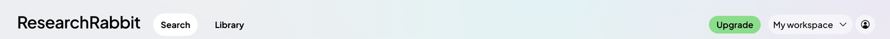 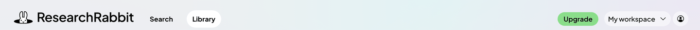

#### Wordmark link
ResearchRabbit wordmark. The rabbit mark beside it only shows on the Library and Home pages (the width animates). Read as `nav-logo` on the search split view, library map view.

| State | Values (a hover or focus-visible row lists only what changes) |
|---|---|
| default | size 208 x 48; background transparent; text Plus Jakarta Sans 14/21 600, #000000 `--primary`; cursor pointer; icon 48 x 48, #000000 `--primary` |
| hover | text Plus Jakarta Sans 14/21 600, #000000 `--primary`, underline |
| focus-visible | outline 1px auto #005fcc, offset 1px |
| with-mark (as the first row, except) | size 256 x 48 |

Parts:

- wordmark: 208 x 42

Authored state rules (from the page's CSS): `a:hover { text-decoration: underline; }`.

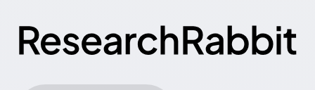 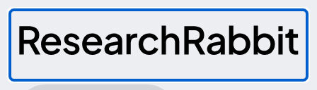 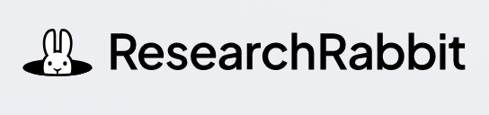

#### Search and Library tabs
Two text tabs. The current one sits in a white pill; the other is plain text. Read as `nav-tab` on the search split view.

| State | Values (a hover or focus-visible row lists only what changes) |
|---|---|
| current | size 71.77 x 37; padding 8px 12px; radius 48px; background #ffffff `--grey-bg-0`; text Plus Jakarta Sans 14/21 700, #000000 `--primary`; cursor pointer |
| current, hover | text Plus Jakarta Sans 14/21 700, #000000 `--primary`, underline |
| current, focus-visible | outline 1px auto #005fcc, offset 1px |
| other (as the first row, except) | size 71.33 x 37; background transparent |
| other, hover | text Plus Jakarta Sans 14/21 700, #000000 `--primary`, underline |
| other, focus-visible | outline 1px auto #005fcc, offset 1px |

Authored state rules (from the page's CSS): `a:hover { text-decoration: underline; }`.

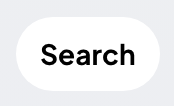 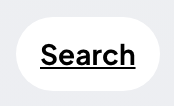 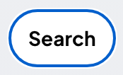 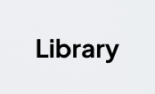 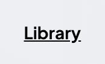 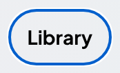

#### Upgrade pill
Green pill button in the top bar. Read as `nav-upgrade` on the search split view.

| State | Values (a hover or focus-visible row lists only what changes) |
|---|---|
| default | size 83.64 x 29; padding 4px 12px; gap 8px; radius 48px; background #8add8a `--green`; text Plus Jakarta Sans 14/21 600, #000000 `--primary`; cursor pointer |
| hover | background #c4eec4 `--green-50` |
| focus-visible | outline 1px auto #b0edf0 `--turq-50`, offset 0px |

Authored state rules (from the page's CSS): `button:focus, input:focus { outline-color: var(--turq-50); }`; `.x:hover { background-color: rgba(0, 0, 0, 0.05); }`; `.x:hover { background-color: var(--green-50); }`.

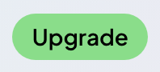 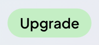 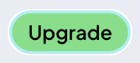

#### Workspace menu button
Pill with the workspace name (redacted to "My workspace") and a chevron. The menu itself is not in the snapshots. Read as `nav-workspace` on the search split view.

| State | Values (a hover or focus-visible row lists only what changes) |
|---|---|
| default | size 137 x 32; padding 8px; gap 8px; radius 48px; background rgba(255, 255, 255, 0.5); text Plus Jakarta Sans 14/14 500, #000000 `--primary`; cursor pointer; icon 16 x 16, #000000 `--primary` |
| hover | background #ffffff `--grey-bg-0` |
| focus-visible | outline 1px auto #b0edf0 `--turq-50`, offset 0px |

Authored state rules (from the page's CSS): `button:focus, input:focus { outline-color: var(--turq-50); }`; `.x:hover { background-color: #ffffff; }`.

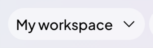 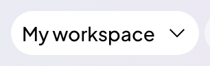 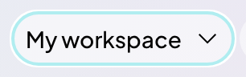

#### Account button
Round 32px button with a person icon. Read as `nav-avatar` on the search split view.

| State | Values (a hover or focus-visible row lists only what changes) |
|---|---|
| default (same: hover) | size 32 x 32; padding 8px; radius 48px; background rgba(255, 255, 255, 0.5); text Plus Jakarta Sans 14/21 400, #000000 `--primary`; cursor pointer; icon 16 x 16, #000000 `--primary` |
| focus-visible | outline 1px auto #b0edf0 `--turq-50`, offset 0px |

Authored state rules (from the page's CSS): `button:focus, input:focus { outline-color: var(--turq-50); }`; `.x:hover { background-color: rgba(255, 255, 255, 0.5); }`.

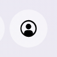 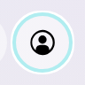

#### Search session bar
Grey pill under the top bar with close, back, forward and the rabbit trail button. Read as `session-bar` on the search split view.

**Values (default).** size 112 x 40; padding 4px; radius 48px; background rgba(0, 0, 0, 0.1); text Plus Jakarta Sans 14/21 400, #000000 `--primary`; icon 16 x 16, #000000 `--primary`.

Parts:

- container: 112 x 40; background rgba(0, 0, 0, 0.1); radius 48px; padding 4px
  - child button: 24 x 32; at 4, 4; Plus Jakarta Sans 20/30 400, #000000 `--primary`; radius 48px; padding 4px
  - child button: 24 x 32; at 28, 4; Plus Jakarta Sans 20/30 400, #000000 `--primary`; radius 48px; padding 4px; opacity 0.5
  - child button: 24 x 32; at 52, 4; Plus Jakarta Sans 20/30 400, #000000 `--primary`; radius 48px; padding 4px; opacity 0.5
  - child button: 32 x 32; at 76, 4; Plus Jakarta Sans 14/21 400, #000000 `--primary`; radius 48px

#### Search session bar button
Close, back and forward buttons in the session bar. Read as `session-bar-button` on the search split view.

| State | Values (a hover or focus-visible row lists only what changes) |
|---|---|
| close | size 24 x 32; padding 4px; radius 48px; background transparent; text Plus Jakarta Sans 20/30 400, #000000 `--primary`; cursor pointer; icon 16 x 16, #000000 `--primary` |
| close, hover | background rgba(0, 0, 0, 0.1) |
| close, focus-visible | outline 1px auto #b0edf0 `--turq-50`, offset 0px |
| back (same: hover) (as the first row, except) | opacity 0.5; cursor none |
| rabbit | size 32 x 32; radius 48px; background transparent; text Plus Jakarta Sans 14/21 400, #000000 `--primary`; cursor pointer; icon 32 x 32, #000000 `--primary` |
| rabbit, hover | background rgba(0, 0, 0, 0.05) |
| rabbit, focus-visible | outline 1px auto #b0edf0 `--turq-50`, offset 0px |

Authored state rules (from the page's CSS): `button:focus, input:focus { outline-color: var(--turq-50); }`; `.x:hover { background-color: rgba(0, 0, 0, 0.1); }`.

 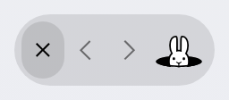 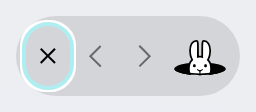 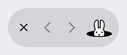  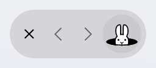 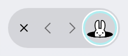

#### Main card
The 50% white card, rounded at the top corners only, that holds a solid white header strip and the list or graph, left of the right-hand panel. Read as `main-card` on the search split view.

**Values (default).** size 994 x 772; radius 16px 16px 0px 0px; background rgba(255, 255, 255, 0.5); text Plus Jakarta Sans 14/21 600, #000000 `--primary`; icon 14 x 14, #ffffff `--grey-bg-0`.

Parts:

- header: 994 x 46; Plus Jakarta Sans 14/21 400, #000000 `--primary`; background #ffffff `--grey-bg-0`; padding 0px 12px; gap 16px; text "Similar articles to 9 Articles"
- body: 994 x 726; Plus Jakarta Sans 14/21 400, #000000 `--primary`; text "Jimenez, 2023 SWE-bench: Can L"
- actions: 390 x 772; Plus Jakarta Sans 14/21 400, #000000 `--primary`; text "Next Search Auto-save to... Se"
- root: 1440 x 836; Plus Jakarta Sans 14/21 400, #000000 `--primary`; padding 0px 24px 8px; gap 8px; text "Similar articles to 9 Articles"
- content: 1392 x 772; Plus Jakarta Sans 14/21 400, #000000 `--primary`; gap 8px; text "Similar articles to 9 Articles"

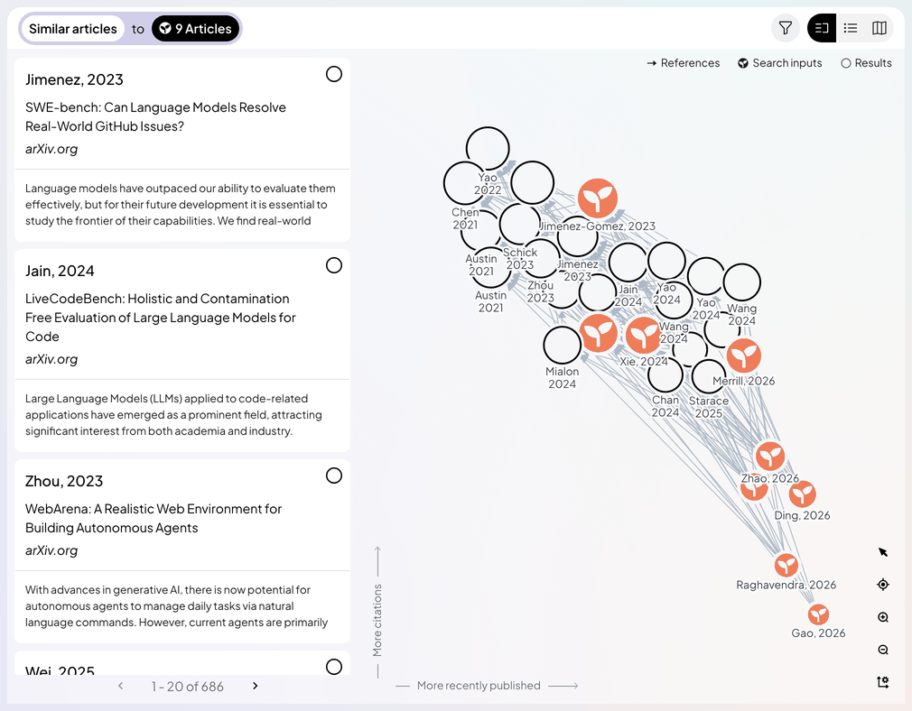

#### Right panel
The 390px column at the right: Next Search, the article detail or the layout settings take turns in it. Read as `side-panel` on the search split view, search map view (a node inspected), search map view (layout settings, X Axis).

| State | Values (a hover or focus-visible row lists only what changes) |
|---|---|
| next-search | size 390 x 772; background transparent; text Plus Jakarta Sans 16/24 500, #000000 `--primary`; icon 16 x 16, #ffffff `--grey-bg-0` |
| article (as the first row, except) | text Plus Jakarta Sans 14/14 400, #000000 `--primary`; icon 16 x 16, #000000 `--primary` |
| layout (same as the first row) | same values |

Child layers that carry the look: div 390x772 background rgba(221, 204, 255, 0.2) radius 12px; button 126.2x32 background #000000 `--primary` radius 48px; div 374x44 background #d7f6f8 `--turq-25` radius 8px.

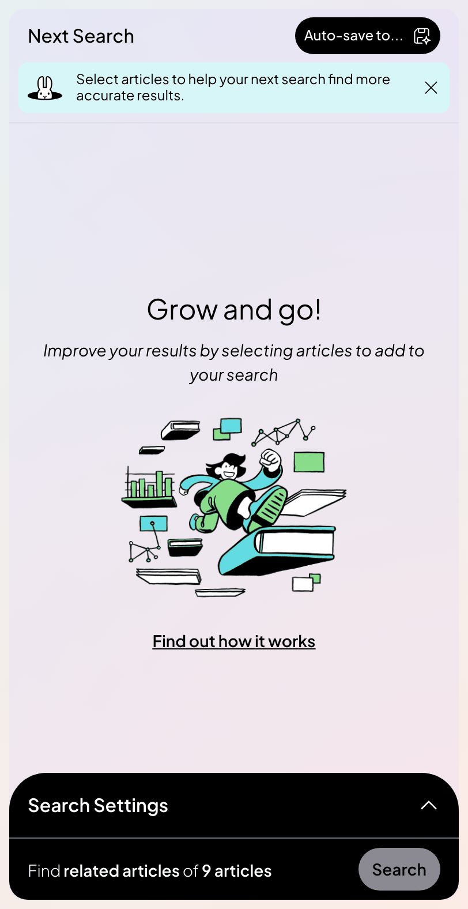 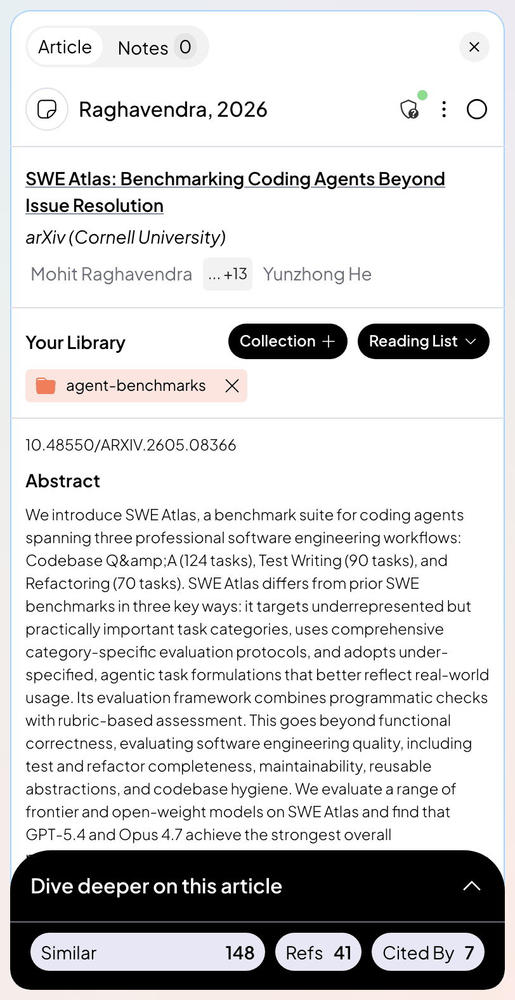 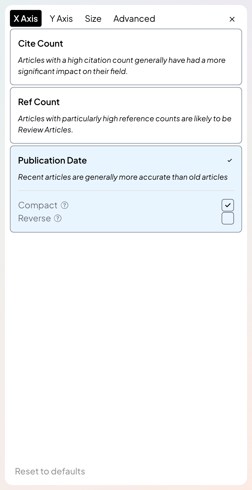

### Search header

The row at the top of the main card: the "Similar articles to 9 Articles" summary capsule at the left, then the filter button and the three-way view toggle at the right.

#### Search summary pill
The search header: "Similar articles" in a light pill, "to", then the black "9 Articles" pill, all inside a lavender capsule. Read as `search-summary` on the search split view.

**Values (default).** size 248.64 x 37; padding 4px; gap 8px; radius 48px; background #d1ceed `--lavender-50`; text Plus Jakarta Sans 14/21 600, #000000 `--primary`; cursor pointer; icon 14 x 14, #ffffff `--grey-bg-0`.

Parts:

- left: 113.81 x 29; Plus Jakarta Sans 14/21 400, #000000 `--primary`; background #ffffff `--grey-bg-0`; radius 48px; padding 4px 8px; gap 4px; text "Similar articles"
- label: 97.81 x 21; Plus Jakarta Sans 14/21 600, #000000 `--primary`; text "Similar articles"
- to: 14.33 x 14; Plus Jakarta Sans 14/14 400, #000000 `--primary`; text "to"

Authored state rules (from the page's CSS): `.x:hover { opacity: 0.7; }`.

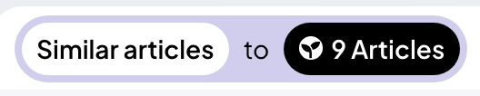

#### Search type pill
The light pill that names the kind of search ("Similar articles"). Read as `search-summary-type` on the search split view.

**Values (default).** size 113.81 x 29; padding 4px 8px; gap 4px; radius 48px; background #ffffff `--grey-bg-0`; text Plus Jakarta Sans 14/21 600, #000000 `--primary`; cursor pointer.

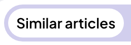 

#### Search inputs pill
The black pill that names the inputs ("9 Articles") with the seed icon. Read as `search-summary-inputs` on the search split view.

**Values (default).** size 96.5 x 29; padding 4px 8px; gap 4px; radius 48px; background #000000 `--primary`; text Plus Jakarta Sans 14/21 600, #ffffff `--grey-bg-0`; cursor pointer; icon 14 x 14, #ffffff `--grey-bg-0`.

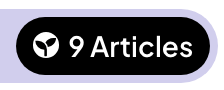 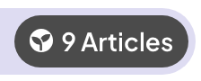

#### View toggle
Three icon buttons in one capsule: split, list and map. The current one is filled black. Read as `view-toggle` on the search split view, search map view.

| State | Values (a hover or focus-visible row lists only what changes) |
|---|---|
| default | size 96 x 32; radius 48px; background transparent; text Plus Jakarta Sans 14/21 400, #000000 `--primary`; icon 16 x 16, #ffffff `--grey-bg-0` |
| map (as the first row, except) | icon 16 x 16, #000000 `--primary` |

Child layers that carry the look: button 32x32 background #000000 `--primary`; button 32x32 background rgba(0, 0, 0, 0.05); button 32x32 background rgba(0, 0, 0, 0.05).

Parts:

- container: 96 x 32; radius 48px
  - child button: 32 x 32; at 0, 0; Plus Jakarta Sans 16/24 400, #ffffff `--grey-bg-0`; background #000000 `--primary`; padding 8px
  - child button: 32 x 32; at 32, 0; Plus Jakarta Sans 16/24 400, #000000 `--primary`; background rgba(0, 0, 0, 0.05); padding 8px
  - child button: 32 x 32; at 64, 0; Plus Jakarta Sans 16/24 400, #000000 `--primary`; background rgba(0, 0, 0, 0.05); padding 8px

 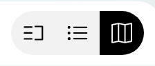

#### View toggle button
One of the three view buttons, current and not current. Read as `view-toggle-button` on the search split view.

| State | Values (a hover or focus-visible row lists only what changes) |
|---|---|
| current | size 32 x 32; padding 8px; background #000000 `--primary`; text Plus Jakarta Sans 16/24 400, #ffffff `--grey-bg-0`; cursor pointer; icon 16 x 16, #ffffff `--grey-bg-0` |
| current, hover | background #333333 `--secondary` |
| current, focus-visible | outline 1px auto #b0edf0 `--turq-50`, offset 0px |
| other (as the first row, except) | background rgba(0, 0, 0, 0.05); text Plus Jakarta Sans 16/24 400, #000000 `--primary`; icon 16 x 16, #000000 `--primary` |
| other, hover | background rgba(0, 0, 0, 0.1) |
| other, focus-visible | outline 1px auto #b0edf0 `--turq-50`, offset 0px |

Authored state rules (from the page's CSS): `button:focus, input:focus { outline-color: var(--turq-50); }`; `.x:hover { background-color: rgba(0, 0, 0, 0.1); }`; `.x:hover { background-color: #333333; }`.

 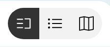 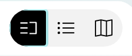  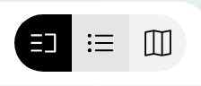 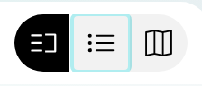

#### Filter button
Round funnel button left of the view toggle; it opens the filter popover. Read as `filter-button` on the search split view, search map view (filter popover open).

| State | Values (a hover or focus-visible row lists only what changes) |
|---|---|
| default (same: hover) | size 32 x 32; padding 8px; gap 8px; radius 48px; background #eef0f1 `--grey-bg2`; text Plus Jakarta Sans 16/24 400, #000000 `--primary`; cursor pointer; icon 16 x 16, #000000 `--primary` |
| focus-visible | outline 1px auto #b0edf0 `--turq-50`, offset 0px |
| open (as the first row, except) | outline 1px solid #000000 `--primary`, offset 0px |

Authored state rules (from the page's CSS): `button:focus, input:focus { outline-color: var(--turq-50); }`.

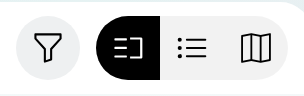 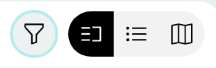 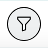

#### Filter popover
A small card under the filter button: a text field with a Go button and a line of help. Read as `filter-popover` on the search map view (filter popover open).

**Values (default).** size 356 x 148; padding 8px; radius 16px; background #ffffff `--grey-bg-0`; shadow rgba(14, 18, 22, 0.35) 0px 10px 38px -10px, rgba(14, 18, 22, 0.2) 0px 10px 20px -15px; text Plus Jakarta Sans 14/21 400, #000000 `--primary`.

Parts:

- input: 340 x 37; Plus Jakarta Sans 14/21 400, #000000 `--primary`; radius 8px; padding 8px 32px 8px 12px; shadow #c9cdd3 0px 0px 0px 1px inset
- info: 340 x 58; Plus Jakarta Sans 14/21 400, #000000 `--primary`; background #e8e7f6 `--lavender-25`; radius 8px; padding 8px 12px; gap 8px; text "Find a broader set of results "

Authored state rules (from the page's CSS): `.x:focus { box-shadow: rgba(14, 18, 22, 0.35) 0px 10px 38px -10px, rgba(14, 18, 22, 0.2) 0px 10px 20px -15px, rgba(0, 0, 0, 0.2) 0px 0px 0px 2px; }`; `.x[data-state="open"][data-side="bottom"] { animation-name: fSMqcH; }`.

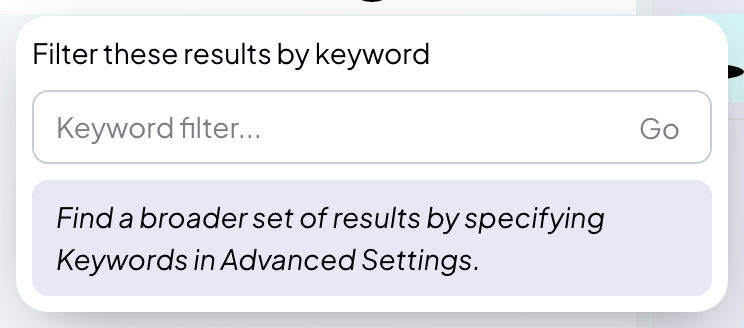

#### Filter field
Text input inside the filter popover. Read as `filter-input` on the search map view (filter popover open).

| State | Values (a hover or focus-visible row lists only what changes) |
|---|---|
| default (same: hover) | size 340 x 37; padding 8px 32px 8px 12px; radius 8px; background transparent; shadow #c9cdd3 0px 0px 0px 1px inset; text Plus Jakarta Sans 14/21 400, #000000 `--primary`; cursor text; placeholder oklab(0 0 0 / 0.5) |
| focus-visible | outline 1px auto #b0edf0 `--turq-50`, offset 0px |

Authored state rules (from the page's CSS): `button:focus, input:focus { outline-color: var(--turq-50); }`.

 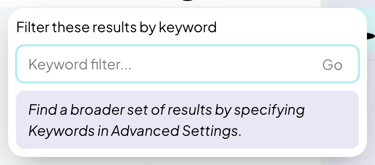

#### Filter Go button
Small button at the right end of the filter field. Read as `filter-go` on the search map view (filter popover open).

| State | Values (a hover or focus-visible row lists only what changes) |
|---|---|
| default (same: hover) | size 38.59 x 27; padding 3px 9px; radius 4px; background #61dce2 `--turq`; text Plus Jakarta Sans 14/21 500, #ffffff `--grey-bg-0`; cursor pointer |
| focus-visible | outline 1px auto #b0edf0 `--turq-50`, offset 0px |

Authored state rules (from the page's CSS): `button:focus, input:focus { outline-color: var(--turq-50); }`.

### Graph

The graph area. Everything drawn on the canvas (nodes, edges, labels, the hover title box) is a bitmap in the snapshots; this group measures the DOM around it: the legend, the axis captions, the toolbar, the Positions moved pill and the legend tooltip. The canvas crops are the only record of node drawing, so read node colours and sizes from graph.md and raw/graph-code-notes.md.

#### Graph canvas region
The graph area of each captured state: the canvas bitmap with its axes captions, legend, toolbar and any hover label drawn on top. The canvas is a bitmap in the snapshots, so these crops are the only record of node, edge and label drawing; read the colours from graph.md and raw/graph-code-notes.md. Read as `graph-canvas` on the search split view, search split view (hovering a search input node), search split view (hovering a result node) and 16 more.

| State | Values (a hover or focus-visible row lists only what changes) |
|---|---|
| split-default | size 594 x 726; background transparent; text Plus Jakarta Sans 12/12 400, #686d79 `--grey-secondary`; icon 14 x 14, #8a92a1 `--line` |
| split-hover-input (same as the first row) | same values |
| split-hover-result (same as the first row) | same values |
| split-hover-list-card (same as the first row) | same values |
| split-hover-legend-inputs (same as the first row) | same values |
| split-hover-legend-results (same as the first row) | same values |
| split-inspect-node (same as the first row) | same values |
| map-default (as the first row, except) | size 994 x 726 |
| map-zoomed-in (as the first row, except) | size 994 x 726 |
| map-inspect-node (as the first row, except) | size 994 x 726 |
| map-settings-x-axis (as the first row, except) | size 994 x 726 |
| map-settings-y-axis (as the first row, except) | size 994 x 726 |
| map-settings-size (as the first row, except) | size 994 x 726 |
| map-settings-advanced (as the first row, except) | size 994 x 726 |
| map-filter-popover (as the first row, except) | size 994 x 726 |
| library-default (as the first row, except) | size 1126 x 634 |
| library-hover (as the first row, except) | size 1126 x 634 |
| library-positions-moved | size 1126 x 634; background transparent; text Plus Jakarta Sans 14/14 500, #201d1d `--grey-primary`; icon 16 x 16, #201d1d `--grey-primary` |
| library-positions-reset-menu | size 1126 x 634; background transparent; text Plus Jakarta Sans 14/14 500, #201d1d `--grey-primary`; icon 16 x 16, #201d1d `--grey-primary` |

Child layers that carry the look: div 594x726 radius 6px shadow transparent 0px 0px 0px 1440px; div 1x16 background #8a92a1 `--line`; div 1x32 background #8a92a1 `--line`.

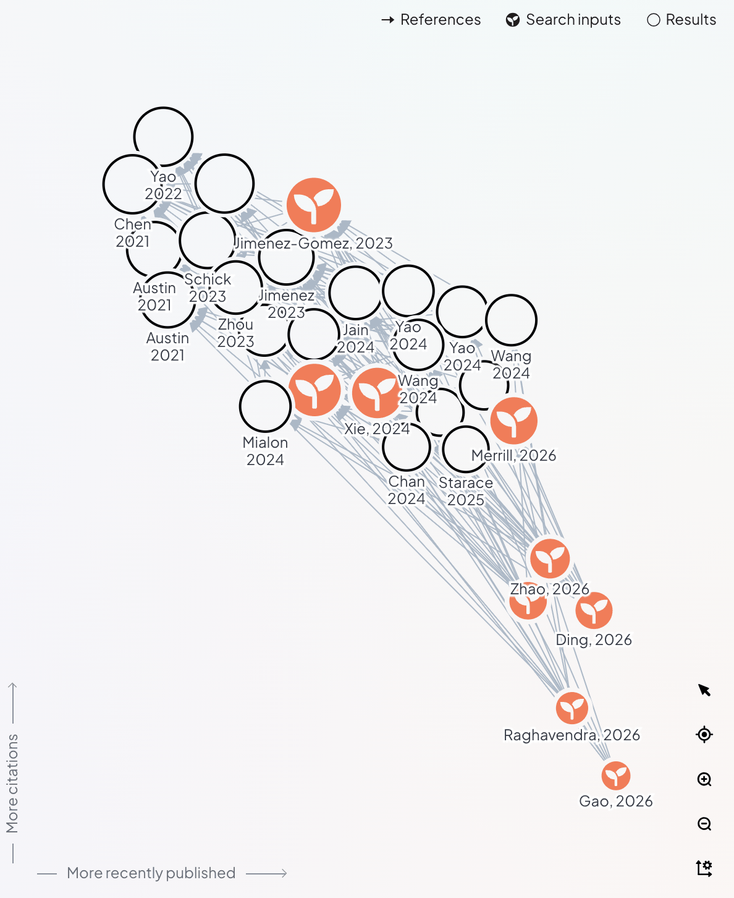 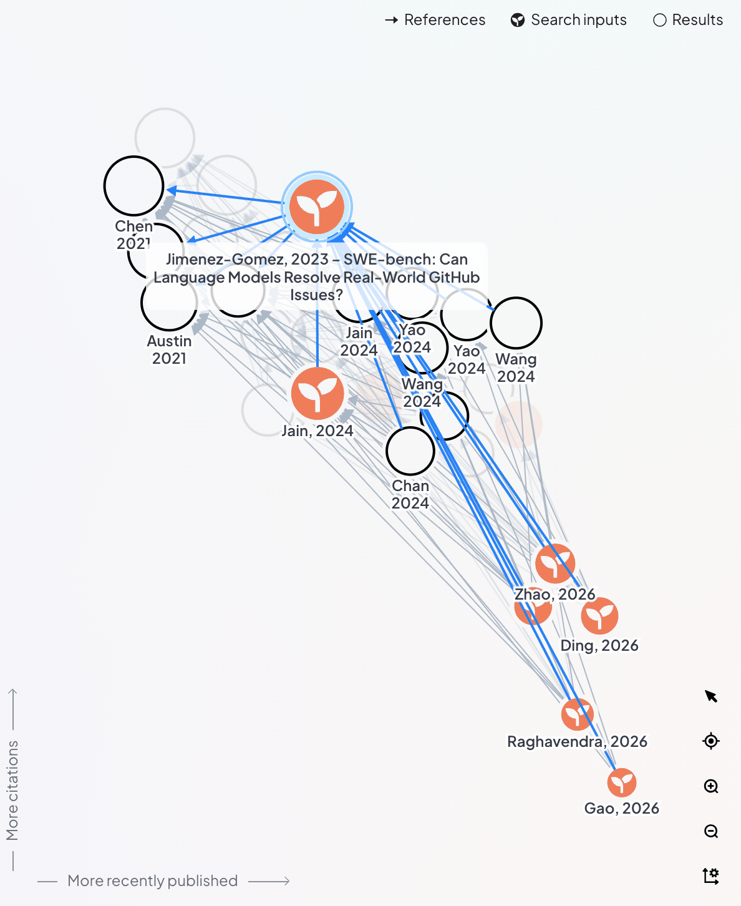 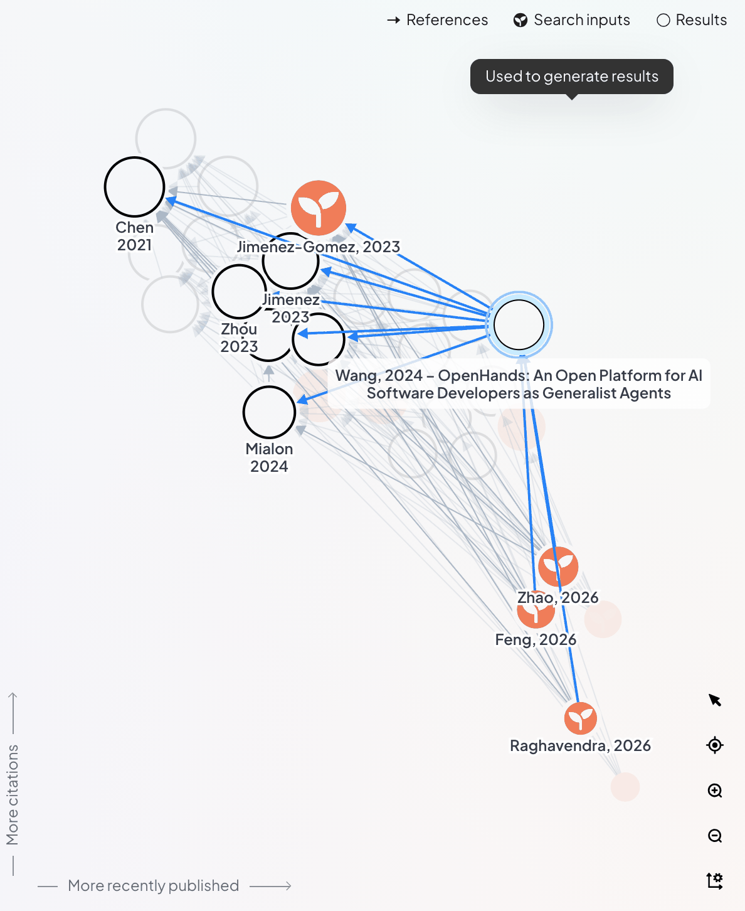 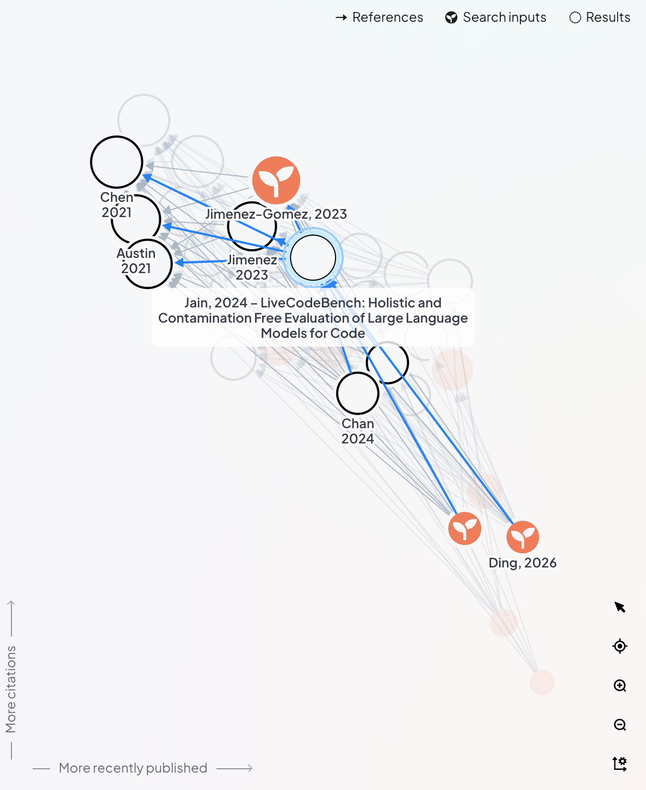 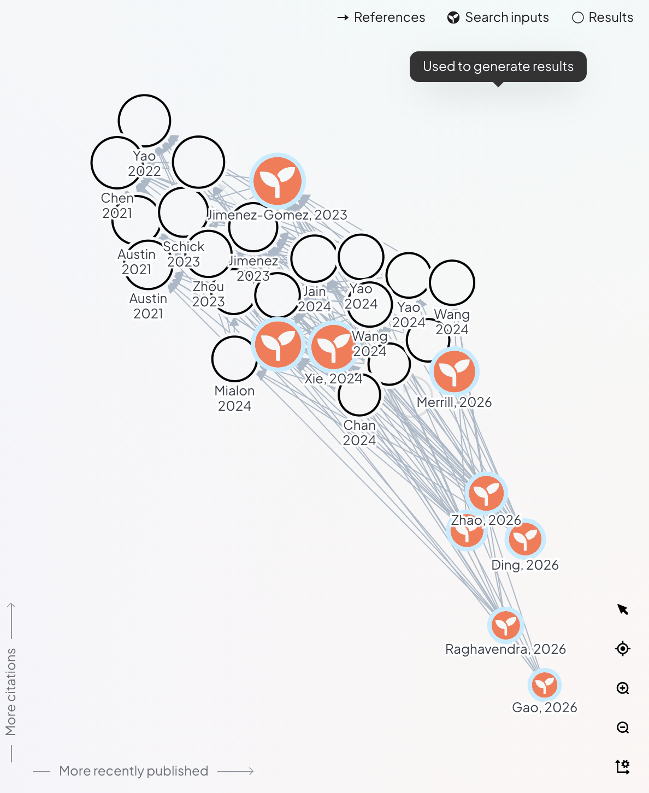 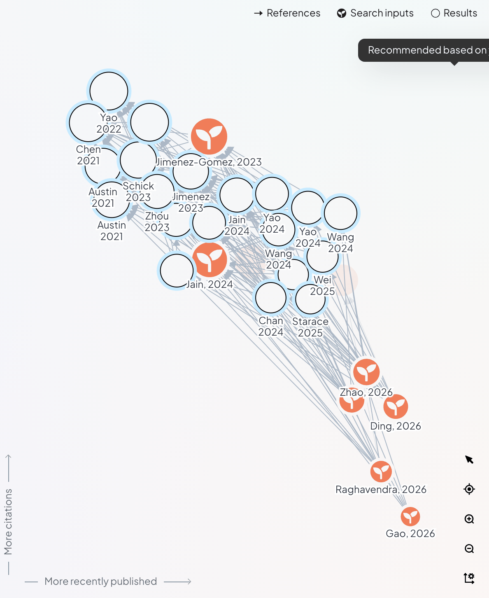 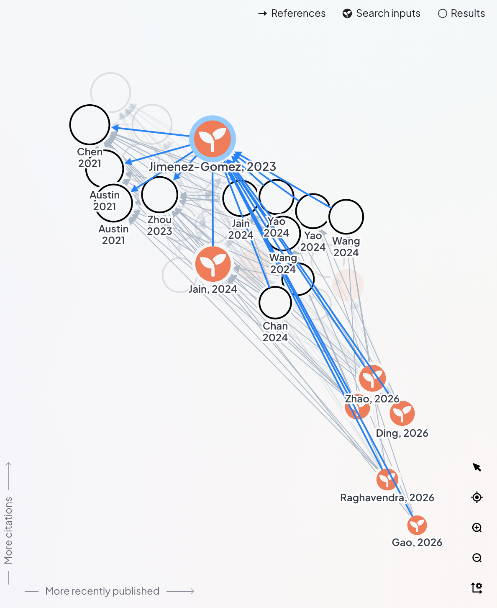  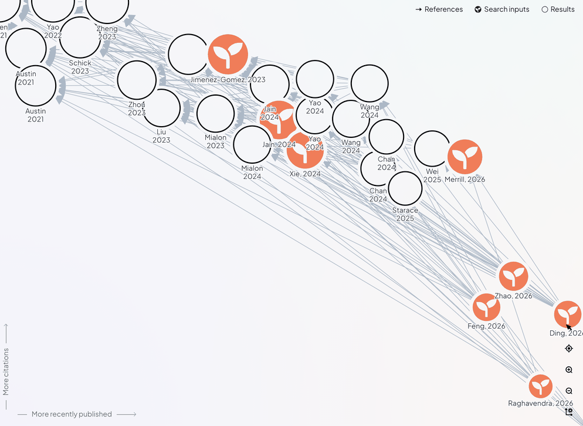          

#### Graph legend
Three chips at the top right of the graph: References (arrow), Search inputs (seed icon), Results (open circle). Hovering a chip shows a tooltip and highlights those nodes. Read as `graph-legend` on the search split view.

**Values (default).** size 288 x 20; gap 4px; background transparent; text Plus Jakarta Sans 12/12 400, #201d1d `--grey-primary`; icon 12 x 12, #201d1d `--grey-primary`.

Parts:

- container: 288 x 20; Plus Jakarta Sans 12/18 400, #201d1d `--grey-primary`; gap 4px; text "References Search inputs Resul"
  - child References: 97.45 x 20; at 0, 0; Plus Jakarta Sans 12/18 400, #201d1d `--grey-primary`; radius 24px; padding 4px 8px; gap 4px; text "References"
  - child svg: 12 x 12; at 8, 4
  - child References: 65.45 x 12; at 24, 4; Plus Jakarta Sans 12/12 400, #201d1d `--grey-primary`; text "References"
  - child Search inputs: 109.33 x 20; at 101.5, 0; Plus Jakarta Sans 12/18 400, #201d1d `--grey-primary`; radius 24px; padding 4px 8px; gap 4px; text "Search inputs"
  - child svg: 12 x 12; at 109.5, 4
  - child Search inputs: 77.33 x 12; at 125.5, 4; Plus Jakarta Sans 12/12 400, #201d1d `--grey-primary`; text "Search inputs"
  - child Results: 73.22 x 20; at 214.8, 0; Plus Jakarta Sans 12/18 400, #201d1d `--grey-primary`; radius 24px; padding 4px 8px; gap 4px; text "Results"
  - child svg: 12 x 12; at 222.8, 4
  - child Results: 41.22 x 12; at 238.8, 4; Plus Jakarta Sans 12/12 400, #201d1d `--grey-primary`; text "Results"

#### Graph legend chip
One legend chip. Hovering shows a help cursor and a white fill; the tooltip itself comes from script and is only present in three of the snapshots. Read as `graph-legend-item` on the search split view.

| State | Values (a hover or focus-visible row lists only what changes) |
|---|---|
| references | size 97.45 x 20; padding 4px 8px; gap 4px; radius 24px; background transparent; text Plus Jakarta Sans 12/12 400, #201d1d `--grey-primary`; cursor help; icon 12 x 12, #201d1d `--grey-primary` |
| references, hover | background #ffffff `--grey-bg-0` |
| inputs (as the first row, except) | size 109.33 x 20 |
| inputs, hover | background #ffffff `--grey-bg-0` |
| results (as the first row, except) | size 73.22 x 20 |
| results, hover | background #ffffff `--grey-bg-0` |

- Not measured: references cannot take keyboard focus.

Authored state rules (from the page's CSS): `.x:hover { background-color: white; }`.

     

#### Legend tooltip
Dark tooltip with an arrow, shown above a legend chip. Read as `graph-tooltip` on the search split view (hovering a result node), search split view (hovering the Search inputs legend chip), search split view (hovering the Results legend chip).

| State | Values (a hover or focus-visible row lists only what changes) |
|---|---|
| search-inputs | size 162.41 x 28; padding 8px 12px; radius 8px; background #333333 `--secondary`; shadow rgba(14, 18, 22, 0.35) 0px 10px 38px -10px, rgba(14, 18, 22, 0.2) 0px 10px 20px -15px; text Plus Jakarta Sans 12/12 400, #ffffff `--grey-bg-0`; icon 10 x 5, #ffffff `--grey-bg-0` |
| results (as the first row, except) | size 232.84 x 28 |
| result-hover (same as the first row) | same values |

Parts:

- arrow: 10 x 5

  

#### Graph axis caption, vertical
Rotated caption with an arrow icon and two rules, at the bottom left of the graph ("More citations"). Read as `graph-axis-y` on the search map view.

**Values (default).** size 20 x 166.86; padding 0px 0px 0px 8px; radius 4px; background transparent; text Plus Jakarta Sans 12/12 400, #686d79 `--grey-secondary`; transform matrix(0, -1, 1, 0, 0, 0); cursor pointer; icon 14 x 14, #8a92a1 `--line`.

Child layers that carry the look: div 1x16 background #8a92a1 `--line`; div 1x32 background #8a92a1 `--line`.

Parts:

- label: 12 x 80.86; Plus Jakarta Sans 12/12 400, #686d79 `--grey-secondary`; margin 4px 8px; text "More citations"
- icon: 14 x 14
- line: 1 x 16; background #8a92a1 `--line`

Authored state rules (from the page's CSS): `.x:hover { background-color: white; }`.

#### Graph axis caption, horizontal
The horizontal caption along the bottom edge ("More recently published"). Read as `graph-axis-x` on the search map view.

**Values (default).** size 222.89 x 20; padding 0px 0px 0px 8px; radius 4px; background transparent; text Plus Jakarta Sans 12/12 400, #686d79 `--grey-secondary`; cursor pointer; icon 14 x 14, #8a92a1 `--line`.

Child layers that carry the look: div 16x1 background #8a92a1 `--line`; div 32x1 background #8a92a1 `--line`.

Parts:

- label: 136.89 x 12; Plus Jakarta Sans 12/12 400, #686d79 `--grey-secondary`; margin 4px 8px; text "More recently published"
- icon: 14 x 14
- line: 16 x 1; background #8a92a1 `--line`

Authored state rules (from the page's CSS): `.x:hover { background-color: white; }`.

#### Graph toolbar
Five 32px icon buttons stacked at the bottom right of the graph: pointer, recentre, zoom in, zoom out and layout settings. Read as `graph-controls` on the search split view, search map view, library map view.

| State | Values (a hover or focus-visible row lists only what changes) |
|---|---|
| default | size 32 x 176; gap 4px; radius 8px; background transparent; text Plus Jakarta Sans 16/24 400, #000000 `--primary`; icon 16 x 16, #000000 `--primary` |
| split (same as the first row) | same values |
| library (same as the first row) | same values |

Parts:

- container: 32 x 176; radius 8px; gap 4px
  - child button: 32 x 32; at 0, 0; Plus Jakarta Sans 18/27 400, #000000 `--primary`; radius 4px; padding 8px
  - child button: 32 x 32; at 0, 36; Plus Jakarta Sans 18/27 400, #000000 `--primary`; radius 4px; padding 8px
  - child button: 32 x 32; at 0, 72; Plus Jakarta Sans 18/27 400, #000000 `--primary`; radius 4px; padding 8px
  - child button: 32 x 32; at 0, 108; Plus Jakarta Sans 18/27 400, #000000 `--primary`; radius 4px; padding 8px
  - child button: 32 x 32; at 0, 144; Plus Jakarta Sans 18/27 400, #000000 `--primary`; radius 4px; padding 8px

  

#### Graph toolbar button
One toolbar button. The first (pointer) is the active tool. Read as `graph-control-button` on the search map view.

| State | Values (a hover or focus-visible row lists only what changes) |
|---|---|
| pointer | size 32 x 32; padding 8px; radius 4px; background transparent; text Plus Jakarta Sans 18/27 400, #000000 `--primary`; cursor pointer; icon 16 x 16, #000000 `--primary` |
| pointer, hover | background rgba(0, 0, 0, 0.05) |
| pointer, focus-visible | outline 1px auto #b0edf0 `--turq-50`, offset 0px |
| recentre (same as the first row) | same values |
| recentre, hover | background rgba(0, 0, 0, 0.05) |
| recentre, focus-visible | outline 1px auto #b0edf0 `--turq-50`, offset 0px |
| zoom-in (same as the first row) | same values |
| zoom-in, hover | background rgba(0, 0, 0, 0.05) |
| settings (same as the first row) | same values |
| settings, hover | background rgba(0, 0, 0, 0.05) |
| settings, focus-visible | outline 1px auto #b0edf0 `--turq-50`, offset 0px |

Authored state rules (from the page's CSS): `button:focus, input:focus { outline-color: var(--turq-50); }`; `.x:hover { background-color: rgba(0, 0, 0, 0.05); }`.

          

#### Panel resize handle
Invisible 8px strip at the edge of the graph with a 4px display bar; drag resizes the list or the panel. Read as `graph-resize-handle` on the search split view.

**Values (default).** size 8 x 200; background transparent; text Plus Jakarta Sans 14/21 400, #000000 `--primary`; transform matrix(1, 0, 0, 1, -4, 0); cursor col-resize.

Child layers that carry the look: div 4x200 background #8a92a1 `--line` radius 1px.

Parts:

- display: 4 x 200; background #8a92a1 `--line`; radius 1px; margin 2px 0px

No crop was saved for this entry (a whole page or a hidden element); the values are from the computed styles.

#### Positions moved pill
Replaces the axes captions once a node has been dragged: a peach pill with an icon, in the bottom left of the graph. It opens a one-item menu. Read as `positions-moved` on the library map view (positions moved), library map view (reset menu open).

| State | Values (a hover or focus-visible row lists only what changes) |
|---|---|
| default (same: hover) | size 150.33 x 24; padding 4px 8px; gap 8px; radius 48px; background #f5c751 `--activity-important`; text Plus Jakarta Sans 14/14 500, #201d1d `--grey-primary`; cursor pointer; icon 16 x 16, #201d1d `--grey-primary` |
| focus-visible | outline 1px auto #b0edf0 `--turq-50`, offset 0px |
| open (same as the first row) | same values |

Authored state rules (from the page's CSS): `button:focus, input:focus { outline-color: var(--turq-50); }`.

  

#### Reset positions menu
White menu card above the Positions moved pill with one row, Reset. Read as `reset-menu` on the library map view (reset menu open).

| State | Values (a hover or focus-visible row lists only what changes) |
|---|---|
| default | size 220 x 38; padding 4px; radius 6px; background #ffffff `--grey-bg-0`; shadow rgba(22, 23, 24, 0.35) 0px 10px 38px -10px, rgba(22, 23, 24, 0.2) 0px 10px 20px -15px; text Plus Jakarta Sans 14/21 400, #201d1d `--grey-primary`; icon 18 x 18, #201d1d `--grey-primary` |
| item (same: hover) | size 212 x 30; padding 8px 8px 8px 32px; radius 3px; background transparent; text Plus Jakarta Sans 14/21 400, #201d1d `--grey-primary`; icon 18 x 18, #201d1d `--grey-primary` |

Parts:

- item: 212 x 30; Plus Jakarta Sans 14/21 400, #201d1d `--grey-primary`; radius 3px; padding 8px 8px 8px 32px; text "Reset"
- icon: 20 x 20

Authored state rules (from the page's CSS): `.x[data-state="checked"] { font-weight: 600; }`.

 

### Article list

The 400px column of result cards in the split view, and the same cards at full width in the list view and in the library.

#### Result list column
The 400px column of result cards at the left of the split view, with a thin loading line on top and a pager at the bottom. Read as `list-column` on the search split view.

**Values (default).** size 400 x 726; padding 8px; background transparent; text Plus Jakarta Sans 16/24 500, #000000 `--primary`; icon 18 x 18, #000000 `--primary`.

Child layers that carry the look: div 372x2 background #0000ff; div 372x2; div 372x204 background #ffffff `--grey-bg-0` radius 8px.

Parts:

- viewport: 372 x 686; Plus Jakarta Sans 14/21 400, #000000 `--primary`; radius 4px; text "Jimenez, 2023 SWE-bench: Can L"
- loadline: 372 x 2; background #0000ff; opacity 0

#### Result card
A white card per article: author and year, title, journal in italics, a selection circle at the top right, then a rule and the abstract. The tinted variant is the card the pointer was over when its snapshot was taken (it stays tinted and its node is highlighted in the graph). Read as `list-card` on the search split view, search split view (hovering a list card), search list view and 1 more.

| State | Values (a hover or focus-visible row lists only what changes) |
|---|---|
| default | size 372 x 204; radius 8px; background #ffffff `--grey-bg-0`; text Plus Jakarta Sans 16/24 500, #000000 `--primary`; icon 18 x 18, #000000 `--primary` |
| hover | shadow #a7d4ff 0px 0px 0px 1px inset |
| second (as the first row, except) | size 372 x 225 |
| tinted (as the first row, except) | size 372 x 225; background #f0f6ff; shadow #a7d4ff 0px 0px 0px 1px inset |
| list-view (as the first row, except) | size 966 x 183 |
| list-view, hover | shadow #a7d4ff 0px 0px 0px 1px inset |
| library (as the first row, except) | size 1114 x 217; icon 16 x 16, #f07d59 `--ugc-amber` |
| library, hover | shadow #a7d4ff 0px 0px 0px 1px inset |

Parts:

- details: 336 x 123; Plus Jakarta Sans 14/21 400, #000000 `--primary`; padding 12px; gap 8px; text "Jimenez, 2023 SWE-bench: Can L"
- nickname: 108.92 x 24; Plus Jakarta Sans 16/24 500, #000000 `--primary`; text "Jimenez, 2023"
- title: 312 x 42; Plus Jakarta Sans 14/21 400, #000000 `--primary`; text "SWE-bench: Can Language Models"
- journal: 58.27 x 21; Plus Jakarta Sans 14/21 400 italic, #000000 `--primary`; text "arXiv.org"
- rule: 370 x 1; margin 0px 1px; border T:1px solid #dde0e4 `--grey-1`
- abstract: 348 x 56; Plus Jakarta Sans 12/18 400, #201d1d `--grey-primary`; text "Language models have outpaced "
- side: 36 x 123; Plus Jakarta Sans 14/21 400, #000000 `--primary`; radius 0px 8px 8px 0px; padding 8px
- tick: 20 x 20

Authored state rules (from the page's CSS): `.x:hover { box-shadow: inset 0 0 0 1px var(--selection); }`.

       

#### Result card, focus ring
The card body is a button; this is its keyboard focus ring, measured on the button itself. Read as `list-card-focus` on the search split view.

Not on the page when it was captured.

#### Result card side button
Full-height 36px strip at the right of a card; holds the selection circle. Read as `list-card-side` on the search split view.

| State | Values (a hover or focus-visible row lists only what changes) |
|---|---|
| default (same: hover) | size 36 x 123; padding 8px; radius 0px 8px 8px 0px; background transparent; text Plus Jakarta Sans 14/21 400, #000000 `--primary`; cursor pointer; icon 18 x 18, #000000 `--primary` |
| focus-visible | outline 1px auto #b0edf0 `--turq-50`, offset 0px |

Parts:

- tick: 20 x 20
- icon: 18 x 18; opacity 0

Authored state rules (from the page's CSS): `button:focus, input:focus { outline-color: var(--turq-50); }`.

  

#### List pager
Previous and next chevrons around a "1 - 20 of 686" label at the foot of the list. Read as `list-pager` on the search split view.

| State | Values (a hover or focus-visible row lists only what changes) |
|---|---|
| prev | size 32 x 24; padding 4px 8px; radius 4px; background transparent; text Plus Jakarta Sans 14/21 500, #000000 `--primary`; opacity 0.4; icon 16 x 16, #000000 `--primary` |
| prev, hover | background rgba(0, 0, 0, 0.05) |
| next (as the first row, except) | opacity none; cursor pointer |
| next, hover | background rgba(0, 0, 0, 0.05) |
| next, focus-visible | outline 1px auto #b0edf0 `--turq-50`, offset 0px |

- Not measured: prev cannot take keyboard focus.

Authored state rules (from the page's CSS): `button:focus, input:focus { outline-color: var(--turq-50); }`; `.x:hover { background-color: rgba(0, 0, 0, 0.05); }`.

     

#### List scrollbar
Custom 12px scrollbar track with a thumb; visible on hover in the list. Read as `list-scrollbar` on the search split view (hovering a list card).

**Values (default).** size 12 x 686; padding 1px; background rgba(0, 0, 0, 0.1); text Plus Jakarta Sans 14/21 400, #000000 `--primary`; transition background-color 0.16s ease-out.

Parts:

- thumb: 10 x 112.08; background #ffffff `--grey-bg-0`; radius 12px

Authored state rules (from the page's CSS): `.x:hover { background-color: rgba(0, 0, 0, 0.15); }`.

#### Library folder chip
Outlined chip under a library card title naming the collection the article is in. Read as `list-state-chip` on the library list view.

| State | Values (a hover or focus-visible row lists only what changes) |
|---|---|
| default | size 1054 x 26; gap 4px; background transparent; text Plus Jakarta Sans 12/18 400, #000000 `--primary`; icon 16 x 16, #f07d59 `--ugc-amber` |
| hover | cursor pointer |

Child layers that carry the look: div 154.5x26 radius 4px shadow #dde0e4 0px 0px 0px 1px inset.

Parts:

- container: 1054 x 26; Plus Jakarta Sans 14/21 400, #000000 `--primary`; gap 4px; text "agent-benchmarks"
  - child svg: 16 x 16; at 8, 5
  - child agent-benchmarks: 110.55 x 18; at 32, 4; Plus Jakarta Sans 12/18 400, #000000 `--primary`; text "agent-benchmarks"

### Next Search panel

The right panel when nothing is selected: a header, a dismissible tip, an empty state, and the black Search Settings drawer.

#### Next Search panel
The right-hand column when nothing is selected: header, a dismissible tip, an empty state with art, and the black Search Settings drawer at the foot. Read as `next-search` on the search split view.

**Values (default).** size 390 x 772; radius 12px; background rgba(221, 204, 255, 0.2); text Plus Jakarta Sans 16/24 500, #000000 `--primary`; icon 16 x 16, #ffffff `--grey-bg-0`.

#### Next Search header
Title at the left, the black "Auto-save to..." pill at the right. Read as `next-search-header` on the search split view.

**Values (default).** size 390 x 46; padding 16px; radius 12px 12px 0px 0px; background transparent; text Plus Jakarta Sans 16/24 500, #000000 `--primary`; icon 16 x 16, #ffffff `--grey-bg-0`.

Child layers that carry the look: button 126.2x32 background #000000 `--primary` radius 48px.

Parts:

- container: 390 x 46; Plus Jakarta Sans 14/21 400, #000000 `--primary`; radius 12px 12px 0px 0px; padding 16px; text "Next Search Auto-save to..."
  - child Next Search: 92.5 x 24; at 16, 11; Plus Jakarta Sans 16/24 500, #000000 `--primary`; text "Next Search"
  - child Auto-save to...: 126.16 x 32; at 247.8, 7; Plus Jakarta Sans 14/21 500, #ffffff `--grey-bg-0`; background #000000 `--primary`; radius 48px; padding 8px; gap 8px; text "Auto-save to..."
  - child Auto-save to...: 86.16 x 12; at 255.8, 17; Plus Jakarta Sans 12/12 500, #ffffff `--grey-bg-0`; text "Auto-save to..."

#### Auto-save button
Black pill with a disk icon. Read as `autosave-button` on the search split view.

| State | Values (a hover or focus-visible row lists only what changes) |
|---|---|
| default (same: hover) | size 126.16 x 32; padding 8px; gap 8px; radius 48px; background #000000 `--primary`; text Plus Jakarta Sans 12/12 500, #ffffff `--grey-bg-0`; cursor pointer; icon 16 x 16, #ffffff `--grey-bg-0` |
| focus-visible | outline 1px auto #b0edf0 `--turq-50`, offset 0px |

Authored state rules (from the page's CSS): `button:focus, input:focus { outline-color: var(--turq-50); }`.

 

#### Tip banner
Turquoise strip with the rabbit, a line of help and a close button. Read as `tip-banner` on the search split view.

**Values (default).** size 374 x 44; radius 8px; background #d7f6f8 `--turq-25`; text Plus Jakarta Sans 12/14 400, #000000 `--primary`; icon 30 x 30, #000000 `--primary`.

Parts:

- container: 374 x 44; Plus Jakarta Sans 14/21 400, #000000 `--primary`; background #d7f6f8 `--turq-25`; radius 8px; margin 0px 8px 8px; text "Select articles to help your n"
  - child svg: 30 x 30; at 8, 7
  - child Select articles to help : 288 x 28; at 50, 8; Plus Jakarta Sans 12/14 400, #000000 `--primary`; text "Select articles to help your n"
  - child button: 32 x 44; at 342, 0; Plus Jakarta Sans 14/21 400, #000000 `--primary`; padding 0px 8px
  - child svg: 16 x 16; at 350, 14

#### Tip close button
32px icon button that dismisses the tip. Read as `tip-close` on the search split view.

| State | Values (a hover or focus-visible row lists only what changes) |
|---|---|
| default | size 32 x 44; padding 0px 8px; background transparent; text Plus Jakarta Sans 14/21 400, #000000 `--primary`; cursor pointer; icon 16 x 16, #000000 `--primary` |
| hover | background rgba(0, 0, 0, 0.05) |
| focus-visible | outline 1px auto #b0edf0 `--turq-50`, offset 0px |

Authored state rules (from the page's CSS): `button:focus, input:focus { outline-color: var(--turq-50); }`; `.x:hover { background-color: rgba(0, 0, 0, 0.05); }`.

  

#### Next Search empty state
Centred heading "Grow and go!", an italic line, the illustration and a "Find out how it works" link. Read as `empty-state` on the search split view.

**Values (default).** size 390 x 673; padding 8px 24px 24px 24px; gap 8px; background transparent; text Plus Jakarta Sans 24/36 400, #000000 `--primary`.

Parts:

- container: 390 x 673; Plus Jakarta Sans 14/21 400, #000000 `--primary`; padding 8px 24px 24px; gap 8px; text "Grow and go! Improve your resu"
  - child Grow and go!: 152.45 x 36; at 118.8, 141.9; Plus Jakarta Sans 24/36 400, #000000 `--primary`; text "Grow and go!"
  - child Improve your results by : 342 x 42; at 24, 185.9; Plus Jakarta Sans 14/21 400 italic, #000000 `--primary`; text "Improve your results by select"
  - child img: 249.98 x 178.22; at 70, 243.9; margin 8px 0px
  - child Find out how it works: 141.39 x 21; at 124.3, 438.1; Plus Jakarta Sans 14/21 400, #000000 `--primary`; text "Find out how it works"
  - child Find out how it works: 141.39 x 18; at 124.3, 439.1; Plus Jakarta Sans 14/21 600, #000000 `--primary`; text "Find out how it works"

#### Find out how it works link
Underlined link under the illustration. Read as `empty-state-link` on the search split view.

| State | Values (a hover or focus-visible row lists only what changes) |
|---|---|
| default (same: hover) | size 141.39 x 18; background transparent; text Plus Jakarta Sans 14/21 600, #000000 `--primary`, underline; cursor pointer |
| focus-visible | outline 1px auto #005fcc, offset 1px |

Authored state rules (from the page's CSS): `a:hover { text-decoration: underline; }`.

 

#### Search Settings drawer
Black rounded sheet pinned to the foot of the right panel: a head row with a chevron, a rule, then a summary line and the grey Search button. The article panel reuses it as "Dive deeper on this article". Read as `drawer` on the search split view, search map view (a node inspected).

| State | Values (a hover or focus-visible row lists only what changes) |
|---|---|
| search-settings | size 390 x 110; radius 32px 32px 16px 16px; background #000000 `--primary`; text Plus Jakarta Sans 16/24 600, #ffffff `--grey-bg-0`; transition max-height 0.5s ease; icon 20 x 20, #ffffff `--grey-bg-0` |
| dive-deeper (same as the first row) | same values |

Parts:

- head: 390 x 57; Plus Jakarta Sans 14/21 400, #ffffff `--grey-bg-0`; padding 16px; gap 8px; border B:1px solid #686d79 `--grey-secondary`; text "Search Settings"
- title: 122.03 x 24; Plus Jakarta Sans 16/24 600, #ffffff `--grey-bg-0`; text "Search Settings"
- chevron: 20 x 20
- summary: 211.91 x 18; Plus Jakarta Sans 14/18 400, #ffffff `--grey-bg-0`; text "Find related articles of 9 art"
- emph: 100.98 x 18; Plus Jakarta Sans 14/14 600, #ffffff `--grey-bg-0`; text "related articles"

 

#### Drawer head button
The title row of the drawer; pressing it opens and closes the sheet. Read as `drawer-head` on the search split view, search map view (a node inspected).

| State | Values (a hover or focus-visible row lists only what changes) |
|---|---|
| search-settings (same: hover) | size 390 x 57; padding 16px; gap 8px; border B: 1px solid #686d79 `--grey-secondary`; background transparent; text Plus Jakarta Sans 16/24 600, #ffffff `--grey-bg-0`; cursor pointer; icon 20 x 20, #ffffff `--grey-bg-0` |
| search-settings, focus-visible | outline 1px auto #b0edf0 `--turq-50`, offset 0px |
| dive-deeper (same: hover) (same as the first row) | same values |

Child layers that carry the look: button 390x57 border 1px solid #686d79 `--grey-secondary`.

Authored state rules (from the page's CSS): `button:focus, input:focus { outline-color: var(--turq-50); }`.

  

#### Drawer Search button
Grey pill button at the right of the drawer summary. Read as `drawer-search-button` on the search split view.

**Values (default).** size 71.41 x 37; padding 8px 12px; radius 48px; background #e8e7f6 `--lavender-25`; text Plus Jakarta Sans 14/14 600, #000000 `--primary`; opacity 0.6.

- Not measured: the component cannot take keyboard focus.

Authored state rules (from the page's CSS): `button:focus, input:focus { outline-color: var(--turq-50); }`.

### Article detail panel

The right panel when an article is selected, from the graph or from the list. It reuses the black drawer as "Dive deeper on this article".

#### Article detail panel
The right column when a node or card is selected: a header (counts, close, sticker and nickname, action icons), the title, journal, authors, library buttons, folder chip and abstract, with the "Dive deeper" drawer at the foot. Read as `inspector` on the search split view (a node inspected), search map view (a node inspected).

| State | Values (a hover or focus-visible row lists only what changes) |
|---|---|
| default | size 390 x 772; radius 16px; background #ffffff `--grey-bg-0`; shadow #a7d4ff 0px 0px 0px 1px inset; text Plus Jakarta Sans 14/14 400, #000000 `--primary`; icon 16 x 16, #000000 `--primary` |
| split (same as the first row) | same values |

Parts:

- header: 390 x 108; Plus Jakarta Sans 14/21 400, #000000 `--primary`; padding 12px; gap 16px; border B:1px solid #dde0e4 `--grey-1`; text "Article Notes 0 Raghavendra, 2"
- body: 390 x 662; Plus Jakarta Sans 14/21 400, #000000 `--primary`; radius 8px; text "SWE Atlas: Benchmarking Coding"
- nav: 145.2 x 33; Plus Jakarta Sans 14/21 400, #000000 `--primary`; background #f2f2f2 `--ui-bg`; radius 48px; padding 2px; gap 4px; text "Article Notes 0"
- nickname: 149.25 x 24; Plus Jakarta Sans 16/24 500, #000000 `--primary`; text "Raghavendra, 2026"
- title: 366 x 42; Plus Jakarta Sans 14/21 600, #000000 `--primary`; text "SWE Atlas: Benchmarking Coding"
- journal: 366 x 21; Plus Jakarta Sans 14/21 400 italic, #000000 `--primary`; text "arXiv (Cornell University)"
- authors: 366 x 29; Plus Jakarta Sans 14/21 400, #000000 `--primary`; text "Mohit Raghavendra ... +13 Yunz"
- abstract: 366 x 414; Plus Jakarta Sans 12/18 300, #000000 `--primary`; text "We introduce SWE Atlas, a benc"

 

#### Article navigation
Previous and next article arrows with a count. Read as `inspector-nav` on the search map view (a node inspected).

| State | Values (a hover or focus-visible row lists only what changes) |
|---|---|
| default | size 145.2 x 33; padding 2px; gap 4px; radius 48px; background #f2f2f2 `--ui-bg`; text Plus Jakarta Sans 14/14 400, #000000 `--primary` |
| item (same: hover) | size 58.72 x 29; padding 4px 8px; radius 48px; background #ffffff `--grey-bg-0`; text Plus Jakarta Sans 14/14 400, #000000 `--primary`; cursor pointer |

- Not measured: item cannot take keyboard focus.

Parts:

- container: 145.2 x 33; Plus Jakarta Sans 14/21 400, #000000 `--primary`; background #f2f2f2 `--ui-bg`; radius 48px; padding 2px; gap 4px; text "Article Notes 0"
  - child Article: 58.72 x 29; at 2, 2; Plus Jakarta Sans 14/21 400, #000000 `--primary`; background #ffffff `--grey-bg-0`; radius 48px; padding 4px 8px; text "Article"
  - child Notes 0: 78.48 x 29; at 64.7, 2; Plus Jakarta Sans 14/21 400, #000000 `--primary`; radius 48px; padding 4px 8px; gap 4px; text "Notes 0"
  - child 0: 18.25 x 21; at 117, 6; Plus Jakarta Sans 14/21 400, #000000 `--primary`; background rgba(0, 0, 0, 0.05); radius 48px; padding 0px 4px; text "0"

Authored state rules (from the page's CSS): `.x:hover { background-color: white; }`.

 

#### Article panel close button
24px X at the top right of the panel. Read as `inspector-close` on the search map view (a node inspected).

| State | Values (a hover or focus-visible row lists only what changes) |
|---|---|
| default | size 24 x 24; padding 4px; radius 36px; background #f2f2f2 `--ui-bg`; text Plus Jakarta Sans 18/27 400, #000000 `--primary`; cursor pointer; icon 16 x 16, #000000 `--primary` |
| hover | background #e8e8e8 `--ui-bg-hover` |
| focus-visible | outline 1px auto #b0edf0 `--turq-50`, offset 0px |

Authored state rules (from the page's CSS): `button:focus, input:focus { outline-color: var(--turq-50); }`; `.x:hover { background-color: var(--ui-bg-hover); }`.

  

#### Sticker button
34px square button at the left of the nickname (the sticker icon). Read as `inspector-sticker` on the search map view (a node inspected).

| State | Values (a hover or focus-visible row lists only what changes) |
|---|---|
| default (same: hover) | size 34 x 34; border 1px solid #dde0e4 `--grey-1`; radius 48px; background rgba(255, 255, 255, 0.9); text Plus Jakarta Sans 14/21 400, #000000 `--primary`; cursor pointer; icon 18 x 18, #000000 `--primary` |
| focus-visible | outline 1px auto #b0edf0 `--turq-50`, offset 0px |

Parts:

- emoji: 32 x 32
- icon: 18 x 18

Authored state rules (from the page's CSS): `button:focus, input:focus { outline-color: var(--turq-50); }`.

 

#### Nickname row
Author and year heading ("Raghavendra, 2026") with the evaluation dot and action icons. Read as `inspector-nickname-row` on the search map view (a node inspected).

**Values (default).** size 366 x 34; background transparent; text Plus Jakarta Sans 16/24 500, #000000 `--primary`; icon 18 x 18, #000000 `--primary`.

Child layers that carry the look: button 34x34 background rgba(255, 255, 255, 0.9) border 1px solid #dde0e4 `--grey-1` radius 48px; div 8x8 background #8add8a `--green` radius 50%.

Parts:

- nickname: 149.25 x 24; Plus Jakarta Sans 16/24 500, #000000 `--primary`; text "Raghavendra, 2026"
- dot: 8 x 8; background #8add8a `--green`; radius 50%
- tick: 20 x 20

#### Article action icon button
24px icon buttons in the nickname row. Read as `inspector-icon-button` on the search map view (a node inspected).

| State | Values (a hover or focus-visible row lists only what changes) |
|---|---|
| first | size 24 x 24; padding 4px; gap 4px; radius 48px; background transparent; text Plus Jakarta Sans 12/18 600, #333333 `--secondary`; cursor pointer; icon 16 x 16, #333333 `--secondary` |
| first, hover | background #e8e8e8 `--ui-bg-hover` |
| first, focus-visible | outline 1px auto #b0edf0 `--turq-50`, offset 0px |
| second | size 24 x 24; padding 4px; radius 24px; background transparent; text Plus Jakarta Sans 16/24 400, #000000 `--primary`; cursor pointer; icon 16 x 16, #000000 `--primary` |
| second, hover | background rgba(0, 0, 0, 0.08) |
| second, focus-visible | outline 1px auto #b0edf0 `--turq-50`, offset 0px |

Child layers that carry the look: div 8x8 background #8add8a `--green` radius 50%.

Authored state rules (from the page's CSS): `button:focus, input:focus { outline-color: var(--turq-50); }`; `.x:hover { background-color: var(--ui-bg-hover); }`.

     

#### Article title
The paper title, a link to the source. Read as `inspector-title` on the search map view (a node inspected).

| State | Values (a hover or focus-visible row lists only what changes) |
|---|---|
| default | size 331.11 x 39; background transparent; text Plus Jakarta Sans 14/21 600, #000000 `--primary`, underline; cursor pointer |
| hover | text Plus Jakarta Sans 14/21 600, #746fa3, underline |
| focus-visible | outline 1px auto #005fcc, offset 1px |

Parts:

- heading: 366 x 42; Plus Jakarta Sans 14/21 600, #000000 `--primary`; text "SWE Atlas: Benchmarking Coding"

Authored state rules (from the page's CSS): `a:hover { text-decoration: underline; }`; `.x:hover a { text-decoration: underline; color: #746fa3; }`.

  

#### Author chips
Authors as inline buttons; the rest collapse into a "+13" button. Read as `inspector-authors` on the search map view (a node inspected).

| State | Values (a hover or focus-visible row lists only what changes) |
|---|---|
| default | size 366 x 29; background transparent; text Plus Jakarta Sans 14/14 400, #686d79 `--grey-secondary` |
| author | size 143.88 x 29; padding 4px 8px; radius 48px; background transparent; text Plus Jakarta Sans 14/14 400, #686d79 `--grey-secondary` |
| author, hover | background rgba(0, 0, 0, 0.05) |
| more (same: hover) | size 39.38 x 26; padding 4px; radius 4px; background rgba(0, 0, 0, 0.05); text Plus Jakarta Sans 12/18 400, #201d1d `--grey-primary`; cursor pointer |
| more, focus-visible | outline 1px auto #b0edf0 `--turq-50`, offset 0px |

- Not measured: author cannot take keyboard focus.

Child layers that carry the look: button 39.4x26 background rgba(0, 0, 0, 0.05) radius 4px.

Parts:

- container: 366 x 29; Plus Jakarta Sans 14/21 400, #000000 `--primary`; text "Mohit Raghavendra ... +13 Yunz"
  - child Mohit Raghavendra: 143.88 x 29; at -4, 0; Plus Jakarta Sans 14/21 400, #686d79 `--grey-secondary`; radius 48px; padding 4px 8px; margin 0px -4px; text "Mohit Raghavendra"
  - child ... +13: 39.38 x 26; at 139.9, 1.5; Plus Jakarta Sans 12/18 400, #201d1d `--grey-primary`; background rgba(0, 0, 0, 0.05); radius 4px; padding 4px; text "... +13"
  - child Yunzhong He: 102.14 x 29; at 179.3, 0; Plus Jakarta Sans 14/21 400, #686d79 `--grey-secondary`; radius 48px; padding 4px 8px; margin 0px -4px; text "Yunzhong He"

Authored state rules (from the page's CSS): `button:focus, input:focus { outline-color: var(--turq-50); }`; `.x:hover { background-color: var(--lavender-25); z-index: 1; }`; `.x:disabled:hover { border-color: transparent; background-color: rgba(0, 0, 0, 0.05); }`.

     

#### Add to library row
A "Library" label with the Collection and Reading List buttons. Read as `inspector-library-row` on the search map view (a node inspected).

| State | Values (a hover or focus-visible row lists only what changes) |
|---|---|
| default | size 366 x 28; background transparent; text Plus Jakarta Sans 14/21 600, #000000 `--primary`; icon 12 x 12, #ffffff `--grey-bg-0` |
| collection (same: hover) | size 94.19 x 28; padding 4px 8px; gap 4px; border 1px solid transparent; radius 48px; background #000000 `--primary`; text Plus Jakarta Sans 12/18 600, #ffffff `--grey-bg-0`; cursor pointer; icon 12 x 12, #ffffff `--grey-bg-0` |
| collection, focus-visible | outline 1px auto #b0edf0 `--turq-50`, offset 0px |
| reading-list (same: hover) | size 104.09 x 28; padding 4px 8px; gap 4px; border 1px solid transparent; radius 48px; background #000000 `--primary`; text Plus Jakarta Sans 12/18 600, #ffffff `--grey-bg-0`; cursor pointer; icon 12 x 12, #ffffff `--grey-bg-0` |
| reading-list, focus-visible | outline 1px auto #b0edf0 `--turq-50`, offset 0px |

Child layers that carry the look: button 94.2x28 background #000000 `--primary` border 1px solid transparent radius 48px; button 104.1x28 background #000000 `--primary` border 1px solid transparent radius 48px.

Parts:

- container: 366 x 28; Plus Jakarta Sans 14/21 400, #000000 `--primary`; text "Your Library Collection Readin"
  - child Your Library: 79.14 x 21; at 0, 3.5; Plus Jakarta Sans 14/21 600, #000000 `--primary`; text "Your Library"
  - child Collection: 94.19 x 28; at 159.7, 0; Plus Jakarta Sans 12/18 600, #ffffff `--grey-bg-0`; background #000000 `--primary`; radius 48px; padding 4px 8px; gap 4px; border T:1px solid transparent / R:1px solid transparent / B:1px solid transparent / L:1px solid transparent; text "Collection"
  - child svg: 12 x 12; at 232.9, 8
  - child Reading List: 104.09 x 28; at 261.9, 0; Plus Jakarta Sans 12/18 600, #ffffff `--grey-bg-0`; background #000000 `--primary`; radius 48px; padding 4px 8px; gap 4px; border T:1px solid transparent / R:1px solid transparent / B:1px solid transparent / L:1px solid transparent; text "Reading List"
  - child svg: 12 x 12; at 345, 8

Authored state rules (from the page's CSS): `button:focus, input:focus { outline-color: var(--turq-50); }`.

    

#### Folder chip
The collection the article is already in, with a remove button. Read as `inspector-folder-chip` on the search map view (a node inspected).

| State | Values (a hover or focus-visible row lists only what changes) |
|---|---|
| default (same: hover) | size 174.55 x 26; padding 4px 0px 4px 8px; gap 8px; radius 4px; background rgba(240, 125, 89, 0.2); text Plus Jakarta Sans 12/18 400, #000000 `--primary`; icon 16 x 16, #f07d59 `--ugc-amber` |
| remove | size 24 x 24; padding 4px; background transparent; text Plus Jakarta Sans 14/21 400, #000000 `--primary`; cursor pointer; icon 16 x 16, #000000 `--primary` |
| remove, hover | background rgba(0, 0, 0, 0.05) |
| remove, focus-visible | outline 1px auto #b0edf0 `--turq-50`, offset 0px |

Parts:

- icon: 16 x 16
- label: 110.55 x 18; Plus Jakarta Sans 12/18 400, #000000 `--primary`; text "agent-benchmarks"
- remove: 24 x 24; Plus Jakarta Sans 14/21 400, #000000 `--primary`; padding 4px; margin -4px 0px

Authored state rules (from the page's CSS): `button:focus, input:focus { outline-color: var(--turq-50); }`; `.x:hover { background-color: rgba(0, 0, 0, 0.05); }`.

   

#### Abstract text
Abstract paragraphs in the scrolling body of the panel. Read as `inspector-abstract` on the search map view (a node inspected).

**Values (default).** size 366 x 414; background transparent; text Plus Jakarta Sans 12/18 300, #000000 `--primary`.

#### Dive deeper chips
Three outlined chips in the drawer: Similar, Refs and Cited By, each with a count. The drawer is always shown on this panel; the "Dive deeper on this article" title above them is the drawer head. Read as `inspector-chips` on the search map view (a node inspected).

| State | Values (a hover or focus-visible row lists only what changes) |
|---|---|
| similar (same: hover) | size 185.08 x 30; padding 8px; radius 48px; background #e8e7f6 `--lavender-25`; text Plus Jakarta Sans 14/14 400, #000000 `--primary`; cursor pointer |
| similar, focus-visible | outline 1px auto #b0edf0 `--turq-50`, offset 0px |
| refs (same: hover) (as the first row, except) | size 68.34 x 30 |
| cited-by (same: hover) (as the first row, except) | size 88.58 x 30 |

Authored state rules (from the page's CSS): `button:focus, input:focus { outline-color: var(--turq-50); }`.

   

### Layout settings

The right panel the graph toolbar opens: four tabs for how the map is laid out (X Axis, Y Axis, Size, Advanced).

#### Layout settings panel
The right column opened by the graph toolbar: four tabs (X Axis, Y Axis, Size, Advanced) with a close button, then option cards, and Reset to defaults at the foot. Read as `layout-panel` on the search map view (layout settings, X Axis), search map view (layout settings, Y Axis), search map view (layout settings, Size) and 1 more.

| State | Values (a hover or focus-visible row lists only what changes) |
|---|---|
| x-axis | size 390 x 772; padding 8px; background transparent; text Plus Jakarta Sans 14/14 600, #ffffff `--grey-bg-0`; icon 16 x 16, #000000 `--primary` |
| y-axis (as the first row, except) | text Plus Jakarta Sans 14/14 400, #000000 `--primary` |
| size (as the first row, except) | text Plus Jakarta Sans 14/14 400, #000000 `--primary` |
| advanced (as the first row, except) | text Plus Jakarta Sans 14/14 400, #000000 `--primary` |

Child layers that carry the look: div 51.2x27 background #000000 `--primary` radius 3px; div 374x91 border 1px solid #8a92a1 `--line` radius 6px; div 374x91 border 1px solid #8a92a1 `--line` radius 6px.

Parts:

- tabs: 342 x 30; Plus Jakarta Sans 14/21 400, #000000 `--primary`; gap 4px; text "X Axis Y Axis Size Advanced"

   

#### Layout tabs
Text tabs across the top of the panel; the current tab is a black pill with white text. Read as `layout-tabs` on the search map view (layout settings, X Axis), search map view (layout settings, Y Axis).

| State | Values (a hover or focus-visible row lists only what changes) |
|---|---|
| default | size 342 x 30; gap 4px; background transparent; text Plus Jakarta Sans 14/14 600, #ffffff `--grey-bg-0` |
| y-axis (as the first row, except) | text Plus Jakarta Sans 14/14 400, #000000 `--primary` |

Child layers that carry the look: div 51.2x27 background #000000 `--primary` radius 3px.

Parts:

- container: 342 x 30; Plus Jakarta Sans 14/21 400, #000000 `--primary`; gap 4px; text "X Axis Y Axis Size Advanced"
  - child X Axis: 51.17 x 27; at 0, 0; Plus Jakarta Sans 14/21 400, #ffffff `--grey-bg-0`; background #000000 `--primary`; radius 3px; padding 3px 6px; margin 0px 3px 3px 0px; text "X Axis"
  - child X Axis: 39.17 x 18; at 6, 4; Plus Jakarta Sans 14/14 600, #ffffff `--grey-bg-0`; text "X Axis"
  - child Y Axis: 49.39 x 27; at 58.2, 0; Plus Jakarta Sans 14/21 400, #000000 `--primary`; radius 3px; padding 3px 6px; margin 0px 3px 3px 0px; text "Y Axis"
  - child Y Axis: 37.39 x 18; at 64.2, 4; Plus Jakarta Sans 14/14 400, #000000 `--primary`; text "Y Axis"
  - child Size: 39.16 x 27; at 114.6, 0; Plus Jakarta Sans 14/21 400, #000000 `--primary`; radius 3px; padding 3px 6px; margin 0px 3px 3px 0px; text "Size"
  - child Size: 27.16 x 18; at 120.6, 4; Plus Jakarta Sans 14/14 400, #000000 `--primary`; text "Size"
  - child Advanced: 79.53 x 27; at 160.7, 0; Plus Jakarta Sans 14/21 400, #000000 `--primary`; radius 3px; padding 3px 6px; margin 0px 3px 3px 0px; text "Advanced"
  - child Advanced: 67.53 x 18; at 166.7, 4; Plus Jakarta Sans 14/14 400, #000000 `--primary`; text "Advanced"

 

#### Layout tab
One tab, current and not current. Read as `layout-tab` on the search map view (layout settings, X Axis).

| State | Values (a hover or focus-visible row lists only what changes) |
|---|---|
| current | size 51.17 x 27; padding 3px 6px; radius 3px; background #000000 `--primary`; text Plus Jakarta Sans 14/14 600, #ffffff `--grey-bg-0`; cursor pointer |
| current, hover | opacity 0.8 |
| other (as the first row, except) | size 49.39 x 27; background transparent; text Plus Jakarta Sans 14/14 400, #000000 `--primary` |
| other, hover | opacity 0.8 |

- Not measured: current cannot take keyboard focus.
- Not measured: other cannot take keyboard focus.

Parts:

- label: 39.17 x 18; Plus Jakarta Sans 14/14 600, #ffffff `--grey-bg-0`; text "X Axis"

Authored state rules (from the page's CSS): `.x:hover { opacity: 0.8; }`.

     

#### Layout panel close button
X at the top right of the panel. Read as `layout-close` on the search map view (layout settings, X Axis).

| State | Values (a hover or focus-visible row lists only what changes) |
|---|---|
| default | size 32 x 24; padding 4px 8px; radius 4px; background transparent; text Plus Jakarta Sans 14/21 500, #000000 `--primary`; cursor pointer; icon 16 x 16, #000000 `--primary` |
| hover | background rgba(0, 0, 0, 0.05) |
| focus-visible | outline 1px auto #b0edf0 `--turq-50`, offset 0px |

Authored state rules (from the page's CSS): `button:focus, input:focus { outline-color: var(--turq-50); }`; `.x:hover { background-color: rgba(0, 0, 0, 0.05); }`.

  

#### Layout option card
A bordered card per choice (for the Y axis: Cite Count, Ref Count, Publication Date). The chosen card is tinted blue, shows a tick and opens its sub-settings; the others are white with a hint line. Read as `layout-option` on the search map view (layout settings, X Axis), search map view (layout settings, Y Axis), search map view (layout settings, Size).

| State | Values (a hover or focus-visible row lists only what changes) |
|---|---|
| chosen | size 374 x 190; padding 12px; border 1px solid #8a92a1 `--line`; radius 6px; background #e9f5fe `--selection-light`; text Plus Jakarta Sans 14/21 600, #000000 `--primary`; icon 14 x 14, #000000 `--primary` |
| other | size 374 x 91; padding 12px; border 1px solid #8a92a1 `--line`; radius 6px; background transparent; text Plus Jakarta Sans 14/21 600, #000000 `--primary`; cursor pointer |
| other, hover | background #e9f5fe `--selection-light` |
| x-chosen (as the first row, except) | size 374 x 140 |
| size-chosen (same as the first row) | same values |

Parts:

- header: 348 x 21; Plus Jakarta Sans 14/21 400, #000000 `--primary`; text "Cite Count"
- hint: 348 x 36; Plus Jakarta Sans 12/18 400 italic, #000000 `--primary`; text "Articles with a high citation "
- label: 85.52 x 21; Plus Jakarta Sans 14/21 400, #686d79 `--grey-secondary`; margin 8px 0px; text "Interpolation"

Authored state rules (from the page's CSS): `.x:hover { background-color: var(--selection-light); }`; `.x:hover { background-color: var(--selection); }`.

    

#### Layout select
Grey rounded select with a chevron ("Logarithmic", "4"). Read as `layout-select` on the search map view (layout settings, Y Axis), search map view (layout settings, Advanced).

| State | Values (a hover or focus-visible row lists only what changes) |
|---|---|
| default | size 119.59 x 29; padding 4px 8px; gap 8px; radius 4px; background rgba(0, 0, 0, 0.05); text Plus Jakarta Sans 14/14 400, #000000 `--primary`; cursor pointer; icon 16 x 16, #000000 `--primary` |
| hover | background rgba(0, 0, 0, 0.07) |
| focus-visible | shadow #000000 0px 0px 0px 2px; outline 1px auto #b0edf0 `--turq-50`, offset 0px |
| small (as the first row, except) | size 48.83 x 29 |
| small, hover | background rgba(0, 0, 0, 0.07) |
| advanced (as the first row, except) | size 85.86 x 29 |
| advanced, hover | background rgba(0, 0, 0, 0.07) |

Parts:

- value: 79.59 x 21; Plus Jakarta Sans 14/21 400, #000000 `--primary`; text "Logarithmic"

Authored state rules (from the page's CSS): `button:focus, input:focus { outline-color: var(--turq-50); }`; `.x:hover { background-color: rgba(0, 0, 0, 0.07); }`; `.x:focus { box-shadow: black 0px 0px 0px 2px; }`.

      

#### Layout toggle
Checkbox-like 20px button for the on and off options (Compact, Reverse). Read as `layout-toggle` on the search map view (layout settings, X Axis).

| State | Values (a hover or focus-visible row lists only what changes) |
|---|---|
| checked (same: hover) | size 20 x 20; border 1px solid #686d79 `--grey-secondary`; radius 4px; background transparent; text Plus Jakarta Sans 18/27 400, #000000 `--primary`; cursor pointer; icon 18 x 18, #000000 `--primary` |
| checked, focus-visible | outline 1px auto #b0edf0 `--turq-50`, offset 0px |
| unchecked (same: hover) (as the first row, except) | icon none |
| unchecked, focus-visible | outline 1px auto #b0edf0 `--turq-50`, offset 0px |

Authored state rules (from the page's CSS): `button:focus, input:focus { outline-color: var(--turq-50); }`.

     

#### Setting help icon
Small question-mark icon beside a setting label. Read as `layout-help` on the search map view (layout settings, Y Axis).

**Values (default).** size 14 x 14; background transparent; text Plus Jakarta Sans 14/21 400, #686d79 `--grey-secondary`; icon 14 x 14, #686d79 `--grey-secondary`.

 

#### Reset to defaults button
Plain text button at the foot of the layout panel. Read as `layout-reset` on the search map view (layout settings, X Axis).

| State | Values (a hover or focus-visible row lists only what changes) |
|---|---|
| default | size 129.23 x 29; padding 4px 8px; radius 4px; background transparent; text Plus Jakarta Sans 14/21 500, #000000 `--primary`; opacity 0.4 |
| hover | background rgba(0, 0, 0, 0.05) |

- Not measured: the component cannot take keyboard focus.

Authored state rules (from the page's CSS): `button:focus, input:focus { outline-color: var(--turq-50); }`; `.x:hover { background-color: rgba(0, 0, 0, 0.05); }`.

 

### Library

The Library page: a sidebar of lists and collections, a collection header, a selection bar, and the same list, split and map views as search.

#### Library sidebar
A 250px column of white cards: three fixed lists (Recently Found, All Articles, Reading List) with counts, then Collections with its tools and the folder list, then BibTeX and Zotero at the foot. Read as `library-sidebar` on the library map view.

**Values (default).** size 250 x 812; padding 0px 16px 0px 0px; background transparent; text Plus Jakarta Sans 14/14 400, #000000 `--primary`; icon 16 x 16, #000000 `--primary`.

Child layers that carry the look: div 234x34 background #ffffff `--grey-bg-0` radius 8px; div 24.7x18 background rgba(0, 0, 0, 0.05) radius 48px; div 234x34 background #ffffff `--grey-bg-0` radius 8px.

#### Library list row
A fixed list entry with an icon, a name and a count badge. Read as `library-list-row` on the library map view.

| State | Values (a hover or focus-visible row lists only what changes) |
|---|---|
| recently-found (same: hover) | size 234 x 34; padding 8px; radius 8px; background #ffffff `--grey-bg-0`; text Plus Jakarta Sans 14/14 400, #000000 `--primary`; cursor pointer; icon 16 x 16, #000000 `--primary` |
| all-articles (same: hover) (same as the first row) | same values |
| reading-list (same: hover) (same as the first row) | same values |

- Not measured: recently-found cannot take keyboard focus.

Parts:

- title: 103.13 x 14; Plus Jakarta Sans 14/14 400, #000000 `--primary`; text "Recently Found"
- count: 24.7 x 18; Plus Jakarta Sans 12/18 500, #000000 `--primary`; background rgba(0, 0, 0, 0.05); radius 48px; padding 0px 8px; text "0"

  

#### Collections heading
The "Collections" heading with three 24px tool buttons (sort, filter, add). Read as `library-collections-title` on the library map view.

| State | Values (a hover or focus-visible row lists only what changes) |
|---|---|
| default | size 88.44 x 24; background transparent; text Plus Jakarta Sans 16/24 600, #000000 `--primary` |
| tool-sort | size 24 x 24; padding 4px; radius 24px; background rgba(0, 0, 0, 0.05); text Plus Jakarta Sans 16/24 400, #000000 `--primary`; cursor pointer; icon 16 x 16, #000000 `--primary` |
| tool-sort, hover | background rgba(0, 0, 0, 0.08) |
| tool-sort, focus-visible | outline 1px auto #b0edf0 `--turq-50`, offset 0px |
| tool-add | size 24 x 24; padding 4px; radius 24px; background rgba(0, 0, 0, 0.05); text Plus Jakarta Sans 16/24 400, #000000 `--primary`; cursor pointer; icon 16 x 16, #000000 `--primary` |
| tool-add, hover | background rgba(0, 0, 0, 0.08) |

Authored state rules (from the page's CSS): `button:focus, input:focus { outline-color: var(--turq-50); }`; `.x:hover { background-color: rgba(0, 0, 0, 0.08); }`.

     

#### Collection row
A collection in the sidebar: folder icon in the collection colour, name, and a hover chevron. The current collection has a black outline. Read as `library-folder` on the library map view.

| State | Values (a hover or focus-visible row lists only what changes) |
|---|---|
| default (same: hover) | size 218 x 38; background transparent; text Plus Jakarta Sans 14/21 600, #000000 `--primary`; icon 18 x 18, #f07d59 `--ugc-amber` |
| chevron | size 32 x 32; padding 8px; radius 4px; background transparent; text Plus Jakarta Sans 14/21 400, #000000 `--primary`; opacity 0; transform matrix(1, 0, 0, 1, 0, -16); cursor pointer; icon 16 x 16, #000000 `--primary` |
| chevron, hover | background rgba(0, 0, 0, 0.05); opacity none |
| chevron, focus-visible | outline 1px auto #b0edf0 `--turq-50`, offset 0px |

Child layers that carry the look: div 218x37 background #ffffff `--grey-bg-0` radius 4px; button 32x32 background #ffffff `--grey-bg-0` radius 4px; hr 218x1 border 1px solid #dde0e4 `--grey-1`.

Parts:

- icon: 18 x 18
- label: 131.59 x 21; Plus Jakarta Sans 14/21 600, #000000 `--primary`; margin 4px 0px; text "agent-benchmarks"
- overlay: 218 x 38; radius 8px; shadow #000000 0px 0px 0px 1px inset
- chevron: 16 x 16

Authored state rules (from the page's CSS): `button:focus, input:focus { outline-color: var(--turq-50); }`; `.x:hover .x { opacity: 1; }`; `.x:hover { background-color: rgba(0, 0, 0, 0.05); }`.

   

#### BibTeX and Zotero buttons
Two text buttons with icons at the foot of the sidebar (import). Read as `library-footer-button` on the library map view.

| State | Values (a hover or focus-visible row lists only what changes) |
|---|---|
| bibtex | size 93.95 x 32; padding 8px 12px; gap 8px; radius 48px; background transparent; text Plus Jakarta Sans 14/14 500, #000000 `--primary`; cursor pointer; icon 16 x 16, #000000 `--primary` |
| bibtex, hover | background rgba(0, 0, 0, 0.05) |
| bibtex, focus-visible | outline 1px auto #b0edf0 `--turq-50`, offset 0px |
| zotero (as the first row, except) | size 93.13 x 32 |
| zotero, hover | background rgba(0, 0, 0, 0.05) |

Authored state rules (from the page's CSS): `button:focus, input:focus { outline-color: var(--turq-50); }`; `.x:hover { background-color: rgba(0, 0, 0, 0.05); }`.

    

#### Collection header
White banner: a 64px tile in the collection colour with a folder icon, the name, the article count, then Share, settings, add and Search from Collection at the right. Read as `collection-header` on the library map view.

**Values (default).** size 1142 x 92; radius 8px; background #ffffff `--grey-bg-0`; text Plus Jakarta Sans 20/30 600, #000000 `--primary`; icon 32 x 32, #ffffff `--grey-bg-0`.

Parts:

- tile: 64 x 92; background #f07d59 `--ugc-amber`; padding 16px
- name: 188 x 30; Plus Jakarta Sans 20/30 600, #000000 `--primary`; text "agent-benchmarks"
- info: 69.95 x 12; Plus Jakarta Sans 12/18 400, #000000 `--primary`; gap 4px; text "9 Articles"
- children: 1078 x 92; Plus Jakarta Sans 14/21 400, #000000 `--primary`; padding 16px 12px; gap 4px; text "agent-benchmarks Share 9 Artic"

#### Share button
Peach pill button with a people icon. Read as `collection-share` on the library map view.

| State | Values (a hover or focus-visible row lists only what changes) |
|---|---|
| default (same: hover) | size 72.94 x 24; padding 4px 8px; gap 8px; radius 48px; background rgba(240, 125, 89, 0.2); text Plus Jakarta Sans 12/12 400, #000000 `--primary`; cursor pointer; icon 16 x 16, #000000 `--primary` |
| focus-visible | outline 1px auto #b0edf0 `--turq-50`, offset 0px |

Authored state rules (from the page's CSS): `button:focus, input:focus { outline-color: var(--turq-50); }`.

 

#### Collection icon button
24px round icon buttons beside Share: settings and add. Read as `collection-icon-button` on the library map view.

| State | Values (a hover or focus-visible row lists only what changes) |
|---|---|
| settings (same: hover) | size 24 x 24; padding 4px; radius 48px; background rgba(240, 125, 89, 0.2); text Plus Jakarta Sans 14/21 400, #000000 `--primary`; cursor pointer; icon 16 x 16, #000000 `--primary` |
| settings, focus-visible | outline 1px auto #b0edf0 `--turq-50`, offset 0px |
| add (same: hover) (same as the first row) | same values |

Authored state rules (from the page's CSS): `button:focus, input:focus { outline-color: var(--turq-50); }`.

  

#### Search from Collection button
Black pill under the header buttons. Read as `collection-search-button` on the library map view.

| State | Values (a hover or focus-visible row lists only what changes) |
|---|---|
| default | size 156.97 x 26; padding 4px 12px; radius 48px; background #000000 `--primary`; text Plus Jakarta Sans 12/18 600, #ffffff `--grey-bg-0`; cursor pointer |
| hover | background #333333 `--secondary` |
| focus-visible | outline 1px auto #b0edf0 `--turq-50`, offset 0px |

Authored state rules (from the page's CSS): `button:focus, input:focus { outline-color: var(--turq-50); }`; `.x:hover { background-color: #333333; }`.

  

#### Selection bar
A row under the header: Select all at the left, then Reading, Delete, Save, Export and Search, greyed until something is selected. Read as `selection-bar` on the library map view.

| State | Values (a hover or focus-visible row lists only what changes) |
|---|---|
| default | size 1142 x 42; padding 8px 0px; background transparent; text Plus Jakarta Sans 12/12 400, #000000 `--primary`; icon 16 x 16, #000000 `--primary` |
| select-all | size 67.53 x 20; padding 4px 8px; gap 4px; radius 24px; background transparent; text Plus Jakarta Sans 12/12 400, #000000 `--primary`; cursor pointer |
| select-all, hover | background rgba(255, 255, 255, 0.5) |
| select-all, focus-visible | outline 1px auto #b0edf0 `--turq-50`, offset 0px |
| action (same: hover) | size 83.31 x 26; padding 4px 8px; gap 4px; radius 24px; background transparent; text Plus Jakarta Sans 12/18 500, #000000 `--primary`; opacity 0.4; icon 16 x 16, #000000 `--primary` |

- Not measured: action cannot take keyboard focus.

Parts:

- container: 1142 x 42; Plus Jakarta Sans 14/21 400, #000000 `--primary`; padding 8px 0px; text "Select all Reading Delete Save"
  - child Select all: 67.53 x 20; at 0, 11; Plus Jakarta Sans 12/18 400, #000000 `--primary`; radius 24px; padding 4px 8px; gap 4px; text "Select all"
  - child Reading: 83.31 x 26; at 757.6, 8; Plus Jakarta Sans 12/18 500, #000000 `--primary`; radius 24px; padding 4px 8px; gap 4px; opacity 0.4; text "Reading"
  - child Delete: 74.42 x 26; at 849, 8; Plus Jakarta Sans 12/18 500, #000000 `--primary`; radius 24px; padding 4px 8px; gap 4px; opacity 0.4; text "Delete"
  - child Save: 64 x 26; at 931.4, 8; Plus Jakarta Sans 12/18 500, #000000 `--primary`; radius 24px; padding 4px 8px; gap 4px; opacity 0.4; text "Save"
  - child Export: 74.3 x 26; at 1003.4, 8; Plus Jakarta Sans 12/18 500, #000000 `--primary`; radius 24px; padding 4px 8px; gap 4px; opacity 0.4; text "Export"
  - child Search: 56.33 x 26; at 1085.7, 8; Plus Jakarta Sans 12/18 500, #000000 `--primary`; radius 24px; padding 4px 8px; gap 4px; opacity 0.4; text "Search"

Authored state rules (from the page's CSS): `button:focus, input:focus { outline-color: var(--turq-50); }`; `.x:hover { background-color: rgba(255, 255, 255, 0.5); }`.

     

#### Library filter bar
Grey row inside the list card: "Showing 9 Articles" at the left, then sort, filter, search and the four view buttons at the right. Read as `filter-bar` on the library map view, library list view.

| State | Values (a hover or focus-visible row lists only what changes) |
|---|---|
| default | size 1126 x 24; gap 8px; background transparent; text Plus Jakarta Sans 12/18 400 italic, #686d79 `--grey-secondary`; icon 16 x 16, #000000 `--primary` |
| map (same as the first row) | same values |

Child layers that carry the look: button 24x24 background rgba(0, 0, 0, 0.05) radius 48px; button 24x24 background rgba(0, 0, 0, 0.05) radius 48px; input 24x24 background rgba(0, 0, 0, 0.05) radius 48px.

Parts:

- container: 1126 x 24; Plus Jakarta Sans 14/21 400, #000000 `--primary`; gap 8px; text "Showing 9 Articles Label"
  - child Showing 9 Articles: 103.73 x 18; at 0, 3; Plus Jakarta Sans 12/18 400 italic, #686d79 `--grey-secondary`; text "Showing 9 Articles"
  - child Label: 24 x 24; at 934, 0; Plus Jakarta Sans 14/21 400, #000000 `--primary`; background rgba(0, 0, 0, 0.05); radius 48px; padding 4px; gap 8px; text "Label"
  - child svg: 16 x 16; at 938, 4
  - child svg: 16 x 16; at 945.5, 25.5
  - child button: 24 x 24; at 962, 0; Plus Jakarta Sans 14/21 400, #000000 `--primary`; background rgba(0, 0, 0, 0.05); radius 48px; padding 4px
  - child svg: 16 x 16; at 966, 4
  - child input: 24 x 24; at 990, 0; Plus Jakarta Sans 14/14 400, #000000 `--primary`; background rgba(0, 0, 0, 0.05); radius 48px; padding 4px 12px
  - child svg: 16 x 16; at 994, 4
  - child button: 24 x 24; at 1030, 0; Plus Jakarta Sans 16/24 400, #ffffff `--grey-bg-0`; background #000000 `--primary`; padding 4px
  - child svg: 16 x 16; at 1034, 4

 

#### Library filter bar controls
The sort select, the filter button, the search field and the view buttons (current and not). Read as `filter-bar-button` on the library list view.

| State | Values (a hover or focus-visible row lists only what changes) |
|---|---|
| sort | size 24 x 24; padding 4px; gap 8px; radius 48px; background rgba(0, 0, 0, 0.05); text Plus Jakarta Sans 14/14 400, #000000 `--primary`; cursor pointer; icon 16 x 16, #000000 `--primary` |
| sort, hover | background rgba(0, 0, 0, 0.07) |
| sort, focus-visible | shadow #000000 0px 0px 0px 2px; outline 1px auto #b0edf0 `--turq-50`, offset 0px |
| filter | size 156.97 x 26; padding 4px 12px; radius 48px; background #000000 `--primary`; text Plus Jakarta Sans 12/18 600, #ffffff `--grey-bg-0`; cursor pointer |
| filter, hover | background #333333 `--secondary` |
| filter, focus-visible | outline 1px auto #b0edf0 `--turq-50`, offset 0px |
| search (same: hover) | size 24 x 24; padding 4px 12px; radius 48px; background rgba(0, 0, 0, 0.05); text Plus Jakarta Sans 14/14 400, #000000 `--primary`; cursor text; placeholder oklab(0 0 0 / 0.5) |
| search, focus-visible | size 200 x 24; padding 4px 12px 4px 24px; outline 1px auto #b0edf0 `--turq-50`, offset 0px |
| view-current | size 24 x 24; padding 4px; background #000000 `--primary`; text Plus Jakarta Sans 16/24 400, #ffffff `--grey-bg-0`; cursor pointer; icon 16 x 16, #ffffff `--grey-bg-0` |
| view-current, hover | background #333333 `--secondary` |
| view-current, focus-visible | outline 1px auto #b0edf0 `--turq-50`, offset 0px |
| view-other (as the first row, except) | gap none; radius none; text Plus Jakarta Sans 16/24 400, #000000 `--primary` |
| view-other, hover | background rgba(0, 0, 0, 0.1) |
| view-other, focus-visible | outline 1px auto #b0edf0 `--turq-50`, offset 0px |

Authored state rules (from the page's CSS): `button:focus, input:focus { outline-color: var(--turq-50); }`; `.x:hover { background-color: rgba(0, 0, 0, 0.07); }`; `.x:focus { box-shadow: black 0px 0px 0px 2px; }`.

           

### Home

The home page: a hero with a search field, then three white cards (recent articles, collections, getting started).

#### Home hero
An illustration at the left, then a heading, a subtitle, a wide search field with its Search button, a tip line and Browse Library. Read as `home-hero` on the home page.

**Values (default).** size 1042 x 171; gap 4px; background transparent; text Plus Jakarta Sans 32/48 600, #000000 `--primary`; icon 20 x 20, #ffffff `--grey-bg-0`.

Child layers that carry the look: form 853.5x53 background #000000 `--primary` radius 36px; button 71.4x37 background #d1ceed `--lavender-50` radius 48px; button 142.5x34 background #ffffff `--grey-bg-0` border 1px solid #686d79 `--grey-secondary` radius 48px.

Parts:

- title: 1042 x 48; Plus Jakarta Sans 32/48 600, #000000 `--primary`; text "Follow your curiosity"
- subtitle: 1042 x 30; Plus Jakarta Sans 20/30 500, #000000 `--primary`; text "Jump from what you know, to wh"
- bar: 853.48 x 53; Plus Jakarta Sans 14/21 400, #ffffff `--grey-bg-0`; background #000000 `--primary`; radius 36px; text "Search"
- tip: 853.48 x 12; Plus Jakarta Sans 12/12 400, #000000 `--primary`; text "Search for new articles using "
- or: 14.06 x 14; Plus Jakarta Sans 14/14 500, #000000 `--primary`; text "or"

#### Home search field
The 53px search input with a magnifier icon. Read as `home-search-field` on the home page.

| State | Values (a hover or focus-visible row lists only what changes) |
|---|---|
| default (same: hover) | size 853.48 x 53; padding 16px 72px 16px 48px; radius 48px; background transparent; text Plus Jakarta Sans 14/21 400, #ffffff `--grey-bg-0`; cursor text; placeholder #ffffff `--grey-bg-0` |
| focus-visible | outline 1px auto #b0edf0 `--turq-50`, offset 0px |

Authored state rules (from the page's CSS): `button:focus, input:focus { outline-color: var(--turq-50); }`.

 

#### Home Search button
Black pill inside the right end of the field. Read as `home-search-button` on the home page.

| State | Values (a hover or focus-visible row lists only what changes) |
|---|---|
| default (same: hover) | size 71.41 x 37; padding 8px 12px; radius 48px; background #d1ceed `--lavender-50`; text Plus Jakarta Sans 14/21 600, #000000 `--primary`; cursor pointer |
| focus-visible | outline 1px auto #b0edf0 `--turq-50`, offset 0px |

Authored state rules (from the page's CSS): `button:focus, input:focus { outline-color: var(--turq-50); }`.

 

#### Browse Library button
Light pill with a library icon next to the field. Read as `home-browse-library` on the home page.

| State | Values (a hover or focus-visible row lists only what changes) |
|---|---|
| default | size 142.45 x 34; padding 8px; gap 12px; border 1px solid #686d79 `--grey-secondary`; radius 48px; background #ffffff `--grey-bg-0`; text Plus Jakarta Sans 14/14 600, #000000 `--primary`; cursor pointer; icon 16 x 16, #000000 `--primary` |
| hover | background rgba(255, 255, 255, 0.9) |
| focus-visible | outline 1px auto #b0edf0 `--turq-50`, offset 0px |

Authored state rules (from the page's CSS): `button:focus, input:focus { outline-color: var(--turq-50); }`; `.x:hover { background-color: rgba(255, 255, 255, 0.9); }`.

  

#### Home section card
Three white cards: recent articles, your collections and getting started. Each has a header with title and description. Read as `home-section` on the home page.

| State | Values (a hover or focus-visible row lists only what changes) |
|---|---|
| recent | size 440 x 500; padding 12px; gap 4px; radius 8px; background rgba(255, 255, 255, 0.4); text Plus Jakarta Sans 16/24 600, #000000 `--primary`; icon 16 x 16, #f07d59 `--ugc-amber` |
| collections (same as the first row) | same values |
| guides (as the first row, except) | size 440 x 901; icon 14 x 14, #000000 `--primary` |

Parts:

- header: 416 x 53; Plus Jakarta Sans 14/21 400, #000000 `--primary`; padding 4px 8px; text "Recently saved Dive deeper on "
- title: 400 x 24; Plus Jakarta Sans 16/24 600, #000000 `--primary`; text "Recently saved"
- desc: 400 x 21; Plus Jakarta Sans 14/21 400, #000000 `--primary`; text "Dive deeper on your new finds"

  

#### Compact article row
A row in the recent lists: author and year, folder icon, a one-line title and two 36px buttons at the right (search from this article, open). Read as `home-article-row` on the home page.

| State | Values (a hover or focus-visible row lists only what changes) |
|---|---|
| default | size 332 x 47; padding 4px 8px; background transparent; text Plus Jakarta Sans 14/21 600, #000000 `--primary`; icon 16 x 16, #f07d59 `--ugc-amber` |
| hover | cursor pointer |
| focus-visible | outline 1px auto #b0edf0 `--turq-50`, offset 0px |
| side-button (same: hover) | size 36 x 47; padding 8px; background transparent; text Plus Jakarta Sans 14/21 400, #000000 `--primary`; cursor pointer; icon 18 x 18, #000000 `--primary` |
| side-button, focus-visible | outline 1px auto #b0edf0 `--turq-50`, offset 0px |

Parts:

- nickname: 76.14 x 21; Plus Jakarta Sans 14/21 600, #000000 `--primary`; text "Feng, 2026"
- folders: 16 x 16; gap 4px
- title: 316 x 18; Plus Jakarta Sans 12/18 400, #000000 `--primary`; text "LongCLI-Bench: A Preliminary B"

Authored state rules (from the page's CSS): `button:focus, input:focus { outline-color: var(--turq-50); }`; `.x:hover { cursor: pointer; }`.

     

#### Home collection row
A collection link with a folder icon in its colour and an arrow. Read as `home-folder-row` on the home page.

| State | Values (a hover or focus-visible row lists only what changes) |
|---|---|
| default | size 416 x 40; padding 8px; gap 12px; radius 8px; background #ffffff `--grey-bg-0`; text Plus Jakarta Sans 16/24 500, #000000 `--primary`; cursor pointer; icon 16 x 16, #f07d59 `--ugc-amber` |
| hover | background rgba(255, 255, 255, 0.5) |
| focus-visible | outline 1px auto #b0edf0 `--turq-50`, offset 0px |

Parts:

- icon: 16 x 16
- label: 148.89 x 24; Plus Jakarta Sans 16/24 500, #000000 `--primary`; text "agent-benchmarks"
- arrow: 16 x 16; opacity 0

Authored state rules (from the page's CSS): `button:focus, input:focus { outline-color: var(--turq-50); }`; `.x:hover { text-decoration: none; background-color: rgba(255, 255, 255, 0.5); }`.

  

#### Guide card
A linked card with a 180px image over a title and a short description. Read as `home-guide-card` on the home page.

| State | Values (a hover or focus-visible row lists only what changes) |
|---|---|
| default | size 416 x 275; radius 16px; background #ffffff `--grey-bg-0`; text Plus Jakarta Sans 14/21 600, #000000 `--primary`; cursor pointer; icon 14 x 14, #000000 `--primary` |
| hover | shadow #000000 0px 0px 0px 1px |
| focus-visible | outline 1px auto #005fcc, offset 1px |

Parts:

- image: 416 x 180; background #e8e7f6 `--lavender-25`
- body: 416 x 95; Plus Jakarta Sans 14/21 600, #000000 `--primary`; padding 16px; text "Get started in 2 minutes Learn"
- title: 158.92 x 21; Plus Jakarta Sans 14/21 600, #000000 `--primary`; text "Get started in 2 minutes"
- desc: 384 x 42; Plus Jakarta Sans 14/21 400, #000000 `--primary`; text "Learn about how ResearchRabbit"

Authored state rules (from the page's CSS): `a:hover { text-decoration: underline; }`; `.x:hover { box-shadow: black 0px 0px 0px 1px; }`.

  

## Icons

66 SVGs: 59 lifted from the snapshots and 7 copied as path strings from the graph engine's `graphIconPathMap` (the `graph-*` files, 24 x 24, drawn on the canvas with Path2D). They are in [icons/](icons), named by role, with the source table in [icons/INDEX.tsv](icons/INDEX.tsv). Colour is `currentColor` wherever the icon took its colour from the text, so each recolours from CSS `color`. The big Lottie rabbit and the illustration art are not included. The SVGs are ResearchRabbit's, kept for reference only.

| Icon | Rendered sizes | View box | Style | Seen on | Place |
|---|---|---|---|---|---|
|  [account](icons/account.svg) | 16x16 | 0 0 24 24 | fill | 22 pages | button ActiveUserAvatar__PlaceholderContainer |
|  [wordmark](icons/wordmark.svg) | 208x42 | 0 0 119 19 | fill | 22 pages | a Navigation__StyledWordmark |
|  [chevron-down](icons/chevron-down.svg) | 12x12 16x16 20x20 | 0 0 24 24 | fill | 22 pages | button generateVariantComponent__default |
|  [view-split](icons/view-split.svg) | 16x16 | 0 0 24 24 | fill | 21 pages | button ViewSelection__Button |
|  [filter](icons/filter.svg) | 16x16 | 0 0 24 24 | fill | 21 pages | button Button__SharedStyles |
|  [view-list](icons/view-list.svg) | 16x16 | 0 0 25 24 | fill | 21 pages | button ViewSelection__Button |
|  [zoom-out](icons/zoom-out.svg) | 16x16 | 0 0 25 24 | fill | 19 pages | button GraphControls__StyledButton |
|  [zoom-in](icons/zoom-in.svg) | 16x16 | 0 0 24 24 | fill | 19 pages | button GraphControls__StyledButton |
|  [tool-pointer](icons/tool-pointer.svg) | 16x16 | 0 0 24 25 | fill | 19 pages | button GraphControls__StyledButton |
|  [layout-settings](icons/layout-settings.svg) | 16x16 | 0 0 24 25 | fill | 19 pages | button GraphControls__StyledButton |
|  [recentre](icons/recentre.svg) | 16x16 | 0 0 24 25 | fill | 19 pages | button GraphControls__StyledButton |
|  [axis-arrowhead-a](icons/axis-arrowhead-a.svg) | 14x14 | 0 0 24 24 | fill | 17 pages | div GraphAxes__AxisIcon |
|  [axis-arrowhead](icons/axis-arrowhead.svg) | 14x14 | 0 0 24 24 | fill | 17 pages | div GraphAxes__AxisIcon |
|  [close-small](icons/close-small.svg) | 16x16 18x18 | 0 0 24 24 | fill | 17 pages | div Dropdown__LeftSpace |
|  [nav-back](icons/nav-back.svg) | 16x16 | 0 0 24 24 | fill | 16 pages | button ExploreSession__NavButton |
|  [search-inputs-summary](icons/search-inputs-summary.svg) | 14x14 | 0 0 24 24 | fill | 16 pages | div SearchSummary__InfoContainer |
|  [close](icons/close.svg) | 16x16 | 0 0 24 24 | fill | 16 pages | button ExploreSession__NavButton |
|  [nav-forward](icons/nav-forward.svg) | 16x16 | 0 0 24 24 | fill | 16 pages | button ExploreSession__NavButton |
|  [legend-references](icons/legend-references.svg) | 12x12 | 0 0 24 24 | fill | 15 pages | div ExploreGraphLegend__ItemContainer |
|  [legend-search-inputs](icons/legend-search-inputs.svg) | 12x12 | 0 0 24 24 | fill | 15 pages | div ExploreGraphLegend__ItemContainer |
|  [legend-results](icons/legend-results.svg) | 12x12 | 0 0 25 24 | fill | 15 pages | div ExploreGraphLegend__ItemContainer |
|  [tick-small](icons/tick-small.svg) | 14x14 16x16 18x18 | 0 0 24 25 | fill | 14 pages | button SelectionTick__SelectionTickIcon |
|  [auto-save](icons/auto-save.svg) | 16x16 | 0 0 24 24 | fill | 14 pages | button generateVariantComponent__default |
|  [rabbit-tip](icons/rabbit-tip.svg) | 30x30 | 0 0 24 24 | fill | 14 pages | div ExploreBuilder__Container |
|  [view-map](icons/view-map.svg) | 16x16 | 0 0 24 24 | fill | 12 pages | button ViewSelection__Button |
|  [selection-circle](icons/selection-circle.svg) | 16x16 18x18 | 0 0 24 24 | fill | 10 pages | button SelectionTick__Container |
|  [chevron-next](icons/chevron-next.svg) | 16x16 | 0 0 24 24 | fill | 9 pages | button Button__SharedStyles |
|  [chevron-prev](icons/chevron-prev.svg) | 16x16 | 0 0 24 24 | fill | 9 pages | button Button__SharedStyles |
|  [view-map-alt](icons/view-map-alt.svg) | 16x16 | 0 0 24 24 | fill | 9 pages | button ViewSelection__Button |
|  [folder-collection](icons/folder-collection.svg) | 16x16 18x18 | 0 0 24 24 | fill | 8 pages | button ListItemArticleDetailsCompact__FolderIcon |
|  [add-small](icons/add-small.svg) | 12x12 16x16 | 0 0 24 24 | fill | 7 pages | button NestedFolders__HoverInlineButton |
|  [search](icons/search.svg) | 16x16 18x18 20x20 | 0 0 24 24 | fill | 6 pages | div SearchBar__IconContainer |
|  [save](icons/save.svg) | 16x16 | 0 0 24 24 | fill | 5 pages | button Button__SharedStyles |
|  [reading-list](icons/reading-list.svg) | 16x16 | 0 0 24 24 | fill | 5 pages | button Button__SharedStyles |
|  [filter-library](icons/filter-library.svg) | 16x16 | 0 0 24 24 | fill | 5 pages | button Button__SharedStyles |
|  [import-bibtex](icons/import-bibtex.svg) | 16x16 | 0 0 24 24 | fill | 5 pages | button generateVariantComponent__default |
|  [zotero](icons/zotero.svg) | 16x16 | 0 0 24 24 | fill | 5 pages | button generateVariantComponent__default |
|  [delete](icons/delete.svg) | 16x16 | 0 0 24 25 | fill | 5 pages | button Button__SharedStyles |
|  [export](icons/export.svg) | 16x16 | 0 0 24 24 | fill | 5 pages | button Button__SharedStyles |
|  [list-reading](icons/list-reading.svg) | 16x16 | 0 0 24 24 | fill | 5 pages | div LibrarySidebar__ClickableSectionContainer |
|  [settings](icons/settings.svg) | 16x16 | 0 0 24 24 | fill | 5 pages | button generateVariantComponent__default |
|  [add](icons/add.svg) | 16x16 | 0 0 24 24 | fill | 5 pages | button Button__SharedStyles |
|  [list-all-articles](icons/list-all-articles.svg) | 12x12 16x16 | 0 0 24 24 | fill | 5 pages | div LibrarySidebar__ClickableSectionContainer |
|  [folder-tile](icons/folder-tile.svg) | 32x32 | 0 0 24 24 | fill | 5 pages | div LibraryStyles__IconContainer |
|  [share](icons/share.svg) | 16x16 | 0 0 24 24 | fill | 5 pages | button generateVariantComponent__default |
|  [view-rows](icons/view-rows.svg) | 16x16 | 0 0 24 24 | fill | 5 pages | button ViewSelection__Button |
|  [collections-sort](icons/collections-sort.svg) | 16x16 | 0 0 24 24 | fill | 5 pages | button Button__SharedStyles |
|  [list-recently-found](icons/list-recently-found.svg) | 16x16 | 0 0 24 24 | fill | 5 pages | div LibrarySidebar__ClickableSectionContainer |
|  [folder-expand](icons/folder-expand.svg) | 16x16 | 0 0 24 24 | fill | 5 pages | button NestedFolders__TwiddleChevronRight |
|  [help-small](icons/help-small.svg) | 14x14 | 0 0 24 24 | fill | search-map settings-size; search-map settings-x-axis; search-map settings-y-axis | div LayoutSettingControlHint__StyledQuestion |
|  [more-vertical](icons/more-vertical.svg) | 16x16 | 0 0 24 24 | fill | search-map inspect-node; search-split inspect-node | button Button__SharedStyles |
|  [positions-moved](icons/positions-moved.svg) | 16x16 | 0 0 24 24 | fill | library-map positions-moved; library-map positions-reset-menu | button GraphBrokenAxes__BrokenAxesDropdown |
|  [arrow-right-small](icons/arrow-right-small.svg) | 16x16 | 0 0 25 24 | fill | home; search-split inspect-node | button DashboardFolders__StyledArrowRight |
|  [evaluation-shield](icons/evaluation-shield.svg) | 16x16 | 0 0 24 24 | fill | search-map inspect-node; search-split inspect-node | button generateVariantComponent__default |
|  [sticker](icons/sticker.svg) | 18x18 | 0 0 25 24 | fill | search-map inspect-node; search-split inspect-node | button StickerButton__StyledSticker |
|  [sort-arrows](icons/sort-arrows.svg) | 16x16 | 0 0 24 24 | fill | library-list | button Select__Trigger |
|  [browse-library](icons/browse-library.svg) | 16x16 | 0 0 24 24 | fill | home | button DashboardSearch__LibraryIcon |
|  [open-article](icons/open-article.svg) | 18x18 | 0 0 24 24 | fill | home | button withGo__SearchIconContainer |
|  [external-link](icons/external-link.svg) | 14x14 | 0 0 24 24 | fill | home | a DashboardNew__ContentBody |
|  [graph-author](icons/graph-author.svg) | 24x24 | 0 0 24 24 | fill | graph canvas (graphIconPathMap) | canvas Path2D, Author |
|  [graph-evaluationalert](icons/graph-evaluationalert.svg) | 24x24 | 0 0 24 24 | fill | graph canvas (graphIconPathMap) | canvas Path2D, EvaluationAlert |
|  [graph-evaluationcaution](icons/graph-evaluationcaution.svg) | 24x24 | 0 0 24 24 | fill | graph canvas (graphIconPathMap) | canvas Path2D, EvaluationCaution |
|  [graph-seed](icons/graph-seed.svg) | 24x24 | 0 0 24 24 | fill | graph canvas (graphIconPathMap) | canvas Path2D, Seed |
|  [graph-star](icons/graph-star.svg) | 24x24 | 0 0 24 24 | fill | graph canvas (graphIconPathMap) | canvas Path2D, Star |
|  [graph-starcircle](icons/graph-starcircle.svg) | 24x24 | 0 0 24 24 | fill | graph canvas (graphIconPathMap) | canvas Path2D, StarCircle |
|  [graph-tick](icons/graph-tick.svg) | 24x24 | 0 0 24 24 | fill | graph canvas (graphIconPathMap) | canvas Path2D, Tick |

## Gaps

### Graph

- **Canvas states are bitmaps.** The graph is drawn on a canvas, and each snapshot holds an image of it. Node fills, rings, edge colours, label placement and the hover title box have no computed style; read them from [raw/graph-code-notes.md](raw/graph-code-notes.md) and measure them off the crops. A node's hit area and the camera are not in the snapshots at all.
- **Drag and box select are only partly captured.** The library snapshots show one state after dragging a node (Positions moved) and the Reset menu. There is no mid-drag frame, no box-select rectangle, no multi-select state and no resize drag.
- **Pan and zoom are one before and after.** Zoomed in is a single snapshot; the zoom steps and the transition between them are not.
- **The author-ring layout** (articles on the map, authors on a ring) was not captured.
- **One screenshot disagrees with a fresh render.** In [library-map-light-positions-reset-menu](screenshots/library-map-light-positions-reset-menu.png) the Positions moved pill is a salmon gradient; rendering the same snapshot file again paints it `#f5c751` (as in library-map-light-positions-moved), and the measurements here use the fresh render. If the live pill turns salmon when its menu is open, that is an animation or a state the snapshot did not keep.

### States

- **Pressed** was not measured. The authored `:active` rules, where the CSS has any, are listed in the entry's state rules.
- **Hover states of the canvas** (a node, an edge) are only in the three hover snapshots; the DOM tooltip is measured, the title box on the canvas is not.
- **Components that did not take focus** (legend chips, the disabled pager and drawer Search button, text tabs that are divs) are named in each entry.
- **Anything script-driven is missing**: the workspace menu, the account menu, the Sort select list, the Collection and Reading List menus, the share dialog, dialogs, toasts and loading spinners, typing in a field, list scrolling and paging, the drawer opening and closing, and every transition between panels. Only the states captured are measured.
- **Disabled and error states** appear only where a snapshot happens to hold one (the greyed selection bar, the pager).

### Themes

Only the light theme was captured. The stylesheets declare dark values (the `--shadow-*-dark` variables and a few others), but no page was captured in dark, so no dark component values exist here.

### Pages and widths

- **One width.** Everything was read at 1440 x 900. There are no tablet or phone layouts.
- **Not captured:** sign-in and onboarding, settings and billing, the share dialog, the import (BibTeX, Zotero) flows, the authors view, the Recently Found, All Articles and Reading List lists with content, the PDF reader, and empty states other than Next Search.

### Screenshots and crops

- Article cards show public papers; the workspace name is redacted. The graph bitmap in each crop is the app's own, so two states of the same search can differ in which nodes are labelled.
- Crops and screenshots are 256-colour PNGs; read exact colours from the tables above or from [raw/css-vars.json](raw/css-vars.json), not from the images.
- Images from the app's own `/assets/` (the home page's illustration and guide thumbnails) are allowed through while measuring so the crops show them; no other request is let through.
