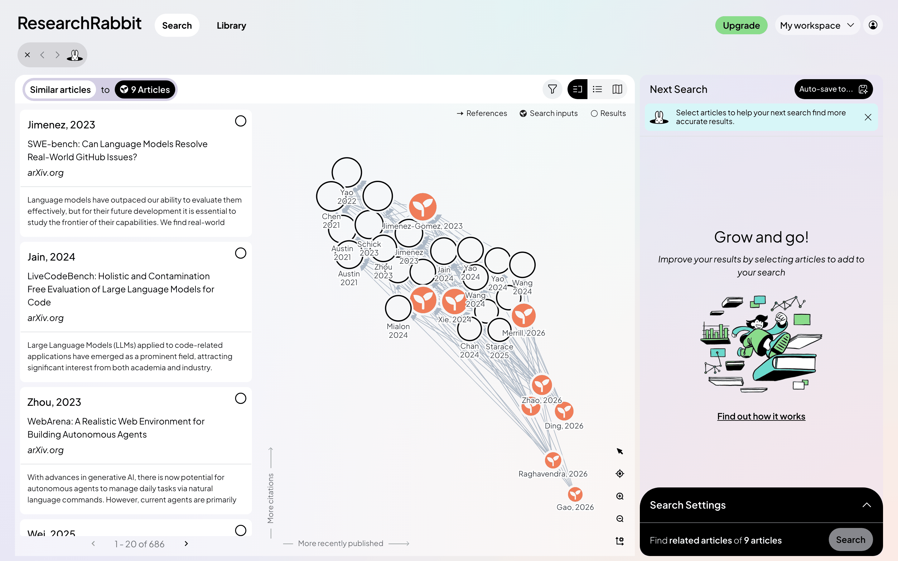
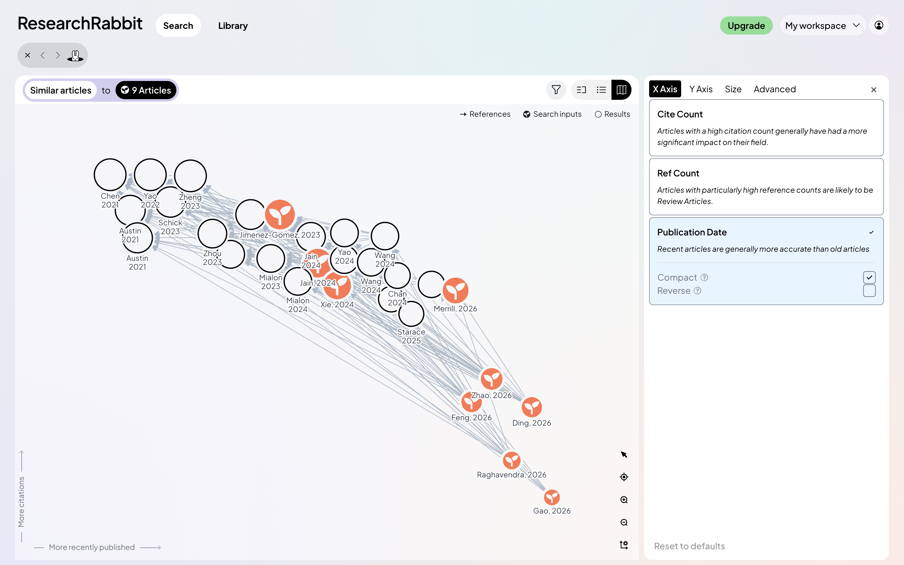
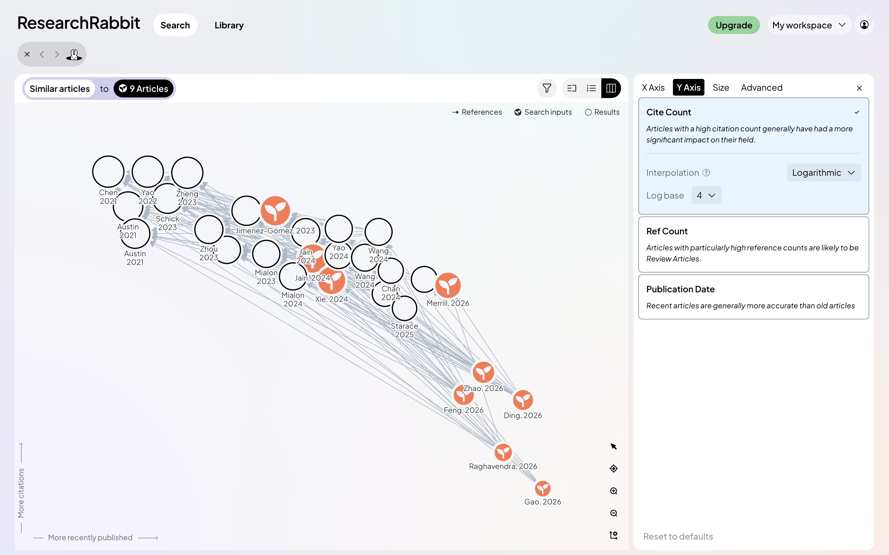
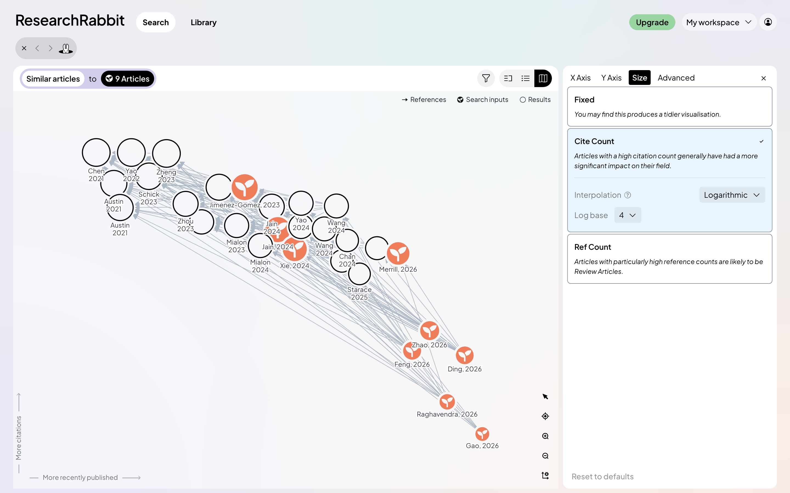
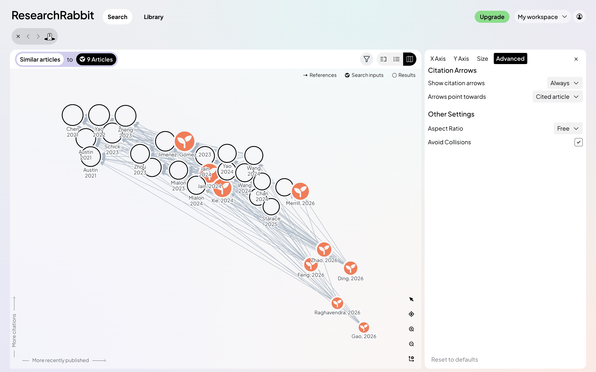
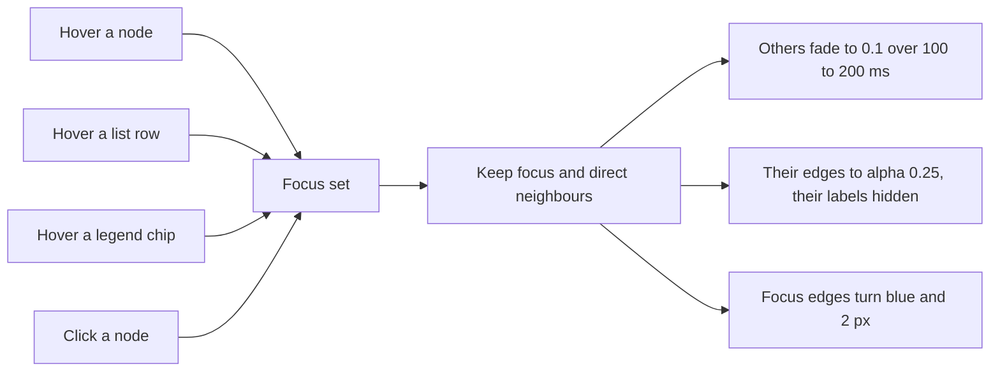

# How ResearchRabbit's graph is designed and made interactive

This is the part of the reference the `/learn` map needs. It describes the
citation graph on ResearchRabbit's search and library pages: how nodes are
placed, how they are drawn, what every pointer and key does, and how it moves.
The values come from three places, and each claim says which:

- **Seen**: the signed-in app, played with on 2026-10-04 and captured as the
  screenshots in [screenshots/](screenshots/).
- **Read**: the production bundle, reverse-engineered into
  [raw/graph-code-notes.md](raw/graph-code-notes.md), which cites the
  identifier and byte offset behind every number.
- **Measured**: computed styles of the HTML chrome around the canvas, in
  [raw/components-computed.json](raw/components-computed.json) and
  [components.md](components.md).

The engine is Litmaps' map engine (its help links point at docs.litmaps.com,
and one string says "this Litmap"), now shipped inside ResearchRabbit. It is a
single Canvas 2D surface with no graph library and no physics.

## The idea in one paragraph

Positions mean something. Each axis is a data field (publication date across,
citation count up), so a paper's place answers a question before you hover it:
old and influential sits top left, new and unproven bottom right. Nodes never
drift, because nothing simulates forces. Interaction then works on that stable
picture in one way only: whatever you point at (a node, a list row, a legend
chip) keeps itself and its direct neighbours, and everything else fades to a
tenth. That single rule carries hover, selection, the list, and the legend.

## Layout

| Step | What it does | Values (read) |
| --- | --- | --- |
| 1. Field per axis | x and y each take one field: publication date, cite count, or ref count | Default x = date, y = cite count |
| 2. Transform | Date becomes its rank among distinct dates ("Compact"), so gaps in time collapse to even steps. Counts go through `log(n + 1) / log(base)` | log base 4 (2 and 8 offered) |
| 3. Normalise and flip | Each axis to 0..1, y negated so more is up | |
| 4. Fit a box | Scale into a box 500 graph units tall and as wide as the container's aspect | `LOOSE_BOUNDS_SCALE = 500` |
| 5. Size | Diameter from log citations, in a range that shrinks as the graph grows | 25 to 50 units for a small graph, 10 to 25 at 150 nodes or more, eased by `(n / 150)²` |
| 6. Collisions | Each node that overlaps an earlier one jumps to its edge, then walks an outward spiral until clear | Overlap below 0.95 of touching; 60° steps that get finer per ring; at most 200 tries |
| 7. Manual moves | A dragged node keeps its spot for the session, applied after everything above | Stored per graph in `sessionStorage` |
| 8. Camera | Fits the box to the screen with padding | `max(10% of width, 24px)` and `max(12% of height, 24px)` |

The settings panel exposes steps 1, 2 and 5 directly, one tab per axis plus
size, each option a card with a sentence on what it is for:

| X axis | Y axis | Size | Advanced |
| --- | --- | --- | --- |
|  |  |  |  |

Advanced holds citation arrows (always, while interacting, never; pointing at
the cited or the citing paper), a fixed aspect ratio, and "Avoid collisions".
The code also defines momentum (citations per day, age adjusted), map
connectivity (edges inside the map), and a "cluster" order that shortens edges
by greedy insertion, none of which the panel offers.

Two things the layout does not do: it never runs a force simulation, and it
never re-lays out on hover. Only a settings change or new data moves nodes.

## Drawing

### Nodes

Every node is a circle of radius `size / 2` in graph units, so it grows when
you zoom. Before drawing a node the engine erases a disc of radius `r + 4`
under it (`destination-out`), which cuts the edges back and leaves a clean gap
round every node. This one trick is most of why a dense ResearchRabbit graph
still reads.

| Node | Looks like | Where seen |
| --- | --- | --- |
| Result | No fill, black ring, 2 screen px | The white circles in [search-split-light-default](screenshots/search-split-light-default.png) |
| Search input (saved) | Disc in its collection's colour with a seedling glyph cut out of it, so the glyph shows the page through | The orange nodes; colour is `--ugc-amber` `#f07d59`, the collection's |
| Saved article (library) | Plain disc in the collection colour, no icon | [library-map-light-default](screenshots/library-map-light-default.png) |
| In several collections | Pie slices from 45°, split by 1px cut lines | Read only |
| Ticked in the list | Tick glyph inside | Read only |
| Hovered | Extra ring `#95CCFF` at `r + 6px`, 2px | [search-split-light-hover-input](screenshots/search-split-light-hover-input.png) |
| Selected | Filled `#95CCFF` disc behind the node at `r + 6px` | [search-split-light-inspect-node](screenshots/search-split-light-inspect-node.png) |
| Group highlighted (legend hover) | Ring `#C8EBFF` at `r + 2px`, 4px | [search-split-light-hover-legend-results](screenshots/search-split-light-hover-legend-results.png) |

Rings and strokes are divided by the zoom, so they stay the same on screen
while the disc itself scales. The collection colours are the eight `--ugc-*`
variables in [tokens.json](tokens.json); `--unsorted` (`#3a3e5e`) fills a
saved paper in no collection.

### Edges

Straight lines, centre to centre, drawn under the nodes so the knock-out gap
trims them.

| State | Colour | Width | Alpha |
| --- | --- | --- | --- |
| Normal | `#ACB8C6` | 1 screen px | 1 |
| Touching the hovered or selected node | `#2782F7` | 2 screen px | 1, drawn on a higher layer |
| Touching a faded node | normal colour | 1 screen px | 0.25 |

With arrows on (the default), each edge stops 5 units outside the target's rim
and ends in a filled triangle 10 units long with wings at ±0.5 rad. The head
is in graph units, so arrows grow with zoom. Edges stay hidden until both of
their nodes have finished most of their entrance (`aliveAmount ≥ 0.8`).

### Labels

| Property | Value |
| --- | --- |
| Text | First author and year on two lines ("Jain" / "2024"); on hover, "Author, year – full title" |
| Font | 12px Plus Jakarta Sans, colour `#363B47`; 600 weight for neighbours of the focus; 600 14px when selected |
| Halo | White stroke 3px plus a 3px white blur, so labels read over edges |
| Place | Centred, 1px under the node |
| Size on zoom | Constant on screen; only the nodes grow |
| Hover plate | Full title on `rgba(255,255,255,0.8)`, radius 6, padding 6, wrapped at 300px, pushed 12 units lower |
| Crowding | Greedy: labels are placed in priority order (hovered, selected, the rest) and any label whose box hits one already placed is skipped this frame |

There is no zoom threshold. Because labels stay 12px while the space between
nodes grows, zooming in lets more labels pass the overlap test, which is the
effect in [search-map-light-zoomed-in](screenshots/search-map-light-zoomed-in.png):
far more names show than at fit.

### Draw order

Faded nodes, then edges, then normal nodes, then focus edges, then the focus's
neighbours, then labels, then the selected and hovered nodes, then the hover
plate. So a hovered node and its blue edges always sit above the crowd, and
its title above everything.

## Interaction

The whole model is one rule with several ways in:

Hover, selection and the legend all write the same small store (`graph-hovered`,
`graph-selection`, `graph-highlighted`), and the list reads it too, so the
graph and the list stay in step in both directions.

| You do | What happens | Seen in |
| --- | --- | --- |
| Hover a node | Halo ring, blue arrows to and from it, neighbours keep their labels in bold, everything else fades, full title on a white plate | [hover-input](screenshots/search-split-light-hover-input.png), [hover-result](screenshots/search-split-light-hover-result.png), [library hover](screenshots/library-map-light-hover.png) |
| Hover a list card | The same treatment on the graph for that paper; the card gets a selection-blue inset border | [hover-list-card](screenshots/search-split-light-hover-list-card.png) |
| Hover a legend chip | That group keeps full strength with a pale ring, the rest fade, and a dark tooltip explains the group ("Used to generate results") | [legend-inputs](screenshots/search-split-light-hover-legend-inputs.png), [legend-results](screenshots/search-split-light-hover-legend-results.png) |
| Click a node | Selects it (blue disc behind), keeps the neighbourhood lit after the pointer leaves, and turns the right panel into the paper's detail with a black "Dive deeper on this article" bar (Similar, Refs, Cited by) | [split](screenshots/search-split-light-inspect-node.png), [map](screenshots/search-map-light-inspect-node.png) |
| Click empty space | Clears selection and the panel | |
| Drag a node | Moves it, saved for the session; the axis captions are replaced by a yellow "Positions moved" pill whose menu has Reset, because the axes no longer hold | [positions-moved](screenshots/library-map-light-positions-moved.png), [reset menu](screenshots/library-map-light-positions-reset-menu.png) |
| Drag on empty space | Box select (fill `rgba(151,191,251,0.22)`); nodes whose centre is inside are hovered live and selected on release | Read |
| Hold Space and drag, or switch the toolbar's first button to the hand | Pans | Read |
| Toolbar zoom in or out | ×1.4 about the centre, 200 ms | [zoomed-in](screenshots/search-map-light-zoomed-in.png) |
| `+` / `-` | ×1.2, or ×1.8 with Shift, 200 ms | Read |
| Arrow keys | Pan 40px, or 160px with Shift, 200 ms | Read |
| `F` or the target button | Recenter: fit every node with the padding above, 500 ms | Seen |
| Toolbar's last button | Opens the layout settings panel in place of the right panel | [settings](screenshots/search-map-light-settings-x-axis.png) |
| Wheel | Nothing in this build. The handler (Ctrl or ⌘ plus wheel zooms to the cursor, plain wheel pans) exists but is never attached | Read and seen |

A click is a mouse-up within 2px of the mouse-down. Hit-testing is a square
around each node, scanned in order; there is no spatial index, and no touch or
pinch handling at all.

## Motion

| Moment | Duration | Easing | Notes |
| --- | --- | --- | --- |
| Node entrance | 600 to 1100 ms, random per node | `backEaseOut`, so each node overshoots and settles | Nodes start as dots; labels, icons and edges wait until 80% |
| Node exit | 300 to 1000 ms, random | fade | |
| Position or size change (settings, new data) | 200 to 400 ms, random per node | cubic ease in out | The random spread stops the graph moving as one block |
| Fade on focus, and back | 100 to 200 ms, random per node | | |
| Camera (recenter, fit) | 500 ms | cubic ease in out | Zoom and position interpolated together, so a zoom-and-pan reads as one straight move |
| Toolbar and key zoom, key pan | 200 ms | cubic ease in out | |
| Panels sliding in | 200 to 350 ms | CSS transform plus opacity, 6 to 18px travel | From the page's CSS |

The engine redraws only while something is dirty or still animating, capped
at 120 frames a second, then stops. The graph also waits for its edges
(about 2.3 s on this search) before the entrance starts, with a "Loading
edges..." note at the top of the canvas.

## The chrome around the graph

| Element | Design | Seen in |
| --- | --- | --- |
| View toggle | Split, list, map as three icon buttons in a pill; the chosen one black with a white icon | Every search screenshot |
| Search header | Lavender pill "Similar articles to (black chip) 9 Articles"; the filter button turns lavender with the keyword when a filter is on | [filter](screenshots/search-map-light-filter-popover.png) |
| Legend | Top right of the canvas: "→ References", a filled seedling "Search inputs", an open circle "Results"; 12px, chips go white on hover, help cursor | All graph screenshots |
| Axis captions | Bottom left: "More recently published" with a short line and arrow across, "More citations" rotated up the side; 12px grey; clicking one opens the settings | All graph screenshots |
| Toolbar | Five icon buttons stacked bottom right, no container fill, 18px icons, hover `rgba(0,0,0,0.05)` | All graph screenshots |
| Positions moved | Yellow pill (`--activity-important`) bottom left in place of the axes | [library](screenshots/library-map-light-positions-moved.png) |
| Right panel | "Next search" on a lavender wash with an illustration, and a black rounded drawer "Search settings" at its foot; becomes the paper detail on click | [split](screenshots/search-split-light-default.png) |
| Page | Grey `#eef0f1` with three soft radial washes (turquoise top right, lavender bottom left, peach bottom right) behind white panels | Every screenshot |

## What the `/learn` map can take from this

Written against the island map, which was then replaced on 2026-10-04 by
the domain map ([DomainGraph.tsx](../../../../apps/web/src/components/learn/DomainGraph.tsx),
[domain-map.md](../../../proposals/domain-map.md)). That took the hover
fade, the gap round each dot, the full-title plate, drag with a "Positions
moved" Reset, and the list beside the graph hovering in step; the legend
chips and label culling are not built. The island map
([knowledge-map.md](../../../proposals/knowledge-map.md)) had islands,
a dagre layout, pan, wheel and pinch zoom, fit buttons, selection with accent
edges, and filter dimming. Set against ResearchRabbit:

| Behaviour | ResearchRabbit | `/learn` map today | Worth taking |
| --- | --- | --- | --- |
| Layout | Field-driven axes, no physics | Layered dagre per island, prerequisites above | Keep dagre. An optional axes view (x = course week or order, y = how many concepts depend on it, log) is a cheap second layout that answers "what is foundational" at a glance |
| Hover | Keeps focus plus neighbours, fades the rest to 0.1 | No hover state; only a click selects | Yes: the same fade on hover, not only on select. It is the single most useful thing here |
| List and graph | One hover store, synced both ways | The table is a separate view | Yes, if the map ever sits beside a list (search results, the island's concepts) |
| Legend | Chips that highlight their group on hover, with a tooltip | Status filter dims by choice | Yes: mastery buckets as hoverable chips (mastered, learning, untouched, ready) giving a preview before committing to the filter |
| Gap around nodes | Erases `r + 4` under each node | Edges run into the dot | Yes: in SVG, a white stroke of 4 under each dot or a mask does the same |
| Labels | Constant 12px, greedy collision culling per frame, no threshold | All labels hide below a zoom level | Yes: cull by overlap instead of by zoom, so the zoomed-out map still names its biggest concepts |
| Hover title | Full title on a white plate above everything | Title shown wrapped under the dot | Optional |
| Selected | Blue disc behind, neighbours bold, detail panel with next actions | Accent ring, panel | Already close; the "dive deeper" bar maps to "Start a session" and "Open in workspace" |
| Entrance | Staggered pop-in with overshoot | None | Small and cheap; respect reduced motion |
| Layout change | Each node tweens 200 to 400 ms, random | Not applicable yet | Only if an axes view is added |
| Dragging nodes | Allowed, flagged by "Positions moved" with Reset | Drag pans | No for a prerequisite map, where the layout carries meaning; the pill is a good pattern if it is ever allowed |
| Wheel and touch | Wheel unhooked, no touch at all | Wheel, pinch, touch drag | Keep ours; this is where ResearchRabbit is weaker |
| Keyboard | Zoom, pan and recenter keys only; nodes not reachable | Tab between islands, arrows between concepts | Keep ours, and add `+`, `-`, `F` |

Mistakes in the bundle not to copy: label priority is read from the wrong
field, so citation count never decides which label wins; the arrow-direction
setting does not change the drawn head; multi-select collapses to the last
paper; and hit-testing uses squares, so a corner outside the circle still
hovers.

[style-guide.html](style-guide.html) has a working version of the whole
grammar on canvas with sample learning topics, written to be ported.
