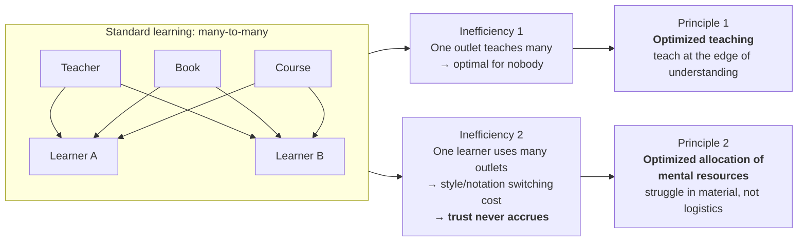
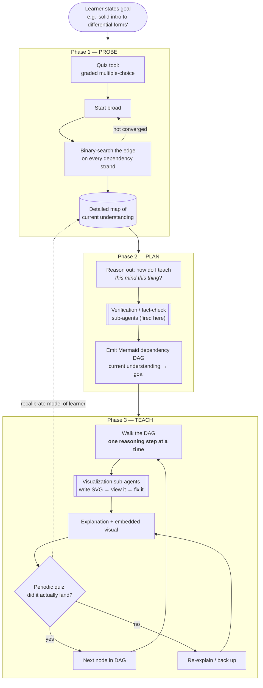
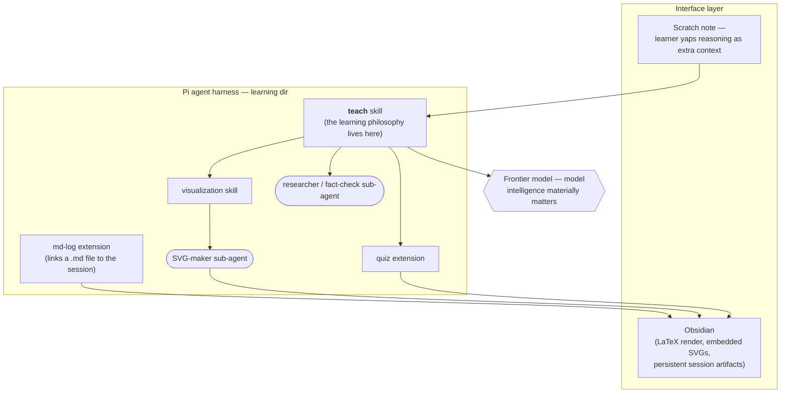

# Architecture of the AI Learning System

Source: Eero Alvar, ["How I Use AI to Learn Things"](https://www.youtube.com/watch?v=kzcI5F4tGiU)

These are notes on the three-phase system described in that video. This repo
implements a four-phase loop (Probe → Plan → Teach → Close), documented in
[LEARN.md](LEARN.md).

## 1. The diagnosis — why standard learning is lossy

**The collapse to 1:1.** Ideal = one teacher per student *and* one teacher for that student.
The objection "one teacher = one perspective" conflates **source** with **interface** — the AI
aggregates all sources and delivers them through a single interface. Trust is not earned over
time; it is *engineered* via verification and fact-checking sub-agents.

## 2. The runtime — three phases

### Why each mechanism exists

| Mechanism | Real reason |
|---|---|
| Quiz tool in probe | Optimal teaching depends entirely on current understanding — so measure it |
| Mermaid DAG shown to learner | Nominally previews what's coming; **actually forces the model to reason it all out** so it can't wing it |
| One reasoning step at a time | Chat models rush; slow steps stay digestible and leave room to ask |
| Periodic quizzes | (1) you can gaslight yourself into "I understood"; (2) keeps the system calibrated; (3) application locks learning in |
| Sub-agents for visuals/facts | Preserve main context, and the sub-agent *looks at its own SVG* to verify it |

## 3. The implementation stack

## 4. The load-bearing insight

The architecture is scaffolding. What actually made it work is the **teaching philosophy**
installed into the `teach` skill, which controls exactly two things:

1. **The learning arc** — the path from current understanding → goal understanding.
2. **The individual steps** — each explanation along the way.

Everything else (probing, planning, verification, rendering, logistics) exists so that
100% of the learner's cognitive effort lands on the material itself.
