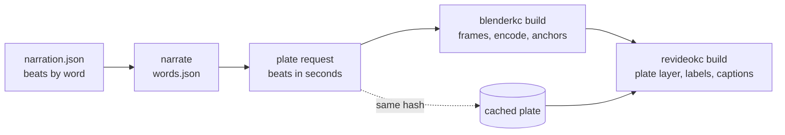

# Proposal: blenderkc, photoreal 3D plates for the narrated videos

Status: proposed 2026-10-09, and decided the same day: the owner chose a
full fourth video tool over plates (D96, amended below). blenderkc is built
as its own repository (github.com/c-wenlong/blenderkc, private): it narrates
through gnosia-audio, writes its own sidecars and answers `topics --json`
with manimkc's report shape, and the catalog imports its renders as
`blenderkc:` rows (`tools/blenderkc` here, its section in
[AGENTS.md](../../AGENTS.md)). The studio does not offer it. Its first video,
on HBM under `gpu-architecture`, is written and not yet rendered. Its own
contract as built is `tools/blenderkc/docs/DESIGN.md`; where it and this page
differ, DESIGN.md is current, and this page is the record of why.

The first thing measured was a test shot, described under "What was
measured": 150 rendered frames (5 seconds at 30fps), delivered as a
7-second clip by holding the last frame for 2 seconds so its labels can be
read. The measurements since are below it.

## The problem

Our three video tools draw well, and none of them draws like a camera.
manimkc's 3D is flat-shaded surfaces under a point light, and remotionkc and
revideokc put a three.js scene on the stage, rasterised, with shadow maps
([VIDEO-TOOLS.md](../VIDEO-TOOLS.md),
[CAPABILITIES.md](../../tools/revideokc/docs/CAPABILITIES.md)). That covers
diagrams, charts, code and maths. It does not cover the look of the best
hardware explainers, where the subject is a physical object.

The reference is a 17-minute explainer on how HBM is built, very likely
"用最好的动画为你讲解--HBM的原理" by Redknot-乔红
([Bilibili](https://www.bilibili.com/video/BV1ahjA6qEwc/)). Its 3D is
path-traced: brushed copper traces, a glass-fibre weave inside the PCB
substrate, depth of field, window reflections on glossy dies, a volumetric
SF6 plasma cloud during the TSV etch, and an exploded 16-die stack. Text,
equations and labels sit on top in 2D. Its creator tags their process video
"Blender", and nothing found says they script it.

The catalog already has topics like that: `gpu-architecture`,
`cache-basics` and `ai-accelerator-architecture` under computer
architecture, where the subject is a chip, a board or a die stack. A concept
whose subject is a physical thing is taught better by seeing the thing.

## What exists

Nobody maintains a Manim-style animation library on Blender. Searched on
GitHub by keyword, by topic and through the authors who work on Blender for
science video, on 2026-10-09 (stars and last push as read then):

| Project | What it is | Why it is not the answer |
| --- | --- | --- |
| [primerpython](https://github.com/Helpsypoo/primerpython), 1.4k stars | The Primer channel's Manim-inspired `Bobject` and keyframe helpers over bpy | Blender 2.79, runs only through an add-on inside the app, no licence (so no reuse), one author, who moved to Unity |
| [blendify](https://github.com/ptrvilya/blendify), 869, GPL-3.0 | A scene, camera and render API | Built for research figures of meshes and point clouds, not narrated animation |
| [make-blender-education-video-skill](https://github.com/sunxiayi/make-blender-education-video-skill), 48, MIT | An agent skill: brief, claim ledger, one approved 4K frame, render | A process for an agent, not a library; English cinematic only; its own narration |
| [blender-mcp](https://github.com/ahujasid/mcp-for-blender), 30k | An MCP server driving an open Blender window | Interactive, needs the app running, nothing reproducible to rebuild from |
| [blender_typst_importer](https://github.com/kolibril13/blender_typst_importer), [bpy-gallery](https://github.com/kolibril13/bpy-gallery) | Equations inside Blender; a large snippet collection | Pieces worth borrowing, not a framework |

Searched in Chinese too (Bilibili, 知乎, Gitee, 掘金). JAnim (jkjkil4) is a
well kept Manim-style library with no 3D; the agent frameworks (ModelScope's
Singularity Cinema, Code2Video) make 2D or image-based video. One Bilibili
recipe renders a rough three.js shot and restyles it with MiniMax-H3, which
is generated pixels and not a repeatable render.

So the library layer is ours to write. It is small, as the measurement below
shows: a 335-line script already holds its core.

## What was measured

One shot, built and rendered from a Python script on 2026-10-09 on the
owner's M4 Pro: a wide GPU package, a camera move in, one HBM stack lifting
into a logic die and 8 DRAM dies, its copper TSVs lighting up, two labels
laid over afterwards, and the last frame held 2 seconds. 150 frames at 1080p30, Cycles on Metal, 48 samples with
adaptive sampling at 0.02, denoised, AgX.

| Measure | Value |
| --- | --- |
| Whole shot, 150 frames | 896 s, so 6.0 s a frame |
| One full-resolution still, scene built from scratch | 11.3 s (app), 12.3 s (wheel) |
| One half-resolution still | 2.8 to 3.9 s |
| The first render on a machine | 105 s, almost all of it Metal compiling the Cycles kernels once |
| A minute of finished 3D at 30fps | about 3 hours |
| The shot's PNG frames | 394 MB (2.6 MB a frame); 6.6 MB as H.264 at CRF 16 |
| `bpy` from PyPI against the desktop app, same frame | mean difference 0.001 of 255 per channel |
| The same frame rendered twice by the wheel | differs by at most 1 of 255 |

`bpy` 5.2.2 is Blender as a Python module, published by Blender on PyPI with
a wheel for macOS arm64, Linux x86_64 and Windows. It pins Python 3.13
exactly, found the M4 Pro's Metal GPU without any setup beyond selecting it,
installs to 732 MB, and ships the bundled CC0 studio HDRIs under
`bpy/5.2/datafiles/studiolights` (`bpy.utils.system_resource('DATAFILES')`).

What the test shot already matches: the dark tiled floor, glossy dies with a
cell grid, depth of field, soft reflections, emissive copper. What it lacks
is detail (the fibre weave, die markings, wear) and effects (the plasma
cloud). Blender does all of those; each is modelling time, not another tool.

### Measured since: the homeserver

The Linux wheel runs on the homeserver (Ubuntu, an NVIDIA GTX 1070), where
Cycles renders on CUDA with the OptiX denoiser. On the same frames:

| Where | Seconds a frame |
| --- | --- |
| Homeserver, GTX 1070, OptiX denoiser | 3.2 |
| The owner's M4 Pro, Metal | 4.0 |
| Homeserver, when the denoiser falls back to OIDN on the CPU | 17 |

So the 3D of a build renders on the homeserver (`blenderkc build <topic>
--host home`), one scene at a time, and every 2D step (overlays, joining,
narration, sidecars) stays on the Mac. The OIDN fallback is five times
slower, which is why `doctor --host` checks the GPU before a build.

## Decisions

### D96. blenderkc renders plates, and never a narrated video

**Amended 2026-10-09: the owner chose the fourth video tool.** blenderkc
makes the whole narrated video: its narration, its sidecars and its entry in
the catalog are its own, through the same gnosia-audio, the same sidecar
format and the same `topics --json` report as the other three, so the
catalog registers it as one more video tool (`blenderkc:` rows, `source_repo`
`blenderkc`, migration 0029, labelled "blender" in the web app). Labels and
equations are 2D overlays composited onto the rendered frames, cued on
narration words, so text never has to be modelled in Blender. The plate
design below is kept as the record of the alternative; D97 (plate requests
timed by a composing tool) and the composing work in phases 2 and 3 do not
apply.

A **plate** is a silent shot of 3D: a frame sequence of a given length, with
an encoded copy and a report. A narrated video stays the work of revideokc
(first) or remotionkc, which places the plate as a layer the way it places
anything else, and owns the narration, the 2D text, the equations, the
captions and the deliverable.

The alternative is a fourth video tool that makes the whole video in
Blender. Against it:

| | Plates (proposed) | Fourth video tool |
| --- | --- | --- |
| Narration, sidecars, captions | The composing tool's, unchanged | Built again in Python, against a second venv |
| Labels, equations, code panels | 2D, where the composing tool is good | Text in Blender, which is the weak part of Blender |
| Render cost | Only the 3D beats, typically 5 to 15 s each | Every second of the video, 3 hours a minute |
| Catalog, web app, studio | Nothing to register: the video is a revideokc video | The full list in "Where the work is", every one of them |
| A video with no 3D | Unaffected | Unaffected |
| Cost | Two tools in one video, and a handoff between them (D97) | One tool |

The catalog never sees a plate. The deliverable it indexes is the composing
tool's, with the composing tool's prefix, so no `asset` kind, migration or
web label changes.

### D97. The composing topic asks for a plate, with times taken from its narration

Narration sets a video's length in every tool here: each line is lead-in,
clip and tail, back to back, and a scene cues visuals on words. A plate has
to follow the same clock, so its times come from the composing topic and not
from the plate's script.

1. The composing topic's scene names a plate and its beats by narration
   word, for example `beats: { lift: ["MH3_Stack", 0, "stacked"], glow:
   ["MH3_Stack", 1, "copper"] }`.
2. `narrate` already writes `words.json`. A new step in the composing tool
   turns the beats into seconds and writes a **plate request**:
   `{ plate, seconds, fps, width, height, beats: { lift: 1.84, glow: 4.20 } }`.
3. `blenderkc build <plate> --request <file>` renders exactly that. The
   plate's script reads `beats` and never hard-codes a time.
4. A hash names the render, over everything that decides its pixels: the
   request, the plate script, the blenderkc library and kit files it
   imports (the source set, as the studio's `sourceHash` does for a topic),
   the render settings (samples, seed, resolution, engine), and the `bpy`
   version. A narration change that moves a beat renders the plate again,
   and so does an edit to a material or a camera move; a change to none of
   them reuses the render. Re-rendering is the expensive step, so this
   cache is the main defence of the budget (D102).



`still <plate> --request <file> 1.84s 4.2s` renders those instants, at half
resolution, for the look loop.

### D98. bpy from PyPI, in blenderkc's own Python 3.13 venv

Not the desktop app. The wheel matched the app's frame to 0.001 of 255
(measured), runs as `python script.py`, needs no install outside the venv,
and has a Linux wheel for the homeserver or a rented GPU box later. It gets
its own `.venv`, created by `make deps` with uv and pinned to `bpy==5.2.2`,
because gnosia-audio's venv in the other tools is Python 3.12 and bpy needs
3.13. blenderkc never narrates, so it never needs gnosia-audio at all.

The desktop app stays optional, for a person who wants to open a shot:
`blenderkc open <plate>` saves the plate's scene as a `.blend` and opens it.

Constraints the module carries, from Blender's own docs page on it: one
`.blend` per process, no Python threads around a render (use processes),
Ctrl-C does not stop a render, and `importlib.reload(bpy)` raises. Each
`still` and `build` is its own process, which the CLI does anyway.

### D99. The library is a thin timeline over bpy, and bpy stays reachable

Plain bpy is long-winded, not hard: today's script spends most of its lines
on creating boxes, arrays, materials and keyframes. The library removes that
and adds the one thing bpy lacks for this job, time in seconds.

```python
from blenderkc import Plate, kit, ease

p = Plate(__file__)                          # reads the request: seconds, beats
floor = kit.studio_floor("dark-tiles")
pkg = kit.package(size=(7, 5), substrate="solder-green")
stack = kit.die_stack(dies=8, base="logic", die="dram", at=(1.85, -0.68))

p.camera.dolly(start=kit.view(-7.5, -9, 6.5), end=kit.view(-0.6, -5.1, 2.7),
               look=stack.top, over=(0, "lift"), ease=ease.in_out)
stack.explode(gap=0.16, at="lift", over=2.0, stagger=0.07)
stack.tsvs.glow(strength=6, at="glow", over=0.7)
p.anchor("top_die", stack.dies[-1].edge("+x"))  # for the label (D100)
p.light(kit.rig("studio-soft"))
```

- **Time is seconds or a beat name.** Frames never appear in a script.
- **The kit is materials, parts and rigs** that recur across hardware
  shots: copper, solder mask, silicon, gold pads, glass, brushed metal; a
  package, a die stack, a PCB, a heat spreader; a dark studio floor and three
  light rigs. A shot that wants something else uses bpy directly: every kit
  object exposes its `bpy` object, and a script may import `bpy` beside the
  library.
- **Equations and text are not drawn in Blender.** They belong to the
  composing tool (D96). `blender_typst_importer` stays an option for a label
  that must sit on a surface in 3D, and nothing in phase 1 needs it.

### D100. A plate exports its anchors, so 2D labels track 3D objects

The test shot's labels were placed by hand on the last frame, and would have
drifted had the camera kept moving. `p.anchor(name, point)` records the
point's screen position on every frame (`world_to_camera_view`), and `build`
writes them to `<plate>.anchors.json` as `{ fps, anchors: { name: [[x, y,
visible], ...] } }` in pixels. The composing tool's plate component reads it
and moves a label's leader line with the object. This is the piece no other
library offers, and the one that makes a 3D plate and 2D labels look like
one picture.

### D101. Cycles everywhere, a fixed seed, and a build that resumes

- **One engine.** `still` renders Cycles at half resolution and low
  samples (3 to 4 s, measured), so what the agent looks at is the look that
  ships. EEVEE would be faster and would differ in exactly the things the
  look loop judges: reflections, depth of field, glow.
- **Fixed seed, `use_animated_seed` off.** A repeat render differed by at
  most 1 of 255 (measured), which no viewer sees, so frames from different
  runs can sit side by side.
- **Frames are the unit of work.** `build` writes
  `$BLENDERKC_HOME/frames/<plate>/<hash>/f_0001.png` and skips a frame that
  exists, so a killed build resumes and a long plate can be split across
  processes by frame range. It then encodes the plate (H.264 for an opaque
  plate, ProRes 4444 when it was asked for alpha) and deletes the PNGs unless
  `--keep-frames`, since frames are 60 times the size of the encode.
- **The first render compiles kernels for about 105 s.** `doctor` runs a
  one-frame render so that cost lands there and not in a job.

### D102. A render budget the CLI enforces

At 6 s a frame, a careless request is hours. `build` prints its estimate from
the half-resolution still's time before it starts, refuses a plate longer than
15 seconds without `--long`, and records every build's seconds a frame in
`state/builds.jsonl`. Phase 2 adds routing guidance to
[VIDEO-TOOLS.md](../VIDEO-TOOLS.md) that says it plainly: a plate is for the
moments where the subject is a physical object, a video holds a few of them,
and the rest of the video is 2D.

### D103. The blenderkc repository is GPL-3.0-or-later

**Amended 2026-10-09: the question is moot for now.** The repository is
private, like the other video tools' repositories, and nothing of it is
published or distributed, so the GPL's terms, which attach on distribution,
ask nothing of it today. If it is ever made public, this decision applies as
written below.

Blender's licence page: scripts using the Python API, "if published", must be
shared under a GPL compliant licence, because the API is "an integral part of
the software" ([blender.org/about/license](https://www.blender.org/about/license/)).
The GNU FAQ says the same of interpreted programs using GPL bindings. The
other submodules are public, so blenderkc is GPL-3.0-or-later, which is also
what Blender's extensions platform requires. This binds blenderkc's own code
only:

- What Blender renders belongs to whoever made it (the same page), so a
  plate, and the composed video around it, carry no GPL obligation.
- The composing tools import nothing from blenderkc. They read its CLI's
  JSON and its output files, as the catalog reads theirs, so their licences
  are untouched.
- The bundled HDRIs are CC0 (their `license.txt`), fine in any render.

Not legal advice; the owner may want a second look before the repository is
public.

### D104. Shaped like the other tools, and outside the studio until measured

**As built, 2026-10-09:** topics rather than plates, under
`topics/<domain>/[<sub>/]<slug>/` with a `topic.yml`, a `narration.json` and
one shot script per scene, and the verbs DESIGN.md lists (`doctor`, `home`,
`api`, `new`, `narrate`, `still`, `build`, `sidecars`, `sheet`, `topics`).
There is no skill yet. The studio part below stands unchanged.

The repository and CLI follow remotionkc and revideokc so that nothing about
it is new to learn: `tools/blenderkc/` as a submodule
(github.com/c-wenlong/blenderkc), `BLENDERKC_ROOT` the checkout and
`BLENDERKC_HOME` the data root (renders, frames, the kernel cache, state),
plates under `plates/<domain>/[<sub>/]<slug>/<name>.py` mirroring topics, a
`blenderkc-plate` skill symlinked into `.claude/skills/`, and verbs `doctor`,
`home`, `api`, `new`, `still`, `build`, `open` and `plates --json`.

The studio does not drive it in this proposal. A studio video job runs
inside a Seatbelt profile, and manimkc's render profile already proves Metal
works there with `iokit-open` and one Mach service,
`com.apple.MTLCompilerService` (`buildProfile` in `services/studio/src/video/sandbox.ts`).
Cycles adds things that profile denies: its kernel cache and Metal's shader
cache under the home directory, and possibly more Mach services. That is a
measurement, and it belongs in its own phase (phase 4) once a plate has been
worth making by hand.

## Where the work is

| Area | Change | Phase |
| --- | --- | --- |
| `c-wenlong/blenderkc` (new) | The library, the kit, the CLI, the `blenderkc-plate` skill, the HBM plate | 1 |
| `tools/blenderkc` here | The submodule, `.gitmodules`, the `eslint.config.mjs` ignore, the skill symlink, an AGENTS.md section | 1 |
| `tools/revideokc` | A `Plate` component (a `Video` layer plus anchor-following labels), a `plates` step that writes requests and stages encodes into `public/<topic>/plates/`, the beats syntax in a scene | 2 |
| [VIDEO-TOOLS.md](../VIDEO-TOOLS.md) | A routing row ("a physical object, photoreal: revideokc with blenderkc plates"), a matrix row, and a "Not built yet" entry until phase 2 lands | 2 |
| `tools/remotionkc` | The same `Plate` component over `OffthreadVideo` | 3 |
| `services/studio` | A plate step in the revideokc backend, Seatbelt rules for Cycles, the planner's TOOLS block | 4 |
| The catalog, the web app, the schema | Nothing under plates; under D96 as amended, blenderkc registered as the fourth video tool (its source, `--blenderkc-root`, migration 0029, the "blender" label) | done |

## Phases

### Phase 1. The library and one plate

In `c-wenlong/blenderkc`: the venv and `make deps`, the timeline, the kit
the HBM shot needs, the CLI verbs of D104, anchors, the resumable build, and
the HBM shot rebuilt as `plates/computer-architecture/hbm/stack.py` on the
library.

Done when:

- `blenderkc doctor` passes on a fresh clone after `make deps`, including its
  one-frame render.
- `blenderkc build hbm/stack --request <fixture>` reproduces the 2026-10-09
  shot from a request file, and a build killed half way resumes without
  re-rendering a frame.
- Moving a beat in the request moves the explode in the render, an edit to
  the plate script or a kit material renders it again, and a rebuild with
  neither change reuses the encode.
- `anchors.json` follows the top die across all 150 frames (checked by
  drawing the anchor onto five frames and looking).

### Phase 2. One narrated revideokc video with plates

The `Plate` component and the `plates` step in revideokc, then a narrated
video of 60 to 90 seconds on HBM with two or three plates, built, imported
and watched in the web app.

Done when:

- The video's plates start on their beat words, and a re-narration that
  moves a word re-renders only the plate whose beat moved.
- A label follows its anchor through a camera move.
- `catalog import --only revideokc` imports it with its poster and sidecars
  like any revideokc video.
- Revideo's `Video` node, never used in a topic here (CAPABILITIES.md lists
  it under "Not tested here yet"), decodes the plate frame-accurately; if it
  does not, the component uses the PNG frames as an image sequence instead,
  and this doc records which.

### Phase 3. remotionkc

The same component over `OffthreadVideo`, proved by one plate in one
remotionkc topic.

### Phase 4. The studio

Measure Cycles inside the revideokc render profile: which Mach services and
paths it needs, with the kernel and shader caches pointed into the job's
`render/`. Then a plate step in the revideokc backend and a planner that may
propose plates in a brief. This phase gets its own design section, here or in
[STUDIO-VIDEO-TOOLS.md](../STUDIO-VIDEO-TOOLS.md), when it starts.

## Risks

- **Render time.** 3 hours a minute of 3D. D97's cache and D102's limits
  are the defence; a rented NVIDIA box with the Linux wheel is the escape.
- **Re-narration re-renders.** Every beat that moves costs its plate again.
  Lock narration before the final plate build; `still` is cheap enough for
  everything before that.
- **Revideo decoding.** Unproven here (phase 2 tests it, with the image
  sequence as the fallback).
- **Disk.** 2.6 MB a frame while a build runs; deleted after the encode by
  default.
- **Modelling skill is the real ceiling.** The library makes a shot quick to
  write, not good. The reference video's detail is hours of modelling per
  shot, and an agent's first attempts will look like the test shot: clean,
  simple, convincing at a glance. The kit is where that skill accumulates.

## Open questions

1. **Plates or a fourth tool (D96).** Decided 2026-10-09: a fourth tool.
2. **The name.** Decided: blenderkc.
3. **GPL-3.0-or-later for a public repository (D103).** Moot while the
   repository is private.
4. **The first video.** Decided: HBM, filed under the `gpu-architecture`
   topic.
