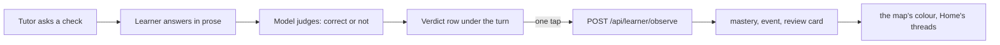

# Proposal: recall in the chat

Status: accepted, 2026-10-04, and all three phases are built. R2 is the owner's call
(tap to record); R1 and R3 to R6 are the proposal's defaults, and open
questions 2 and 3 take theirs until the owner says otherwise. Step 1 of the
same conversation, taking
Review out of the sidebar, shipped on its own
([#343](https://github.com/c-wenlong/gnosia-learn/pull/343)) and is recorded
in [DESIGN.md](../design/DESIGN.md), "Information architecture".

## The problem

Gnosia is a chat that makes things, a view over the concepts you hold, and
courses that give them structure. The review queue at `/review` sat beside
those as a fifth destination, and did not fit: it is Anki's loop (decision
11 of [DESIGN.md](../design/DESIGN.md)), and Anki's loop is fed by cards,
and the surfaces the product is built around make none.

Only three things write a review card today, all through
`recordObservation` in
[observe.ts](../../services/catalog/src/state/observe.ts): the Teach
session at `/learn/<concept>/session`, a module's week check at
`/courses/<slug>/<module>/check`, and the terminal's `/learn` skill. The
concept tutor at `/learn/<concept>`, the open tutor at `/ask`, the studio
and the videos write no mastery and make no card. Measured on the owner's
database on 2026-10-04:

| | Count | What it says |
| --- | --- | --- |
| Concepts | 306 | The graph the map draws |
| Mastery rows above the prior | 5 | Five concepts the model knows anything about |
| Observations | 21, the last on 2026-09-27 | 19 probes, 2 teach; every one from a session page or the terminal |
| Review cards | 11, due from 2026-08-21 | Made by those observations |
| Review grades | 0 | No `review` event has ever been written: no card was rated on `/review` or by `learn review grade` |
| Tutor chat turns that moved mastery | 0 | The chat has no write at all |

The tutor is already doing the asking. Its prompt
([prompt.ts](../../apps/web/src/lib/agent/prompt.ts)) carries the learner's
p(L), their last answers and the card's next review date, offers "Give me a
check" as a suggestion chip, and its rules say: ask one question that checks
understanding after each answer, and when asked for a check, wait for the
reply before grading. So the tutor asks, the learner answers, the tutor
says "right" or "not quite" in prose, and nothing happens: the verdict is
words in a thread that `sessionStorage` forgets when the tab closes. The
same prompt tells the tutor "Next review: 2026-08-21", and nothing the tutor
does can move that date.

That is the gap. Review as a page was downstream of it, which is why it
looked bolted on: a queue that only the quiz-shaped pages could fill, shown
next to a chat that could not.

## The idea

A check inside the chat is evidence, recorded through the same write as the
session page's and the terminal's. The tutor asks, the learner answers in
their own words, the model judges the answer, and the learner commits the
verdict with one tap. From then on the concept's mastery, the map's colour
and the review card move from the conversation, and the review page becomes
what the terminal's `/review` already is: the full queue for whoever wants
it, reached from a concept page and from Home, not from the sidebar.



## How it works

### 1. The tutor marks a check (R5)

A tutor turn that asks a check ends with one line the server strips before
the reply reaches the browser:

```
CHECK: <the question, in one line>
```

The chat route returns it beside the prose as `check: { question }`, and
the thread stores it on that turn. The convention is the one `[n]` citations
already use: structure carried in the model's prose and parsed on the
server, so no model needs a tool call or a schema to take part. A turn with
no marker asked nothing, and the next learner message is a question, not an
answer. The tutor's rules gain one line: when you ask a check, end the turn
with the marker; when you are only conversing, do not.

### 2. The answer is judged (R5)

When the learner replies to a turn that carried `check`, the page calls
`POST /api/agent/judge` beside `POST /api/agent/chat`, so the tutor's reply
and the verdict arrive independently and neither waits on the other. The
judge is a second, short model call: the question, the note's matching
check block if one exists (its `answer:` and `why:`), the learner's words,
and a request for JSON `{ correct: boolean, feedback: string }`. The
pattern is the one `POST /api/agent/session` uses for a question
([session-question.ts](../../packages/tutor/src/session-question.ts)): ask the model for
JSON, parse it strictly, refuse what does not parse. The parser is new,
since `parseSessionQuestion` reads options and a correct index and the
verdict has neither: a small `parseVerdict` with the same clipping and the
same test shape, and a reply it cannot read is `UNSTRUCTURED_REPLY`, so the
route answers with no verdict rather than a guessed one. The judge is an
archivist, not a teacher, as the recap prompt is: it reads the answer
against the note and says one thing.

The reply call is unchanged. The tutor still responds in prose, and its
prose feedback is what the learner reads; the judge's `feedback` is one
sentence for the verdict row, never a second voice in the thread.

### 3. The learner commits the verdict (R2)

Under the tutor's reply, a row: the judge's verdict as a pre-selected
button, "Record as correct" or "Record as incorrect", and the other beside
it. One tap writes `POST /api/learner/observe` with the concept, the
verdict, the question and the learner's answer, and the row becomes the
result: "Recorded · p(L) 0.25 → 0.41 · review in 1 day", the same words the
session page prints after an answer. No tap, nothing written: the row stays
until the thread moves on, then folds to "Not recorded". A write that fails
keeps the row and its request id, so the next tap retries the same answer
rather than recording a second (`requestId`, as the session page does).

Since 2026-10-05 (D89 of [STUDIO-CHAT-FIRST.md](../STUDIO-CHAT-FIRST.md)),
in the concept tutor the committed row is a card rather than that one line:
the verdict, the concept, "Mastery moved: p(L) 0.25 → 0.41", the next
review, and "Open the note", which brings the concept's note into view
(`#note`). After Manus's deliverable card and its "View all files in this
task": the thread shows what the turn left behind. The recording flow is
unchanged; the course topic tutor keeps the line.

This is the review page's own rule for a check card, applied to prose: "a
right pick suggests Good and a wrong one Again, shown on the rating row and
committed by Continue, and any of the four buttons overrides it". The model
proposes, the learner decides, and the append-only log holds only what the
learner agreed to.

### 4. The source: probe or teach (R4)

`recordObservation` takes `source`, `probe` or `teach`, and a probe skips
the learning step on purpose: being asked is not being taught
([LEARN.md](../LEARN.md), "Phase 1"). A chat check is `teach` only when
the thread holds a tutor turn before it that taught something, and `probe`
otherwise. The test for "taught something" is mechanical: a tutor turn with
no marker. A turn that carries a marker asked (the opening recall question
with its one-line reflection is such a turn), and does not count; a turn
with no marker explained, answered or worked an example. The rule errs
towards `probe`, which is the safe side: a probe still updates p(L) from
the answer itself (with the model's guess and slip rates, a correct answer
raises it and a wrong one lowers it; see `posterior` in `bkt.mjs`) and
earns the card its review slot (`recordObservation`, "every answered
question earns a review slot, whatever the source"), and skips only the
learning step, the extra credit for having been taught. Mislabelling a
taught check as a probe under-credits one step; mislabelling a recall as
teaching credits a step that never happened. Both
are values the route and the `--json` shapes already know; no new source is
added, and nothing the `learning` plugin parses changes.

### 5. Recall as the opening move (R3)

Built as: the concept page passes `recall` when the card is due
(`dueRecall`). An empty thread then opens on the tutor's turn, built in the
page from the note's first check at no model cost (`recallOpening`), so the
judge also has that check as its reference; a note with no check asks the
model, with `RECALL_SEED` standing in for the learner's first turn, and
opens only on a reply that carries the marker. A thread that opens on the
tutor is sent with the seed before it, since a request must start on a user
turn.

The tutor's prompt already says, on a return visit: open by reflecting back
what was established, then ask one question that checks the ground still
holds. With the marker, that opening question is a check, and with R4 it is
a probe. So a learner who opens a concept whose card is due is asked
first, in the conversation, and their answer reschedules the card. The
card's due date is the only trigger: a grade on `/review` moves the date
without writing an observation, so a rule that also read the last
observation's age would ask again right after a grade. This is the review
queue, delivered one concept at a time at the moment the learner returns to
it, instead of as a list. Home's "Worth a quick recall" (part 4 of
[the Home proposal](home-page.md)) keeps proposing which concepts those are.

### 6. The chat becomes a session (R6)

The first recorded answer in a thread opens a `session` row and its
`session-start` event, in the same locked transaction as the answer, exactly
as the session page's first answer does (`sessionId` on the observe route).
A thread that records nothing leaves no row. The id is
`chat-<date>-<concept>-<random>`, kept beside the thread in
`sessionStorage`. Closing is best-effort, as the session page's is: the
page sends `POST /api/learner/session/close` (idempotent) when it goes away,
by navigation inside the app or `pagehide`, and when the learner starts a new
thread, and a tab killed before that leaves the session open, exactly as an
abandoned Teach session does today. An answer refused because its session was
closed elsewhere (another tab, the terminal) is sent once more under a fresh
id; the refusal wrote nothing, so this is not a second observation. There is no idle rule in the
catalog that closes one, and this proposal adds none; `learn session close`
closes it from the terminal, and an open session costs nothing but an
honest row. Two things follow for free: Home's "Pick up
where you left off" lists the concept through its observation events (the
limit called out under the Home proposal's "Tutor chats are not a thread"
narrows to the text of the chat, which stays in the browser), and the
`session` table and its `session-start` and `session-close` events show a web
chat beside a terminal one. `learn session list` does not: it lists session
logs, which only the terminal writes, so no web session (the session page's
included) appears there.

## Decisions

**R1. A chat check is an observation, never a review grade.** It goes
through `recordObservation`, which writes the event, moves mastery, spreads
a correct answer to prerequisites, and creates or reschedules the card, all
under the learner lock in one transaction (layering rule 11: a page never
assembles evidence). `POST /api/review/grade` and the four SM-2 ratings stay
the review page's, and the chat never calls it. One write, one meaning.

**R2. The model proposes, the learner commits with one tap.** The owner's
call, 2026-10-04: tap to record. The
alternative is to record the judge's verdict with no tap, as the terminal
skill does when Claude judges an answer. Chosen against it, for two
reasons. The web tutor runs on the owner's model chain
([TUTOR-MODELS.md](../TUTOR-MODELS.md)), whose defaults are a free cascade,
and a free model judging "yes, roughly" against a note is noisier than an
interactive Claude; and the log is append-only, so a wrong auto-grade
cannot be taken back except by voiding the whole session
(`learn void --session`). A tap costs the learner a second per check and
keeps the log honest. The owner may overturn this: the row is the same
either way, only whether it waits.

**R3. A return visit opens with recall when the card is due.** The tutor
asks first when the concept's card is due, and only then. Otherwise the
opening is the prompt's existing return-visit opening, a reflection and one
question, which may or may not be a check. The due date the tutor already
reads is the trigger; nothing new is computed, and the last observation's
age is not consulted, since a `/review` grade moves the card without one.

**R4. The source is `probe` unless a marker-less tutor turn came first.**
The rule is mechanical: a check is `teach` only when an earlier tutor turn
in this thread carried no marker, which is the turn that explained rather
than asked. An opening recall question, reflection included, is a marker
turn and so a probe. It keeps the BKT semantics the terminal set, errs
towards the source that cannot credit teaching that did not happen, and
adds no value to `OBSERVE_SOURCES`.

**R5. Structure in prose, judged by a second call.** The marker and the
judge, as above. The one-call alternative, asking the tutor to also emit
`VERDICT: correct` at the end of its reply, was turned down: it asks the
teaching model to grade in the same breath as it teaches, and its failure
mode (a verdict with no marker, or a marker on a non-check) is silent. The
cost of R5 is one short extra call per answered check, in the chat's own
rate bucket, only on turns that follow a marker.

**R6. The first recorded answer opens a session, and closing is
best-effort.** As the session page does, on both counts. The thread's words
stay in `sessionStorage`; storing chats on the server is a separate
proposal.

## What stays

- The `--json` shapes of `status`, `frontier`, `plan`, `observe` and
  `review due`. The `learning` plugin parses them and nothing here changes
  one.
- SM-2, the `review` table, `review grade` and `/review` with its four
  ratings. `/review` is reached from
  All reviews on Home's recall card, whose rows and Start recall button
  open the concepts' chats since phase 3.
- The Teach session page and the week check. They are the structured path
  and stay the first thing "Teach me" opens; this proposal gives the
  unstructured path the same write.
- The open tutor at `/ask`. It has no concept row to record against (H4 of
  the Home proposal), so it carries no marker and no row.
- Owner scoping: the chat route reads the concept through `ownerScope`, and
  the observe route refuses a concept the owner cannot read, both as today.

## Edge cases

- **The learner answers a check with a question.** The judge is still run,
  and will usually say incorrect with feedback such as "the answer asked
  what X is". The row offers both buttons, and the natural tap is none. A
  row nobody taps writes nothing (R2).
- **The marker appears where it should not** (a turn that teaches and ends
  with a rhetorical question). The next reply is judged and a row appears;
  the learner ignores it. Over-marking costs a judge call and a row, never
  a write.
- **The judge is down or unstructured.** The row appears with no
  pre-selection and both buttons live, so the learner can still record
  their own verdict, as the review page lets a rating override a suggestion.
  Nothing is pre-selected by guessing.
- **The note has no check block.** The judge reads the note's body and the
  question alone. A `check` block, when present, is the stronger reference
  and is passed first.
- **The same question twice in a thread.** Each answer is its own
  observation with its own request id; the log is a log.
- **Two tabs on one concept.** Each thread is its own `sessionStorage`
  entry and its own session row, as two session pages would be.

## Phases

| Phase | Ships | Done when |
| --- | --- | --- |
| 1 (built) | R1, R2, R4, R5: the marker, the judge and its `parseVerdict`, the verdict row, the observe write, on the concept tutor only. `lib/tutor-check.ts`, `lib/agent/judge.ts`, `app/api/agent/judge/route.ts`, `components/workspace/VerdictRow.tsx` | "Give me a check", an answer and one tap writes an `observation` event that shows under Recent answers on the concept page and moves its colour on the map; a thread with no check writes nothing; `observe --json` is byte-for-byte what it was |
| 2 (built) | R3 and R6: recall as the opening move, the session row. `dueRecall` and `recallOpening` in `lib/tutor-check.ts`, `requestTurns` and `RECALL_SEED` in `lib/tutor-thread.ts` | Opening a concept with a due card is met with a question (the note's first check, or the model's when it has none); its answer reschedules the card; Home's threads list the concept; the chat's `session` row opens with the first recorded answer and closes when the page goes away |
| 3 (built) | The course topic tutor's exit ticket records against the topic's concepts; Home's recall card opens the concepts' chats rather than `/review`. The marker names the concept, `CHECK(<concept id>): ...`, and the route keeps it only for a concept the topic's course item declares (`topicCheck`); a topic with one concept takes an unnamed check as that one's. The judge, the write and the session handling moved into `lib/chat-recall.ts`, shared by both tutors | A course session's closing questions move mastery on the concepts the topic declares |

Each phase is its own PR. Phase 3 depends on `concepts:` coverage on course
items ([the course items proposal](course-items-declare-concepts.md)) and is
the one most likely to change shape.

## Open questions for the owner

1. **R2.** Answered 2026-10-04: tap to record.
2. **Should `/review` go entirely** once phase 2 is in, leaving the terminal
   skill as the only whole-queue view? This proposal keeps it, reachable
   from two places, since it costs nothing and the phone layout exists.
3. **Should the judge see the tutor's own prose feedback** as a third input?
   It would agree with the tutor more often, and inherit the tutor's
   mistakes. The default here is no: the judge reads the note and the
   answer only.
