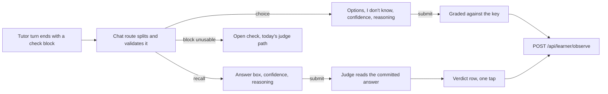

# Proposal: structured checks in the tutor chat

Status: accepted, 2026-10-25, with the default of all four open questions
(the owner's call). Nothing is built yet. Decisions K1 to K8, three phases. It builds on
[recall in the chat](recall-in-chat.md) and changes one of its decisions:
R5 (structure in prose, judged by a second call) still holds for a recall
check, and a choice check needs no judge at all (K4). R1 to R4 and R6 stand
as they are.

## The problem

Since [recall in the chat](recall-in-chat.md) was built (2026-10-04 and
2026-10-05), a check inside the concept tutor's chat works like this: the
tutor ends a turn with `CHECK: <question>`, the learner answers in their own
words, a second model call judges the answer, and the learner taps to record
the judge's verdict. Four things about that flow are weaker than they need
to be.

1. **The standard is written after the answer.** The judge reads the
   learner's words and then decides what counts as right. Its reference is
   the note's check block when `matchCheck` finds one at a Jaccard of 0.75
   or more ([tutor-check.ts](../../packages/tutor/src/tutor-check.ts)),
   and otherwise the note's body alone. The tutor that asked the question
   never says what answer it had in mind.
2. **The evidence is one bit.** `recordObservation` gets `correct` and
   nothing else about the answer. A lucky guess and solid knowledge record
   the same, and so do a confident misconception and an honest gap, though
   they call for opposite next steps and opposite review schedules.
3. **The learner's reasoning has no place of its own.** Whatever they think
   while answering goes into the answer, where the judge grades it.
4. **"I don't know" is something to type**, and the judge has to recognise
   it (its rule 2 in [judge.ts](../../packages/tutor/src/judge.ts)).

Measured on the owner's database on 2026-10-25:

| | Count |
| --- | --- |
| Observations, ever | 23 |
| Recorded from a chat check (a `chat-` session) | 0 |
| Since recall in the chat was built (2026-10-04) | 2, both from the macOS app's session page on 2026-10-21 |

## Where the idea comes from

[LearnHarness](https://github.com/amosblomqvist/learnharness) (read at
`6cba9c8`) is a desktop tutor whose teacher agent asks graded questions
through two tools, defined in
[question-core.ts](https://github.com/amosblomqvist/learnharness/blob/6cba9c8/src/core/question-core.ts):

- **`quiz`, multiple choice.** The model writes the question, the options
  (bare claims, with no reasoning in any of them), an `explanation`, and
  then `correctAnswer`, keyed by the option's value rather than its
  position. The explanation comes before the answer in the schema on
  purpose: the model reasons, then commits. A key that matches no option is
  sent back to the model as a tool error, and it retries. The app adds
  "I don't know" itself, shuffles the options with a seed taken from the
  call id, and grades the pick in the browser. No model reads the answer.
- **`explain`, free recall.** The model commits the full correct answer
  before it asks. The learner answers in words, sees the committed answer
  on submit, and the teacher's next turn grades against its own commitment.

Every answer carries a confidence (the learner's probability that their
pick is right, chosen from 0, 30, 50, 70, 90 and 100, resting on 50) and an
optional thinking field. The teacher's prompt reads confidence against the
verdict: correct and sure means move on, correct and unsure means one
reinforcing touch, wrong and sure is a committed misconception worth
digging into, and wrong and unsure is a small correction
([25-confidence.md](https://github.com/amosblomqvist/learnharness/blob/6cba9c8/src/agent/prompts/shared/25-confidence.md)).

LearnHarness is AGPL-3.0 and this repository is MIT. This proposal takes
the ideas and none of the code or prompt text (K8).

## The idea

The tutor commits to the answer in the same turn it asks the question, and
the learner answers on a card with options or a box for their words, a
confidence and an optional line of reasoning. A choice check is graded on
the spot against the committed key. A recall check is judged against the
committed answer. Both write the confidence and the reasoning onto the
observation, and the confidence shapes the review card.



## How it works

### 1. The check block (K1, K2)

A tutor turn that asks a check ends with a fenced block whose info string
is `check`, holding one JSON object. Nothing but whitespace may follow it.

A choice check:

````
```check
{"kind": "choice", "question": "...", "options": ["...", "...", "...", "..."], "why": "...", "answer": "<the correct option, copied exactly>"}
```
````

A recall check:

````
```check
{"kind": "recall", "question": "...", "answer": "<the full answer, its reasoning included>"}
```
````

The course topic tutor adds `"concept": "<concept id>"`, and `topicCheck`
applies to it as it applies to `CHECK(<concept id>):` today.

`why` sits before `answer` in the block, and the prompt asks for that
order, for LearnHarness's reason: a model writes fields in order, so the
reasoning comes first and the key follows from it.

The chat route splits the block off the reply, as `splitCheck` splits the
marker today, and validates it in a new `check-block.ts` in
`packages/tutor`, beside `tutor-check.ts`. `firstObject` from
[session-question.ts](../../packages/tutor/src/session-question.ts) reads
the object. The rules:

| Field | Rule |
| --- | --- |
| `kind` | `choice` or `recall` |
| `question` | 1 to `CHECK_QUESTION_LIMIT` (400) characters |
| `options` (choice) | 3 to 5 strings, each 1 to `QUESTION_LIMITS.option` (240) characters, distinct once trimmed |
| `answer` (choice) | equal, once trimmed, to exactly one option |
| `why` (choice) | 1 to `QUESTION_LIMITS.explanation` (800) characters |
| `answer` (recall) | 1 to 800 characters |

The key is matched by its text, not its index, so a miscounted position
cannot grade the wrong option. The chat cannot send a bad block back for a
retry the way a tool call can, since one turn is one call down the model
chain. A block that fails validation therefore falls back (K7): if its
question is readable it becomes an open check `{ question }`, judged as
today, and the server logs the reason on one line; otherwise the turn
carries no check. A `CHECK:` line is read exactly as it is today.

The route returns the validated block as `check` beside the prose, now with
`kind` and, for a choice check, `options`, `why` and `answer`. The key
travels to the browser with the turn and stays hidden until the learner
submits. The session page already ships its question's `correct` index the
same way, and the only person who could read the key early is the learner
grading themselves.

### 2. The choice card (K3, K6)

Under the tutor's turn, in place of the composer's role as the answer box:

- The options in an order shuffled with a seed from the turn, using the
  seeded shuffle the session page already has, so a reload keeps the
  order.
- **I don't know**, a button beside the options, the session page's own.
- **How sure are you?**, six stops (0, 30, 50, 70, 90 and 100 percent),
  resting on 50. Picking "I don't know" hides it.
- **Your reasoning (optional)**, one text box, clipped to
  `SESSION_TEXT_LIMIT` (2,000).
- **Submit**, live once an option or "I don't know" is chosen.

On submit the card locks: the pick is marked, the key is marked, `why`
shows, and the answer is recorded (K4). The recorded card of D89 in
[STUDIO-CHAT-FIRST.md](../STUDIO-CHAT-FIRST.md) follows, with the same
words: the verdict, "Mastery moved: p(L) 0.25 → 0.41" and the next review.

The composer stays live while a check waits. A message sent instead of an
answer folds the card to "Not answered", and nothing is written, as an
untapped verdict row folds to "Not recorded" today.

### 3. The recall card (K3)

The same card with an answer box in place of the options: the answer, the
confidence, the optional reasoning and Submit. Submit shows the tutor's
committed answer under the learner's and calls `POST /api/agent/judge` with
the commitment as the judge's first reference, ahead of a note check that
`matchCheck` finds. The verdict row then works exactly as it does today
(R2): the judge's verdict pre-selected, one tap to record.

### 4. What the observation carries (K5)

The observe route accepts two new fields and passes them to
`recordObservation`, which writes them into the event's payload:

- `confidence`: an integer from 0 to 100. Refused with `chosen: null`
  ("I don't know"), which carries no confidence.
- `thinking`: the learner's reasoning, clipped to `SESSION_TEXT_LIMIT`.

Both are left out of the payload when absent, the way `module` is, so a
terminal observation's payload is exactly what it always was. `question`,
`answer` (the key or the committed answer) and `chosen` (the pick or the
learner's words) fill the fields they already have.

The confidence also picks the SM-2 grade, through the `grade` input
`recordObservation` already takes. The grade starts from `gradeFromOutcome`
([schedule.mjs](../../scripts/learn/lib/schedule.mjs)) and moves in one
case:

| Answer | Grade |
| --- | --- |
| Correct, confidence 30 or less | at most 3, the lowest passing grade, so the card's ease falls and its intervals grow more slowly |
| Anything else, and every answer with no confidence | `gradeFromOutcome`, as today |

A wrong answer needs no rule. Every failing grade (0, 1 or 2) does the
same thing to the card in `review` in `schedule.mjs`: the interval goes
back to one day, a lapse is counted, and the ease is left alone, so a
confident miss and an unsure one already come back tomorrow. What a
confident miss changes is the tutor's next move (§5), and the confidence
on the event keeps it on record.

The event already records its `grade`, so a `review rebuild` replays the
schedule unchanged. p(L) moves exactly as it does today: `bktUpdate` reads
`correct` only.

### 5. What the tutor reads next (K5)

The learner's answer reaches the tutor as their next turn, written by the
page and delimited as data, as the judge's `<learner_answer>` is:

```
<check_answer>
Picked: "..." (incorrect; the key was "...")
Confidence: 90%
Reasoning: ...
</check_answer>
```

A recall answer gives the learner's words and no verdict, since the judge
and the tutor's reply run side by side. The tutor grades in prose against
its own commitment, which it can see: the request rebuilds the asking turn
with its block, because a commitment the tutor cannot see is one it cannot
be held to. The browser still shows that turn without the block.

The tutor's prompt
([prompt.ts](../../packages/tutor/src/prompt.ts), rule 6 of the concept
tutor and rule 10 of the topic tutor) gains, in this repository's own
words:

- When to ask which kind: choice when the likely mistakes are known and
  nameable, recall when the point is to produce the idea unprompted.
- How to write options: write the correct claim first, then turn it into
  each wrong option by applying one specific misconception; keep every
  option the same length and register; put no reasoning or bold in any
  option; if the key can be spotted without knowing the material, write
  the question again.
- How to read confidence against the verdict: the four cases above.
- One check per turn, as today.

## Decisions

**K1. The tutor commits to the answer when it asks.** The key or the full
answer is written in the same turn as the question, before the learner has
said anything. Grading then measures the answer against a standard set in
advance, and the judge, when there is one, checks agreement with a stated
answer rather than inventing one after reading the learner's.

**K2. Structure travels as a fenced block, never a tool call.** The tutor
runs down the owner's model chain ([TUTOR-MODELS.md](../TUTOR-MODELS.md)),
whose defaults are free models with no reliable tool calling, and a turn
is one call. A block in the reply is the convention `CHECK:` and the `[n]`
citations already use, parsed on the server, and every model that can
write JSON can take part. The cost is the retry LearnHarness gets for free:
a bad block falls back instead (K7).

**K3. Two kinds, chosen by the tutor.** Choice for a check whose wrong
answers are worth telling apart, recall for producing the idea in one's
own words. The prompt says when to use which, and Settings does not
override it (open question 2).

**K4. A choice check records on submit; a recall check keeps the tap.**
R2 asked for a tap because a free model judging prose is noisy. A choice
check has no judge: the pick either is or is not the option the tutor
committed to before the learner saw it, which is exactly what a session
page question is, and the session page records a pick the moment it is
made. The risk is a
wrong key from the tutor, which writes a wrong observation into a log that
only `learn void --session` can take back. The owner accepted that risk
over a second tap (open question 1).

**K5. Confidence and reasoning go on the event, and confidence shapes the
review card, not p(L).** Mastery stays comparable with every observation
the terminal and the session page have written, and the five `--json`
shapes the `learning` plugin parses do not change. The review schedule is
where a lucky guess should differ from knowledge, and SM-2 already takes a
grade; a wrong answer is rescheduled for tomorrow whatever its grade, so
only the correct side needs a rule. Confidence does not move p(L) (open
question 3).

**K6. "I don't know" is a button.** It records incorrect with
`chosen: null` and no confidence, as the session page does, and the judge
no longer has to recognise it in prose.

**K7. The `CHECK:` line and a broken block stay checks.** Both become an
open check judged as today. A model that ignores the block format still
records evidence, and nothing built for recall in the chat stops working.
Retiring the line is a later decision, once the block has run for a while.

**K8. Ideas from LearnHarness, not its code or prompts.** It is AGPL-3.0,
and this repository is MIT. The mechanics above are reimplemented on
gnosia's own pieces (the session page's options and shuffle, `firstObject`,
the judge, the verdict row, `recordObservation`), and the prompt rules are
written here in this repository's words.

## What stays

- R1, R3, R4 and R6 of [recall in the chat](recall-in-chat.md). A turn that
  carries a check block is a marker turn for R4, so the `probe` or `teach`
  rule reads it the same.
- The `--json` shapes of `status`, `frontier`, `plan`, `observe` and
  `review due`, and the terminal's `learn observe`. Neither gains a flag in
  this proposal.
- BKT and its guess and slip rates.
- The Teach session page and the week check, which already ask choice
  questions. Giving them the confidence stops is phase 3.
- The open tutor at `/ask`, which records nothing.

## Edge cases

- **The key matches no option, or two.** The block fails validation and
  falls back to an open check (K7). The learner sees a plain question and
  answers in words.
- **The tutor puts the answer's reasoning in one option.** Validation
  cannot see it. The prompt's option rules are the defence, and the
  learner's tell-tale is a question that answers itself.
- **The key is wrong.** The learner sees it on submit, since `why` and the
  key show at once. Under K4 the observation is already written; the
  learner can say so to the tutor, and `learn void --session` retracts the
  session's evidence: it appends a marker, and the next `model --rebuild`
  and `review rebuild` skip what it names. The owner accepted this risk
  (open question 1).
- **Two blocks in one turn.** Only a block at the very end counts, as only
  the last line counts for `CHECK:`. An earlier one stays in the prose as
  written.
- **A reload while the card waits.** The thread keeps the check in
  `sessionStorage`, and the card comes back unanswered. A write still
  saving on reload is settled as `settleInterrupted` settles one today, and
  its retry replays the same `requestId`.
- **Maths in a question or option.** Each field renders through the
  tutor's markdown, the same renderer as the prose.
- **The learner reads the key in the browser's developer tools.** Out of
  scope: the log is theirs, and so is the only person fooled.

## Phases

| Phase | Ships | Done when |
| --- | --- | --- |
| 1 | K1, K2, K4, K5, K6, K7 for choice checks on the concept tutor: `check-block.ts` and its tests, the route's split, the choice card, `confidence` and `thinking` through the observe route and into the payload, the grade rule, the prompt's option rules | A tutor turn with a valid choice block shows the card; submit writes one observation whose payload holds the confidence and the reasoning and whose `grade` follows the table; a broken block or a `CHECK:` line takes today's judge path; `observe --json` and a terminal observation's payload are byte for byte what they were; the owner's database holds its first observation from a chat check |
| 2 | Recall checks: the recall card, the commitment as the judge's first reference, the commitment shown on submit, the asking turn rebuilt with its block in the request | A recall answer is judged against the tutor's commitment, and the tutor's next turn can quote it |
| 3 | The course topic tutor's blocks with `concept`, and the confidence stops on the Teach session page and the week check | A topic check records against the concept it names; a session page answer carries a confidence |

Each phase is its own PR. A `--confidence` flag for the terminal's
`learn observe`, so the `learning` plugin can send one, would be a fourth,
in the plugin as well as here.

## Open questions for the owner

All four answered on 2026-10-25, each with the proposal's default.

1. **K4.** Should a choice check record on submit, as proposed, or keep
   R2's tap after the reveal? The tap costs a second per check and guards
   against a wrong key. Answered 2026-10-25: record on submit.
2. **K3.** Should Settings offer a check style (choice, recall, or the
   tutor decides), as LearnHarness lets the learner pick a quizzing
   mechanic? The default here is that the tutor decides. Answered
   2026-10-25: the tutor decides, and Settings gains no check style.
3. **K5.** Should confidence move p(L) as well, for example by trusting a
   low-confidence correct answer less? The default is no, so mastery stays
   comparable with every earlier observation. Answered 2026-10-25: no.
   Every chat answer given with a confidence stores it on its event (an
   "I don't know" and a terminal observation carry none), so this can be
   revisited later and a `model --rebuild` would replay those answers
   under the new rule.
4. Should a recall check carry a confidence at all? LearnHarness asks for
   one only on multiple choice. The default here is yes, since how sure
   someone is of their own words still separates a guess from knowledge.
   Answered 2026-10-25: yes.
