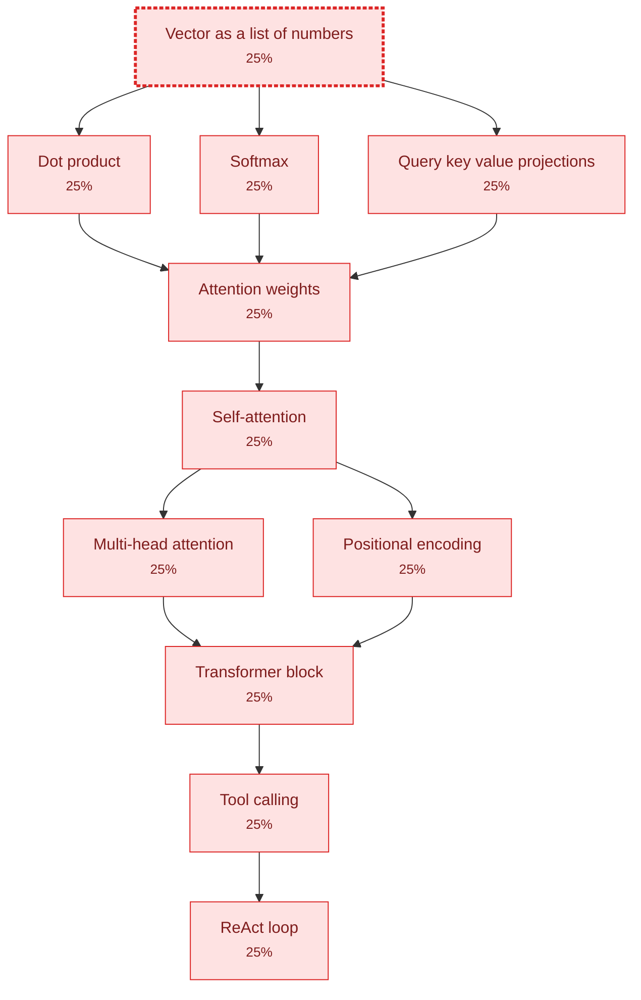

# Knowledge Map

> Generated by `npm run learn -- map`. Do not edit by hand — edits are overwritten.

**0 mastered · 0 in progress · 11 untouched · 11 total**

Mastery is p(L) from Bayesian Knowledge Tracing: the probability you hold a
concept, given every answer you have given. 95% counts as mastered.

## The frontier

The edge of your understanding — every prerequisite met, the concept itself
not yet held. This is the only place teaching is efficient.

- [[vector-as-a-list-of-numbers]] — Vector as a list of numbers · 25% (gap)

## Graph

## Legend

| Colour | Meaning | p(L) |
| --- | --- | --- |
| green | mastered | ≥ 95% |
| blue | solid | 75–95% |
| yellow | shaky | 55–75% |
| orange | weak | 40–55% |
| red | gap | ≤ 40% |

A dashed border marks a frontier concept.
