# The catalog schema

The authored content, the learner state and the rows that run them, in one
SQLite file, `$GNOSIA_HOME/catalog.db` by default
([docs/SQLITE-MIGRATION.md](../../docs/SQLITE-MIGRATION.md), `databaseUrl()` in
[`src/env.ts`](src/env.ts)). This document is the reasoning; [`packages/schema/src/`](../../packages/schema/src/) is the
definition, and [`drizzle-sqlite/`](drizzle-sqlite/) is the SQL that definition
generates. When they disagree, the code is right and this file is stale.

The catalog ran on Postgres until the move to SQLite, and much of what follows
was decided there. A migration number named below (`0010`, `0013`, `0022` and
the rest) is the old Postgres journal's, kept in `drizzle/` as a reference
for porting an old database with
[`scripts/pg-to-sqlite.mjs`](scripts/pg-to-sqlite.mjs); nothing applies it
and the script does not read it. On SQLite every one of
them is folded into
[`drizzle-sqlite/0000_majestic_ronan.sql`](drizzle-sqlite/0000_majestic_ronan.sql),
the whole schema and its seeds. Two SQLite migrations follow it:
[`0001_catalog_armed_rule.sql`](drizzle-sqlite/0001_catalog_armed_rule.sql)
(the table that stands in for deferred triggers, under "Triggers" below) and
[`0002_recap_request_id.sql`](drizzle-sqlite/0002_recap_request_id.sql)
(`recap.request_id`). Where a section below names one of those two, it says
so by file. The Postgres numbers stay below as the record of when a table or
a rule arrived. A Postgres error code such as `23503` still names
the failure: `sqlstate` in [`src/state/errors.ts`](src/state/errors.ts) reads
SQLite's errors onto the codes the same failures carried on Postgres.

The plan is [#27](https://github.com/c-wenlong/gnosia-learn/issues/27); this is
the first half of bundle 3, [#21](https://github.com/c-wenlong/gnosia-learn/issues/21).

[docs/CONTENT-MIGRATION.md](../../docs/CONTENT-MIGRATION.md) is the plan
that made the database (Postgres at the time) the source of truth for content, and it is built through
its phase 3 cut-over. Every content type is authored in the database, the
repository's `content/` and `learn/` are gone (the tag `content-files-final`
keeps every version of them), and files are an export format (D1 there):
`catalog export` writes that layout, `catalog import` reads it back, and
`seed/` is one such tree. [The content migration's foundation](#the-content-migrations-foundation)
below describes the tables the plan added. Where a section below says an
indexer "reads" `content/` or `learn/`, it means those folders inside the
directory being imported: an export, `seed/`, or `content-files-final`.

## The two halves

| Half | Tables | Source of truth |
| --- | --- | --- |
| Content | `topic`, `concept`, `collection`, `curriculum_item`, `asset` and seven link tables; since 0010 also `tag`, `topic_relation`, `manimkc_topic`, `collection_tag`, `diagram`, `blob_object`, `session_log_entry` and `content_revision`; since 0015 `video` | The database, since the phase 3 cut-over: every type is authored here through the write seam, and files are an export (`catalog export --out`, and the nightly export under `$GNOSIA_HOME/archive/`). The manimkc rows and the mirror ledger are still rebuilt by `catalog import` from manimkc's own CLI. `content_revision` is the only record of who wrote what, and why. |
| State | `learner`, `event`, `mastery`, `review`, `progress`, `recap`, `preference`, `provider_key`, `custom_provider`, `tutor_model`, `asset_name`, `check_distractor` | The database. `event` is the only copy; `mastery` and `review` are replayable from it. Filled by bundle 5's backfill: see [LEARN.md](LEARN.md). |
| Operational | `index_run`, `mirror`, `content_source`, `catalog_instance` | Neither. What the indexers did, which content types the database owns, and whether this database is the primary. |
| Studio | `session`, `draft`, `job`, `asset_job` | The database, and the only copy. Who asked for a file to be made, and what came out. |

`index_run` is the third thing because it is neither of the first two: it is not
derived *from* files, and it is not the only copy of anything a learner did.
Without it, "is the manimkc half of this database stale?" has no answer short of
re-indexing and diffing, because a table full of rows from a three-week-old
checkout looks exactly like a fresh one.

It carries one thing that is not a report on the run, and the distinction is
worth stating because the column names invite confusion. `source_root` is what
the run *read*: the imported directory's `learn/concepts` for the notes, and for manimkc the checkout the
CLI was pointed at. `metadata.outRoot`, written by the video tools' sources
(`manimkc`, `remotionkc`, `revideokc`, `blenderkc`) only, is what that source's
`asset.path` strings are *relative to*, which is the tool's own data root and
is a different directory whenever `$MANIMKC_HOME` (or `$REMOTIONKC_HOME`,
`$REVIDEOKC_HOME`, `$BLENDERKC_HOME`) is set.
Nothing outside the catalog may re-derive it, since this repo does not read
that variable ([AGENTS.md](../../AGENTS.md)), so a consumer that wants to open one
of those files, such as `apps/web/src/app/api/assets/[id]/file/route.ts`, joins
`metadata.outRoot` onto `asset.path` and refuses when the run predates the
value rather than guessing at a base.

The studio group is the fourth thing, and it is fourth for the opposite reason
`index_run` is third. It has the state half's durability — losing it loses the
brief and the failure record, and no re-index writes either back — and none of
its meaning. A render error is not a thing a learner did, so a row saying
Chromium fell over sitting beside a Bayesian belief about the dot product would
make both harder to read. `catalog status` counts it apart for exactly that
reason.

Losing the content half used to cost an index run. Since the cut-over it
loses what was authored after the last export (the nightly one keeps thirty
under `$GNOSIA_HOME/archive/`) and the revision history, which only a
database backup holds; the manimkc, remotionkc, revideokc and blenderkc rows
alone come back from an import.
Losing the state half loses the study record, which is why `event` is
append-only and why the derived state tables can always be recomputed rather
than restored. Losing the studio half loses the provenance: the diagrams stay,
with their revisions in `content_revision`, and what goes is the record of
which brief produced them.

## Entities

### Content

| Table | Purpose |
| --- | --- |
| `topic` | The shared vocabulary. Slug PK, title, domain, summary, aliases. The required join for every asset. |
| `concept` | One authored note (`learn/concepts/<domain>/<slug>.md` in the export layout). Carries prerequisites and mastery. Optional enrichment under a topic. Since Track C the row holds the whole note: its frontmatter as columns (`title`, `summary`, `tags`, `sources`, `authored_at` for `created:`, `requires:` and `assumes:` as `concept_prerequisite`), its folder as `domain`, and the markdown after the frontmatter as `body`, byte for byte. The file it renders writes the keys in one order and leaves out an empty `assumes`, since a row keeps values, not layout; `services/catalog/src/content/notes.ts` is the one rule. |
| `collection` | Courses and modules today, decks next. A self-referencing tree with `kind`, `position` and a `metadata` JSON column. A course may name its cover photo's blob in `cover_blob_key` (0016), with its credit in `metadata.coverCredit`. |
| `curriculum_item` | The checklist row a learner ticks: `cs4263-m1-t1`, its title and its subtopics. |
| `asset` | A file or a link: video, transcript, chapters, captions, diagram source, diagram SVG, note, session, link. `source_repo` says which repository or tool made it: `gnosia`, `manimkc`, `tldrawkc`, `remotionkc` (0017, the second video tool), `revideokc` (0019, the third), or `blenderkc` (0029, the fourth). |
| `asset_topic` | This asset is about this topic. |
| `asset_concept` | This asset is about this concept. Written for a note (its own concept), for a session log (the notes its wikilinks name), for a diagram's SVG and source (its `meta.tldrawkc` concepts), for a studio video (its brief's concepts, `catalog video put`), and for a manimkc, remotionkc, revideokc or blenderkc render and each of its sidecars (its topic.yml's `concepts:`). |
| `concept_prerequisite` | This concept `requires` or `assumes` that one. |
| `collection_item` | This collection contains exactly one of a topic, a concept or an asset, at a position. A module holds one topic row (its topic, with `topic_position`, its place in that topic's `maps.courses`) and, since 0.5, one asset row per curated link in `resources:` order. |
| `asset_derivation` | This asset was produced from that one: a transcript from a video, an SVG from a `.tldr`. |
| `curriculum_item_topic` | This checklist row covers this topic. How a course reaches the assets. |
| `concept_curriculum_item` | This note contributes to this checklist row, at this position. Written by the courses source from `topics[].concepts`. |
| `curriculum_item_asset` | This reading goes with this lesson (0022): a curated `link` asset to a curriculum item of the same module, at the item's place in the reading's `lessons:` list. Written by the courses source and `course import` only. See "Readings on lessons and listed videos" below. |
| `tag` | A cross-course theme (`content/tags.yaml` in the export layout), at its position in the list. Since 0010, filled by the `tags` source since 0.5, and written by `catalog tag` since Track A. |
| `collection_tag` | This course carries this tag, at its place in the course's `tags:`. Makes a stale tag a `23503` instead of a string in a JSON column. |
| `topic_relation` | A typed edge between two topics: `broader`, `related` (symmetric, stored once with the slugs in byte order, `collate binary` in `topic_relation_related_order_check`), `precedes`. Read from a topic's `relations:` list, at its position there. |
| `manimkc_topic` | One manimkc topic path under one vocabulary topic: `maps.manimkc` as rows, and the primary key is the one-path-one-topic rule. |
| `diagram` | A `.tldr` document as JSON, its SVG as a blob, and the two hashes that say whether the SVG is stale. |
| `video` | A video made through the studio's chat (0015, docs/STUDIO-VIDEOS.md D49): its source (the scene files, `topic.yml` and the brief) as JSON, its cut as a blob, and the hash of the source the cut was rendered from. The cut, its sidecars and its poster are also `asset` rows under `video:` and `poster:video:`. See [Studio videos: a row, five assets and one transaction](#studio-videos-a-row-five-assets-and-one-transaction). |
| `blob_object` | One object in the blob store: `<owner_id>/<sha256>.<ext>`, its size, type, provider and whether the upload is confirmed. |
| `session_log_entry` | One appended piece of a session log: the exact text that went onto the end of the file, so the log is its entries concatenated, byte for byte. The first entry is what `learn session start` wrote, frontmatter included. Append-only; its own history, so no revisions. An import appends what a file grew by and refuses one edited above its end. |
| `content_revision` | One row per content write: the whole entity after it, its hash, who wrote it and why. Append-only. |

### State

| Table | Purpose |
| --- | --- |
| `learner` | Who. One row, id `local`, until authentication exists. Carries the owner's `display_name` and `avatar`, a pixel sprite from `AVATARS` that the column's default draws at random whenever a row is made (migration `0023_learner_avatar`; [docs/design/BRAND.md](../../docs/design/BRAND.md#avatar-sprites)). |
| `event` | Append-only log of everything the tutoring loop observed. |
| `mastery` | BKT belief per concept: `p_l`, observations, correct, last seen. Derived. |
| `review` | SM-2 card per concept: repetitions, ease, interval, lapses, due, leech. Derived. |
| `progress` | A ticked checklist row, plus the learner's note on it. |
| `recap` | The durable "what I learnt" record per checklist row. `request_id` (SQLite's [`0002_recap_request_id.sql`](drizzle-sqlite/0002_recap_request_id.sql)) is the id of the write that last stored it, so a copy of that write sent again after a lost answer counts no second session (`upsertRecap` in `src/state/recap.ts`). |
| `preference` | Theme, epoch, last visited, and the studio's two agent settings (`studioVideoAgent`, `studioDiagramAgent`: `{ model, effort }`, D53 of docs/STUDIO-VIDEOS.md), which the runner reads with `catalog preference get`. Key/value, because these change with the UI. |
| `provider_key` | An owner's own model provider API keys for the tutor, one per provider, AES-256-GCM encrypted by the web app (migration `0018_provider_key`, [docs/BYOK.md](../../docs/BYOK.md)). See "Provider keys" under the state half. |
| `custom_provider` | The providers an owner added themselves: a name and an OpenAI-compatible base URL under an id `custom-<slug>`, which their `provider_key` row and `tutor_model` entries are filed under (migration `0028_custom_provider`, [docs/TUTOR-MODELS.md](../../docs/TUTOR-MODELS.md) T14). No secret. The base URL is `https://`, or `http://` to a loopback host, in the function and a CHECK. Written only by `src/state/custom-providers.ts`; a provider's Delete removes the row, its key and its models in one transaction (`deleteTutorProvider`). |
| `tutor_model` | The tutor's model chain: an owner's ordered provider and model pairs, tried top to bottom, with `position` 0 to n-1 (migration `0020_tutor_model`, [docs/TUTOR-MODELS.md](../../docs/TUTOR-MODELS.md)). No secret. Written only by `src/state/tutor-models.ts`, which rewrites an owner's rows whole under the learner lock. |
| `asset_name` | A learner's own name for an asset, read in place of `asset.title` by every `AssetRef` query, `catalog show`, `catalog search` and the studio's video list (migration `0024_asset_name`). State rather than a column on `asset`, because every import writes the whole asset row again and would undo an edit there; the learner's, so a name for a commons video is nobody else's. No foreign key on `asset_id`, so a name outlives a prune and comes back with an asset re-imported under the same id. Written only by `src/state/asset-names.ts`, from the library page through `POST /api/learner/asset-name`. |
| `check_distractor` | The tutor's three wrong options for one check block in a note, cached per learner and keyed by the check's id with a sha256 of its question and answer, so an edited check reads as missing and is written again (migration `0003_check_distractor` of `drizzle-sqlite/`, [docs/LEARN.md](../../docs/LEARN.md) "Wrong options"). Derived: losing it costs one model call per check, so no exporter reads it. `cascade` on the learner and the concept. Written only by `src/state/check-distractors.ts`, from `checkOptionsTurn` in `packages/tutor`. |

### Operational

| Table | Purpose |
| --- | --- |
| `index_run` | One row per source: when it last ran, what it read, what it wrote, and anything else it wanted remembered. Overwritten each run. |
| `mirror` | One row per (asset, destination): what one audit saw of a deliverable on Google Drive or Seafile. |
| `content_source` | Which content types the database owns, written by `catalog flip`, with the last export's hash and the parity the flip checked. The importers read a type with no row from files; a reader, the web app's included, reads it from the database, the default since the cut-over. See [Who owns a type](#who-owns-a-type). |
| `catalog_instance` | One row: this database is `primary` or `copy`. A copy refuses every write (the copy guard below). |

### Studio

| Table | Purpose |
| --- | --- |
| `session` | One run of something that writes to the knowledge base. `kind` is `tutor` (a `/learn` session) or `studio` (a generation runner); both share one id space, which is what lets `event.session_id` be a foreign key. |
| `draft` | One conversation with the studio's planner (docs/STUDIO-CHAT-FIRST.md, D32): the headless session every turn resumes, the transcript's path under the runner's `STUDIO_HOME`, the latest brief that passed and, when its topic does not exist yet, the proposed topic (`pending_topic`). One owner's, like a job. A mirror of the runner's `drafts/<id>/draft.json`, written by `catalog draft upsert`, so it has no transition guard of its own: the runner holds the record and the state machine (`DRAFT_TRANSITIONS`). `title` is the latest brief's, written by the planner; `name` (0027) is the owner's, set with the sidebar's Rename through the runner's `PUT /api/drafts/{id}/name`, one line of 1 to 200 characters or null (`draft_name_check`). Every page calls a conversation by its name, else its title. `updated_at` is the runner's own `updatedAt` when `draft.json` carries one, so a rename, which leaves it alone, does not move the conversation up Recent. |
| `job` | One request to generate one file (`kind` `diagram` or, since 0015, `video`, whose `target_path` is `videos/<slug>.mp4`): the brief, the lease on a committed path, the state machine, the gate's verdict and what it cost. `draft_id` names the conversation that asked for it (D35), `ON DELETE SET NULL`, so pruning a draft never takes a job with it; a draft reports its newest job. |
| `asset_job` | This job wrote this asset, at this hash, at this size. Provenance as a link table, so regenerating does not erase the earlier job's claim. Once the job is accepted the hash is a snapshot and is never rewritten: a repair assert over a file somebody has edited since would otherwise replace "what the job wrote" with "what a person wrote afterwards", which is the one comparison that makes the edit visible. |

Three shapes here are worth stating outright.

**`target_path` and `candidate_path` are different files.** A job writes only
its candidate, in its own workspace, `jobs/<id>/candidate/<name>` relative to
the runner's `STUDIO_HOME`, which is what `candidate_path` holds (rows from
before phase 2 keep `learn/assets/.candidates/<name>` as history); nothing
lands until a person accepts. So `target_path` names a file
the job has never opened, and it is also the lease key:

```sql
CREATE UNIQUE INDEX job_active_target_key ON job (target_path)
  WHERE state in ('queued', 'running', 'awaiting_review');
```

Two jobs cannot hold the same committed path at once, and an unaccepted
candidate keeps holding it, because the second brief would be written against
what the first has not landed yet. Partial rather than total, because the whole
history of a path is jobs that have finished with it. A lock held by a
connection (a Postgres advisory lock, when this was decided) was the
alternative and dies with its connection, so nothing could ever show who holds
it.

**`state` is checked and `phase` is not.** `state` is the small vocabulary every
transition is guarded against, so a conditional `UPDATE … WHERE state = ?` is
the only way a job moves and two runners cannot both claim one. `phase` is the
progress label the UI shows (`drawing`, `linting`, `exporting`), differs per
generator, and would make the CHECK grow every time a pipeline gained a step.
`cancel_requested_at` is a timestamp for the same reason: a job being cancelled
is still running until the runner has killed Chromium.

**`topic_slug` is a column and a foreign key; the rest of the brief is JSON.**
A foreign key does not survive being stuffed into JSON — the same argument that
keeps `curriculum_item` out of `asset` — and the topic is the earliest moment
refuse-never-skip can fire: a brief naming a slug that has no `topic` row
fails the enqueue with a `23503` before any GPU time.

## Decisions

### Curriculum items are their own table, not assets

A course topic like `cs4263-m1-t1` could have been an `asset` row of kind
`curriculum_item`, as issue #21 sketched. It is a table instead, for three
reasons.

An asset is defined by where its bytes are: a `path` or a `blob_key`, or else a
`url`, plus a content hash and a byte count. A curriculum item has none of
those. It is a node inside a course file, not a file, so every column that
makes `asset` useful would be null for it and the location check
(`asset_location_check`; `num_nonnulls(path, url) = 1` when this was decided)
would have to be dropped to let it in, weakening a constraint for every real asset to
accommodate a row that is not one.

It also needs columns no asset has: `subtopics`, and a `collection_id` naming
the module it is authored inside. Those would have to hide in a JSON column, and
`collection_id` in particular is a foreign key, which does not survive being
stuffed into JSON.

Most of all, three state tables point at it. `progress` and `recap` are keyed by
curriculum item, and the web app's `completed` and `notes` maps already are. As
a dedicated table those are plain foreign keys, and a stale id is a constraint
error. As an asset kind they would be foreign keys to `asset(id)` with no way to
say "and it must be a curriculum item" short of a `UNIQUE (id, kind)` plus a
composite foreign key against a literal — a trick that works and that nobody
reading the schema in six months would enjoy.

**The id is the stable external key.** `cs4263-m1-t1` is opaque: nothing parses
its course or module prefix. Reordering changes `position`; moving an item to
another module changes `collection_id`; neither touches the id, so the learner's
tick, note and recap survive the move. That is also why the id is text carried
from the authored data rather than a generated key — a generated key would be
reassigned on the next index run and every `progress` row would point at the
wrong thing.

Curriculum items are deliberately *not* a fourth target in `collection_item`.
An item belongs to exactly one module and is authored inside it, so it carries
`collection_id` directly rather than paying for a many-to-many it will never
use.

### Typed link tables, never a generic edge table

Issue #21 said `edge`. It is eleven columns across seven tables instead:
`asset_topic`, `asset_concept`, `concept_prerequisite`, `collection_item`,
`asset_derivation`, `curriculum_item_topic`, `concept_curriculum_item`, and
since 0022 `curriculum_item_asset`.

A generic `edge(from_type, from_id, to_type, to_id)` cannot have foreign keys,
because `from_id` would have to reference five different tables depending on a
value in another column, and no database can express that. Without the foreign
keys, a typo in an indexer inserts a row that reads fine, joins to nothing, and
is found months later by a query that quietly returns fewer results than it
should. That is exactly the failure the audit already recorded: an
`out/networking/adguard-home` render outlived its source and nothing flagged it.

With typed tables the same typo is a `23503` at write time. Putting this data in
a database and then dropping the constraints would leave nothing but a slower
JSON file.

Where a column set must be exactly-one-of, a check constraint says so:
`collection_item_one_target_check` adds up `(topic_slug is not null) +
(concept_slug is not null) + (asset_id is not null)` and wants `1`, and
`asset_location_check` wants a `url` exactly when there is neither a `path`
nor a `blob_key`
([`0000_majestic_ronan.sql`](drizzle-sqlite/0000_majestic_ronan.sql)). A row
that names no target, or two, is refused rather than being a silent no-op for
every consumer.

Kind columns are `text` plus a `CHECK`. On Postgres that was chosen over an
`ENUM`, whose widening has awkward transaction rules and whose narrowing is
impossible; SQLite has no `ENUM`, so the question is gone. These vocabularies
do grow: bundle 6 added `mirrors` to `index_run.source` and two new
vocabularies of its own (Postgres `0005_mirror_ledger.sql`). SQLite cannot
alter a constraint in place, so on SQLite a changed `CHECK` means a migration
that rebuilds the table.

### Append-only is a trigger, not a revoked privilege

`event` has two `BEFORE UPDATE` and `BEFORE DELETE ... FOR EACH ROW` triggers,
`event_no_update` and `event_no_delete`, that abort with
`23001: event is append-only`. They are created in
[`drizzle-sqlite/0000_majestic_ronan.sql`](drizzle-sqlite/0000_majestic_ronan.sql),
beside the same pair on `content_revision` and `session_log_entry`.

On Postgres, `REVOKE UPDATE, DELETE ON event` was the alternative and was
weaker in the only case that mattered: a revoked privilege does not bind the
table's owner, and the owner was precisely who ran the migrations, the CLI and
psql on a laptop. SQLite has no privileges at all, so a trigger is the only
guard there is. It fires for every connection that opens the file; getting
past it takes an explicit `DROP TRIGGER`, which is an auditable act rather
than an accident. It lives in the file with the rows, so a copy of the
database carries it.

The correction path is a new row, not an edit: the `learn` CLI writes a
`void` event with a reason.

The triggers are per row, and on Postgres `0003_append_only_per_row` existed
because they first were not. As `FOR EACH STATEMENT` a trigger fired on the
statement whether or not it touched a row, and `event.concept_slug` was a
foreign key with `ON DELETE SET NULL`: deleting any concept made Postgres run
an `UPDATE` against `event`, which tripped the guard even against a completely
empty `event`, so no `concept` row could be deleted at all. SQLite has row
triggers only, so that cannot come back. `event.concept_slug` is
`ON DELETE RESTRICT` (since Postgres 0004, and in `0000`): a concept with
evidence cannot be deleted, and the refusal is the foreign key's rather than
the trigger's.

`event` carries no `updated_at`. A column that can never change would only
invite someone to try.

### Event types

`event.type` is one of `EVENT_TYPES` in `packages/schema/src/shared.ts`, and
the `event_type_check` constraint repeats the list, so a new type is a
migration as well as an edit there.

| Type | Written by | Payload | Read by |
| --- | --- | --- | --- |
| `session-start`, `observation`, `review`, `session-close`, `void` | the `learn` CLI and the web app's session and tutor routes | per type; `observation` and `review` carry the concept and the grade | both replays (`observation` and `review` only), session close, `void` |
| `watched` (0008) | the library asset page's Mark watched, and the player at 90% played | `{ asset, kind }`, no concept | the asset page's "Watched on"; never evidence |
| `visit` (0025) | `POST /api/learner/preference`, each time a course or module page opens, beside the `lastVisited` and `recentModules` preferences | `{ course, module? }`, no concept, no session | the sidebar's Recent and Home's "Pick up where you left off" (`apps/web/src/lib/recent.ts`); neither study nor evidence |

`visit` replaces the `recentModules` preference, which keeps the last five
visits only. The route writes both for one release, and Recent merges the two
by course and module meanwhile, so the five modules a list held before the
first event are not lost; then the preference is left unread, as H1 of
docs/proposals/home-page.md left the streak's rows. A visit is a row per page
open, a repeat included, the way a second review is a second row.

### What is derived and what is not

`mastery` and `review` are projections. Replaying `event` from the beginning
rebuilds both exactly, which is why a wrong row there is a bug to recompute
rather than data to recover, and why `review` has no `history` column: every
grade is already an event of type `review`, and a second copy would be a second
version of the truth.

The content half was derived too, from files in git, until the phase 3
cut-over. It is authored here now: every write goes through the write seam
with an author and a reason, and nothing rebuilds it but a restore or an
import of an export. The manimkc rows and the mirror ledger are the part
still derived, from manimkc's CLI.

`progress`, `recap` and `preference` are *not* derived. They are the only copy.
Bundle 5 filled them: `catalog backfill` from `learn/state/*.json`, and
`/api/learner/import` from a browser's localStorage on first mount. Their column names mirror `LearnerState` in
`packages/schema/src/shared.ts` and the limits beside it (`KNOWLEDGE_LIMITS`: 1200-character summaries, 8-item
lists) so that backfill is a straight copy. The per-item 300-character clamp has
no check constraint: testing each element needs `json_each`, which is a
subquery, and a `CHECK` cannot contain one, on SQLite as on Postgres. That clamp stays in
application code, where it already is.

### Readings on lessons and listed videos

Phase 2 of
[docs/proposals/module-learning-path.md](../../docs/proposals/module-learning-path.md)
(0022). A reading's `lessons:` is `curriculum_item_asset`, a typed link with
a foreign key at both ends, for the reason every link here has one: a reading
named onto an item that does not exist is a `23503`, not a row that joins to
nothing. Both ends cascade, as `concept_curriculum_item`'s do: a pruned link
asset or a purged item takes its rows with it. It carries no `owner_id`; a
link belongs to its parent's owner (D24), and the item is the parent, so
placing a reading is a revision of the lesson, and the item's snapshot lists
the rows. `position` is the item's place in the reading's list, so the export
writes `lessons:` back in the order it was written; the readings of one lesson
are ordered by the module's `resources:`. That the item and the reading are in
the same module is the reader's check, not a constraint: both writers build
the rows from a parsed file, and the export keeps only same-module rows to
live items. `collection_item` stays the module's own list, so a reading is on
its module whether or not it names lessons.

A lesson's `videos:` is `curriculum_item.videos` and a module's is
`collection.metadata.videos`: asset ids kept as data, deliberately not foreign
keys. The courses source indexes before the video tools, and a clone may have
none of them, so a course naming a manimkc video would otherwise be refused on
a fresh catalog. The reader checks only the shape; a page resolves the id
when it reads it.

Neither is in a snapshot while empty (`OMITTED_WHEN_EMPTY` and
`LINKS_OMITTED_WHEN_EMPTY` in `src/content/entities.ts`, the way 0016's
`cover_blob_key` is left out while null), so an item that uses neither hashes
exactly as it did before 0022, and the first import after the migration
appends no revision for it. `asset_resource_type_check` gained `practice`.

### Two things called "topic"

The course data calls `cs4263-m1-t1` a topic, and the plan calls the shared
vocabulary a topic. They are different things and the schema names them apart:
`curriculum_item` for the first, `topic` for the second. A course row's
`concepts:` list names notes that teach the *first* kind, which is why the link
table for it is `concept_curriculum_item` and not `asset_topic`'s sibling. That
link used to be authored the other way round, as a `topics:` key in the note's
frontmatter; the courses source owns it now and the concepts source refuses a
note that still carries the key
([the proposal](../../docs/proposals/course-items-declare-concepts.md)).

### Indexes

Every foreign key column has an index, because SQLite, like Postgres before
it, creates one for a primary key and a unique constraint but never for a
foreign key, and an unindexed one turns every parent delete into a full scan
of the child.
On top of those: `event(at)` for the log read in time order, `review(due)` for
"what is due today", `topic(domain)`, `asset(kind)` and `asset(content_hash)`
for the drift check, and `mirror(status)` for the count `catalog status`
reports per destination.

## The content half

The column types are SQLite's, as
[`0000_majestic_ronan.sql`](drizzle-sqlite/0000_majestic_ronan.sql) declares
them: a column marked `json` below is `text` holding JSON (`mode: "json"` in
`packages/schema/src/`), which drizzle hands back parsed; a time is an
`integer` of epoch milliseconds; a flag is an `integer`, `0` or `1`; a
fraction is `real`; bytes are a `blob`. On Postgres these were `jsonb`,
`timestamptz`, `boolean`, `double precision` and `bytea`
([docs/SQLITE-MIGRATION.md](../../docs/SQLITE-MIGRATION.md)).

```mermaid
erDiagram
    topic ||--o{ concept : "optionally groups"
    topic ||--o{ asset_topic : "is subject of"
    asset ||--o{ asset_topic : "is about"
    concept ||--o{ asset_concept : "is explained by"
    asset ||--o{ asset_concept : "is about"
    concept ||--o{ concept_prerequisite : "depends on"
    concept ||--o{ concept_prerequisite : "is required by"
    collection ||--o{ collection : "contains"
    collection ||--o{ curriculum_item : "lists"
    collection ||--o{ collection_item : "contains"
    topic ||--o{ collection_item : "may be listed as"
    concept ||--o{ collection_item : "may be listed as"
    asset ||--o{ collection_item : "may be listed as"
    asset ||--o{ asset_derivation : "is derived from"
    curriculum_item ||--o{ curriculum_item_topic : "covers"
    topic ||--o{ curriculum_item_topic : "is covered by"
    concept ||--o{ concept_curriculum_item : "contributes to"
    curriculum_item ||--o{ concept_curriculum_item : "is served by"
    asset ||--o{ curriculum_item_asset : "is read with"
    curriculum_item ||--o{ curriculum_item_asset : "is read with"

    topic {
        text slug PK
        text title
        text domain
        text summary
        json aliases
    }
    concept {
        text slug PK
        text title
        text summary
        text topic_slug FK "nullable"
        int topic_position "place in the topic's maps.concepts"
        text path UK
    }
    collection {
        text id PK
        text kind "course|module|deck"
        text slug
        text title
        text parent_id FK "nullable"
        int position
        json metadata
        text cover_blob_key FK "nullable, courses only"
    }
    curriculum_item {
        text id PK "cs4263-m1-t1"
        text collection_id FK
        int position
        text title
        json subtopics
        json videos "asset ids, not foreign keys (0022)"
    }
    asset {
        text id PK
        text kind "video|transcript|..."
        text path "exactly one of path/url"
        text url
        text content_hash
        text inputs_hash "what a derived asset was made from (0031)"
        int bytes
        text title
        text source_repo
    }
    asset_topic {
        text asset_id PK_FK
        text topic_slug PK_FK
    }
    asset_concept {
        text asset_id PK_FK
        text concept_slug PK_FK
    }
    concept_prerequisite {
        text concept_slug PK_FK
        text prerequisite_slug PK_FK
        text kind PK "requires|assumes"
    }
    collection_item {
        int id PK
        text collection_id FK
        int position
        text topic_slug FK "exactly one target"
        text concept_slug FK
        text asset_id FK
        int topic_position "a module's place in its topic's maps.courses"
    }
    asset_derivation {
        text asset_id PK_FK
        text source_asset_id PK_FK
    }
    curriculum_item_topic {
        text curriculum_item_id PK_FK
        text topic_slug PK_FK
    }
    concept_curriculum_item {
        text concept_slug PK_FK
        text curriculum_item_id PK_FK
        int position "teaching order, from the course file"
    }
    curriculum_item_asset {
        text curriculum_item_id PK_FK
        text asset_id PK_FK
        int position "place in the reading's lessons list"
    }
```



## The state half

```mermaid
erDiagram
    learner ||--o{ event : "records"
    learner ||--o{ mastery : "believes"
    learner ||--o{ review : "schedules"
    learner ||--o{ progress : "ticks"
    learner ||--o{ recap : "keeps"
    learner ||--o{ preference : "sets"
    learner ||--o{ provider_key : "brings"
    learner ||--o{ tutor_model : "orders"
    learner ||--o{ custom_provider : "adds"
    learner ||--o{ asset_name : "names"
    concept ||--o{ event : "may be about"
    concept ||--o{ mastery : "is tracked by"
    concept ||--o{ review : "is scheduled by"
    curriculum_item ||--o{ progress : "is ticked in"
    curriculum_item ||--o{ recap : "is recapped in"
    event ||..|| mastery : "replays into"
    event ||..|| review : "replays into"

    learner {
        text id PK "local"
        text display_name
    }
    event {
        int id PK "autoincrement"
        int at "epoch ms, indexed"
        text learner_id FK
        text type "session-start|observation|review|session-close|void"
        text concept_slug FK "nullable"
        text session_id "nullable"
        json payload
    }
    mastery {
        text learner_id PK_FK
        text concept_slug PK_FK
        real p_l "0..1"
        int observations
        int correct "<= observations"
        int last_seen "epoch ms"
    }
    review {
        text learner_id PK_FK
        text concept_slug PK_FK
        int repetitions
        real ease ">= 1.3"
        int interval_days "1..36500"
        int lapses
        int due "epoch ms, indexed"
        int last_reviewed "epoch ms"
        int leech "0 or 1"
    }
    progress {
        text learner_id PK_FK
        text curriculum_item_id PK_FK
        int completed_at "epoch ms, nullable"
        text note
    }
    recap {
        text learner_id PK_FK
        text curriculum_item_id PK_FK
        text summary "<= 1200 chars"
        json key_points "<= 8 items"
        json misconceptions "<= 8 items"
        json open_questions "<= 8 items"
        text source "agent|manual"
        int sessions
        text request_id "nullable"
    }
    preference {
        text learner_id PK_FK
        text key PK
        json value
    }
    provider_key {
        text owner_id PK_FK "no default"
        text provider PK "a built-in provider or custom-<slug>"
        blob ciphertext "1..2048 bytes"
        blob iv "12 bytes"
        blob auth_tag "16 bytes"
        int key_version ">= 1"
        text last4 "4 chars"
    }
    tutor_model {
        text owner_id PK_FK "no default"
        text provider PK "a built-in id or custom-slug"
        text model PK "printable ASCII, 1..200"
        int position "0..9, unique per owner"
    }
    custom_provider {
        text owner_id PK_FK "no default"
        text id PK "custom-slug"
        text label "1..60"
        text base_url "https:// or loopback http://"
    }
    asset_name {
        text learner_id PK_FK
        text asset_id PK "no FK: outlives a prune"
        text title "cleaned, 1..200"
    }
```

The dotted lines are not foreign keys. They say that `mastery` and `review` are
computed from `event` and can be thrown away and rebuilt.

### Provider keys

`provider_key` holds the tutor's model provider keys an owner saved in
Settings, in place of the `NVIDIA_API_KEY`, `GEMINI_API_KEY` and
`OPENROUTER_API_KEY` variables, which are now the fallback. The design, the
threat model and rotation are [docs/BYOK.md](../../docs/BYOK.md); what the
table itself guarantees is here.

- **It holds no key.** The web app seals each key with AES-256-GCM under a
  key derived from `AUTH_SECRET` (HKDF-SHA256, `key_version` naming the
  derivation) and stores the ciphertext, the 12-byte nonce and the 16-byte
  tag. The catalog stores and returns bytes and has nothing that opens them.
  `last4` is the only part of a key in the clear.
- **The additional data names the owner, the provider and the version.** A
  ciphertext moved onto another owner's row, or relabelled as another
  provider, fails its tag. The cost is that renaming an owner (the
  `on update cascade` on `learner.id`) leaves their keys unreadable, and
  Settings asks for them again.
- **No default owner, and `cascade` on delete.** Every content table defaults
  `owner_id` to `local` and restricts deletes; this one does neither, so a key
  is never filed under `local` by omission, and deleting an owner deletes
  their keys.
- **One module names it.** `src/state/provider-keys.ts` is the only code that
  reads or writes the table, and `test/provider-keys.test.ts` fails a
  reference anywhere else. That is what keeps it out of `catalog export`, the
  nightly export, `learn vault pull` and the learner export, none of which can
  reach a table they never name. The same test lists every file that walks
  all tables without naming one (the `tables` registry, the database's table
  list, a whole-file copy through the SQLite backup API), so a generic
  exporter cannot arrive unread. `catalog status` counts it with the state
  half. A whole copy of the database, such as the backup
  `scripts/flip-rehearsal.mjs` takes with `copyDatabase` from
  [`scripts/lib/sqlite.mjs`](../../scripts/lib/sqlite.mjs) (a `pg_dump` on
  Postgres), does include it, as ciphertext: see the threat model.
- It carries the copy guard like every other table: its three
  `provider_key_copy_guard_*` triggers are in
  [`0000_majestic_ronan.sql`](drizzle-sqlite/0000_majestic_ronan.sql).

## Filling it

`npm run catalog -- import <dir>` reads a directory in the export layout
(`seed/`, an export) and rewrites the rows it owns; with no directory it
reads the repository, which has held no content since the phase 3 cut-over.
A type the database owns is skipped when its files are its own last export,
and, once the database owns every type, when the directory holds none of
them, so on a database that owns all six a bare `import` runs only manimkc,
remotionkc, revideokc, blenderkc and the mirror ledger. Once topics are
flipped the vocabulary every source resolves a slug against comes from the
topic rows (`vocabularyOf` in `src/index/vocabulary.ts`), not from the
directory's `content/topics.yaml`. `catalog index` is the old name, kept as an
alias that says so once on stderr. Eleven sources, run in the order the
foreign keys require regardless of how `--only` names them, each path
relative to the directory:

| Source | Reads | Produces |
| --- | --- | --- |
| `topics` | `content/topics.yaml` | `topic`, `topic_relation`, `manimkc_topic` |
| `tags` | `content/tags.yaml` | `tag` |
| `concepts` | `learn/concepts/<domain>/*.md` | `concept`, `concept_prerequisite`, `note` assets |
| `courses` | `content/courses/*.yaml` | `collection`, `curriculum_item`, `collection_item`, `collection_tag`, `curriculum_item_topic`, `concept_curriculum_item`, `link` assets with their `resource_type` |
| `manimkc` | `manimkc topics --json` | `video`, `transcript`, `chapters`, `captions` assets, their derivations, and `asset_concept` from each topic.yml's `concepts:` |
| `remotionkc` | `remotionkc topics --json` | the same four kinds, under `remotionkc:` |
| `revideokc` | `revideokc topics --json` | the same four kinds, under `revideokc:` |
| `blenderkc` | `blenderkc topics --json` | the same four kinds, under `blenderkc:` |
| `diagrams` | `tldrawkc list <dir>/learn/assets --json`, or the `.tldr` JSON | `diagram_svg`, `diagram_source` assets |
| `sessions` | `learn/sessions/*.md` | `session` assets, linked by the body's wikilinks |
| `mirrors` | `manimkc mirrors --json` | `mirror` |

`concepts` runs before `courses` because a course row's `concepts:` list
becomes rows pointing at concepts, and the courses source refuses an id no note
defines by checking what the concepts source just produced. Everything runs
after `topics` because every other source resolves a slug from the shared
vocabulary. `mirrors` runs last: it reads no
content tree, only a ledger joined onto asset rows `manimkc` has already
written.

**`--only` selects downstream too.** Pruning a `topic` cascades: the
`asset_topic`, `curriculum_item_topic` and `collection_item` rows pointing at it
are deleted (a topic that still files a concept is held instead, since 0012
made `concept.topic_slug` `ON DELETE RESTRICT`; see the last section). So `--only topics` after a
slug is renamed would leave every other source silently unlinked, and nothing
would say so until a `show` that used to return videos stopped. Selecting a
source therefore selects everything that points at what it owns, and the run
reports what it added. `--only topics` is a full run, which is the honest
answer, and `--only manimkc` stays cheap: the only thing pointing at what
manimkc owns is `mirrors`, whose rows cascade away with the asset they name, so
that pair runs together and nothing else has to. `--only courses` goes the
other way and re-reads the notes first: a course row's `concepts:` list
resolves against concept rows, and checking it against rows from the last run
would refuse a note added since, so `concepts` is a prerequisite of `courses`
the way `manimkc` is of `mirrors`. `tags` is a prerequisite of `courses` too,
since `collection_tag` points at tag rows, and a dependent of it, since pruning
a tag clears the links to it that only the courses source writes back. The two
closures are applied until neither adds anything: `--only concepts` pulls in
`courses` as a dependent, and `courses` then pulls in `tags`. `--only concepts`
also pulls in the four video tools, and `mirrors` behind `manimkc`, since a
concept prune cascades through the `asset_concept` rows a topic.yml's
`concepts:` wrote, and only those sources write them back.

`manimkc`, `remotionkc`, `revideokc`, `blenderkc` and `mirrors` are the
optional sources. `manimkc` and `mirrors` read
`tools/manimkc/tools/cli/manimkc`, `remotionkc` reads
`tools/remotionkc/tools/cli/remotionkc.mjs`, `revideokc` reads
`tools/revideokc/tools/cli/revideokc.mjs` and `blenderkc` reads
`tools/blenderkc/tools/cli/blenderkc` (with `python3`, as manimkc's), each in a submodule that a fresh
clone and CI deliberately do not fetch. A default run drops one with a note when the
submodule is absent *and* that source has never been indexed here, because then
there is nothing to leave stale. It refuses when `--only` asked for it, and
refuses when it does have rows to lose.

### The diagram metadata rule

A `.tldr` carries `meta.tldrawkc` on its tldraw document record, written by
`tldrawkc meta set` or by `tldrawkc new`, and that object is where the diagrams
source gets the topic and the concepts. A `.tldr` with no topic there is
refused by name. The filename stem used to carry that job and was never more
than a guess: a stem matching no concept was filed nowhere and nothing said so.

The metadata is read through `tldrawkc list <dir> --json` when the submodule is
built, and by parsing the `.tldr` JSON directly when it is not, since a fresh
clone has the seed's files and not the build. `services/catalog/test/tldr.test.ts`
asserts the two readers agree on the same directory.

The one thing still filed by its stem is an SVG with no `.tldr` beside it. It
has no editable source, so there is nothing to stamp and refusing it would
refuse work that cannot be fixed; each one is reported as a warning instead.

### Diagrams: a row and a blob

Since Track D a `.tldr` is a `diagram` row and its SVG is a blob. The import
parses each document into `diagram.document` and hands each SVG to the runner,
which stores it through `uploadBlob` (`src/content/blob.ts`: a `pending`
`blob_object` row committed first, the bytes streamed, `head` asked, then
`present`) before the rows that name its key are written. The asset ids and
paths stay what they were, as logical names (D11), and the SVG asset gains
`blob_key`.

A document's bytes are its canonical JSON: keys sorted at every depth, no
whitespace (`src/content/diagram-document.ts`). Postgres `jsonb`, where this
was decided, kept no key order, so the file an import read could not be given
back byte for byte, and one form has to be the definition; the column is JSON
text on SQLite and the rule stands. `diagram.document_hash` and the `.tldr` asset's
`content_hash` are the sha256 of those bytes, the export writes them, and a
checkout writes them; tldraw reads a document in any key order, and parity
compares `.tldr` files parsed. The first export after the import therefore
rewrites each tracked `.tldr`'s key order once.

`svg_document_hash` is the `document_hash` the SVG was exported from, as the
writer vouches: `catalog diagram put` with an SVG records the pair as current,
and a put without one keeps the stored SVG, stale once the document moved. An
import keeps that record for an SVG whose bytes the database already stores,
so a stale SVG stays stale through the next import, and records any other SVG
as exported from the document beside it, since nothing on disk says
otherwise. `catalog diagram put|checkout|commit|list|show`
(`src/content/diagrams.ts`) is the write path the studio's Accept and the
plugin use; `commit` carries the revision its checkout started from and is
refused when the diagram moved past it. Until `catalog flip diagrams`, a put
also writes its files under the directory diagrams were last imported from
(D17), so the next import reads back what was written rather than undoing it.

An SVG drawn without the canvas has no document, so it is no `diagram` row:
`put --slug --svg --topic [--concept]` with no `--tldr` writes one
`diagram_svg` asset and its blob, filed under what the writer names, and is
refused for a slug that has a document (asked again under the SVG asset's
lock, which a document put also takes, and, until the flip, counting a
`.tldr` on disk that no import has read yet). Until the flip the import files such
an SVG by its name alone (the concept of that name and its topic), so the put
is refused unless it names exactly that; after it, the writer's links stand.

### Course covers: a column and a blob

A course's cover photo is a blob (D5, D7), and the course row names it by key
in `collection.cover_blob_key` (0016), never by a URL: the web app serves it
from `/api/courses/<slug>/cover`, so the route and a later cloud store can
change without a migration. The key follows `diagram.svg_blob_key`: a foreign
key to `blob_object(key)`, `ON DELETE RESTRICT` (an object a course shows
cannot be deleted) and `ON UPDATE CASCADE`, with an index. Two checks hold the
rest:

| Constraint | Rule | Why |
| --- | --- | --- |
| `collection_cover_course_check` | only a `course` has a cover | a module is a page inside a course; a photo on it is one nothing shows |
| `collection_cover_credit_check` | `cover_blob_key` is set exactly when `metadata.coverCredit` is | a photo never arrives without the photographer, source page and licence it is used under |

`catalog course cover <id>` (`src/content/course-cover.ts`) is the one writer:
it checks the image (WebP, JPEG or PNG by its bytes, at most 2 MiB) and the
credit, stores the bytes through `uploadBlob`, then points the row at the key
in one seam write with a revision, or with `--clear` removes both. The blob
stays after a replace or a clear, since an earlier revision names it; `catalog
blob audit` counts a cover as referenced and a replaced one as unreferenced.

In the export a cover is `content/courses/<code>.cover.<ext>` beside the
course file, which names it under `cover:` with the credit. `catalog import
<dir>` stores it as a blob before the rows, as the diagrams source stores an
SVG, and refuses by name a cover that is missing, not an image, or not the
type its name says. It sets a cover the course lacks and never changes one it
has: a file with no `cover:` (an export from before covers) keeps the stored
cover and credit with no revision, and a `cover:` whose credit, type or bytes
differ from the stored cover is refused by name. Those decisions are made
against the covers as the read saw them, and the writer reads them again
under its locks: a `course cover` that committed in between refuses the
courses source by name, writing nothing for it, and a rerun reads the new
cover. `course import` of one file carries the cover over and
refuses a `cover:` that differs from the course's.

### Studio videos: a row, five assets and one transaction

A video made through the studio's chat (docs/STUDIO-VIDEOS.md, D49) is the
shape a diagram is. The `video` row holds the source, `{ files: { "<name>.py":
..., "topic.yml": ... }, brief: {...} }`, which is what a change job starts from,
and `source_hash`, the sha256 of its canonical JSON. The cut is a blob,
`mp4_blob_key`, paired by `video_mp4_pair_check` with `rendered_source_hash`,
the source it was rendered from, as `diagram_svg_pair_check` pairs an SVG.
`duration_seconds` is the gate's ffprobe figure, since `asset` has no column
for it.

The files are also `asset` rows, so the library plays a studio video as it
plays a manimkc render: `video:<slug>` (kind `video`, path `videos/<slug>.mp4`,
a logical name, D11), `video:<slug>.transcript.json`, `.chapters.json` and
`.vtt` (derived from the video; a silent cut has none, and a change to silent
deletes the old ones through the seam), and `poster:video:<slug>`, derived
from it too, in the `poster:` namespace the blob audit and the re-render
unhooking key on. The video carries `asset_topic` and one `asset_concept` per
concept in the brief. `video:` is no import source, so no import prunes it; the
`manimkc:` namespace is deliberately not used, since `catalog import --only
manimkc` deletes every `manimkc:` asset its report does not list, and a studio
video has no folder in manimkc's `topics/` (edge case V16).

`catalog video put --job <id> --slug S --dir <candidate> --base <rev|none>`
(`src/content/videos.ts`) is Accept. It reads the job (this owner's, kind
`video`, `awaiting_review`, target `videos/S.mp4`), holds every file in the
candidate directory to the hash the gate wrote in `copies.json` (each a regular
file with one link; every source file needs a record, and every recorded source
file must be there), stores the blobs, and then, in one transaction, writes the
`video` row, the asset rows, their `asset_job` provenance and the job's move to
`accepted`, through the same checked transition `catalog job accept` makes
(`acceptJobIn` in `src/commands/job.ts`). So there is no state in which a video
is in the catalog and its job still in review, unlike a diagram's put and
accept, which predate this and are two calls. A put repeated for an accepted
job returns the landed revision and writes nothing when the source hash and
every file's hash are what that job landed, and is refused by name otherwise;
the same check runs again under the locks, so a retry that raced the first put
gets the landed Accept rather than a stale-base refusal.

The blobs are stored before the transaction, so a put refused inside it leaves
them in the store with no row naming them. Nothing deletes them: a retry of the
same Accept reuses them (the keys are hashes), `catalog blob audit` lists any
left as `unreferenced` (the audit counts `video.mp4_blob_key` as a reference),
and they count toward the owner's byte cap, the same as a re-rendered video's
old bytes. A reclaim of unreferenced blobs, for every kind, is still to build.

A change to a video in review is `catalog job enqueue --discard-parent <id>`
(D52): the parent is locked, checked (this owner's, a video job, awaiting
review, the same target) and discarded in the transaction that inserts the
child, so the lease on `videos/<slug>.mp4` passes from one to the other with no
gap, and a refused insert leaves the parent in review.

### The mirror ledger

`mirror` holds what one audit saw, not what is true now. `manimkc mirrors
--json` owns the comparison, because it owns the mirror layout, the hash cache,
and the fact that a Google Drive placeholder will not open and has to be judged
by size and mtime; `compared` records which of those tests the verdict rests on,
so a `present` reached by sha256 is distinguishable from the weaker one. The
join between the two reports is the repo-relative deliverable path, unrewritten
on either side. Videos never enter the database as bytes.

A destination the run could not reach writes nothing and deletes nothing, so its
rows keep the older `checked_at` that says when they were last true. That is why
`mirror` is not cleared and rewritten like the other link tables: a run declares
which destinations it audited, the writer clears only those, and
`index_run.metadata` records what the run actually saw.

### Refuse, never skip

An unresolved reference stops the run and names the file and the slug. A skipped
row is an asset that is silently absent from the catalog, with nothing anywhere
saying so — which is the failure the audit in
[#27](https://github.com/c-wenlong/gnosia-learn/issues/27) already recorded once,
when a rendered video outlived its source and nothing flagged it. Errors are
collected per source and reported together, so one run fixes one edit rather
than thirty runs fixing thirty.

Two facts stated in two files are checked against each other rather than
resolved by precedence: a module's `topic:` against the vocabulary's
`maps.courses`, and a manimkc `topic.yml`'s optional `topic:` against
`maps.manimkc`. When they disagree, neither is knowably right, so the run stops.

remotionkc, revideokc and blenderkc have no vocabulary map, so there is nothing to check
their folders against: a remotionkc, revideokc or blenderkc `topic.yml`'s `topic:` is
required, and is the topic its video is filed under. A folder with none, or one naming a topic the
importing owner cannot read, is refused by its file and its slug.

All four tools' topic.yml may name the concepts the video teaches,
`concepts: [slug, ...]`, which each CLI reports on the topic entry. Each slug
becomes an `asset_concept` row on the video and on each of its sidecars, as a
diagram's concepts go on its SVG and its source, and must be a concept the
importing owner can read (theirs or the commons'). A slug that is not, or a
`concepts:` that is not a list of slugs, is refused by its file and its slug,
beside any other refusal in the same run; a missing or empty list links
nothing, and a slug dropped from the list is pruned on the next import. The
poster `catalog asset upload` cuts carries no concept, as it carries no
topic: it is reached through its derivation from the video.

The one exception is `sessions`. A session log is prose, and its wikilinks point
at other sessions and at notes nobody has written; a link that names no concept
is counted, not refused.

### Upsert, then prune

Each source writes in one transaction: clear the link rows it owns, upsert its
entities, delete the entities it no longer produces, insert the links. Two
things make that safe.

**Entities are upserted, never replaced.** `concept` is the target of `ON
DELETE CASCADE` foreign keys from `mastery` and `review`, and `curriculum_item`
of `ON DELETE RESTRICT` ones from `progress` and `recap`, so deleting and
reinserting a row would destroy the learner's record of it or fail on it. The upsert's SET
clause is built from the table's columns rather than the supplied keys, so a
field deleted from a file becomes null instead of living on as the last value
anyone wrote.

**Each source owns a namespace.** Every asset id begins with its source's prefix
(`note:`, `link:`, `manimkc:`, `remotionkc:`, `revideokc:`, `blenderkc:`, `diagram:`, `session:`) and the writer refuses an
id outside it. That prefix is how a prune knows which rows it may delete, so one
indexer can never remove another's. `mirrors` mints no asset ids at all: it
writes `mirror` rows against ids the `manimkc` source already wrote, and the
writer refuses a `mirror` row for a destination the run did not declare it
audited, because such a row would never be cleared again.

`poster:` is the one asset namespace no indexer owns. `catalog asset upload`
writes it, one `poster:<video id>` row per video, derived from the video
through `asset_derivation`, with no `path` and a `blob_key`
([CONTENT-MIGRATION.md](../../docs/CONTENT-MIGRATION.md), Track E). It sits
outside `manimkc:` because the manimkc prune deletes every row in that
namespace it did not produce, and it never produces a poster.

**An index keeps a blob it did not name.** An indexer hands over asset rows
with no `blob_key`, and the upsert sets every column, so the writer carries the
stored key forward whenever the stored blob's sha256 is the `content_hash` just
read (`services/catalog/src/index/blob-keys.ts`). A re-render changes the hash
and drops the key, so the asset falls back to its file until the next upload.
That is the order before the contract migration, 0013 (below). After it a
stored-kind row cannot exist without its blob, so the manimkc source does what
the diagrams source always did: it hands each video and sidecar to the runner
to store first and names the content-addressed key on the row
(`IndexContext.blobsRequired`, set when `asset_stored_blob_check` exists). A
re-render then lands under its own key in the same import.

Because deletions cascade, `import` prints the keys it removed rather than a
count.

**Courses and their items are archived, not pruned** (D12, since 0010). A
module or checklist row the course files stop listing gets `archived_at`, and
listing it again clears it, because the upsert's SET clause takes every column
from the insert and `archived_at` defaults to null. Archiving runs before the
upsert, so a module that replaces an archived one can reuse its slug:
`collection_parent_slug_key` covers only live rows. `import` prints the archived
keys beside the deleted ones.

An archived row is kept for the learner rows under it and is on no page, so
the readers leave it out: `catalog status`'s coverage, `catalog ls`, and the
lists `catalog show` returns count and list live rows only, and `show` or
`ls` of an archived entity named directly says `archived: true`. A tick, note
or recap written to an archived item is refused by name (`assertKnownItems` in
`src/state/progress.ts`), while what was recorded on it before stays, and the
Settings export still carries it; importing that export back
(`src/state/import.ts`) restores it, since it is the learner's own record.

The course writers (`catalog course import`, `catalog item archive|restore`,
`src/content/courses.ts` and `src/content/items.ts`) archive through the seam
and keep the archived row's links, so a restore brings its concept links
back; the courses indexer replaces its link tables wholesale and so drops
them, and a restore of such an item takes them from the last revision that
recorded it live. The one way an item leaves the table is `catalog item
purge`, which refuses a live item, refuses while a `progress` or `recap` row
names it, and with `--with-learner-data` copies those rows into its `delete`
revision's snapshot (under `links.progress` and `links.recap`, by column name)
before deleting them, so `catalog item restore` of a purged item rebuilds the
row, its links and the learner rows from that revision alone.

**Every entity a run touched gets an `import` revision when its snapshot
changed.** The run's author is `import:<git sha>` of the commit the files it
read are tracked at, `import:<sha>-dirty` when some under `content/` or
`learn/` differ from it, and `import:unknown` when nothing under the directory
is tracked (an export in a scratch folder is not the enclosing checkout's
commit). The reason names the directory and the file or folder read,
repository-relative or under `~`, never a home path. A second run over an
unchanged tree appends none, which `catalog.test.ts` asserts on `seed/`.

## The content migration's foundation

Migration `0010_content_expand` is phase 0 section 0.2 of
[docs/CONTENT-MIGRATION.md](../../docs/CONTENT-MIGRATION.md): every table and
column the five phase 1 tracks need, landed at once so no track generates a
migration of its own (D10). It changes nothing any reader sees. The write seam
that uses it (0.3) is in `src/content/`.

### Owners

Every content entity carries `owner_id text not null default 'local'
references learner(id) on delete restrict`: `topic`, `tag`, `topic_relation`,
`manimkc_topic`, `concept`, `collection`, `curriculum_item`, `asset`,
`diagram`, `video`, `blob_object`, `content_revision`, and `job` and `asset_job`. Link
tables carry none; they belong to the entity at their owning end. Primary keys
did not change, so ids stay global across owners (D3). The migration inserts
the `local` learner before the first `owner_id` column, because a database that
was indexed and never studied has no learner row and every foreign key default
would have failed on it.

**Who reads what** (phase 4 of the plan). An owner is a learner id, and one
owner may read its own rows and the commons', `readableOwners(owner)` in
`@gnosia/schema`, which is `[owner, 'commons']`. `commons` is a reserved
learner that owns shared content and never signs in; its `learner` row is
created by the write seam on its first write, as `local`'s is by
`ensureLearner`, and no read needs it. The filter is in the application, not in
the database: Postgres's row-level security was left for the day a second
service read the database, and SQLite has none:

| Where | What it does |
| --- | --- |
| `dbSource(db, scope)` and the six readers in `src/content/readers/` | Keep rows whose `owner_id` is in `scope.readable`; a link only when its far end is readable too; a session log only when `session.learner_id` is |
| The queries in `src/state/` the web app reaches (`assets.ts`, `blobs.ts`, `topics.ts`, `notes.ts`, `conceptSummaries`, `readConceptGraph`) | Take an `OwnerScope`, required, and filter the same way. `readKnowledgeBase`, `reviewQueue` and `dueReviews` derive it from the learner they already take |
| `readNoteRows(db, slugs, owners)` (`src/content/note-rows.ts`) | Scoped, keeps a `requires:` or `assumes:` edge only when the concept it names is readable, as `readableEdges` does for the graph; the export's unscoped read keeps every edge |
| A learner's write naming a curriculum item or a concept (`src/state/progress.ts`, `recap.ts`, `import.ts`, `mastery.ts`) | `assertReadableItems` and `assertReadableConcepts`: another owner's item or concept is refused with the sentence a missing one gets, so a tick is neither a foreign row nor a way to ask whether an id exists. A reset clears only rows on readable items; the legacy import reports another owner's item as unknown |
| `catalog diagram list`, `show`, `checkout`, `commit`, `put` (`src/content/diagrams.ts`) | Take `--owner` (default `CLI_OWNER`): list and show only what that owner may read, check out another owner's slug as a slug with no diagram (no file, no revision number, and a checkout already on disk left untouched), and write as that owner. The studio passes the owner its runner serves |
| The studio runner (`services/studio/src/api.ts`) | Serves one owner, `STUDIO_OWNER` (default `local`), and refuses a request the web app names as another's (`x-gnosia-owner`, set by the app's server from the session, never taken from a page), because its queue, checkouts, cache and agent account are that owner's |
| The `learn` CLI's learner view (`src/learn/files.ts`, `vault.ts`) | Reads as `cliScope()`: `status`, `frontier`, `plan`, the note reads and checkouts, and `vault pull` see the CLI owner's notes and the commons', with edges to anything else dropped, and only the CLI owner's own session logs. The five pinned `--json` shapes did not change |
| The write seam (`src/content/write.ts`) | Stamps `owner_id = owner` (required on every write) and refuses a write naming an id another owner holds, `foreign-owner`, since ids are global. Stamps its link rows the same way (D24: a link belongs to its parent's owner) and refuses a new far end, or a row's own reference, naming a row neither the writer's nor the commons' (`ROW_FAR_ENDS`, `LINK_FAR_ENDS` in `src/content/entities.ts`); one already there is carried over. `deleteContent` deletes through the same two checks. The CLIs write as `CLI_OWNER` (`src/content/scope.ts`), which is `local` |
| The verbs that write around the seam | `topic rename` refuses another owner's topic; `item purge` refuses another owner's item and deletes only the purging learner's rows; `course import` deletes only its own orphaned links, through `deleteContent` |
| `catalog video put`, `list`, `show`, `checkout` (`src/content/videos.ts`) and `catalog preference get`, `set` | Take `--owner` (default `CLI_OWNER`): `put` lands only that owner's job (another owner's is "no job") and writes as them; `list`, `show` and `checkout` read only what they may read, and another owner's slug is a slug with no video (`checkout` writes nothing). Their joins are scoped at the far end too: a poster, transcript, topic or concept another owner holds is left out rather than named `preference get` reads, and `preference set` writes, only that learner's row |
| `catalog job` and `catalog session` | Take `--owner` (default `CLI_OWNER`) and act only on that owner's jobs and sessions: another owner's is "no job", an id another learner holds is refused rather than adopted, and a job's session and parent job must be the owner's too. The studio passes the owner it serves |
| `catalog doctor` | Reports D24's mixed rows (a relation or mapping whose `owner_id` is not its topic's), which fail it (exit 1) as an armed rule's violator does, and links pointing at a row their owner cannot read, which are reported only; `--fix` restamps the mixed rows through the seam, one revision per topic |
| `catalog topic ls`, `topic add` (`src/content/topics.ts`) | Take `--owner` (default: every owner for `ls`, `CLI_OWNER` for `add`); no other topic or tag verb takes it. `ls` lists that owner's topics and the commons', with relations, concepts and courses scoped at the far end as `readTopicEntries` does. `add` writes as that owner and checks the slug, title, relations, placement and near matches against what they may read: another owner's slug is refused without its title, and their titles neither clash nor show as near matches. The position is still placed among every owner's topics, so the whole export stays grouped by domain, and is withheld (`null`) from an add run with `--owner`, since it would say where their topics sit. The studio passes the owner it serves |
| `catalog export`, parity, `topic ls` without `--owner` | Read every owner, through an `owners` argument that is optional only on those internal functions |
| `catalog import` (`src/index/writer.ts`, `src/index/run.ts`) | Writes as the importing owner (`CLI_OWNER`) and stamps every row it writes with it. Prunes, archives and clears links only among that owner's rows: a link is its parent's (D24), and one whose far end the owner cannot read is left for `catalog doctor`. Refuses, by id and before the source writes anything, a tree row on an id another owner holds, a link under another owner's entity or to one the owner cannot read, and a prune whose cascade would take another owner's rows (their links, their diagram under a topic, their `asset_job` record of an asset, another learner's mastery or review). Another learner's session log is neither called gone nor appended to. The cross-source lookups (`knownConcepts` and the rest) answer only for readable rows: once a source has run, what it produced plus the commons' |
| `catalog asset upload` (`src/content/asset-upload.ts`) | Uploads the rows the CLI's owner or the commons holds, and writes each one as its own owner, so its bytes land under that owner's prefix and the seam's owner check passes. Another owner's row, and a poster whose owner is not its video's, are refused by name before a byte is read or cut |
| `uploadBlob` (`src/content/blob.ts`) | With `GNOSIA_OWNER_BYTES_CAP` or `GNOSIA_OWNER_UPLOADS_PER_DAY` set, refuses a new object that would take its owner past either, measured from `blob_object` by `owner_id` (which the table's check ties to the key's prefix) inside the write transaction, whose `begin immediate` holds the file's write lock (a per-owner advisory lock on Postgres). A key that has a row is never measured or refused, a malformed cap included. `catalog blob audit` prints each owner's totals, and its stale-pending delete runs under the same write lock |
| Blob keys and their rows (`src/content/write.ts`, `src/state/blobs.ts`) | A row may name only a blob under its own owner's prefix: the seam refuses a new key under another owner's (a key the row already had passes, for D23's move), and the asset routes' blob reads serve a blob only to a reader who may read its owner (`blob_object.owner_id` in the reader's scope), so a row naming another owner's bytes serves them to nobody who cannot read that owner, while a row D23 moved to the commons keeps serving its `local/` bytes to `local` until the upload re-keys it |

**A database from before 0010** has no `owner_id`, and holds one owner's
rows by construction. Only a Postgres database can be one, since every SQLite
catalog has `owner_id` from `0000`; the guard stays in `src/content/scope.ts`.
`scopedRead` runs a scoped read there unscoped, but only
after asking the catalog (`ownersExist`, one question to
`pragma_table_info('asset')`, whose yes is kept per connection): a missing
column error (`42703`, as `sqlstate` reads SQLite's "no such column") on a
database that has `owner_id` is the query's own bug and is thrown,
never answered with every owner's rows. A write path asks first
(`readableFor`), since in a transaction the failed attempt would abort the
retry.

**Whole-database readers, on purpose.** These run on the owner's machine
against the owner's database and read every owner, so none of them may ever
sit behind the web app's door: `catalog ls`, `search`, `path`, `revisions`,
`topic ls` without `--owner`, `show` (the entity itself; the asset lists it prints are scoped to
`CLI_OWNER`), `export`, `import` (it reads every owner to refuse a collision,
and writes only `CLI_OWNER`'s rows, as its row above says), `parity`, `status`,
`doctor`, `blob audit`.
Everything else a CLI prints about content is scoped to `CLI_OWNER` as the
table above says.

**A type still on files has no owner.** Until `catalog flip <type>`, that
type's truth is its files in `content/` and `learn/`, and a file carries no
`owner_id`, so every account would see the owner's files for it (the web app
now refuses such a type outright; see [Who owns a type](#who-owns-a-type)).
Accounts therefore need every type flipped first; `catalog status` says which
are.

D23 of the plan decides, per type, which ids stay global and which types move
to the commons. The import limit it named, a tree that pruned and re-stamped
whatever it did not produce whoever owned it, is closed by the `catalog
import` row above. What is left is narrower: an import writes as one owner, so
a type moved to the commons is refused by the import as another owner's rows
until the import can be told to write as the commons.

### Revisions

`content_revision` is the history git used to give. One row per content write,
with `seq` per entity, `previous_id`, `op`, `author_kind`, `author` and a
non-empty `reason`, and a `snapshot`: the entity after the write with its owned
links nested under it, keys sorted, link rows sorted, `created_at`,
`updated_at` and `collection_item.id` left out as facts about the write rather
than the content. `snapshot_hash` is sha256 of that canonical form, which is
how an import that changes nothing appends nothing. Which link belongs to which
parent is `src/content/entities.ts`; the seam and the importer both read it, so
they cannot snapshot the same entity two ways.

| Parent | Owned links |
| --- | --- |
| `topic` | `topic_relation` (as `from`), `manimkc_topic` |
| `collection` | `collection_tag`, `collection_item` |
| `curriculum_item` | `curriculum_item_topic`, `concept_curriculum_item`, `curriculum_item_asset` (0022) |
| `concept` | `concept_prerequisite` |
| `asset` | `asset_topic`, `asset_concept`, `asset_derivation` |
| `tag`, `diagram`, `video` | none |

A column added to a table after its entities had revisions is left out of the
snapshot while it is null (`OMITTED_WHEN_NULL` in `src/content/entities.ts`):
`collection.cover_blob_key`, from 0016. Without that, the new empty key would
change the hash of every course and module, and the next write of each would
append a revision whose only difference is a key that says nothing. The first
revision that mentions the column is the one that set it.

`writeContent` in `src/content/write.ts` is the one authored write: one
transaction that takes the revision locks, refuses when the writer's `base` is
not the latest revision, names the revision on the connection (`markSeam`,
through `setRevisionId`, which `catalog_revision_id()` answers; on Postgres
the setting `gnosia.revision_id`), upserts the row and any
links given in a savepoint, reads the snapshot back and appends the revision.
A write whose snapshot equals the latest revision's rolls the savepoint back,
so it appends nothing and changes nothing, `updated_at` included. The id is
reserved before the entity write, because the guard checks that a revision is
named before the write: `reserveRevisionIds` in `src/content/revisions.ts`
takes the next `max(id) + 1`, safe under the transaction's write lock. On
Postgres it came from the identity's own sequence, which is why that identity
was `BY DEFAULT`.

An import that deletes an entity (a topic, concept or asset its files stopped
producing) appends a `delete` revision holding the state it was deleted in.
The history then ends with a word, and an entity that comes back is always a
new revision even when its snapshot matches the one before it went.

`seq` is the latest plus one, so two writers of one entity must not read the
latest at once. On SQLite the file is the lock: `inTransaction` opens every
write transaction with `begin immediate`, so a writer holds the write lock from
its first statement to its last and no two writers overlap
([`src/db.ts`](src/db.ts)). On Postgres both took transaction-scoped advisory
locks before reading: the seam its entity type shared and the entity
exclusive, an import every entity type it may touch exclusive, in sorted
order, up front. `lockEntity` and `lockTypes` in
[`src/content/revisions.ts`](src/content/revisions.ts) keep that shape and
take nothing now, so each caller still says where a lock was taken.

A write of several entities in one transaction is `writeContents`, which takes
every entity's locks before its first write, sorted by type and then id, and
then writes in the order it was given (the order the foreign keys need). The
lock order, and why nothing that followed it could deadlock on Postgres, is
written out in `src/content/revisions.ts`. Two `writeContent` calls inside one
outer transaction do compose, as savepoints, but take their locks in call
order. On Postgres that deadlocked against an import; on SQLite, where the
file is the one lock, `test/content-seam.test.ts` sees the import's
`begin immediate` time out with `SQLITE_BUSY` instead.

### Positions

`topic`, `tag`, `collection_tag`, `manimkc_topic` and `concept_prerequisite`
gained `position` in 0010, because each holds a list a person wrote in an order
and the export has to write it back in that order. Building the export found
three more such lists with nowhere to live, and migration
`0011_content_export_positions` added them: `concept.topic_position` (a
topic's `maps.concepts`, which the course path breaks ties by),
`collection_item.topic_position` on a module's topic row (a topic's
`maps.courses`) and `topic_relation.position` (a topic's `relations:`). The
indexers fill all eight since 0.5, and a curated link's place in its module's
`resources:` is its `collection_item.position`.

Five of them order separate entities rather than the links inside one:
`topic.position`, `tag.position`, `concept.topic_position`,
`curriculum_item.position` and a module's `collection_item.topic_position`.
Each is part of its row's snapshot, so they are sparse (D22 of the plan): the
indexers hand over each list's order as a rank, and the writer
(`src/index/writer.ts`, with the arithmetic in `src/content/positions.ts`)
stores steps of 1000, keeping a row's number for as long as its place relative
to its neighbours is unchanged and giving a moved or new row a number from the
gap it landed in. Adding a topic at the top of the vocabulary is then one
revision, not one per topic. A row whose entity has no revision yet was
positioned before revisions existed and is placed afresh. When a gap has no
whole number left the import refuses and names `catalog renumber <list>`,
which spreads the list back out to 1000, 2000, ... with one revision per row
it moves. The other positions order links inside one snapshot and stay
`1, 2, 3`: any change to such a list is that one entity's revision anyway.

### Who owns a type

`content_source` has one row per content type once anything has recorded
something about it. The row is the authority (D18): the importers and
`catalog flip` read it directly, and a reader follows it through
`selectSource`'s `ownership()` callback (`contentOwnership` in
`src/content/ownership.ts`, passed by the web app's
`apps/web/src/data/source.ts`) unless `CONTENT_SOURCE` overrides it for that
reader. A type with no row resolves to `db`, the default since the phase 3
cut-over (it was `files` before), so `CONTENT_SOURCE` is a test's switch.
Since phase 2 the web app has no file reader: a row that says `files`, or
`CONTENT_SOURCE` pointing a type at files, is refused with a
`ContentUnavailableError` naming `catalog flip <type>`, and rows that cannot
be read are refused too (logged once per outage), where they used to fall
back to the files. The files are an export and an import format, never a
read path for the app.

| Column | Written by | Read by |
| --- | --- | --- |
| `source` | `catalog flip` sets `db`; a row created by an export says `files` | the importers: a `db` type is not read from files. Readers, through `ownership()` |
| `flipped_at` | `catalog flip`, the first time; a second flip re-arms and keeps it | `catalog import`'s skip line |
| `export_hash`, `exported_at` | sha256 over `path<TAB>sha256(bytes)` lines of the type's files, written by `catalog flip` (the tree it just checked), by every write-through (the tree it left), and by `catalog export` only when `--out` is the tree this database last imported the type from: the hash describes that tree, and an export elsewhere recording it would make the untouched tree look edited | `catalog import`: a `db` type whose files hash to this, or are byte for byte what the database would export now, is its own export and is skipped with a named line; anything else is refused, naming the files that differ (edge case 12) |
| `parity_report` | `catalog flip`: the parity it checked before flipping, against the files the type was last imported from (`index_run.metadata.root`) | a person asking what the flip rested on |
| `waivers` | `catalog flip --waive <rule> --reason` | `catalog doctor`, on every run; `flip --strict` leaves a waived rule disarmed |

`catalog export` is a read of the database, so on a copy it records nothing
rather than failing on the copy guard at its last step. `catalog parity`
records nothing anywhere.

**A root belongs to the database that recorded it.** Every import records,
beside `index_run.metadata.root`, which database it ran against
(`metadata.database`: the database file's resolved path, `databaseIdentity`
in [`src/content/import-root.ts`](src/content/import-root.ts); on Postgres it
was the database's name and oid). A copy made with `copyDatabase`
([`scripts/lib/sqlite.mjs`](../../scripts/lib/sqlite.mjs)) inherits every
row, the owner's root included, and its `catalog_instance` says `primary`
like the original's, so the file's path is what tells them apart. A write-through, `catalog flip`'s parity and `catalog
export`'s hash all use a root only when this database recorded it, and a
write-through also refuses a root inside any git checkout other than the
one running it, another worktree or a separate clone
(`src/content/import-root.ts`). A copy therefore writes no file
until an import run against the copy itself names its own tree; an import
that skips a flipped type because its files are the database's own export
records that tree as the type's root too.

`catalog flip <type>` does four things in one transaction: writes the row as
`db`, arms the type's write guards (`WRITE_GUARDS` in `src/content/rules.ts`),
records the export hash of the files it just checked parity against, and with
`--strict` arms the type's completeness rules. Before any of it, it
refuses a type whose database reader is not built (`DB_READERS` in
`src/content/source.ts`, empty until a track fills one in), since readers
follow the row, and it runs parity itself against the files the type was last
imported from, inside its own write transaction so no import moves the rows
under the check. It arms the triggers first and counts the violators after
(`src/content/flip.ts`). On Postgres the order mattered because arming took
each table's lock; on SQLite the transaction's `begin immediate` already holds
the file's write lock, so nothing can add a violator between the count and
the commit either way. A refusal rolls the arming back with everything
else. A waived rule is disarmed even if an earlier strict flip armed it.
`manimkc` cannot be flipped until Track E gives videos a parity.

`catalog flip <type> --strict --rearm` is for a type the database already
owns, and a rule a later migration added (0021's
`course-order-respects-requires` was the first). A plain re-flip would run
parity against the tree the type was last imported from, which the database
has moved past since it took ownership, and its hint, importing those files,
would undo the database's own edits. `--rearm` reads no tree: it arms the
guards and, with `--strict`, every rule of the type that is not waived,
counts the violators the same way, keeps the last flip's parity report and
records no export hash. It refuses a type still on files.

### Export, import and parity

`catalog import` with no directory reads the repository root, and with one
reads that directory: one code path, reading any directory in the export
layout, with the pinned tools (`tools/manimkc`, `tools/tldrawkc`) always
the repository's own. Since the cut-over the repository root holds none of
the six types' files, and once the database owns every type, a type is
skipped when the directory holds none of them, its root left as it was
(`ownedSkips` in `src/index/run.ts`). Before that, trees are kept in step
(D17), and a tree missing a type's files is refused by name. Phase 2 made `import` the name; `catalog index`, the old
one, still runs it and prints the new name once, on stderr so a `--json`
reader's stdout is unchanged.

`catalog export --subset --topic <slug>... --course <id> --session <id>
--diagram <slug> --out <dir>` writes a tree that imports into an empty
database on its own: the named topics, the course's modules filed under them
(and the course's tags), every note filed under them, one log and one diagram,
with each topic's `maps.manimkc` left out since the tree has no videos. It
refuses, by name, a reference that would leave the tree (a note's prerequisite,
an item's concept, a diagram or a topic relation reaching a topic not named),
and it refuses to write over the repository, over any tree the database was
imported from, or through a symlink that leaves `<dir>` (a check every export
now makes). It records no export hash. `seed/` is made this way (seed/README.md).

`catalog export --out <dir>` writes the same layout back. Topics, tags and
courses are written from rows, in the house style they were authored in, so
an export of an unchanged database over its own last export changes no byte.
Diagrams are written from their rows and the blob store (see "Diagrams: a row
and a blob" for the one byte-level difference). Since Track C concept notes
and session logs are rendered from their rows too: a note from its columns
and `body`, a log from its `session_log_entry` rows concatenated. Once every
type is flipped nothing writes these files as a side effect of a write
(D17 ended), so an export is something a person runs, or the nightly export
(`scripts/nightly-export.mjs`, into `$GNOSIA_HOME/archive/<UTC time>/`).

`catalog parity <dir>` renders the export in memory and compares it with
`<dir>` entity by entity: a topic, a tag, a course file, a note, a log, a
diagram file. YAML is compared parsed, as sorted-key JSON; markdown as parsed
frontmatter plus the body byte for byte; a `.tldr` parsed; an SVG by its bytes.
It prints counts per type on both sides, every mismatch with the first field
that differs, and exits 1 on any.

### Triggers

Every guard in the database, and the state a fresh one is in after
`npm run catalog -- migrate`. SQLite has row triggers only, and one event per
trigger, so a guard that was one Postgres trigger on `INSERT OR UPDATE OR
DELETE` is three here, named `<guard>_ins`, `_upd` and `_del`. The functions
the triggers call, `catalog_copy_ok()` and `catalog_revision_id()`, are
registered by `connect` on each connection and read that connection's flags
([`src/db.ts`](src/db.ts)); on Postgres they were the settings
`gnosia.copy_ok` and `gnosia.revision_id`.

| Guard | Table | Kind | State | What it does |
| --- | --- | --- | --- | --- |
| `event_no_update`, `event_no_delete` | `event` | before, per row | on | Append-only, `23001` |
| `content_revision_no_update`, `content_revision_no_delete` | `content_revision` | before, per row | on | Append-only, with its own message |
| `session_log_entry_no_update`, `session_log_entry_no_delete` | `session_log_entry` | before, per row | on | Append-only, with its own message |
| `video_write_guard_*` | `video` | before, per row | on | The write guard below, created by the migration itself: `video` has had no writer outside the seam, so there was nothing to wait for |
| `<table>_write_guard_*` | the 18 tables in `WRITE_GUARDS` (`src/content/rules.ts`) | before, per row | **off** (absent) | Refuses a write unless the connection's `catalog_revision_id()` is set (D4), with `42501`. `catalog flip` creates a type's three triggers per table and disarming drops them (`setTriggers` in [`src/content/rules.ts`](src/content/rules.ts)), where Postgres enabled and disabled triggers it had created off. `asset`'s arm with `diagrams` (or `manimkc`), the last writers outside the seam being gone since Track D retired `assert-output`; `curriculum_item_asset`'s (0022) are armed on a database that already owns courses by `catalog flip courses --rearm` |
| `module-has-item` | `collection`, `curriculum_item` | rule, checked before commit | **off** | Every live module has at least one live curriculum item |
| `item-has-concept` | `curriculum_item`, `concept_curriculum_item` | rule, checked before commit | **off** | Every live curriculum item names at least one concept; nine courses fail it today |
| `item-concept-in-module-topic` | the four tables that can move either side | rule, checked before commit | **off** | An item's concepts are filed under its module's topic |
| `course-order-respects-requires` | the four tables that can change a course's order or a `requires` edge (0021) | rule, checked before commit | **off** | A course teaches no concept before a concept it `requires`, judged by each concept's first appearance (module, item, position). `assumes` out of order is a doctor warning, never refused |
| `<table>_copy_guard_*` | every table in `0000_majestic_ronan.sql` but `catalog_instance` | before, per row | on | Refuses a write with `25006` when `catalog_instance.role = 'copy'`, naming `primary_host`, unless the connection's `catalog_copy_ok()` answers 1 |

Why each is shaped the way it is:

- **The write guard is per row.** On Postgres that was a choice, for the
  reason `0003` existed: a statement trigger fired on a referential action
  that touched no row. On SQLite it is the only kind. It reads a flag the
  seam sets with `setRevisionId` and `inTransaction` clears when the outermost
  transaction ends ([`src/db.ts`](src/db.ts)), so a connection cannot carry
  the seam's permission into the next caller's write.
- **The completeness rules are checked at commit.** A `CHECK` sees one row,
  and "at least one child" is a question about others; checked at commit, a
  course written in one transaction is judged whole. On Postgres each rule
  was a set of `CONSTRAINT TRIGGER ... INITIALLY DEFERRED` triggers on the
  parent and the child; their names survive in `COMPLETENESS_RULES` as labels.
  SQLite has no deferred triggers, so an armed rule is a row in
  `catalog_armed_rule`
  ([`0001_catalog_armed_rule.sql`](drizzle-sqlite/0001_catalog_armed_rule.sql)),
  and `inTransaction` runs every armed rule's violator query after the last
  write and before `commit`, refusing with `DeferredRuleViolation`
  ([`src/db.ts`](src/db.ts)). `catalog doctor` runs the same queries, from
  `COMPLETENESS_RULES` in `src/content/rules.ts`, and `catalog flip <type>
  --strict` arms them when it reports zero.
- **The copy guard is per row now, and that is narrower.** On Postgres it was
  per statement, because on a copy even a statement that would change nothing
  is a write aimed at the wrong database, and `TRUNCATE` has no rows. SQLite
  has neither statement triggers nor `TRUNCATE`, so a statement that touches
  no row reaches no guard and lands silently on a copy
  ([`0000_majestic_ronan.sql`](drizzle-sqlite/0000_majestic_ronan.sql) says
  so beside the triggers). It is a trigger rather than a check in each writer
  for the same reason `event` is append-only by trigger: it binds every
  connection that opens the file. `CATALOG_COPY_OK=1`, or `connect({ copyOk:
  true })`, makes `catalog_copy_ok()` answer 1 on that connection; `catalog
  migrate` always passes it, since a copy's schema must still follow the
  primary's.

### The hand-written statements in 0000

drizzle generates DDL for tables, columns, indexes and constraints. Everything
else in [`0000_majestic_ronan.sql`](drizzle-sqlite/0000_majestic_ronan.sql)
was added by hand, below the generated block, as Postgres `0010` was:

| Statement | Why drizzle cannot express it |
| --- | --- |
| `INSERT INTO learner (id) VALUES ('local') ON CONFLICT DO NOTHING` | Data. Every `owner_id` foreign key needs it |
| `INSERT INTO catalog_instance ... 'primary'` | Data. The local database is the primary (D2) |
| The six append-only triggers | Triggers |
| The three copy-guard triggers of every table but `catalog_instance` | Same |
| `video_write_guard_ins`, `_upd`, `_del` | Same. The other write guards are DDL that `catalog flip` runs (`writeGuardDdl` in `src/content/rules.ts`) |

A table added later carries no copy guard unless its own migration adds its
three triggers, and `test/content-seam.test.ts` fails any table without
`<table>_copy_guard_ins`. `catalog_armed_rule`, created by SQLite's
`0001_catalog_armed_rule.sql`, has none, and the test passes it over by name.

Near-duplicate topic search has no index. On Postgres it was `pg_trgm` with
two trigram indexes; on SQLite `connect` registers `similarity()`, the same
trigram measure computed in JavaScript ([`src/db.ts`](src/db.ts)), and
`src/content/topics.ts` scores every live topic's title, slug and aliases
with it.

## Working on it

```bash
npm run catalog -- migrate             # create the file on first connect, apply every outstanding migration
npm run catalog -- status --json       # row counts, migration head, source freshness, course coverage
MANIMKC_ROOT=/nonexistent REMOTIONKC_ROOT=/nonexistent REVIDEOKC_ROOT=/nonexistent BLENDERKC_ROOT=/nonexistent npm run catalog -- import seed   # fill it from the seed (or: import <an export>)
for t in topics tags concepts sessions courses diagrams; do npm run catalog -- flip $t; done
```

Reading it back, cheapest first. Every command takes `--json`.

```bash
npm run catalog -- ls                          # domains and courses, with counts
npm run catalog -- ls algorithms               # one domain's topics
npm run catalog -- show master-theorem         # one entity, and its paths
npm run catalog -- path big-o-witness-definition master-theorem
npm run catalog -- search "common data bus"    # titles and aliases, top 20
npm run catalog -- doctor                      # completeness rules, guards, primary or copy
npm run catalog -- export --out /tmp/export    # the database as files in the export layout
npm run catalog -- parity /tmp/export          # entity by entity against a directory; exit 1 on a mismatch
npm run catalog -- import /tmp/export          # a directory back in; a bare `import` refreshes the video tools
npm run catalog -- flip tags                   # the database owns tags (needs a clean parity first)
npm run catalog -- history topic tomasulo-algorithm   # every revision, oldest first
npm run catalog -- diff 42                     # what revision 42 changed; or diff 41 42
```

`show` returns paths, never bodies; the paths are logical names in the export
layout. The words are in the rows: `learn concept show` for a note,
`catalog diagram checkout` for a diagram, `catalog export` for everything.

Every command exits 0 when it worked, 1 when it failed, 2 on a wrong
invocation, 3 when the database is unreachable: a file that cannot be opened
(`SQLITE_CANTOPEN`), a path through something that is not a directory, a
permission denied or a read-only filesystem, and 4 when the database is behind this code.
`index`, `import`, `export`, `parity`, `flip`, `ls`, `show`, `history`,
`diff` and `renumber` (and `learn index`) check the migration journal first and refuse with how many
migrations are outstanding and `Run: npm run catalog -- migrate`, rather than
with drizzle's `Failed query: ...` for a table the database does not have yet.
A file that opened and refused (locked past the busy timeout, or not a
database) is 1. Either way stderr carries one line naming the cause, such as
`database unreachable: cannot open the database file (SQLITE_CANTOPEN)`, read
from the driver's error code in
[`src/connection-failure.ts`](src/connection-failure.ts), which still carries
the Postgres codes beside SQLite's. The studio runs a job without the database on 3
and refuses it on 1 (D16 in `docs/TLDRAWKC-INTEGRATION.md`).

After changing anything in `packages/schema/src/`:

```bash
npm run generate -w @gnosia/catalog   # writes services/catalog/drizzle-sqlite/
npm run catalog -- migrate
npm test
```

Never edit an applied migration, and never add one to `drizzle/`, which
nothing applies any more (`MIGRATIONS_FOLDER` in
[`src/migrations.ts`](src/migrations.ts) is `drizzle-sqlite/`). drizzle
applies by the journal's timestamp and never compares a hash, while `catalog
migrate`, `status` and `doctor` read a migration as applied by the sha256 of
its file, so an edit makes it pending
forever everywhere it has already run, and one drizzle will not apply again.
`catalog migrate` refuses such a file by name (`MigrationSkipped` in
`src/migrations.ts`) rather than report it applied.

## Still open

- **Settled in migration `0013`, phase 2's contract: a stored kind has a
  blob, and a key is the package's.** `asset_stored_blob_check` narrows the
  location check: a `video`, `transcript`, `chapters`, `captions`, `poster`,
  `pdf` or `diagram_svg` row must name a `blob_key` (a note, a log, a `.tldr`
  and a link are rows or URLs, and keep their path). `blob_object_key_check`
  holds the key `@gnosia/blob` makes: a lowercase owner of 1 to 64, a
  required extension of 1 to 16 (`BLOB_KEY_PATTERN` in
  `packages/schema/src/content.ts`). On SQLite both checks are in
  [`0000_majestic_ronan.sql`](drizzle-sqlite/0000_majestic_ronan.sql), so a
  catalog has them from its first `migrate`, and `catalog doctor` still
  reports any stored-kind asset with no blob and any key the package would
  not make (`src/content/blob-contract.ts`).
  On Postgres, 0013 was a contract migration: it applied only after `catalog
  import` and `catalog asset upload --source manimkc` had stored every file,
  so until the phase 3 cut-over `catalog migrate` held it back through
  `CONTRACT_MIGRATIONS` (`src/migrations.ts`), and docs/CONTENT-MIGRATION.md,
  "After the merge", has how the owner's database went through flip day. The
  cut-over unregistered it, and `CONTRACT_MIGRATIONS` is empty. The holding
  machinery (`migrateHolding`, `heldMigrations`, `assertMigrated`) stays for
  the next contract migration; `test/blob-contract.test.ts` checks that any
  registered contract is the journal's last entry, and skips its 0013 cases on
  SQLite, which ships no schema from before 0013: the first migration
  already carries the contract as `asset_stored_blob_check`.

- **Settled in migration `0012`: `concept.topic_slug` is `NOT NULL`**, and its
  foreign key is `ON DELETE RESTRICT` instead of the `SET NULL` that could
  only produce the null the column no longer allows. On Postgres the
  migration counted the concepts with no topic first and refused with every
  slug; on SQLite the column is `NOT NULL` from
  [`0000_majestic_ronan.sql`](drizzle-sqlite/0000_majestic_ronan.sql) on. One consequence for an import while topics are files: the topics
  source runs before the concepts source, so a topic dropped in the same edit
  that moves its concepts elsewhere, or removes their notes, cannot be deleted
  by the topics source. That source holds it (row and links untouched,
  `deferred` on its result), the concepts source empties it, and `runIndex`
  deletes it with `pruneHeldTopics` straight after, with a `delete` revision
  of its whole last state. The notes are read before anything is written, so
  an edit whose notes would be refused leaves the topic as it was. When the
  concepts source is not part of the import (the database owns concepts), the
  drop is refused by name before anything is written.
- **Settled in migration `0006`: `event.session_id` is a foreign key.** Not to
  `asset(id)`, which is what this section used to propose and what could never
  have worked — `learn session start` writes the event before the markdown log
  exists as a file, so the asset had not been indexed yet. It points at
  `session(id)` instead, a row the same command now writes beside the event, so
  the referent exists at write time. `ON DELETE RESTRICT ON UPDATE CASCADE`,
  and `SET NULL` was not even available: the referential UPDATE it fires is
  what the per-row trigger from `0003` refuses. The migration backfills a
  `tutor` session (on Postgres; SQLite has the foreign key from 0000) for
  every distinct value the column already held, taking
  `started_at` from `min(at)` and reading a `session-close` event as `closed`
  and its absence as `interrupted`, because a column that has been free text
  for six migrations cannot be cleaned up after the constraint lands.
- **Settled in bundle 5: a studied concept cannot be deleted.**
  `event.concept_slug` is now `ON DELETE RESTRICT` (migration 0004). Under
  `SET NULL` the delete fired an UPDATE that the append-only trigger refused,
  so the rule was already this — it just arrived as an error about a trigger.
  `mastery` and `review` still cascade, because they are projections this log
  rebuilds. **Settled in migration `0010`:** `progress` and `recap` are
  `RESTRICT` on `curriculum_item`, and `curriculum_item` is `RESTRICT` on
  `collection`, so dropping an item from the course YAML archives it and the
  learner's tick and recap stay. On SQLite all three rules are in
  [`0000_majestic_ronan.sql`](drizzle-sqlite/0000_majestic_ronan.sql).
- `learner` holds one row by convention, not by constraint. A `CHECK (id =
  'local')` would enforce it and would have to be dropped the day authentication
  arrives, so the convention is documented instead.
