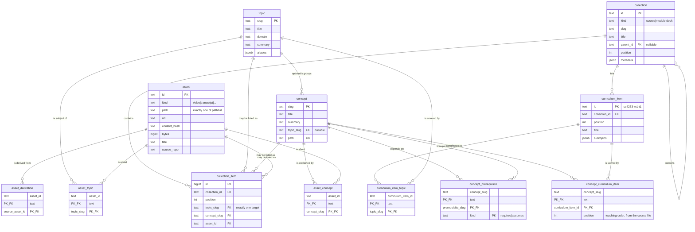

# The catalog schema

One derived index over three content trees, in Postgres 17. This document is
the reasoning; [`packages/schema/src/`](../../packages/schema/src/) is the
definition, and `services/catalog/drizzle/` is the SQL that definition
generates. When they disagree, the code is right and this file is stale.

The plan is [#27](https://github.com/c-wenlong/self-learn/issues/27); this is
the first half of bundle 3, [#21](https://github.com/c-wenlong/self-learn/issues/21).

[docs/CONTENT-MIGRATION.md](../../docs/CONTENT-MIGRATION.md) is the proposed
plan that makes Postgres the source of truth for content, and this document
describes the files-as-truth state that plan replaces.

## The two halves

| Half | Tables | Source of truth |
| --- | --- | --- |
| Content | `topic`, `concept`, `collection`, `curriculum_item`, `asset` and seven link tables | Files in git. Every row is rebuildable by re-running the indexers. |
| State | `learner`, `event`, `mastery`, `review`, `progress`, `recap`, `preference` | Postgres. `event` is the only copy; `mastery` and `review` are replayable from it. Filled by bundle 5's backfill — see [LEARN.md](LEARN.md). |
| Operational | `index_run`, `mirror` | Neither. One row per source saying when it was last read and what it produced. |
| Studio | `session`, `job`, `asset_job` | Postgres, and the only copy. Who asked for a file to be made, and what came out. |

`index_run` is the third thing because it is neither of the first two: it is not
derived *from* files, and it is not the only copy of anything a learner did.
Without it, "is the manimkc half of this database stale?" has no answer short of
re-indexing and diffing, because a table full of rows from a three-week-old
checkout looks exactly like a fresh one.

It carries one thing that is not a report on the run, and the distinction is
worth stating because the column names invite confusion. `source_root` is what
the run *read*: `learn/concepts` for the notes, and for manimkc the checkout the
CLI was pointed at. `metadata.outRoot`, written by the manimkc source only, is
what that source's `asset.path` strings are *relative to*, which is manimkc's
own data root and is a different directory whenever `$MANIMKC_HOME` is set.
Nothing outside the catalog may re-derive it, since this repo does not read
that variable ([AGENTS.md](../../AGENTS.md)), so a consumer that wants to open one
of those files, such as `apps/web/src/app/api/assets/[id]/file/route.ts`, joins
`metadata.outRoot` onto `asset.path` and refuses when the run predates the
value rather than guessing at a base.

The studio group is the fourth thing, and it is fourth for the opposite reason
`index_run` is third. It has the state half's durability — losing it loses the
brief and the failure record, and no re-index writes either back — and none of
its meaning. A render error is not a thing a learner did, so a row saying
Chromium fell over sitting beside a Bayesian belief about the dot product would
make both harder to read. `catalog status` counts it apart for exactly that
reason.

Losing the content half costs an index run. Losing the state half loses the
study record, which is why `event` is append-only and why the derived state
tables can always be recomputed rather than restored. Losing the studio half
loses the provenance: the files are still in git with their authors, and what
goes is the record of which brief produced them.

## Entities

### Content

| Table | Purpose |
| --- | --- |
| `topic` | The shared vocabulary. Slug PK, title, domain, summary, aliases. The required join for every asset. |
| `concept` | One authored note under `learn/concepts/`. Carries prerequisites and mastery. Optional enrichment under a topic. |
| `collection` | Courses and modules today, decks next. A self-referencing tree with `kind`, `position` and a `metadata` jsonb. |
| `curriculum_item` | The checklist row a learner ticks: `cs4263-m1-t1`, its title and its subtopics. |
| `asset` | A file or a link: video, transcript, chapters, captions, diagram source, diagram SVG, note, session, link. |
| `asset_topic` | This asset is about this topic. |
| `asset_concept` | This asset is about this concept. |
| `concept_prerequisite` | This concept `requires` or `assumes` that one. |
| `collection_item` | This collection contains exactly one of a topic, a concept or an asset, at a position. |
| `asset_derivation` | This asset was produced from that one: a transcript from a video, an SVG from a `.tldr`. |
| `curriculum_item_topic` | This checklist row covers this topic. How a course reaches the assets. |
| `concept_curriculum_item` | This note contributes to this checklist row, at this position. Written by the courses source from `topics[].concepts`. |

### State

| Table | Purpose |
| --- | --- |
| `learner` | Who. One row, id `local`, until authentication exists. |
| `event` | Append-only log of everything the tutoring loop observed. |
| `mastery` | BKT belief per concept: `p_l`, observations, correct, last seen. Derived. |
| `review` | SM-2 card per concept: repetitions, ease, interval, lapses, due, leech. Derived. |
| `progress` | A ticked checklist row, plus the learner's note on it. |
| `recap` | The durable "what I learnt" record per checklist row. |
| `preference` | Theme, epoch, last visited. Key/value, because these change with the UI. |

### Operational

| Table | Purpose |
| --- | --- |
| `index_run` | One row per source: when it last ran, what it read, what it wrote, and anything else it wanted remembered. Overwritten each run. |
| `mirror` | One row per (asset, destination): what one audit saw of a deliverable on Google Drive or Seafile. |

### Studio

| Table | Purpose |
| --- | --- |
| `session` | One run of something that writes to the knowledge base. `kind` is `tutor` (a `/learn` session) or `studio` (a generation runner); both share one id space, which is what lets `event.session_id` be a foreign key. |
| `job` | One request to generate one file: the brief, the lease on a committed path, the state machine, the gate's verdict and what it cost. |
| `asset_job` | This job wrote this asset, at this hash, at this size. Provenance as a link table, so regenerating does not erase the earlier job's claim. Once the job is accepted the hash is a snapshot and is never rewritten: a repair assert over a file somebody has edited since would otherwise replace "what the job wrote" with "what a person wrote afterwards", which is the one comparison that makes the edit visible. |

Three shapes here are worth stating outright.

**`target_path` and `candidate_path` are different files.** A job writes only
the candidate, under `learn/assets/.candidates/`, and nothing under
`learn/assets/` changes until a person accepts. So `target_path` names a file
the job has never opened, and it is also the lease key:

```sql
CREATE UNIQUE INDEX job_active_target_key ON job (target_path)
  WHERE state in ('queued', 'running', 'awaiting_review');
```

Two jobs cannot hold the same committed path at once, and an unaccepted
candidate keeps holding it, because the second brief would be written against
what the first has not landed yet. Partial rather than total, because the whole
history of a path is jobs that have finished with it. An advisory lock was the
alternative and dies with its connection, so nothing could ever show who holds
it.

**`state` is checked and `phase` is not.** `state` is the small vocabulary every
transition is guarded against, so a conditional `UPDATE … WHERE state = ?` is
the only way a job moves and two runners cannot both claim one. `phase` is the
progress label the UI shows (`drawing`, `linting`, `exporting`), differs per
generator, and would make the CHECK grow every time a pipeline gained a step.
`cancel_requested_at` is a timestamp for the same reason: a job being cancelled
is still running until the runner has killed Chromium.

**`topic_slug` is a column and a foreign key; the rest of the brief is jsonb.**
A foreign key does not survive being stuffed into JSON — the same argument that
keeps `curriculum_item` out of `asset` — and the topic is the earliest moment
refuse-never-skip can fire: a brief naming a slug that is not in
`content/topics.yaml` fails the enqueue with a `23503` before any GPU time.

## Decisions

### Curriculum items are their own table, not assets

A course topic like `cs4263-m1-t1` could have been an `asset` row of kind
`curriculum_item`, as issue #21 sketched. It is a table instead, for three
reasons.

An asset is defined by where its bytes are: exactly one of `path` or `url`, plus
a content hash and a byte count. A curriculum item has none of those. It is a
node inside a course file, not a file, so every column that makes `asset` useful
would be null for it and the `num_nonnulls(path, url) = 1` check would have to
be dropped to let it in — weakening a constraint for every real asset to
accommodate a row that is not one.

It also needs columns no asset has: `subtopics`, and a `collection_id` naming
the module it is authored inside. Those would have to hide in a jsonb blob, and
`collection_id` in particular is a foreign key, which does not survive being
stuffed into JSON.

Most of all, three state tables point at it. `progress` and `recap` are keyed by
curriculum item, and the web app's `completed` and `notes` maps already are. As
a dedicated table those are plain foreign keys, and a stale id is a constraint
error. As an asset kind they would be foreign keys to `asset(id)` with no way to
say "and it must be a curriculum item" short of a `UNIQUE (id, kind)` plus a
composite foreign key against a literal — a trick that works and that nobody
reading the schema in six months would enjoy.

**The id is the stable external key.** `cs4263-m1-t1` is opaque: nothing parses
its course or module prefix. Reordering changes `position`; moving an item to
another module changes `collection_id`; neither touches the id, so the learner's
tick, note and recap survive the move. That is also why the id is text carried
from the authored data rather than a generated key — a generated key would be
reassigned on the next index run and every `progress` row would point at the
wrong thing.

Curriculum items are deliberately *not* a fourth target in `collection_item`.
An item belongs to exactly one module and is authored inside it, so it carries
`collection_id` directly rather than paying for a many-to-many it will never
use.

### Typed link tables, never a generic edge table

Issue #21 said `edge`. It is eleven columns across seven tables instead:
`asset_topic`, `asset_concept`, `concept_prerequisite`, `collection_item`,
`asset_derivation`, `curriculum_item_topic`, `concept_curriculum_item`.

A generic `edge(from_type, from_id, to_type, to_id)` cannot have foreign keys,
because `from_id` would have to reference five different tables depending on a
value in another column, and no database can express that. Without the foreign
keys, a typo in an indexer inserts a row that reads fine, joins to nothing, and
is found months later by a query that quietly returns fewer results than it
should. That is exactly the failure the audit already recorded: an
`out/networking/adguard-home` render outlived its source and nothing flagged it.

With typed tables the same typo is a `23503` at write time. Putting this data in
Postgres and then dropping the constraints would leave nothing but a slower
JSON file.

Where a column set must be exactly-one-of, a check constraint says so:
`collection_item` has `num_nonnulls(topic_slug, concept_slug, asset_id) = 1`, and
`asset` has `num_nonnulls(path, url) = 1`. A row that names no target, or two,
is refused rather than being a silent no-op for every consumer.

Kind columns are `text` plus a `CHECK`, not a Postgres `ENUM`. Both enforce the
same thing; the check is a one-line drop-and-add in a migration, while widening
an enum has awkward transaction rules and narrowing one is impossible. These
vocabularies do grow: bundle 6 added `mirrors` to `index_run.source` and two
new vocabularies of its own, each a two-statement change in
`0005_mirror_ledger.sql`.

### Append-only is a trigger, not a revoked privilege

`event` has a `BEFORE UPDATE OR DELETE ... FOR EACH STATEMENT` trigger that
raises `restrict_violation`. It is created in
[`drizzle/0001_event_append_only.sql`](drizzle/0001_event_append_only.sql).

`REVOKE UPDATE, DELETE ON event` was the alternative and is weaker in the only
case that matters: a revoked privilege does not bind the table's owner or a
superuser, and the owner is precisely who runs the migrations, the CLI and psql
on a laptop. It would read as enforced and enforce nothing. The trigger fires
for everyone; getting past it takes an explicit `ALTER TABLE ... DISABLE
TRIGGER`, which is an auditable act rather than an accident. It is also dumped
and restored with the schema, so the guarantee survives the eventual `pg_dump`
move to a cloud database, which a grant on a role that does not exist there
would not.

The correction path is a new row, not an edit: the `learn` CLI already writes a
`void` event with a reason, and the trigger's hint says so.

The triggers are `FOR EACH ROW`, and `0003_append_only_per_row` exists because
they were not. As `FOR EACH STATEMENT` a trigger fires on the statement whether
or not it touches a row, and `event.concept_slug` is a foreign key with `ON
DELETE SET NULL`: deleting any concept makes Postgres run `UPDATE ONLY event SET
concept_slug = NULL WHERE $1 = concept_slug`, which tripped the guard even
against a completely empty `event`. No `concept` row could be deleted at all,
which is incompatible with an indexer whose contract is that a derived row goes
when its file does. Per-row keeps the guarantee exactly — every event row
actually being changed still raises — and drops the false positive.

`event` carries no `updated_at`. A column that can never change would only
invite someone to try.

### What is derived and what is not

`mastery` and `review` are projections. Replaying `event` from the beginning
rebuilds both exactly, which is why a wrong row there is a bug to recompute
rather than data to recover, and why `review` has no `history` column: every
grade is already an event of type `review`, and a second copy would be a second
version of the truth.

The whole content half is derived too, from files in git. Nothing in this
database is authored here.

`progress`, `recap` and `preference` are *not* derived. They are the only copy.
Bundle 5 filled them: `catalog backfill` from `learn/state/*.json`, and
`/api/learner/import` from a browser's localStorage on first mount. Their column names mirror `apps/web/src/lib/types.ts` and the limits in
`apps/web/src/lib/storage.ts` (`KNOWLEDGE_LIMITS`: 1200-character summaries, 8-item
lists) so that backfill is a straight copy. The per-item 300-character clamp has
no check constraint: testing each element needs `jsonb_array_elements_text`,
which is a subquery, and a `CHECK` cannot contain one. That clamp stays in
application code, where it already is.

### Two things called "topic"

The course data calls `cs4263-m1-t1` a topic, and the plan calls the shared
vocabulary a topic. They are different things and the schema names them apart:
`curriculum_item` for the first, `topic` for the second. A course row's
`concepts:` list names notes that teach the *first* kind, which is why the link
table for it is `concept_curriculum_item` and not `asset_topic`'s sibling. That
link used to be authored the other way round, as a `topics:` key in the note's
frontmatter; the courses source owns it now and the concepts source refuses a
note that still carries the key
([the proposal](../../docs/proposals/course-items-declare-concepts.md)).

### Indexes

Every foreign key column has an index, because Postgres creates one for a
primary key and a unique constraint but never for a foreign key, and an
unindexed one turns every parent delete into a sequential scan of the child.
On top of those: `event(at)` for the log read in time order, `review(due)` for
"what is due today", `topic(domain)`, `asset(kind)` and `asset(content_hash)`
for the drift check, and `mirror(status)` for the count `catalog status`
reports per destination.

## The content half



## The state half

```mermaid
erDiagram
    learner ||--o{ event : "records"
    learner ||--o{ mastery : "believes"
    learner ||--o{ review : "schedules"
    learner ||--o{ progress : "ticks"
    learner ||--o{ recap : "keeps"
    learner ||--o{ preference : "sets"
    concept ||--o{ event : "may be about"
    concept ||--o{ mastery : "is tracked by"
    concept ||--o{ review : "is scheduled by"
    curriculum_item ||--o{ progress : "is ticked in"
    curriculum_item ||--o{ recap : "is recapped in"
    event ||..|| mastery : "replays into"
    event ||..|| review : "replays into"

    learner {
        text id PK "local"
        text display_name
    }
    event {
        bigint id PK "identity"
        timestamptz at "indexed"
        text learner_id FK
        text type "session-start|observation|review|session-close|void"
        text concept_slug FK "nullable"
        text session_id "nullable"
        jsonb payload
    }
    mastery {
        text learner_id PK_FK
        text concept_slug PK_FK
        float p_l "0..1"
        int observations
        int correct "<= observations"
        timestamptz last_seen
    }
    review {
        text learner_id PK_FK
        text concept_slug PK_FK
        int repetitions
        float ease ">= 1.3"
        int interval_days "1..36500"
        int lapses
        timestamptz due "indexed"
        timestamptz last_reviewed
        boolean leech
    }
    progress {
        text learner_id PK_FK
        text curriculum_item_id PK_FK
        timestamptz completed_at "nullable"
        text note
    }
    recap {
        text learner_id PK_FK
        text curriculum_item_id PK_FK
        text summary "<= 1200 chars"
        jsonb key_points "<= 8 items"
        jsonb misconceptions "<= 8 items"
        jsonb open_questions "<= 8 items"
        text source "agent|manual"
        int sessions
    }
    preference {
        text learner_id PK_FK
        text key PK
        jsonb value
    }
```

The dotted lines are not foreign keys. They say that `mastery` and `review` are
computed from `event` and can be thrown away and rebuilt.

## Filling it

`npm run catalog -- index` reads the content trees and rewrites the derived
rows. Seven sources, run in the order the foreign keys require regardless of how
`--only` names them:

| Source | Reads | Produces |
| --- | --- | --- |
| `topics` | `content/topics.yaml` | `topic` |
| `concepts` | `learn/concepts/<domain>/*.md` | `concept`, `concept_prerequisite`, `note` assets |
| `courses` | `content/courses/*.yaml` | `collection`, `curriculum_item`, `collection_item`, `curriculum_item_topic`, `concept_curriculum_item`, `link` assets |
| `manimkc` | `manimkc topics --json` | `video`, `transcript`, `chapters`, `captions` assets and their derivations |
| `diagrams` | `tldrawkc list learn/assets --json`, or the `.tldr` JSON | `diagram_svg`, `diagram_source` assets |
| `sessions` | `learn/sessions/*.md` | `session` assets, linked by the body's wikilinks |
| `mirrors` | `manimkc mirrors --json` | `mirror` |

`concepts` runs before `courses` because a course row's `concepts:` list
becomes rows pointing at concepts, and the courses source refuses an id no note
defines by checking what the concepts source just produced. Everything runs
after `topics` because every other source resolves a slug from the shared
vocabulary. `mirrors` runs last: it reads no
content tree, only a ledger joined onto asset rows `manimkc` has already
written.

**`--only` selects downstream too.** Pruning a `topic` cascades: the
`asset_topic`, `curriculum_item_topic` and `collection_item` rows pointing at it
are deleted and `concept.topic_slug` is set to null. So `--only topics` after a
slug is renamed would leave every other source silently unlinked, and nothing
would say so until a `show` that used to return videos stopped. Selecting a
source therefore selects everything that points at what it owns, and the run
reports what it added. `--only topics` is a full run, which is the honest
answer, and `--only manimkc` stays cheap: the only thing pointing at what
manimkc owns is `mirrors`, whose rows cascade away with the asset they name, so
that pair runs together and nothing else has to. `--only courses` goes the
other way and re-reads the notes first: a course row's `concepts:` list
resolves against concept rows, and checking it against rows from the last run
would refuse a note added since, so `concepts` is a prerequisite of `courses`
the way `manimkc` is of `mirrors`.

`manimkc` and `mirrors` are the optional sources. Both read
`tools/manimkc/tools/cli/manimkc`, which lives in a submodule that a fresh clone and
CI deliberately do not fetch. A default run drops one with a note when the
submodule is absent *and* that source has never been indexed here, because then
there is nothing to leave stale. It refuses when `--only` asked for it, and
refuses when it does have rows to lose.

### The diagram metadata rule

A `.tldr` carries `meta.tldrawkc` on its tldraw document record, written by
`tldrawkc meta set` or by `tldrawkc new`, and that object is where the diagrams
source gets the topic and the concepts. A `.tldr` with no topic there is
refused by name. The filename stem used to carry that job and was never more
than a guess: a stem matching no concept was filed nowhere and nothing said so.

The metadata is read through `tldrawkc list <dir> --json` when the submodule is
built, and by parsing the `.tldr` JSON directly when it is not, since a fresh
clone has the files and not the build. `services/catalog/test/tldr.test.ts`
asserts the two readers agree on the same directory.

The one thing still filed by its stem is an SVG with no `.tldr` beside it. It
has no editable source, so there is nothing to stamp and refusing it would
refuse work that cannot be fixed; each one is reported as a warning instead.

### The mirror ledger

`mirror` holds what one audit saw, not what is true now. `manimkc mirrors
--json` owns the comparison, because it owns the mirror layout, the hash cache,
and the fact that a Google Drive placeholder will not open and has to be judged
by size and mtime; `compared` records which of those tests the verdict rests on,
so a `present` reached by sha256 is distinguishable from the weaker one. The
join between the two reports is the repo-relative deliverable path, unrewritten
on either side. Videos never enter the database as bytes.

A destination the run could not reach writes nothing and deletes nothing, so its
rows keep the older `checked_at` that says when they were last true. That is why
`mirror` is not cleared and rewritten like the other link tables: a run declares
which destinations it audited, the writer clears only those, and
`index_run.metadata` records what the run actually saw.

### Refuse, never skip

An unresolved reference stops the run and names the file and the slug. A skipped
row is an asset that is silently absent from the catalog, with nothing anywhere
saying so — which is the failure the audit in
[#27](https://github.com/c-wenlong/self-learn/issues/27) already recorded once,
when a rendered video outlived its source and nothing flagged it. Errors are
collected per source and reported together, so one run fixes one edit rather
than thirty runs fixing thirty.

Two facts stated in two files are checked against each other rather than
resolved by precedence: a module's `topic:` against the vocabulary's
`maps.courses`, and a manimkc `topic.yml`'s optional `topic:` against
`maps.manimkc`. When they disagree, neither is knowably right, so the run stops.

The one exception is `sessions`. A session log is prose, and its wikilinks point
at other sessions and at notes nobody has written; a link that names no concept
is counted, not refused.

### Upsert, then prune

Each source writes in one transaction: clear the link rows it owns, upsert its
entities, delete the entities it no longer produces, insert the links. Two
things make that safe.

**Entities are upserted, never replaced.** `concept` and `curriculum_item` are
the target of `ON DELETE CASCADE` foreign keys from `mastery`, `review`,
`progress` and `recap`, so deleting and reinserting a row would destroy the
learner's record of it and put an identical-looking row back. The upsert's SET
clause is built from the table's columns rather than the supplied keys, so a
field deleted from a file becomes null instead of living on as the last value
anyone wrote.

**Each source owns a namespace.** Every asset id begins with its source's prefix
(`note:`, `link:`, `manimkc:`, `diagram:`, `session:`) and the writer refuses an
id outside it. That prefix is how a prune knows which rows it may delete, so one
indexer can never remove another's. `mirrors` mints no asset ids at all: it
writes `mirror` rows against ids the `manimkc` source already wrote, and the
writer refuses a `mirror` row for a destination the run did not declare it
audited, because such a row would never be cleared again.

Because deletions cascade, `index` prints the keys it removed rather than a
count.

## Working on it

```bash
createdb self_learn                    # once, against the Homebrew Postgres 17
npm run catalog -- migrate             # apply every outstanding migration
npm run catalog -- status --json       # row counts, migration head, source freshness, course coverage
npm run catalog -- index               # fill it from content/ and learn/
```

Reading it back, cheapest first. Every command takes `--json`.

```bash
npm run catalog -- ls                          # domains and courses, with counts
npm run catalog -- ls algorithms               # one domain's topics
npm run catalog -- show master-theorem         # one entity, and its paths
npm run catalog -- path big-o-witness-definition master-theorem
npm run catalog -- search "common data bus"    # titles and aliases, top 20
```

`show` returns paths, never bodies. The database says which file to read; git
holds the words.

Every command exits 0 when it worked, 1 when it failed, 2 on a wrong
invocation, and 3 when the database is unreachable: nothing listening, or a host
name that does not resolve. A server that answered and refused (bad password,
no such database, too many clients) is 1. Either way stderr carries one line
naming the cause, such as `database unreachable: connection refused
(ECONNREFUSED)`, read from the driver's error code in
`src/connection-failure.ts`. The studio runs a job without the database on 3
and refuses it on 1 (D16 in `docs/TLDRAWKC-INTEGRATION.md`).

After changing anything in `packages/schema/src/`:

```bash
npm run generate -w @self-learn/catalog   # writes services/catalog/drizzle/
npm run catalog -- migrate
npm test
```

Never edit an applied migration. drizzle keys them by the sha256 of the file, so
an edit makes the migration look unapplied everywhere it has already run.

## Still open

- `concept.topic_slug` is still nullable, though every one of the 32 notes now
  resolves through `maps.concepts` and the end-to-end test asserts none is null.
  Tightening it to `NOT NULL` is a one-line migration and is deliberately not in
  this bundle: the constraint should land after bundle 4 has exercised the
  column, not on the same day the indexer that fills it does.
- **Settled in migration `0006`: `event.session_id` is a foreign key.** Not to
  `asset(id)`, which is what this section used to propose and what could never
  have worked — `learn session start` writes the event before the markdown log
  exists as a file, so the asset had not been indexed yet. It points at
  `session(id)` instead, a row the same command now writes beside the event, so
  the referent exists at write time. `ON DELETE RESTRICT ON UPDATE CASCADE`,
  and `SET NULL` was not even available: the referential UPDATE it fires is
  what the per-row trigger from `0003` refuses. The migration backfills a
  `tutor` session for every distinct value the column already held, taking
  `started_at` from `min(at)` and reading a `session-close` event as `closed`
  and its absence as `interrupted`, because a column that has been free text
  for six migrations cannot be cleaned up after the constraint lands.
- **Settled in bundle 5: a studied concept cannot be deleted.**
  `event.concept_slug` is now `ON DELETE RESTRICT` (migration 0004). Under
  `SET NULL` the delete fired an UPDATE that the append-only trigger refused,
  so the rule was already this — it just arrived as an error about a trigger.
  `mastery` and `review` still cascade, because they are projections this log
  rebuilds; `progress` and `recap` cascade from `curriculum_item`, which is a
  real remaining sharp edge: deleting a curriculum item from the course YAML
  silently takes the learner's tick and recap with it, and nothing rebuilds
  those.
- `learner` holds one row by convention, not by constraint. A `CHECK (id =
  'local')` would enforce it and would have to be dropped the day authentication
  arrives, so the convention is documented instead.
