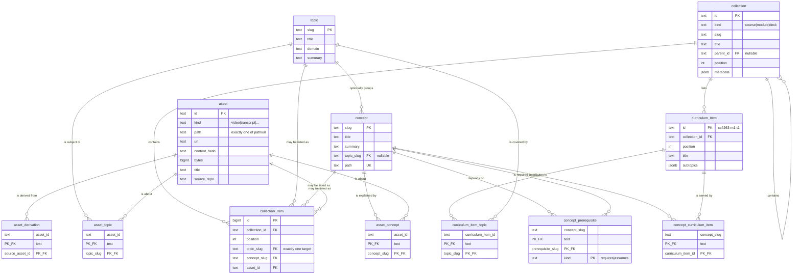

# The catalog schema

One derived index over three content trees, in Postgres 17. This document is
the reasoning; [`packages/schema/src/`](../../packages/schema/src/) is the
definition, and `services/catalog/drizzle/` is the SQL that definition
generates. When they disagree, the code is right and this file is stale.

The plan is [#27](https://github.com/c-wenlong/self-learn/issues/27); this is
the first half of bundle 3, [#21](https://github.com/c-wenlong/self-learn/issues/21).

## The two halves

| Half | Tables | Source of truth |
| --- | --- | --- |
| Content | `topic`, `concept`, `collection`, `curriculum_item`, `asset` and seven link tables | Files in git. Every row is rebuildable by re-running the indexers. |
| State | `learner`, `event`, `mastery`, `review`, `progress`, `recap`, `preference` | Postgres. `event` is the only copy; `mastery` and `review` are replayable from it. |

Losing the content half costs an index run. Losing the state half loses the
study record, which is why `event` is append-only and why the derived state
tables can always be recomputed rather than restored.

## Entities

### Content

| Table | Purpose |
| --- | --- |
| `topic` | The shared vocabulary. Slug PK, title, domain, summary. The required join for every asset. |
| `concept` | One authored note under `learn/concepts/`. Carries prerequisites and mastery. Optional enrichment under a topic. |
| `collection` | Courses and modules today, decks next. A self-referencing tree with `kind`, `position` and a `metadata` jsonb. |
| `curriculum_item` | The checklist row a learner ticks: `cs4263-m1-t1`, its title and its subtopics. |
| `asset` | A file or a link: video, transcript, chapters, captions, diagram source, diagram SVG, note, session, link. |
| `asset_topic` | This asset is about this topic. |
| `asset_concept` | This asset is about this concept. |
| `concept_prerequisite` | This concept `requires` or `assumes` that one. |
| `collection_item` | This collection contains exactly one of a topic, a concept or an asset, at a position. |
| `asset_derivation` | This asset was produced from that one: a transcript from a video, an SVG from a `.tldr`. |
| `curriculum_item_topic` | This checklist row covers this topic. How a course reaches the assets. |
| `concept_curriculum_item` | This note contributes to this checklist row. |

### State

| Table | Purpose |
| --- | --- |
| `learner` | Who. One row, id `local`, until authentication exists. |
| `event` | Append-only log of everything the tutoring loop observed. |
| `mastery` | BKT belief per concept: `p_l`, observations, correct, last seen. Derived. |
| `review` | SM-2 card per concept: repetitions, ease, interval, lapses, due, leech. Derived. |
| `progress` | A ticked checklist row, plus the learner's note on it. |
| `recap` | The durable "what I learnt" record per checklist row. |
| `preference` | Theme, epoch, last visited. Key/value, because these change with the UI. |

## Decisions

### Curriculum items are their own table, not assets

A course topic like `cs4263-m1-t1` could have been an `asset` row of kind
`curriculum_item`, as issue #21 sketched. It is a table instead, for three
reasons.

An asset is defined by where its bytes are: exactly one of `path` or `url`, plus
a content hash and a byte count. A curriculum item has none of those. It is a
node inside a course file, not a file, so every column that makes `asset` useful
would be null for it and the `num_nonnulls(path, url) = 1` check would have to
be dropped to let it in — weakening a constraint for every real asset to
accommodate a row that is not one.

It also needs columns no asset has: `subtopics`, and a `collection_id` naming
the module it is authored inside. Those would have to hide in a jsonb blob, and
`collection_id` in particular is a foreign key, which does not survive being
stuffed into JSON.

Most of all, three state tables point at it. `progress` and `recap` are keyed by
curriculum item, and the web app's `completed` and `notes` maps already are. As
a dedicated table those are plain foreign keys, and a stale id is a constraint
error. As an asset kind they would be foreign keys to `asset(id)` with no way to
say "and it must be a curriculum item" short of a `UNIQUE (id, kind)` plus a
composite foreign key against a literal — a trick that works and that nobody
reading the schema in six months would enjoy.

**The id is the stable external key.** `cs4263-m1-t1` is opaque: nothing parses
its course or module prefix. Reordering changes `position`; moving an item to
another module changes `collection_id`; neither touches the id, so the learner's
tick, note and recap survive the move. That is also why the id is text carried
from the authored data rather than a generated key — a generated key would be
reassigned on the next index run and every `progress` row would point at the
wrong thing.

Curriculum items are deliberately *not* a fourth target in `collection_item`.
An item belongs to exactly one module and is authored inside it, so it carries
`collection_id` directly rather than paying for a many-to-many it will never
use.

### Typed link tables, never a generic edge table

Issue #21 said `edge`. It is eleven columns across seven tables instead:
`asset_topic`, `asset_concept`, `concept_prerequisite`, `collection_item`,
`asset_derivation`, `curriculum_item_topic`, `concept_curriculum_item`.

A generic `edge(from_type, from_id, to_type, to_id)` cannot have foreign keys,
because `from_id` would have to reference five different tables depending on a
value in another column, and no database can express that. Without the foreign
keys, a typo in an indexer inserts a row that reads fine, joins to nothing, and
is found months later by a query that quietly returns fewer results than it
should. That is exactly the failure the audit already recorded: an
`out/networking/adguard-home` render outlived its source and nothing flagged it.

With typed tables the same typo is a `23503` at write time. Putting this data in
Postgres and then dropping the constraints would leave nothing but a slower
JSON file.

Where a column set must be exactly-one-of, a check constraint says so:
`collection_item` has `num_nonnulls(topic_slug, concept_slug, asset_id) = 1`, and
`asset` has `num_nonnulls(path, url) = 1`. A row that names no target, or two,
is refused rather than being a silent no-op for every consumer.

Kind columns are `text` plus a `CHECK`, not a Postgres `ENUM`. Both enforce the
same thing; the check is a one-line drop-and-add in a migration, while widening
an enum has awkward transaction rules and narrowing one is impossible. These
vocabularies are expected to grow — bundle 6 adds asset kinds.

### Append-only is a trigger, not a revoked privilege

`event` has a `BEFORE UPDATE OR DELETE ... FOR EACH STATEMENT` trigger that
raises `restrict_violation`. It is created in
[`drizzle/0001_event_append_only.sql`](drizzle/0001_event_append_only.sql).

`REVOKE UPDATE, DELETE ON event` was the alternative and is weaker in the only
case that matters: a revoked privilege does not bind the table's owner or a
superuser, and the owner is precisely who runs the migrations, the CLI and psql
on a laptop. It would read as enforced and enforce nothing. The trigger fires
for everyone; getting past it takes an explicit `ALTER TABLE ... DISABLE
TRIGGER`, which is an auditable act rather than an accident. It is also dumped
and restored with the schema, so the guarantee survives the eventual `pg_dump`
move to a cloud database, which a grant on a role that does not exist there
would not.

The correction path is a new row, not an edit: the `learn` CLI already writes a
`void` event with a reason, and the trigger's hint says so.

`event` carries no `updated_at`. A column that can never change would only
invite someone to try.

### What is derived and what is not

`mastery` and `review` are projections. Replaying `event` from the beginning
rebuilds both exactly, which is why a wrong row there is a bug to recompute
rather than data to recover, and why `review` has no `history` column: every
grade is already an event of type `review`, and a second copy would be a second
version of the truth.

The whole content half is derived too, from files in git. Nothing in this
database is authored here.

`progress`, `recap` and `preference` are *not* derived. They are the only copy,
and bundle 5 backfills them from `learn/state/*.json` and the browser's
localStorage. Their column names mirror `src/lib/types.ts` and the limits in
`src/lib/storage.ts` (`KNOWLEDGE_LIMITS`: 1200-character summaries, 8-item
lists) so that backfill is a straight copy. The per-item 300-character clamp has
no check constraint: testing each element needs `jsonb_array_elements_text`,
which is a subquery, and a `CHECK` cannot contain one. That clamp stays in
application code, where it already is.

### Two things called "topic"

The course data calls `cs4263-m1-t1` a topic, and the plan calls the shared
vocabulary a topic. They are different things and the schema names them apart:
`curriculum_item` for the first, `topic` for the second. Concept frontmatter's
`topics: [cp4284-m1-t1]` names the *first* kind, which is why the link table for
it is `concept_curriculum_item` and not `asset_topic`'s sibling.

### Indexes

Every foreign key column has an index, because Postgres creates one for a
primary key and a unique constraint but never for a foreign key, and an
unindexed one turns every parent delete into a sequential scan of the child.
On top of those: `event(at)` for the log read in time order, `review(due)` for
"what is due today", `topic(domain)`, `asset(kind)` and `asset(content_hash)`
for the drift check in bundle 6.

## The content half



## The state half

```mermaid
erDiagram
    learner ||--o{ event : "records"
    learner ||--o{ mastery : "believes"
    learner ||--o{ review : "schedules"
    learner ||--o{ progress : "ticks"
    learner ||--o{ recap : "keeps"
    learner ||--o{ preference : "sets"
    concept ||--o{ event : "may be about"
    concept ||--o{ mastery : "is tracked by"
    concept ||--o{ review : "is scheduled by"
    curriculum_item ||--o{ progress : "is ticked in"
    curriculum_item ||--o{ recap : "is recapped in"
    event ||..|| mastery : "replays into"
    event ||..|| review : "replays into"

    learner {
        text id PK "local"
        text display_name
    }
    event {
        bigint id PK "identity"
        timestamptz at "indexed"
        text learner_id FK
        text type "session-start|observation|review|session-close|void"
        text concept_slug FK "nullable"
        text session_id "nullable"
        jsonb payload
    }
    mastery {
        text learner_id PK_FK
        text concept_slug PK_FK
        float p_l "0..1"
        int observations
        int correct "<= observations"
        timestamptz last_seen
    }
    review {
        text learner_id PK_FK
        text concept_slug PK_FK
        int repetitions
        float ease ">= 1.3"
        int interval_days "1..36500"
        int lapses
        timestamptz due "indexed"
        timestamptz last_reviewed
        boolean leech
    }
    progress {
        text learner_id PK_FK
        text curriculum_item_id PK_FK
        timestamptz completed_at "nullable"
        text note
    }
    recap {
        text learner_id PK_FK
        text curriculum_item_id PK_FK
        text summary "<= 1200 chars"
        jsonb key_points "<= 8 items"
        jsonb misconceptions "<= 8 items"
        jsonb open_questions "<= 8 items"
        text source "agent|manual"
        int sessions
    }
    preference {
        text learner_id PK_FK
        text key PK
        jsonb value
    }
```

The dotted lines are not foreign keys. They say that `mastery` and `review` are
computed from `event` and can be thrown away and rebuilt.

## Working on it

```bash
createdb self_learn                    # once, against the Homebrew Postgres 17
npm run catalog -- migrate             # apply every outstanding migration
npm run catalog -- status --json       # row counts and the migration head
```

After changing anything in `packages/schema/src/`:

```bash
npm run generate -w @self-learn/catalog   # writes services/catalog/drizzle/
npm run catalog -- migrate
npm test
```

Never edit an applied migration. drizzle keys them by the sha256 of the file, so
an edit makes the migration look unapplied everywhere it has already run.

## Still open

- The `topic` table is empty until `content/topics.yaml` lands with the second
  half of bundle 3. `concept.topic_slug` is nullable for that reason and should
  be tightened once every note resolves.
- `event.session_id` is free text. Sessions are files under `learn/sessions/`
  today, so there is nothing to reference; they become assets of kind `session`
  when the indexers land, and the column can become a foreign key then.
- `learner` holds one row by convention, not by constraint. A `CHECK (id =
  'local')` would enforce it and would have to be dropped the day authentication
  arrives, so the convention is documented instead.
