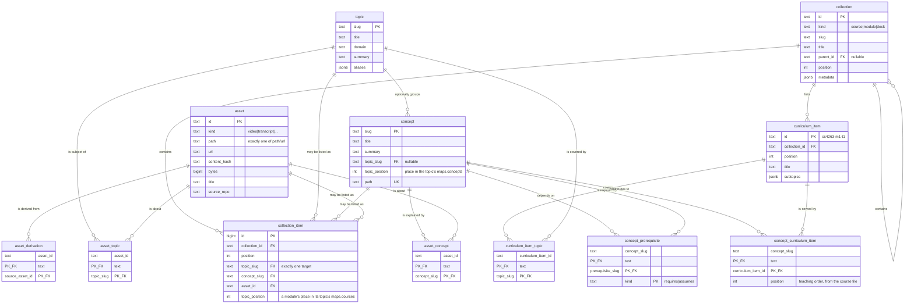

# The catalog schema

The authored content, the learner state and the rows that run them, in
Postgres 17. This document is the reasoning; [`packages/schema/src/`](../../packages/schema/src/) is the
definition, and `services/catalog/drizzle/` is the SQL that definition
generates. When they disagree, the code is right and this file is stale.

The plan is [#27](https://github.com/c-wenlong/self-learn/issues/27); this is
the first half of bundle 3, [#21](https://github.com/c-wenlong/self-learn/issues/21).

[docs/CONTENT-MIGRATION.md](../../docs/CONTENT-MIGRATION.md) is the plan
that made Postgres the source of truth for content, and it is built through
its phase 3 cut-over. Every content type is authored in the database, the
repository's `content/` and `learn/` are gone (the tag `content-files-final`
keeps every version of them), and files are an export format (D1 there):
`catalog export` writes that layout, `catalog import` reads it back, and
`seed/` is one such tree. [The content migration's foundation](#the-content-migrations-foundation)
below describes the tables the plan added. Where a section below says an
indexer "reads" `content/` or `learn/`, it means those folders inside the
directory being imported: an export, `seed/`, or `content-files-final`.

## The two halves

| Half | Tables | Source of truth |
| --- | --- | --- |
| Content | `topic`, `concept`, `collection`, `curriculum_item`, `asset` and seven link tables; since 0010 also `tag`, `topic_relation`, `manimkc_topic`, `collection_tag`, `diagram`, `blob_object`, `session_log_entry` and `content_revision` | Postgres, since the phase 3 cut-over: every type is authored here through the write seam, and files are an export (`catalog export --out`, and the nightly export under `$SELF_LEARN_HOME/archive/`). The manimkc rows and the mirror ledger are still rebuilt by `catalog import` from manimkc's own CLI. `content_revision` is the only record of who wrote what, and why. |
| State | `learner`, `event`, `mastery`, `review`, `progress`, `recap`, `preference` | Postgres. `event` is the only copy; `mastery` and `review` are replayable from it. Filled by bundle 5's backfill — see [LEARN.md](LEARN.md). |
| Operational | `index_run`, `mirror`, `content_source`, `catalog_instance` | Neither. What the indexers did, which content types the database owns, and whether this database is the primary. |
| Studio | `session`, `job`, `asset_job` | Postgres, and the only copy. Who asked for a file to be made, and what came out. |

`index_run` is the third thing because it is neither of the first two: it is not
derived *from* files, and it is not the only copy of anything a learner did.
Without it, "is the manimkc half of this database stale?" has no answer short of
re-indexing and diffing, because a table full of rows from a three-week-old
checkout looks exactly like a fresh one.

It carries one thing that is not a report on the run, and the distinction is
worth stating because the column names invite confusion. `source_root` is what
the run *read*: the imported directory's `learn/concepts` for the notes, and for manimkc the checkout the
CLI was pointed at. `metadata.outRoot`, written by the manimkc source only, is
what that source's `asset.path` strings are *relative to*, which is manimkc's
own data root and is a different directory whenever `$MANIMKC_HOME` is set.
Nothing outside the catalog may re-derive it, since this repo does not read
that variable ([AGENTS.md](../../AGENTS.md)), so a consumer that wants to open one
of those files, such as `apps/web/src/app/api/assets/[id]/file/route.ts`, joins
`metadata.outRoot` onto `asset.path` and refuses when the run predates the
value rather than guessing at a base.

The studio group is the fourth thing, and it is fourth for the opposite reason
`index_run` is third. It has the state half's durability — losing it loses the
brief and the failure record, and no re-index writes either back — and none of
its meaning. A render error is not a thing a learner did, so a row saying
Chromium fell over sitting beside a Bayesian belief about the dot product would
make both harder to read. `catalog status` counts it apart for exactly that
reason.

Losing the content half used to cost an index run. Since the cut-over it
loses what was authored after the last export (the nightly one keeps thirty
under `$SELF_LEARN_HOME/archive/`) and the revision history, which only a
database backup holds; the manimkc rows alone come back from an import.
Losing the state half loses the study record, which is why `event` is
append-only and why the derived state tables can always be recomputed rather
than restored. Losing the studio half loses the provenance: the diagrams stay,
with their revisions in `content_revision`, and what goes is the record of
which brief produced them.

## Entities

### Content

| Table | Purpose |
| --- | --- |
| `topic` | The shared vocabulary. Slug PK, title, domain, summary, aliases. The required join for every asset. |
| `concept` | One authored note (`learn/concepts/<domain>/<slug>.md` in the export layout). Carries prerequisites and mastery. Optional enrichment under a topic. Since Track C the row holds the whole note: its frontmatter as columns (`title`, `summary`, `tags`, `sources`, `authored_at` for `created:`, `requires:` and `assumes:` as `concept_prerequisite`), its folder as `domain`, and the markdown after the frontmatter as `body`, byte for byte. The file it renders writes the keys in one order and leaves out an empty `assumes`, since a row keeps values, not layout; `services/catalog/src/content/notes.ts` is the one rule. |
| `collection` | Courses and modules today, decks next. A self-referencing tree with `kind`, `position` and a `metadata` jsonb. |
| `curriculum_item` | The checklist row a learner ticks: `cs4263-m1-t1`, its title and its subtopics. |
| `asset` | A file or a link: video, transcript, chapters, captions, diagram source, diagram SVG, note, session, link. |
| `asset_topic` | This asset is about this topic. |
| `asset_concept` | This asset is about this concept. |
| `concept_prerequisite` | This concept `requires` or `assumes` that one. |
| `collection_item` | This collection contains exactly one of a topic, a concept or an asset, at a position. A module holds one topic row (its topic, with `topic_position`, its place in that topic's `maps.courses`) and, since 0.5, one asset row per curated link in `resources:` order. |
| `asset_derivation` | This asset was produced from that one: a transcript from a video, an SVG from a `.tldr`. |
| `curriculum_item_topic` | This checklist row covers this topic. How a course reaches the assets. |
| `concept_curriculum_item` | This note contributes to this checklist row, at this position. Written by the courses source from `topics[].concepts`. |
| `tag` | A cross-course theme (`content/tags.yaml` in the export layout), at its position in the list. Since 0010, filled by the `tags` source since 0.5, and written by `catalog tag` since Track A. |
| `collection_tag` | This course carries this tag, at its place in the course's `tags:`. Makes a stale tag a `23503` instead of a string in jsonb. |
| `topic_relation` | A typed edge between two topics: `broader`, `related` (symmetric, stored once with the slugs in "C" order), `precedes`. Read from a topic's `relations:` list, at its position there. |
| `manimkc_topic` | One manimkc topic path under one vocabulary topic: `maps.manimkc` as rows, and the primary key is the one-path-one-topic rule. |
| `diagram` | A `.tldr` document in jsonb, its SVG as a blob, and the two hashes that say whether the SVG is stale. |
| `blob_object` | One object in the blob store: `<owner_id>/<sha256>.<ext>`, its size, type, provider and whether the upload is confirmed. |
| `session_log_entry` | One appended piece of a session log: the exact text that went onto the end of the file, so the log is its entries concatenated, byte for byte. The first entry is what `learn session start` wrote, frontmatter included. Append-only; its own history, so no revisions. An import appends what a file grew by and refuses one edited above its end. |
| `content_revision` | One row per content write: the whole entity after it, its hash, who wrote it and why. Append-only. |

### State

| Table | Purpose |
| --- | --- |
| `learner` | Who. One row, id `local`, until authentication exists. |
| `event` | Append-only log of everything the tutoring loop observed. |
| `mastery` | BKT belief per concept: `p_l`, observations, correct, last seen. Derived. |
| `review` | SM-2 card per concept: repetitions, ease, interval, lapses, due, leech. Derived. |
| `progress` | A ticked checklist row, plus the learner's note on it. |
| `recap` | The durable "what I learnt" record per checklist row. |
| `preference` | Theme, epoch, last visited. Key/value, because these change with the UI. |

### Operational

| Table | Purpose |
| --- | --- |
| `index_run` | One row per source: when it last ran, what it read, what it wrote, and anything else it wanted remembered. Overwritten each run. |
| `mirror` | One row per (asset, destination): what one audit saw of a deliverable on Google Drive or Seafile. |
| `content_source` | Which content types the database owns, written by `catalog flip`, with the last export's hash and the parity the flip checked. The importers read a type with no row from files; a reader, the web app's included, reads it from the database, the default since the cut-over. See [Who owns a type](#who-owns-a-type). |
| `catalog_instance` | One row: this database is `primary` or `copy`. A copy refuses every write (the copy guard below). |

### Studio

| Table | Purpose |
| --- | --- |
| `session` | One run of something that writes to the knowledge base. `kind` is `tutor` (a `/learn` session) or `studio` (a generation runner); both share one id space, which is what lets `event.session_id` be a foreign key. |
| `job` | One request to generate one file: the brief, the lease on a committed path, the state machine, the gate's verdict and what it cost. |
| `asset_job` | This job wrote this asset, at this hash, at this size. Provenance as a link table, so regenerating does not erase the earlier job's claim. Once the job is accepted the hash is a snapshot and is never rewritten: a repair assert over a file somebody has edited since would otherwise replace "what the job wrote" with "what a person wrote afterwards", which is the one comparison that makes the edit visible. |

Three shapes here are worth stating outright.

**`target_path` and `candidate_path` are different files.** A job writes only
its candidate, in its own workspace, `jobs/<id>/candidate/<name>` relative to
the runner's `STUDIO_HOME`, which is what `candidate_path` holds (rows from
before phase 2 keep `learn/assets/.candidates/<name>` as history); nothing
lands until a person accepts. So `target_path` names a file
the job has never opened, and it is also the lease key:

```sql
CREATE UNIQUE INDEX job_active_target_key ON job (target_path)
  WHERE state in ('queued', 'running', 'awaiting_review');
```

Two jobs cannot hold the same committed path at once, and an unaccepted
candidate keeps holding it, because the second brief would be written against
what the first has not landed yet. Partial rather than total, because the whole
history of a path is jobs that have finished with it. An advisory lock was the
alternative and dies with its connection, so nothing could ever show who holds
it.

**`state` is checked and `phase` is not.** `state` is the small vocabulary every
transition is guarded against, so a conditional `UPDATE … WHERE state = ?` is
the only way a job moves and two runners cannot both claim one. `phase` is the
progress label the UI shows (`drawing`, `linting`, `exporting`), differs per
generator, and would make the CHECK grow every time a pipeline gained a step.
`cancel_requested_at` is a timestamp for the same reason: a job being cancelled
is still running until the runner has killed Chromium.

**`topic_slug` is a column and a foreign key; the rest of the brief is jsonb.**
A foreign key does not survive being stuffed into JSON — the same argument that
keeps `curriculum_item` out of `asset` — and the topic is the earliest moment
refuse-never-skip can fire: a brief naming a slug that has no `topic` row
fails the enqueue with a `23503` before any GPU time.

## Decisions

### Curriculum items are their own table, not assets

A course topic like `cs4263-m1-t1` could have been an `asset` row of kind
`curriculum_item`, as issue #21 sketched. It is a table instead, for three
reasons.

An asset is defined by where its bytes are: exactly one of `path` or `url`, plus
a content hash and a byte count. A curriculum item has none of those. It is a
node inside a course file, not a file, so every column that makes `asset` useful
would be null for it and the `num_nonnulls(path, url) = 1` check would have to
be dropped to let it in — weakening a constraint for every real asset to
accommodate a row that is not one.

It also needs columns no asset has: `subtopics`, and a `collection_id` naming
the module it is authored inside. Those would have to hide in a jsonb blob, and
`collection_id` in particular is a foreign key, which does not survive being
stuffed into JSON.

Most of all, three state tables point at it. `progress` and `recap` are keyed by
curriculum item, and the web app's `completed` and `notes` maps already are. As
a dedicated table those are plain foreign keys, and a stale id is a constraint
error. As an asset kind they would be foreign keys to `asset(id)` with no way to
say "and it must be a curriculum item" short of a `UNIQUE (id, kind)` plus a
composite foreign key against a literal — a trick that works and that nobody
reading the schema in six months would enjoy.

**The id is the stable external key.** `cs4263-m1-t1` is opaque: nothing parses
its course or module prefix. Reordering changes `position`; moving an item to
another module changes `collection_id`; neither touches the id, so the learner's
tick, note and recap survive the move. That is also why the id is text carried
from the authored data rather than a generated key — a generated key would be
reassigned on the next index run and every `progress` row would point at the
wrong thing.

Curriculum items are deliberately *not* a fourth target in `collection_item`.
An item belongs to exactly one module and is authored inside it, so it carries
`collection_id` directly rather than paying for a many-to-many it will never
use.

### Typed link tables, never a generic edge table

Issue #21 said `edge`. It is eleven columns across seven tables instead:
`asset_topic`, `asset_concept`, `concept_prerequisite`, `collection_item`,
`asset_derivation`, `curriculum_item_topic`, `concept_curriculum_item`.

A generic `edge(from_type, from_id, to_type, to_id)` cannot have foreign keys,
because `from_id` would have to reference five different tables depending on a
value in another column, and no database can express that. Without the foreign
keys, a typo in an indexer inserts a row that reads fine, joins to nothing, and
is found months later by a query that quietly returns fewer results than it
should. That is exactly the failure the audit already recorded: an
`out/networking/adguard-home` render outlived its source and nothing flagged it.

With typed tables the same typo is a `23503` at write time. Putting this data in
Postgres and then dropping the constraints would leave nothing but a slower
JSON file.

Where a column set must be exactly-one-of, a check constraint says so:
`collection_item` has `num_nonnulls(topic_slug, concept_slug, asset_id) = 1`, and
`asset` has `num_nonnulls(path, url) = 1`. A row that names no target, or two,
is refused rather than being a silent no-op for every consumer.

Kind columns are `text` plus a `CHECK`, not a Postgres `ENUM`. Both enforce the
same thing; the check is a one-line drop-and-add in a migration, while widening
an enum has awkward transaction rules and narrowing one is impossible. These
vocabularies do grow: bundle 6 added `mirrors` to `index_run.source` and two
new vocabularies of its own, each a two-statement change in
`0005_mirror_ledger.sql`.

### Append-only is a trigger, not a revoked privilege

`event` has a `BEFORE UPDATE OR DELETE ... FOR EACH STATEMENT` trigger that
raises `restrict_violation`. It is created in
[`drizzle/0001_event_append_only.sql`](drizzle/0001_event_append_only.sql).

`REVOKE UPDATE, DELETE ON event` was the alternative and is weaker in the only
case that matters: a revoked privilege does not bind the table's owner or a
superuser, and the owner is precisely who runs the migrations, the CLI and psql
on a laptop. It would read as enforced and enforce nothing. The trigger fires
for everyone; getting past it takes an explicit `ALTER TABLE ... DISABLE
TRIGGER`, which is an auditable act rather than an accident. It is also dumped
and restored with the schema, so the guarantee survives the eventual `pg_dump`
move to a cloud database, which a grant on a role that does not exist there
would not.

The correction path is a new row, not an edit: the `learn` CLI already writes a
`void` event with a reason, and the trigger's hint says so.

The triggers are `FOR EACH ROW`, and `0003_append_only_per_row` exists because
they were not. As `FOR EACH STATEMENT` a trigger fires on the statement whether
or not it touches a row, and `event.concept_slug` is a foreign key with `ON
DELETE SET NULL`: deleting any concept makes Postgres run `UPDATE ONLY event SET
concept_slug = NULL WHERE $1 = concept_slug`, which tripped the guard even
against a completely empty `event`. No `concept` row could be deleted at all,
which is incompatible with an indexer whose contract is that a derived row goes
when its file does. Per-row keeps the guarantee exactly — every event row
actually being changed still raises — and drops the false positive.

`event` carries no `updated_at`. A column that can never change would only
invite someone to try.

### What is derived and what is not

`mastery` and `review` are projections. Replaying `event` from the beginning
rebuilds both exactly, which is why a wrong row there is a bug to recompute
rather than data to recover, and why `review` has no `history` column: every
grade is already an event of type `review`, and a second copy would be a second
version of the truth.

The content half was derived too, from files in git, until the phase 3
cut-over. It is authored here now: every write goes through the write seam
with an author and a reason, and nothing rebuilds it but a restore or an
import of an export. The manimkc rows and the mirror ledger are the part
still derived, from manimkc's CLI.

`progress`, `recap` and `preference` are *not* derived. They are the only copy.
Bundle 5 filled them: `catalog backfill` from `learn/state/*.json`, and
`/api/learner/import` from a browser's localStorage on first mount. Their column names mirror `apps/web/src/lib/types.ts` and the limits in
`apps/web/src/lib/storage.ts` (`KNOWLEDGE_LIMITS`: 1200-character summaries, 8-item
lists) so that backfill is a straight copy. The per-item 300-character clamp has
no check constraint: testing each element needs `jsonb_array_elements_text`,
which is a subquery, and a `CHECK` cannot contain one. That clamp stays in
application code, where it already is.

### Two things called "topic"

The course data calls `cs4263-m1-t1` a topic, and the plan calls the shared
vocabulary a topic. They are different things and the schema names them apart:
`curriculum_item` for the first, `topic` for the second. A course row's
`concepts:` list names notes that teach the *first* kind, which is why the link
table for it is `concept_curriculum_item` and not `asset_topic`'s sibling. That
link used to be authored the other way round, as a `topics:` key in the note's
frontmatter; the courses source owns it now and the concepts source refuses a
note that still carries the key
([the proposal](../../docs/proposals/course-items-declare-concepts.md)).

### Indexes

Every foreign key column has an index, because Postgres creates one for a
primary key and a unique constraint but never for a foreign key, and an
unindexed one turns every parent delete into a sequential scan of the child.
On top of those: `event(at)` for the log read in time order, `review(due)` for
"what is due today", `topic(domain)`, `asset(kind)` and `asset(content_hash)`
for the drift check, and `mirror(status)` for the count `catalog status`
reports per destination.

## The content half



## The state half

```mermaid
erDiagram
    learner ||--o{ event : "records"
    learner ||--o{ mastery : "believes"
    learner ||--o{ review : "schedules"
    learner ||--o{ progress : "ticks"
    learner ||--o{ recap : "keeps"
    learner ||--o{ preference : "sets"
    concept ||--o{ event : "may be about"
    concept ||--o{ mastery : "is tracked by"
    concept ||--o{ review : "is scheduled by"
    curriculum_item ||--o{ progress : "is ticked in"
    curriculum_item ||--o{ recap : "is recapped in"
    event ||..|| mastery : "replays into"
    event ||..|| review : "replays into"

    learner {
        text id PK "local"
        text display_name
    }
    event {
        bigint id PK "identity"
        timestamptz at "indexed"
        text learner_id FK
        text type "session-start|observation|review|session-close|void"
        text concept_slug FK "nullable"
        text session_id "nullable"
        jsonb payload
    }
    mastery {
        text learner_id PK_FK
        text concept_slug PK_FK
        float p_l "0..1"
        int observations
        int correct "<= observations"
        timestamptz last_seen
    }
    review {
        text learner_id PK_FK
        text concept_slug PK_FK
        int repetitions
        float ease ">= 1.3"
        int interval_days "1..36500"
        int lapses
        timestamptz due "indexed"
        timestamptz last_reviewed
        boolean leech
    }
    progress {
        text learner_id PK_FK
        text curriculum_item_id PK_FK
        timestamptz completed_at "nullable"
        text note
    }
    recap {
        text learner_id PK_FK
        text curriculum_item_id PK_FK
        text summary "<= 1200 chars"
        jsonb key_points "<= 8 items"
        jsonb misconceptions "<= 8 items"
        jsonb open_questions "<= 8 items"
        text source "agent|manual"
        int sessions
    }
    preference {
        text learner_id PK_FK
        text key PK
        jsonb value
    }
```

The dotted lines are not foreign keys. They say that `mastery` and `review` are
computed from `event` and can be thrown away and rebuilt.

## Filling it

`npm run catalog -- import <dir>` reads a directory in the export layout
(`seed/`, an export) and rewrites the rows it owns; with no directory it
reads the repository, which has held no content since the phase 3 cut-over.
A type the database owns is skipped when its files are its own last export,
and, once the database owns every type, when the directory holds none of
them, so on a database that owns all six a bare `import` runs only manimkc
and the mirror ledger. Once topics are
flipped the vocabulary every source resolves a slug against comes from the
topic rows (`vocabularyOf` in `src/index/vocabulary.ts`), not from the
directory's `content/topics.yaml`. `catalog index` is the old name, kept as an
alias that says so once on stderr. Eight sources, run in the order the
foreign keys require regardless of how `--only` names them, each path
relative to the directory:

| Source | Reads | Produces |
| --- | --- | --- |
| `topics` | `content/topics.yaml` | `topic`, `topic_relation`, `manimkc_topic` |
| `tags` | `content/tags.yaml` | `tag` |
| `concepts` | `learn/concepts/<domain>/*.md` | `concept`, `concept_prerequisite`, `note` assets |
| `courses` | `content/courses/*.yaml` | `collection`, `curriculum_item`, `collection_item`, `collection_tag`, `curriculum_item_topic`, `concept_curriculum_item`, `link` assets with their `resource_type` |
| `manimkc` | `manimkc topics --json` | `video`, `transcript`, `chapters`, `captions` assets and their derivations |
| `diagrams` | `tldrawkc list <dir>/learn/assets --json`, or the `.tldr` JSON | `diagram_svg`, `diagram_source` assets |
| `sessions` | `learn/sessions/*.md` | `session` assets, linked by the body's wikilinks |
| `mirrors` | `manimkc mirrors --json` | `mirror` |

`concepts` runs before `courses` because a course row's `concepts:` list
becomes rows pointing at concepts, and the courses source refuses an id no note
defines by checking what the concepts source just produced. Everything runs
after `topics` because every other source resolves a slug from the shared
vocabulary. `mirrors` runs last: it reads no
content tree, only a ledger joined onto asset rows `manimkc` has already
written.

**`--only` selects downstream too.** Pruning a `topic` cascades: the
`asset_topic`, `curriculum_item_topic` and `collection_item` rows pointing at it
are deleted and `concept.topic_slug` is set to null. So `--only topics` after a
slug is renamed would leave every other source silently unlinked, and nothing
would say so until a `show` that used to return videos stopped. Selecting a
source therefore selects everything that points at what it owns, and the run
reports what it added. `--only topics` is a full run, which is the honest
answer, and `--only manimkc` stays cheap: the only thing pointing at what
manimkc owns is `mirrors`, whose rows cascade away with the asset they name, so
that pair runs together and nothing else has to. `--only courses` goes the
other way and re-reads the notes first: a course row's `concepts:` list
resolves against concept rows, and checking it against rows from the last run
would refuse a note added since, so `concepts` is a prerequisite of `courses`
the way `manimkc` is of `mirrors`. `tags` is a prerequisite of `courses` too,
since `collection_tag` points at tag rows, and a dependent of it, since pruning
a tag clears the links to it that only the courses source writes back. The two
closures are applied until neither adds anything: `--only concepts` pulls in
`courses` as a dependent, and `courses` then pulls in `tags`.

`manimkc` and `mirrors` are the optional sources. Both read
`tools/manimkc/tools/cli/manimkc`, which lives in a submodule that a fresh clone and
CI deliberately do not fetch. A default run drops one with a note when the
submodule is absent *and* that source has never been indexed here, because then
there is nothing to leave stale. It refuses when `--only` asked for it, and
refuses when it does have rows to lose.

### The diagram metadata rule

A `.tldr` carries `meta.tldrawkc` on its tldraw document record, written by
`tldrawkc meta set` or by `tldrawkc new`, and that object is where the diagrams
source gets the topic and the concepts. A `.tldr` with no topic there is
refused by name. The filename stem used to carry that job and was never more
than a guess: a stem matching no concept was filed nowhere and nothing said so.

The metadata is read through `tldrawkc list <dir> --json` when the submodule is
built, and by parsing the `.tldr` JSON directly when it is not, since a fresh
clone has the seed's files and not the build. `services/catalog/test/tldr.test.ts`
asserts the two readers agree on the same directory.

The one thing still filed by its stem is an SVG with no `.tldr` beside it. It
has no editable source, so there is nothing to stamp and refusing it would
refuse work that cannot be fixed; each one is reported as a warning instead.

### Diagrams: a row and a blob

Since Track D a `.tldr` is a `diagram` row and its SVG is a blob. The import
parses each document into `diagram.document` and hands each SVG to the runner,
which stores it through `uploadBlob` (`src/content/blob.ts`: a `pending`
`blob_object` row committed first, the bytes streamed, `head` asked, then
`present`) before the rows that name its key are written. The asset ids and
paths stay what they were, as logical names (D11), and the SVG asset gains
`blob_key`.

A document's bytes are its canonical JSON: keys sorted at every depth, no
whitespace (`src/content/diagram-document.ts`). jsonb keeps no key order, so
the file an import read cannot be given back byte for byte, and one form has
to be the definition. `diagram.document_hash` and the `.tldr` asset's
`content_hash` are the sha256 of those bytes, the export writes them, and a
checkout writes them; tldraw reads a document in any key order, and parity
compares `.tldr` files parsed. The first export after the import therefore
rewrites each tracked `.tldr`'s key order once.

`svg_document_hash` is the `document_hash` the SVG was exported from, as the
writer vouches: `catalog diagram put` with an SVG records the pair as current,
and a put without one keeps the stored SVG, stale once the document moved. An
import keeps that record for an SVG whose bytes the database already stores,
so a stale SVG stays stale through the next import, and records any other SVG
as exported from the document beside it, since nothing on disk says
otherwise. `catalog diagram put|checkout|commit|list|show`
(`src/content/diagrams.ts`) is the write path the studio's Accept and the
plugin use; `commit` carries the revision its checkout started from and is
refused when the diagram moved past it. Until `catalog flip diagrams`, a put
also writes its files under the directory diagrams were last imported from
(D17), so the next import reads back what was written rather than undoing it.

An SVG drawn without the canvas has no document, so it is no `diagram` row:
`put --slug --svg --topic [--concept]` with no `--tldr` writes one
`diagram_svg` asset and its blob, filed under what the writer names, and is
refused for a slug that has a document (asked again under the SVG asset's
lock, which a document put also takes, and, until the flip, counting a
`.tldr` on disk that no import has read yet). Until the flip the import files such
an SVG by its name alone (the concept of that name and its topic), so the put
is refused unless it names exactly that; after it, the writer's links stand.

### The mirror ledger

`mirror` holds what one audit saw, not what is true now. `manimkc mirrors
--json` owns the comparison, because it owns the mirror layout, the hash cache,
and the fact that a Google Drive placeholder will not open and has to be judged
by size and mtime; `compared` records which of those tests the verdict rests on,
so a `present` reached by sha256 is distinguishable from the weaker one. The
join between the two reports is the repo-relative deliverable path, unrewritten
on either side. Videos never enter the database as bytes.

A destination the run could not reach writes nothing and deletes nothing, so its
rows keep the older `checked_at` that says when they were last true. That is why
`mirror` is not cleared and rewritten like the other link tables: a run declares
which destinations it audited, the writer clears only those, and
`index_run.metadata` records what the run actually saw.

### Refuse, never skip

An unresolved reference stops the run and names the file and the slug. A skipped
row is an asset that is silently absent from the catalog, with nothing anywhere
saying so — which is the failure the audit in
[#27](https://github.com/c-wenlong/self-learn/issues/27) already recorded once,
when a rendered video outlived its source and nothing flagged it. Errors are
collected per source and reported together, so one run fixes one edit rather
than thirty runs fixing thirty.

Two facts stated in two files are checked against each other rather than
resolved by precedence: a module's `topic:` against the vocabulary's
`maps.courses`, and a manimkc `topic.yml`'s optional `topic:` against
`maps.manimkc`. When they disagree, neither is knowably right, so the run stops.

The one exception is `sessions`. A session log is prose, and its wikilinks point
at other sessions and at notes nobody has written; a link that names no concept
is counted, not refused.

### Upsert, then prune

Each source writes in one transaction: clear the link rows it owns, upsert its
entities, delete the entities it no longer produces, insert the links. Two
things make that safe.

**Entities are upserted, never replaced.** `concept` is the target of `ON
DELETE CASCADE` foreign keys from `mastery` and `review`, and `curriculum_item`
of `ON DELETE RESTRICT` ones from `progress` and `recap`, so deleting and
reinserting a row would destroy the learner's record of it or fail on it. The upsert's SET
clause is built from the table's columns rather than the supplied keys, so a
field deleted from a file becomes null instead of living on as the last value
anyone wrote.

**Each source owns a namespace.** Every asset id begins with its source's prefix
(`note:`, `link:`, `manimkc:`, `diagram:`, `session:`) and the writer refuses an
id outside it. That prefix is how a prune knows which rows it may delete, so one
indexer can never remove another's. `mirrors` mints no asset ids at all: it
writes `mirror` rows against ids the `manimkc` source already wrote, and the
writer refuses a `mirror` row for a destination the run did not declare it
audited, because such a row would never be cleared again.

`poster:` is the one asset namespace no indexer owns. `catalog asset upload`
writes it, one `poster:<video id>` row per video, derived from the video
through `asset_derivation`, with no `path` and a `blob_key`
([CONTENT-MIGRATION.md](../../docs/CONTENT-MIGRATION.md), Track E). It sits
outside `manimkc:` because the manimkc prune deletes every row in that
namespace it did not produce, and it never produces a poster.

**An index keeps a blob it did not name.** An indexer hands over asset rows
with no `blob_key`, and the upsert sets every column, so the writer carries the
stored key forward whenever the stored blob's sha256 is the `content_hash` just
read (`services/catalog/src/index/blob-keys.ts`). A re-render changes the hash
and drops the key, so the asset falls back to its file until the next upload.
That is the order before the contract migration, 0013 (below). After it a
stored-kind row cannot exist without its blob, so the manimkc source does what
the diagrams source always did: it hands each video and sidecar to the runner
to store first and names the content-addressed key on the row
(`IndexContext.blobsRequired`, set when `asset_stored_blob_check` exists). A
re-render then lands under its own key in the same import.

Because deletions cascade, `import` prints the keys it removed rather than a
count.

**Courses and their items are archived, not pruned** (D12, since 0010). A
module or checklist row the course files stop listing gets `archived_at`, and
listing it again clears it, because the upsert's SET clause takes every column
from the insert and `archived_at` defaults to null. Archiving runs before the
upsert, so a module that replaces an archived one can reuse its slug:
`collection_parent_slug_key` covers only live rows. `import` prints the archived
keys beside the deleted ones.

An archived row is kept for the learner rows under it and is on no page, so
the readers leave it out: `catalog status`'s coverage, `catalog ls`, and the
lists `catalog show` returns count and list live rows only, and `show` or
`ls` of an archived entity named directly says `archived: true`. A tick, note
or recap written to an archived item is refused by name (`assertKnownItems` in
`src/state/progress.ts`), while what was recorded on it before stays, and the
Settings export still carries it; importing that export back
(`src/state/import.ts`) restores it, since it is the learner's own record.

The course writers (`catalog course import`, `catalog item archive|restore`,
`src/content/courses.ts` and `src/content/items.ts`) archive through the seam
and keep the archived row's links, so a restore brings its concept links
back; the courses indexer replaces its link tables wholesale and so drops
them, and a restore of such an item takes them from the last revision that
recorded it live. The one way an item leaves the table is `catalog item
purge`, which refuses a live item, refuses while a `progress` or `recap` row
names it, and with `--with-learner-data` copies those rows into its `delete`
revision's snapshot (under `links.progress` and `links.recap`, by column name)
before deleting them, so `catalog item restore` of a purged item rebuilds the
row, its links and the learner rows from that revision alone.

**Every entity a run touched gets an `import` revision when its snapshot
changed.** The run's author is `import:<git sha>` of the commit the files it
read are tracked at, `import:<sha>-dirty` when some under `content/` or
`learn/` differ from it, and `import:unknown` when nothing under the directory
is tracked (an export in a scratch folder is not the enclosing checkout's
commit). The reason names the directory and the file or folder read,
repository-relative or under `~`, never a home path. A second run over an
unchanged tree appends none, which `catalog.test.ts` asserts on `seed/`.

## The content migration's foundation

Migration `0010_content_expand` is phase 0 section 0.2 of
[docs/CONTENT-MIGRATION.md](../../docs/CONTENT-MIGRATION.md): every table and
column the five phase 1 tracks need, landed at once so no track generates a
migration of its own (D10). It changes nothing any reader sees. The write seam
that uses it (0.3) is in `src/content/`.

### Owners

Every content entity carries `owner_id text not null default 'local'
references learner(id) on delete restrict`: `topic`, `tag`, `topic_relation`,
`manimkc_topic`, `concept`, `collection`, `curriculum_item`, `asset`,
`diagram`, `blob_object`, `content_revision`, and `job` and `asset_job`. Link
tables carry none; they belong to the entity at their owning end. Primary keys
did not change, so ids stay global across owners (D3). The migration inserts
the `local` learner before the first `owner_id` column, because a database that
was indexed and never studied has no learner row and every foreign key default
would have failed on it.

### Revisions

`content_revision` is the history git used to give. One row per content write,
with `seq` per entity, `previous_id`, `op`, `author_kind`, `author` and a
non-empty `reason`, and a `snapshot`: the entity after the write with its owned
links nested under it, keys sorted, link rows sorted, `created_at`,
`updated_at` and `collection_item.id` left out as facts about the write rather
than the content. `snapshot_hash` is sha256 of that canonical form, which is
how an import that changes nothing appends nothing. Which link belongs to which
parent is `src/content/entities.ts`; the seam and the importer both read it, so
they cannot snapshot the same entity two ways.

| Parent | Owned links |
| --- | --- |
| `topic` | `topic_relation` (as `from`), `manimkc_topic` |
| `collection` | `collection_tag`, `collection_item` |
| `curriculum_item` | `curriculum_item_topic`, `concept_curriculum_item` |
| `concept` | `concept_prerequisite` |
| `asset` | `asset_topic`, `asset_concept`, `asset_derivation` |
| `tag`, `diagram` | none |

`writeContent` in `src/content/write.ts` is the one authored write: one
transaction that takes the revision locks, refuses when the writer's `base` is
not the latest revision, sets `self_learn.revision_id`, upserts the row and any
links given in a savepoint, reads the snapshot back and appends the revision.
A write whose snapshot equals the latest revision's rolls the savepoint back,
so it appends nothing and changes nothing, `updated_at` included. The id comes
from the identity's own sequence before the entity write, which is why the
identity is `BY DEFAULT`: the setting has to name the revision before the write
the guard checks.

An import that deletes an entity (a topic, concept or asset its files stopped
producing) appends a `delete` revision holding the state it was deleted in.
The history then ends with a word, and an entity that comes back is always a
new revision even when its snapshot matches the one before it went.

`seq` is the latest plus one, so two writers of one entity must not read the
latest at once. Both take transaction-scoped advisory locks before reading and
before any row lock: the seam takes its entity type shared and the entity
exclusive, and an import takes every entity type it may touch exclusive, in
sorted order, up front. Seam writes of different entities run side by side, an
import waits for the ones in flight, and no two writers can each hold what the
other is waiting for.

A write of several entities in one transaction is `writeContents`, which takes
every entity's locks before its first write, sorted by type and then id, and
then writes in the order it was given (the order the foreign keys need). The
lock order, and why nothing that follows it can deadlock, is written out in
`src/content/revisions.ts`. Two `writeContent` calls inside one outer
transaction do compose, as savepoints, but take their locks in call order, and
`test/content-seam.test.ts` shows that deadlocking against an import.

### Positions

`topic`, `tag`, `collection_tag`, `manimkc_topic` and `concept_prerequisite`
gained `position` in 0010, because each holds a list a person wrote in an order
and the export has to write it back in that order. Building the export found
three more such lists with nowhere to live, and migration
`0011_content_export_positions` added them: `concept.topic_position` (a
topic's `maps.concepts`, which the course path breaks ties by),
`collection_item.topic_position` on a module's topic row (a topic's
`maps.courses`) and `topic_relation.position` (a topic's `relations:`). The
indexers fill all eight since 0.5, and a curated link's place in its module's
`resources:` is its `collection_item.position`.

Five of them order separate entities rather than the links inside one:
`topic.position`, `tag.position`, `concept.topic_position`,
`curriculum_item.position` and a module's `collection_item.topic_position`.
Each is part of its row's snapshot, so they are sparse (D22 of the plan): the
indexers hand over each list's order as a rank, and the writer
(`src/index/writer.ts`, with the arithmetic in `src/content/positions.ts`)
stores steps of 1000, keeping a row's number for as long as its place relative
to its neighbours is unchanged and giving a moved or new row a number from the
gap it landed in. Adding a topic at the top of the vocabulary is then one
revision, not one per topic. A row whose entity has no revision yet was
positioned before revisions existed and is placed afresh. When a gap has no
whole number left the import refuses and names `catalog renumber <list>`,
which spreads the list back out to 1000, 2000, ... with one revision per row
it moves. The other positions order links inside one snapshot and stay
`1, 2, 3`: any change to such a list is that one entity's revision anyway.

### Who owns a type

`content_source` has one row per content type once anything has recorded
something about it. The row is the authority (D18): the importers and
`catalog flip` read it directly, and a reader follows it through
`selectSource`'s `ownership()` callback (`contentOwnership` in
`src/content/ownership.ts`, passed by the web app's
`apps/web/src/data/source.ts`) unless `CONTENT_SOURCE` overrides it for that
reader. A type with no row resolves to `db`, the default since the phase 3
cut-over (it was `files` before), so `CONTENT_SOURCE` is a test's switch.
Since phase 2 the web app has no file reader: a row that says `files`, or
`CONTENT_SOURCE` pointing a type at files, is refused with a
`ContentUnavailableError` naming `catalog flip <type>`, and rows that cannot
be read are refused too (logged once per outage), where they used to fall
back to the files. The files are an export and an import format, never a
read path for the app.

| Column | Written by | Read by |
| --- | --- | --- |
| `source` | `catalog flip` sets `db`; a row created by an export says `files` | the importers: a `db` type is not read from files. Readers, through `ownership()` |
| `flipped_at` | `catalog flip`, the first time; a second flip re-arms and keeps it | `catalog import`'s skip line |
| `export_hash`, `exported_at` | sha256 over `path<TAB>sha256(bytes)` lines of the type's files, written by `catalog flip` (the tree it just checked), by every write-through (the tree it left), and by `catalog export` only when `--out` is the tree this database last imported the type from: the hash describes that tree, and an export elsewhere recording it would make the untouched tree look edited | `catalog import`: a `db` type whose files hash to this, or are byte for byte what the database would export now, is its own export and is skipped with a named line; anything else is refused, naming the files that differ (edge case 12) |
| `parity_report` | `catalog flip`: the parity it checked before flipping, against the files the type was last imported from (`index_run.metadata.root`) | a person asking what the flip rested on |
| `waivers` | `catalog flip --waive <rule> --reason` | `catalog doctor`, on every run; `flip --strict` leaves a waived rule disarmed |

`catalog export` is a read of the database, so on a copy it records nothing
rather than failing on the copy guard at its last step. `catalog parity`
records nothing anywhere.

**A root belongs to the database that recorded it.** Every import records,
beside `index_run.metadata.root`, which database it ran against
(`metadata.database`: `current_database()` and its `pg_database` oid). A
`createdb -T` copy inherits every row, the owner's root included, and its
`catalog_instance` says `primary` like the original's, so the oid is what
tells them apart. A write-through, `catalog flip`'s parity and `catalog
export`'s hash all use a root only when this database recorded it, and a
write-through also refuses a root inside any git checkout other than the
one running it, another worktree or a separate clone
(`src/content/import-root.ts`). A copy therefore writes no file
until an import run against the copy itself names its own tree; an import
that skips a flipped type because its files are the database's own export
records that tree as the type's root too.

`catalog flip <type>` does four things in one transaction: writes the row as
`db`, arms the type's write guards (`WRITE_GUARDS` in `src/content/rules.ts`),
records the export hash of the files it just checked parity against, and with
`--strict` arms the type's completeness rules. Before any of it, it
refuses a type whose database reader is not built (`DB_READERS` in
`src/content/source.ts`, empty until a track fills one in), since readers
follow the row, and it runs parity itself against the files the type was last
imported from, holding the type's revision locks so no import moves the rows
under the check. It arms the triggers first and counts the violators after,
because arming takes each table's lock, so nothing can add a violator between
the count and the commit; a refusal rolls the arming back with everything
else. A waived rule is disarmed even if an earlier strict flip armed it.
`manimkc` cannot be flipped until Track E gives videos a parity.

### Export, import and parity

`catalog import` with no directory reads the repository root, and with one
reads that directory: one code path, reading any directory in the export
layout, with the pinned tools (`tools/manimkc`, `tools/tldrawkc`) always
the repository's own. Since the cut-over the repository root holds none of
the six types' files, and once the database owns every type, a type is
skipped when the directory holds none of them, its root left as it was
(`ownedSkips` in `src/index/run.ts`). Before that, trees are kept in step
(D17), and a tree missing a type's files is refused by name. Phase 2 made `import` the name; `catalog index`, the old
one, still runs it and prints the new name once, on stderr so a `--json`
reader's stdout is unchanged.

`catalog export --subset --topic <slug>... --course <id> --session <id>
--diagram <slug> --out <dir>` writes a tree that imports into an empty
database on its own: the named topics, the course's modules filed under them
(and the course's tags), every note filed under them, one log and one diagram,
with each topic's `maps.manimkc` left out since the tree has no videos. It
refuses, by name, a reference that would leave the tree (a note's prerequisite,
an item's concept, a diagram or a topic relation reaching a topic not named),
and it refuses to write over the repository, over any tree the database was
imported from, or through a symlink that leaves `<dir>` (a check every export
now makes). It records no export hash. `seed/` is made this way (seed/README.md).

`catalog export --out <dir>` writes the same layout back. Topics, tags and
courses are written from rows, in the house style they were authored in, so
an export of an unchanged database over its own last export changes no byte.
Diagrams are written from their rows and the blob store (see "Diagrams: a row
and a blob" for the one byte-level difference). Since Track C concept notes
and session logs are rendered from their rows too: a note from its columns
and `body`, a log from its `session_log_entry` rows concatenated. Once every
type is flipped nothing writes these files as a side effect of a write
(D17 ended), so an export is something a person runs, or the nightly export
(`scripts/nightly-export.mjs`, into `$SELF_LEARN_HOME/archive/<UTC time>/`).

`catalog parity <dir>` renders the export in memory and compares it with
`<dir>` entity by entity: a topic, a tag, a course file, a note, a log, a
diagram file. YAML is compared parsed, as sorted-key JSON; markdown as parsed
frontmatter plus the body byte for byte; a `.tldr` parsed; an SVG by its bytes.
It prints counts per type on both sides, every mismatch with the first field
that differs, and exits 1 on any.

### Triggers

Every trigger in the database, and the state migration `0010` leaves it in.
The functions qualify table names with `public.`, so a caller's `search_path`
cannot point them elsewhere.

| Trigger | Table | Kind | State | What it does |
| --- | --- | --- | --- | --- |
| `event_no_update`, `event_no_delete` | `event` | before, per row | on | Append-only (0001, per row since 0003) |
| `content_revision_no_update`, `content_revision_no_delete` | `content_revision` | before, per row | on | Append-only, `catalog_append_only()` |
| `session_log_entry_no_update`, `session_log_entry_no_delete` | `session_log_entry` | before, per row | on | Append-only, same function, its own hint |
| `<table>_write_guard` | the 17 tables in `WRITE_GUARDS` (`src/content/rules.ts`) | before, per row | **off** | Refuses a write unless the transaction set `self_learn.revision_id` (D4). Armed per type by `catalog flip`; `asset`'s arms with `diagrams` (or `manimkc`), the last writers outside the seam being gone since Track D retired `assert-output` |
| `collection_module_has_item`, `curriculum_item_module_has_item` | `collection`, `curriculum_item` | constraint, deferred | **off** | Rule `module-has-item` |
| `curriculum_item_item_has_concept`, `concept_curriculum_item_item_has_concept` | `curriculum_item`, `concept_curriculum_item` | constraint, deferred | **off** | Rule `item-has-concept`; nine courses fail it today |
| `concept_curriculum_item_concept_topic`, `concept_concept_topic`, `curriculum_item_concept_topic`, `collection_item_concept_topic` | the four tables that can move either side | constraint, deferred | **off** | Rule `item-concept-in-module-topic` |
| `<table>_copy_guard` | every table but `catalog_instance` | before, per statement, including `TRUNCATE` | on | Refuses a write when `catalog_instance.role = 'copy'`, naming `primary_host`, unless the connection set `self_learn.copy_ok = on` |

Why each is shaped the way it is:

- **The write guard is per row**, for the reason `0003` exists: a statement
  trigger fires on a referential action that touches no row. It checks a
  transaction-local setting, so a pooled connection cannot carry the seam's
  permission into the next caller's write.
- **The completeness rules are constraint triggers deferred to commit.** A
  `CHECK` sees one row, and "at least one child" is a question about others.
  Deferred, so a course written in one transaction is judged whole. Each is
  attached to the parent (a new module, a new item) and to the child (the last
  item or concept link leaving), since a trigger on the parent alone would
  never see a child go. `catalog doctor` runs the same predicates as queries,
  from `COMPLETENESS_RULES` in `src/content/rules.ts`, and `catalog flip
  <type> --strict` will arm them when it reports zero.
- **The copy guard is per statement**, because on a copy even a statement that
  would change nothing is a write aimed at the wrong database, and `TRUNCATE`
  has no rows. It is a trigger rather than a check in each writer for the same
  reason `event` is append-only by trigger: it binds the web app and psql too.
  `pg_dump` puts triggers in its post-data section, so a restore loads rows
  before any guard exists. `CATALOG_COPY_OK=1` makes `connect()` add `-c
  self_learn.copy_ok=on`; `catalog migrate` always does, since a copy's schema
  must still follow the primary's.

### The hand-written statements in 0010

drizzle generates DDL for tables, columns, indexes and constraints. Everything
else in `0010_content_expand.sql` was added by hand, above and below the
generated block, as `0001`, `0003` and `0006` did before it:

| Statement | Why drizzle cannot express it |
| --- | --- |
| `CREATE EXTENSION IF NOT EXISTS pg_trgm` | Extensions are not schema objects drizzle models. First, since the trigram indexes need it |
| `INSERT INTO learner (id) VALUES ('local') ON CONFLICT DO NOTHING` | Data. Before any `owner_id` foreign key |
| `INSERT INTO catalog_instance ... 'primary'` | Data. The local database is the primary (D2) |
| `catalog_append_only()` and its four triggers | Functions and triggers |
| `content_write_guard()`, its triggers, and `DISABLE TRIGGER` | Same, in a `DO` loop over the table list |
| The three `catalog_check_*()` functions, their eight constraint triggers, and `DISABLE TRIGGER` | Same |
| `catalog_copy_guard()` and its triggers | Same, in a `DO` loop |

The trigram indexes themselves are drizzle's: `topic_title_trgm_idx` on
`title` and `topic_aliases_trgm_idx` on `aliases::text`, since an index
expression cannot unnest an array. Near-duplicate search is `title % $1` and
`$1 <% aliases::text`.

## Working on it

```bash
createdb self_learn                    # once, against the Homebrew Postgres 17
npm run catalog -- migrate             # apply every outstanding migration
npm run catalog -- status --json       # row counts, migration head, source freshness, course coverage
MANIMKC_ROOT=/nonexistent npm run catalog -- import seed   # fill it from the seed (or: import <an export>)
for t in topics tags concepts sessions courses diagrams; do npm run catalog -- flip $t; done
```

Reading it back, cheapest first. Every command takes `--json`.

```bash
npm run catalog -- ls                          # domains and courses, with counts
npm run catalog -- ls algorithms               # one domain's topics
npm run catalog -- show master-theorem         # one entity, and its paths
npm run catalog -- path big-o-witness-definition master-theorem
npm run catalog -- search "common data bus"    # titles and aliases, top 20
npm run catalog -- doctor                      # completeness rules, guards, primary or copy
npm run catalog -- export --out /tmp/export    # the database as files in the export layout
npm run catalog -- parity /tmp/export          # entity by entity against a directory; exit 1 on a mismatch
npm run catalog -- import /tmp/export          # a directory back in; a bare `import` refreshes manimkc
npm run catalog -- flip tags                   # the database owns tags (needs a clean parity first)
npm run catalog -- history topic tomasulo-algorithm   # every revision, oldest first
npm run catalog -- diff 42                     # what revision 42 changed; or diff 41 42
```

`show` returns paths, never bodies; the paths are logical names in the export
layout. The words are in the rows: `learn concept show` for a note,
`catalog diagram checkout` for a diagram, `catalog export` for everything.

Every command exits 0 when it worked, 1 when it failed, 2 on a wrong
invocation, 3 when the database is unreachable: nothing listening, or a host
name that does not resolve, and 4 when the database is behind this code.
`index`, `import`, `export`, `parity`, `flip`, `ls`, `show`, `history`,
`diff` and `renumber` (and `learn index`) check the migration journal first and refuse with how many
migrations are outstanding and `Run: npm run catalog -- migrate`, rather than
with drizzle's `Failed query: ...` for a table the database does not have yet.
A server that answered and refused (bad password,
no such database, too many clients) is 1. Either way stderr carries one line
naming the cause, such as `database unreachable: connection refused
(ECONNREFUSED)`, read from the driver's error code in
`src/connection-failure.ts`. The studio runs a job without the database on 3
and refuses it on 1 (D16 in `docs/TLDRAWKC-INTEGRATION.md`).

After changing anything in `packages/schema/src/`:

```bash
npm run generate -w @self-learn/catalog   # writes services/catalog/drizzle/
npm run catalog -- migrate
npm test
```

Never edit an applied migration. drizzle applies by the journal's timestamp
and never compares a hash, while `catalog migrate`, `status` and `doctor` read
a migration as applied by the sha256 of its file, so an edit makes it pending
forever everywhere it has already run, and one drizzle will not apply again.
`catalog migrate` refuses such a file by name (`MigrationSkipped` in
`src/migrations.ts`) rather than report it applied.

## Still open

- **Settled in migration `0013`, phase 2's contract: a stored kind has a
  blob, and a key is the package's.** `asset_stored_blob_check` narrows the
  location check: a `video`, `transcript`, `chapters`, `captions`, `poster` or
  `diagram_svg` row must name a `blob_key` (a note, a log, a `.tldr` and a
  link are rows or URLs, and keep their path). `blob_object_key_check`
  tightens from 0010's `^[^/]+/[0-9a-f]{64}([.][a-z0-9]+)?$` to the key
  `@self-learn/blob` makes: a lowercase owner of 1 to 64, a required extension
  of 1 to 16 (`BLOB_KEY_PATTERN` in `packages/schema/src/content.ts`). A
  hand-written block first lists every stored-kind asset with no blob and every
  key the package would not make, and raises with them; `catalog doctor`
  reports the same two lists (`src/content/blob-contract.ts`). **It applies
  only after `catalog import` (which stores each diagram SVG) and `catalog
  asset upload --source manimkc` have run on that database**, which on the
  owner's was flip day. Until the phase 3 cut-over `catalog migrate` held it
  back: 0013 was registered in `CONTRACT_MIGRATIONS`
  (`src/migrations.ts`), so `migrate` applied everything before it as its own
  run, asked the same question, and held 0013 (and anything after it) with
  the reason, exiting 0 with `held`, which let a database at 0009 migrate to
  0012 and then run the upload 0013 waits on. The price was that a migration
  generated after 0013 waited behind it on any database still holding it.
  The owner's database applied it before the cut-over merged, so the cut-over
  unregistered it and `CONTRACT_MIGRATIONS` is empty: migrations may follow
  0013 again. On a database without it, `migrate` applies it like any other
  migration, and its guard raises with the ids and rolls that run back if
  the data is not ready; `catalog status`, `learn init` and `learn doctor`
  report it as outstanding and say "run migrate". Such a database cannot
  clear it from this code, since `import` and `asset upload` refuse while a
  migration is outstanding: it goes through flip day from
  `content-files-final`, where 0013 is still held, and comes back. Only a
  database never taken through flip day can be there. The holding machinery
  (`migrateHolding`, `heldMigrations`, `assertMigrated`) stays for the next
  contract migration, and `test/blob-contract.test.ts` registers 0013 through
  their `contracts` option to test it, and fails if a registered contract is
  ever not the journal's last entry.

- **Settled in migration `0012`: `concept.topic_slug` is `NOT NULL`**, and its
  foreign key is `ON DELETE RESTRICT` instead of the `SET NULL` that could
  only produce the null the column no longer allows. The migration counts the
  concepts with no topic first, archived ones included, and refuses with every
  slug rather than failing on the constraint; `catalog doctor` reports the
  same list, and whether the constraint is in force, on a database behind only
  on 0012. One consequence for an import while topics are files: the topics
  source runs before the concepts source, so a topic dropped in the same edit
  that moves its concepts elsewhere, or removes their notes, cannot be deleted
  by the topics source. That source holds it (row and links untouched,
  `deferred` on its result), the concepts source empties it, and `runIndex`
  deletes it with `pruneHeldTopics` straight after, with a `delete` revision
  of its whole last state. The notes are read before anything is written, so
  an edit whose notes would be refused leaves the topic as it was. When the
  concepts source is not part of the import (the database owns concepts), the
  drop is refused by name before anything is written.
- **Settled in migration `0006`: `event.session_id` is a foreign key.** Not to
  `asset(id)`, which is what this section used to propose and what could never
  have worked — `learn session start` writes the event before the markdown log
  exists as a file, so the asset had not been indexed yet. It points at
  `session(id)` instead, a row the same command now writes beside the event, so
  the referent exists at write time. `ON DELETE RESTRICT ON UPDATE CASCADE`,
  and `SET NULL` was not even available: the referential UPDATE it fires is
  what the per-row trigger from `0003` refuses. The migration backfills a
  `tutor` session for every distinct value the column already held, taking
  `started_at` from `min(at)` and reading a `session-close` event as `closed`
  and its absence as `interrupted`, because a column that has been free text
  for six migrations cannot be cleaned up after the constraint lands.
- **Settled in bundle 5: a studied concept cannot be deleted.**
  `event.concept_slug` is now `ON DELETE RESTRICT` (migration 0004). Under
  `SET NULL` the delete fired an UPDATE that the append-only trigger refused,
  so the rule was already this — it just arrived as an error about a trigger.
  `mastery` and `review` still cascade, because they are projections this log
  rebuilds. **Settled in migration `0010`:** `progress` and `recap` are
  `RESTRICT` on `curriculum_item`, and `curriculum_item` is `RESTRICT` on
  `collection`, so dropping an item from the course YAML archives it and the
  learner's tick and recap stay.
- `learner` holds one row by convention, not by constraint. A `CHECK (id =
  'local')` would enforce it and would have to be dropped the day authentication
  arrives, so the convention is documented instead.
