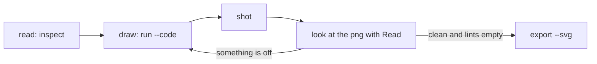

# How an agent uses it

This was the draft of the skill. The skill itself now exists, in the tool repo
at `tldrawkc/.claude/skills/tldrawkc-diagram/SKILL.md` (tldrawkc PR #4),
symlinked into `self-learn/.claude/skills/tldrawkc-diagram` the same way
`manimkc-video` is. It was also the brief for the `diagram-maker` subagent in
the `learning` plugin, which used to write SVG by hand and read it back and
now runs this loop (quiver-hub PR #2). Read the skill for the current wording;
what follows is the reasoning behind it, kept because the skill is deliberately
shorter.

## How the commands are actually invoked

Every example below is written as a bare `tldrawkc`, which is the tool
installed on `PATH` or run as `node dist/cli/index.js` inside its own repo.
**From a host repo it is `npm run --silent canvas -- <verb>`**, and `--silent`
is not optional: without it npm prints a two-line banner on stdout before the
tool writes anything, and `--json` output cannot be parsed.

Four details the examples get wrong or leave out:

| Written here | What the CLI does |
| --- | --- |
| `--code <snippet>` | takes a path, or `-` to read stdin. Inline source is a separate flag, `--eval <source>`, and the two are mutually exclusive |
| `tldrawkc shot x.tldr` | writes the PNG to a temp file unless `-o, --output <out.png>` says where |
| `tldrawkc api` | takes no file and no helper name; it prints every helper from its JSDoc and nothing else. It does not list the lint rules, so the rule names come from [HELPERS.md](HELPERS.md) or a failing `inspect` |
| `tldrawkc serve` | is phase 4 and not built. The command exists and says so |

## The loop



1. **Read before writing.** `tldrawkc inspect <file> --json` if the file
   exists. Know what is there and what the ids are. Never clear a canvas you
   did not create.
2. **Draw with the helpers.** Write a snippet to a temp file and run
   `tldrawkc run <file> --code <snippet> --shot <png> --create`. Use
   `helpers.box` and `helpers.connect`; never build raw arrow shapes for a
   real connection. Use stable, readable ids.
3. **Look.** Open the PNG with the Read tool. Judge it as a stranger would:
   clipped or overlapping text, arrows that cross boxes, labels sitting on
   lines, a reading order that is not obvious.
4. **Fix with a second snippet**, not by starting over. Nudge positions,
   change anchors or `mid` on the arrows that route badly, widen boxes whose
   labels wrap. Re-shot.
5. **Stop when the lints are empty and the picture reads.** Three passes
   without improvement means return what you have and say plainly what is
   still wrong. Then `tldrawkc export <file> --svg <out.svg>`.

Never report a diagram finished without having looked at the last
screenshot. Exit code 3 exists so this cannot be skipped by accident.

## Where files go in self-learn

| File | Path | Committed |
| --- | --- | --- |
| Canvas source | `learn/assets/<concept-id>.tldr` | yes |
| Final export | `learn/assets/<concept-id>.svg` | yes, and embedded in the session log as `![[<concept-id>.svg]]` exactly as today |
| Iteration screenshots | `/tmp` or the scratchpad, never `learn/` | no |
| Snippets | scratchpad | no, unless the snippet is worth keeping as a fixture |

The `.tldr` next to the `.svg` is what makes the diagram editable later: the
next session's agent can `inspect` it and extend it rather than redraw, and
once `serve` lands in phase 4 a human can open it and drag things.

## Starting from mermaid

Every diagram in this repo today is mermaid. To lift one:

```
tldrawkc from-mermaid learn/assets/x.tldr --source x.mmd --shot /tmp/x.png
```

then look, then fix. `learn/map.md` is a generated mermaid file and should
stay mermaid: it is a derived cache the pipeline rebuilds, not a teaching
diagram.

## What makes a teaching diagram work

Carried over from the current `diagram-maker` brief, because none of it
changes with the tool:

- One idea per diagram. If it needs a legend, it is doing too much.
- Show the mechanism, not a summary of it. A box labelled "attention"
  teaches nothing; three vectors and the products between them does.
- Label directly on the elements.
- Before and after, or step by step, beats a static tangle for any process.
- The words on a card are the card's label, not a separate text shape.
- Minimum readable size: keep boxes at 160 by 60 or larger at the default
  font, and check the PNG at 2x before trusting it.

## Snippet conventions

- Ids are lower-case slugs that name the concept: `helpers.box('query',
  ...)`, not `helpers.box('b1', ...)`.
- Place with `after` and `below` where the layout is a grid; use absolute
  `x`, `y` only for the first shape in a cluster.
- Choose `kind: 'elbow'` for anything architectural or ERD-like, `arc` for
  intuition diagrams where a curve reads better.
- Return `helpers.describe().lints` at the end so the run's JSON says what
  still needs work.
- Keep one snippet per pass. A pass that does twenty things and fails half
  way is rolled back as a whole.

## For a human watching

Phase 4, not built yet. The plan: `tldrawkc serve learn/assets/x.tldr` opens
the canvas in a normal browser tab and reloads when the agent writes the file,
keeping the human's camera. Cmd+S in that tab saves hand edits back to the
same file, and the agent's next `inspect` sees them. Until then the `.tldr` is
still the editable record, just without a viewer: it opens in the tldraw
offline desktop app.
