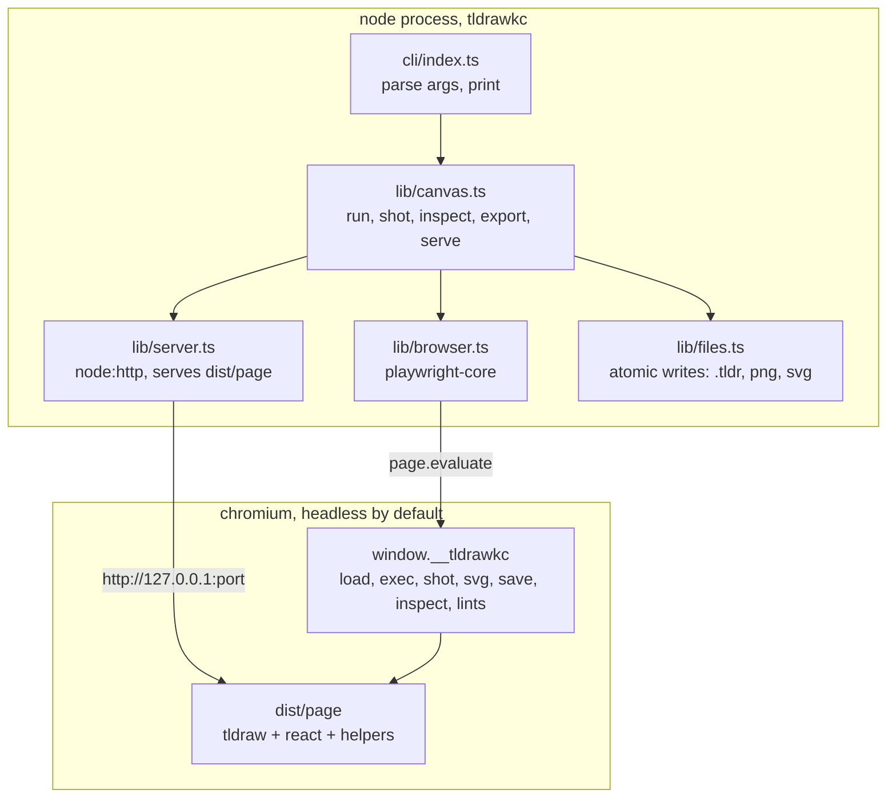
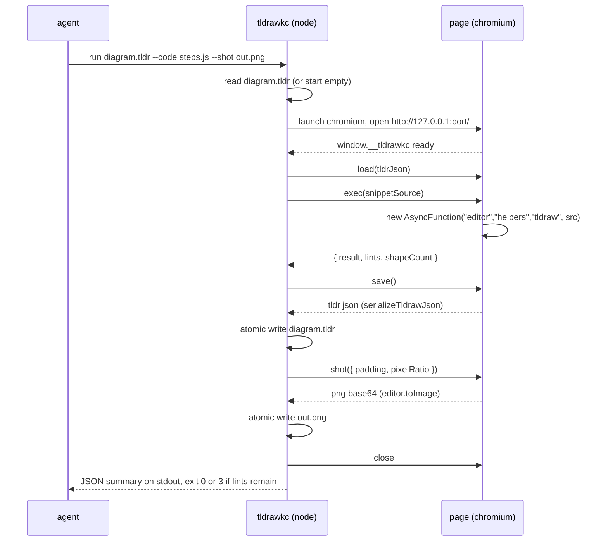

# Architecture

`tldrawkc` (working name, see [README.md](README.md)) is a command line tool
that lets a coding agent draw a diagram on a real tldraw canvas, take a
picture of it, look, and fix it. It is one Node program and one browser page.
The page owns every drawing decision; the Node side only launches the page,
moves files, and prints.

## The shape



| Layer | Where | What |
| --- | --- | --- |
| Entry points | `src/cli/` | Argument parsing and printing. The only module that prints. |
| Orchestration | `src/lib/` | Launches Chromium, serves the page, calls the bridge, writes files. Takes data, returns data. |
| Drawing | `src/page/` | A Vite app: `<Tldraw>`, the `helpers` bag, the mermaid importer, the lint pass, and the `window.__tldrawkc` bridge. Built into `dist/page/`. |
| Optional entry | `src/mcp/` | Deferred. A thin wrapper over `src/lib/` exposing the same verbs as MCP tools. See [DECISIONS.md](DECISIONS.md). |

**The version, as built (phase 0):** tldraw is on **5.4.2**, not the 4.x
these docs were written against. Every API the design depends on is present in
v5: `markHistoryStoppingPoint`, `bailToMark`, `toImage`, `getSvgString`,
`serializeTldrawJson`, `parseTldrawJsonFile`, `loadSnapshot`, `onMount`,
`hideUi` and `zoomToBounds`. Nothing in this document had to change for it.
Do not trust a 4.x changelog entry without checking the installed `.d.mts`.

Nothing in `src/lib/` or `src/cli/` imports `tldraw`, `react` or anything
from `src/page/`. Those packages exist only inside the page bundle, which is
why the tool can be dropped into any repo without adding React to its
dependency tree.

## The layout

```
tldrawkc/
  package.json            name, "type": "module", bin, exports, engines node >=22
  bin/tldrawkc            shell shim: node "$(dirname "$0")/../dist/cli/index.js" "$@"
  src/
    cli/index.ts          parseArgs dispatch, --json, exit codes
    lib/
      index.ts            public API re-exports (openCanvas, runSnippet, ...)
      canvas.ts           one function per verb: run, shot, inspect, export, fromMermaid, serve
      browser.ts          launch or connect Chromium, open the page, wait for the bridge
      server.ts           static server for dist/page plus /api/* for serve mode
      files.ts            atomic write (temp + rename), base64 to png, svg text
      paths.ts            every path the tool computes; nothing else builds paths
      doctor.ts           environment checks
    page/
      index.html
      main.tsx            mounts <Tldraw>, installs window.__tldrawkc
      bridge.ts           the functions Node calls
      helpers/
        index.ts          assembles the helpers bag passed to exec snippets
        shapes.ts         box, text, note, remove, clear
        connect.ts        connect (bound arrows), anchors, elbow routing, attribute, stub
        layout.ts         row, column, grid, boxShapes, translate, fitCamera
        mermaid.ts        parseMermaid(source) -> Plan (pure), applyPlan(plan) -> shapes
        lints.ts          friendless arrows, overlapping text, off-page shapes
        read.ts           plainText, describe (the inspect summary)
      mirror.tsx          serve mode: poll for changes, reload document, save on Cmd+S
  vite.config.ts          builds src/page (root: 'src/page', base: './'). At the repo root, not inside src/page, because that is where Vite looks by default
  tsconfig.json           the node build: src/cli and src/lib to dist/
  tsconfig.test.json      the same, plus test/ and the root config files, no emit
  tsconfig.page.json      src/page: JSX, the DOM lib, bundler resolution, no emit
  dist/                   built output: cli/, lib/, page/  (gitignored, built by npm run build)
  test/
    unit/                 vitest, node environment: paths, args, files, mermaid parser
    e2e/                  vitest + playwright: draw, shot, inspect, export, from-mermaid
    fixtures/             .tldr files and .mmd sources with expected outputs
  AGENTS.md               operating manual for agents working in this repo
  CLAUDE.md               "@AGENTS.md" pointer
  README.md
```

## One command, end to end

`tldrawkc run diagram.tldr --code steps.js --shot out.png` does this:



Every command is stateless: it starts a browser, does its work, saves, and
exits. State lives in the `.tldr` file and nowhere else. The cost is roughly
one to two seconds of startup per command on a laptop, which is acceptable
for an iterate loop and removes daemons, ports and stale state files from the
design. A warm-browser optimisation is a roadmap item, not a v1 concern.

## The bridge

`src/page/bridge.ts` installs `window.__tldrawkc` once the editor has
mounted. Node calls it through `page.evaluate`. Every function takes and
returns JSON-safe values so the same surface can back a future MCP entry.

| Function | Input | Output | Notes |
| --- | --- | --- | --- |
| `ping()` | none | `{ ok: true, version }` | Answers once the editor has mounted. `doctor` and `browser.ts` wait on it. |
| `load(tldrJson)` | `.tldr` file contents as a string, or `null` for a fresh document | `{ pages, shapeCount }` | `parseTldrawJsonFile({ json, schema: editor.store.schema })` returns a detached store with migrations applied; the bridge then calls `loadSnapshot(editor.store, { document: parsed.value.getStoreSnapshot() })`. That second step is what puts the records into the mounted editor. |
| `setPage(name)` | page name or `null` for the first page | `{ page }` | Every verb that takes `--page` calls this first. Unknown name is an error. |
| `exec(source)` | JavaScript source | `{ result, lints, shapeCount }` | Wrapped in `new AsyncFunction('editor', 'helpers', 'tldraw', source)`. Before running: `const mark = editor.markHistoryStoppingPoint('exec')`. A thrown error calls `editor.bailToMark(mark)` and rejects. (`editor.mark` was removed in tldraw v4 and is still absent in v5.) |
| `save()` | none | string | `await serializeTldrawJson(editor)`; it returns a promise. Assets inlined as data URLs. |
| `shot(opts)` | `{ ids?, padding?, pixelRatio?, background? }` | `{ pngBase64, width, height, bounds }` | `editor.toImage(ids, { format: 'png', padding, pixelRatio, background })` resolves `{ blob, width, height }`; the bridge reads the blob into base64. `background` is a boolean (paint the page background or leave it transparent), default `true`. Defaults: all shapes on the current page, padding 32, pixelRatio 2. |
| `svg(opts)` | `{ ids?, padding?, background? }` | `{ svg, width, height }` | `editor.getSvgString`. tldraw inlines the fonts it can load, which is why the bundle's fonts must resolve from a relative URL with no network. |
| `inspect()` | none | see below | The "read the canvas" step. This table is the single definition; [CLI.md](CLI.md) prints it unchanged. |
| `lints()` | none | `Lint[]` | Same pass `exec` runs; exposed so `inspect` can report without mutating. `helpers.getLints()` returns the same bare array. |
| `zoomToFit()` | none | bounds | Used by serve mode on first load only. |

`inspect()` returns:

```json
{
  "pages": ["Page 1"],
  "page": "Page 1",
  "bounds": { "x": 100, "y": 80, "w": 900, "h": 420 },
  "shapes": [
    { "id": "shape:q", "type": "geo", "geo": "rectangle", "x": 100, "y": 80, "w": 160, "h": 64, "text": "query", "parentId": "page:page" }
  ],
  "bindings": [
    { "arrow": "shape:a1", "from": "shape:q", "to": "shape:k", "fromAnchor": { "x": 1, "y": 0.5 }, "toAnchor": { "x": 0, "y": 0.5 } }
  ],
  "lints": [
    { "rule": "friendless-arrow", "shapeIds": ["shape:a2"], "message": "arrow shape:a2 has no binding at its end" }
  ]
}
```

`geo` is present only for geo shapes; `text` is the label's plain text or
`null`; `bounds` is the union of all shapes on the page.

The snippet is trusted local code. It runs with the same power as the
tldraw offline app's `/exec`: full `editor`, the `helpers` bag from
[HELPERS.md](HELPERS.md), and the `tldraw` module for `createShapeId`,
`toRichText` and friends.

## Fonts and offline rendering

tldraw's hand-drawn look depends on its fonts, and **they do not ship in the
`tldraw` package**. This paragraph originally said "its bundled fonts"; phase
0 found there are no `.woff2` files anywhere under `node_modules/tldraw` or
`node_modules/@tldraw/editor`. tldraw's `FontManager` asks for a font by key
(`tldraw_draw`, `tldraw_mono_italic_bold` and so on) and, when nothing
supplies a URL for that key, falls back to requesting the bare key as a
relative URL. That 404s and the export silently degrades to a system font.

The fonts live in `@tldraw/assets`, a separate package. Its `imports.vite`
entry point exports `getAssetUrlsByImport()`, which imports every woff2 with
`?url`, so Vite emits them into `dist/page/assets/` and hands back the built
URLs; the page passes them to `<Tldraw assetUrls={...}>`. With `base: './'` in
the Vite config those URLs are relative, so `toImage` and `getSvgString` never
wait on a network fetch. Sixteen `.woff2` files in `dist/page/assets/` after a
build is the check that it worked.

`doctor` verifies the page loads with no failed requests. `getSvgString`
inlines the fonts it managed to load into the SVG on its own (there is no
option to ask for it), which keeps [learn/assets](INTEGRATION.md)
self-contained the way the current hand-written SVGs are. If a font failed to
load, the export silently falls back to a system font, so the failed-requests
check in `doctor` is the guard, and phase 1 owes a rendered check on top of
it: screenshot a one-box fixture and confirm the label is Shantell Sans, not a
fallback.

## Files this tool writes

| File | Written by | Format |
| --- | --- | --- |
| `<name>.tldr` | `run`, `new`, `from-mermaid`, `serve` (on save) | tldraw's JSON envelope `{ tldrawFileFormatVersion, schema, records }`. Source of truth for a diagram. |
| `<name>.png` | `run --shot`, `shot` | PNG framed to shape bounds. For the agent to look at, not for committing. |
| `<name>.svg` | `export --svg` | Self-contained SVG with fonts inlined. What gets embedded in notes. |
| stdout | every command | Human summary, or `--json` for one JSON object. |

All writes go through `files.ts`, which writes to a sibling temp file and
renames, so an interrupted run cannot truncate a `.tldr`.

## Serve mode

`tldrawkc serve diagram.tldr` starts the same static server plus three
routes and opens a normal, headed browser tab at it. The page mounts in
mirror mode ([mirror.tsx](#the-layout)).

| Route | Method | What |
| --- | --- | --- |
| `/api/document` | GET | The file contents plus its `mtimeMs`. The page polls every second and calls `loadSnapshot(store, { document })` when the mtime changes, which keeps the human's camera where it is. |
| `/api/document` | PUT | The page posts a fresh `serializeTldrawJson` on Cmd+S. The server writes atomically. |
| `/api/health` | GET | `{ ok: true, file }` |

Both the agent and the human write the same file, last write wins, and the
page shows a banner when it reloaded over unsaved local edits. That is the
whole collaboration story; there is no sync server and none is planned. See
[DECISIONS.md](DECISIONS.md).

## The numbers

| Constant | Value | Where |
| --- | --- | --- |
| `DEFAULT_PADDING` | 32 px | `page/bridge.ts` |
| `DEFAULT_PIXEL_RATIO` | 2 | `page/bridge.ts` |
| `MAX_SHOT_EDGE` | 4096 px, pixelRatio is reduced to stay under it | `page/bridge.ts` |
| `BRIDGE_TIMEOUT_MS` | 15000 | `lib/browser.ts` |
| `EXEC_TIMEOUT_MS` | 30000 | `lib/browser.ts` |
| `MIRROR_POLL_MS` | 1000 | `page/mirror.tsx` |
| `DEFAULT_SERVE_PORT` | 7240, falls back to a random free port when taken | `lib/server.ts` |
| `EXIT_LINTS` | 3 | `cli/index.ts` |

## Testing

| Suite | Runs where | Covers |
| --- | --- | --- |
| `test/unit/**` | CI, every push | Argument parsing, path resolution, atomic writes, `parseMermaid` (a pure function from source to a `Plan`, see [HELPERS.md](HELPERS.md)), lint rules on fixture stores. |
| `test/e2e/**` | CI with `npx playwright install chromium --with-deps`, and locally | `run` draws three boxes and two bound arrows from a snippet, `shot` writes a PNG larger than 10 kB, `inspect` reports 5 shapes and 4 bindings and no lints, `export --svg` contains all three labels, `from-mermaid` produces bound arrows for every edge. |
| `doctor` | On demand | Node version, Chromium present, `dist/page` built, page loads with zero failed requests. |

## Layering rules

1. **`src/lib/` and `src/cli/` never import `tldraw`, `react` or `src/page/`.** Those live only in the page bundle. A grep for `from "tldraw"` outside `src/page/` is a failing test.
2. **`src/page/` never touches the filesystem or the network.** It receives strings and returns strings through the bridge. The only exception is mirror mode's two fetches to `/api/document`.
3. **`src/cli/index.ts` is the only module that prints.** Everything under `src/lib/` returns data.
4. **Nothing outside `src/lib/paths.ts` builds a path.** Output locations, temp files and the state of `dist/` all resolve there.
5. **Every file write is atomic** and goes through `src/lib/files.ts`.
6. **Every meaningful connection is a bound arrow.** `helpers.connect` is the only way snippets should draw one; the lint pass flags raw arrows with a free end.
7. **A command never leaves a browser running.** `run`, `shot`, `inspect`, `export`, `from-mermaid`, `new` and `doctor` close Chromium in a `finally`. `serve` is the one long-lived command and exits on SIGINT.
8. **No network access at runtime.** The page bundle is self-contained, fonts included. `doctor` fails on any request that leaves 127.0.0.1.
