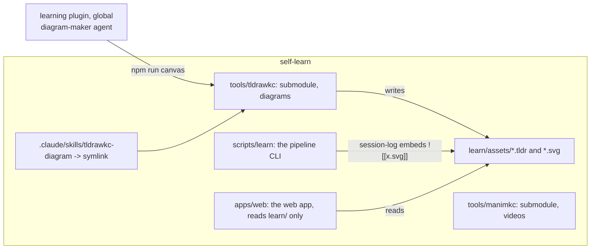

# Integration with self-learn

How the tool fits this repository specifically. The general design is in
[ARCHITECTURE.md](ARCHITECTURE.md); this file is about seams.

## Where it lives

`tools/tldrawkc/` is a submodule beside `tools/manimkc/`, with the same rules
from the root AGENTS.md: commit and push inside it first, then bump the pointer
here, never to an unpushed commit. Its `node_modules` and `dist` are local
artefacts; a fresh clone runs `git submodule update --init tools/tldrawkc`,
then `npm ci && npm run build` inside it, then `npm run canvas -- doctor`.

## The one seam: `learn/assets/`

The `diagram-maker` subagent used to write `learn/assets/<concept-id>.svg`
by hand, and the session log embeds it as `![[<concept-id>.svg]]`. The tool
keeps that contract exactly and adds one file:

| Path | Before | After |
| --- | --- | --- |
| `learn/assets/<id>.svg` | hand-written SVG, viewed via Read, fixed by editing markup | exported by `tldrawkc export --svg`, fonts inlined, self-contained |
| `learn/assets/<id>.tldr` | did not exist | the editable source, committed beside the SVG |
| session log embed | `![[<id>.svg]]` | unchanged |
| `/learn` page | does not render assets | unchanged |

Two root layering rules carry a documented carve-out for `learn/assets/`,
written in phase 3 rather than routing SVG bytes through `scripts/learn`:
rule 3, "the CLI is the only writer of `learn/`", and rule 5, "nothing
outside `lib/paths.mjs` builds a path under `learn/`". Both are about
`learn/state/` and `learn/concepts/`; `learn/assets/` has always been
written by the diagram agent directly at a path the agent chose, and the
tool keeps that behaviour.

`learn/map.md` stays mermaid. It is a derived cache that `learn map`
rebuilds from `events.jsonl`, not a teaching diagram, and the web app reads
its string from `index.json` without rendering it.

The `.tldr`'s own metadata is the other half of this seam: `--topic` on
`new` and `meta set` takes a slug from `content/topics.yaml`, so a diagram
under `learn/assets/` names the same topic the rest of the pipeline already
uses, and `tldrawkc list learn/assets` is a directory-wide check for which
diagrams still have none.

## Changes to make in self-learn (phase 3)

The first four rows landed early, in phase 0, because the submodule had to
work before anything could be built against it. They are listed as done rather
than deleted so the table still reads as the whole list of seams.

| File | Change | Status |
| --- | --- | --- |
| `package.json` | `"canvas": "node tools/tldrawkc/dist/cli/index.js"` (`tldrawkc/dist/...` until the submodules moved under `tools/`) | done, phase 0 |
| `.gitmodules` | the new submodule | done, phase 0 |
| `eslint.config.mjs` | add the submodule to the ignore block that already lists manimkc and `coverage/`, or lint will walk its `node_modules` | done, phase 0 |
| `tsconfig.json` | add `tldrawkc` to `exclude`. Not in the original list, and needed: unlike manimkc the submodule is TypeScript, so `"**/*.ts"` in `include` typechecks it against Next's compiler options and `npm run typecheck` fails | done, phase 0; later undone, because the root tsconfig stopped being the app's and no longer walks the tree |
| `.claude/skills/tldrawkc-diagram` | symlink to `../../tools/tldrawkc/.claude/skills/tldrawkc-diagram` | done, phase 3 |
| `AGENTS.md` | a "Diagrams: tldrawkc/" section mirroring the manimkc one: read its AGENTS.md first, drive it through the CLI, outputs go to `learn/assets/`, commit inside the submodule first. Also amend the sentence in the manimkc section that says the `manimkc-video` symlink and `launch.json` are "the only things `.claude/` holds here", since a second symlink now exists. | done, phase 3, plus a gotcha for `npm run canvas` needing `--silent` before `--json`. Phase 0 had added only a row for `tldraw-integration/` in the documents table and the two-excludes gotcha |
| `ARCHITECTURE.md` | add the submodule to "The shape", `assets/<id>.tldr` to the on-disk layout, and the `learn/assets/` carve-out to layering rules 3 and 5 | done, phase 3 |
| `CONTRIBUTING.md` | a submodule row in the project layout table, and guideline 5 widened to both submodules | done, phase 3. Not in the original list; phase 0's row above covered only the build note |
| `README.md`, `CONTRIBUTING.md` | say that `npm run canvas` needs `npm ci && npm run build` inside the submodule, because the compiled CLI is not committed | done, phase 0 |
| `.github/workflows/ci.yml` | nothing. CI already skips submodules and the tool has its own CI. | n/a |
| `vitest.config.ts` | nothing. The tool's tests run in its repo. | n/a |

## Changes outside self-learn

| Where | Change |
| --- | --- |
| `~/.quiver/plugins/learning/learning/agents/diagram-maker.md` | Replace the "write SVG, read it back" loop with the [AGENT-WORKFLOW.md](AGENT-WORKFLOW.md) loop. Keep the "what makes a teaching diagram work" section. `Bash` is already in its tool list, so it needs no new tools. Done: quiver-hub PR #2. |
| `~/.quiver/plugins/learning/learning/skills/learn/SKILL.md` | Where it says "spawn diagram-maker; it writes an SVG into learn/assets", add "and a .tldr beside it". Done: same PR. |

The plugin is global and shared across projects, so the agent should check
`npm run canvas -- doctor` and fall back to the hand-written SVG path when
the tool is not installed in the current repo. That keeps `/learn` working
in a project that has not adopted the submodule.

**Every content edit to the plugin needs a version bump.** Claude Code reads
the plugin from a cache under `~/.claude`, not from the marketplace checkout,
and `claude plugin update` refreshes that cache by comparing the version in
`.claude-plugin/plugin.json` against the installed one. An edit that leaves
the version alone is an edit nobody's session ever sees. PR #2 bumped
`learning` from 0.2.0 to 0.2.2 for exactly this reason, and every follow-up
has to keep bumping.

## manimkc

No coupling in v1. They are siblings: both are submodules, both are driven
by a CLI from a skill, both have a "render a preview, look at it, iterate"
loop, and both write into paths the agent chooses. The parallels worth
copying from manimkc into the tool repo:

| manimkc | tldrawkc |
| --- | --- |
| `manimkc doctor` | `tldrawkc doctor` |
| `manimkc api` prints every `lib/` helper with a usage line | `tldrawkc api` prints every helper from JSDoc |
| `manimkc preview` renders 480p contact sheets the agent must look at | `tldrawkc run --shot` writes a PNG the agent must look at |
| `manimkc lint` domain checks | the lint pass and exit code 3 |
| `AGENTS.md` as the single source of truth, `CLAUDE.md` is `@AGENTS.md` | same |
| "Verdict (recorded so it isn't relitigated)" callouts in `server/DESIGN.md` | [DECISIONS.md](DECISIONS.md) |

If a diagram should appear inside a manimkc video, the path is `export
--svg` then manim's SVG import, which is a manimkc concern and out of scope
here.

## The frontend question, answered

Keep `src/` as the encyclopedia. Reasons, from reading it:

- It deploys to Vercel as a server-rendered Next app. A tool that needs a
  local Chromium and local file writes cannot run there, and shipping
  tldraw in that bundle would add a large dependency to a site that today
  has one static SVG component.
- Nothing in `src/` talks to manimkc either. manimkc's server is a JSON job
  API with no UI, and finished videos go to Seafile, not to a URL the app
  could embed. A video panel is new work on both sides.
- The tool's own `serve` command (phase 4, specified but not built) is the
  answer to "let me watch and nudge" without a second app. Until it lands,
  the `.tldr` opens in the tldraw offline desktop app.

If a combined local studio becomes worth it after real use, build it as
its own small app (phase 6), local only, reading `learn/assets/` and
talking to `localhost:8090`. That is a different project with a different
deployment story and should not be designed on the back of this one.
